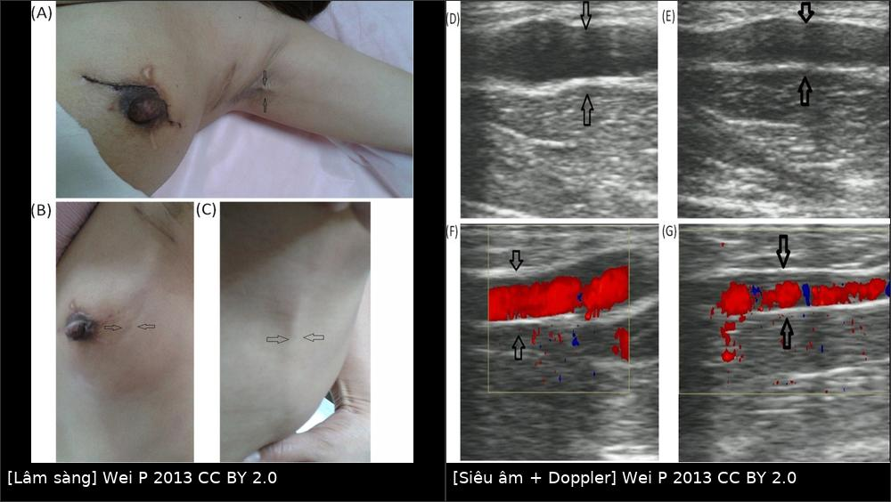
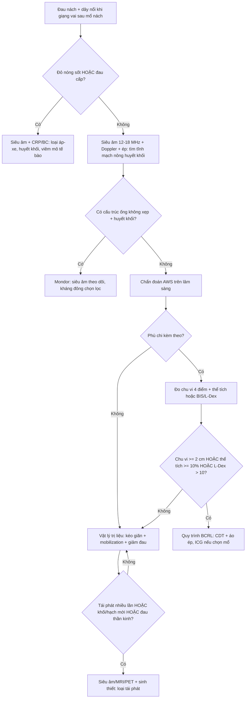
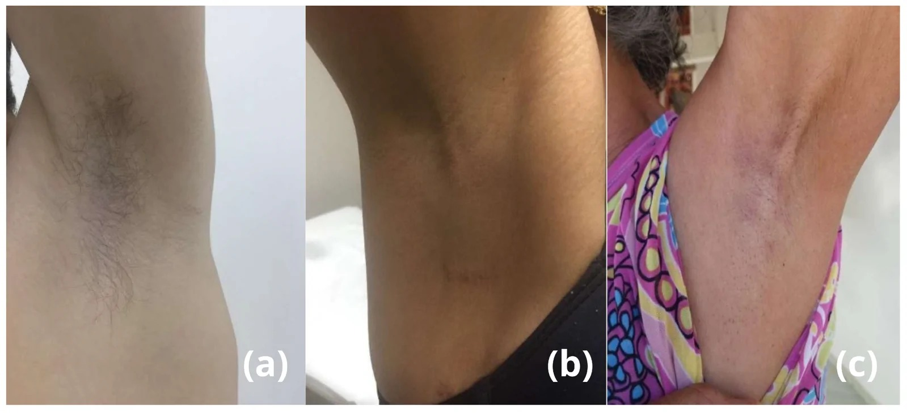
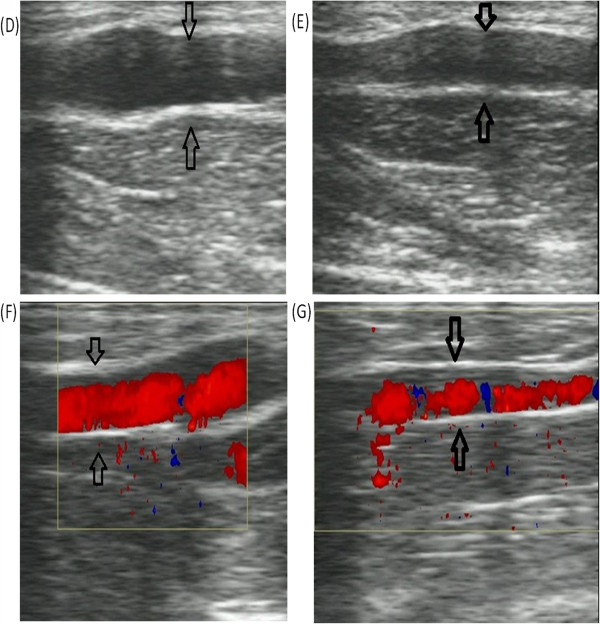

# 599 — Hội chứng dây nách (axillary web syndrome) & phù bạch mạch sau mổ nách: nhận diện dây, siêu âm loại trừ & xử trí / Axillary web syndrome

**Tags:** `pattern:day-xo` `pattern:phu-bach-mach` `pattern:day-da` `vung:chi-tren` `vung:vu` `score:ISL` `score:MDACC-ICG` `protocol:sieu-am` `protocol:MRI` `protocol:lymphoscintigraphy`
**Mức chắc chắn (certainty):** tổng hợp y văn (literature synthesis) — nhóm tự biên từ y văn mở (Europe PMC/PMC: *J Clin Med* 2026, *Breast Cancer (Dove)* 2019, *Ann Rehabil Med* 2021, *Lymphat Res Biol* 2022, *World J Surg Oncol* 2013). Có **một ca nguyên văn** (PMC3598739) dùng làm phản biện về cơ chế. Ảnh CC BY 2.0/4.0.

## 1. Tổng quan — dây nách hình thành thế nào và vì sao hình ảnh "mờ nhạt"

- **Định nghĩa:** hội chứng dây nách (axillary web syndrome — **AWS**, còn gọi *cording*, *lymphatic cording*) là tình trạng **dây/dải xơ dưới da (subcutaneous cord)** nổi từ **nách** chạy dọc **mặt trong cánh tay** (có khi tới khuỷu, thành ngực, bụng trên), xuất hiện sau **mổ nách ± xạ vùng hạch**, gây **đau khi giạng vai** và **hạn chế tầm vận động (ROM)**.
- **Tần suất — ngưỡng định lượng bắt buộc:**
  - Báo cáo rộng **6–86%** sau mổ ung thư vú; khác biệt do thiết kế nghiên cứu, thời điểm khám và **thiếu tiêu chuẩn chẩn đoán thống nhất** (PMC6304256; PMC13566857).
  - Theo loại mổ: **cắt hạch nách (ALND) 36–72%** vs **sinh thiết hạch gác (SLNB) 11–58%** (PMC6304256).
  - Nghiên cứu Hàn Quốc **189 bệnh nhân**: **30,6%**; **hóa trị OR 2,84** (95% CI 1,46–5,53), **tăng huyết áp OR 2,72** (1,18–6,30) (PMC8572992).
  - Theo dõi chủ động: **90,9% tích lũy trong 180 ngày**, trong đó **66,1% dây được phát hiện ngay ngày hậu phẫu thứ 7** — nghĩa là **khám sớm mới thấy**, chờ bệnh nhân tự than mới khám là bỏ sót (PMC13566857).
  - Nhóm **cắt tuyến đối bên dự phòng** có tần suất cao nhất tới **86%** (PMC6304256).
- **Thời điểm:** thường **2–8 tuần** sau mổ; vẫn có thể xuất hiện/tái phát **nhiều tháng đến nhiều năm** sau mổ (PMC6304256). AWS cũng gặp **không do ung thư**: vận động tay lặp lại (thể thao, nghề nghiệp) (PMC13566857).
- **TẠI SAO hình ảnh trông như vậy (vật lý + mô bệnh):**
  - Dây = **xơ hóa mô liên kết dưới da** + **rối loạn bạch mạch nông** ± **huyết khối tĩnh mạch nông**. Trên siêu âm, **collagen/xơ** cho **hồi âm cao, mất mặt phẳng mô mỡ**; **dịch bạch mạch ứ** cho vùng **giảm hồi âm** quanh dây → dây hiện như **cấu trúc ống giảm hồi âm** (PMC3598739 mô tả "echo of a tube structure").
  - **Doppler màu:** nếu dây là **tĩnh mạch nông huyết khối** → **không có dòng**; nếu là **tĩnh mạch giãn còn thông** → có dòng (ca PMC3598739 thấy **dòng trong lòng ống**, tác giả kết luận dây là **mạch máu**). Vì vậy **màu trong dây không đồng nghĩa AWS**.
  - **MRI:** xơ/collagen **T1 trung gian, T2 thấp**; phù/dịch quanh dây **T2 cao**. MRI độ phân giải cao (**≥ 3 T, FOV nhỏ, bề dày ≤ 2 mm**) đủ thấy **tĩnh mạch nông huyết khối** — đây là mục tiêu **loại trừ**, không phải "chẩn đoán AWS".
- **Điểm cốt lõi (phản biện nguồn):** tổng quan 2019 kết luận **AWS không có cấu trúc giải phẫu nhất quán trên siêu âm** → siêu âm **không xác nhận** AWS, chỉ **loại trừ huyết khối tĩnh mạch nông/Mondor** (PMC6304256). Tổng quan 2026 đồng tình: siêu âm là công cụ **bổ trợ loại trừ** (PMC13566857). Ca 2013 lại chứng minh dây có **dòng máu** — nhắc rằng **cơ chế là lympho–mạch (lymphovascular), không thuần bạch mạch**.

## 2. Mẫu hình (pattern) + chẩn đoán phân biệt theo bối cảnh (Gamut)

- **Khuôn 1 — Dây đơn độc/đa dây, đau khi giạng vai, sau mổ nách 2–8 tuần.** Gamut: **AWS** vs **huyết khối tĩnh mạch nông (Mondor)** vs **xơ hóa sau mổ**. Chốt: **dây nổi khi giạng vai, không đỏ nóng, không sốt, xuất hiện đúng cửa sổ 2–8 tuần** → AWS.
- **Khuôn 2 — Dây + đỏ, nóng, đau lan, sốt.** Gamut: **viêm mô tế bào/erysipelas** vs **viêm mạch bạch huyết (lymphangitis)** vs AWS bội nhiễm. Chốt: **sốt + đỏ lan nhanh + CRP/bạch cầu tăng** → nhiễm trùng; siêu âm tìm ổ áp-xe.
- **Khuôn 3 — Dây ở thành ngực/vú, đau, không tiền sử mổ nách.** Gamut: **bệnh Mondor (viêm tắc tĩnh mạch nông thành ngực)** vs AWS không do ung thư vs viêm mô tế bào. Chốt: **siêu âm: cấu trúc ống không xẹp, huyết khối trong lòng, không dòng** → Mondor.
- **Khuôn 4 — Dây + phù chi.** Gamut: **AWS + phù bạch mạch liên quan ung thư vú (BCRL)** vs huyết khối tĩnh mạch sâu vs phù hệ thống. Chốt: **phù một chi cùng bên, chu vi ≥ 2 cm/thể tích ≥ 10%, L-Dex > 10** → BCRL (bài [593](../593-phu-bach-mach-chi-tren-sau-dieu-tri-ung-thu-vu/lesson.md)).
- **Khuôn 5 — Dây + khối/hạch mới ở nách, đau kiểu thần kinh.** Gamut: **tái phát hạch/xâm lấn đám rối** vs AWS vs xơ xạ. Chốt: **hạch mất rốn mỡ, vỏ dày, ngấm/DWI sáng, PET dương** → tái phát; **không khối** → nghiêng AWS.
- **Khuôn 6 — Dây + hạn chế vận động kéo dài, không đau nhiều.** Gamut: **viêm dính bao khớp (adhesive capsulitis)** vs xơ hóa sau xạ vs AWS mạn. Chốt: **mất vận động cả chủ động và thụ động, ổ chảo–cánh tay** → adhesive capsulitis; AWS **chủ động hạn chế do đau, thụ động gần bình thường**.
- **Gợi nhớ "CORD":** **C**ellulitis/lymphangitis, **O**cclusion (superficial vein thrombosis — Mondor), **R**ecurrence (hạch tái phát), **D**isorder of lymphatics (AWS/BCRL).

## 3. Bảng so sánh phân biệt (ma trận đối chiếu)

| Thực thể (entity) | Hình ảnh điển hình | Chốt vào (rule-in) | Chốt loại (rule-out) | Gợi ý xác nhận |
|---|---|---|---|---|
| **AWS** | Siêu âm: dây **giảm hồi âm dạng ống** dưới da, **không có cấu trúc mạch nhất quán**; Doppler thường **không dòng**; MRI: dải **T2 cao** mỏng, không khối | **Dây nổi khi giạng vai + đúng cửa sổ 2–8 tuần sau mổ nách + không đỏ nóng/sốt** | **Có huyết khối trong tĩnh mạch nông** → không phải AWS đơn thuần; **có khối hạch** → nghĩ tái phát | Lâm sàng là chính; siêu âm **loại trừ** |
| **Mondor (viêm tắc tĩnh mạch nông)** | Siêu âm: **tĩnh mạch không xẹp khi ép**, **huyết khối hồi âm trong lòng**, **không dòng**; thành ngực/vú | **Cấu trúc ống không xẹp + huyết khối trong lòng + không dòng Doppler** | **Cấu trúc xẹp khi ép, không thấy lòng mạch** → không Mondor | Siêu âm tuyến vú/thành ngực, Doppler |
| **BCRL (phù bạch mạch)** | Da dày, mô dưới da dày **tăng hồi âm**, **cobblestone**; MRI **honeycomb**, dày da; LS: **dermal backflow** | **Phù một chi cùng bên + chu vi ≥ 2 cm hoặc thể tích ≥ 10% + L-Dex > 10** | **Không phù, chỉ dây** → chưa BCRL | Đo chu vi 4 điểm/thể tích; BIS; ICG/lymphoscintigraphy |
| **Viêm mô tế bào / lymphangitis** | Dày da **khu trú**, tăng tưới máu, có thể ổ áp-xe; **không theo trục bạch mạch** | **Sốt + đỏ nóng lan nhanh + đáp ứng kháng sinh** | **Không sốt, mạn tính, đối xứng theo trục dây** → không nhiễm trùng | CRP/BC; siêu âm loại áp-xe/huyết khối |
| **Tái phát hạch nách** | Hạch **mất rốn mỡ, vỏ dày**, xâm lấn; MRI ngấm, DWI sáng; PET dương | **Khối/hạch mới + PET dương + đau thần kinh** | **Không khối, mô mềm đồng nhất** → nghiêng AWS | Siêu âm + FNA/core; MRI/PET-CT |
| **Xơ hóa sau xạ** | Da dày đều **trong trường chiếu**, mô xơ **không ngấm**, không khối; teo cơ | **Thay đổi đối xứng theo trường xạ + không khối** | **Khối/ngấm/DWI sáng** → không phải xơ đơn thuần | MRI; so phim cũ |
| **Adhesive capsulitis** | Không tổn thương mô mềm đặc hiệu; MRI có thể dày bao khớp, co rút bao | **Hạn chế cả vận động thụ động, ổ chảo–cánh tay** | **Thụ động gần bình thường, dây nổi rõ** → AWS | Khám lâm sàng; MRI khớp vai nếu cần |

*Trái: dây căng từ nách xuống mặt trong cánh tay, bệnh nhân không giạng vai hết (mũi tên); (B, C) dây lan tới góc trên ngoài vú và thành ngực–bụng. Phải: siêu âm B-mode (D, E) thấy cấu trúc **dạng ống giảm hồi âm**; Doppler màu (F, G) có **dòng trong lòng ống** — trong ca này tác giả kết luận dây là **mạch máu**, không phải tổ chức xơ thuần. Ảnh ghép letterbox, CC BY 2.0 (Wei P et al., World J Surg Oncol 2013, PMC3598739).*

### Đọc siêu âm đúng cách — "loại trừ, không xác nhận"
- **Kỹ thuật:** đầu dò linear **12–18 MHz** (tổng quan 2019 khuyến cáo **≥ 15 MHz**, tổng quan 2026 dùng **12 MHz**), bệnh nhân **giạng vai 90°** để dây căng; quét **từ nách dọc mặt trong cánh tay tới khuỷu**, so sánh **hai bên**.
- **Mô tả:** số dây, chiều dài, **đường kính dây (mm)**, hồi âm, **có/không cấu trúc ống có lòng**, **xẹp khi ép**, **có/không dòng Doppler**. Hiện **chưa có ngưỡng đường kính được chuẩn hóa** cho AWS → ghi số đo để theo dõi, **không dùng để chốt**.
- **Kết luận đúng:** thấy **tĩnh mạch nông không xẹp + huyết khối + không dòng** → **Mondor**, không gọi AWS; **không thấy bất thường mạch** + lâm sàng điển hình → **AWS** (siêu âm âm tính **ủng hộ**, không loại trừ).

## 4. Protocol chụp – theo dõi – xử trí + lưu đồ

- **Khám lâm sàng (chuẩn vàng):** quan sát + sờ **khi vai giạng**; đo **ROM** (giạng, gập, xoay trong); ghi **số dây, vị trí, mức đau VAS**; khám **hai bên** và **thành ngực**.
- **Siêu âm (khi cần loại trừ):** linear **12–18 MHz**, quét theo trục dây, **Doppler màu + ép**; mục tiêu là **tìm huyết khối tĩnh mạch nông/khối hạch**, không phải "chụp dây".
- **MRI (chọn lọc):** **3 T, FOV nhỏ, T1 + T2 fat-sat ± DWI**, khi siêu âm không kết luận hoặc nghi tái phát/xơ xạ; tìm **dải T2 cao**, **huyết khối trong tĩnh mạch**, **khối ngấm**.
- **Lymphoscintigraphy ⁹⁹ᵐTc-nanocolloid (nghiên cứu/chọn mổ):** 46 bệnh nhân AWS — **67,3% có tuần hoàn bàng hệ và/hoặc dermal backflow**, **15,2% chỉ suy chức năng**, **8,6% tắc bạch mạch không bàng hệ**, **8,6% bình thường**; trong 5 người chỉ suy chức năng lần 1, **4 người tiến triển** sang bàng hệ/dermal backflow ở lần 2 → AWS **có thể tiến triển** (PMC9422805).
- **Phân độ:** **không có thang riêng cho AWS**. Dùng **ISL** cho phù kèm theo (**0** dưới lâm sàng, **I** giảm khi nâng tay, **II** không giảm, **IIb** không lõm, **III** voi phù) và **MDACC ICG 0–V** khi đánh giá chức năng bạch mạch; ghi rõ **đang dùng thang nào**.
- **Xử trí (chủ yếu bảo tồn):**
  - **Vật lý trị liệu**: kéo giãn nhẹ, **mobilization vai tiến triển**, manual therapy, giáo dục; đa số **giảm trong vài tuần** (ca PMC3598739 hồi phục **3 tuần**; loạt 2026 hồi phục **2 tuần**).
  - **Giảm đau**: NSAIDs/paracetamol; **không bắt buộc kháng đông** trừ khi siêu âm chứng minh huyết khối tĩnh mạch nông.
  - **Tiếp tục vận động** — nghỉ tuyệt đối làm cứng vai; tránh kéo giãn quá mạnh gây đau.
  - **Theo dõi phù**: đo chu vi/thể tích mỗi **3–6 tháng** trong 2–3 năm đầu; **L-Dex > 10** hoặc **chu vi ≥ 2 cm** → vào quy trình BCRL (bài 593).
- **Khi nào nghi tái phát thay vì AWS:** dây **mới kèm khối/hạch**, **đau thần kinh**, **phù tăng nhanh**, **nốt da** → siêu âm + MRI/PET-CT + sinh thiết; **AWS đơn thuần không liên quan tái phát ung thư** (PMC6304256).

## 5. Biến thể bình thường và cạm bẫy

- **Cạm bẫy "siêu âm phải thấy dây mới là AWS":** AWS **không có cấu trúc nhất quán** trên siêu âm; siêu âm **âm tính là bình thường** trong AWS (PMC6304256; PMC13566857).
- **Cạm bẫy "có màu trong dây = AWS":** màu trong lòng ống chứng minh **có mạch**, tức là **tĩnh mạch nông** — hướng tới **Mondor/huyết khối**, không phải bằng chứng AWS (ca PMC3598739).
- **Cạm bẫy "dây = tái phát ung thư":** AWS **không liên quan tái phát**; nhưng **khối/hạch mới** thì phải loại tái phát — đừng gộp hai bệnh cảnh.
- **Cạm bẫy "đau vai sau mổ = dính bao khớp":** AWS hạn chế **chủ động do đau**, thụ động gần bình thường; adhesive capsulitis hạn chế **cả thụ động**.
- **Cạm bẫy bỏ sót phù:** AWS và BCRL **thường đi cùng**; không đo chu vi/BIS là bỏ giai đoạn 0–I của BCRL.
- **Cạm bẫy "AWS chỉ sau ung thư":** gặp ở **nam giới, vận động tay lặp lại, nghề nghiệp** — không có tiền sử ung thư vẫn phải nghĩ AWS (PMC13566857).
- **Cạm bẫy "nghỉ ngơi cho hết đau":** bất động làm **co rút vai**; điều trị đúng là **vận động có kiểm soát**.
- **Cạm bẫy tái phát:** AWS **tái phát** nhiều tháng–năm sau mổ; tái phát **không đồng nghĩa thất bại điều trị** hay bệnh nặng lên.

## 6. Tự lượng giá — Blind Quiz

**Ca 1 — Nữ 54 tuổi, 5 tuần sau cắt tuyến + ALND trái, đau nách khi giạng tay. Nhìn ảnh, mô tả trước khi mở đáp án.**

- Gợi ý lâm sàng: đau tăng khi giạng vai, không sốt, không đỏ.
- Câu hỏi: Dấu hiệu chính? Hai chẩn đoán phân biệt cần loại trừ? Siêu âm dùng để làm gì trong bệnh cảnh này?

<b>Bấm để hiện đáp án (findings + chẩn đoán)</b>

- **Findings:** dây căng dưới da từ nách xuống mặt trong cánh tay, **nổi rõ khi giạng vai**, giới hạn giạng; các dây lan tới góc trên ngoài vú và thành ngực–bụng. Siêu âm: cấu trúc **dạng ống giảm hồi âm**; Doppler màu **có dòng trong lòng ống**.
- **Chẩn đoán:** **hội chứng dây nách (AWS)** — điển hình về vị trí và thời điểm (2–8 tuần sau ALND). **Phân biệt:** Mondor (huyết khối tĩnh mạch nông) và viêm mô tế bào.
- **Vai trò siêu âm:** **loại trừ** huyết khối tĩnh mạch nông/khối hạch; **không xác nhận** AWS. Trong ca này dòng trong ống là **mạch máu**, cho thấy dây có thành phần **lympho–mạch**, không thuần xơ.
- **Xử trí:** kéo giãn + mobilization vai tiến triển + giảm đau; đo chu vi/thể tích theo dõi phù.
- Nguồn ảnh: Wei P et al., World J Surg Oncol 2013, Fig. 1–2, CC BY 2.0 (ảnh ghép letterbox).

**Ca 2 — Nam 34 tuổi, không tiền sử ung thư, đau nách sau chơi squash nhiều giờ. Ảnh lâm sàng 3 bệnh nhân (a–c).**

- Gợi ý: (a) nam, vận động mạnh; (b) sau mổ ung thư vú; (c) vận động nghề nghiệp lặp lại.
- Câu hỏi: Dây nách có chỉ gặp sau ung thư không? Cần hỏi gì để phân biệt nguyên nhân?

<b>Bấm để hiện đáp án (findings + chẩn đoán)</b>

- **Findings:** cả ba đều có **dây dưới da nách/mặt trong cánh tay**, đau và hạn chế giạng vai; không có khối, không sốt.
- **Chẩn đoán:** **AWS** ở cả ba bối cảnh — **(a) không do ung thư (vận động mạnh)**, **(b) sau mổ ung thư vú**, **(c) nghề nghiệp lặp lại**. Đây là điểm mới của tổng quan 2026: **AWS không chỉ của bệnh nhân ung thư**.
- **Cần hỏi:** tiền sử mổ nách/xạ, hoạt động lặp lại, khởi phát – thời gian, sốt/đỏ, khối mới; khám hai bên.
- Nguồn ảnh: Cardoso Oliveira N et al., J Clin Med 2026, Fig. 1, CC BY 4.0.

**Ca 3 — Nữ 61 tuổi, 3 năm sau mổ + xạ, phù tay phải tăng dần, nay thấy dây cứng ở nách. Chọn bước tiếp theo.**

- Câu hỏi: Kết luận nào **không** được phép rút ra từ ảnh? Cần đo gì để phân tầng?

<b>Bấm để hiện đáp án (findings + chẩn đoán)</b>

- **Findings:** cấu trúc **dạng ống** dưới da, thành rõ; Doppler màu **có dòng** trong lòng ống (D–G).
- **Điều KHÔNG được kết luận:** "có dòng nên chắc chắn là AWS" — ngược lại, **dòng chứng minh có mạch**, phải loại **Mondor/tĩnh mạch giãn**; AWS được chẩn đoán bằng **lâm sàng** sau khi loại trừ.
- **Phân tầng:** phù 3 năm + dây cứng → **đo chu vi 4 điểm/thể tích, BIS (L-Dex > 10)**, siêu âm mô mềm (dày da, cobblestone), cân nhắc **ICG/lymphoscintigraphy** nếu xét can thiệp; **khối/nốt mới** phải sinh thiết.
- Nguồn ảnh: Wei P et al., World J Surg Oncol 2013, Fig. 2, CC BY 2.0 (giữ nguyên bản).

## Bài liên quan chéo
- [593 – Phù bạch mạch chi trên sau điều trị ung thư vú (BCRL)](../593-phu-bach-mach-chi-tren-sau-dieu-tri-ung-thu-vu/lesson.md)
- [522 – Theo dõi sau điều trị ung thư vú](../522-theo-doi-sau-dieu-tri-ung-thu-vu/lesson.md)
- [589 – Sinh thiết hạch gác & cắt hạch nách có định hướng](../589-sinh-thiet-hach-gac-nach-targeted-axillary-dissection/lesson.md)
- [598 – Xạ trị vùng hạch sau ung thư vú](../598-xa-tri-vung-hach-sau-ung-thu-vu/lesson.md)
- [516 – Hình ảnh vú sau điều trị: tái tạo, hoại tử mỡ, sẹo vs tái phát](../516-hinh-anh-vu-sau-dieu-tri/lesson.md)
- [523 – Sarcoma mạch do xạ ở vú (RAAS)](../523-sarcoma-mach-do-xa-vu/lesson.md)

## Ảnh
- `images/composite_day-nach.jpg`, `images/599_day-nach_Clinical_PMC3598739.jpg`, `images/599_day-nach_US_PMC3598739.jpg`, `images/599_day-nach_Clinical_PMC13566857.jpg`. Nguồn + giấy phép từng ảnh trong `images/CREDITS.md`.

> Không dùng để chẩn đoán độc lập khi chưa có người hướng dẫn.
