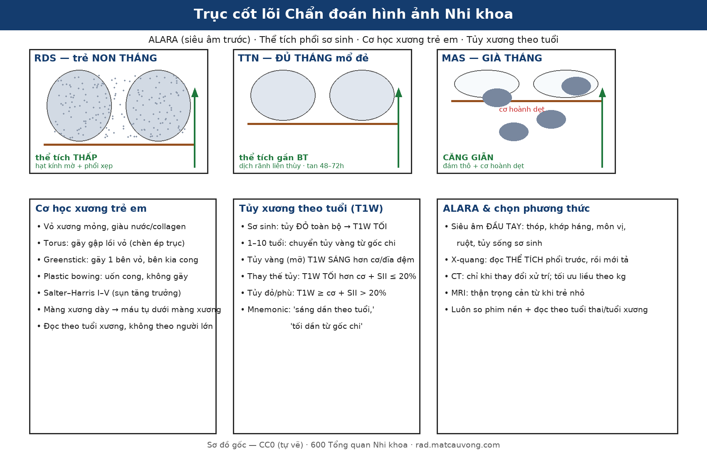

# 600 — Tổng quan Hệ Nhi khoa / Pediatric radiology overview

**Tags:** `tong-quan`
**Mức chắc chắn (certainty):** tổng hợp y văn (literature synthesis).

## Trục cốt lõi hình ảnh Nhi khoa

*Bốn trục đọc phim Nhi khoa: (1) **ALARA** — siêu âm đầu tay (thóp, khớp háng, môn vị, ruột, tủy sống sơ sinh), X-quang đọc **thể tích phổi trước**; (2) **thể tích phổi sơ sinh** — RDS thể tích thấp, TTN gần bình thường, MAS căng giãn; (3) **cơ học xương trẻ** — torus/greenstick/plastic bowing + Salter–Harris I–V; (4) **tủy xương theo tuổi** — tủy đỏ sơ sinh T1W tối → tủy vàng (mỡ) T1W sáng dần từ gốc chi. Sơ đồ gốc — CC0 (tự vẽ).*

## Bảng so sánh phân biệt bắt buộc (Hệ Nhi khoa)
| Mẫu hình (pattern) | Vị trí (location) | Gamut chính (DDx) | Phân biệt nhanh (Chốt định lượng / Tín hiệu) | Bài chi tiết |
|---|---|---|---|---|
| Suy hô hấp sơ sinh (Neonatal respiratory distress) | Phổi sơ sinh (neonatal lung) | Bệnh màng trong (RDS), Thở nhanh thoáng qua (TTN), Hít phân su (MAS), Thoát vị hoành bẩm sinh (CDH) | Sinh non + phổi xẹp thể tích thấp + hạt kính mờ = RDS; Đủ tháng mổ đẻ + phổi ứ khí + dịch rãnh liên thùy tan sau 48–72h = TTN; Quai ruột trên ngực trái đẩy trung thất = CDH (cấm bóp bóng qua mask!) | `610` |
| Tổn thương phổi bẩm sinh dạng nang / khối | Phổi trẻ em | Dị dạng đường thở phổi bẩm sinh (CPAM), Phổi biệt lập (sequestration), Khí phế thũng thùy bẩm sinh (CLE) | Nhiều nang chứa khí/dịch thông cây phế quản = CPAM; Khối đặc đáy phổi trái có nhánh ĐM nuôi tách trực tiếp từ ĐMC = Phổi biệt lập; Thùy trên trái căng khí đè xẹp phổi lành = CLE | `610`, `612` |
| Viêm phổi ở trẻ em (round pneumonia / virus vs vi khuẩn / hít dầu hỏa) | Phổi (lung) | Viêm phổi tròn (Round pneumonia — *S. pneumoniae*), Viêm phổi virus (RSV...), Viêm phổi hóa chất do hydrocarbon | **< 8 tuổi + sốt/ho + WBC–CRP tăng + đông đặc tròn KHÔNG mức khí–dịch = Round pneumonia** (kháng sinh + X-quang lại sau 3–4 tuần); Mờ hai bên + ứ khí ở nhũ nhi = virus; Mờ hai đáy sau hít dầu hỏa + **CẤM gây nôn** = hydrocarbon | `615` |
| Biến chứng viêm phổi nhi (empyema & hoại tử phổi) | Màng phổi – nhu mô phổi (pleura – lung) | Viêm mủ màng phổi/PPE có biến chứng (empyema), Hoại tử phổi (necrotizing pneumonia), Áp-xe phổi, Nang khí (pneumatocele), Nang sán | **Hai lá màng phổi dày ngấm thuốc tách nhau = split pleura (empyema; gặp 98,7% ca nhiễm trùng màng phổi)**; **ổ giảm mật độ không ngấm + mất mạch máu trong đông đặc = hoại tử phổi**; dẫn lưu khi **pH < 7,20 · glucose < 40 mg/dL · LDH > 1000 IU/L · cấy (+)**; hoại tử **> 50% thùy → cân nhắc cắt thùy** | `616` |
| Viêm tiểu phế quản ở nhũ nhi (RSV) | Tiểu phế quản – phổi (bronchioles) | Viêm tiểu phế quản cấp (RSV), Viêm phổi khu trú, Viêm tiểu phế quản tắc nghẽn (BO)/Swyer-James | **Nhũ nhi < 2 tuổi + wheeze/crackles + tăng ứ khí hai bên + xẹp vi mô KHÔNG đông đặc thùy = viêm tiểu phế quản** (chẩn đoán lâm sàng, X-quang không thường quy); tràn khí màng phổi **0,5–2%**; ho kéo dài + **air trapping thì THỞ RA** + giãn phế quản = BO | `613` |
| Viêm tiểu phế quản tắc nghẽn (BO) hậu nhiễm trùng & Swyer–James | Tiểu phế quản – phổi (bronchioles – lung) | PIBO/BO hai bên, Swyer–James–MacLeod (một bên), Asthma | **Mosaic giảm tỷ trọng + ứ khí thì THỞ RA hai bên = PIBO/BO** (tắc nghẽn cố định, đáp ứng giãn phế quản âm, triệu chứng > 6 tuần); **một bên sáng + mạch thưa + rốn phổi nhỏ = Swyer–James**; **ứ khí một bên ĐỘT NGỘT → dị vật (nội soi!)** | `614` |
| Hội chứng rò khí ở nhũ nhi (air-leak) | Phổi – màng phổi – trung thất (lung – pleura – mediastinum) | Tràn khí màng phổi (PTX), Tràn khí trung thất (PM/spinnaker-sail), Khí kẽ phổi (PIE), Tràn khí màng ngoài tim, Khí phúc mạc do barotrauma | **Có bờ phổi tạng tách thành ngực + mất trượt màng phổi (điểm phổi) = PTX**; **nâng tuyến ức + dấu cơ hoành liên tục + V Naclerio = PM**; **AP-ratio < 0,10 → 0% cần can thiệp; > 0,19 → 100% (ngưỡng 0,184, AUC 0,902, Se 86%/Sp 88%)**; **khí tự do dưới cơ hoành ở trẻ thở máy + bụng mềm = barotrauma, KHÔNG mổ bụng**; tràn khí áp lực → chọc giải áp liên sườn 2–3 cạnh xương ức | `617` |
| Khí trung thất & khí dưới da ở trẻ: lành tính vs HOẠI TỬ | Cổ sâu – trung thất – thành ngực | Rò khí từ phổi (Macklin), thủng thực quản (Boerhaave), viêm trung thất hoại tử lan xuống (DNM), nhiễm khuẩn sinh khí (viêm dạ dày sinh hơi, viêm mô tế bào sinh khí) | **Khí + không viêm quanh + tự tiêu = rò phổi lành tính (KHÔNG mổ)**; **khí + dịch trung thất sau nôn dữ dội = Boerhaave (mổ cấp cứu, trì hoãn > 24 giờ tử vong > 40%)**; **khí cổ sâu lan xuống T4 + sốt nhiễm độc = DNM (tử vong gộp 19,4%)**; **khí TRONG thành tạng + thành dày + dịch quanh = nhiễm khuẩn sinh khí**, không phải khí "đi lạc" | `649`, `617`, `618` |
| Rò khí DAI DẲNG & rò phế quản–màng phổi (BPF/PAL) | Phổi – màng phổi (lung – pleura) | Rò phế nang–màng phổi (APF/ngoại vi), BPF gốc phế quản sau cắt phổi, BPF do nấm/hoại tử, BPF bẩm sinh (rất hiếm), viêm màng phổi mủ do rò | **Rò > 5–7 ngày / > 15–20 mL/phút (BTS) = PAL**; **đường thông phế quản–màng phổi + rò ngay khi kẹp ống (DIPAL) = BPF**; **hang dai dẳng sát gốc phế quản + Aspergillus = BPF do nấm**; **occlusion test giảm > 50% + khe liên thùy > 90% = hợp van một chiều (EBV)**; **sau cắt thùy BPF 0,57%, tử vong 90 ngày 29,2% nhóm bảo tồn** | `618`, `617`, `616` |
| Khí kẽ phổi (PIE) & tràn khí ÁP LỰC ở nhũ nhi | Khoảng kẽ phổi – màng phổi – màng tim (neonatal) | PIE, tràn khí màng phổi áp lực, tràn khí màng ngoài tim, tràn khí trung thất | **Bóng khí kẽ CỐ ĐỊNH dọc mạch (không đổi tư thế) = PIE** (khác bờ phổi tạng của PTX); **điều trị PIE MỘT BÊN = nằm nghiêng bên tổn thương + giảm PIP/PEEP** (khỏi 96 giờ); **PIE khổng lồ/đẩy trung thất kháng trị → dẫn lưu qua da ± NKQ chọn lọc ± nội soi** (ca 327 g); **HFOV + "sigh breath" làm TĂNG tràn khí áp lực (OR 5,5; 15,6%)**; **vòng khí ôm tim = tràn khí màng ngoài tim → siêu âm tim + chọc giải áp** | `611`, `617` |
| Dịch & khí màng ngoài tim ở nhũ nhi (pericardial effusion / pneumopericardium) | Màng ngoài tim – tim (pericardium – heart) | Dịch màng ngoài tim do catheter/sau mổ/nhiễm trùng, Tràn khí màng ngoài tim áp lực, Tràn khí trung thất, Bóng tim to do bệnh cơ tim | **Khoang màng tim nhũ nhi < 5 mL; dịch/khí nhỏ nhưng tích tụ NHANH vẫn gây chèn ép**; **quầng khí ôm sát tim, KHÔNG vượt trên mạch máu lớn = tràn khí màng ngoài tim (halo 96%)**; **nâng tuyến ức + cơ hoành liên tục = trung thất**; **bóng tim “bình nước” + siêu âm thấy khoảng âm = dịch**; **chèn ép tim → chọc dưới mũi ức dưới siêu âm; khí 2,9–14 mL/kg, để catheter đến khi dịch < 30 mL/ngày** | `604`, `611`, `617` |
| **Khí trung thất & khí dưới da do NHIỄM KHUẨN** (khác rò khí lành) | Cổ sâu – trung thất – thành ngực (deep neck – mediastinum) | Rò khí lành tính (Macklin), DNM (viêm trung thất hoại tử lan xuống), Boerhaave (thủng thực quản), Nhiễm khuẩn sinh khí (viêm dạ dày sinh hơi), Khí do can thiệp | **Khí KHÔNG có ổ dịch + bệnh nhân tỉnh = rò khí lành (tự khỏi 2–7 ngày)**; **ổ dịch cổ sâu viền ngấm CÓ bóng khí + sốt/CRP > 100 = DNM** (tử vong **11–40%**, can thiệp lại **> 50%**); **khí trung thất sau + dịch màng phổi hai bên sau nôn = Boerhaave** (trì hoãn **> 24 h → tử vong > 40%**); **thành dạ dày dày + bọt khí + lactate cao = viêm dạ dày sinh hơi** (tử vong **26,9%**, thủng **OR 6,59**), còn **thành < 3 mm + không phù quanh = BGE lành**; **nhũ nhi có thể KHÔNG có dấu cổ điển** | `649`, `617`, `612` |
| Ống dẫn lưu màng phổi (chest tube) & biến chứng ở trẻ | Khoang màng phổi – thành ngực (pleural space – chest wall) | Ống gấp khúc/tắc, ống lạc (nhu mô/khe liên thùy/phế quản gốc), chèn ép tim, phù phổi tái nở (RPE), tổn thương động mạch liên sườn, khí dưới da | **Không cải thiện sau đặt ống → kiểm tra gấp khúc (hay gặp nhất) rồi CT tìm ống LẠC**; **đâm trong tam giác an toàn, TRÊN bờ sườn dưới** (Fr ÷ 3 = mm); **hút −10 đến −20 cmH₂O, KHÔNG hút ngay (RPE)**; **rút khi hết rò khí ≥ 24h + phổi nở + dịch < 6 mL/kg/8h** (rút sớm 3 vs 4,9 ngày); **kẹp thử không giảm tái phát (tràn khí áp lực 0,4%)** | `609`, `617`, `616`, `618` |
| **Catheter rốn ở sơ sinh (UVC/UAC): vị trí, lạc vị trí & biến chứng sớm** | Tĩnh mạch rốn – xoang cửa – IVC/nhĩ phải; động mạch chủ – chậu | UVC đúng tại cavoatrial junction · UVC quá cao (nhĩ phải/trái) · UVC lạc xoang cửa/gan · PVT · tràn dịch–chèn ép tim · UAC cao T6–T9 · UAC thấp L3–L5 · thiếu máu chi dưới · NEC | **UVC đúng = T8–T10 hoặc 0,5–1,0 cm trên cơ hoành (phim nghiêng)**; **di lệch 50–90% trong 72 giờ** → **đặt sai thì chỉnh, di lệch muộn thì RÚT**; **POCUS Se 93,3%/Sp 95,6% vs X-quang 66,7%/63,0%**; **PVT sau UVC 19%** và **vị trí đầu catheter KHÔNG dự báo PVT (p = 0,46)**; **UAC > 5 ngày → NEC-III AOR 3,8** | `3045`, `3044`, `622`, `6111` |
| **Rít hai thì ở nhũ nhi + khối dưới thanh môn ngấm mạnh** (subglottic hemangioma) | Dưới thanh môn – vòng sụn nhẫn | **U máu dưới thanh môn** · Mềm sụn thanh quản · Hẹp dưới thanh môn · Croup · Nang dưới thanh môn · U nhú · Vòng mạch | **< 6 tháng + rít HAI thì tiến triển + khối 118–300 HU dưới dây thanh + 24% có u máu da = SGH**; **rít thì HÍT VÀO, giảm khi nằm nghiêng = mềm sụn thanh quản**; **sốt + ho sủa + steeple sign = croup**; propranolol đủ cho **80%** u máu đường thở | `3005`, `694`, `612` |
| **Khối hông lưng / thận to ở sơ sinh** (neonatal flank mass) | Thận – tĩnh mạch thận – thượng thận (sơ sinh) | Huyết khối tĩnh mạch thận (RVT) · Xuất huyết thượng thận · Ứ nước thận · U nguyên bào thận/nephroblastomatosis · Viêm thận–bể thận mủ · Huyết khối động mạch thận | **Thận TO + mất dòng tĩnh mạch thận + RI tăng so bên đối diện = RVT** (thận trái **2,8 lần**; **2,2/100.000** trẻ sinh sống, **13/100.000** đẻ non); **khối TRÊN thận, thận bình thường = xuất huyết thượng thận**; **RI sinh lý ở sơ sinh đã cao → phải so bên–bên, không dùng ngưỡng 0,70 của người lớn**; teo thận **67–90,9%**, tăng huyết áp **38,8%** sau **11,1 năm** | `6111`, `6112`, `151`, `157`, `635` |
| **Huyết khối động mạch chủ sau catheter động mạch rốn (UAC)** | Động mạch chủ bụng – chậu – động mạch thận (sơ sinh) | Huyết khối ĐM chủ do UAC · Huyết khối ĐM chậu trong (catheter lạc) · Coarctation · Huyết khối ĐM thận · Huyết khối tự phát do mất nước tăng Na⁺ · Co thắt do lạnh | **Mất mạch bẹn + chi lạnh + vô niệu/THA ở trẻ có UAC = tắc ĐM chủ–chậu**: Doppler đầu tay, **CTA khi cần mức lan**; huyết khối ĐM ở trẻ UAC **8–20%** (gộp **8,2%**, KTC 1,91–18,20), catheter ĐM nói chung **21%**; vị trí UAC cao **44%** có huyết khối (phần lớn im lặng); **UL-UAC 0/235**; heparin dự phòng **0,25–1 U/mL** kéo dài thông nhưng **không giảm huyết khối**; **đe dọa chi/cơ quan → tiêu sợi huyết**, không → kháng đông | `6113`, `3045`, `6111`, `6112` |
| **Di chứng muộn huyết khối tĩnh mạch cửa sau catheter rốn (EHPVO/cavernoma)** | Tĩnh mạch cửa – rốn gan – lách – tĩnh mạch thực quản | Portal cavernoma · Xơ gan · Budd–Chiari · Teo đường mật sau Kasai · Tắc tĩnh mạch lách · Nang ống mật chủ · Giả phình ĐM gan | **PVT sau UVC 19% (200/1.052)**, **43% không triệu chứng, 56% tan**; **cavernoma = chùm mạch quanh rốn gan thay TM cửa chính**; **giãn TM thực quản 97% ở 5,5 tuổi, 58% chảy máu**; **lách to > 90%, chậm tăng trưởng 50%, báng 8,3%**, **portal biliopathy 45,2% (67% trên MRCP), 25% có triệu chứng**; **banding + propranolol**; **Meso-Rex khi TM cửa trái ≥ 2 mm**, thông shunt **83–86%**, **vận tốc ≥ 15 cm/s** | `6114`, `3045`, `6113`, `176`, `183` |
| **Tăng áp cửa phía trái do tắc tĩnh mạch lách** (sinistral/left-sided portal hypertension) | Tĩnh mạch lách – tĩnh mạch dạ dày ngắn – đáy vị – lách | Huyết khối/hẹp tĩnh mạch lách · Viêm tụy cấp–mạn · Nang giả tụy · U tụy (SPN/IPMN) · Lách lạc chỗ xoắn · EHPVO · Xơ gan · Giãn tĩnh mạch dạ dày nguyên phát | **TM cửa chính THÔNG + TM lách tắc + lách to + varices ĐÁY VỊ đơn độc = LSPH**, không phải xơ gan; varices dạ dày đơn độc **92,3%**, lách to **67,6%**, cường lách chỉ **1,4%** (tiểu cầu bình thường **không loại trừ**); chảy máu **11,6% thô, ~30% tích lũy sau 3 năm**; keo cyanoacrylate **93,9% vs 79,5%** thắt vòng; PSE đốt **40% (IQR 25–60)** lách; cắt lách khi tái chảy máu, tiêm phòng **mỗi 5 năm** | `6115`, `6114`, `135`, `136` |
| **Tăng huyết áp do mạch máu thận ở trẻ** (renovascular hypertension) | Động mạch thận – ĐMC bụng – nhu mô thận | Huyết khối ĐM thận sau UAC · FMD · Takayasu · NF1 · Hội chứng ĐMC giữa · Loạn sản thận một bên · U chèn ép | **Thận nhỏ chênh ≥ 1 cm + phổ parvus–tardus + renin cao = nghi hẹp ĐM thận**; RVH chiếm **5–25%** THA ở trẻ; Doppler Se **65–88%**/CTA **88%**/MRA **80%**; **28%** tổn thương chỉ thấy trên chụp mạch; nong bóng khỏi **39,3%** lần 1 → **57,1%** sau nhiều lần; stent hẹp lại **35,5% vs 17,4%**; teo thận **> 70%** sau huyết khối mạch thận sơ sinh; **ACEi chống chỉ định** khi hẹp hai bên/một thận | `6117`, `6113`, `6111`, `850` |
| **Hẹp eo động mạch chủ ở trẻ** (aortic coarctation) | Eo ĐMC ngay sau động mạch dưới đòn trái – ĐMC xuống – động mạch liên sườn | Hẹp eo thật · giả hẹp eo (kinking) · giảm sản quai · đứt đoạn ĐMC · "CoA giả" do huyết khối UAC · hội chứng ĐMC giữa/FMD–Takayasu · hẹp lại sau mổ | **Chênh huyết áp tay–chân > 20 mmHg + gradient ≥ 20 mmHg + hẹp khu trú có bàng hệ**; dấu "3" và **khuyết sườn 4–8**; 5–8% CHD, 4/10.000 trẻ sinh sống; nong bóng nhũ nhi (< 10 kg), stent trẻ lớn; THA tồn lưu 25–62%, hẹp lại 30–59% | `6116` |
| **U tụy ở trẻ** (pediatric pancreatic tumors) | Tụy – ống tụy chính – tĩnh mạch lách | U đặc–nhầy nhú (SPN) · u nguyên bào tụy (PB) · IPMN nhánh · nang giả tụy · NET · lymphoma · SPN vỡ | **Khối lớn đặc–nang có vỏ bao xơ + T1 sáng do máu + ngấm thuốc tiến triển = SPN**; SPN 0,1–0,2/1 triệu trẻ/năm, Ki-67 5% vs 30% (PB); cắt thân–đuôi **giữ lách**, theo dõi tĩnh mạch lách | `6120` |
| **Hội chứng động mạch chủ giữa** (mid-aortic syndrome, MAS) | ĐMC bụng đoạn trên thận/liên thận – động mạch thận – mạch treo tràng trên – thân tạng | MAS vô căn · Takayasu · FMD · hội chứng gen (Williams, Alagille, NF1, Turner, TSC) · chèn ép ngoài · hẹp eo ĐMC ngực · hẹp ĐM thận đơn thuần | **Trẻ tăng huyết áp kháng trị + hẹp ĐMC BỤNG trên CTA/MRA + 66% hẹp ĐM thận (60% hai bên)**; 0,5–2% hẹp ĐMC, 20–48% THA do mạch thận; Doppler **PSV ~400 cm/s, AT > 70 ms, parvus–tardus**; **28% tổn thương chỉ thấy trên DSA**; nong bóng can thiệp lại **67%/5 năm**, bắc cầu chủ–chủ **55–64%**, khỏi THA **36–70%**; **KHÔNG chênh huyết áp tay–chân không loại trừ** | `6118`, `6116`, `6117`, `850` |
| **Rò tụy sau mổ tụy ở trẻ** (postoperative pancreatic fistula, POPF) | Diện cắt thân tụy – miệng nối tụy–ruột – ống tụy chính – khoang quanh tụy | Rò sinh hóa (BL) · độ B · độ C · viêm tụy cấp sau mổ (PPAP) · rò mật · rò dưỡng trấp · giả phình/chảy máu muộn · nang giả tụy | **Amylase dịch dẫn lưu > 3× ULN từ POD 3 = POPF**; BL **không đổi xử trí**, độ B cần dẫn lưu/nội soi, độ C suy cơ quan/mổ lại; trẻ **POPF 11%, CR 3,4%**, bóc u đầu tụy nặng nhất; amylase ngày 1 **> 5.000 U/L (OR ~3)**, **< 600 U/L** loại trừ; **sentinel bleed → CTA + nút mạch** | `6121`, `6120`, `135`, `136` |
| Bệnh phổi mạn tính của trẻ sinh non (BPD) | Phổi trẻ sinh non (preterm lung) | BPD (NICHD 2018 I–IIIB / Jensen 2019 1–3) · PIE · CPAM · CLO · viêm tiểu phế quản · giãn phế quản · BPD-PH | **BPD = còn cần hỗ trợ hô hấp tại 36 tuần PMA ở trẻ < 32 tuần**; **grade 1 cannula ≤ 2 L/phút, grade 2 > 2 L/phút hoặc NIV, grade 3 thở máy** (3A < 32 tuần, 3B ≥ 32 tuần); **bubbly/cystic ngày 28 → oxy tại nhà (2% nếu không có)**; **PH 20–40% ở BPD nặng**; **TBM 10–48%**; SpO₂ mục tiêu **90–95%** | `606`, `610`, `611`, `605` |
| **Tăng áp phổi trong bệnh phổi mạn nhi** (BPD, PIBO, giãn phế quản) | Tuần hoàn phổi – tim phải | BPD-PH type 1 (trước mao mạch) · type 2 (shunt, tăng dòng) · type 3a (tim trái) · type 3b (hẹp tĩnh mạch phổi) · PH do tắc nghẽn đường thở nhỏ | **RVSP ≥ 50% áp lực hệ thống + vách dẹt tâm thu (EI ≥ 1,3) + PAAT:RVET < 0,30** = PH; **vách dẹt tâm trương + buồng trái giãn = shunt**; **tĩnh mạch phổi > 160 cm/s = hẹp tĩnh mạch phổi**; **giãn mạch phổi ở nhóm 3 có thể làm nặng V/Q** | `686`, `606`, `669`, `610` |
| **Xẹp đường thở trung tâm thì thở ra** (TBM) ở trẻ BPD | Khí quản – phế quản gốc | TBM do sụn · EDAC (màng sau) · thể liềm/chu vi/lưỡi kiếm · bronchomalacia · hẹp dưới thanh môn · vòng mạch chèn ép | **Xẹp > 50% diện tích lòng khi thở ra, hết khi hít vào** = TBM; **EDAC: sụn chữ C còn nguyên, màng sau lồi**; **nội soi dưới gây mê bỏ sót 35%**; **PEEP 13 vs 10,5 cmH₂O (mỗi +1 cmH₂O OR 1,36)**; aortopexy thành công 84% | `602`, `606`, `611`, `694` |
| **Theo dõi sau mổ thoát vị hoành bẩm sinh (CDH)** | Cơ hoành – phổi – tiêu hóa | Tái phát thật · thoát vị hoành–thực quản thứ phát · liệt/eventration · giảm sản phổi tồn dư · PH mạn · trào ngược/tắc ruột do dính | **Tái phát 9,5%, 43,2% không triệu chứng, 51,4% trong năm đầu**; **CDH trái RR 8,5, vá thành bụng RR 3,2**; **PH mạn 4,5–38%**; **trào ngược 18,0% triệu chứng nhưng 13,4% khách quan**; **tái nhập viện 72,5%/3 năm, tử vong muộn 1,4%** | `608`, `610`, `606`, `602` |
| **Hạ oxy kháng oxy ở sơ sinh** (PPHN) | Tuần hoàn phổi – tim phải (sơ sinh) | PPHN thể maladaptation · PPHN + bệnh nhu mô (MAS/RDS/viêm phổi/CDH) · tim bẩm sinh tím (TAPVC, TGA, teo phổi) · PPHN do tim trái (nhóm 2) · loạn sản phổi (TBX4/ACD) | **Chênh SpO₂ tay phải–chân > 5% + hạ oxy không đáp ứng FiO₂ cao = shunt phải–trái (PPHN)**; **D-shape thất trái = áp phổi 50–100% hệ thống, lưỡi liềm = > hệ thống**; **PASP = 4×TR Vmax² + RAP; TR chỉ có 60–85%**; **iNO 20 ppm, đáp ứng PaO₂ tăng ≥ 20 mmHg/30 phút; ECMO khi OI > 40 kéo dài > 4 giờ**; **hết bệnh > 10 ngày → nghĩ loạn sản phổi** | `607`, `605`, `686`, `610` |
| Siêu âm phổi có điểm (LUS) ở sơ sinh | Phổi (lung) | RDS, TTN, MAS, Viêm phổi, Phù phổi, Tràn khí màng phổi, BPD | **Mỗi vùng 0–3 điểm: A-lines = 0; B-lines < 50% = 1; B-lines ≥ 50% = 2; đông đặc = 3**; **6 vùng 0–18, > 8 → surfactant 200 mg/kg** (thở máy xâm lấn 19,6% vs 46,5%); **12 vùng 0–36, ngưỡng 10 dự báo cai máy (AUC 0,954, Se 93,3%/Sp 88,0%)**; **LUS cao KHÔNG đồng nghĩa RDS** (phù phổi LUS 9); quỹ đạo LUS-high → thất bại cai máy 61,5% | `605`, `610`, `611` |
| Nôn ở trẻ sơ sinh & nhũ nhi (Infantile vomiting) | Dạ dày – Tá tràng | Hẹp phì đại môn vị (HPS), Ruột quay dở dang có xoắn ruột (malrotation with volvulus), Teo tá tràng (duodenal atresia) | Nôn vọt không mật + cơ môn vị dày ≥ 3 mm và dài ≥ 15 mm = HPS; Nôn dịch mật xanh + SMV nằm bên trái SMA + dấu xoáy nước (whirlpool) = Xoắn ruột (mổ tối khẩn!); Bóng đôi (double-bubble) không có khí ruột xa = Teo tá tràng | `620` |
| Cấp cứu ống tiêu hóa trẻ nhỏ & Sơ sinh | Ruột non – Đại tràng | Lồng ruột (intussusception), Viêm ruột hoại tử sơ sinh (NEC) | Khối hình bia bắn (target/donut) đường kính ≥ 2,5 cm ở hạ sườn phải = Lồng ruột hồi-manh tràng; Sinh non + khí trong thành ruột (pneumatosis) + khí tĩnh mạch cửa = NEC | `620`, `622` |
| Vàng da ứ mật sơ sinh kéo dài > 2 tuần | Đường mật (biliary tree) | Teo đường mật bẩm sinh (biliary atresia) vs. Viêm gan sơ sinh (neonatal hepatitis) vs. Nang ống mật chủ | Dấu thừng tam giác (triangular cord sign) dày ≥ 4 mm trước chạc ba TM cửa + túi mật teo < 15–19 mm không co bóp sau bú = Teo đường mật (mổ Kasai trước 60 ngày tuổi!) | `625` |
| Nang ống mật chủ ở trẻ (Todani I–V) | Gan – đường mật (hepatobiliary) | Todani I/IVa (giãn ngoài gan ± trong gan), III (choledochocele), V (Caroli), Teo đường mật dạng nang, Nang gan/sán lá gan | **Nang rốn gan THÔNG cây mật + kênh chung > 15 mm (PBM) = nang ống mật chủ** (MRCP phân loại đúng 96,2%); **I** giãn ngoài gan, **IVa** giãn trong+ngoài gan (24,0%), **V** chỉ trong gan + dấu chấm trung tâm; **nang nhỏ không to + thừng ≥ 4 mm = teo đường mật dạng nang**; cắt nang + Roux-en-Y, theo dõi ung thư đường mật suốt đời | `666`, `625`, `626` |
| Khối u đặc ổ bụng trẻ em (Pediatric abdominal mass) | Khoang sau phúc mạc | U nguyên bào thần kinh (neuroblastoma) vs. U nguyên bào thận (Wilms tumor / nephroblastoma) | Vôi hóa lấm tấm (85%) + bao bọc mạch máu (vessel encasement) + vượt qua đường giữa = Neuroblastoma; Dấu móng vuốt thận (claw sign) + đẩy lệch mạch + huyết khối TM thận/IVC + không vượt đường giữa = Wilms | `630` |
| **Ung thư vỏ thượng thận (ACC) ở trẻ** | Thượng thận (adrenal, nhi) | ACC (Wieneke 1–3), U tuyến vỏ thượng thận, Tăng sản thượng thận bẩm sinh (CAH), Pheochromocytoma, Neuroblastoma | **Nam hóa/Cushing + khối thượng thận lớn không đồng nhất + DHEA-S/testosteron rất cao, ACTH thấp = ACC**; ACC **9,9 cm** vs adenoma **4,4 cm** (AUC 0,92), không đồng nhất **OR 45,5**, vôi hóa 6/13; **u 3,2 cm vẫn là ACC**; **Weiss gọi quá mức ở trẻ → dùng Wieneke**; giai đoạn COG I–IV, sống 5 năm **> 80% (I–II) vs < 20% (di căn)** | `193`, `155`, `169`, `198` |
| Khối thận đặc ở trẻ theo TUỔI (Pediatric solid renal mass) | Thận (kidney) | U cơ trung mô bẩm sinh (CMN), U nguyên bào thận (Wilms), Ung thư biểu mô tế bào thận (RCC — chuyển đoạn MiT), Ổ nguyên bào thận (nephrogenic rest) | **< 6 tháng + khối ĐỒNG NHẤT + dấu vòng đồng tâm, KHÔNG hoại tử/nang = CMN thể kinh điển** (không đồng nhất + nang/xuất huyết = thể tế bào, 311,6 vs 41,0 cm³); **1–10 tuổi + khối lớn không đồng nhất + ổ nguyên bào thận ± huyết khối IVC = Wilms** (vỡ u → OS 58,2% vs 81,4%); **≥ 9–10 tuổi + đặc-nang + vôi hóa = RCC (MiT: TFE3/PAX8)**; ổ nguyên bào thận đi kèm **28–40%** Wilms một bên / **90–100%** hai bên; **< 3 tháng → cắt thận trước, KHÔNG sinh thiết** | `639`, `630`, `635` |
| Khối mới sau cắt thận vì CMN (Post-nephrectomy mass) | Giường cắt thận – phổi – gan – tinh hoàn | Tái phát tại chỗ, Di căn phổi/gan/tinh hoàn, U nguyên bào thận đối bên, Ổ nguyên bào thận, Dịch tụ/seroma, Phì đại bù thận còn lại | **Tái phát CMN 5,3% (trung vị 3,6 tháng; 12/16 tại chỗ); giai đoạn III 16,4% vs I 2,2%; thể tế bào 91,5% EFS — thể kinh điển vẫn tái phát 3/16**; khối đặc ngấm thuốc mới = tái phát; dịch không ngấm giảm dần = seroma; thận to đồng nhất giữ hình = phì đại bù; **US bụng mỗi 3 tháng × 18–24 tháng**, CT ngực khi có triệu chứng | `647`, `639` |
| Hội chứng dễ mắc u nguyên bào thận & tầm soát (Wilms predisposition) | Thận hai bên (bilateral kidneys) | BWS (11p15.5), WAGR (11p13), Denys–Drash/Frasier (WT1), Phì đại nửa người, SGBS (GPC3), Nephroblastomatosis | **US bụng mỗi 3 tháng: BWS đến 7 tuổi + AFP đến 36 tháng; WAGR đến 7 tuổi (u đối bên muộn tới 7 năm, 45–60% WT); DDS đến 5–7 tuổi (29% WT, trung vị 1,2 tuổi) + HA/creatinine**; nephroblastomatosis = nhiều nốt nhỏ ngấm kém, **không khối thống trị**, tiến triển WT ~35%; **không sinh thiết, ưu tiên NSS** | `648`, `639`, `630` |
| Đáp ứng & theo dõi sau điều trị u nguyên bào thận (Wilms) | Thận – phổi (kidney – lung) | U sống sót (blastema), Hoại tử/xơ, Trưởng thành stromal, Tái phát tại chỗ, Nephroblastomatosis, FNH gan giả di căn, Di căn phổi | **Thể tích sau hóa trị > 500 cm³ = nguy cơ cao (nhóm trung gian không stromal/epithelial)**; **ellipsoid vs planimetry r 0,993, lệch +6,1%**; **bệnh phẩm thấp hơn 119,5 cm³, đổi phân tầng 47% → KHÔNG dùng thể tích bệnh phẩm**; **ADC < 1,195 × 10⁻³ mm²/s = blastema sống; stromal 1,516**; **95,7% tái phát < 24 tháng, 91,3% không triệu chứng; OS sau tái phát 54,7%** | `651`, `639`, `648` |
| Đau khớp háng & Đi khập khiễng theo lứa tuổi | Khớp háng trẻ em (pediatric hip) | Loạn sản khớp háng (DDH), Viêm khớp nhiễm khuẩn, Hoại tử chỏm (Legg-Calvé-Perthes), Trượt chỏm xương đùi (SCFE) | < 6 tháng: góc α Graf < 60° = DDH; 4–8 tuổi: chỏm nhỏ đặc xương/vỡ = Perthes; 10–15 tuổi béo phì: đường Klein không cắt qua cực ngoài chỏm = SCFE | `640` |
| Ứ nước thận & trào ngược ở trẻ (Hydronephrosis & reflux) | Đường tiết niệu nhi (kidney–ureter–bladder) | Hẹp khúc nối bể-niệu quản (UPJO), Trào ngược bàng quang–niệu quản (VUR), Van niệu đạo sau (PUV) | Giãn bể/đài + niệu quản **rỗng** = UPJO; niệu quản giãn + **VCUG có trào ngược** (độ I–V) = VUR; trẻ **nam** + bàng quang thành dày + **dấu lỗ khóa** (keyhole) = PUV (creatinine đáy > 0,8–1,0 mg/dL = nguy cơ CKD) | `635` |
| Cấp cứu niệu – sinh dục nhi (Pediatric GU emergencies) | Thận – tinh hoàn – buồng trứng (kidney–gonad) | Chấn thương thận (AAST I–V), Xoắn tinh hoàn, Xoắn buồng trứng/phần phụ | Thận **mất mạch ở MỌI thì** + rò thuốc thì muộn/máu vượt Gerota = AAST IV–V (khác đụng dập ngấm lại thì muộn); bìu cấp + **dấu xoáy thừng tinh** (Se 92%/Sp 99%) = xoắn tinh hoàn (cứu ~90% nếu < 12 giờ); buồng trứng **> 20 mL** + dấu xoáy/mất mạch = xoắn (còn mạch KHÔNG loại trừ — mạch kép) | `636` |
| Chấn thương bàng quang – niệu đạo nhi (Pediatric bladder & urethral trauma) | Bàng quang – niệu đạo (bladder – urethra) | Vỡ bàng quang ngoài phúc mạc, Vỡ trong phúc mạc, Đứt niệu đạo sau (do vỡ khung chậu), Đụng dập bàng quang | **Thuốc khu trú khoang tiền bàng quang = vỡ NGOÀI phúc mạc; bao quai ruột/rãnh cạnh đại tràng = TRONG phúc mạc**; **RUG: máu lỗ sáo + không thấy bàng quang + bàng quang trôi cao "pie-in-the-sky" = đứt niệu đạo hoàn toàn (> 2 cm = độ V)**; CT cystography bơm **≥ 300 mL** — thì bài tiết KHÔNG đủ; PFUI trẻ **0,47–4,2%** vỡ khung chậu | `637` |
| Chấn thương gan & đường mật ở trẻ (Pediatric hepatic & biliary trauma) | Gan – đường mật (liver – biliary tree) | Đường vỡ/máu tụ gan (AAST I–III), Mất tưới máu thùy/ thương tổn mạch (V), Biloma/ tổn thương túi mật–đường mật muộn | **Dải giảm đậm độ cắt qua mạch trên thì TM cửa = đường vỡ**; **một thùy không ngấm + cắt cụt mạch cửa = grade V**; **túi dịch 0–20 HU nối nhánh đường mật giãn trên MRCP = biloma (biến chứng MUỘN)**; **ở trẻ quyết định theo huyết động, KHÔNG theo độ CT** | `624` |
| Giả phình mạch & xuất huyết muộn sau chấn thương gan/lách ở trẻ (Delayed pseudoaneurysm & late hemorrhage) | Gan – lách (liver – spleen) | Giả phình mạch (pseudoaneurysm), Rò động–tĩnh mạch (AVF), Xuất huyết hoạt tính, Cục máu đông lính gác (sentinel clot) | **Ổ ngấm thuốc khu trú GIỮ HÌNH + thải thuốc ở thì muộn = giả phình ("đi theo bể máu")**; **TO RA/đậm lên ở thì muộn = chảy máu hoạt tính (> 90 HU)**; **TM ngấm đồng thời ĐM ở thì động mạch = rò ĐM–TM**; giả phình muộn xuất hiện **từ ngày 2 trở đi, trung vị ngày 8 (5–10)**; **thoát thuốc trên CT đầu → OR 3,94**; **không nút mạch dự phòng 32% VỠ vs 0% có nút mạch** | `627`, `624`, `140` |
| Khối bìu – tinh hoàn KHÔNG đau ở trẻ (Painless scrotal/testicular mass) | Bìu – tinh hoàn (scrotum – testis) | U tế bào mầm (seminoma/NSGCT/u túi noãn hoàng), Nang biểu bì, Giãn tĩnh mạch tinh, U lympho/bạch cầu | **Khối đặc trong tinh hoàn có mạch = u thật**; **vòng "onion-ring" vô mạch = nang biểu bì (lành)**; **dạng ống giãn ≥ 2,5 mm (≥ 3,0 mm khi Valsalva) bên TRÁI = varicocele**; u tế bào mầm nguyên phát **đơn độc một bên** (hai bên → nghĩ u lympho/leukemia) | `638` |
| Hạ tinh hoàn ẩn & tinh hoàn KHÔNG sờ thấy (Cryptorchidism & non-palpable testis) | Bìu – ống bẹn – ổ bụng | Tinh hoàn di động (retractile), UDT trong ống bẹn (palpable), UDT trong ổ bụng (non-palpable), Thiếu/teo (vanishing/TRS), Lạc chỗ (ectopic), Polyorchidism | **Siêu âm KHÔNG loại trừ** (Se ~45%/Sp ~78% cho tinh hoàn không sờ thấy) → **nội soi ổ bụng là tiêu chuẩn vàng**; **dây tinh hoàn cụt = thiếu/TRS**; tinh hoàn đối bên phì đại bù + **dương tính giả 27,9%**; **mổ hạ tinh hoàn trước 12 tháng, muộn nhất 18 tháng**; **tinh hoàn di động (2–50% tăng cao) KHÔNG mổ — theo dõi 6–12 tháng** | `634`, `636`, `638` |
| Đau bìu cấp KHÔNG do xoắn tinh hoàn (Acute scrotum beyond torsion) | Bìu – mào tinh – tinh hoàn (scrotum – epididymis – testis) | Xoắn mào tinh phụ (TATE), Viêm mào tinh/orchitis, Viêm tinh hoàn quai bị, Phù bìu vô căn, Xoắn ngoài bao sơ sinh, U xuất huyết | **Chấm hồi âm VÔ MẠCH ở cực trên = xoắn mào tinh phụ (appendix testis 91–95%; điều trị NSAID)**; **mào tinh to + TĂNG mạch = viêm mào tinh**; **tuổi trung vị TATE 10,5 vs xoắn tinh hoàn 14,0 tuổi**; **TWIST 7 điểm (≥5 mổ ngay)**; **dòng chảy bình thường KHÔNG loại trừ xoắn** | `631`, `636`, `638` |
| Khối u não trẻ em (Ưu thế Hố sau — 70%) | Hố sau (posterior fossa) | U nguyên bào tủy (medulloblastoma), U sao bào lông (pilocytic astrocytoma), U màng não thất (ependymoma), U cầu não lan tỏa (DIPG) | Đường giữa/nhộng tiểu não + DWI sáng rực (ADC < 0,7 × 10⁻³) = Medulloblastoma; Nang lớn có nốt đặc ngấm thuốc + ADC cao (> 1,4 × 10⁻³) = Sao bào lông; Chui qua lỗ Luschka/Magendie = Ependymoma | `650` |
| Bệnh não sơ sinh KHÔNG do ngạt (DDx HIE) | Não sơ sinh (neonatal brain) | Hạ đường huyết (vùng chẩm–đỉnh), Vàng nhân/kernicterus (thể vân), Chuyển hóa (MSUD), Nhiễm trùng TKTW (parechovirus), Đột quỵ nhũ nhi | **Vùng sau (chẩm–thái dương) + né PLIC + glucose thấp = hạ đường huyết**; **T1 thể vân sáng + DWI âm + TSB ≥ 20–25 mg/dL = vàng nhân** (khác HIE: DWI sáng nhân xám); **MRS 0,9 ppm = MSUD**; **nhiều ổ chất trắng dưới vỏ trán + bó thể chai = parechovirus**; **một bên theo lãnh thổ ĐM não giữa = đột quỵ nhũ nhi** | `654` |
| Đột quỵ & bệnh mạch máu não ở trẻ (Pediatric stroke & arteriopathy) | Mạch não – nhu mô não (cerebral vessels – brain) | Moyamoya (MMD/MMS), FCA thể viêm, viêm mạch, bóc tách, CVST, đột quỵ chu sinh | **Hẹp tận ICA hai bên + búi mạch "khói thuốc" = moyamoya** (trẻ **một bên cũng đủ**); **hẹp một bên + nhồi máu nhân xám sâu + hồi phục một pha = FCA** (FCASS nền **≥ 8** dự báo tiến triển, AUC 0,962); **ivy sign FLAIR = giảm CVR**, mất sau tái thông; **MRA bình thường tuần đầu không loại trừ**; **CVST: empty delta + nhồi máu không theo lãnh thổ** | `652` |
| Theo dõi SAU tái thông moyamoya ở trẻ (Post-revascularization follow-up) | Mạch não – nhu mô não (post-op) | Hội chứng tưới máu quá mức (CHS/TND), Thiếu máu "dịch chuyển phân thủy", Tắc/hẹp miệng nối, Bàng hệ kém (Matsushima C), Tiến triển bên đối diện | **Triệu chứng (mất ngôn ngữ/tê/yếu) ngày 0–7 + CBF vùng mổ tăng (≥ +30% so bên đối diện hoặc ≥ +50% so nền) + DWI ÂM = CHS/TND**; **DWI mới ở phân thủy ngày ~3 dù miệng nối THÔNG = dịch chuyển phân thủy**; **Matsushima A ≥ 2/3 · B 1/3–2/3 · C < 1/3 lãnh thổ MCA**; mổ bên đối diện thường cách **~3–6 tháng**; áp lực: TND **16,5–38,2%** | `660`, `652` |
| Chống kết tập tiểu cầu SAU tái thông mạch não ở trẻ (Post-bypass antiplatelet therapy) | Mạch não – miệng nối (graft) | Tắc miệng nối do huyết khối tiểu cầu, CHS/TND, Nhồi máu do huyết động, Tái phát do BỎ aspirin, Kháng aspirin, Xuất huyết muộn, Giả hẹp trên MRA TOF | **Aspirin 3–5 mg/kg/ngày, bắt đầu TRƯỚC mổ, duy trì không thời hạn** (không dùng 81 mg cho mọi trẻ); **kháng aspirin 2,7%** (ngưng tập > 5 ohm · PFA-200 CE < 180 giây · BT Ivy ≤ 7 phút); **0% xuất huyết** trong 14 trẻ nhưng **14% nhồi máu mới dù dùng thuốc**; **ngừng aspirin → tái phát**; ngừng tạm khi nhiễm virus cấp (Reye) | `681`, `660`, `652`, `1780` |
| Đột quỵ & bệnh mạch não do hồng cầu hình liềm ở trẻ (Sickle cell cerebral vasculopathy) | Mạch não – nhu mô não (trẻ SCD) | Nhồi máu có triệu chứng, Nhồi máu IM LẶNG (SCI), Xuất huyết nội sọ, Hội chứng moyamoya do SCD, Bệnh mạch cảnh trong NGOÀI sọ (eICA) | **TCD hằng năm 2–16 tuổi: TAMMV < 170 = bình thường; 170–200 = trung gian (lặp mỗi 3 tháng); ≥ 200 cm/s = bất thường → truyền máu định kỳ (giảm 92% đột quỵ đầu tiên)**; **SCI = FLAIR sáng + T1 tối, chất trắng sâu/cạnh vỏ, không triệu chứng (24–42%)**; **eICA TAMMV ≥ 160 cm/s = nguy cơ SCI**; đo lúc nền, KHÔNG đo ngay sau truyền máu | `661`, `652`, `660` |
| Bóc tách động mạch cổ & chấn thương mạch máu não do chấn thương kín (Pediatric BCVI / cervical artery dissection) | Động mạch cảnh – đốt sống (cổ & trong sọ) | Bóc tách do chấn thương (BCVI), Bóc tách tự phát (bệnh mô liên kết), Bóc tách sau động tác cổ, Giả phình dạng bóc tách, RCVS/FMD/VA thiểu sản (bắt chước) | **Sàng lọc: điểm McGovern ≥ 3 = nguy cơ BCVI 18% → CTA đầu–cổ** (Se tới 100%/Sp 83,8%, AUC 0,960 ở một đoàn hệ; Utah Se thấp 45,8–52,4%, Memphis Se 88–91,7%); **Denver (Biffl) I–V**: I < 25% hẹp, II ≥ 25%, III giả phình, IV tắc, V đứt rời thoát mạch; **độ thấp điều trị aspirin 3–5 mg/kg (tối đa 81 mg)**, độ cao cân nhắc kháng đông/nội mạch; **seatbelt sign đơn độc KHÔNG đủ**; **MRA bỏ sót huyết khối trong thành (Se 47–60%)** | `662`, `652`, `661` |
| Viêm tụy cấp do tăng triglyceride máu ở trẻ (Pediatric hypertriglyceridemia-induced acute pancreatitis) | Tụy – chuyển hóa lipid | HTG-AP (thiếu insulin/DKA), FCS đơn gen (LPL/GPIHBP1/APOC2/APOA5/LMF1), AAHTG (asparaginase), Thiếu citrin (SLC25A13), Nang giả vs WON | **SHTG = TG > 11,3 mmol/L; nguy cơ AP 5% khi > 11,2 và 10–20% khi > 22,4 mmol/L**; **ống máu đục như sữa + ban vàng = chỉ điểm tại giường** (83% không triệu chứng); **điều trị insulin TM đến TG < 5,6 mmol/L** (giảm 55/76/82% tại 24/48/96 giờ); **plasmapheresis chỉ khi thất bại nội khoa** (đạt đích 3,0 vs 12,5 ngày; 4/7 ca có huyết khối TM); **CT hoại tử cần 72–96 giờ** → MRCP khi tái phát | `628`, `626`, `623`, `624` |
| Tăng triglyceride KHÁNG TRỊ ở trẻ: leo thang thuốc & liệu pháp gen (Refractory pediatric hypertriglyceridemia) | Tụy – võng mạc – da (đa cơ quan) | FCS đơn gen, Chylomicronemia đa yếu tố (MCS), Thứ phát (DKA, asparaginase, suy giáp, thuốc), GSD1a, "Kháng trị giả" do kém tuân thủ | **Phân độ theo tuổi: 0–9 tuổi bình thường < 75, nặng 1.000–1.999, rất nặng ≥ 2.000 mg/dL** (10–19 tuổi: < 90); **lipemia retinalis khi TG > 1.500, trắng kem ≥ 5.000 mg/dL**; **insulin 0,05–0,1 U/kg/giờ → −55% sau 24 giờ**; plasmapheresis loại **40–70% TG**; **olezarsen 80 mg Q4W: −43,5% TG, −88% viêm tụy (người lớn)**; **Glybera đã rút 2017** | `683`, `628`, `626`, `629` |
| Bệnh não sau có hồi phục ở trẻ (Pediatric PRES & RCVS) | Nhu mô não & mạch máu não (trẻ em) | PRES trẻ em (điển hình & không điển hình), RCVS trẻ em, Nhồi máu não, ADEM, Hạ đường huyết/vàng nhân sơ sinh | **Co giật 77,9% + CHỈ 64,9% tăng huyết áp → nghĩ PRES dù HA bình thường** (ngưỡng tự điều hòa trẻ ~40 mmHg < người lớn 50–60); **62,5% hình ảnh KHÔNG điển hình (nhiều thùy/tiểu não/xuất huyết/hạn chế khuếch tán ổ, gliosis tồn lưu)**; **DWI âm + ADC TĂNG = phù mạch máu** (DWI sáng/ADC tối = nhồi máu); **đau đầu sét đánh tái diễn + co mạch "chuỗi hạt" hồi phục < 3 tháng = RCVS** (MRA có thể âm tuần đầu); bệnh nền huyết học/ung thư 32,5%, thận 22,1%; tái phát 15% khi đổi ức chế miễn dịch | `653`, `219`, `654`, `652`, `676` |
| Chấn thương tụy–tá tràng (bụng kín, cơ chế tay lái) | Tụy – tá tràng (pancreas–duodenum) | Đứt ống tụy (AAST III–IV), Đụng dập tụy (I–II), Khối máu tụ thành tá tràng, Thủng tá tràng | **Dịch khoang cạnh thận trước/túi mật–tụy + khe dịch ~10 mm đứt ngang > 50% trục ngắn = đứt ống tụy (MRCP + secretin)**; **dày thành D2–D3 KHÔNG khí ngoài lòng = khối máu tụ tá tràng** (bảo tồn); **khí ngoài lòng/bọt khí = thủng** (mổ) | `623` |
| Viêm tụy cấp ở trẻ (nguyên nhân, biến chứng tụ dịch) | Tụy (pancreas) | Viêm tụy phù kẽ (APFC), Viêm tụy hoại tử (ANC/WON), Nang giả tụy, Nguyên nhân giải phẫu (tụy divisum, nang ống mật chủ), Thuốc (asparaginase, valproate) | **Lipase/amylase > 3× ULN + 2/3 tiêu chuẩn INSPPIRE = viêm tụy cấp**; **ổ KHÔNG ngấm mọi thì > 30–50% nhu mô = hoại tử** (CT sau 72–96 giờ); **tụ dịch > 4 tuần: dịch đồng nhất = nang giả, có mảnh hoại tử = WON**; **> 6 cm dự báo tiến triển/cần can thiệp**; tái phát → **MRCP tìm tụy divisum/nang ống mật chủ** | `626` |
| Viêm tụy mạn ở trẻ & suy tụy ngoại tiết (Pediatric chronic pancreatitis & EPI) | Tụy (pancreas) | Viêm tụy mạn vôi hóa, Tụy phân đôi (divisum), Hợp lưu tụy–mật bất thường (APBDU), Viêm tụy tự miễn (AIP/IgG4), Nang giả vs u nang | **Vôi hóa nhu mô/ống (HU > 200) + ống chính giãn > 5 mm + teo = CP (Cambridge độ 4)**; **MRCP "chuỗi hồ" + hẹp xen kẽ**; **MRI MÙ với vôi hóa nhỏ → phải có CT/X-quang không cản quang**; **steatorrhea chỉ khi mất > 90% acini; fecal elastase-1 < 200 µg/g = EPI** (100–200 nhẹ–TB, < 100 nặng); **PERT 1.000 U lipase/kg/bữa + vitamin ADEK** | `629`, `626`, `135` |
| Theo dõi hậu phẫu Kasai ở teo đường mật (Post-Kasai follow-up in biliary atresia) | Gan – đường mật (liver – biliary tree) | Viêm đường mật, Tắc quai mật Roux (biliary limb), Xơ gan mật, Tăng áp lực cửa (varices/lách to), Nốt gan (tái sinh vs loạn sản/HCC), Biến chứng sau ghép | **Sốt + bilirubin tăng so nền + giãn ống "chuỗi hạt"/vi nang trong gan = viêm đường mật** (cholangitis 40–93%); **tăng áp lực cửa 46,4% tổng số & 49,8% người sống 20 năm; varices đỉnh năm 5, lách to đỉnh năm 10**; **nốt tái sinh T2 tối + KHÔNG ngấm + mạch cửa xuyên nốt; nốt loạn sản/HCC ngấm ĐM + thải thuốc (AFP có thể bình thường)**; **thất bại Kasai: bilirubin > 6 mg/dL sau 3 tháng → xét ghép (PELD)** | `641`, `625`, `121` |
| Khối gan ở trẻ em (Pediatric liver mass) | Gan (liver) | U nguyên bào gan (hepatoblastoma), U mạch máu (hemangioma/u nội mô mạch máu), U mô đệm lành (mesenchymal hamartoma), Ung thư gan (HCC), FNH/adenoma | **6 tháng–5 tuổi + AFP > 10.000 ng/mL + vôi hóa thô 40–50% + > 5 cm = hepatoblastoma**; **< 6 tháng + ngấm viền nốt rồi đầy dần trung tâm + AFP < 100 ng/mL = hemangioma**; **nhũ nhi < 18 tháng + nhiều nang vách + AFP thường = u mô đệm lành**; **> 6 tuổi + ngấm động mạch rồi thải thuốc + nền xơ gan = HCC** | `665` |
| **U mô đệm lành gan (MH): theo dõi vs mổ & phổ MH → UESL** | Gan (liver) | MH (nhiều nang vách, ít mạch), UESL (giả nang ĐẶC), Hepatoblastoma, IHH/CHH, MCN, Nang sán, Áp-xe | **< 2 tuổi + nhiều vách + AFP thường + ít mạch → MH**; **AFP có thể tăng nhẹ (306 ng/mL) — không đủ gọi HB**; **cắt u hoàn toàn là chuẩn khi đủ nhu mô (95 ca: biến chứng 17% vs 20%, tử vong 6% vs 10%)**; **theo dõi chỉ cho ca chọn lọc, bằng chứng yếu**; **19q13.4/C19MC + TP53 = phổ MH → UESL** | `664`, `665`, `663`, `667` |
| U mạch máu gan ở trẻ & điều trị nội khoa (IHH/CHH) | Gan (liver) | U mạch máu nhũ nhi (IHH — GLUT-1 dương, đáp ứng propranolol), U mạch máu bẩm sinh (CHH: RICH/NICH — GLUT-1 âm, thường kháng propranolol), Hepatoblastoma, U mô đệm lành, Di căn gan | **Đã có đủ lúc sinh + không tăng = CHH; xuất hiện/tăng sau sinh + GLUT-1 dương + ngấm viền nốt → đầy dần = IHH**; thể **lan tỏa** phải soát **suy tim cung lượng cao (shunt) + suy giáp tiêu thụ (D3) + thiếu máu/khoang bụng**; **propranolol đầu tay (± prednisone), thêm sirolimus/nút mạch/ghép gan khi kháng trị** | `667`, `665` |
| Theo dõi & điều trị IHH SAU can thiệp (sirolimus, TAE, ghép gan, ngừng propranolol) | Gan (liver) | IHH còn mô sống, Xơ/vôi hóa sau điều trị, Rebound sau ngừng propranolol, Biến chứng TAE (hoại tử/áp-xe/hẹp mật), Độc tính sirolimus, Hepatoblastoma | **US 2 tuần rồi cộng dần 2 tuần/lần, duy trì ≥ 1 năm**; **AFP/TSH/fT4/siêu âm tim** mỗi lần khám; **duy trì propranolol ≥ 6 tháng và đến 12 tháng tuổi**; **rebound 10–25%, có thể tới 6 tháng sau ngừng**, nguy cơ cao nếu ngừng < 12 tháng (đặc biệt < 9), thấp nhất 12–15 tháng; **sirolimus 1,6 mg/m²/ngày**, đáy **7–12 ng/mL**; **TAE khi shunt/suy tim không kiểm soát**; **ghép gan là cứu cánh cuối** | `687`, `667`, `646` |
| Suy giáp tiêu thụ do u mạch máu ở trẻ (Consumptive hypothyroidism) | Gan – tuyến giáp (liver – thyroid) | CH do IHH, CH do u mạch máu ngoài gan, Suy giáp bẩm sinh, Kháng TSH, NTIS, Hepatoblastoma (DDx khối gan) | **TSH cao + rT3 cao + fT3 thấp + khối gan đa ổ = CH**; CH gặp **5,3%** IHH, **13/43** ca có sàng lọc sơ sinh bình thường; **LT4 khởi đầu 10–15 µg/kg/ngày, liều tối đa trung bình 24,04 (1–110) µg/kg/ngày; LT3 ở 28,8%**; **AFP có thể tăng (13.923; 23.900 ng/mL) — xem AFP-L3** | `689`, `1804`, `667`, `687` |
| Bụng mở tạm thời sau mổ giải áp & liệu pháp áp lực âm (Open abdomen & NPWT) | Thành bụng – ổ phúc mạc (abdominal wall) | Bogota bag · NPWT đơn thuần · NPWT + dynamic fascial traction (VAWCM) · Wittmann patch · đóng da đơn thuần · đóng cân thì đầu | **Áp lực theo tuổi: −20 mmHg (sơ sinh < 2 kg) · −50 (nhũ nhi) · −75 (trẻ lớn) · −40…−60 (ghép gan)** — KHÔNG dùng −125 như người lớn; **luôn có film đục lỗ bảo vệ ruột**; **đóng thì đầu: NPWT đơn thuần 18–59% vs + traction 77–100%**; mục tiêu đóng **ngày 5–7**, quá **3–4 tuần → planned ventral hernia**; **IAP đích sau đóng < 10–12 mmHg** | `688`, `646` |
| **Rò ruột–khí quyển sau bụng mở (EAF)** | Thành bụng – ruột non (abdominal wall – small bowel) | EAF (không đường hầm) · Rò ruột–da (ECF) · Bục miệng nối + áp-xe · Rò ruột–ruột · Quai ruột lộ chưa rò · Tắc đoạn xa | **EAF 7,0% (71/1009) ở bụng mở; màng bảo vệ tạng 4,1% vs 10,7% (OR 0,36); xuất hiện 23,2 ± 20,3 ngày; 55% ở ca đóng cân thất bại; ECF tự đóng 19,9–81,4% nhưng KHÔNG ca nào sau 2 tháng**; lưu lượng **< 200 / 200–500 / > 500 mL/ngày**; **không dùng baryt**, CT cản quang uống + loopogram đoạn xa | `1625`, `688`, `646` |
| **Hẹp lỗ thông Mitrofanoff** | Thành bụng – bàng quang (abdominal wall – bladder) | Hẹp mức da · Hẹp mức cân · Hẹp mức bàng quang · Ống giãn dư/gấp khúc · Rò giả do nong · Granuloma · Són do ứ | **Hẹp 6,8–54%, mổ lại 20–67%; ruột thừa 18,2% vs niệu quản 9,1% nhưng can thiệp lần hai 30,3% vs 45,5%; lỗ thông ở rốn 86% vs 36% hạ vị; lưu sonde 2–3 tuần sau mổ**; **chụp TRƯỚC khi nong**; ống giãn dư thì **cắt bớt — không nong** | `3001`, `691`, `672` |
| Hội chứng khoang bụng ở trẻ (ACS): đo áp lực bàng quang, phân độ I–IV & xử trí | Khoang bụng – ổ bụng (abdominal cavity) | ACS nguyên phát (chấn thương, NEC, cổ trướng, viêm tụy, sau ghép), ACS thứ phát (hồi sức dịch, sepsis, bỏng), Thủng tạng, Ileus, Rò khí barotrauma | **IAP bình thường 4–10 mmHg; IAH ≥ 10; ACS > 10 + rối loạn cơ quan MỚI**; độ **I 10–12 / II 13–15 / III 16–19 / IV ≥ 20**; **APP = MAP − IAP**, đích **50–60 mmHg** (> 5 tuổi), **~35 mmHg** ở nhũ nhi; đo bàng quang **1 mL/kg, tối đa 25 mL, mỗi 6 giờ**; **2 tiêu chí chính hoặc 1 chính + 3 phụ → mổ giải áp** | `646`, `617`, `667` |
| Sarcoma phôi gan chưa biệt hóa & u gan hiếm ở trẻ (UESL, pseudocystic liver mass) | Gan (liver) | UESL (khối giả nang ĐẶC), U mô đệm lành (MH), U nhầy đường mật (MCN/biliary cystadenoma), Áp-xe gan, Nang sán lá gan, Di căn (neuroblastoma/Wilms) | **Trẻ 6–10 tuổi + khối lớn thùy phải "giả nang" nhưng ĐẶC (ngấm vỏ/mô đặc thì muộn 3–5 phút) + AFP bình thường + không vôi hóa = UESL**; **nang thật KHÔNG ngấm = nang lành (đừng chọc/fenestration mù)**; **< 2 tuổi + nhiều nang vách + không ngấm mô đặc = u mô đệm lành**; UESL không dùng PRETEXT (IRS group), **cắt RO + hóa trị** — sống 5 năm trẻ **84,4%** vs người lớn **48,2%** | `663`, `665` |
| Theo dõi & biến chứng sau cắt u gan ở trẻ (Post-resection liver tumours) | Gan – đường mật sau mổ (post-op liver/biliary) | Biloma, Áp-xe trong ổ cắt, Máu tụ/Seroma, Hẹp đường mật, Rò mật–phế quản (bilothorax), Tái phát tại diện cắt, Di căn phổi/hạch trung thất, Nốt tăng sản lành | **Biến chứng đường mật 14% (9 rò, 3 hẹp), 83% sau cắt mở rộng, segment 1 p = 0,023**; **biloma T2 rất sáng/T1 tối, HBP không ngấm** vs **áp-xe khí + vách dày + ADC thấp**; **hẹp: nong/stent → nối mật–ruột**; theo dõi **AFP + siêu âm 3 tháng rồi 6 tháng × 3 năm**, CT khi AFP tăng; **di căn phổi: 1 nốt > 10 mm hoặc ≥ 1 nốt > 5 mm**, tái phát **20%** (toàn bộ di căn xa) | `693`, `664`, `665`, `666`, `663` |
| U quái & u tế bào mầm vùng gan ở trẻ (Hepatic teratoma & GCT) | Gan (liver) | U quái trưởng thành (mature teratoma), U quái non, U túi noãn hoàng (yolk sac tumor), Hỗn hợp GCT, Hepatoblastoma, U mô đệm lành, Nang sán lá gan | **Khối gan có MỠ (−40 đến −120 HU) + vôi hóa/răng + mô đặc + AFP/βhCG bình thường = u quái trưởng thành** (cắt u hoàn toàn); **AFP > 20.000 ng/mL + βhCG thấp + khối đặc hoại tử xâm lấn ở nhũ nhi = u túi noãn hoàng** (hóa trị + cắt gan); **mỡ là chốt LOẠI hepatoblastoma/UESL**; **cạm bẫy: u quái dạng nang vôi hóa bị nhầm nang sán** | `674`, `665`, `664`, `663`, `139` |
| Bất thường tủy–cột sống kín (Closed spinal dysraphism) | Tủy sống – cột sống (spinal cord) | Dị tật đôi tủy (SCM I/II), Tủy căng (tethered cord/tight–fatty filum), U mỡ tủy (lipoma/lipomyelocele), Đường rò da (dermal sinus), Ống tủy rỗng (syringomyelia) | **Chóp tủy dưới L2 + dây tận cùng > 2 mm/T1 sáng = tủy căng**; **T1 sáng như mỡ từ da vào ống sống = u mỡ**; **hai bao màng cứng + gai xương = SCM type I**, **một bao + vách xơ = type II**; **đường hầm da → ống sống = đường rò da (viêm màng não tái diễn, cắt sớm)** | `656` |
| Dị tật hố sau khác (Joubert & rhombencephalosynapsis) | Hố sau – tiểu não (posterior fossa) | Joubert syndrome (ciliopathy), Rhombencephalosynapsis, Dandy-Walker, Thiểu sản sâu tiểu não, Bể lớn sau khổng lồ, Poretti-Boltshauser (LAMA1) | **Axial T2 ngã ba đồi–cầu: cuống tiểu não trên dày nằm NGANG + hố liên cuống sâu + thiểu sản sâu = dấu răng hàm (Joubert)**; **folia tiểu não liên tục qua đường giữa + mất sâu não = rhombencephalosynapsis**; bể lớn sau to + não thất IV dạng nang + lều nâng cao = Dandy-Walker; **không kết luận thiểu sản sâu trước tuần 18**; Joubert ~80% liệt vận nhãn, ~20–30% loạn dưỡng võng mạc | `657` |
| Theo dõi dài hạn sau tháo căng tủy & bàng quang thần kinh (retethering & neurogenic bladder) | Tủy sống – bàng quang – đường tiết niệu trên | Tái căng tủy (retethering), Bàng quang thần kinh áp lực cao (NB/NLUTD), VUR, Ứ nước thận – mỏng nhu mô, Sẹo thận | **Áp lực bàng quang > 40 cm H₂O khi chứa/rò = bàng quang đe dọa đường trên**; tái căng **tăng ~3,2%/năm, tới 57% ở 18 năm** (cần so phim nền + UDS); **VUR có ở tới 1/3 trẻ NB**; siêu âm động: **bể thận ≥ 5 mm / niệu quản xa ≥ 6,5 mm** gợi ý VUR độ cao; mỏng nhu mô Sp 94,4% nhưng Se chỉ 40,9% | `668` |
| Phổ mắt–tai–cột sống (OAVS/Goldenhar) & dị tật cung mang I–II | Mặt – tai – cột sống cổ & vùng cổ bên (craniofacial–auricular–cervical) | Vi mất sản sọ mặt (CFM/OAVS), Goldenhar (CFM + dermoid ± đốt sống), Treacher-Collins, Nager, BOR, Moebius; và nang khe mang I/II, túi mang III/IV, nang ống giáp–lưỡi, bạch mạch | **Lệch nửa mặt + microtia một bên = CFM/OAVS**; **+ dermoid ở rìa giác mạc (limbus) hai bên ± bất thường đốt sống = Goldenhar**; **nang cổ bên: bờ trước SCM + trên xương móng = khe mang II (~67–95%, hay gặp nhất)**; **quanh tuyến mang tai/loa tai = khe mang I (Work I–II, coi chừng dây VII)**; **đường giữa + di động khi nuốt = nang ống giáp–lưỡi**; **hố hầu/cổ dưới + dò xoang pyriform (~90% bên trái) = túi mang III/IV**; điểm **Jahrsdoerfer 1–10** (< 5 nặng), **điểm Mann** cho dermoid limbus | `658` |
| Tắc nghẽn đường thở trên sơ sinh: micrognathia – glossoptosis (Pierre Robin) | Đường thở trên – hàm dưới (upper airway – mandible) | Pierre Robin sequence (đơn lẻ/hội chứng: Stickler, Treacher–Collins, 22q11.2), Mềm sụn thanh quản, Ứ mạc khoang mũi, Lưỡi to (BWS/Down), Mềm sụn khí quản/vòng mạch | **Tam chứng micrognathia + glossoptosis + tắc thở; khe hở vòm chỉ 80–90%**; **chỉ 55% trẻ PRS có OSA bị ngáy → PSG mọi ca**; **DISE xác định tầng tắc**; **MDO: kéo 1,4 mm/ngày × ~7 ngày, tổng 15 mm, rút ống khi > 5 mm; thất bại rút ống 20%, viêm phổi OR 5,25** | `603`, `692`, `658`, `612` |
| Mềm sụn thanh quản ở nhũ nhi (Infantile laryngomalacia) | Thanh quản – tầng trên thanh môn (larynx – supraglottis) | Thể I (niêm mạc sụn phễu thừa), thể II (dây thanh–nắp thanh môn ngắn), thể III (nắp thanh môn sa), LM thứ phát (bệnh thần kinh–cơ/Down/CHARGE), u máu dưới thanh môn, khí phế quản mềm, liệt dây thanh, nang thung lũng | **Rít thì HÍT VÀO + tăng khi ngửa/khóc/bú = LM**; soi thức chỉ thấy **18,7%** ca, **DISE 100%**; **AHI thể III 25,4/giờ** vs II 12,5 vs I 2,8; **OAHI 22/giờ khi ngửa vs 7 khi nghiêng**; điểm Elsobki **nhẹ < 4 / vừa 4–9 / nặng > 9**; **~20% cần supraglottoplasty**, mở khí quản sau mổ **8%** (bệnh nền nặng) | `694`, `603`, `612` |
| Microtia & hẹp/ứ mạc ống tai ngoài | Tai ngoài – tai giữa (external/middle ear) | Microtia Marx I–IV/Nagata, Ứ mạc type A/B/C, Cholesteatoma trong ứ mạc, OAVS/Goldenhar, Treacher–Collins, CHARGE, BOR | **> 90% ứ mạc kèm microtia; cholesteatoma tới 20%**; **Jahrsdoerfer 10 điểm (stapes 2), ≥ 7 + tai trong bình thường + ≥ 6 tuổi → atresiaplasty**; **hình thái vành tai KHÔNG dự báo điểm CT (ρ = −0,38, p = 0,051)**; **BCD cải thiện 38 dB vs atresiaplasty 24,1 dB** | `692`, `658`, `720` |
| Thiểu sản cầu–tiểu não (PCH/PHSD) & loạn dưỡng chất trắng giảm myelin POLR3B | Hố sau: tiểu não & thân não (posterior fossa) | PCH/PHSD (TSEN54, RARS2, EXOSC3, AMPD2, CLP1…), POLR3B-related HLD (nhóm 4H), Joubert (molar tooth), thiểu sản/teo tiểu não do sinh non, thiểu sản tiểu não đơn độc | **Coronal T2 "chuồn chuồn" (bán cầu teo > sâu) = PCH (TSEN54 điển hình) nhưng KHÔNG đặc hiệu**; **axial "trung não hình số 8" = AMPD2 (PCH9)**; **giảm myelin (T2 sáng, T1 KHÔNG tối) + "răng hàm mini" (SCP mỏng, hố trước nông) = POLR3B/4H**; **răng hàm kinh điển (SCP dày, hố sâu) = Joubert**; **thiểu sản = ngừng tăng trưởng, teo = mất mô tiến triển** | `659`, `657` |
| Tư vấn tiền sản & MRI thai hố sau | Hố sau thai nhi (fetal posterior fossa) | MCM, BPC, DWM, IIVH, PCH, Joubert, kinked brainstem/L1CAM | **Bể lớn < 10 mm; MCM > 10 mm**; **TCD theo percentile**; **góc tegmento–thùy nhộng < 12° trước 24 tuần, < 8° sau 24 tuần**; **khoảng cách thùy nhộng dưới < 4 mm**; **BPC tự khỏi > 50% (24–26 tuần)**; **MCM/BPC đơn độc 90–95% bình thường vs DWM ~50%**; **Joubert: dấu răng hàm, > 30 gen, tái phát 25%** | `675`, `657`, `659` |
| Nhiễm CMV bào thai (congenital CMV) | Não thai – nhau thai (fetal brain/placenta) | CMV · toxoplasmosis · Zika · LCMV · Aicardi–Goutières · PCH di truyền · thiếu máu–giảm tưới máu (song thai) · giả polymicrogyria | **Vôi hóa QUANH NÃO THẤT + nang dưới nội tủy + dãn não thất = CMV** (khác toxo: vôi hóa rải rác, dãn não thất nặng); **dãn não thất > 10 mm, nặng ≥ 15 mm; bể lớn ≥ 8 mm; đầu nhỏ < −2 SD**; **MRI thêm 10,5% tổn thương khi siêu âm bình thường**; **nhiễm 3 tháng đầu → 23% di chứng muộn**; **chọc ối sau 21 tuần, âm không loại trừ (Se 41,7%)** | `6102`, `675`, `659`, `655` |
| Di chứng hô hấp sau hoại tử phổi & cắt thùy (Respiratory sequelae of NP & lobectomy) | Phổi – màng phổi (lung – pleura) | Giãn phế quản sau nhiễm trùng, Xẹp phổi dính tồn dư, Phổi bó / không nở (trapped lung), Dày màng phổi, Rò phế quản–màng phổi tồn dư, Nang khí tồn dư | **Di chứng X-quang ở 6–9 tháng: NP 56,41% vs PPE 40,0%** (xẹp 26,92%, giãn phế quản 3,84%, dày màng phổi 41,02%, BPF 2,56%); **dấu nhẫn con dấu / BAR > 1 = giãn phế quản**; **phổi KHÔNG nở lại sau dẫn lưu + mất trượt phổi = trapped lung**; spirometry 3 tháng bất thường 54,54% (NP) → 6–9 tháng bình thường 87%; sau cắt thùy FEV₁% ≈ 80,09% | `619`, `616`, `614`, `618` |
| Phục hồi chức năng hô hấp & chuyển tiếp người lớn (Pulmonary rehabilitation & transition) | Phổi – đường thở nhỏ (small airways) | PIBO tắc nghẽn cố định (nhóm O), Giãn phế quản ứ mủ (S), Phổi bó/không nở (R), Mất thể lực (D), Hen, CF | **Tắc nghẽn cố định: FEV₁/FVC giảm + FEF25–75 giảm + đáp ứng giãn phế quản < 12% + DLCO bình thường**; **HRCT phải có thì THỞ RA** (chỉ hít vào bỏ sót ứ khí); **6MWT/peak VO₂ giảm mà spirometry không đổi = mất thể lực (D)**; chuyển tiếp **bắt đầu 12–14 tuổi, transfer 18–21** (64,7% trung tâm chưa có chương trình) | `644`, `619`, `614`, `669` |
| Theo dõi DÀI HẠN BO hậu nhiễm trùng & Swyer–James (Long-term follow-up of PIBO) | Tiểu phế quản – phổi (bronchioles – lung) | PIBO/BO hai bên (tăng trưởng phổi loạn nhịp), Swyer–James một bên (biến chứng muộn), Giãn phế quản không-CF, BOS sau ghép | **FEV₁ giậm chân tại chỗ nhưng FVC tăng → FEV₁/FVC giảm theo năm = tăng trưởng phổi loạn nhịp (dysanaptic)** (FEV₁ +0,008/năm p=0,69; FVC +0,185/năm p=0,003); **ứ khí/mosaic cố định trên HRCT thì THỞ RA**; **HIIT tăng V̇O₂peak +3,39 mL/kg/min (p=0,04)**; tư vấn vaccine cúm–phế cầu, làm sạch đường thở, chuyển tiếp người lớn | `669`, `614`, `619`, `613` |
| Nang sán lá phổi (hydatid) ở trẻ | Phổi (lung) | Nang nguyên vẹn (CE1/CE2), Nang vỡ (liềm khí/Cumbo/hoa súng/khô), Áp-xe phổi, Hang lao, Nang phổi bẩm sinh (CPAM/bronchogenic) | **Thùy dưới + nang dịch đồng nhất không ngấm ± nang gan = nang sán**; **màng sán nổi trên mức khí–dịch = hoa súng (water lily)**; **khí giữa pericyst–endocyst + mức khí–dịch trong endocyst = Cumbo**; nang vỡ 47,5%, waterlily 24,6%; **CẤM chọc dò nang nguyên vẹn** (sốc phản vệ/tung gieo); mổ cystotomy + capitonnage + albendazole 10–15 mg/kg/ngày | `621`, `616`, `610` |
| Nang sán lá NGOÀI phổi ở trẻ (tim, não, thận, cơ–xương) | Đa cơ quan (multi-organ) | Nang sán tim, Nang sán não, Nang sán thận, Nang sán cơ–xương, Nang đơn thận, K thận dạng nang, Lao cột sống, Áp-xe não | **Gan 63% → phổi 25% → cơ 5% → xương 3% → thận 2%; tim 0,02–2%; não 1,7% (75% là trẻ em)**; **nang não KHÔNG phù quanh + DWI không hạn chế = nang sán** (áp-xe thì ngược lại); **tim: thất trái 8/18, thất phải 5/18, vách 5/18; 63,4% có nang cơ quan khác**; **CẤM chọc/PAIR với nang tim và nang não**; albendazole **15 mg/kg/ngày** 2 tuần trước mổ + 3 tháng sau mổ | `633`, `621`, `632`, `139` |
| Theo dõi & biến chứng DÀI HẠN sau chấn thương đường tiết niệu dưới ở trẻ (Long-term complications of pediatric lower urinary tract trauma) | Niệu đạo – bàng quang – đường tiết niệu trên | Hẹp niệu đạo tái phát, Cứng/hẹp cổ bàng quang, Tiểu không tự chủ (thiểu năng cơ tròn), Rối loạn cương, Nhiễm trùng niệu tái phát & Sỏi | **Hẹp sau PFUI ở trẻ: hẹp 41,7%, tiểu không tự chủ 22,0%, ED 29,3%, mổ lại 37,5%, can thiệp lại 16,3%**; **thành công sau tạo hình = Qmax > 10 mL/s**; **đầu niệu đạo hành ở vùng B (OR 3,1) / gãy cung mu (3,9) / tiền sử tạo hình (4,2) = dự báo cần can thiệp lại**; cổ bàng quang lệch khỏi đường giữa + khoảng khuyết dài = mổ khó (thời gian/mất máu tăng); **hẹp miệng nối ngắn → nong/nội soi, hẹp dài/cổ bàng quang → tạo hình (bậc Webster)** | `642`, `637`, `668` |
| Vỡ khung chậu ở trẻ (Tile/AO – Young–Burgess) | Khung chậu (pelvic ring, nhi) | Tile A (vững), Tile B (mất vững xoay), Tile C (mất vững xoay + dọc); Young–Burgess APC/LC/VS | **Di lệch DỌC + phá dây chằng sau = Tile C (VS)**; **giãn khớp mu ≥ 2,5 cm = APC II trở lên**; **thoát mạch hoạt tính > 90 HU (lớn dần) = đang chảy → nút mạch**, khác máu tụ 45–70 HU; ở trẻ **quyết định theo huyết động, KHÔNG theo độ CT**; Matta ≤ 4 mm rất tốt; vỡ khung chậu chỉ ~2,0% gãy xương trẻ | `645`, `637`, `140` |
| Cương & sinh sản sau chấn thương khung chậu/PFUI ở bé trai | Dương vật – khung chậu – tinh hoàn | ED mạch máu (ĐM thể hang) · hở tĩnh mạch · tổn thương thần kinh thể hang · tổn thương cơ ngồi hang (ICM) · xơ hóa thể hang · suy sinh dục · xuất tinh ngược/tắc ống phóng tinh | **ED sau PFUI 34% (25–45%), sau gãy vòng chậu 37% (26–50%); ở bé trai 29,3% sau tạo hình niệu đạo**; **Doppler sau papaverine: PSV < 25 cm/s = thiếu máu, EDV > 5 cm/s = hở tĩnh mạch**; **MRI: đứt/phù ICM cấp, teo + mỡ hóa mạn (T2 giảm)**; testosterone sáng < 300 ng/dL; **39,6% ED do ICM hồi phục** → không kết luận sớm | `678`, `642`, `637`, `645` |
| Rò niệu đạo–da ở trẻ sau tạo hình niệu đạo (Urethrocutaneous fistula) | Niệu đạo trước dương vật – da thân dương vật | Rò sau mổ hypospadias, Rò sau cắt bao quy đầu/chấn thương/áp-xe–sỏi, CAUCF thể thường, CAUCF thể gần ("skip lesion"), Túi niệu đạo, Hở quy đầu, Niệu đạo đôi, Hẹp niệu đạo phía xa | **Dòng tiểu chia đôi + lỗ rò có biểu mô = UCF**; **rò ≤ 2 mm, phát hiện ≤ 14 ngày tự đóng 53,8–62,5%**; **mổ ≥ 6 tháng**, sẹo cứng chờ thêm 3–6 tháng; **tái phát 16,7%** (TIP 24,1% · Mathieu 14,3%); **rò là "van an toàn" của hẹp phía xa → calibration/VCUG trước mổ** | `679`, `642`, `637`, `677` |
| U quái cùng cụt ở trẻ (Sacrococcygeal teratoma) | Cùng cụt – trước xương cùng | SCT Altman I–IV (trưởng thành/non/ác), U mỡ–tủy màng não, Màng não trước xương cùng, Bộ ba Currarino, Nang trùng lặp trực tràng, Chordoma, Rhabdomyosarcoma | **Mỡ (−40 đến −120 HU) + vôi hóa + nang vùng cùng cụt = SCT**; **TFR > 0,12 trước 24 tuần = tiên lượng xấu**; **ác tính 3,3% (3 tháng) → 32,9% (2 tuổi)**; **tái phát 10,2%, trong đó 36,1% ác**; **bắt buộc cắt kèm xương cụt** | `680`, `656`, `674`, `630` |
| Chấn thương đáy chậu – sinh dục ngoài ở trẻ (máu tụ âm hộ, rách âm đạo) | Đáy chậu – âm hộ – âm đạo | Máu tụ âm hộ đơn thuần, giả phình động mạch thẹn, rách âm đạo, vỡ khung chậu mở, Morel-Lavallée | **Máu tụ 45–70 HU không lớn = tự cầm; > 90 HU lớn dần = thoát mạch → CTA/nút mạch**; **khám ngoài bình thường KHÔNG loại trừ rách âm đạo → khám dưới gây mê + soi**; vỡ khung chậu mở WSES tử vong **3,5/11,2/23,8%** | `643`, `637`, `645` |
| Hội chứng tiểu phế quản tắc nghẽn (BOS) sau ghép tế bào gốc / ghép phổi ở trẻ | Tiểu phế quản – phổi (bronchioles – lung) | BOS do cGVHD (sau ghép tủy), CLAD thể BOS vs RAS (sau ghép phổi), PIBO/Swyer–James, mosaic do mạch/kính mờ | **Mosaic + ứ khí CHỈ lộ rõ ở thì THỞ RA = bệnh tiểu phế quản** (khác mosaic do mạch, giữ nguyên 2 thì); **NIH 2014: FEV₁ < 75% dự đoán + giảm ≥ 10% trong 2 năm + ứ khí thì thở ra + không nhiễm trùng = BOS**; **FEV₁ bình thường KHÔNG loại trừ** (V25/FEF25–75 nhạy hơn); sau ghép phổi **FEV₁ giảm > 20% = CLAD**, **TLC giảm ≥ 10% + mờ phổi dai dẳng = RAS** (nặng hơn BOS) | `670`, `614`, `669` |
| Sốt + đau hông lưng ở trẻ bàng quang thần kinh | Thận – bàng quang (kidney – bladder) | Viêm thận–bể thận (APN), viêm bàng quang, khuẩn trú, áp-xe/ứ mủ thận, sỏi/ứ nước, rối loạn tự chủ, táo bón | **Cấy ≥ 50.000 CFU/mL + pyuria = UTI**; **không triệu chứng = khuẩn trú, KHÔNG kháng sinh**; **CEUS phát hiện APN (κ 0,80 với DMSA)**; **DLPP ≥ 40 cmH₂O + compliance < 20 mL/cmH₂O = nguy cơ UUTD**; **dự phòng chỉ khi VUR III–V hoặc UTI sốt tái phát** | `671`, `635`, `668` |
| Biến chứng muộn sau tái tạo bàng quang bằng ruột (sỏi, thủng tự phát, ung thư, B12) | Bàng quang tái tạo – đường tiết niệu trên | Sỏi bàng quang, Thủng trong/ngoài phúc mạc, Ung thư tại đường nối, Chất nhầy giả sỏi, Thiếu B12/toan chuyển hóa | **Sỏi 10–52% (36,4% cohort theo dõi 13,4 năm); thủng 1,9–4,5%; ung thư 1,2–4,5% (tuyến 52% / tế bào chuyển tiếp 39% / vảy 6%), thường sau > 10 năm; B12 thấp tới 62% từ năm thứ 7; theo dõi B12 hàng năm từ năm thứ 5** | `672`, `671`, `668` |
| **Sỏi bàng quang & sỏi quanh catheter** ở trẻ bàng quang thần kinh | Bàng quang – niệu đạo (bladder – urethra) | Sỏi struvite (nhiễm trùng) · Sỏi calcium oxalate/acid uric · Vảy canxi quanh catheter · U/búi máu/bóng nấm giả sỏi · Vôi hóa thành/túi thừa · Dị vật (mảnh bóng, chỉ khâu) | **Siêu âm: tăng âm + bóng lưng SẠCH, di động theo tư thế**; **KUB âm KHÔNG loại trừ sỏi acid uric**; **CT không cản quang nhạy nhất**; **sau augmentation sỏi 10,5–52% (36,4%), tái phát ~50%/5 năm; bơm rửa 240–250 mL/ngày → không sỏi 67%/5 năm**; **sỏi quanh catheter: bóng xẹp, catheter tụt tái diễn** | `691`, `671`, `672`, `668` |
| Chuyển tiếp người lớn ở spina bifida & bàng quang thần kinh | Đa hệ: tủy – bàng quang – da – sinh sản | Tủy căng/tái căng, Shunt rối loạn, Suy thận do bàng quang áp lực cao, Loét tì đè/viêm xương tủy, Dị ứng latex, Thai kỳ nguy cơ cao, Rối loạn tự chủ | **Bắt đầu chuyển tiếp 12–14 tuổi, chuyển 18–21; TRAQ-SB 65%; chỉ 15% trung tâm triển khai đầy đủ; latex 26–47,9% (4,5% nếu không latex từ sinh); tái căng tới 30%; 14/18 lần sinh phải mổ lấy thai** | `673`, `668`, `656`, `672` |
| **Tràn khí màng phổi tự phát ở trẻ lớn + bóng khí (bleb/bulla)** | Màng phổi – phổi (pleura – lung) | PSP có bleb, PSP bóng khí thùy dưới, SSP do BHD/LAM/LCH, bulla khổng lồ, nếp da, tràn khí kinh nguyệt | **Dải khí toàn bộ đường nách + ≥ 2 cm ở rốn phổi = LỚN**; **tái phát: ống ngực 28,0%, oxy 17,8%, VATS 0%; gộp sau VATS 10% (8–12%)**; **≤ 19 tuổi: cùng bên 12,3% vs 3,9%, đối diện 18,1% vs 4,6%**; **bleb trên CT dự báo tái phát (p < 0,001), tái phát sớm 10,5–12,7 tháng** | `601`, `617`, `609`, `618` |
| **Tổn thương đa cơ quan của xơ cứng củ ở trẻ** (Tuberous sclerosis complex) | Não thất – thận – tim – phổi – xương (multisystem) | Nốt dưới màng não thất (SEN), SEGA, cortical tuber, AML thận, nang thận, RCC, u cơ tim, LAM, MMPH, đảo xương đặc | **~1/10.000; 2 major hoặc 1 major + 2 minor**; **SEN: CT phát hiện 100% vs MRI thường quy 68,4%**; **cortical tuber: MRI 84,2% vs CT 21,7%**; **SEGA: > 1 cm ở lỗ Monro + ngấm mạnh + não thất giãn**; **AML: mỡ −10 đến −100 HU, T1 sáng tắt khi fat-sat**; **theo dõi não/thận mỗi 1–3 năm** | `380`, `156`, `151`, `696` |
| **Túi niệu đạo sau tạo hình niệu đạo** (Urethral diverticulum after hypospadias repair) | Niệu đạo dương vật (lỗ tiểu – hành) | Túi sau tạo hình · Hẹp lỗ tiểu/niệu đạo · Rò niệu đạo–da · Sỏi niệu đạo · Lông niệu đạo/bezoar · Ứ nước tiểu trong niệu đạo (giả túi) · Van niệu đạo trước | **Túi sau tạo hình 1,5–14% (loạt 159 trẻ: 8,64%)**, khởi phát **1–22 tháng** (TB **8,50 ± 6,61**); **phồng mặt bụng khi tiểu 100%** + tia chẻ **64,29%**; **hẹp niệu đạo OR 10,01 (1,55–64,47)**, **MOIF OR 10,67**; siêu âm 15 MHz: **ứ nước tiểu 9,9%** vs **túi 1,65%** — phân biệt bằng **cổ túi**; RUG **thì voiding** mới đầy túi | `1702`, `679`, `642`, `691` |
| **Huyết khối xoang tĩnh mạch ở trẻ thiếu máu/huyết tán** (CVST in pediatric anemia/hemolysis) | Xoang màng cứng – tĩnh mạch vỏ não | CVST · Nhồi máu động mạch · PRES · IIH · Viêm màng não · Huyết khối do viêm xương chũm · Huyết khối tĩnh mạch vỏ đơn độc | **0,6–1,1/100.000 trẻ/năm**; thiếu máu gặp ở **27%** ca CVST (mạnh hơn khi hồng cầu nhỏ); **CT không cản quang có thể BÌNH THƯỜNG** → cần **MRV/CTV**; **thiếu sắt → tăng tiểu cầu phản ứng (832/nL) + Lp(a) 86 mg/dL**; chống đông giảm tử vong **RR 0,14 (0,05–0,39)**, **30% có xuất huyết vẫn điều trị**, enoxaparin **1 mg/kg × 2/ngày** | `1781`, `216`, `682`, `661` |
| **Ngưng thở khi ngủ do tắc nghẽn ở trẻ bệnh phổi mạn** (OSA in BPD/PIBO/bronchiectasis) | Đường thở trên – phổi – tim phải | OSA do phì đại amidan–VA · OSA hỗn hợp BPD · Giảm thông khí khi ngủ/OHS · Ngưng thở trung ương · TBM/laryngomalacia · OSA có tăng áp phổi | **OAHI > 1/giờ là chẩn đoán** (nhẹ 1–5, vừa 5–10, nặng > 10; rất nặng ≥ 25); **BPD 34% có PSQ-SRBD > 0,33**, hen **OR 3,75**; đoàn hệ BPD: **OAHI 6,5/giờ + trung ương 3,0/giờ**; **PH 5,9%** ở 1500 trẻ phì đại amidan, hồi phục **12 tuần sau mổ**; **HB vs OAHI r = 0,801, AUC 0,888**; workup tim trước mổ chỉ hữu ích ở nhóm chọn lọc | `1803`, `686`, `606`, `602`, `694` |
| **Cai nuôi ống & rút ống mở thông dạ dày ở trẻ** (Pediatric tube weaning) | Dạ dày – thành bụng – dinh dưỡng | Phụ thuộc ống do hành vi · Rối loạn vận động miệng–hầu · Nuốt mất an toàn/sặc · Trào ngược/EoE · Chậm rỗng dạ dày · Bệnh hô hấp–tim mạn · Sau rút ống rò da–dạ dày | **Cai được 67–69% chung, mô hình Graz 80–90%**; **giảm 25% thể tích ống/tuần**; **giảm cân ≥ 10% → tăng lại 25%, thử thêm 1 lần rồi dừng**; giảm cân thường **3,5–9,3%**; sau cai **72,5% cai ống nhưng chỉ 36,4% đủ năng lượng hoàn toàn từ thức ăn** → **bổ sung vi chất + theo dõi 12 tháng**; đường hầm G-tube mature **2–4 tuần** | `1805`, `083`, `082`, `081` |

## Bài liên quan chéo
- [1803 – Ngưng thở khi ngủ do tắc nghẽn ở trẻ bệnh phổi mạn (BPD, PIBO, giãn phế quản)](../1803-ngung-tho-khi-ngu-tac-nghen-tre-benh-phoi-man/lesson.md) *(mới — OAHI > 1, BPD 34%, PH 5,9% hồi phục sau cắt amidan; nối 686/606/602/694)*
- [3005 – U máu dưới thanh môn ở nhũ nhi: rít HAI thì + u máu vùng râu, CECT 118–300 HU, propranolol 1→2–3 mg/kg/ngày, TASE khi kháng trị](../3005-u-mau-duoi-thanh-mon-nhu-nhi/lesson.md) *(mới — 1,6% u máu có đường thở, râu đoạn 33,3%, 92% chẩn đoán nhầm, 80% đủ propranolol; nối 694/612/602)*
- [1805 – Rút ống mở thông dạ dày & cai nuôi ống ở trẻ](../1805-rut-ong-mo-thong-da-day-cai-ong-tre/lesson.md) *(mới — giảm 25%/tuần, ngưỡng 10%, 72,5% cai nhưng chỉ 36,4% đủ năng lượng; nối 083/082/081)*
- [6102 – Nhiễm CMV bào thai: vôi hóa quanh não thất, thiểu sản tiểu não mắc phải vs di truyền, tư vấn tiền sản](../6102-nhiem-cmv-bao-thai/lesson.md) *(mới — nối 675/659/655)*
- [6111 – Huyết khối tĩnh mạch thận ở trẻ sơ sinh: thận to + mất dòng tĩnh mạch + RI tăng, teo thận & tăng huyết áp dài hạn](../6111-huyet-khoi-tinh-mach-than-so-sinh/lesson.md) *(mới — 2,2/100.000 trẻ sinh sống, thận trái 2,8 lần, teo thận 67–90,9%, THA 38,8%; nối 151/157/635)*
- [6112 – Xuất huyết thượng thận ở trẻ sơ sinh: khối trên thận “đổi hình theo ngày”, hết trong 20–165 ngày, cortisol & u nguyên bào thần kinh](../6112-xuat-huyet-thuong-than-so-sinh/lesson.md) *(mới — 0,2–0,55% trẻ sinh sống, vôi hóa 1/3, trước sinh 75% vs 11,1%; nối 6111/630/151)*
- [3045 – Catheter rốn ở sơ sinh (UVC/UAC): vị trí đúng, lạc vị trí & biến chứng sớm](../3045-catheter-ron-so-sinh-uvc-uac/lesson.md) *(mới — di lệch 50–90%/72 giờ, PVT 19%, POCUS Se 93,3%, UAC > 5 ngày AOR 3,8; nối 3044/622/6111)*
- [6113 – Huyết khối động mạch chủ ở sơ sinh sau UAC: mất mạch bẹn + chi lạnh, Doppler/CTA, kháng đông vs tiêu sợi huyết](../6113-huyet-khoi-dong-mach-chu-so-sinh-uac/lesson.md) *(mới — huyết khối ĐM ở trẻ UAC 8–20%, gộp 8,2%, vị trí cao 44%, UL-UAC 0/235; nối 3045/6111/6112)*
- [6114 – Di chứng muộn huyết khối tĩnh mạch cửa sau catheter rốn (EHPVO/cavernoma): banding, propranolol, Meso-Rex, portal biliopathy](../6114-ehpvo-sau-catheter-ron/lesson.md) *(mới — PVT 19%, giãn TM 97% ở 5,5 tuổi, 58% chảy máu, portal biliopathy 45,2%, Meso-Rex 83% thông; nối 3045/6113/176)*
- [6115 – Tăng áp cửa phía trái do tắc tĩnh mạch lách: varices dạ dày đơn độc, keo cyanoacrylate, đốt lách từng phần, cắt lách](../6115-tang-ap-cua-phia-trai-tac-tinh-mach-lach/lesson.md) *(mới — varices dạ dày đơn độc 92,3%, chảy máu 11,6%/~30% sau 3 năm, keo 93,9% vs 79,5%, PSE 40% lách; nối 6114/135/136)*
- [6117 – Tăng huyết áp do mạch máu thận ở trẻ sau huyết khối sơ sinh: Doppler, CTA/DSA, nong bóng, cắt thận](../6117-tang-huyet-ap-mach-than-sau-huyet-khoi-so-sinh/lesson.md) *(mới — thận nhỏ chênh ≥ 1 cm, 28% chỉ thấy trên chụp mạch, khỏi 57,1% sau nong nhiều lần, stent hẹp lại 35,5% vs 17,4%; nối 6113/6111/850)*
- [6116 – Hẹp eo động mạch chủ ở trẻ: khuyết sườn 4–8 + dấu "3", chênh huyết áp tay–chân > 20 mmHg, nong bóng nhũ nhi vs stent, THA tồn lưu 25–62%](../6116-hep-eo-dong-mach-chu-o-tre/lesson.md) *(mới — 5–8% CHD & 4/10.000 trẻ sinh sống, gradient ≥ 20 mmHg, hẹp lại 30–59%, phình nội sọ 3,8%; nối 6117/6113/850)*
- [6120 – U tụy ở trẻ: SPN vs u nguyên bào tụy vs IPMN nhánh, cạm bẫy “nang giả tụy”, cắt thân–đuôi giữ lách](../6120-u-tuy-o-tre/lesson.md) *(mới — SPN 0,1–0,2/1 triệu trẻ/năm, T1 sáng do máu, vôi hóa 30%, Ki-67 5% vs 30%, rò tụy/R1 cao ở đầu tụy; nối 6115/135/136)*
- [6118 – Hội chứng động mạch chủ giữa ở trẻ: hẹp ĐMC bụng ± nhánh tạng, Doppler PSV ~400 cm/s, 66% hẹp ĐM thận, nong bóng can thiệp lại 67%/5 năm, bắc cầu chủ–chủ](../6118-hoi-chung-dong-mach-chu-giua/lesson.md) *(mới — 0,5–2% hẹp ĐMC, 20–48% THA mạch thận, 28% chỉ thấy trên DSA, khỏi THA 36–70%; nối 6116/6117/850)*
- [6121 – Rò tụy sau cắt thân–đuôi/bóc u tụy ở trẻ: phân độ ISGPS 2016, amylase dẫn lưu > 3× ULN, trẻ POPF 11%/CR 3,4%, sentinel bleed](../6121-ro-tuy-sau-mo-tuy-o-tre/lesson.md) *(mới — BL vs độ B/C, đầu tụy nguy cơ cao nhất, amylase ngày 1 > 5.000 U/L, dẫn lưu qua da 78%; nối 6120/135/136)*
- [380 – Bệnh xơ cứng củ ở trẻ: bản đồ đa cơ quan & lịch tầm soát](../380-benh-xo-cung-cu-o-tre/lesson.md) *(mới — SEN/SEGA, AML, u cơ tim, LAM; nối 156/696/151)*
- [082 – Bại não & an toàn nuốt ở trẻ: GMFCS, VFSS/FEES & ngưỡng chuyển sang ống](../082-bai-nao-an-toan-nuot/lesson.md) *(mới — nối 081/612)*
- [083 – Nuôi ăn qua sonde & mở thông dạ dày ở trẻ: biến chứng mạn, kiểm tra vị trí & xử trí](../083-nuoi-an-qua-sonde/lesson.md) *(mới — nối 082/646)*
- [610 – Suy hô hấp sơ sinh](../610-suy-ho-hap-so-sinh-va-di-dang-phoi/lesson.md) *(đã có)*
- [612 – Cấp cứu đường thở trên trẻ em](../612-cap-cuu-duong-tho-tren-tre-em/lesson.md) *(đã có)*
- [615 – Viêm phổi nhi: round pneumonia, virus vs vi khuẩn & hít sặc dầu hỏa](../615-viem-phoi-nhi-round-pneumonia/lesson.md) *(đã có)*
- [616 – Biến chứng viêm phổi nhi: viêm mủ màng phổi (empyema) & hoại tử phổi](../616-bien-chung-viem-phoi-nhi-empyema-hoai-tu/lesson.md) *(đã có)*
- [613 – Viêm tiểu phế quản ở nhũ nhi (RSV)](../613-viem-tieu-phe-quan-nhi/lesson.md) *(đã có)*
- [614 – Bệnh tiểu phế quản tắc nghẽn (BO) hậu nhiễm trùng & Swyer–James](../614-benh-tieu-phe-quan-tac-nghen-BO-Swyer-James/lesson.md) *(đã có)*
- [617 – Hội chứng rò khí ở nhũ nhi (tràn khí màng phổi & tràn khí trung thất)](../617-hoi-chung-ro-khi-o-nhu-nhi/lesson.md) *(đã có)*
- [618 – Rò phế quản–màng phổi & rò khí dai dẳng ở trẻ (van một chiều, pleurodesis, khi nào mổ)](../618-ro-phe-quan-mang-phoi-va-ro-khi-dai-dang-o-tre/lesson.md) *(đã có)*
- [619 – Di chứng hô hấp sau hoại tử phổi & cắt thùy ở trẻ (giãn phế quản, phổi bó)](../619-di-chung-ho-hap-sau-hoai-tu-phoi-cat-thuy/lesson.md) *(đã có)*
- [601 – Tràn khí màng phổi tự phát ở trẻ lớn & vị thành niên: bóng khí, ngưỡng tái phát & VATS](../601-tran-khi-mang-phoi-tu-phat-tre-lon-vats/lesson.md) *(đã có)*
- [611 – Khí kẽ phổi (PIE) & tràn khí áp lực ở nhũ nhi (HFOV, nằm nghiêng bên tổn thương, tràn khí màng ngoài tim)](../611-ro-khi-nang-pie-tran-khi-ap-luc-nhu-nhi/lesson.md) *(đã có)*
- [649 – Khí trung thất & khí dưới da ở trẻ: rò khí lành tính vs viêm trung thất hoại tử (DNM) vs nhiễm khuẩn sinh khí](../649-khi-trung-that-hoai-tu-va-sinh-khi-o-tre/lesson.md) *(đã có)*
- [609 – Ống dẫn lưu màng phổi (chest tube) ở trẻ: kỹ thuật – vị trí – biến chứng – khi nào rút](../609-ong-dan-luu-mang-phoi-o-tre/lesson.md) *(đã có)*
- [604 – Chọc/dẫn lưu màng ngoài tim ở nhũ nhi & tràn khí màng ngoài tim áp lực](../604-dan-luu-mang-ngoai-tim-nhu-nhi/lesson.md) *(đã có)*
- [605 – Siêu âm phổi có điểm (LUS) ở sơ sinh: ngưỡng surfactant, cai máy & BPD](../605-sieu-am-phoi-diem-so-sinh/lesson.md) *(đã có)*
- [607 – PPHN: siêu âm tim tại giường, chênh SpO₂ trước–sau ống, iNO & ngưỡng ECMO](../607-tang-ap-phoi-so-sinh-pphn/lesson.md) *(mới — echo 7 bước, OI, iNO 20 ppm, ECMO OI > 40/4 giờ)*
- [606 – BPD: bệnh phổi mạn tính ở trẻ sinh non (NICHD 2018/Jensen 2019, hình ảnh & theo dõi)](../606-bpd-tre-sinh-non/lesson.md) *(đã có)*
- [602 – Tracheobronchomalacia ở trẻ BPD: nội soi tối thiểu an thần, CT động 4D & chỉ định aortopexy/mở khí quản](../602-tracheobronchomalacia-o-tre-bpd/lesson.md) *(mới — xẹp > 50%, bỏ sót 35% ở lần nội soi đầu)*
- [608 – Theo dõi sau mổ thoát vị hoành bẩm sinh (CDH): tái phát, tăng áp phổi mạn, trào ngược & dinh dưỡng](../608-theo-doi-sau-mo-thoat-vi-hoanh-bam-sinh/lesson.md) *(mới — tái phát 9,5%, tái nhập viện 72,5% trong 3 năm)*
- [649 – Khí trung thất & khí dưới da ở trẻ: rò khí lành tính vs viêm trung thất hoại tử (DNM) vs nhiễm khuẩn sinh khí](../649-khi-trung-that-hoai-tu-va-sinh-khi-o-tre/lesson.md) *(đã có)*
- [669 – Theo dõi dài hạn BO hậu nhiễm trùng & Swyer–James ở trẻ (tăng trưởng phổi, PHCN hô hấp)](../669-theo-doi-dai-han-BO-Swyer-James/lesson.md) *(đã có)*
- [686 – Tăng áp lực động mạch phổi & hạ oxy mạn trong bệnh phổi mạn nhi (BPD, PIBO, giãn phế quản)](../686-tang-ap-luc-dong-mach-phoi-benh-phoi-man-nhi/lesson.md) *(mới: siêu âm tim, oxy lưu động, khi nào dùng giãn mạch phổi)*
- [670 – Hội chứng tiểu phế quản tắc nghẽn (BOS) sau ghép tế bào gốc / ghép phổi ở trẻ (ứ khí thì thở ra, tiêu chuẩn NIH 2014)](../670-bos-sau-ghep-te-bao-goc-ghep-phoi-o-tre/lesson.md) *(đã có)*
- [671 – Nhiễm trùng tiểu & viêm thận–bể thận ở trẻ có bàng quang thần kinh (khuẩn trú vs UTI, kháng sinh dự phòng)](../671-nhiem-trung-tieu-bang-quang-than-kinh-o-tre/lesson.md) *(đã có)*
- [672 – Biến chứng muộn sau tái tạo bàng quang bằng ruột (sỏi, thủng tự phát, ung thư, B12)](../672-bien-chung-muon-sau-tai-tao-bang-quang/lesson.md) *(đã có)*
- [691 – Sỏi bàng quang & sỏi quanh catheter ở trẻ bàng quang thần kinh: struvite, vôi hóa catheter & dự phòng tái phát](../691-soi-bang-quang-va-soi-quanh-catheter-o-tre/lesson.md) *(mới)*
- [673 – Chuyển tiếp sang người lớn ở spina bifida & bàng quang thần kinh (theo dõi suốt đời, latex, loét tì đè, sinh sản, tủy căng)](../673-chuyen-tiep-nguoi-lon-spina-bifida-bang-quang-than-kinh/lesson.md) *(đã có)*
- [621 – Nang sán lá phổi (hydatid) ở trẻ: dấu hoa súng, Cumbo](../621-nang-san-la-phoi-o-tre/lesson.md) *(đã có)*
- [690 – CMMRD: u não, đa polyp, café-au-lait & lịch tầm soát WB-MRI/nội soi ở trẻ](../690-cmmrd-tam-soat-wb-mri-o-tre/lesson.md) *(đã có)*
- [632 – Theo dõi dài hạn & dự phòng tái phát nang sán: huyết thanh học, albendazole chu kỳ, PAIR, sốc phản vệ](../632-theo-doi-dai-han-nang-san-tai-phat/lesson.md) *(đã có)*
- [633 – Nang sán lá NGOÀI phổi ở trẻ: tim, não, thận, cơ–xương, mắt](../633-nang-san-da-co-quan-o-tre/lesson.md) *(đã có)*
- [644 – Phục hồi chức năng hô hấp & chuyển tiếp người lớn ở trẻ bệnh phổi mạn](../644-phuc-hoi-chuc-nang-ho-hap-va-chuyen-tiep-o-tre/lesson.md) *(đã có)*
- [620 – Cấp cứu tiêu hóa nhi](../620-cap-cuu-tieu-hoa-so-sinh-nhu-nhi/lesson.md) *(đã có)*
- [622 – Tắc ruột sơ sinh](../622-tac-ruot-so-sinh/lesson.md) *(đã có)*
- [625 – Vàng da tắc mật](../625-vang-da-tac-mat-so-sinh-teo-duong-mat/lesson.md) *(đã có)*
- [626 – Viêm tụy cấp ở trẻ (Atlanta nhi, nang ống mật chủ, tụy divisum)](../626-viem-tuy-cap-nhi/lesson.md) *(đã có)*
- [629 – Viêm tụy mạn ở trẻ & suy tụy ngoại tiết (vôi hóa, ống giãn, EPI, PERT)](../629-viem-tuy-man-o-tre-suy-tuy-ngoai-tiet/lesson.md) *(đã có)*
- [641 – Theo dõi hậu phẫu Kasai ở teo đường mật (viêm đường mật, tăng áp lực cửa, nốt gan/HCC)](../641-theo-doi-hau-phau-kasai/lesson.md) *(đã có)*
- [630 – U bụng nhi](../630-u-bung-nhi-neuroblastoma-vs-wilms/lesson.md) *(đã có)*
- [193 – Ung thư vỏ thượng thận (ACC) ở trẻ: nam hóa/Cushing, COG staging, Wieneke & mitotane](../193-ung-thu-vo-thuong-than-o-tre/lesson.md) *(đã có)*
- [640 – Háng nhi & NAT](../640-khop-hang-nhi-DDH-Perthes-SCFE-va-NAT/lesson.md) *(đã có)*
- [650 – Thần kinh nhi](../650-than-kinh-nhi-xuat-huyet-mam-va-u-ho-sau/lesson.md) *(đã có)*
- [655 – HIE sơ sinh & dị tật bẩm sinh hệ thần kinh (Chiari II, Dandy-Walker, bất sản thể chai)](../655-hie-so-sinh-va-di-dang-bam-sinh-than-kinh/lesson.md) *(đã có)*
- [635 – Dị tật hệ tiết niệu nhi (SFU/VUR/PUV)](../635-di-tat-tiet-nieu-nhi-SFU-VUR-PUV/lesson.md) *(đã có)*
- [636 – Cấp cứu niệu–sinh dục nhi (chấn thương thận AAST & xoắn tinh hoàn/buồng trứng)](../636-cap-cuu-nieu-sinh-duc-nhi/lesson.md) *(đã có)*
- [637 – Chấn thương bàng quang & niệu đạo nhi (AAST, vỡ ngoài/trong phúc mạc, đứt niệu đạo sau)](../637-chan-thuong-bang-quang-nieu-dao-nhi/lesson.md) *(đã có)*
- [623 – Chấn thương tụy–tá tràng ở trẻ (AAST tụy I–V, đứt ống tụy)](../623-chan-thuong-tuy-ta-trang-nhi/lesson.md) *(đã có)*
- [624 – Chấn thương gan & đường mật ở trẻ (AAST gan I–V, biloma)](../624-chan-thuong-gan-duong-mat-nhi/lesson.md) *(đã có)*
- [627 – Giả phình mạch & xuất huyết muộn sau chấn thương gan/lách ở trẻ](627-gia-phinh-mach-xuat-huyet-muon-gan-lach-nhi/lesson.md) *(đã có)*
- [638 – Khối bìu–tinh hoàn ở trẻ (u tế bào mầm, nang biểu bì, varicocele)](../638-khoi-biu-tinh-hoan-nhi/lesson.md) *(đã có)*
- [634 – Hạ tinh hoàn ẩn & tinh hoàn không sờ thấy (cryptorchidism)](../634-ha-tinh-hoan-an-tinh-hoan-khong-so-thay/lesson.md) *(đã có)*
- [631 – Đau bìu cấp ở trẻ KHÔNG do xoắn tinh hoàn (xoắn mào tinh phụ, viêm mào tinh)](../631-dau-biu-cap-khong-do-xoan/lesson.md) *(đã có)*
- [639 – Khối thận đặc ở trẻ theo tuổi (Wilms vs u cơ trung mô bẩm sinh vs RCC)](../639-khoi-than-o-tre-wilms-cmn-rcc/lesson.md) *(đã có)*
- [647 – CMN thể tế bào: theo dõi sau cắt thận, tái phát/di căn & điều trị đích](../647-cmn-the-te-bao-theo-doi-tai-phat/lesson.md) *(đã có)*
- [648 – Hội chứng dễ mắc u nguyên bào thận (BWS, WAGR, Denys–Drash) & lịch tầm soát](../648-hoi-chung-de-mac-wilms-tam-soat-nephroblastomatosis/lesson.md) *(đã có)*
- [651 – Đánh giá đáp ứng & theo dõi sau điều trị Wilms (thể tích 500 cm³, DWI/ADC, tái phát)](../651-danh-gia-dap-ung-sau-dieu-tri-wilms/lesson.md) *(đã có)*
- [6700 – Biến chứng muộn & chuyển tiếp sau Wilms: CKD/eGFR, bệnh cơ tim do anthracycline, vẹo cột sống sau xạ, ung thư thứ hai](../6700-di-chung-muon-sau-wilms-va-chuyen-tiep/lesson.md) *(mới)*
- [6104 – Aniridia bẩm sinh & hội chứng WAGR: glaucoma, AAK & tầm soát Wilms](../6104-aniridia-bam-sinh-va-hoi-chung-wagr/lesson.md) *(mới)*
- [654 – Tổn thương não sơ sinh KHÔNG do ngạt (hạ đường huyết, vàng nhân)](../654-ton-thuong-nao-so-sinh-khong-do-ngat/lesson.md) *(đã có)*
- [652 – Đột quỵ & bệnh mạch máu não ở trẻ (moyamoya, FCA, viêm mạch, CVST)](../652-dot-quy-mach-mau-nao-nhi-moyamoya-viem-mach/lesson.md) *(đã có)*
- [660 – Theo dõi sau tái thông moyamoya ở trẻ (CHS, thiếu máu muộn, Matsushima, thời điểm mổ bên đối diện)](../660-theo-doi-sau-tai-thong-moyamoya-o-tre/lesson.md) *(đã có)*
- [661 – Đột quỵ & bệnh mạch não do hồng cầu hình liềm ở trẻ (TCD, SCI, truyền máu)](../661-dot-quy-hong-cau-hinh-liem-o-tre/lesson.md) *(đã có)*
- [682 – Bệnh mạch máu não & quá tải sắt ở thalassemia/huyết tán khác (ngoài SCD): SCI, CVR/acetazolamide, T2*/QSM](../682-benh-mach-nao-qua-tai-sat-thalassemia/lesson.md) *(đã có)*
- [1780 – Chọn kỹ thuật tái thông moyamoya ở trẻ: EDAS/EDAMS vs STA–MCA vs phối hợp (EDMS)](../1780-chon-ky-thuat-tai-thong-moyamoya-o-tre/lesson.md) *(đã có)*
- [681 – Chống kết tập tiểu cầu sau tái thông mạch não ở trẻ: liều aspirin mg/kg, thời gian dùng, nguy cơ chảy máu & khi nào ngừng](../681-chong-ket-tap-tieu-cau-sau-tai-thong-mach-nao-o-tre/lesson.md) *(đã có)*
- [1795 – Xuất huyết & vi chảy máu trong moyamoya ở trẻ: SWI/T2*, EDAS sớm ≤ 3 tháng, aspirin & theo dõi xuất huyết muộn 19 năm](../1795-xuat-huyet-vi-chay-mau-moyamoya-o-tre/lesson.md) *(mới — nối 681/1782/660)*
- [662 – Bóc tách động mạch cổ ở trẻ & sau chấn thương cổ (Denver, CTA/MRA, chống huyết khối)](../662-boc-tach-dong-mach-co-o-tre/lesson.md) *(đã có)*
- [628 – Viêm tụy cấp do tăng triglyceride máu & nguyên nhân chuyển hóa ở trẻ (insulin, plasmapheresis)](../628-viem-tuy-tang-triglyceride-o-tre/lesson.md) *(đã có)*
- [683 – Tăng triglyceride kháng trị ở trẻ: fibrate/omega-3, ức chế PCSK9, olezarsen, liệu pháp gen LPL & khi nào lặp plasmapheresis](../683-tang-triglyceride-khang-tri-o-tre/lesson.md) *(đã có)*
- [665 – Khối u gan ở trẻ em (hepatoblastoma, hemangioma, hamartoma, HCC)](../665-khoi-u-gan-nhi/lesson.md) *(đã có)*
- [667 – U mạch máu gan ở trẻ & điều trị nội khoa (suy tim cung lượng cao, propranolol)](../667-u-mach-mau-gan-o-tre-va-dieu-tri/lesson.md) *(đã có)*
- [687 – Theo dõi & điều trị IHH sau can thiệp (sirolimus, TAE, ghép gan, ngừng propranolol)](../687-theo-doi-va-dieu-tri-ihh-sau-can-thiep/lesson.md) *(đã có)*
- [689 – Suy giáp tiêu thụ do u mạch máu ở trẻ: D3, rT3, liều LT4/LT3 & theo dõi](../689-suy-giap-tieu-thu-do-u-mach-mau-o-tre/lesson.md) *(đã có)*
- [1804 – Suy giáp tiêu thụ do D3 LẠC VỊ (u mạch máu ngoài gan & u thận biệt hoá rhabdoid): thể KHÔNG có khối gan](../1804-suy-giap-tieu-thu-do-u-mach-mau-ngoai-gan/lesson.md) *(đã có)*
- [646 – Hội chứng khoang bụng ở trẻ: đo áp lực bàng quang, phân độ I–IV & xử trí](../646-hoi-chung-khoang-bung-o-tre/lesson.md) *(đã có)*
- [688 – Đóng bụng tạm thời & NPWT ở trẻ sau mở bụng giải áp: chọn vật liệu, mức áp lực, thời điểm đóng](../688-dong-bung-tam-thoi-va-NPWT-o-tre/lesson.md) *(đã có)*
- [663 – Sarcoma phôi gan chưa biệt hóa (UESL) & u gan hiếm ở trẻ (khối giả nang)](../663-sarcoma-phoi-gan-chua-biet-hoa/lesson.md) *(đã có)*
- [664 – U mô đệm lành của gan ở trẻ: theo dõi bảo tồn vs mổ & phổ MH → UESL](../664-u-mo-dem-lanh-gan-o-tre/lesson.md) *(đã có)*
- [666 – Nang ống mật chủ ở trẻ (Todani I–V): MRCP, PBM & nguy cơ ung thư đường mật](../666-nang-ong-mat-chu-o-tre/lesson.md) *(đã có)*
- [674 – U quái & u tế bào mầm vùng gan ở trẻ (khối có mỡ + vôi hóa)](../674-u-quai-te-bao-mam-gan-o-tre/lesson.md) *(đã có)*
- [656 – Bất thường tủy–cột sống kín ở trẻ (dị tật đôi tủy, tủy căng, u mỡ, đường rò da)](../656-bat-thuong-tuy-cot-song-nhi/lesson.md) *(đã có)*
- [657 – Dị tật hố sau: Joubert (dấu răng hàm) & rhombencephalosynapsis](../657-di-dang-ho-sau-joubert-rhombencephalo/lesson.md) *(đã có)*
- [653 – PRES & RCVS ở trẻ em: biến thể không điển hình & ngưỡng tự điều hòa thấp](../653-pres-rcvs-tre-em/lesson.md) *(đã có)*
- [676 – RCVS ở trẻ em: bậc điều trị, khi nào can thiệp nội mạch, theo dõi](../676-rcvs-tre-em-dieu-tri/lesson.md) *(đã có)*
- [668 – Theo dõi dài hạn sau tháo căng tủy & bàng quang thần kinh (tái căng, urodynamics, bảo tồn chức năng thận)](../668-theo-doi-sau-thao-cang-tuy-bang-quang-than-kinh/lesson.md) *(đã có)*
- [642 – Theo dõi & biến chứng dài hạn sau chấn thương đường tiết niệu dưới ở trẻ (hẹp niệu đạo, tiểu không tự chủ, rối loạn cương, nhiễm trùng niệu tái phát)](../642-bien-chung-muon-chan-thuong-nieu-dao-nhi/lesson.md) *(đã có)*
- [678 – Cương & sinh sản sau chấn thương khung chậu/PFUI ở bé trai: Doppler thể hang, MRI cơ ngồi hang, PDE5-I & trữ tinh trùng](../678-cuong-sinh-san-sau-chan-thuong-khung-chau-o-tre/lesson.md) *(đã có)*
- [679 – Rò niệu đạo–da ở trẻ sau tạo hình niệu đạo: chẩn đoán, thời điểm mổ lại & kỹ thuật](../679-ro-nieu-dao-da-o-tre/lesson.md) *(đã có)*
- [680 – U quái cùng cụt ở trẻ: Altman I–IV, mỡ + vôi hóa & nguy cơ ác tính theo tuổi](../680-u-quai-cung-cut-o-tre/lesson.md) *(đã có)*
- [1701 – Đường mổ u quái cùng cụt: sau–qua xương cùng vs nội soi ổ bụng hỗ trợ (Altman I–IV)](../1701-duong-mo-u-quai-cung-cut/lesson.md) *(đã có)*
- [1681 – Di chứng muộn niệu–sinh dục ở bé gái sau chấn thương khung chậu (hẹp âm đạo, rò, sa tạng chậu)](../1681-di-chung-muon-nieu-sinh-duc-be-gai-sau-chan-thuong-khung-chau/lesson.md) *(đã có)*
- [1702 – Túi niệu đạo sau tạo hình niệu đạo ở trẻ: phồng khi tiểu, RUG thì voiding, siêu âm 15 MHz, cắt túi + meatoplasty](../1702-tui-nieu-dao-sau-tao-hinh-nieu-dao-o-tre/lesson.md) *(mới — nối 679/642/691)*
- [1781 – Huyết khối tĩnh mạch não ở trẻ thiếu máu/huyết tán: MRV, thiếu sắt + Lp(a), chống đông 3 tháng – 1 năm](../1781-huyet-khoi-tinh-mach-nao-tre-thieu-mau-huyet-tan/lesson.md) *(mới — nối 682/661/216)*
- [645 – Vỡ khung chậu ở trẻ (Tile/AO, Young–Burgess, WSES, kiểm soát chảy máu)](../645-vo-khung-chau-o-tre/lesson.md) *(đã có)*
- [643 – Chấn thương đáy chậu – sinh dục ngoài ở trẻ (máu tụ âm hộ, rách âm đạo, vỡ khung chậu mở)](../643-chan-thuong-day-chau-sinh-duc-nhi/lesson.md) *(đã có)*
- [658 – Phổ mắt–tai–cột sống (OAVS/Goldenhar) & dị tật cung mang I–II (dermoid limbus, microtia, nang khe mang)](../658-pho-oavs-goldenhar-va-cung-mang/lesson.md) *(đã có)*
- [603 – Hội chứng Pierre Robin & tắc nghẽn đường thở trên ở trẻ sơ sinh (glossoptosis, PSG/DISE, prone → NPA → MDO)](../603-pierre-robin-tac-nghen-duong-tho/lesson.md) *(đã có)*
- [692 – Microtia & hẹp/ứ mạc ống tai ngoài (Marx/Nagata, Jahrsdoerfer, atresiaplasty vs BCD)](../692-microtia-atresia-phuc-hoi-thinh-luc/lesson.md) *(đã có)*
- [694 – Mềm sụn thanh quản ở nhũ nhi: thể I–III, DISE, PSG & chỉ định supraglottoplasty](../694-mem-sun-thanh-quan-o-nhu-nhi/lesson.md) *(mới)*
- [693 – Theo dõi & biến chứng sau cắt u gan ở trẻ: biloma, hẹp đường mật, tái phát & di căn phổi](../693-theo-doi-sau-cat-u-gan-o-tre/lesson.md) *(mới)*
- [659 – Thiểu sản cầu–tiểu não (PCH/PHSD) & loạn dưỡng chất trắng giảm myelin POLR3B (dấu chuồn chuồn, số 8, răng hàm mini)](../659-thieu-san-cau-tieu-nao-pch-polr3b/lesson.md) *(đã có)*
- [675 – Tư vấn tiền sản & MRI thai hố sau: thiểu sản cầu–tiểu não](../675-tu-van-tien-san-mri-ho-sau/lesson.md) *(đã có)*
- [677 – Ống dẫn lưu trên xương mu (SPC) ở trẻ: chăm sóc, tắc–sỏi–nhiễm đường hầm & chuyển CIC/Mitrofanoff](../677-cham-soc-ong-dan-luu-tren-xuong-mu-o-tre/lesson.md) *(đã có)*
- [450 – Mắt nhi](../450-mat-nhi/lesson.md) (retinoblastoma vs Coats)
- [478 – Điếc tiếp âm (ANSD) ở trẻ: ABR mất + CM còn, MRI dây VIII & chọn cấy ốc tai](../478-diec-tiep-am-ansd-tre/lesson.md) *(mới)*
- [1625 – Rò ruột–khí quyển (EAF) sau bụng mở ở trẻ: màng bảo vệ tạng, CT cản quang uống & loopogram](../1625-ro-ruot-khi-quen-o-tre/lesson.md) *(mới — nối 688/646/083)*
- [3001 – Hẹp lỗ thông Mitrofanoff ở trẻ: channelogram phân tầng hẹp, ống giãn dư không phải hẹp](../3001-hep-lo-thong-mitrofanoff-o-tre/lesson.md) *(mới — nối 691/672/677)*

## Quy hoạch Master Curriculum Hệ Nhi khoa (600–670)
> Đã viết có link; chưa viết là text dự kiến. ID ổn định, không đánh lại số. Nối chéo bài `450` Mắt nhi.

**600–619 — Tổng quan, Lồng ngực & Đường thở Nhi khoa**
- **600** – Tổng quan Hệ Nhi khoa / Pediatric radiology overview *(bài này)*
- 610 – Suy hô hấp sơ sinh (RDS, TTN, MAS, Thoát vị hoành CDH) & Dị dạng phổi bẩm sinh (CPAM vs. Phổi biệt lập vs. CLE) *(đã có — [bài học](../610-suy-ho-hap-so-sinh-va-di-dang-phoi/lesson.md))*
- 612 – Cấp cứu đường thở trên ở trẻ em: Viêm thanh khí phế quản cấp (Croup — dấu tháp chuông *steeple sign*) vs. Viêm nắp thanh quản cấp (dấu ngón tay cái *thumb sign*), Áp-xe thành sau họng & Dị vật đường thở (bẫy khí 1 bên trên phim thở ra/nằm nghiêng) *(đã có — [bài học](../612-cap-cuu-duong-tho-tren-tre-em/lesson.md))*
- 615 – Viêm phổi ở trẻ em: Viêm phổi tròn (Round pneumonia — *S. pneumoniae*, < 8 tuổi), Viêm phổi virus vs vi khuẩn & Viêm phổi hóa chất do hít sặc dầu hỏa (hydrocarbon) *(đã có — [bài học](../615-viem-phoi-nhi-round-pneumonia/lesson.md))*
- 616 – Biến chứng viêm phổi ở trẻ em: Viêm mủ màng phổi (empyema — **split pleura sign**) & Hoại tử phổi (necrotizing pneumonia — vùng giảm mật độ/mất mạch máu) vs Áp-xe phổi; Light criteria + chỉ định dẫn lưu + tiêu sợi huyết/VATS *(đã có — [bài học](../616-bien-chung-viem-phoi-nhi-empyema-hoai-tu/lesson.md))*
- 613 – Viêm tiểu phế quản ở nhũ nhi (RSV): tăng ứ khí, xẹp vi mô, biến chứng (tràn khí/tràn dịch màng phổi) & viêm tiểu phế quản tắc nghẽn (BO) *(đã có — [bài học](../613-viem-tieu-phe-quan-nhi/lesson.md))*
- 614 – Bệnh tiểu phế quản tắc nghẽn (BO) hậu nhiễm trùng & Swyer–James–MacLeod: mosaic + ứ khí thì THỞ RA (hai bên = PIBO; một bên sáng + mạch thưa = Swyer–James), HRCT thở ra, adenovirus 20–69%, Colom–Teper ≥ 7 *(đã có — [bài học](../614-benh-tieu-phe-quan-tac-nghen-BO-Swyer-James/lesson.md))*
- 617 – Hội chứng rò khí ở nhũ nhi (air-leak): Tràn khí màng phổi (dấu rãnh sâu, bờ phổi tạng) vs Tràn khí trung thất (dấu cánh buồm *spinnaker-sail*, cơ hoành liên tục, V Naclerio) vs Khí kẽ phổi (PIE); cơ chế Macklin + rửa nitơ; **AP-ratio (ngưỡng 0,184, AUC 0,902)** quyết định dẫn lưu; **khí phúc mạc do barotrauma — tránh mổ bụng oan**; siêu âm phổi (điểm phổi) *(đã có — [bài học](../617-hoi-chung-ro-khi-o-nhu-nhi/lesson.md))*
- 618 – Rò phế quản–màng phổi (BPF) & rò khí dai dẳng (PAL) ở trẻ: định vị **trung tâm (gốc phế quản) vs ngoại vi (APF)**, ngưỡng PAL **> 5–7 ngày / > 15–20 mL/phút**, **occlusion test/Chartis (giảm > 50%, khe > 90%)**, van một chiều (EBV)/nút Watanabe, pleurodesis (máu/FFP), BPF do nấm, và **khi nào mổ** (BPF 0,57%, tử vong 90 ngày 29,2% nhóm bảo tồn) *(đã có — [bài học](../618-ro-phe-quan-mang-phoi-va-ro-khi-dai-dang-o-tre/lesson.md))*
- 619 – Di chứng hô hấp sau hoại tử phổi (NP) & cắt thùy ở trẻ: **giãn phế quản sau nhiễm trùng (signet ring / BAR > 1)**, **xẹp phổi dính**, **phổi bó / không nở (trapped lung, pneumothorax ex vacuo)**, dày màng phổi, BPF tồn dư; **theo dõi spirometry (3 tháng → 6–9 tháng)**; di chứng X-quang **NP 56,41% vs PPE 40,0%**, sau cắt thùy **FEV₁% ≈ 80,09%** *(đã có — [bài học](../619-di-chung-ho-hap-sau-hoai-tu-phoi-cat-thuy/lesson.md))*
- 611 – Khí kẽ phổi (PIE) & tràn khí ÁP LỰC ở nhũ nhi: **PIE = bóng khí kẽ CỐ ĐỊNH dọc mạch** (khác tràn khí màng phổi có bờ phổi tạng); **điều trị theo bậc — nằm nghiêng bên TỔN THƯƠNG (ca 990 g khỏi sau 96 giờ), giảm PIP/PEEP, HFOV, dẫn lưu qua da ± NKQ chọn lọc ± nội soi phế quản (ca 327 g)**, cắt thùy khi kháng trị; **HFOV + "sigh breath" làm TĂNG tràn khí áp lực (OR 5,5; 15,6%)**; **tràn khí màng ngoài tim — siêu âm tim phát hiện sớm, chọc giải áp** (PPV có thể chữa khi có thông màng tim–khí trời) *(đã có — [bài học](../611-ro-khi-nang-pie-tran-khi-ap-luc-nhu-nhi/lesson.md))*
- 609 – Ống dẫn lưu màng phổi (chest tube) ở trẻ: **Fr ÷ 3 = đường kính (mm)**; đặt trong **tam giác an toàn, TRÊN bờ sườn dưới** (tránh động mạch liên sườn — Doppler màu khi nguy cơ cao); **biến chứng: gấp khúc (hay gặp nhất) → tái tràn khí, lạc nhu mô/khe liên thùy/phế quản gốc, chèn ép tim, phù phổi tái nở (RPE), khí dưới da do trocar**; hút **−10 đến −20 cmH₂O, KHÔNG hút ngay**; **rút khi hết rò khí ≥ 24h + phổi nở + dịch < 6 mL/kg/8h** (rút sớm 3 vs 4,9 ngày), **kẹp thử KHÔNG giảm tái phát** (0,4% tràn khí áp lực) *(đã có — [bài học](../609-ong-dan-luu-mang-phoi-o-tre/lesson.md))*
- 604 – Chọc/dẫn lưu màng ngoài tim ở nhũ nhi & tràn khí màng ngoài tim áp lực: **khoang màng tim < 5 mL**, dịch/khí nhỏ tích tụ nhanh vẫn gây chèn ép; **halo sign 96%**; tràn khí **2% VLBW/3,5% thở máy**, tử vong lịch sử **72%**; **chọc dưới mũi ức dưới siêu âm**, khí **2,9–14 mL/kg**, catheter đến khi **dịch < 30 mL/ngày**; biến chứng nặng **4,4%**, tái phát **13%** *(đã có — [bài học](../604-dan-luu-mang-ngoai-tim-nhu-nhi/lesson.md))*
- 047 – Vẹo cột sống & biến dạng lồng ngực SAU MỞ NGỰC ở trẻ (thoracogenic): **dính sườn/synostosis + thiểu sản sườn + khoang liên sườn hẹp cùng bên, KHÔNG dị tật đốt sống**; đo **Cobb trên phim ĐỨNG toàn thân** (> 10° = vẹo; 10–20 nhẹ, 20–40 trung bình, > 40 nặng); **nẹp 25–40° khi Risser 0–2, mổ ≥ 45–50°, trẻ < 10 tuổi ưu tiên dụng cụ tăng trưởng (VEPTR/growing rods)**; nguy cơ **8–50% sau mổ ngực–bụng thời thơ ấu**, teo thực quản **56% vẹo > 10°** khi trưởng thành (dính sườn OR 3,6), CDH **12,6%**, sau cắt thùy phổi bẩm sinh **17,9%**; **cong ngực trái ở trẻ lớn = cờ đỏ → MRI tủy** *(đã có — [bài học](../047-veo-cot-song-sau-mo-nguc/lesson.md))*
- 605 – Siêu âm phổi có điểm (LUS) ở sơ sinh: **mỗi vùng 0–3 điểm**, **6 vùng 0–18** (> 8 → surfactant 200 mg/kg; thở máy xâm lấn **19,6% vs 46,5%**), **12 vùng 0–36** (AUC **0,907**; cai máy ngưỡng **10**, AUC **0,954**), **quỹ đạo LUS-high → thất bại cai máy 61,5%**, BPD **+9 ngày/điểm**; cạm bẫy **LUS cao không = RDS** (phù phổi LUS 9) *(đã có — [bài học](../605-sieu-am-phoi-diem-so-sinh/lesson.md))*
- 621 – Nang sán lá phổi (hydatid) ở trẻ: nang **nguyên vẹn (CE1/CE2)** vs **vỡ** (liềm khí, **Cumbo**, **hoa súng/water lily**, nang khô), phân loại **WHO-IWGE CE1–CE5**, phân biệt áp-xe/hoại tử/hang lao/CPAM, **CẤM chọc dò nang nguyên vẹn**; mổ **cystotomy + capitonnage** ± VATS, **albendazole 10–15 mg/kg/ngày** *(đã có — [bài học](../621-nang-san-la-phoi-o-tre/lesson.md))*
- 633 – Nang sán lá NGOÀI phổi ở trẻ: **gan 63% → phổi 25% → cơ 5% → xương 3% → thận 2%; tim 0,02–2% (thất trái 8/18, thất phải 5/18, vách liên thất 5/18); não 1,7%, 75% là trẻ em**; **nang não không phù quanh + DWI không hạn chế**, **CẤM chọc/PAIR với nang tim–não**; mổ lấy nguyên vẹn (Arana–Iniguez), albendazole **15 mg/kg/ngày** *(đã có — [bài học](../633-nang-san-da-co-quan-o-tre/lesson.md))*
- 644 – Phục hồi chức năng hô hấp & chuyển tiếp người lớn: **4 nhóm O–S–R–D** (tắc nghẽn cố định/ứ mủ/phổi bó/mất thể lực); **HRCT thì THỞ RA + spirometry trước–sau giãn phế quản**; ACT **1–2 lần/ngày**, azithromycin **10 mg/kg × 3 lần/tuần**, methylprednisolone **10–30 mg/kg × 3 ngày**; tập **40 phút × 3 lần/tuần**; chuyển tiếp **12–14 → 18–21 tuổi** *(đã có — [bài học](../644-phuc-hoi-chuc-nang-ho-hap-va-chuyen-tiep-o-tre/lesson.md))*
- 649 – Khí trung thất & khí dưới da ở trẻ: phân biệt **rò khí LÀNH TÍNH (Macklin, tự khỏi)** vs **viêm trung thất hoại tử lan xuống (DNM, tử vong 11–40%, can thiệp lại > 50%)** vs **Boerhaave (thủng thực quản, trì hoãn > 24 h → tử vong > 40%)** vs **nhiễm khuẩn sinh khí (viêm dạ dày sinh hơi, tử vong 26,9%; BGE lành: thành < 3 mm)**; **3 câu hỏi đọc phim: có ổ dịch? – trong hay ngoài lòng tạng? – có dịch màng phổi kèm?**; phân độ **Endo I/IIA/IIB** và **Guan Ia/I/II/III**; nhũ nhi có thể **không có dấu cổ điển** *(đã có — [bài học](../649-khi-trung-that-hoai-tu-va-sinh-khi-o-tre/lesson.md))*
- 669 – Theo dõi DÀI HẠN BO hậu nhiễm trùng & Swyer–James ở trẻ: **tăng trưởng phổi loạn nhịp (dysanaptic)** — FEV₁ giậm chân tại chỗ, FVC tăng, FEV₁/FVC giảm theo năm; **HRCT thì thở RA** chứng minh ứ khí; **ICS liên tục**, khí dung phối hợp, **HIIT tăng V̇O₂peak (+3,39 mL/kg/min, p=0,04)**; theo dõi oxy mạn/dinh dưỡng/vaccine, **chuyển tiếp người lớn** *(đã có — [bài học](../669-theo-doi-dai-han-BO-Swyer-James/lesson.md))*
- 686 – Tăng áp lực động mạch phổi & hạ oxy mạn trong bệnh phổi mạn nhi (BPD, PIBO, giãn phế quản): **BPD-PH 5%/18%/> 40%** theo độ nặng, gần **50% tử vong trong 2 năm**; **RVSP = 4v² + áp lực nhĩ phải**, **RVSP ≥ 50% hệ thống**, **EI ≥ 1,3**, **PAAT:RVET < 0,30**, **TAPSE z < −2**, **tĩnh mạch phổi > 160 cm/s = hẹp**; sàng lọc **4 tuần / 36 tuần CGA**, lặp **4–8 tuần**; **SpO₂ 93–97%** khi có PH (khác **90–95%** ở BPD chung); **giãn mạch phổi phải chọn theo kiểu**, tránh ở type 2/3 *(đã có — [bài học](../686-tang-ap-luc-dong-mach-phoi-benh-phoi-man-nhi/lesson.md))*
- 670 – Hội chứng tiểu phế quản tắc nghẽn (BOS) sau ghép tế bào gốc / ghép phổi ở trẻ: ca nguyên văn trẻ 5 tuổi BOS sau **auto-HSCT** (**FEV₁ 88,2% nhưng V25 36%** → FEV₁ bình thường KHÔNG loại trừ); **ứ khí/mosaic CHỈ lộ rõ ở thì THỞ RA**; **NIH 2014: FEV₁ < 75% + giảm ≥ 10% trong 2 năm + ứ khí thì thở ra + không nhiễm trùng**; sau ghép phổi **FEV₁ giảm > 20% = CLAD**, **BOS vs RAS (TLC giảm ≥ 10% + mờ phổi dai dẳng)**; sàng lọc spirometry mỗi 3 tháng; điều trị corticoid/azithromycin/montelukast/ruxolitinib/ECP, pirfenidone thất bại; **ghép phổi** khi nặng *(đã có — [bài học](../670-bos-sau-ghep-te-bao-goc-ghep-phoi-o-tre/lesson.md))*
- 671 – Nhiễm trùng tiểu & viêm thận–bể thận ở trẻ có bàng quang thần kinh: **khuẩn trú vs UTI**, cấy **≥ 50.000 CFU/mL** + pyuria; **DLPP ≥ 40 cmH₂O / compliance < 20 mL/cmH₂O** = nguy cơ UUTD; **CEUS–DMSA κ 0,80**; dự phòng khi **VUR III–V hoặc UTI sốt tái phát**, ngừng dự phòng làm giảm đề kháng *(đã có — [bài học](../671-nhiem-trung-tieu-bang-quang-than-kinh-o-tre/lesson.md))*
- 672 – Biến chứng muộn sau tái tạo bàng quang bằng ruột: **sỏi 10–52% (36,4% cohort 13,4 năm)** — chất nhầy + tồn lưu + vi khuẩn phân hủy urê; **thủng tự phát 1,9–4,5%** (CT cystogram là chốt, có thể không có khí tự do); **ung thư 1,2–4,5%** (tuyến 52%/TCC 39%/vảy 6%) thường sau **> 10 năm**, đái máu là cờ đỏ; **B12 thấp tới 62% từ năm thứ 7**, theo dõi hàng năm từ năm thứ 5; **chống chỉ định khi CrCl < 40 mL/min** *(đã có — [bài học](../672-bien-chung-muon-sau-tai-tao-bang-quang/lesson.md))*
- 698 – Nang phổi bẩm sinh CPAM/CCAM & bóng khí bẩm sinh: **Stocker 0–4** (type 1 60–65% nang 2–10 cm; type 2 10–40% nang 0,5–2 cm; type 3 vi nang < 5 mm trông đặc; type 4 > 10 cm = **không phân biệt được với PPB type I**); **CVR = 0,52 × dài × rộng × cao / chu vi đầu** (> 1,6 → phù thai; < 1,6 → phù < 3%, sống 94%); < 75% không triệu chứng lúc sinh, **18,5% thoái triển**; ác tính **2–4%**, PPB **~4%** ở CPAM, **DICER1 2/3**; mổ VATS 3–6 tháng *(đã có — [bài học](../698-nang-phoi-bam-sinh-cpam-ccam/lesson.md))*
- 697 – Hội chứng Birt–Hogg–Dubé (FLCN/FDS): **nang phổi ưu thế ĐÁY, phân bố quanh bạch mạch** (chính xác **97%**), nang lớn nhất **≥ 2,1 cm** (Se 99%, Sp 82%) — khác LAM (tròn đều lan toả) và PLCH (đỉnh, kỳ quái); tràn khí **24–38%**, u thận **19–35%** (chromophobe/oncocytoma/HOT); **MRI thận 1–2 năm/lần từ 20 tuổi**, gen FLCN + tầm soát gia đình *(đã có — [bài học](../697-hoi-chung-birt-hogg-dube-flcn/lesson.md))*
- 673 – Chuyển tiếp sang người lớn ở spina bifida: **bắt đầu 12–14 tuổi, chuyển 18–21**, TRAQ-SB, chỉ **15%** trung tâm triển khai đầy đủ; **latex 26–47,9%** (giảm còn **4,5%** nếu không latex từ sinh); **tái căng tới 30%**, kết quả tháo căng ở người lớn **~45%** so với **~70%** ở trẻ; **loét tì đè** có thể không đau → tìm viêm xương tủy; thai kỳ sau tái tạo bàng quang **14/18 lần mổ lấy thai** *(đã có — [bài học](../673-chuyen-tiep-nguoi-lon-spina-bifida-bang-quang-than-kinh/lesson.md))*

**620–629 — Ống tiêu hóa & Gan mật Nhi khoa**
- 620 – Cấp cứu ống tiêu hóa sơ sinh & nhũ nhi: Hẹp phì đại môn vị (HPS), Ruột quay dở dang – Xoắn ruột, Lồng ruột & Viêm ruột hoại tử (NEC) *(đã có — [bài học](../620-cap-cuu-tieu-hoa-so-sinh-nhu-nhi/lesson.md))*
- 622 – Tắc ruột sơ sinh bẩm sinh trên X-quang & Chụp cản quang: Teo tá tràng (*double-bubble*), Teo hỗng-hồi tràng (*microcolon*), Tắc ruột phân su (*dấu Neuhauser*) & Bệnh Hirschsprung (tỷ số trực tràng/sigma < 1) *(đã có — [bài học](../622-tac-ruot-so-sinh/lesson.md))*
- 623 – Chấn thương tụy–tá tràng ở trẻ (bụng kín/tay lái): AAST tụy I–V, đứt ống tụy (khe 10 mm), khối máu tụ thành tá tràng vs thủng *(đã có — [bài học](../623-chan-thuong-tuy-ta-trang-nhi/lesson.md))*
- 624 – Chấn thương gan & đường mật ở trẻ: AAST gan I–V (bỏ grade VI), mất tưới máu thùy, biloma/ tổn thương đường mật muộn (0,9–3,7%), MRCP *(đã có — [bài học](../624-chan-thuong-gan-duong-mat-nhi/lesson.md))*
- 625 – Vàng da tắc mật sơ sinh: Phân biệt Teo đường mật bẩm sinh (Biliary atresia — mổ Kasai < 60 ngày) vs. Viêm gan sơ sinh & Nang ống mật chủ (Todani I–V) *(đã có — [bài học](../625-vang-da-tac-mat-so-sinh-teo-duong-mat/lesson.md))*
- 626 – Viêm tụy cấp ở trẻ: Nguyên nhân (tụy divisum, nang ống mật chủ, sỏi mật, thuốc — asparaginase/valproate, di truyền), phân loại hình ảnh Atlanta nhi (APFC/ANC < 4 tuần → nang giả/WON > 4 tuần), MRCP ± secretin, biến chứng (giả phình, ACS) *(đã có — [bài học](../626-viem-tuy-cap-nhi/lesson.md))*
- 078 – Dưỡng trấp ổ bụng (chylous ascites) ở trẻ: **dịch sữa + TG dịch > 200 mg/dL (hỗ trợ), > 110 mg/dL (ngưỡng nghiên cứu), < 50 mg/dL loại trừ, lympho ưu thế, SAAG < 1,1**, **CT không đặc hiệu** (chỉ tìm nguyên nhân/biến chứng: xoắn ruột, hạch, nang giả tụy); nguyên nhân nhi: **bẩm sinh/dị dạng bạch huyết, lao hạch mạc treo, CMV, sau mổ**; định vị rò bằng **nodal lymphangiography Lipiodol / DCE-MRL**; điều trị bậc thang **MCT ± TPN → octreotide → keo NBCA/keo nhạy nhiệt** (hiệu quả 84,6% vs 55,6%), **sirolimus** cho dị dạng lan tỏa; tử vong tới **40–70%** nếu không nhận diện *(đã có — [bài học](../078-duong-trap-o-bung/lesson.md))*
- 627 – Giả phình mạch & xuất huyết muộn sau chấn thương gan/lách ở trẻ: "đi theo bể máu" vs chảy máu hoạt tính (> 90 HU), giả phình muộn từ ngày 2 (trung vị ngày 8), OR 3,94 khi có thoát thuốc, nút mạch dự phòng (32% vỡ vs 0%), AAST 2018, CEUS theo dõi không chiếu xạ *(đã có — [bài học](../627-gia-phinh-mach-xuat-huyet-muon-gan-lach-nhi/lesson.md))*
- 628 – Viêm tụy cấp do tăng triglyceride máu & nguyên nhân chuyển hóa ở trẻ: **SHTG = TG > 11,3 mmol/L** (nguy cơ AP 5% khi > 11,2, 10–20% khi > 22,4), thiếu insulin/DKA, **FCS đơn gen (LPL/GPIHBP1/APOC2/APOA5/LMF1)**, AAHTG do **asparaginase (2%)**, thiếu citrin (SLC25A13); **ống máu đục như sữa + ban vàng**; điều trị **insulin TM đến TG < 5,6 mmol/L** (giảm 55/76/82% tại 24/48/96 giờ), **plasmapheresis chỉ khi thất bại nội khoa** (3,0 vs 12,5 ngày; 4/7 ca huyết khối TM), **MCT + omega-3**; **CT hoại tử cần 72–96 giờ**, MRCP khi tái phát *(đã có — [bài học](../628-viem-tuy-tang-triglyceride-o-tre/lesson.md))*
- 683 – Tăng triglyceride KHÁNG TRỊ ở trẻ: **phân độ theo tuổi (0–9: bình thường < 75, rất nặng ≥ 2.000 mg/dL)**, **lipemia retinalis > 1.500 / trắng kem ≥ 5.000 mg/dL**, **insulin 0,05–0,1 U/kg/giờ (−55% sau 24 giờ)**, **plasmapheresis loại 40–70% TG (4/7 ca huyết khối TM)**, **olezarsen 80 mg Q4W: −43,5% TG / −88% viêm tụy (người lớn)**, volanesorsen/plozasiran/<18 chưa xác lập, **Glybera rút 2017** *(đã có — [bài học](../683-tang-triglyceride-khang-tri-o-tre/lesson.md))*
- 629 – Viêm tụy mạn ở trẻ & suy tụy ngoại tiết: **vôi hóa (HU > 200) + ống chính giãn > 5 mm + teo = CP** (Cambridge độ 4; **MRI mù với vôi hóa nhỏ**); nguyên nhân theo **TIGAR-O** (trẻ: vô căn 28%, giải phẫu 22%, di truyền 20%, tự miễn 12%); **EPI: fecal elastase-1 < 200 µg/g, mất > 90% acini mới có steatorrhea**; điều trị **PERT 1.000 U lipase/kg/bữa + vitamin ADEK**, ESWL/stent/Puestow khi ống ≥ 7 mm *(đã có — [bài học](../629-viem-tuy-man-o-tre-suy-tuy-ngoai-tiet/lesson.md))*
- 641 – Theo dõi hậu phẫu Kasai ở teo đường mật: **viêm đường mật 40–93% (đỉnh năm đầu; sốt + bilirubin tăng + giãn ống "chuỗi hạt"/vi nang trong gan)**; **tăng áp lực cửa 46,4%/49,8% ở người sống 20 năm** (varices đỉnh năm 5, lách to đỉnh năm 10; TE 12,7 kPa cho varices, 19,9 kPa biến chứng); **nốt gan: tái sinh T2 tối không ngấm + mạch cửa xuyên nốt; loạn sản/HCC ngấm ĐM + thải thuốc (AFP có thể bình thường, 24% có nốt)**; **thất bại Kasai: bilirubin > 6 mg/dL sau 3 tháng → xét ghép**; sau ghép: HAT/hẹp TM cửa/tắc dòng ra *(đã có — [bài học](../641-theo-doi-hau-phau-kasai/lesson.md))*

**630–639 — Tiết niệu – Sinh dục & Khối u ổ bụng Nhi khoa**
- 630 – Tiếp cận Khối u ổ bụng trẻ em: U nguyên bào thần kinh (Neuroblastoma) vs. U nguyên bào thận (Wilms tumor) vs. U nguyên bào gan (Hepatoblastoma) *(đã có — [bài học](../630-u-bung-nhi-neuroblastoma-vs-wilms/lesson.md))*
- 635 – Dị tật hệ tiết niệu Nhi khoa: Thận ứ nước tiền sản (SFU Độ 1–4), Trào ngược bàng quang – niệu quản (VUR Độ I–V trên VCUG) & Van niệu đạo sau (PUV — dấu lỗ khóa *keyhole sign*) *(đã có — [bài học](../635-di-tat-tiet-nieu-nhi-SFU-VUR-PUV/lesson.md))*
- 636 – Cấp cứu niệu – sinh dục Nhi khoa: Chấn thương thận (AAST-OIS 2018 Độ I–V: rò nước tiểu, mất mạch, cuống) & Xoắn tinh hoàn (**dấu xoáy** *whirlpool*, cửa sổ vàng) / Xoắn buồng trứng *(đã có — [bài học](../636-cap-cuu-nieu-sinh-duc-nhi/lesson.md))*
- 637 – Chấn thương bàng quang & niệu đạo Nhi khoa: Bàng quang (AAST I–V: **vỡ ngoài/trong phúc mạc**, cổ bàng quang) & Niệu đạo (đứt sau do **vỡ khung chậu**, RUG, bàng quang trôi cao) *(đã có — [bài học](../637-chan-thuong-bang-quang-nieu-dao-nhi/lesson.md))*
- 638 – Khối bìu–tinh hoàn KHÔNG đau ở trẻ: U tế bào mầm (seminoma vs NSGCT vs u túi noãn hoàng), Nang biểu bì (onion-ring, vô mạch) & Giãn tĩnh mạch tinh (varicocele ≥ 2,5/3,0 mm) — WHO 2022 (GCNIS/non-GCNIS), AFP/β-hCG/LDH *(đã có — [bài học](../638-khoi-biu-tinh-hoan-nhi/lesson.md))*
- 639 – Khối thận đặc ở trẻ theo TUỔI: U cơ trung mô bẩm sinh CMN (thể kinh điển đồng nhất + **dấu vòng đồng tâm 58,3%**, 41,0 cm³ vs thể tế bào **311,6 cm³**, nang/hoại tử 72,7%) vs Wilms (u nguyên bào thận, **ổ nguyên bào thận 28–40%/90–100%**, vỡ u → OS 58,2% vs 81,4%) vs RCC (MiT — TFE3/PAX8); **< 3 tháng cắt thận trước, không sinh thiết**; phân giai đoạn COG/SIOP *(đã có — [bài học](../639-khoi-than-o-tre-wilms-cmn-rcc/lesson.md))*
- 647 – U cơ trung mô bẩm sinh thể tế bào SAU cắt thận: **EFS 93,8%/OS 96,9% nhưng tái phát tích lũy 5,3%, trung vị 3,6 tháng, 12/16 tại chỗ, 2 phổi, 1 gan, 1 tinh hoàn**; **giai đoạn III 16,4%**; **> 6 tháng EFS 74,8%**; thể tế bào **91,5%** không khác có ý nghĩa; **US bụng 3 tháng × 18–24 tháng**, CT ngực khi có triệu chứng; tái phát: mổ + VAC/ICE, **NTRK inhibitor** (larotrectinib, kháng do đột biến TRKA), **EGFR-KDD → afatinib** *(đã có — [bài học](../647-cmn-the-te-bao-theo-doi-tai-phat/lesson.md))*
- 648 – Hội chứng dễ mắc u nguyên bào thận & tầm soát: **BWS 4,1% WT, trung vị 24 tháng, US + AFP 3 tháng, US đến 7 tuổi (bắt 95%), AFP đến 36 tháng**; **WAGR 45–60%, trung vị 22 tháng, 37,5% hai bên, EFS 84,3%, u đối bên tới 7 năm → US đến 7 tuổi**; **Denys–Drash 29%, trung vị 1,2 tuổi, 29% hai bên, hóa trị kém đáp ứng**; **nephroblastomatosis: nhiều nốt nhỏ ngấm kém, tiến triển WT ~35%, không sinh thiết, ưu tiên NSS** *(đã có — [bài học](../648-hoi-chung-de-mac-wilms-tam-soat-nephroblastomatosis/lesson.md))*
- 665 – Khối u gan ở trẻ em theo tuổi: U nguyên bào gan (hepatoblastoma — AFP > 10.000 ng/mL, PRETEXT, vôi hóa thô) vs U mạch máu (hemangioma — ngấm viền nốt rồi đầy dần) vs U mô đệm lành (nhiều nang vách) vs Ung thư gan (HCC — ngấm động mạch rồi thải thuốc) *(đã có — [bài học](../665-khoi-u-gan-nhi/lesson.md))*
- 667 – U mạch máu gan ở trẻ & điều trị nội khoa: IHH (GLUT-1 dương, đáp ứng propranolol) vs CHH/RICH-NICH (GLUT-1 âm, thường kháng), thể khu trú/nhiều ổ/lan tỏa; biến chứng suy tim cung lượng cao (shunt), suy giáp tiêu thụ (D3), khoang bụng; **propranolol ± prednisone (RCT tuần 4 91,3% vs 59,1%)**, sirolimus/nút mạch/ghép gan *(đã có — [bài học](../667-u-mach-mau-gan-o-tre-va-dieu-tri/lesson.md))*
- 687 – Theo dõi & điều trị IHH SAU can thiệp: **US 2 tuần rồi cộng dần, ≥ 1 năm**; AFP/TSH/fT4/echo; **propranolol đến 12 tháng tuổi, rebound 10–25% tới 6 tháng** (nguy cơ cao nếu ngừng < 12 tháng, thấp nhất 12–15 tháng); **sirolimus 1,6 mg/m²/ngày**, đáy 7–12 ng/mL; TAE khi shunt/suy tim; **ghép gan cứu cánh cuối** *(đã có — [bài học](../687-theo-doi-va-dieu-tri-ihh-sau-can-thiep/lesson.md))*
- 646 – Hội chứng khoang bụng ở trẻ: **IAP 4–10 bình thường; IAH ≥ 10; ACS > 10 + rối loạn cơ quan mới**; độ I–IV; **APP = MAP − IAP**, đích 50–60 (> 5 tuổi), ~35 ở nhũ nhi; đo bàng quang 1 mL/kg tối đa 25 mL mỗi 6 giờ; **2 tiêu chí chính hoặc 1 chính + 3 phụ → mổ giải áp**; phân biệt barotrauma vs thủng tạng *(đã có — [bài học](../646-hoi-chung-khoang-bung-o-tre/lesson.md))*
- 688 – Đóng bụng tạm thời & NPWT ở trẻ: **áp lực theo tuổi (−20 sơ sinh < 2 kg · −50 nhũ nhi · −75 trẻ lớn · −40…−60 ghép gan)**; **film đục lỗ bảo vệ ruột bắt buộc**; **NPWT đơn thuần 18–59% vs + traction 77–100%** đóng thì đầu; mục tiêu **ngày 5–7**, quá 3–4 tuần → planned ventral hernia; không quấn băng ngoài *(đã có — [bài học](../688-dong-bung-tam-thoi-va-NPWT-o-tre/lesson.md))*
- 663 – Sarcoma phôi gan chưa biệt hóa (UESL) & u gan hiếm ở trẻ: khối **"giả nang" nhưng ĐẶC** (myxoid giàu nước → T2 sáng giả dịch; **vỏ xơ giả ngấm muộn**) vs U mô đệm lành (nhiều nang thật, không ngấm) vs U nhầy đường mật/áp-xe/nang sán/di căn; **trẻ 6–10 tuổi + AFP bình thường + không vôi hóa**; liên hệ MH–UESL **19q13.4**; điều trị **cắt RO + hóa trị** (5 năm trẻ 84,4% vs người lớn 48,2%) *(đã có — [bài học](../663-sarcoma-phoi-gan-chua-biet-hoa/lesson.md))*
- 664 – U mô đệm lành gan ở trẻ: **nhiều nang vách, ít mạch, AFP thường (có thể tăng nhẹ 306 ng/mL)**; **80% < 2 tuổi**; **cắt u là chuẩn khi đủ nhu mô**, theo dõi chỉ ở ca chọn lọc; **19q13.4/C19MC + TP53 → UESL**; cạm bẫy HBP tăng nhẹ *(đã có — [bài học](../664-u-mo-dem-lanh-gan-o-tre/lesson.md))*
- 666 – Nang ống mật chủ ở trẻ (Todani I–V): nang **thông cây mật + PBM/kênh chung > 15 mm**; **MRCP phân loại đúng 96,2%**, IVa 24,0%; **I/IVb cắt nang + Roux-en-Y**, III nội soi, V (Caroli) cắt gan/ghép; **ung thư đường mật vẫn có thể xuất hiện nhiều năm sau mổ** → theo dõi suốt đời *(đã có — [bài học](../666-nang-ong-mat-chu-o-tre/lesson.md))*
- 674 – U quái & u tế bào mầm vùng gan ở trẻ: **mỡ (−40 đến −120 HU) + vôi hóa/răng + mô đặc + AFP bình thường = u quái trưởng thành**; **AFP > 20.000 ng/mL = u túi noãn hoàng**; **mỡ loại hepatoblastoma/UESL**; cạm bẫy nhầm nang sán *(đã có — [bài học](../674-u-quai-te-bao-mam-gan-o-tre/lesson.md))*

**640–649 — Cơ – Xương – Khớp Nhi khoa & Chấn thương bạo hành**
- 640 – Khớp háng Nhi khoa theo tuổi (DDH Graf α/β, Perthes, SCFE) & Gãy xương trẻ em (Salter-Harris I–V, Chấn thương không tình cờ / Bạo hành trẻ em — NAT) *(đã có — [bài học](../640-khop-hang-nhi-DDH-Perthes-SCFE-va-NAT/lesson.md))*
- 642 – Theo dõi & biến chứng dài hạn sau chấn thương đường tiết niệu dưới ở trẻ: Hẹp niệu đạo/tái hẹp (thời điểm tạo hình, bậc Webster), Tiểu không tự chủ, Rối loạn cương & Nhiễm trùng niệu tái phát (**Qmax > 10 mL/s = thành công**) *(đã có — [bài học](../642-bien-chung-muon-chan-thuong-nieu-dao-nhi/lesson.md))*
- 678 – Cương & sinh sản sau chấn thương khung chậu/PFUI ở bé trai: **ED 34% sau PFUI / 37% sau gãy vòng chậu / 29,3% ở bé trai sau tạo hình**; **Doppler: PSV < 25 cm/s = thiếu máu, EDV > 5 cm/s = hở tĩnh mạch**; **MRI: đứt/phù cơ ngồi hang cấp, teo + mỡ hóa mạn**; **PDE5-I +6,5 điểm IIEF-5**; testosterone sáng < 300 ng/dL; trữ tinh trùng khi dậy thì, mô tinh hoàn (ESHRE 2025) *(đã có — [bài học](../678-cuong-sinh-san-sau-chan-thuong-khung-chau-o-tre/lesson.md))*
- 679 – Rò niệu đạo–da ở trẻ: **dòng tiểu chia đôi + lỗ rò có biểu mô**; **rò ≤ 2 mm, ≤ 14 ngày tự đóng 53,8–62,5%**; **mổ ≥ 6 tháng** (sẹo cứng +3–6 tháng); **tái phát 16,7%** (TIP 24,1% · Mathieu 14,3%); **vesicostomy OR 6,57** cho rò bội nhiễm; cạm bẫy "skip lesion" — niệu đạo xa không ngấm thuốc *(đã có — [bài học](../679-ro-nieu-dao-da-o-tre/lesson.md))*
- 680 – U quái cùng cụt ở trẻ: **mỡ (−40 đến −120 HU) + vôi hóa + nang** = SCT; **TFR > 0,12 trước 24 tuần** = tiên lượng xấu; **ác tính 3,3% (3 tháng) → 32,9% (2 tuổi), trần 64%**; **tái phát 10,2% (36,1% ác)**; **cắt kèm xương cụt** là bắt buộc; AFP đọc **theo tuổi** (sơ sinh ~41.687 ng/mL ngày 0) *(đã có — [bài học](../680-u-quai-cung-cut-o-tre/lesson.md))*
- 1701 – Đường mổ u quái cùng cụt: **Altman I–IV quyết định đường sau vs nội soi + sau**, **cắt xương cụt 100%**, tái phát **8,5%**, tiết niệu **7,4%**, sống 5 năm **94%** *(đã có — [bài học](../1701-duong-mo-u-quai-cung-cut/lesson.md))*
- 1681 – Di chứng muộn niệu–sinh dục ở bé gái sau chấn thương khung chậu: **nhiễm trùng chậu 24%** (4/6 do chẩn đoán muộn), hẹp âm đạo **8%**, rò niệu đạo–âm đạo **5 mm**, hematocolpos **T2 sáng**, mold **1–2–12 tháng** *(đã có — [bài học](../1681-di-chung-muon-nieu-sinh-duc-be-gai-sau-chan-thuong-khung-chau/lesson.md))*
- 1702 – Túi niệu đạo sau tạo hình niệu đạo ở trẻ: **8,64% (14/159)**, khởi phát **1–22 tháng**, phồng khi tiểu **100%**, hẹp niệu đạo **OR 10,01**, **MOIF OR 10,67**, siêu âm 15 MHz **1,65%** — **cổ túi** phân biệt với ứ nước tiểu **9,9%** *(mới — [bài học](../1702-tui-nieu-dao-sau-tao-hinh-nieu-dao-o-tre/lesson.md))*
- 1781 – Huyết khối xoang tĩnh mạch não ở trẻ thiếu máu/huyết tán: **0,6–1,1/100.000 trẻ/năm**, thiếu máu **27%**, chống đông giảm tử vong **RR 0,14**, **xuất huyết 30%** không phải chống chỉ định tuyệt đối, **Lp(a) 86 mg/dL** *(mới — [bài học](../1781-huyet-khoi-tinh-mach-nao-tre-thieu-mau-huyet-tan/lesson.md))*
- 643 – Chấn thương đáy chậu – sinh dục ngoài ở trẻ: **máu tụ âm hộ** (45–70 HU) vs **thoát mạch hoạt tính/giả phình động mạch thẹn** (> 90 HU → CTA/nút mạch), **rách âm đạo** (khám dưới gây mê), **vỡ khung chậu mở** (WSES 3,5/11,2/23,8%), Morel-Lavallée; cờ đỏ lạm dụng tình dục *(đã có — [bài học](../643-chan-thuong-day-chau-sinh-duc-nhi/lesson.md))*
- 645 – Vỡ khung chậu ở trẻ: phân độ **Tile/AO** (A/B/C) + **Young–Burgess** (APC/LC/VS), **WSES** cho khung chậu mở, **Matta**; đai khung chậu sớm, cố định ngoài, **nút mạch khi thoát mạch**; ở trẻ **quyết định theo huyết động** *(đã có — [bài học](../645-vo-khung-chau-o-tre/lesson.md))*
- 649 – Khí trung thất & khí dưới da ở trẻ: **rò khí lành tính từ phổi (Macklin) vs Boerhaave vs viêm trung thất hoại tử lan xuống (DNM, Endo/Guan) vs nhiễm khuẩn sinh khí**; **khí −1000 HU đọc cửa sổ phổi**; can thiệp khác nhau hoàn toàn (bảo tồn vs mổ cấp cứu) *(đã có — [bài học](../649-khi-trung-that-hoai-tu-va-sinh-khi-o-tre/lesson.md))*
- 6105 – Hoại tử xương ở trẻ điều trị ALL: **tích lũy 5 năm 7%** (1.127 trẻ), **10–18 tuổi 22% vs 1–9 tuổi 2%**, trung vị **1,64 năm**, **đa ổ 70–85%**; MRI **bờ ngoằn ngoèo T1 + đường đôi STIR**; **ARCO I–IV**, **> 30% diện tích sát mặt khớp = nguy cơ sụp**; khoan giải áp trước sụp *(mới — [bài học](../6105-hoai-tu-xuong-o-tre-dieu-tri-ALL/lesson.md))*
- 6107 – Thay khớp háng ở người sống sót ung thư nhi: **1.622 THA ở tuổi ≤ 30**: **99% không cement**, **97% chỏm ceramic**, **mổ lại 8 năm 4,6% (2,8–7,3)**, nhiễm trùng **0,7%**; **Perthes đã mổ HR 4,3**; xương đã xạ → cup **tantalum + augment** (12 ca, không lỏng vô khuẩn ở 68 tháng); chuôi ngắn giữ **BMD Gruen 1 (SMD 0,59)** nhưng **chưa chứng minh giảm mổ lại** *(mới — [bài học](../6107-thay-khop-hang-nguoi-song-sot-ung-thu-nhi/lesson.md))*
- 6108 – Hoại tử xương hàm do thuốc (MRONJ) ở trẻ: **1 ca/1.284 trẻ** và **0/178** (16 năm); **mảnh xương chết đậm + đặc xương quanh + KHÔNG phản ứng màng xương** = chốt; phân độ **AAOMS 0–3**; ngưng thuốc **uống 2 tháng · zoledronate 6–12 tháng · denosumab mổ 3–4 tháng sau mũi cuối**, lành **6–8 tuần**; trẻ **không dùng thuốc** mà hoại tử hàm → nghĩ **bệnh xương cứng/LRRK1** *(mới — [bài học](../6108-hoai-tu-xuong-ham-MRONJ-o-tre/lesson.md))*

**650–669 — Thần kinh Nhi khoa (Pediatric Neuroimaging)**
- 650 – Siêu âm thóp Sơ sinh (Xuất huyết vùng mầm Papile Độ I–IV, Nhuyễn chất trắng quanh não thất PVL) & U hố sau trẻ em trên MRI *(đã có — [bài học](../650-than-kinh-nhi-xuat-huyet-mam-va-u-ho-sau/lesson.md))* *(nối chéo bài `450` Mắt nhi)*
- 655 – Bệnh não thiếu máu cục bộ thiếu oxy sơ sinh (HIE) & Dị tật bẩm sinh hệ thần kinh (Chiari I–II, Dandy-Walker, Bất sản thể chai) *(đã có — [bài học](../655-hie-so-sinh-va-di-dang-bam-sinh-than-kinh/lesson.md))*
- 654 – Tổn thương não sơ sinh KHÔNG do ngạt (DDx HIE): Hạ đường huyết (vùng chẩm–đỉnh), Vàng nhân/kernicterus (thể vân, T1 sáng/DWI âm), Chuyển hóa (MSUD), Nhiễm trùng (parechovirus) & Đột quỵ nhũ nhi *(đã có — [bài học](../654-ton-thuong-nao-so-sinh-khong-do-ngat/lesson.md))*
- 656 – Bất thường tủy – cột sống kín ở trẻ: Dị tật đôi tủy (SCM type I gai xương / type II vách xơ), Tủy căng (chóp tủy dưới L2, dây tận cùng > 2 mm/mỡ), U mỡ tủy (lipomyelocele), Đường rò da (dermal sinus) & Ống tủy rỗng *(đã có — [bài học](../656-bat-thuong-tuy-cot-song-nhi/lesson.md))*
- 657 – Dị tật hố sau khác: Joubert (dấu răng hàm *molar tooth sign*) & Rhombencephalosynapsis (folia tiểu não hợp nhất đường giữa), kèm nhóm kèm biểu hiện mắt–cột sống (Gomez-López-Hernández, VACTERL) *(đã có — [bài học](../657-di-dang-ho-sau-joubert-rhombencephalo/lesson.md))*
- 658 – Phổ mắt–tai–cột sống (OAVS/Goldenhar) & dị tật cung mang I–II: **dermoid ở rìa giác mạc (limbus, độ Mann I–III)**, microtia (Nagata/Marx) + tag trước tai, **bất thường đốt sống (~50%)** (đốt sống khối/nửa đốt sống), bất sản IAC trên CT thái dương (**điểm Jahrsdoerfer**), và **nang/rò khe mang** (Work I–II; Bailey I–IV; túi III/IV ~90% bên trái) — luôn quét mắt–tai–cột sống–thận–tim; **đặt nội khí quản khó + OSA 7–67%** *(đã có — [bài học](../658-pho-oavs-goldenhar-va-cung-mang/lesson.md))*
- 659 – Thiểu sản cầu–tiểu não (PCH/PHSD) & loạn dưỡng chất trắng giảm myelin POLR3B: **dấu "chuồn chuồn"** (coronal, bán cầu teo > sâu), **"trung não số 8"** (axial, AMPD2/PCH9), **"răng hàm mini"** (POLR3B — SCP mỏng/hố trước nông) vs **"răng hàm kinh điển"** (Joubert), **giảm myelin (T2 sáng/T1 không tối)** + bộ ba **4H** (hypodontia, hypogonadotropic hypogonadism); **thiểu sản ≠ teo** *(đã có — [bài học](../659-thieu-san-cau-tieu-nao-pch-polr3b/lesson.md))*
- 652 – Đột quỵ động mạch & bệnh mạch máu não ở trẻ: Moyamoya (Suzuki I–VI, ivy sign, ASL/CVR), FCA (FCASS), viêm mạch, bóc tách, CVST & đột quỵ chu sinh — **MRI DWI/ADC + MRA/MRV là bắt buộc** *(đã có — [bài học](../652-dot-quy-mach-mau-nao-nhi-moyamoya-viem-mach/lesson.md))*
- 653 – PRES & RCVS ở trẻ em: biến thể không điển hình & ngưỡng tự điều hòa thấp — **co giật 77,9%**, **chỉ 64,9% tăng huyết áp**, **62,5% hình ảnh không điển hình**, **DWI âm/ADC tăng = phù mạch máu**, tái phát 15% khi đổi ức chế miễn dịch; phân biệt nhồi máu/ADEM/hạ đường huyết *(đã có — [bài học](../653-pres-rcvs-tre-em/lesson.md))*
- 676 – RCVS ở trẻ em (điều trị & theo dõi): **nimodipine khởi trị < 7 ngày → MFV 69,8 ± 19,4 vs 86,1 ± 23,7 cm/s (p = 0,032)**, **RCVS2 ≥ 5: Se 90%/Sp 99%**, **TCH 3–4 cơn/ngày gặp 80–100%**, **tái phát ~5%**, **corticoid có thể làm nặng** (ca 12 tuổi nhận methylprednisolone 1 g/ngày vì chẩn đoán nhầm viêm mạch), **giãn mạch nội động mạch chỉ khi thất bại nội khoa** *(đã có — [bài học](../676-rcvs-tre-em-dieu-tri/lesson.md))*
- 660 – Theo dõi SAU tái thông moyamoya ở trẻ: **CHS/TND 16,5–38,2%** (CBF tăng ≥ +30%/+50%, DWI âm), **thiếu máu "dịch chuyển phân thủy" ngày ~3 dù miệng nối thông**, **Matsushima A ≥ 2/3 · B 1/3–2/3 · C < 1/3**, thời điểm mổ bên đối diện (~3–6 tháng), ASL/tASL/SS-ASL *(đã có — [bài học](../660-theo-doi-sau-tai-thong-moyamoya-o-tre/lesson.md))*
- 681 – Chống kết tập tiểu cầu SAU tái thông ở trẻ: **aspirin 3–5 mg/kg/ngày, bắt đầu TRƯỚC mổ, duy trì không thời hạn** (không dùng 81 mg cho mọi trẻ); **kháng aspirin 2,7%** (> 5 ohm · PFA-200 CE < 180 giây · BT ≤ 7 phút); **0% xuất huyết / 14% nhồi máu mới dù dùng thuốc** (14 trẻ); **bỏ aspirin → tái phát**; **ngừng tạm khi nhiễm virus cấp (Reye)**; MRA TOF mất tín hiệu ≠ tắc miệng nối *(đã có — [bài học](../681-chong-ket-tap-tieu-cau-sau-tai-thong-mach-nao-o-tre/lesson.md))*
- 661 – Đột quỵ & bệnh mạch não do hồng cầu hình liềm ở trẻ: **TCD hằng năm 2–16 tuổi (TAMMV < 170 / 170–200 / ≥ 200 cm/s)**, **truyền máu định kỳ giảm 92% đột quỵ đầu tiên**, **SCI (FLAIR sáng/T1 tối) 24–42%**, **eICA TAMMV ≥ 160 cm/s**, moyamoya-like do SCD *(đã có — [bài học](../661-dot-quy-hong-cau-hinh-liem-o-tre/lesson.md))*
- 682 – Bệnh mạch máu não ở thalassemia/huyết tán khác: **CBF nền cao nhưng tăng ít sau acetazolamide (CVR giảm), OEF/CMRO₂ thấp**, SCI không triệu chứng (DWI+/ADC−), moyamoya **hiếm (< 6 ca β-TM)**, **LIC ≥ 3 mg/g khô**, **T2* tim < 20 ms**, sắt não **chưa có ngưỡng** *(đã có — [bài học](../682-benh-mach-nao-qua-tai-sat-thalassemia/lesson.md))*
- 1780 – Chọn kỹ thuật tái thông moyamoya ở trẻ: **gián tiếp khi mạch nhỏ (< 1 mm)**, trực tiếp/phối hợp khi cần máu ngay; **M4 nhận ≥ 1 mm**, **STA < 1 mm cắt vát 45°**, **EDMS = STA–M4 + cơ trên cửa sổ màng cứng + giữ MMA**, **Matsushima A ≥ 2/3** *(đã có — [bài học](../1780-chon-ky-thuat-tai-thong-moyamoya-o-tre/lesson.md))*
- 662 – Bóc tách động mạch cổ ở trẻ & sau chấn thương cổ (BCVI): sàng lọc **McGovern ≥ 3 = nguy cơ 18% → CTA**, **Denver (Biffl) I–V**, **aspirin 3–5 mg/kg (tối đa 81 mg)** cho độ thấp, kháng đông/nội mạch cho độ cao, **seatbelt sign đơn độc không đủ**, **MRA bỏ sót huyết khối trong thành (Se 47–60%)**, theo dõi CTA/MRA 1–2 tuần *(đã có — [bài học](../662-boc-tach-dong-mach-co-o-tre/lesson.md))*

**650–669 (tiếp) — Cột sống – Tiết niệu Nhi (theo dõi dài hạn)**
- 668 – Theo dõi dài hạn sau tháo căng tủy & bàng quang thần kinh: tái căng (retethering — so phim nền, ~3,2%/năm tới 57% ở 18 năm), urodynamics/video-urodynamics (áp lực > 40 cm H₂O = bàng quang đe dọa), VUR (ISRSC I–V) & bảo tồn chức năng thận (siêu âm động RPD ≥ 5 mm, DMSA sẹo thận) *(đã có — [bài học](../668-theo-doi-sau-thao-cang-tuy-bang-quang-than-kinh/lesson.md))*

> Không dùng để chẩn đoán độc lập khi chưa có người hướng dẫn.
