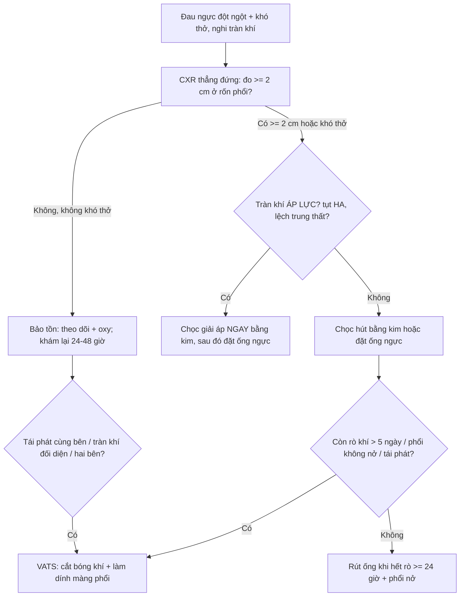
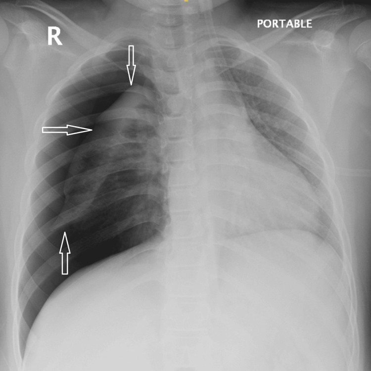
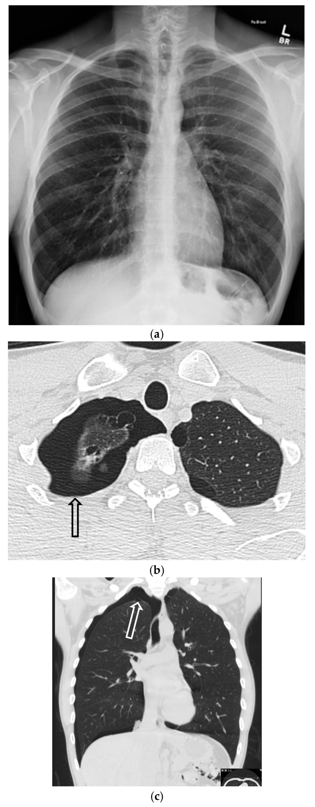
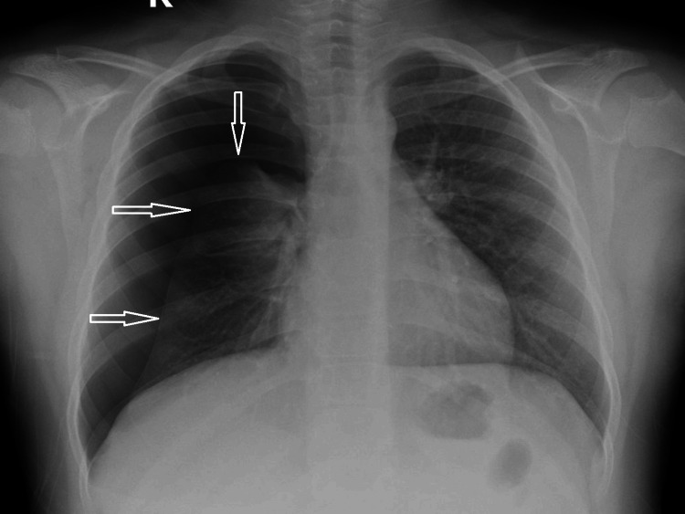
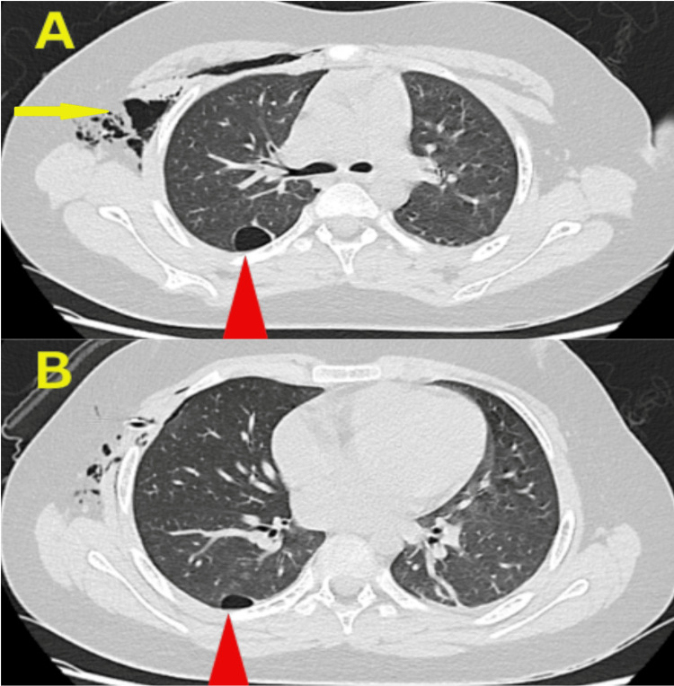
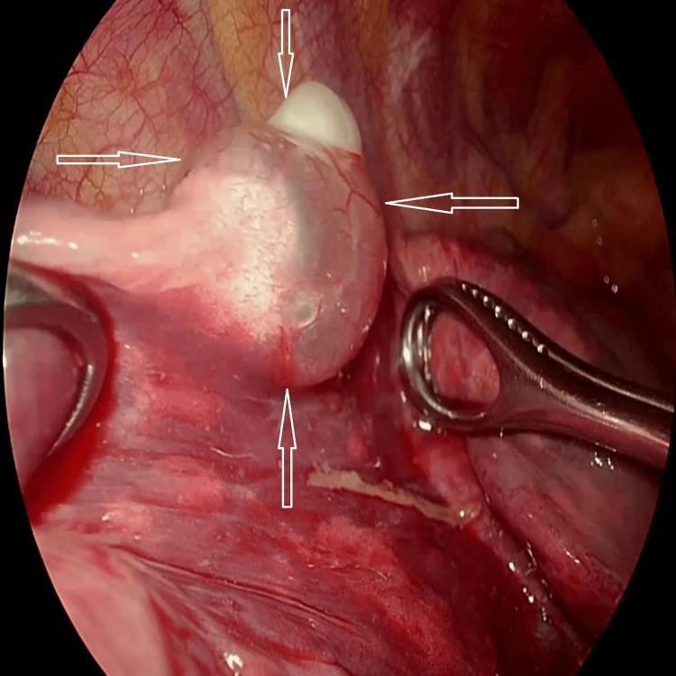

# 601 — Tràn khí màng phổi tự phát ở trẻ lớn & vị thành niên: bóng khí (bleb/bulla), ngưỡng tái phát và chỉ định mổ nội soi (VATS)

**Tags:** `pattern:tran-khi-mang-phoi` `pattern:bong-khi` `vung:phoi` `vung:mong-phoi` `protocol:CT-lat-mong` `score:BTS-2cm`
**Mức chắc chắn (certainty):** tổng hợp y văn (literature synthesis) — bài tự biên từ các nguồn mở 2023–2026 (PMC12820897, PMC12656181, PMC12428816, PMC11228730, PMC13444301, PMC13077400, PMC10439191, PMC10790175, PMC10509123) + **ca nguyên văn** 9 tuổi của Yehya 2025 cho phần ảnh.

## 1. Tổng quan bệnh học – cơ chế hình ảnh

- **Định nghĩa:** tràn khí màng phổi tự phát (spontaneous pneumothorax — SP) là khí trong khoang màng phổi **không do chấn thương, không do can thiệp**. **Nguyên phát (primary — PSP)** khi không có bệnh phổi nền; **thứ phát (secondary — SSP)** khi có bệnh phổi nền (hoặc **> 50 tuổi + hút thuốc nhiều** được xếp vào nhóm thứ phát vì đáp ứng kém với chọc hút).
- **Tần suất ở trẻ:** khoảng **1–4/100.000 trẻ**; phần lớn bằng chứng điều trị **ngoại suy từ người lớn**, còn nghiên cứu nhi chủ yếu là ca lâm sàng (PMC12820897).
- **TẠI SAO có bóng khí (bleb/bulla):** PSP "nguyên phát" thực ra **có bất thường dưới màng phổi**: **bleb** = khoang khí **≤ 1 cm** giữa hai lá màng phổi tạng (thành **< 1 mm**); **bulla** = khoang khí **> 1 cm**. Khi bleb/bulla **vỡ** → khí vào khoang màng phổi. Vì vậy **thấy bleb trên CT là yếu tố dự báo tái phát** (p < 0,001 ở nhóm vị thành niên), và phần lớn tái phát xảy ra trong **10,5 ± 9,9 tháng (phải) / 12,7 ± 9,1 tháng (trái)** (PMC12428816).
- **TẠI SAO hình ảnh trông như vậy (vật lý):**
  - Khí trong khoang màng phổi **≈ −1.000 HU**, đẩy phổi **co lại** → trên phim **thẳng đứng** thấy **đường màng phổi tạng** (visceral pleural line) chạy song song thành ngực, **mất tuần hoàn phổi ngoại vi**.
  - **Nằm ngửa (phim portable)**: khí tụ **phía trước–dưới** → dấu **rãnh sâu (deep sulcus sign)** ở góc hoành, dễ bỏ sót nếu chỉ nhìn đỉnh phổi.
  - **CT**: cửa sổ phổi (lung window) thấy **bóng khí thành mỏng**; **bóng khí lớn (bulla) có thành cong lồi vào trong** — khác đường màng phổi tạng **cong lõm ra ngoài** của tràn khí.
- **Ngưỡng định lượng bắt buộc:**
  - **"Lớn" theo SPLF 2023:** có **dải khí sáng dọc toàn bộ đường nách** VÀ **≥ 2 cm ở ngang rốn phổi** trên phim thẳng; **< 2 cm = nhỏ** (PMC10509123). BTS cũng dùng mốc **2 cm ở rốn phổi**.
  - **Tái phát sau điều trị không mổ:** chọc/dẫn lưu bằng ống ngực **28,0%**, chỉ oxy **17,8%**; **VATS ngay lần đầu: 0% trong cohort** (PMC13444301).
  - **Tái phát sau VATS (gộp 72 nghiên cứu, 23.531 bệnh nhân): 10% (KTC 95%: 8–12%)** (PMC11228730).
  - **Tuổi ≤ 19 (so với 20–29):** tái phát **cùng bên 12,3% vs 3,9%** (P = 0,005); **tràn khí bên đối diện 18,1% vs 4,6%** (P < 0,001) (PMC13077400).
  - **Dữ liệu toàn quốc Hàn Quốc (20,3% tái phát chung):** nhóm **mổ có tái phát 5 năm 23,7%** so với **bảo tồn 7,9%** — **nghịch lý do chỉ định** (ca nặng/bleb nhiều mới được mổ), **không** có nghĩa "mổ làm tăng tái phát" (PMC10439191).

## 2. Mẫu hình + chẩn đoán phân biệt theo cơ chế & vị trí (gamut)

- **Bóng khí ĐỈNH phổi (điển hình PSP):** bleb/bulla ở đỉnh, thường nhiều ổ, thành mỏng; gặp ở nam trẻ, gầy, hút thuốc.
- **Bóng khí ĐÁY/paraseptal (không điển hình — dễ bỏ sót):** **dọc vách liên thùy, đáy phổi, đỉnh thấp** — gắn với **thuốc lá điện tử/vaping, cần sa**; phim thẳng có thể **bình thường** (PMC12656181).
- **Bóng khí ở thùy DƯỚI:** như ca 9 tuổi dưới đây — bullae ở **đoạn đỉnh thùy dưới phải**, không thấy trên phim thường → **chỉ CT mới phát hiện** (PMC12820897).
- **Bệnh nang phổi (SSP):** **Birt–Hogg–Dubé** (nang đáy phổi + u da + ung thư thận), **LAM**, **Langerhans cell histiocytosis** (nang kỳ quái + nốt), **Marfan/Ehlers–Danlos**, **CF**, hen.
- **Nguyên nhân ngoài phổi:** **tràn khí kinh nguyệt (catamenial)** do lạc nội mạc màng phổi (thường bên phải, trong **48–72 giờ quanh kỳ kinh**), **u/di căn hoại tử**, **áp-xe phổi**.
- **Bắt chước (mimic) — không phải tràn khí:** **bulla khổng lồ** (thành lồi vào trong, không có màng phổi tạng), **nếp da (skin fold)**, **nếp ga trải giường**, **bả vai**, **bóng khí trong dạ dày/đại tràng** dưới hoành.
- **Mnemonic "BLEBS":** **B**irt–Hogg–Dubé, **L**AM, **E**hlers–Danlos/Marfan, **B**leb/paraseptal (thuốc lá, vaping), **S**moking/SSP ở người lớn.

## 3. Bảng so sánh phân biệt (ma trận đối chiếu)

| Thực thể (entity) | Hình ảnh điển hình | Chốt vào (rule-in) | Chốt loại (rule-out) | Gợi ý xác nhận |
|---|---|---|---|---|
| **PSP có bleb đỉnh** | Đường màng phổi tạng ở đỉnh, bóng khí thành mỏng ≤ 1 cm, không bệnh nhu mô | **Bleb/bulla trên CT + nam trẻ gầy + hút thuốc/vaping** | Nang nhiều thùy, nang đáy, tổn thương nhu mô → nghĩ SSP | CT lát ≤ 1 mm; so phim cũ |
| **PSP bóng khí thùy dưới** | Phim thẳng **có thể bình thường**; CT: bulla **đoạn đỉnh thùy dưới** | **CT thấy bulla > 1 cm ở thùy dưới + tái phát sớm (10 ngày)** | Không thấy bóng khí trên CT lát mỏng → cân nhắc nguyên nhân khác | CT trước khi quyết định mổ |
| **SSP do BHD/LAM/LCH** | **Nang đáy** (BHD), nang tròn đều (LAM), nang + nốt (LCH), tràn khí tái phát nhiều lần | **Nang hai bên + bệnh da/thận (BHD) hoặc nang lan tỏa (LAM)** | Chỉ một bleb đơn độc, nhu mô còn lại bình thường → PSP | HRCT; tư vấn di truyền (BHD — FLCN) |
| **Bulla khổng lồ (mimic)** | Vùng sáng lớn, **thành cong LỒI vào trong**, vách mảnh, không có màng phổi tạng | **Thành lồi vào trong + không thay đổi khi hít vào** | Có **đường màng phổi tạng cong lõm** + mất mạch ngoại vi → tràn khí thật | CT; so sánh 2 thì hô hấp |
| **Nếp da / vật ngoài (artifact)** | Đường sáng **thẳng, chạy ra ngoài lồng ngực**, không có mạch máu bờ | **Đường sáng vượt khỏi lồng ngực + không thấy màng phổi tạng** | Có màng phổi tạng + mất tuần hoàn ngoại vi → tràn khí thật | Đổi tư thế/khám lại; siêu âm (điểm phổi) |
| **Tràn khí kinh nguyệt** | Tràn khí **bên phải**, tái diễn theo chu kỳ, có thể thấy nốt/mảng màng phổi | **Tái phát trong 48–72 giờ quanh kỳ kinh + bên phải** | Không liên quan chu kỳ → PSP/SSP khác | MRI khung chậu; nội soi lồng ngực |

## 4. Protocol chụp + ngưỡng xử trí + thuật toán

**Chụp gì, khi nào:**
- **Phim ngực thẳng đứng (PA)** là bước đầu; nếu bệnh nhân nằm → phim **AP portable** và **chủ động tìm dấu rãnh sâu**.
- **CT ngực lát ≤ 1 mm, cửa sổ phổi, thì hít vào** — chỉ định: **tái phát**, **phim không giải thích được triệu chứng**, **nghi bệnh nang/di truyền**, **trước mổ để lập kế hoạch cắt bóng khí**. Ở trẻ, CT **không cần** cho mọi ca PSP điển hình (không thêm giá trị chẩn đoán khi phim đã rõ), nhưng **có giá trị trước mổ** (PMC10460625).
- **Siêu âm phổi** tại giường: **mất trượt màng phổi + điểm phổi (lung point) + mã vạch (barcode)** — hữu ích khi không di chuyển được bệnh nhân.
- **Đo kích thước:** đo **khoảng cách màng phổi tạng – thành ngực ở ngang rốn phổi**, ghi bằng mm; **≥ 2 cm = lớn**. Đừng chỉ ước lượng "nhiều/ít".

**Thuật toán xử trí (người lớn + ngoại suy cho trẻ lớn):**

**Chỉ định mổ (dựa trên BTS/ERS, áp dụng cho trẻ lớn):**
- **Tràn khí cùng bên lần thứ 2**, **tràn khí đối diện lần đầu**, **tràn khí hai bên đồng thời**.
- **Rò khí dai dẳng (persistent air leak — PAL)** — ngưỡng dùng phổ biến **> 5 ngày / > 15–20 mL/phút** (xem bài 618); **không có ngưỡng thống nhất tuyệt đối**, đây là điểm tranh luận.
- **Nghề nguy cơ:** phi công, thợ lặn; **thể thao đối kháng** — tư vấn riêng.
- **Thất bại điều trị bảo tồn** hoặc **phổi không nở** (trapped lung).
- **Kỹ thuật:** **VATS 3 cổng** hoặc **1 cổng (uniportal)** — **cắt bóng khí bằng stapler + làm dính màng phổi cơ học/hóa học**; bằng chứng hiện **không chứng minh uniportal ưu việt** ở tràn khí tái phát (PMC12820897).

## 5. Biến thể bình thường và cạm bẫy

- **Phim thẳng bình thường KHÔNG loại trừ bóng khí:** ca vaping dưới đây có **CXR bình thường** nhưng CT thấy **khí paraseptal + bleb/bulla hai đỉnh** và **tràn khí nhỏ** (PMC12656181). Triệu chứng + CT quyết định.
- **Bỏ sót tràn khí nhỏ ở bệnh nhân nằm ngửa:** khí tụ **trước–dưới** → **rãnh sâu**, **dấu cơ hoành "kép"**, **bờ tim sắc nét bất thường**; luôn xem lại vùng đáy và dưới hoành.
- **Nhầm bulla với tràn khí:** bulla có **thành lồi vào trong**, **mạch máu vắt qua vách**; tràn khí có **màng phổi tạng cong lõm** và **mất hoàn toàn tuần hoàn ngoại vi**.
- **"Điều trị phim, không điều trị bệnh nhân":** tràn khí **< 2 cm, không khó thở** có thể **theo dõi bảo tồn** kể cả ở người trẻ; ngược lại tràn khí nhỏ ở trẻ có bệnh nang phổi vẫn có thể nguy hiểm (PMC10509123).
- **Rút ống quá sớm —— và hút áp lực mạnh:** rút khi **hết rò ≥ 24 giờ + phổi nở + dịch ít**; **không hút mạnh ngay** vì nguy cơ **phù phổi tái nở (re-expansion pulmonary edema)** (xem bài 617).
- **Sau mổ vẫn còn "khoang khí" trên CT:** ổ khí nhỏ dưới màng phổi sau làm dính **có thể tồn tại vài tuần**, không đồng nghĩa tái phát.
- **Đừng quên tràn khí đối diện:** nhóm ≤ 19 tuổi có **18,1%** tràn khí bên kia trong dài hạn → hướng dẫn bệnh nhân **quay lại ngay khi đau ngực đột ngột** (PMC13077400).

## 6. Tự lượng giá — Blind Quiz ngay trên trang tĩnh

**Ca 1 — Bé trai 9 tuổi, đau ngực đột ngột, khó thở. Phim chụp tại giường (portable).**

- Gợi ý: không chấn thương, không bệnh phổi trước đó.
- Câu hỏi: (1) Mô tả dấu hiệu chính. (2) Tràn khí lớn hay nhỏ, đo ở đâu? (3) Bước tiếp theo và có cần CT ngay không?

<b>Bấm để hiện đáp án (findings + chẩn đoán)</b>

- **Findings:** **đường màng phổi tạng** (mũi tên) tách khỏi thành ngực bên phải, **mất tuần hoàn phổi ngoại vi**, phổi phải **xẹp gần hoàn toàn**; không thấy bóng khí trong nhu mô trên phim này.
- **Kích thước:** dải khí **rộng > 2 cm ở ngang rốn phổi** và chạy dọc toàn bộ đường nách → **tràn khí LỚN** (SPLF 2023/BTS).
- **Xử trí:** đặt **ống ngực (chest tube)**; sau khi ổn định → **CT ngực lát mỏng** để tìm bóng khí (quyết định mổ sau này).
- **Vì sao CT:** ca này CT phát hiện **hai bulla ở đoạn đỉnh thùy dưới phải** — vị trí **không điển hình**, không thấy trên phim.
- **Nguồn ảnh:** Yehya M et al., *Cureus* 2025, PMC12820897 Fig. 1 — CC BY 4.0.

**Ca 2 — Nam 31 tuổi, đau ngực, có vaping nicotine. Phim thẳng (a) và CT (b–d).**

- Gợi ý: phim thẳng **không thấy đường màng phổi tạng**.
- Câu hỏi: (1) Phim thẳng có bình thường không? (2) CT thấy gì? (3) Vì sao phải chụp CT ở bệnh nhân này?

<b>Bấm để hiện đáp án (findings + chẩn đoán)</b>

- **Findings:** (a) phim thẳng **không rõ tràn khí**; (b–d) CT cửa sổ phổi: **tràn khí nhỏ bên phải** (mũi tên đen) + **khí paraseptal và bleb/bulla hai đỉnh** (mũi tên trắng đứt).
- **Chẩn đoán:** **PSP nhỏ + bóng khí paraseptal** (liên quan vaping) — phim thẳng âm tính.
- **Vì sao CT:** xác định **bóng khí** (yếu tố dự báo tái phát, p < 0,001) và loại trừ bệnh nang phổi; đây cũng là cơ sở **tư vấn bỏ vaping**.
- **Nguồn ảnh:** Jain R et al., *Tomography* 2025, PMC12656181 Fig. 29 — CC BY 4.0.

**Ca 3 — Bé trai 9 tuổi (ca 1) quay lại sau 10 ngày vì đau ngực tái phát. Phim thẳng (A).**

- Gợi ý: lần đầu đã được đặt ống ngực và rút; CT trước đó có bulla thùy dưới.
- Câu hỏi: (1) Chẩn đoán? (2) Vì sao tái phát sớm như vậy? (3) Chỉ định và kỹ thuật điều trị triệt để?

<b>Bấm để hiện đáp án (findings + chẩn đoán)</b>

- **Findings:** **tràn khí phải tái phát** cùng bên (mũi tên) sau **10 ngày** — tái phát **rất sớm**.
- **Chẩn đoán:** **PSP tái phát cùng bên lần 2** trên bệnh nhân có **bulla thùy dưới**:

- **Vì sao tái phát:** bulla **vẫn còn nguyên** sau khi chỉ dẫn lưu — ống ngực **chỉ giải quyết khí**, không loại bỏ **nguồn rò**.
- **Điều trị:** **VATS 3 cổng + cắt bóng khí (bullectomy) + làm dính màng phổi**:

- **Chỉ định mổ ở đây:** **tràn khí cùng bên lần thứ 2** (tiêu chuẩn BTS/ERS); tái phát **10 ngày** càng củng cố chỉ định.
- **Nguồn ảnh:** Yehya M et al., *Cureus* 2025, PMC12820897 Fig. 4, Fig. 3, Fig. 5 — CC BY 4.0.

## Bài liên quan chéo
- [600 – Tổng quan Nhi khoa](../600-tong-quan-nhi-khoa/lesson.md)
- [617 – Hội chứng rò khí ở nhũ nhi (tràn khí màng phổi, tràn khí trung thất)](../617-hoi-chung-ro-khi-o-nhu-nhi/lesson.md)
- [618 – Rò phế quản–màng phổi & rò khí dai dẳng ở trẻ](../618-ro-phe-quan-mang-phoi-va-ro-khi-dai-dang-o-tre/lesson.md)
- [619 – Di chứng hô hấp sau hoại tử phổi & cắt thùy](../619-di-chung-ho-hap-sau-hoai-tu-phoi-cat-thuy/lesson.md)
- [614 – Bệnh tiểu phế quản tắc nghẽn (BO/Swyer–James)](../614-benh-tieu-phe-quan-tac-nghen-BO-Swyer-James/lesson.md)
- [020 – Nốt phổi & tiếp cận nốt](../020-not-phoi/lesson.md)
- [025 – Hang & nấm phổi (chẩn đoán phân biệt hang/bóng khí)](../025-ton-thuong-phoi-tao-hang/lesson.md)

> Không dùng để chẩn đoán độc lập khi chưa có người hướng dẫn.
