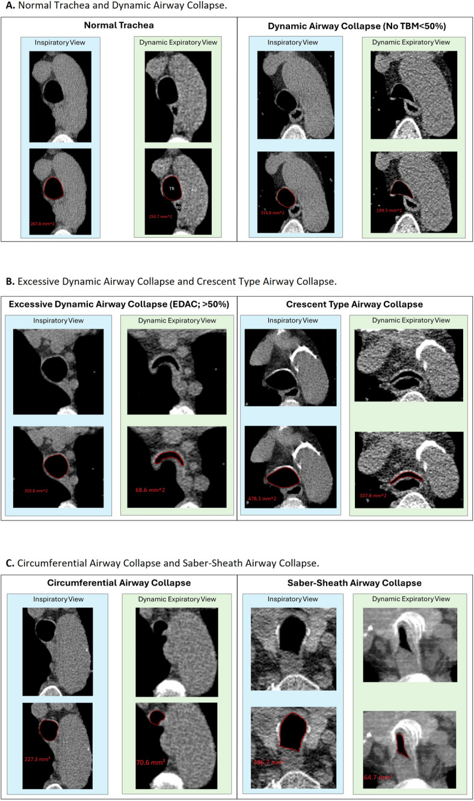
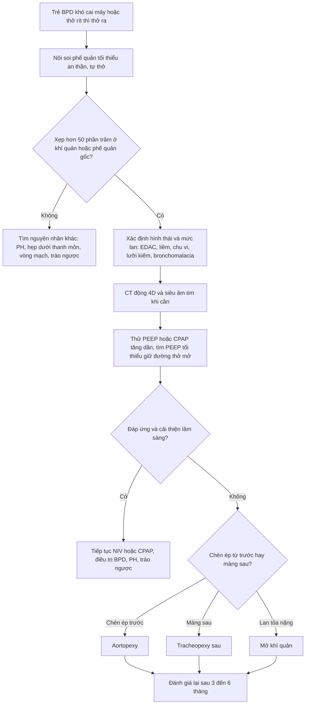
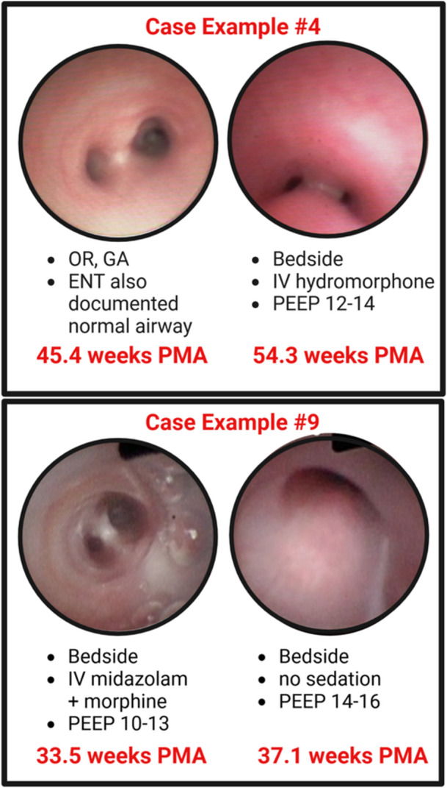

# 602 — Tracheobronchomalacia ở trẻ BPD: chẩn đoán động học (nội soi, CT 4D) & chỉ định can thiệp / Tracheobronchomalacia in BPD

**Tags:** `pattern:tbm` `pattern:xep-duong-tho` `pattern:bpd` `vung:duong-tho-nhi` `vung:phoi-nhi` `protocol:noi-soi-phe-quan` `protocol:CT-dong` `score:NICHD-2018`
**Mức chắc chắn (certainty):** tổng hợp y văn (literature synthesis) — tự biên từ ba nguồn mở: đoàn hệ 56 trẻ BPD độ 3 được nội soi phế quản (Adaikalam SA và cs., *Pediatr Pulmonol* 2025, PMC12606695); nghiên cứu đồng thuận đọc CT động (Cortes-Puentes GA và cs., *Sci Rep* 2025, PMC11762705); và tổng quan aortopexy 473 trẻ (J Clin Med 2025, PMC11857069). Không gắn một bệnh án đơn lẻ.

## 1. Tổng quan bệnh học – cơ chế hình ảnh: "van một chiều" ở đường thở trung tâm

- **Định nghĩa:** tracheobronchomalacia (TBM) là **xẹp đường thở trung tâm > 50% diện tích lòng** trong thì thở ra (hoặc khi ho), do **yếu sụn khí quản/phế quản** và/hoặc **màng sau mềm, rộng**. Khi hẹp **≥ 50%** → TBM; **EDAC** (excessive dynamic airway collapse) là xẹp **≥ 50%** nhưng **sụn trước còn nguyên hình dạng**, chỉ màng sau lồi vào.
- **Dịch tễ:** TBM gặp **30–50%** trẻ BPD; trong đoàn hệ BPD **độ 3** được nội soi, **66%** (37/56) có TBM khi theo dõi nhiều lần. Chỉ **33%** trung tâm trong BPD Collaborative nội soi phế quản cho "phần lớn" trẻ BPD nặng — nghĩa là **đa số trẻ không được tìm TBM**.
- **TẠI SAO BPD gây TBM:** (1) **thở máy kéo dài + áp lực dương** làm tổn thương sụn và niêm mạc; (2) **viêm + phù** làm màng sau dày, mất đàn hồi; (3) **tăng áp lực lồng ngực khi thở ra** (do ứ khí, phổi kém đàn hồi) tạo **gradient xẹp** lên đường thở mềm; (4) **giảm trương lực cơ trơn** do non tháng và thuốc an thần. Kết quả: đường thở trung tâm trở thành **van một chiều** — khí vào được, ra khó.
- **TẠI SAO trẻ "không cai được máy":** mỗi lần thở ra, khí quản xẹp → **ứ khí + tăng CO₂ + giảm oxy**, trẻ phải thở nhanh hơn → càng tạo áp lực âm/xẹp hơn. Đây là vòng xoắn điển hình của **BPD + TBM**; phối hợp này làm tăng **nhập viện kéo dài, phụ thuộc mở khí quản và tử vong**.
- **TẠI SAO chẩn đoán khó — "thuốc an thần che mất bệnh":** trong 56 trẻ BPD độ 3, **lần nội soi đầu bỏ sót 35%** trường hợp TBM; **77%** ca bỏ sót có **an thần sâu hơn** lần sau; **54%** được nội soi **trong phòng mổ dưới gây mê toàn thân**. Trung vị **6,7 tuần** sau mới phát hiện. Lý do: gây mê + thông khí áp lực dương **"giằng" đường thở mở ra**, cơ giãn → mất dấu xẹp động.
- **Ngưỡng định lượng nằm lòng:**
  - **Nội soi:** xẹp **> 50%** ở **bất kỳ đoạn nào** trong 3 đoạn (khí quản xa, phế quản gốc phải, phế quản gốc trái) = TBM. Đồng thuận giữa 2 người đọc **79%**, **κ = 0,57** (trung bình) — đủ để chẩn đoán "có/không", **kém** để chấm mức độ.
  - **CT động thì thở ra:** giảm **≥ 50% diện tích lòng** so với thì hít vào. Ví dụ trong hình: EDAC **337,8 → 68,6 mm²** (giảm **79,7%**); thể liềm **378,3 → 107,8 mm²** (**71,5%**); thể chu vi **227,3 → 70,6 mm²** (**68,9%**); thể "lưỡi kiếm" **386,7 → 84,7 mm²** (**78,1%**). Xẹp sinh lý **< 50%** không gọi TBM.
  - **Dự báo trước nội soi:** PEEP trung vị **13 cmH₂O** ở trẻ có TBM so với **10,5 cmH₂O** ở trẻ không TBM; mỗi **+1 cmH₂O PEEP** làm **tăng 36%** khả năng có TBM (OR 1,36); OSI **> 12** làm **giảm** khả năng TBM (OR 0,24) vì gợi ý bệnh nhu mô nặng hơn. Mô hình có **độ nhạy 86%**, **độ đặc hiệu 30%**, **AUC 0,69** — dùng để **chọn ai cần nội soi**, không để chẩn đoán.
- **Điều trị — vì sao không có "thuốc đặc hiệu":** nong đường thở bằng **CPAP/NIV/PEEP** là bước đầu; **aortopexy** (treo quai ĐMC lên) cho TBM do **chèn ép từ trước**; **tracheopexy sau** cho màng sau lồi; **mở khí quản** cho thể lan tỏa nặng. Tổng quan 473 trẻ aortopexy: **thành công 84%**, nhưng **40,8% còn triệu chứng dai dẳng**; **92,1%** là TBM thứ phát (teo thực quản 54,1%, động mạch cánh tay đầu lạc chỗ 16,1%, vòng mạch 8,3%). **Stent đường thở** ít dùng ở trẻ vì mô hạt, di trú và khó lấy khi trẻ lớn.

## 2. Mẫu hình + chẩn đoán phân biệt theo cơ chế & vị trí (Gamut)

- **Mẫu hình "TBM điển hình":** trẻ **sinh non < 32 tuần**, BPD **độ 2–3**, **khó cai máy hoặc khó cai oxy**, **thở rít thì thở ra**, **xẹp phổi tái diễn cùng vị trí**, **"cơn ngừng thở–tím" khi bú/khóc**, X-quang **ứ khí + xẹp thùy**. Nội soi: khí quản xẹp **> 50%** khi thở ra, có thể lan phế quản gốc.
- **Gamut theo hình thái (CT/nội soi):**
  - **EDAC** — sụn trước còn hình chữ C, **màng sau lồi vào**, xẹp ≥ 50%.
  - **Thể liềm (crescent)** — **sụn trước mềm, bè ra**, lòng xẹp ≥ 50%.
  - **Thể chu vi (circumferential)** — xẹp cả **thành trước và bên**, thành dày.
  - **Thể lưỡi kiếm (saber-sheath)** — thành bên mềm, lòng hình chữ **A**.
  - **Thể hỗn hợp** — phối hợp ≥ 2 kiểu; tiên lượng và lựa chọn mổ khác nhau.
- **Gamut theo vị trí:**
  - **Khí quản đơn thuần:** thường do **chèn ép mạch máu** (động mạch cánh tay đầu, quai ĐMC) hoặc sau **hẹp thực quản–khí quản**.
  - **Phế quản gốc:** **bronchomalacia** — hẹp do sụn yếu, sau nhiễm trùng, hoặc chèn ép bởi **động mạch phổi**/hạch.
  - **Lan tỏa (khí quản + hai phế quản gốc):** thể nặng, thường cần **mở khí quản** hơn là mổ treo.
- **Gamut "trẻ BPD khó cai máy" — đừng chỉ nghĩ TBM:** BPD tiến triển, **tăng áp phổi**, **hẹp dưới thanh môn/hẹp khí quản**, **u hạt sau đặt nội khí quản**, **vòng mạch chèn ép**, **liệt cơ hoành**, **trào ngược/hít sặc**, **thiếu máu**, **suy dinh dưỡng**.
- **Mnemonic "FLOPPY":** **F**loppy central airway, **L**ong-term ventilation, **O**bstructed expiration, **P**rematurity/BPD, **P**ositive pressure masks it, **Y**oung age (thường cải thiện theo tăng trưởng).

## 3. Bảng so sánh phân biệt (ma trận đối chiếu)

| Thực thể (entity) | Hình ảnh điển hình | Chốt vào (rule-in) | Chốt loại (rule-out) | Gợi ý xác nhận |
|---|---|---|---|---|
| **TBM (do sụn)** | Nội soi: khí quản xẹp **> 50%** thì thở ra; CT: diện tích lòng giảm ≥ 50%, sụn biến dạng | **Xẹp > 50% khi thở ra + hết khi hít vào** | **Đường thở cố định hẹp cả 2 thì** → hẹp khí quản, không phải TBM | Nội soi tối thiểu an thần; CT động |
| **EDAC (màng sau)** | CT/nội soi: **sụn chữ C nguyên**, màng sau lồi vào ≥ 50% | **Màng sau lồi, sụn trước còn hình dạng** | **Sụn trước cũng xẹp/bè ra** → thể liềm | Nội soi thì thở ra; CT động |
| **Bronchomalacia** | Phế quản gốc xẹp > 50%, thường kèm ứ khí/xẹp thùy cùng bên | **Xẹp phế quản gốc khi thở ra + xẹp phổi tái diễn** | Khí quản bình thường, chỉ tổn thương phế quản → bronchomalacia đơn thuần | Nội soi phế quản; CT |
| **Hẹp dưới thanh môn/u hạt** | Nội soi: vòng xơ/u hạt **cố định**, không đổi theo thì thở | **Hẹp cố định + tiền sử đặt nội khí quản** | **Hẹp thay đổi theo thì thở** → TBM | Nội soi; đo kích thước ống |
| **Vòng mạch chèn ép** | CT/CTA: vòng mạch quanh khí quản/thực quản; nội soi: **mạch đập vào thành sau** | **CTA thấy vòng mạch + đập theo mạch** | Không thấy mạch máu bất thường → TBM đơn thuần | CTA/echo; nội soi |
| **Hẹp khí quản bẩm sinh** | CT: khí quản hẹp **cố định**, sụn hình vòng kín ("O") | **Hẹp cố định + sụn vòng kín** | **Thay đổi thì thở + sụn chữ C** → TBM | CT lát mỏng; nội soi |
| **Laryngomalacia** | Nội soi thanh quản: sụp **sụn phễu/nắp thanh môn** thì hít vào | **Tiếng thở rít thì HÍT VÀO + sụp thanh môn** | **Thở rít thì thở RA** → TBM | Nội soi thanh quản (xem bài 694) |

*Ghép cặp ảnh hít vào (xanh) và thở ra động (xanh lá) kèm diện tích lòng đo bằng phần mềm: (A) khí quản bình thường và xẹp động sinh lý < 50%; (B) EDAC (> 50%, sụn trước còn hình chữ C) và thể liềm; (C) thể chu vi và thể "lưỡi kiếm". Nguồn: Cortes-Puentes GA và cs., Sci Rep 2025, PMC11762705 Fig. 1, CC BY-NC-ND 4.0 (giữ nguyên bản, không crop/ghép).*

## 4. Protocol chẩn đoán động học + chỉ định can thiệp

- **Bước 1 — nội soi phế quản mềm (chuẩn vàng), làm đúng điều kiện:**
  - **Tối thiểu an thần** (hoặc an thần rất nhẹ), **trẻ tự thở**, **không gây mê toàn thân** nếu có thể; tránh thuốc giãn cơ.
  - Ghi video **3 đoạn**: khí quản xa, phế quản gốc phải, phế quản gốc trái; đánh giá **cả thì hít vào và thở ra**, và **khi ho**.
  - Ghi rõ **PEEP/CPAP lúc làm**, cỡ ống soi và vị trí — vì các yếu tố này thay đổi mức xẹp.
  - Chấm **có/không** trước (xẹp > 50%), **mức độ** sau; nếu hai người đọc khác nhau, cần người thứ ba.
- **Bước 2 — CT động (4D) khi cần khách quan hóa hoặc đo lan tỏa:** lát **≤ 1 mm**, liều thấp theo ALARA, **không an thần** nếu trẻ hợp tác; chụp **thì hít vào tối đa + thì thở ra mạnh** (hoặc 4D trong vài giây). Đo **diện tích lòng tại điểm hẹp nhất**, tính **% giảm**; ngưỡng **≥ 50%**. CT cũng trả lời câu hỏi **chèn ép mạch máu** và **phổi ứ khí/mosaic**.
- **Bước 3 — tìm nguyên nhân chèn ép & bệnh phối hợp:** **siêu âm tim** (PH, shunt, quai ĐMC), **CTA** khi nghi vòng mạch, **nuốt cản quang** khi nghi hẹp/rò thực quản–khí quản, **đa ký giấc ngủ** khi nghi OSA.
- **Bước 4 — thử "stent sinh lý":** tăng **PEEP/CPAP** từng bậc và **đo lại mức xẹp**; tìm **PEEP tối thiểu để đường thở không xẹp**. Đáp ứng với PEEP dự báo khả năng cai máy và là cơ sở để chọn NIV dài hạn.
- **Bước 5 — chỉ định can thiệp (không có đồng thuận, dựa trên mức độ + triệu chứng):**
  - **Nội khoa trước:** tối ưu PEEP/CPAP/NIV, điều trị BPD–PH, trào ngược, dinh dưỡng, tránh an thần gây xẹp.
  - **Aortopexy** khi TBM do **chèn ép từ trước** (động mạch cánh tay đầu/quai ĐMC) hoặc TBM nặng có chỉ định mổ: **thành công 84%**, còn triệu chứng dai dẳng **40,8%**.
  - **Tracheopexy sau** khi **màng sau rộng, lồi vào** là cơ chế chính; có thể phối hợp **treo trước + sau** ở thể nặng.
  - **Mở khí quản** khi TBM **lan tỏa**, đe dọa tính mạng, thất bại nội khoa — đây là **lựa chọn điều trị**, không phải "thất bại".
  - **Stent đường thở**: hạn chế tối đa ở trẻ đang lớn (mô hạt, di trú, khó lấy); chỉ dùng cầu nối trong ca đặc biệt.

- **Theo dõi sau can thiệp:** nội soi/CT động lại **3–6 tháng** nếu còn triệu chứng; đánh giá **cai máy, tăng trưởng, PH, trào ngược**; nhiều trẻ **cải thiện dần theo tăng trưởng** nên tránh can thiệp quá sớm khi chưa thất bại nội khoa.

## 5. Biến thể bình thường và cạm bẫy

- **Xẹp < 50% là sinh lý:** mọi người đều xẹp đường thở khi thở ra mạnh; **chỉ ≥ 50%** mới gọi TBM. Đừng "overcall" ở trẻ khóc, thở gắng sức.
- **An thần sâu/gây mê tạo âm tính giả:** **35%** ca bỏ sót ở lần nội soi đầu, **77%** trong số đó có an thần sâu hơn; **54%** làm ở phòng mổ dưới gây mê. Nếu lần đầu âm tính mà lâm sàng vẫn nghi, **phải làm lại khi tối thiểu an thần** — trung vị chậm **6,7 tuần**.
- **Áp lực dương "giấu" bệnh:** PEEP/CPAP cao làm đường thở mở ra; ghi lại **PEEP lúc nội soi** và luôn đánh giá ở **nhiều mức PEEP** thay vì một lần.
- **Chỉ đọc CT thì hít vào:** CT tĩnh bỏ sót gần như toàn bộ TBM; **bắt buộc có thì thở ra/4D**.
- **Nhiễu do nhịp thở không đều:** trẻ thở nông, khóc, hoặc không hợp tác làm phép đo sai; cần **lặp lại** và **đo tại điểm hẹp nhất**, không đo một lát ngẫu nhiên.
- **Nhầm với hen/nhiễm trùng tái diễn:** trẻ BPD + TBM thường được chẩn đoán "hen" hoặc "viêm phổi tái phát" nhiều tháng; **thở rít thì thở ra + xẹp thùy cùng vị trí** là cờ đỏ.
- **Bỏ sót vòng mạch:** TBM "nguyên phát" ở trẻ nhỏ phải loại trừ **vòng mạch/động mạch cánh tay đầu lạc chỗ** — **92,1%** ca aortopexy là TBM thứ phát; bỏ sót dẫn tới mổ sai hoặc tái phát.
- **Đặt stent ở đường thở đang lớn:** stent không lớn theo trẻ → di trú, mô hạt, hẹp lại; **không** xem stent là giải pháp lâu dài.
- **Mở khí quản không phải thất bại:** ở TBM lan tỏa nặng, mở khí quản **bắc cầu qua đoạn xẹp** và cho trẻ lớn lên; từ chối mở khí quản có thể kéo dài thời gian thở máy và tử vong.

## 6. Tự lượng giá — Blind Quiz

**Ca 1 — Trẻ 28 tuần, BPD độ 3, 44 tuần PMA, không cai được CPAP. CT động thì hít vào và thở ra ở ngang khí quản.**

- Gợi ý lâm sàng: thở rít thì thở ra, xẹp thùy trên phải tái diễn.
- Câu hỏi: (1) Diện tích lòng giảm bao nhiêu %? (2) Thuộc kiểu nào? (3) Ngưỡng chẩn đoán?

<b>Bấm để hiện đáp án (findings + chẩn đoán)</b>

- **Đo:** lấy panel EDAC (hàng B, bên trái): thì hít vào **337,8 mm²**, thì thở ra **68,6 mm²** → giảm **79,7%**, vượt xa ngưỡng **50%**.
- **Kiểu:** **EDAC** — sụn trước còn hình chữ C, **màng sau lồi vào**; nếu sụn trước cũng bè ra thì là **thể liềm**, cả thành trước–bên xẹp là **thể chu vi**, lòng hình chữ A là **thể lưỡi kiếm**.
- **Chẩn đoán:** **TBM mức độ nặng**, phù hợp BPD độ 3 khó cai CPAP.
- **Cạm bẫy:** nếu CT chỉ chụp thì hít vào, diện tích **337,8 mm²** trông "bình thường" — bỏ sót hoàn toàn.
- **Nguồn ảnh:** Cortes-Puentes GA và cs., *Sci Rep* 2025, PMC11762705 Fig. 1, CC BY-NC-ND 4.0.

**Ca 2 — Trẻ BPD độ 3 được nội soi phế quản lần đầu trong phòng mổ dưới gây mê, kết luận "đường thở bình thường". 6 tuần sau vẫn khó cai máy. Làm gì tiếp?**

- Câu hỏi: (1) Vì sao lần đầu âm tính? (2) Lần sau cần làm khác gì? (3) Tỷ lệ bỏ sót là bao nhiêu?

<b>Bấm để hiện đáp án (findings + chẩn đoán)</b>

- **Vì sao âm tính:** gây mê toàn thân + thông khí áp lực dương **giằng đường thở mở**, cơ giãn, nên không thấy xẹp động. Trong đoàn hệ, **35%** trường hợp bị bỏ sót ở lần đầu; **77%** ca bỏ sót có an thần sâu hơn lần sau; **54%** làm ở phòng mổ.
- **Lần sau:** nội soi **tối thiểu an thần**, trẻ **tự thở**, đánh giá **3 đoạn** (khí quản xa, phế quản gốc phải/trái) ở **thì thở ra và khi ho**; ghi lại **PEEP**; nếu cần, **đo lại ở nhiều mức PEEP** và **CT động**.
- **Hình:** bên trái — lần đầu dưới gây mê, lòng đường thở mở; bên phải — lần sau tối thiểu an thần, **xẹp gần hoàn toàn** (thể nặng).
- **Tỷ lệ bỏ sót:** **35%** (13/56) trong đoàn hệ BPD độ 3; trung vị **6,7 tuần** mới phát hiện.
- **Nguồn ảnh:** Adaikalam SA và cs., *Pediatr Pulmonol* 2025, PMC12606695 Fig. 2, CC BY 4.0.

## Bài liên quan chéo
- [600 – Tổng quan Nhi khoa](../600-tong-quan-nhi-khoa/lesson.md)
- [606 – BPD: bệnh phổi mạn tính ở trẻ sinh non](../606-bpd-tre-sinh-non/lesson.md) (bệnh nền & phân độ)
- [608 – Theo dõi sau mổ CDH](../608-theo-doi-sau-mo-thoat-vi-hoanh-bam-sinh/lesson.md) (khó cai máy sau mổ)
- [610 – Suy hô hấp sơ sinh](../610-suy-ho-hap-so-sinh-va-di-dang-phoi/lesson.md)
- [611 – PIE & tràn khí áp lực ở nhũ nhi](../611-ro-khi-nang-pie-tran-khi-ap-luc-nhu-nhi/lesson.md)
- [694 – Mềm sụn thanh quản ở nhũ nhi](../694-mem-sun-thanh-quan-o-nhu-nhi/lesson.md) (thở rít thì hít vào)
- [686 – Tăng áp lực động mạch phổi trong bệnh phổi mạn nhi](../686-tang-ap-luc-dong-mach-phoi-benh-phoi-man-nhi/lesson.md)

> Không dùng để chẩn đoán độc lập khi chưa có người hướng dẫn.
