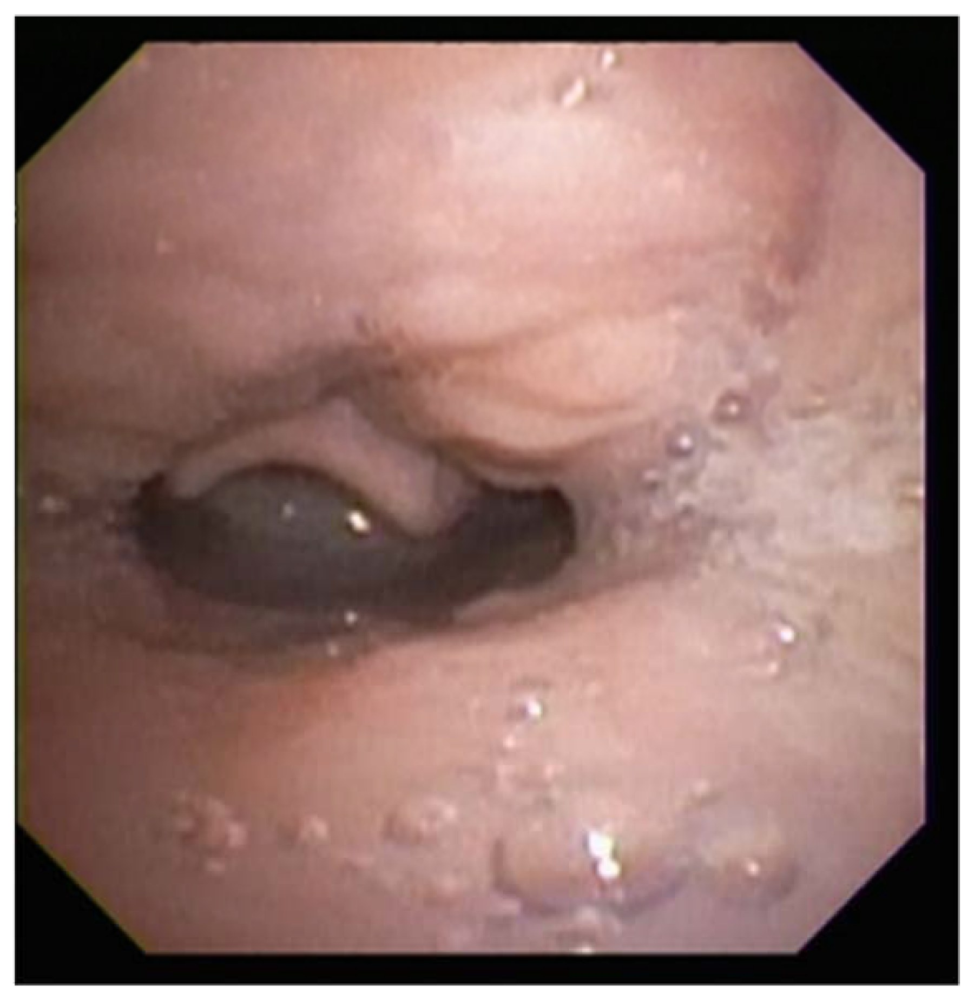
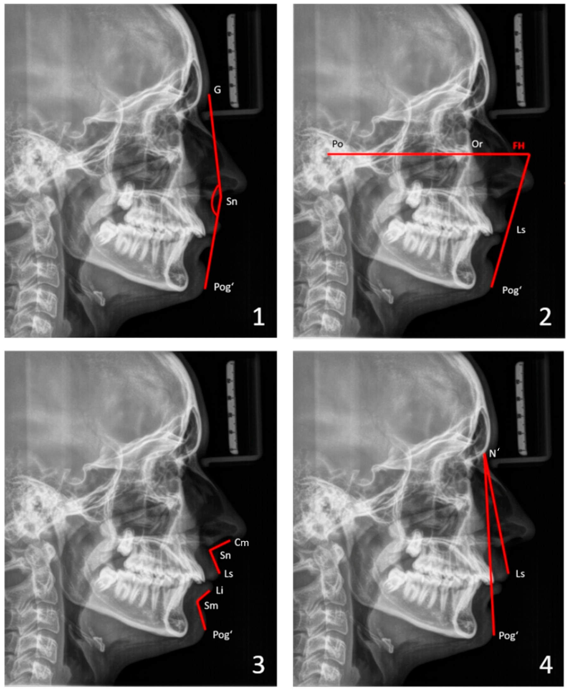
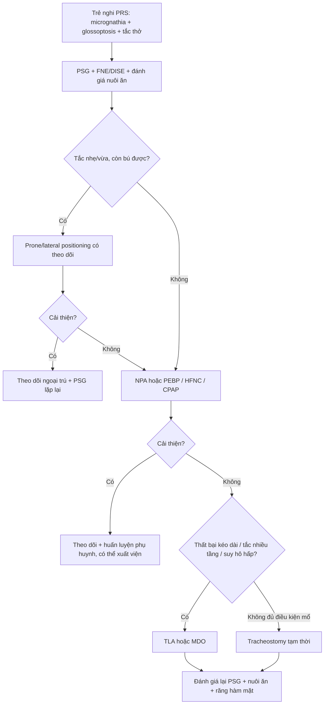
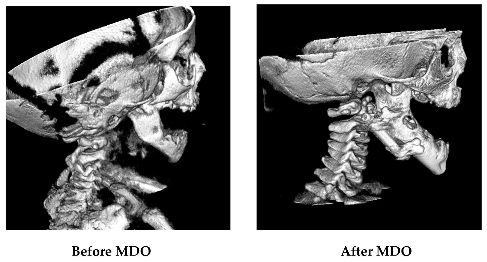
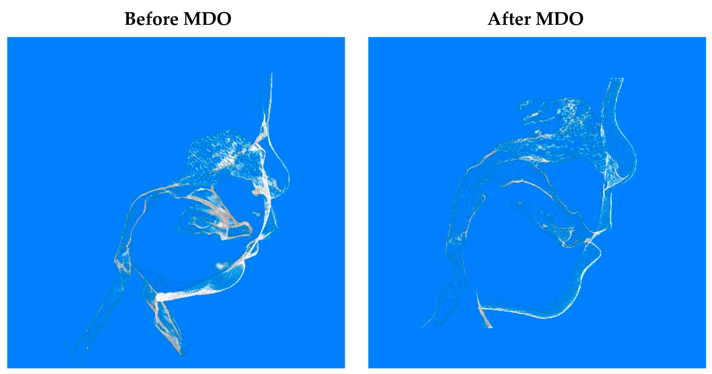

# 603 — Hội chứng Pierre Robin & tắc nghẽn đường thở trên ở trẻ sơ sinh: micrognathia – glossoptosis – chọn prone, NPA hay MDO / Pierre Robin sequence

**Tags:** `pattern:tac-nghen-duong-tho` `pattern:micrognathia` `pattern:glossoptosis` `vung:duong-tho-tren` `vung:ham-mat` `score:AHI` `protocol:PSG` `protocol:DISE` `protocol:CBCT-MDO`
**Mức chắc chắn (certainty):** tổng hợp y văn (literature synthesis) — tổng hợp review, đoàn hệ và ca nguyên văn mở; số liệu lấy trực tiếp từ bài gốc ghi PMCID trong `sources.md`; ảnh minh họa là ca nguyên văn CC BY 4.0, không suy đoán tên tác giả.

> **Bài này nối tiếp 658 (phổ OAVS/Goldenhar, microtia, Jahrsdoerfer) và 612 (cấp cứu đường thở trên ở trẻ).** 658 trả lời “khối/dị dạng vùng mặt–tai là gì”; bài này trả lời **“vì sao trẻ Pierre Robin ngạt khi nằm ngửa, đo bằng gì, và leo thang điều trị theo bậc nào”**.

## 1. Tổng quan bệnh học – cơ chế hình ảnh

- **Hội chứng Pierre Robin (Pierre Robin sequence, PRS)** là một **trình tự (sequence)**, không phải một hội chứng đơn gen: **hàm dưới nhỏ (micrognathia) → lưỡi tụt ra sau (glossoptosis) → tắc nghẽn đường thở trên (upper airway obstruction, UAO)**. **Khe hở vòm (cleft palate)** — thường hình chữ U — có ở **80–90%**, nhưng **không nằm trong tiêu chuẩn chẩn đoán** vì không phải ca nào cũng có (Rickart 2024, PMC11430236).
- **Dịch tễ:** **1/8.000–1/20.000 ca sinh sống** tùy tiêu chuẩn chẩn đoán. Khoảng **một nửa là thể đơn lẻ (isolated)**; nửa còn lại là **thể hội chứng (syndromic)** — hay gặp **Stickler, Treacher–Collins, 22q11.2 deletion**; vì vậy mọi trẻ PRS nên được **khảo sát di truyền** (Rickart 2024).
- **Sinh lý bệnh:** mandible phát triển kém làm sàn miệng ra sau, đế lưỡi bị đẩy vào hầu; khi trẻ nằm ngửa, trọng lực càng kéo lưỡi–nắp thanh quản (epiglottis) úp ra sau, tạo **van một chiều** ở tầng hầu miệng. Đồng thời lưỡi chen giữa hai mảnh khẩu cái → **không khép được đường giữa → khe hở vòm**.
- **Vì sao phải chụp/đo, không chỉ nhìn?**
  - **X-quang sọ nghiêng (lateral radiograph/cephalogram):** thấy tương quan xương hàm trên–dưới; nhưng **tư thế đầu–cổ và há miệng làm sai lệch** phép đo, nên chỉ là định hướng.
  - **CT/CBCT (cone-beam CT) liều thấp:** đo **chiều dài thân xương hàm dưới (body length), chiều cao cành lên (ramus height), khoảng liên lồi cầu (intercondylar) và liên góc hàm (intergonial)**. Điểm quan trọng: micrognathia ở PRS **không đơn thuần là “xương nhỏ”** — ở 25 trẻ PRS đủ nặng để mổ MDO so với 25 trẻ chứng, mandible **rộng hơn theo chiều ngang (intergonial p = 0,008), cành lên cao hơn (p = 0,001) nhưng ngắn hơn nhiều theo trục trước–sau**, và **bất đối xứng chiều dài thân hàm (p = 0,006)** (Bhatia 2026, PMC13646437).
  - **Nội soi mũi–hầu khi ngủ (drug-induced sleep endoscopy, DISE) hoặc nội soi ống mềm (flexible nasoendoscopy, FNE):** xác định **tầng tắc nghẽn** — đế lưỡi, nắp thanh quản, khẩu cái mềm, hạ họng; PRS thể hội chứng có thể **tắc nghẽn nhiều tầng** cùng lúc (Rickart 2024).
  - **Đa ký giấc ngủ (polysomnography, PSG):** định lượng mức nặng; **chỉ 55% trẻ PRS có OSA có tiếng ngáy**, nên không ngáy **không loại trừ** OSA (Rickart 2024).
- **Ngưỡng định lượng cần nhớ:**
  - **AHI (apnea–hypopnea index):** nhẹ **1 đến < 5**, trung bình **5 đến < 10**, nặng **> 10 lần/giờ** — nhưng đây là ngưỡng “người lớn/trẻ lớn”; ở nhũ nhi, **AHI hỗn hợp–tắc nghẽn bình thường khoảng 5,8/h lúc 1 tháng và 3,6/h lúc 1 tuổi**, nên đừng áp ngưỡng người lớn một cách máy móc (Rickart 2024).
  - **Đoạn đường thở trên CT:** diện tích mặt cắt ngang tại **đầu nắp thanh quản** là biến số dự báo đặt nội khí quản khó; trong 69 trẻ PRS, **56,5% đặt nội khí quản khó** (Cormack–Lehane ≥ III) và mô hình dựa trên diện tích này có **AUC 0,8125** (Mao 2019, PMC6868728).
  - **Dinh dưỡng:** **42–82%** trẻ cần nuôi ăn qua sonde; sonde dạ dày trung vị **14–30 tuần**; **7–15%** cần mở thông dạ dày (gastrostomy) lâu dài (Rickart 2024).

*Hình nội soi khi ngủ ở trẻ bị tắc nghẽn đường thở trên: đế lưỡi (tongue base) chạm nắp thanh quản (epiglottis); nắp thanh quản sa ra sau (prolapse) che thanh môn. Đây là tầng tắc nghẽn kinh điển của glossoptosis. Nguồn: Srikanthan A et al., Children 2022;9(7):944 (PMC9322467, Fig. 7), CC BY 4.0.*

## 2. Mẫu hình + chẩn đoán phân biệt theo TẦNG giải phẫu (gamut)

Đừng chỉ hỏi “có Pierre Robin không?” — hãy hỏi **tắc ở tầng nào**, vì can thiệp khác nhau hoàn toàn:

- **Tầng mũi – vòm mũi hầu:** **hẹp/ứ mạc khoang mũi (choanal atresia/stenosis)** — trẻ chỉ thở bằng miệng, khó khi bú; **hội chứng CHARGE**.
- **Tầng hầu miệng (retroglossal):** **glossoptosis do micrognathia (PRS)**; **lưỡi to (macroglossia)** trong **Beckwith–Wiedemann, Down, suy giáp, u mạch máu lưỡi**; **áp-xe/khối vùng hầu** (hiếm).
- **Tầng trên thanh môn (supraglottic):** **mềm sụn thanh quản (laryngomalacia)** — nguyên nhân stridor thì hít vào hay gặp nhất ở nhũ nhi; **hẹp thanh môn do sẹo**.
- **Tầng thanh môn:** **liệt dây thanh (vocal cord paralysis)** — một bên sau mổ tim/ngực, hai bên sau đặt nội khí quản; **u nhú thanh quản**.
- **Tầng dưới thanh môn:** **hẹp dưới thanh môn bẩm sinh/mắc phải**; **u mạch máu dưới thanh môn** (stridor tiến triển, hay kèm u máu da).
- **Tầng khí quản:** **mềm sụn khí quản (tracheomalacia)**, **vòng mạch (vascular ring)**, **rò khí–thực quản (tracheoesophageal fistula)**, **hẹp khí quản**.
- **Bẫy “hai tầng cùng lúc”:** trẻ PRS thể hội chứng có thể vừa glossoptosis vừa laryngomalacia hoặc hẹp dưới thanh môn; **DISE/FNE là bắt buộc** khi triệu chứng không tương xứng với mức micrognathia.

**Gamut micrognathia theo nguyên nhân:**
- **PRS đơn lẻ** (isolated) — không dị tật khác, không bất thường gen.
- **Stickler** — micrognathia + khe hở vòm + **cận thị nặng, bong võng mạc, viêm khớp**; gen **COL2A1/COL11A1/COL11A2**.
- **Treacher–Collins (TCS)** — **gò má thiểu sản (malar hypoplasia)**, vành tai dị dạng, **hở mi dưới**, thiếu lông mi; gen **TCOF1/POLR1C/POLR1D**.
- **22q11.2 deletion** — tim bẩm sinh, hạ calci, suy giảm miễn dịch, khe hở vòm.
- **OAVS/Goldenhar** — bất đối xứng nửa mặt, **microtia**, dermoid kết–giác mạc, bất thường đốt sống (bài 658).
- **Campomelic dysplasia, Nager, cerebro–costo–mandibular** — hiếm, thường nhiều dị tật nặng.

**Mnemonic theo tầng “M–H–T–D–K”:** **M**ũi (choanal), **H**ầu (glossoptosis/macroglossia), **T**hanh môn (laryngomalacia/liệt dây thanh), **D**ưới thanh môn (hẹp/u mạch), **K**hí quản (malacia/vòng mạch).

## 3. Bảng so sánh phân biệt (ma trận đối chiếu)

| Thực thể (entity) | Hình ảnh/lâm sàng điển hình | Chốt vào (rule-in) | Chốt loại (rule-out) | Gợi ý xác nhận |
|---|---|---|---|---|
| PRS đơn lẻ | Micrognathia + glossoptosis + khe hở vòm chữ U; không dị tật khác | **Tam chứng + không dị tật/gene khác; ngáy/retraction khi nằm ngửa** | **Có dị tật tim/tai/mắt/chi hoặc bất thường gen → thể hội chứng** | PSG, DISE, khám di truyền, X-quang/CT sọ mặt |
| PRS thể hội chứng (Stickler/TCS/22q11.2) | Micrognathia + đặc điểm riêng: cận thị/bong võng mạc (Stickler), gò má dẹt/hở mi (TCS), tim–hạ calci (22q11.2) | **Dấu hiệu ngoài mặt + xét nghiệm gen/CMA** | **Chỉ micrognathia đơn độc, không dấu hiệu khác** | Khám mắt–tai–tim, CMA/WES, tư vấn di truyền |
| Mềm sụn thanh quản (laryngomalacia) | Stridor **thì hít vào**, tăng khi nằm ngửa/bú/khóc, giảm khi nằm sấp | **Stridor thì hít vào + nội soi thấy sụn thanh quản sa vào thanh môn** | **Stridor thì thở ra hoặc hai thì + không thấy sa sụn** | FNE/DISE; PSG nếu nghi OSA |
| Hẹp/ứ mạc khoang mũi (choanal atresia) | Khó thở ngay sau sinh, **giảm khi khóc**, không đặt được sonde mũi | **Không qua được sonde mũi + CT thấy màng/xương bít lỗ mũi sau** | **Sonde mũi qua dễ dàng → không phải ứ mạc hoàn toàn** | CT mũi xoang lát mỏng; nội soi |
| Lưỡi to (macroglossia) | Lưỡi thò ra ngoài, rãnh răng, khó bú; có thể kèm thoát vị rốn (BWS) | **Lưỡi to + đặc điểm hội chứng (BWS/Down/suy giáp)** | **Lưỡi bình thường, chỉ tụt ra sau do hàm nhỏ** | Siêu âm bụng (BWS), TSH, khám lâm sàng |
| Mềm sụn khí quản/vòng mạch | Stridor hai thì, thở rít tăng khi bú; khó cai máy | **Nội soi thấy khí quản xẹp khi thở ra; CT thấy vòng mạch** | **Nội soi khí quản bình thường, không có vòng mạch** | Nội soi khí quản, CTA ngực |
| Khe hở vòm đơn thuần | Không tắc nghẽn đường thở dưới; **sặc khi bú, viêm mũi họng tái diễn** | **Sặc/trào sữa qua mũi + khám thấy khe hở** | **Không sặc, không khe hở** | Khám miệng–vòm, VFSS nếu nghi sặc |

*Bốn phép đo mô mềm trên phim sọ nghiêng ở trẻ vị thành niên Robin sequence: (1) góc lồi mặt G–Sn–Pog′; (2) góc Z (đường môi–cằm với mặt phẳng Frankfort); (3) góc mũi–môi; (4) góc mũi–môi–cằm. Hàm dưới lùi rõ (Pog′ ra sau), gợi ý mất cân xứng xương hàm trên–dưới. Nguồn: Müller-Hagedorn S et al., Children 2026;13(2):242 (PMC12938929, Fig. 1), CC BY 4.0.*

## 4. Protocol chụp – theo dõi – hệ điểm & thuật toán điều trị

### 4.1. Trước sinh (antenatal)
- **Siêu âm hình thái 20 tuần:** đo **góc mặt dưới (inferior facial angle), góc trán–mũi–cằm, jaw index**; độ nhạy **84–95%**, độ đặc hiệu **81–95%** cho micrognathia, nhưng **chỉ < 1/3 ca PRS được phát hiện trước sinh** trong thực hành (Rickart 2024).
- **MRI thai:** đánh giá **mức glossoptosis, khe hở vòm, đường thở** khi siêu âm nghi ngờ; giúp tư vấn nơi sinh và chuẩn bị đường thở.
- **Di truyền:** CMA trước, WES/WGS khi có dị tật kèm theo; **đa ối** gợi ý thể hội chứng.

### 4.2. Sau sinh — đo cái gì, bằng gì
- **PSG cho mọi trẻ nghi PRS** (kể cả khi lâm sàng yên tĩnh): ghi **AHI, SpO₂ nadir, CO₂ qua da/transcutaneous CO₂**, phân biệt **tắc nghẽn vs trung ương**; lặp lại khi triệu chứng đổi.
- **FNE/DISE** khi: OSA nặng, nghi tắc nhiều tầng, thất bại với prone/NPA, hoặc trước quyết định mổ.
- **X-quang sọ nghiêng** (tư thế chuẩn, đầu trung tính) để định hướng; **CT/CBCT liều thấp** khi **lập kế hoạch MDO** hoặc nghi dị tật xương phức tạp — đo mandible, khoảng cách lưỡi–thành hầu sau, diện tích đường thở; **ALARA**: chỉ chụp khi thay đổi quyết định.
- **Đánh giá nuôi ăn:** cân nặng, bú–nuốt–thở, VFSS nếu sặc; tầm soát trào ngược.

### 4.3. Thuật toán điều trị theo bậc

- **Bậc 1 — tư thế:** **nằm sấp/nghiêng có theo dõi** giúp **47–100%** trẻ (số liệu không đồng nhất); **không dùng như biện pháp lâu dài tại nhà** vì tăng nguy cơ **SIDS** — chỉ dùng có monitor, ngắn hạn (Rickart 2024).
- **Bậc 2 — NPA/PEBP/CPAP:** **ống thông mũi–hầu (nasopharyngeal airway, NPA)** hiệu quả **60–100%**, có thể cho xuất viện nếu gia đình được huấn luyện; **tấm khẩu cái tiền nắp thanh quản (pre-epiglottic baton plate, PEBP)** đẩy đế lưỡi ra trước, cần chuyên gia; **HFNC/CPAP** là cầu nối, thận trọng với sonde dạ dày và loét do áp lực.
- **Bậc 3 — phẫu thuật:** **TLA (tongue–lip adhesion)** kéo đế lưỡi ra trước bằng chỉ neo vào môi dưới; **MDO (mandibular distraction osteogenesis)** kéo dài xương hàm dưới; **tracheostomy** khi thất bại/không mổ được.
  - **MDO — số liệu vận hành:** ở 135 trẻ, tuổi trung vị **3 tháng (1–5)**, kéo dài **1,4 mm/ngày chia 2 lần**, **7 ngày (5–11)**, tổng **15 mm (12–20)**; **rút nội khí quản khi đã kéo > 5 mm và ổn định ≥ 3 ngày** (trung vị **7 mm**); **thất bại rút ống 20,0%**, **viêm phổi sau mổ là yếu tố nguy cơ độc lập (OR 5,25; 95% CI 1,18–23,28)**; PICU **6 vs 9 ngày**, nằm viện **15 vs 18 ngày** ở nhóm thất bại (Yang 2026, PMC13243392).
  - **Biến chứng MDO:** **15,23%** trong 151 trẻ (7,95% nhẹ, 9,27% trung bình, **0% nặng**); chủ yếu **nhiễm trùng vị trí mổ (SSI)**; **tổn thương thần kinh VII thoáng qua 1/151**; **không có cốt hóa sớm, khớp giả, gãy dụng cụ, cứng khớp thái dương–hàm** (Mao 2023, PMC10605000).
  - **Hiệu quả giải áp:** MDO giúp **cai tracheostomy 80–92%** ở trẻ phụ thuộc ống thở (Rickart 2024); cải thiện cân nặng, đặc biệt khi mổ sớm (< 2 tháng) (Mao 2022, PMC8947281).
- **Theo dõi dài hạn:** PSG lặp lại, tăng trưởng, răng–hàm mặt, ngôn ngữ–nuốt. **Micrognathia có thể tồn tại đến tuổi trưởng thành** dù đã MDO thời nhũ nhi: ca 19 tuổi vẫn OSA + lùi hàm nặng sau **2 lần MDO**, phải **Le Fort I + BSSO tiến 20 mm + ghép xương sườn** (Ueno 2026, PMC13186124).

*Trái: trước MDO — hàm dưới ngắn theo trục trước–sau, cằm lùi. Phải: sau MDO — xương hàm dưới được kéo ra trước, tương quan xương hàm trên–dưới cân hơn. Đây là **hình xương (hard tissue)** trên CBCT; hình mô mềm tương ứng ở ảnh dưới. Nguồn: Mao Z et al., Children 2023;10(10):1591 (PMC10605000, Fig. 2), CC BY 4.0.*

*Cùng bệnh nhân, **hình mô mềm**: sau MDO, cằm–môi dưới–góc hàm ra trước, thể tích khoang hầu sau lưỡi tăng. Đây là cơ sở để hiểu vì sao kéo xương hàm lại cải thiện tắc nghẽn tầng đế lưỡi. Nguồn: Mao Z et al., Children 2023;10(10):1591 (PMC10605000, Fig. 3), CC BY 4.0.*

## 5. Biến thể bình thường và cạm bẫy

- **Không ngáy ≠ không OSA:** chỉ **55%** trẻ PRS có OSA có tiếng ngáy; đánh giá bằng PSG, không bằng hỏi cha mẹ (Rickart 2024).
- **Khe hở vòm không bắt buộc:** thiếu khe hở **không loại trừ** PRS; ngược lại, thấy khe hở vòm **không đủ** để gọi PRS nếu không có micrognathia + glossoptosis.
- **Micrognathia trên phim nghiêng:** đầu xoay/há miệng/ngửa cổ làm thay đổi số đo; luôn chụp **tư thế chuẩn** và đối chiếu 3D nếu quyết định mổ.
- **“Xương hàm nhỏ” là cách nói sai bản chất:** PRS có thể có **xương rộng hơn, cành lên cao hơn nhưng ngắn trước–sau**; đừng chỉ đo một chiều dài (Bhatia 2026).
- **Prone positioning không phải “cho nằm sấp là xong”:** nguy cơ **SIDS**, cần monitor và chỉ dùng ngắn hạn; trẻ cần tư thế kéo dài phải chuyển sang NPA/PEBP/phẫu thuật.
- **Stridor sau rút ống không chỉ do phù thanh môn:** trong đoàn hệ MDO, **viêm phổi** mới là yếu tố dự báo thất bại rút ống; đừng chỉ dùng steroid/khí dung mà bỏ qua ổ nhiễm (Yang 2026).
- **Tắc nhiều tầng:** nếu chỉ nhìn micrognathia mà bỏ qua laryngomalacia/hẹp dưới thanh môn, can thiệp sẽ thất bại; **DISE** là chốt.
- **Đặt nội khí quản khó:** **56,5%** trẻ PRS cần MDO có đặt nội khí quản khó (Cormack–Lehane ≥ III); chuẩn bị **video laryngoscope/ống mềm, giữ trẻ tự thở**, có kế hoạch đường thở thất bại (Mao 2019).
- **Sau MDO vẫn có thể tái hẹp/tái OSA:** theo dõi dài hạn đến trưởng thành, không coi MDO nhũ nhi là “chữa khỏi” (Ueno 2026).

## 6. Tự lượng giá — Blind Quiz

**Ca 1 — Trẻ 3 tuần tuổi, stridor thì hít vào, tụt SpO₂ khi nằm ngửa, bú yếu. Nội soi khi ngủ:**

- Gợi ý lâm sàng: không sốt, không dị vật; nằm sấp đỡ hơn.
- Câu hỏi: Tầng tắc nghẽn ở đâu? Dấu hiệu nào trên ảnh? Ba chẩn đoán phân biệt và bước xác nhận?

<b>Bấm để hiện đáp án (findings + chẩn đoán)</b>

- **Dấu hiệu:** đế lưỡi chạm nắp thanh quản; **nắp thanh quản sa ra sau che thanh môn** — tắc nghẽn tầng hầu miệng do **glossoptosis**.
- **Chẩn đoán:** **Pierre Robin sequence** (micrognathia + glossoptosis + UAO); cần khám tìm khe hở vòm, dị tật khác và **PSG** để định lượng.
- **Phân biệt:** laryngomalacia (sa sụn thanh quản thì hít vào), hẹp dưới thanh môn, liệt dây thanh; **DISE/FNE** phân biệt tầng.
- **Nguồn ảnh:** Srikanthan A et al., Children 2022;9(7):944 (PMC9322467, Fig. 7), CC BY 4.0.

**Ca 2 — Trẻ 14 tuổi Robin sequence, ngáy, ngủ không yên, cằm lùi rõ. Phim sọ nghiêng:**

- Câu hỏi: Mô tả tương quan xương hàm. Vì sao không kết luận mức tắc nghẽn chỉ từ phim này?

<b>Bấm để hiện đáp án (findings + chẩn đoán)</b>

- **Dấu hiệu:** **hàm dưới lùi (retrognathia)**, Pog′ ra sau; các góc mô mềm (góc lồi mặt, góc Z, góc mũi–môi) dùng để lượng hóa mức lùi và định hướng phẫu thuật.
- **Chẩn đoán:** di chứng **micrognathia/retrognathia** của PRS; **không đo được mức tắc nghẽn đường thở** — cần **PSG + DISE**; nếu cân nhắc mổ, **CT/CBCT 3D**.
- **Cạm bẫy:** tư thế đầu và há miệng làm sai lệch phép đo; phim nghiêng chỉ là định hướng.
- **Nguồn ảnh:** Müller-Hagedorn S et al., Children 2026;13(2):242 (PMC12938929, Fig. 1), CC BY 4.0.

**Ca 3 — Trẻ 4 tháng tuổi PRS, OSA nặng, thất bại NPA. Trước và sau MDO:**

- Câu hỏi: Mô tả thay đổi xương hàm. Vì sao phải đánh giá lại đường thở và dinh dưỡng sau mổ?

<b>Bấm để hiện đáp án (findings + chẩn đoán)</b>

- **Dấu hiệu:** sau MDO, xương hàm dưới được **kéo ra trước**, cằm nhô hơn, khoảng hầu sau lưỡi mở rộng; trên CBCT mô mềm thấy lưỡi–mô dưới cằm di chuyển theo.
- **Chẩn đoán:** **PRS tắc nghẽn tầng đế lưỡi**, chỉ định MDO khi thất bại biện pháp ít xâm lấn.
- **Theo dõi:** PSG lại (OSA có thể còn), cân nặng, răng–hàm mặt; **thất bại rút ống 20%**, viêm phổi làm tăng nguy cơ (OR 5,25).
- **Nguồn ảnh:** Mao Z et al., Children 2023;10(10):1591 (PMC10605000, Fig. 2), CC BY 4.0.

## Bài liên quan chéo

- [600 – Tổng quan Hệ Nhi khoa](../600-tong-quan-nhi-khoa/lesson.md)
- [612 – Cấp cứu đường thở trên ở trẻ](../612-cap-cuu-duong-tho-tren-tre-em/lesson.md)
- [658 – Phổ mắt–tai–cột sống (OAVS/Goldenhar) & dị tật cung mang I–II](../658-pho-oavs-goldenhar-va-cung-mang/lesson.md)
- [692 – Microtia & hẹp/ứ mạc ống tai ngoài: Jahrsdoerfer & phục hồi thính lực](../692-microtia-atresia-phuc-hoi-thinh-luc/lesson.md)

## Ảnh

- `603_pierre-robin_Noi-soi_Children2022-F7.jpg` — nội soi khi ngủ, glossoptosis (PMC9322467, Fig. 7), CC BY 4.0.
- `603_pierre-robin_So-nghieng_Children2026-F1.jpg` — phim sọ nghiêng & phép đo mô mềm (PMC12938929, Fig. 1), CC BY 4.0.
- `603_pierre-robin_CBCT-MDO_Children2023-F2.jpg` — CBCT xương trước/sau MDO (PMC10605000, Fig. 2), CC BY 4.0.
- `603_pierre-robin_CBCT-MDO-mo-mem_Children2023-F3.jpg` — CBCT mô mềm trước/sau MDO (PMC10605000, Fig. 3), CC BY 4.0.

> Không dùng để chẩn đoán độc lập khi chưa có người hướng dẫn.
