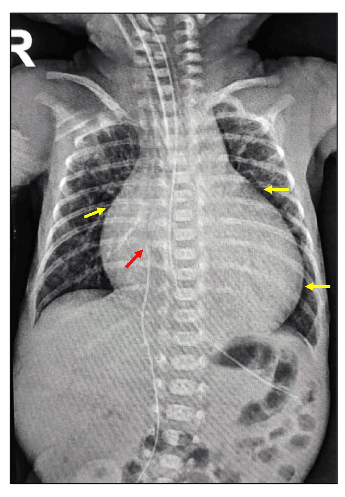
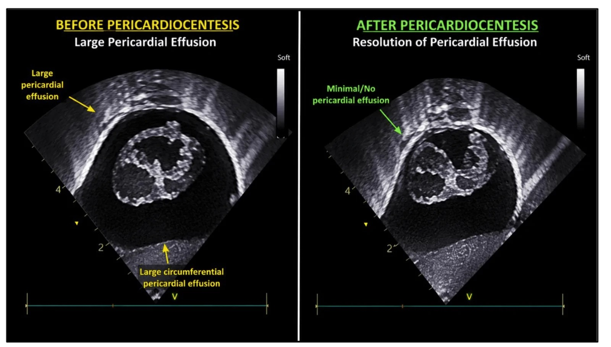
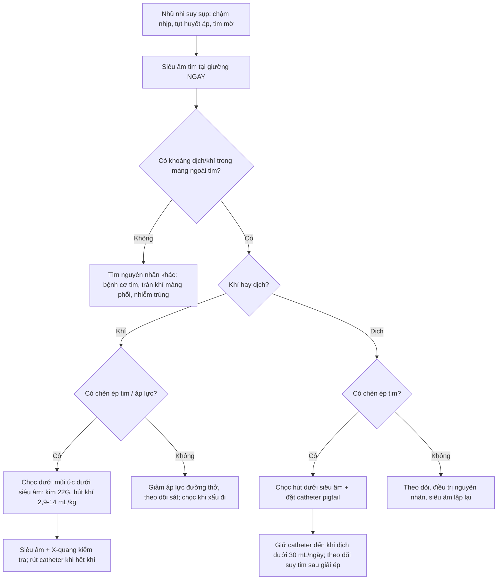
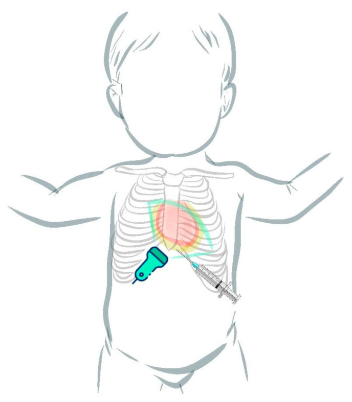
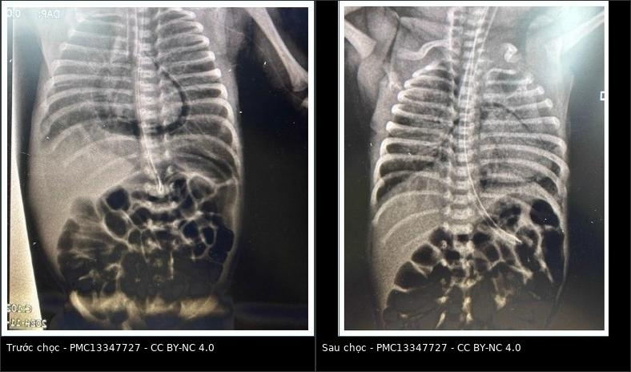

# 604 — Chọc/dẫn lưu màng ngoài tim qua da ở nhũ nhi & tràn khí màng ngoài tim áp lực / Percutaneous pericardiocentesis in infants & tension pneumopericardium

**Tags:** `pattern:dich-mang-ngoai-tim` `pattern:tran-khi-mang-ngoai-tim` `pattern:chèn-ép-tim` `vung:mang-ngoai-tim` `vung:tim` `protocol:sieu-am-tim` `protocol:choc-mang-ngoai-tim` `protocol:POCUS`
**Mức chắc chắn (certainty):** ca nguyên văn (verbatim case) — neo vào **hai ca nguyên văn có hình ảnh**: (1) trẻ **28+1 tuần/1115 g** bị **tràn khí màng ngoài tim (pneumopericardium) áp lực** ngày 7, ngừng tim, được **chọc dưới mũi ức dưới siêu âm**, hút **4 mL khí** rồi hồi phục (Akboga E et al., *Sisli Etfal Hastan Tip Bul* 2026, PMC13347727); (2) trẻ **24 tuần/640 g** có **tràn dịch màng ngoài tim khổng lồ + chèn ép tim** do catheter, chọc hút **13 mL dịch** (Sakharkar S et al., *Cureus* 2026, PMC13569918). Bổ sung bằng **loạt 68 thủ thuật ở trẻ em** (Lee DW et al., *BMC Pediatr* 2026, PMC12853591) và **16 ca tràn dịch do catheter ở NICU** (Cîrstoveanu C et al., *Life* 2024, PMC11433190).

## 1. Tổng quan bệnh học – cơ chế hình ảnh

- **Khoang màng ngoài tim ở nhũ nhi rất nhỏ:** thể tích dịch sinh lý thường **< 5 mL**; tràn dịch màng ngoài tim (pericardial effusion) được định nghĩa khi dịch vượt **5 mL** (Cîrstoveanu et al., 2024, PMC11433190). Vì khoang nhỏ và cơ tim non, **một lượng dịch/khí nhỏ tích tụ NHANH** đã đủ gây **chèn ép tim (cardiac tamponade)** — yếu tố quyết định là **tốc độ tích tụ**, không chỉ thể tích.
- **Cơ chế chèn ép tim:** màng ngoài tim tạng mỏng, màng ngoài tim thành **dày và ít đàn hồi**; dịch/khí làm tăng áp lực trong màng ngoài tim → tăng áp lực tâm trương của thất → **giảm đổ đầy thất → giảm thể tích nhát bóp**. Ở trẻ sơ sinh, thành nhĩ phải mỏng, ít dự trữ → **sụp nhĩ/thất phải thì tâm trương** là dấu hiệu sớm trên siêu âm tim.
- **Vì sao tràn khí màng ngoài tim hay gặp ở trẻ thở máy (cơ chế Macklin):** phế nang căng vỡ → khí đi theo **bao quanh mạch máu (perivascular sheath)** về rốn phổi → vào trung thất → qua các vùng **thiếu mô collagen quanh tĩnh mạch phổi** vào khoang màng ngoài tim. Vì vậy tràn khí màng ngoài tim thường **đi kèm** tràn khí màng phổi/trung thất/khí kẽ phổi.
- **Vì sao thấy trên hình — vật lý:** khí có đậm độ cực thấp (**khoảng −1000 HU** trên CT) nên **đen tuyệt đối** trên X-quang; dịch có đậm độ nước (**0–20 HU**) nên **xám như mô mềm**. Cả hai đều làm **bóng tim to**, nhưng khí tạo **quầng sáng (halo) ôm sát bóng tim**, còn dịch tạo **bóng tim dạng “bình nước” (water-bottle)** với bờ tim bị che mờ.
- **Ngưỡng định lượng và bối cảnh:**
  - **Tràn khí màng ngoài tim:** gặp ở **2% trẻ rất nhẹ cân (VLBW)** và **3,5% trẻ thở máy**; trong một loạt 2.389 VLBW, các rò khí kèm theo là **tràn khí màng phổi 49%**, **khí kẽ phổi 46%**, **tràn khí trung thất 39%**, khí dưới da 17%, khí phúc mạc 10%, **khí tắc mạch toàn thân 5%** (Akboga et al., 2026, PMC13347727).
  - **Dấu “halo sign”** có mặt ở **96% (48/50) ca** tràn khí màng ngoài tim trong loạt Burt & Lester, nhưng **không phải lúc nào cũng thấy ngay lần chụp đầu** (Akboga et al., 2026).
  - **Tử vong lịch sử 72%** trước kỷ nguyên surfactant; hiện nay giảm rõ nếu **chẩn đoán sớm + giải áp kịp** (Akboga et al., 2026).
  - **Tràn dịch do catheter trung tâm:** tỷ lệ **3,8/1.000 catheter** (khoảng 0,07–2%), **92% tiến triển chèn ép tim**, tử vong chung **~27%**; **> 60%** ca do PICC có **di trú đầu catheter vào trong tim** (Sakharkar et al., 2026, PMC13569918).
  - **Chọc/dẫn lưu ở trẻ em:** loạt **68 thủ thuật/58 bệnh nhân**, đường **dưới mũi ức 77,9%**, **tái phát 13%**; **đặt catheter lưu** làm giảm tái phát rõ (**8,1% vs 100%** khi chỉ chọc hút một lần); biến chứng nặng **4,4%**, nhẹ **2,9%** (Lee et al., 2026, PMC12853591).
  - **Lượng khí cần hút để thoát chèn ép:** trong y văn **2,9–14 mL/kg**; ca 1115 g chỉ cần **4 mL (~3,6 mL/kg)** là nhịp tim tăng > 100 lần/phút và SpO₂ lên 100% (Akboga et al., 2026).

## 2. Mẫu hình + chẩn đoán phân biệt theo vị trí (gamut)

- **Trong màng ngoài tim — dịch (pericardial effusion):** bóng tim to **dạng bình nước**, bờ tim mờ, phổi sáng; siêu âm thấy **khoảng trống âm (anechoic)** giữa màng ngoài tim tạng và thành, thay đổi theo thì tim. Nguyên nhân ở nhũ nhi: **catheter trung tâm (UVC/PICC)**, sau mổ tim, nhiễm trùng huyết, suy giáp, bệnh ác tính, tự phát.
- **Trong màng ngoài tim — khí (pneumopericardium):** **quầng khí đen ôm sát bóng tim**, **KHÔNG vượt lên trên các mạch máu lớn**, có thể thấy **khí cả dưới bờ tim**; khi **áp lực** → bóng tim nhỏ lại, tụt huyết áp, chậm nhịp, mạch nghịch.
- **Trung thất (mediastinum) — tràn khí trung thất:** khí **nâng tuyến ức** (dấu cánh buồm/spinnaker sail), **dấu cơ hoành liên tục (continuous diaphragm sign)**, lan lên cổ; **không có quầng khí ôm sát toàn bộ bóng tim**.
- **Khoang màng phổi — tràn dịch/tràn khí màng phổi:** bờ phổi tạng rõ, dịch **meniscus** hoặc khí **rãnh sâu**; siêu âm mất trượt màng phổi/điểm phổi.
- **Bóng tim to do bệnh tim:** Ebstein, hồi lưu tĩnh mạch phổi bất thường toàn phần, viêm cơ tim, tim phì đại — **không có khoảng dịch/khí** trên siêu âm; đừng chọc chỉ vì “tim to” trên X-quang.
- **Catheter trong buồng tim:** đầu catheter **nằm trong nhĩ phải** trên siêu âm/X-quang; có thể gây tràn dịch **dù vị trí ban đầu “ổn”** — luôn kiểm tra lại khi có suy sụp bất ngờ.

## 3. Bảng so sánh phân biệt (ma trận đối chiếu)

| Thực thể (entity) | Hình ảnh điển hình | Chốt vào (rule-in) | Chốt loại (rule-out) | Gợi ý xác nhận |
|---|---|---|---|---|
| Dịch màng ngoài tim | Bóng tim “bình nước”, bờ tim mờ; siêu âm: khoảng âm quanh tim | **Khoảng âm (anechoic) giữa lá tạng và lá thành, thay đổi theo nhịp tim** | **Khí đen ôm sát tim, không có khoảng âm** → tràn khí; **bóng tim to nhưng không có khoảng dịch** → bệnh cơ tim | Siêu âm tim 4 cửa sổ; đo độ dày dịch thì tâm trương; Doppler dòng chảy |
| Tràn khí màng ngoài tim | Quầng khí đen **ôm sát bóng tim**, **không vượt trên mạch máu lớn** | **Halo sign + khí dưới bờ tim + siêu âm thấy khí/bóng sáng trong màng tim** | **Khí nâng tuyến ức, cơ hoành liên tục, lan lên cổ** → trung thất | X-quang thẳng/nghiêng; siêu âm tim tại giường |
| Tràn khí trung thất | Dải khí dọc trung thất, nâng tuyến ức, cơ hoành liên tục | **Nâng tuyến ức (spinnaker sail) + continuous diaphragm sign** | **Quầng khí chỉ quanh tim, không lên cổ** → màng ngoài tim | X-quang; CT khi cần |
| Tràn dịch/tràn khí màng phổi | Bờ phổi tạng, meniscus hoặc rãnh sâu | **Bờ phổi tạng + mất mạch máu băng qua** | **Quầng khí ôm tim, không có bờ phổi tạng** | Siêu âm phổi (mất trượt/điểm phổi); X-quang nghiêng |
| Bóng tim to do bệnh tim | Tim to toàn bộ, không có quầng khí/dịch | **Siêu âm: buồng tim giãn/phì đại, không có khoảng dịch** | **Có khoảng dịch/khí** → nguyên nhân ngoài cơ tim | Siêu âm tim; ECG; BNP nếu cần |
| Catheter trong nhĩ phải | Đầu catheter ở nhĩ phải; có thể tràn dịch | **Đầu catheter trong buồng tim + tràn dịch mới** | **Đầu catheter ngoài tim, không dịch** → tìm nguyên nhân khác | Siêu âm tim; rút/đổi catheter; X-quang kiểm tra |

*Bóng tim **dạng bình nước (water-bottle)** với bờ tim bị che mờ (mũi tên vàng); đầu UVC ở ngang T9, dưới cơ hoành. Đây là **dấu hiệu X-quang kinh điển** nhưng **không đặc hiệu** — phải xác nhận bằng siêu âm tim. Nguồn: Sakharkar S et al., *Cureus* 2026 (PMC13569918), CC BY 4.0.*

*Trái: **tràn dịch màng ngoài tim lượng lớn** (mũi tên vàng) quanh tim. Phải: sau chọc hút, **gần như hết dịch**. Siêu âm tại giường là **chốt chẩn đoán + hướng dẫn chọc**. Nguồn: Sakharkar S et al., *Cureus* 2026 (PMC13569918), CC BY 4.0.*

## 4. Protocol chụp + hệ phân độ/điểm chuẩn hóa

- **Không có RADS riêng cho màng ngoài tim ở nhũ nhi.** Phân tầng thực hành dựa trên **huyết động** và **siêu âm**:
  1. **Không triệu chứng + không chèn ép:** theo dõi, điều trị nguyên nhân, siêu âm lặp lại.
  2. **Có triệu chứng/chèn ép:** **chọc giải áp ngay**.
  3. **Tràn khí màng ngoài tim áp lực:** giải áp **không chờ** X-quang lặp.
- **Siêu âm tim tại giường (cardiac POCUS) — đầu tay:** đầu dò **cao tần 5–10 MHz** (nhũ nhi), 4 cửa sổ: **dưới mũi ức (subcostal)**, **mỏm (apical 4 chambers)**, **cạnh ức trái**, **trên xương ức**. Tìm:
  - khoảng dịch âm quanh tim, độ dày **> 5 mL** (ước tính);
  - **sụp nhĩ phải thì tâm trương**, **sụp thất phải thì tâm trương**, **IVC giãn không xẹp**, **biến thiên dòng chảy van hai lá/phổi** → chèn ép tim;
  - **khí trong màng ngoài tim:** bóng sáng/“màn sương” che tim, mất hình ảnh tim ở một cửa sổ.
- **X-quang ngực thẳng (AP, nằm ngửa):** halo sign, bóng tim bình nước, đẩy trung thất; **không loại trừ** nếu âm.
- **Kỹ thuật chọc dẫn lưu (percutaneous pericardiocentesis):**
  - **Đường dưới mũi ức (subxiphoid)** là đường phổ biến nhất (**77,9%** trong loạt trẻ em) và thuận lợi ở nhũ nhi; đường mỏm (apical) là lựa chọn thay thế.
  - **Dưới hướng dẫn siêu âm liên tục**, sát trùng, gây tê tại chỗ (nếu huyết động cho phép).
  - **Kim 21–22G gắn bơm tiêm 10 mL**, đi **dưới mũi ức, hướng về vai trái**, **vừa đi vừa hút**; khi thấy khí/dịch, ngừng tiến kim. Với khí, có thể dùng **cannula ngoại vi 22G**; với dịch, đặt **catheter pigtail** theo Seldinger để **dẫn lưu liên tục**.
  - **Lượng hút:** khí **2,9–14 mL/kg** là khoảng đã báo cáo; dịch: hút **đủ để huyết động ổn định**, không cần hút cạn ngay. Ca 640 g hút **13 mL**; ca 1115 g hút **4 mL khí**.
  - **Duy trì catheter** đến khi **dịch < 30 mL/ngày** (thực hành ở loạt trẻ em) hoặc hết khí; theo dõi sát 24 giờ đầu.
  - **Biến chứng:** chọc vào cơ tim/mạch vành, tràn khí màng phổi, rối loạn nhịp, khí tắc mạch, nhiễm trùng, tái phát; biến chứng nặng **4,4%**, nhẹ **2,9%**. **Suy tim sau giải ép (paradoxical decompression)** gặp ở **2/68** — hồi sức dịch + inotrope.
- **Flowchart xử trí nhũ nhi có bóng tim to + suy sụp:**

- **Sau thủ thuật:** siêu âm tim kiểm tra, X-quang ngực, theo dõi nhịp tim/huyết áp/SpO₂; tìm **tràn khí màng phổi** và **tái tích tụ**; rút catheter khi đủ điều kiện.

*Sơ đồ đơn giản hóa: đầu dò siêu âm đặt ở mỏm/dưới mũi ức, kim đi **dưới mũi ức hướng về vai trái**, quan sát liên tục trên màn hình. Đây là kỹ thuật **tại giường do neonatologist thực hiện** trong đơn vị có POCUS. Nguồn: Cîrstoveanu C et al., *Life* 2024 (PMC11433190), CC BY 4.0.*

## 5. Biến thể bình thường và cạm bẫy

- **Halo sign âm không loại trừ tràn khí màng ngoài tim:** chỉ có **96%** ca có dấu này, và có thể **chưa xuất hiện ở phim đầu**; nếu lâm sàng xấu, **siêu âm tim** là bước tiếp theo.
- **Nhầm tràn khí màng ngoài tim với tràn khí trung thất:** khí màng ngoài tim **ôm sát tim và không vượt trên mạch máu lớn**; tràn khí trung thất **nâng tuyến ức**, có **dấu cơ hoành liên tục**, lan lên cổ. Đọc theo **vị trí tương đối**, không chỉ theo “có khí”.
- **“Bình nước” không đồng nghĩa với tràn dịch:** Ebstein, hồi lưu tĩnh mạch phổi bất thường, viêm cơ tim cũng làm tim to; **chỉ chọc khi siêu âm xác nhận khoảng dịch**.
- **Dịch rất nhỏ vẫn có thể gây chèn ép:** khoang màng ngoài tim nhũ nhi **< 5 mL**; đừng đánh giá thấp “dịch ít” khi bệnh nhân tụt huyết áp.
- **Catheter “trông đúng” vẫn có thể gây tràn dịch:** **> 60%** ca PICC có di trú đầu catheter vào tim; kiểm tra lại vị trí khi có suy sụp, và **rút catheter** là một phần điều trị.
- **Suy tim sau giải ép:** sau khi hút dịch, **2/68** ca tụt huyết động nghịch lý dù trước đó không suy tim — không xuất viện/ngừng theo dõi ngay sau thủ thuật.
- **Thông khí áp lực dương có thể “chữa” tràn khí màng ngoài tim có thông với khí trời** (như sau đặt catheter): PPV tăng áp lực lồng ngực chặn khí bị hút vào màng tim; ngược lại **hít vào gắng sức** do hẹp đường thở trên lại hút khí vào. Đây là cạm bẫy cơ chế, không phải lý do trì hoãn giải áp khi có chèn ép.
- **Không dùng “nitrogen washout” (oxy cao) cho trẻ < 32 tuần** để “tan” khí: nguy cơ stress oxy hóa, và bằng chứng không rút ngắn thời gian khỏi tràn khí.

## 6. Tự lượng giá — Blind Quiz ngay trên trang tĩnh

> Ảnh trơn ở NGOÀI, dấu hiệu + chẩn đoán giấu trong khối “bấm để hiện đáp án”.

**Ca 1 — Trẻ 28+1 tuần/1115 g, ngày 7 đột ngột chậm nhịp sau đặt lại nội khí quản.**

- Gợi ý lâm sàng: đang thở máy SIPPV, đặt lại nội khí quản vì nhiều đờm; sau đó **nhịp tim < 60**, SpO₂ tụt, tiếng tim mờ, phổi hai bên đều.
- Câu hỏi: Dấu hiệu chính trên phim trái? Khoang nào chứa khí? Xử trí ngay?

<b>Bấm để hiện đáp án (findings + chẩn đoán)</b>

- Dấu hiệu: **quầng khí liên tục ôm sát bóng tim (halo sign)**, khí thấy **dưới bờ tim**, không vượt trên các mạch máu lớn; phổi hai bên đều.
- Chẩn đoán: **tràn khí màng ngoài tim áp lực** sau thông khí áp lực dương. Xử trí: **chọc dưới mũi ức dưới siêu âm**, kim 21G + bơm 10 mL, hút **4 mL khí** → nhịp tim > 100, SpO₂ 100%. Sau đó giảm áp lực thở máy.
- Nguồn ảnh: Akboga E et al., *Sisli Etfal Hastan Tip Bul* 2026 (PMC13347727), CC BY-NC 4.0; ảnh ghép letterbox.

**Ca 2 — Trẻ 24 tuần/640 g, tuần thứ 3 suy sụp, có PICC.**

- Gợi ý: PICC đầu nằm gần bóng tim; đột ngột tăng nhu cầu oxy, tim to, huyết áp tụt.
- Câu hỏi: Ba dấu hiệu X-quang? Chẩn đoán? Thủ thuật nào đã cứu trẻ và lấy ra bao nhiêu dịch?

<b>Bấm để hiện đáp án (findings + chẩn đoán)</b>

- Dấu hiệu: **bóng tim to dạng bình nước**, bờ tim mờ (mũi tên vàng), đầu UVC/PICC ở thấp; siêu âm xác nhận **tràn dịch lượng lớn + chèn ép**.
- Chẩn đoán: **tràn dịch màng ngoài tim do catheter, chèn ép tim**. Xử trí: **rút PICC + chọc hút dưới siêu âm lấy 13 mL dịch**; trẻ ổn định, sống, theo dõi phát triển thần kinh bình thường.
- Nguồn ảnh: Sakharkar S et al., *Cureus* 2026 (PMC13569918), CC BY 4.0.

**Ca 3 — Siêu âm tim trước và sau can thiệp.**

- Câu hỏi: (a) Khoảng âm quanh tim là gì? (b) Vì sao sau chọc hút tim “nở” ra? (c) Dấu hiệu nào trên siêu âm xác nhận chèn ép?

<b>Bấm để hiện đáp án (findings + chẩn đoán)</b>

- Dấu hiệu: (a) **tràn dịch màng ngoài tim lượng lớn** — khoảng âm bao quanh tim; (b) sau hút dịch, **khoảng âm gần như mất**, tim đổ đầy tốt hơn; (c) **sụp nhĩ/thất phải thì tâm trương**, IVC giãn, biến thiên dòng chảy.
- Chẩn đoán: **chèn ép tim do dịch**; siêu âm là chốt chẩn đoán và hướng dẫn chọc.
- Nguồn ảnh: Sakharkar S et al., *Cureus* 2026 (PMC13569918), CC BY 4.0.

**Ca 4 — Kỹ thuật: nhìn sơ đồ và mô tả đường đi của kim.**

- Câu hỏi: Đầu dò đặt ở đâu? Kim đi từ đâu, hướng nào? Vì sao phải vừa đi vừa hút?

<b>Bấm để hiện đáp án (findings + chẩn đoán)</b>

- Dấu hiệu: đầu dò ở **mỏm/dưới mũi ức**; kim vào **dưới mũi ức**, hướng về **vai trái**, song song với thành thất phải.
- Chẩn đoán/kỹ thuật: **chọc dưới mũi ức dưới siêu âm**; vừa tiến vừa hút để phát hiện ngay khi vào khoang màng tim và tránh chọc sâu vào cơ tim.
- Nguồn ảnh: Cîrstoveanu C et al., *Life* 2024 (PMC11433190), CC BY 4.0.

## Bài liên quan chéo
- [600 – Tổng quan Nhi khoa](../600-tong-quan-nhi-khoa/lesson.md)
- [609 – Ống dẫn lưu màng phổi ở trẻ](../609-ong-dan-luu-mang-phoi-o-tre/lesson.md) (kỹ thuật dẫn lưu khoang màng phổi)
- [611 – Khí kẽ phổi (PIE) & tràn khí áp lực ở nhũ nhi](../611-ro-khi-nang-pie-tran-khi-ap-luc-nhu-nhi/lesson.md) (cơ chế Macklin, tràn khí màng ngoài tim)
- [617 – Hội chứng rò khí ở nhũ nhi](../617-hoi-chung-ro-khi-o-nhu-nhi/lesson.md) (tràn khí màng phổi/trung thất)
- [610 – Suy hô hấp sơ sinh: RDS, TTN, MAS & CDH](../610-suy-ho-hap-so-sinh-va-di-dang-phoi/lesson.md)
- [605 – Siêu âm phổi có điểm ở sơ sinh](../605-sieu-am-phoi-diem-so-sinh/lesson.md) (POCUS phổi, phân biệt nguyên nhân suy hô hấp)

## Ảnh
- Tên file: `604_slug_Modality_SourceID.jpg`; nguồn + giấy phép từng ảnh trong `images/CREDITS.md`.
- Ảnh `PMC13347727` là **CC BY-NC 4.0**; các ảnh còn lại **CC BY 4.0**. Ảnh ghép letterbox giữ nguyên tỷ lệ, không crop/kéo giãn.

> Không dùng để chẩn đoán độc lập khi chưa có người hướng dẫn.
