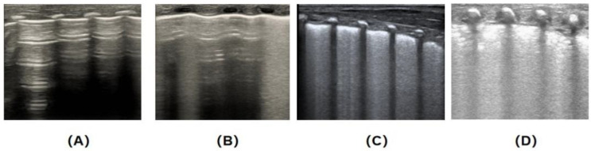
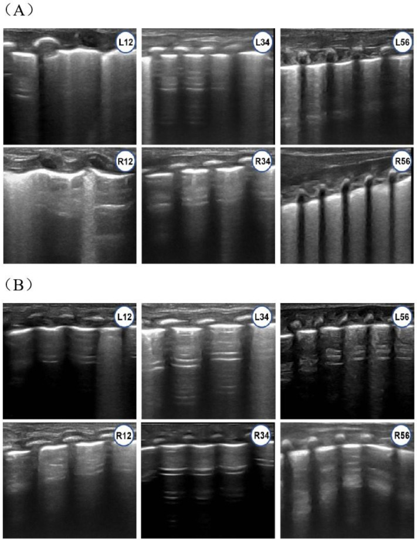
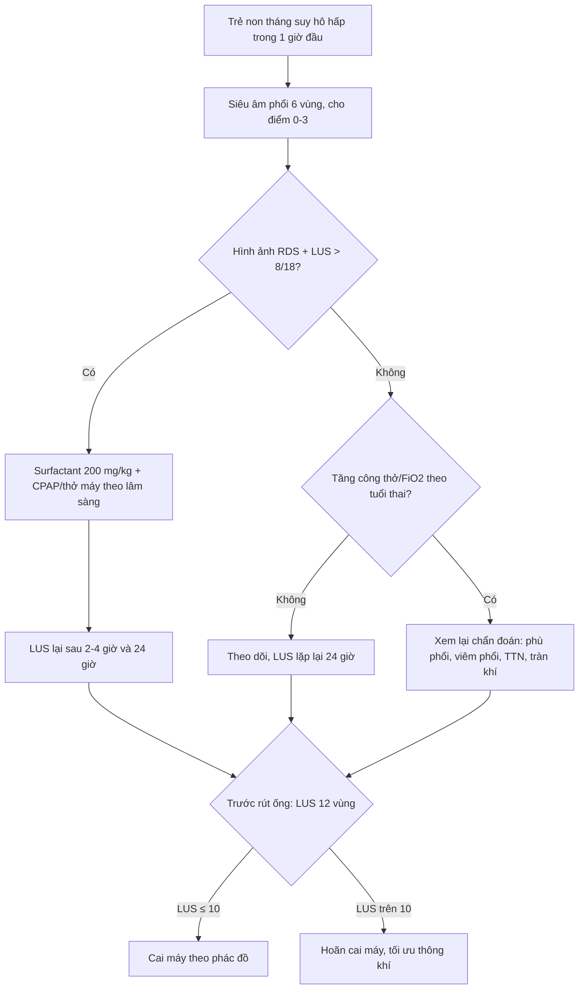
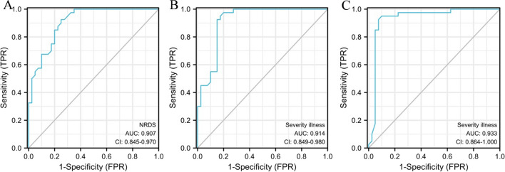
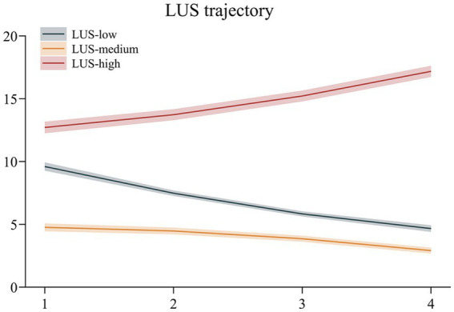
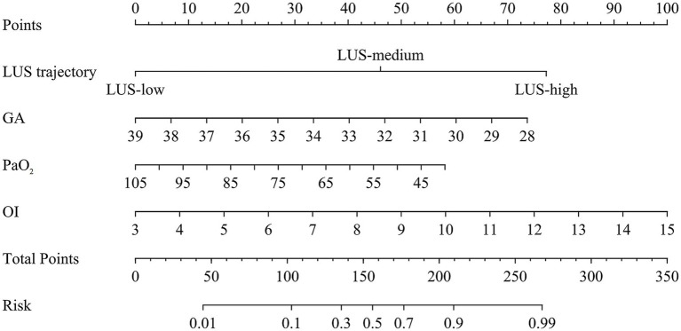

# 605 — Siêu âm phổi có điểm (lung ultrasound score, LUS) ở sơ sinh: ngưỡng surfactant, dự báo cai máy & theo dõi BPD / Neonatal lung ultrasound score

**Tags:** `pattern:giảm-thông-khí` `pattern:b-line` `pattern:đông-đặc` `vung:phổi` `score:LUS-6-vung` `score:LUS-12-vung` `protocol:siêu-âm-phổi` `protocol:surfactant` `protocol:cai-máy`
**Mức chắc chắn (certainty):** tổng hợp y văn (literature synthesis) — vì bài kết hợp **một RCT có nhóm chứng** (89 trẻ < 32 tuần; Zhang J et al., *Children* 2025, PMC12731310), **một nghiên cứu chẩn đoán 65 trẻ** (Huang P et al., *Biomed Eng Online* 2024, PMC10918994), **một nghiên cứu quỹ đạo LUS 266 trẻ** (Jiang L et al., *Front Med* 2026, PMC13013512) và **một nghiên cứu BPD** (PMC13423792). Không có ca nguyên văn duy nhất; các ca minh họa được lấy từ chính các nghiên cứu này.

## 1. Tổng quan bệnh học – cơ chế hình ảnh

- **Siêu âm phổi (lung ultrasound, LUS) nhìn thấy gì:** không khí trong phế nang **phản xạ gần như toàn bộ** sóng siêu âm (chênh trở kháng âm rất lớn giữa khí và mô mềm) → bình thường chỉ thấy **đường màng phổi (pleural line)** và các **đường A (A-lines)** — các đường ngang lặp lại do phản xạ qua lại giữa màng phổi và đầu dò. Khi phế nang mất khí (phù kẽ, phù phế nang, xẹp, đông đặc), mô trở nên **dẫn âm** hơn → xuất hiện **đường B (B-lines)** thẳng đứng, chạm màng phổi và kéo dài tới đáy màn hình; khi mô đặc hoàn toàn → **đông đặc (consolidation)**, giống mô gan (“hepatization”), có thể thấy **phế quản hơi (air bronchogram)**.
- **Thang điểm bán định lượng (semi-quantitative LUS):** mỗi vùng phổi được cho **0–3 điểm** theo mẫu hình nặng nhất:
  - **0 điểm:** thông khí bình thường — A-lines, có thể có vài B-line rời rạc.
  - **1 điểm:** giảm thông khí vừa — B-lines chiếm **< 50%** khoang gian sườn, hội chứng kẽ.
  - **2 điểm:** giảm thông khí nặng — B-lines **≥ 50%** khoang gian sườn/đổ đầy, có thể có đông đặc dưới màng phổi nhỏ.
  - **3 điểm:** **đông đặc phổi** lan rộng.
- **Hai cách chia vùng hay dùng:**
  - **6 vùng:** mỗi phổi chia **trước – bên – sau** (mốc: đường nách trước và đường nách sau) → tổng **0–18 điểm**; đây là cách dùng trong RCT của Zhang et al. (PMC12731310).
  - **12 vùng:** mỗi phổi chia 6 vùng (trước/bên/sau × trên/dưới) → tổng **0–36 điểm**; dùng trong nghiên cứu của Huang et al. (PMC10918994) và Jiang et al. (PMC13013512).
- **Vì sao LUS phản ánh bệnh màng trong (RDS):** thiếu surfactant → phế nang xẹp lan tỏa, mô kẽ đầy dịch → **B-lines lan tỏa, mất A-lines, “phổi trắng”**, đông đặc dưới màng phổi; mức độ mất thông khí tương quan với **độ nặng X-quang** (r = 0,841; Huang et al., 2024).
- **Ngưỡng định lượng có bằng chứng:**
  - **RCT 89 trẻ < 32 tuần:** LUS **> 8/18** + hình ảnh RDS → surfactant **200 mg/kg** (poractant alfa). Kết quả: **19,6%** trẻ nhóm LUS cần thở máy xâm lấn vs **46,5%** nhóm chứng; **surfactant 43,5% vs 74,4%**; thời gian thở máy xâm lấn ngắn hơn (p = 0,005) (Zhang et al., 2025, PMC12731310).
  - **65 trẻ RDS, 12 vùng:** LUS phân biệt RDS với bệnh phổi khác **AUC 0,907** (KTC 0,845–0,970), **Se 89,0%**, **Sp 92,5%**; phân biệt RDS nhẹ–trung bình **AUC 0,914**, trung bình–nặng **AUC 0,933** (Huang et al., 2024).
  - **Dự báo cai máy:** LUS trước rút ống **AUC 0,954** (KTC 0,907–1,000); **ngưỡng 10 điểm**, Se **93,33%**, Sp **88,0%** (Huang et al., 2024).
  - **Quỹ đạo LUS (266 trẻ):** ba nhóm — **LUS-high** khởi đầu ~**12,5** và tăng dần; **LUS-medium** ~**4,8**; **LUS-low** ~**9,5** giảm dần. Nhóm **LUS-high** chiếm **61,5%** ca thất bại cai máy vs **6,2%** ở nhóm thành công (Jiang et al., 2026, PMC13013512).
  - **BPD:** mỗi **1 điểm** tăng LUS tối đa ở **30–32 tuần** tương ứng **+9 ngày** mới cai được hỗ trợ hô hấp (16 trẻ < 32 tuần; PMC13423792).

## 2. Mẫu hình + chẩn đoán phân biệt theo vị trí (gamut)

- **Lan tỏa hai bên, đối xứng — RDS:** B-lines dày đặc/đổ đầy, mất A-lines, “phổi trắng”, đông đặc dưới màng phổi; **không có double lung point**; nặng dần trong 24–48 giờ nếu không bù surfactant.
- **Lan tỏa, đáy phổi — TTN (transient tachypnea of the newborn):** B-lines tập trung **đáy phổi**, có **“double lung point”** (ranh giới rõ giữa vùng B-lines và vùng A-lines), ít đông đặc, **tự cải thiện sau 48–72 giờ**.
- **Không đồng nhất — hít phân su (MAS):** vùng đông đặc/xẹp rải rác, B-lines không đều, tăng ứ khí; dễ kèm rò khí.
- **Ổ khu trú — viêm phổi sơ sinh:** đông đặc một vùng/thùy, **phế quản hơi**, bất đối xứng; có thể kèm tràn dịch màng phổi.
- **Lan tỏa hai bên — phù phổi (pulmonary edema):** B-lines/đông đặc giống RDS nhưng **không phải thiếu surfactant**; đáp ứng lợi tiểu/điều trị nguyên nhân, **không dùng surfactant** (xem ca LUS 9 trong RCT).
- **Màng phổi — tràn khí màng phổi:** **mất trượt màng phổi**, **điểm phổi (lung point)**, A-lines; **không chấm điểm LUS** như bệnh nhu mô.
- **Mạn — BPD (bronchopulmonary dysplasia):** LUS còn cao kéo dài, màng phổi không đều, đông đặc dưới màng phổi, giảm thông khí vùng đáy; LUS theo tuần giúp **theo dõi quỹ đạo** hơn là chẩn đoán một lần.
- **Xẹp phổi (atelectasis):** đông đặc có **mất thể tích**, mạch máu/phế quản dồn về; phân biệt với đông đặc viêm bằng bối cảnh + động học.

## 3. Bảng so sánh phân biệt (ma trận đối chiếu)

| Thực thể (entity) | Hình ảnh điển hình | Chốt vào (rule-in) | Chốt loại (rule-out) | Gợi ý xác nhận |
|---|---|---|---|---|
| RDS | B-lines lan tỏa/đổ đầy, mất A-lines, “phổi trắng”, đông đặc dưới màng phổi | **Mất A-lines + B-lines lan tỏa hai bên + LUS > 8/18 ở trẻ non tháng có suy hô hấp** | **Double lung point + đáy phổi + tự cải thiện** → TTN; **đông đặc khu trú** → viêm phổi | LUS lặp lại sau 1–24 giờ; X-quang; đáp ứng surfactant |
| TTN | B-lines đáy phổi, **double lung point**, ít đông đặc | **Ranh giới rõ vùng B-lines/vùng A-lines + cải thiện nhanh trong 48–72 giờ** | **B-lines lan tỏa toàn bộ + đông đặc + nặng lên** → RDS | LUS lặp lại 24 giờ; bối cảnh mổ lấy thai/đủ tháng |
| MAS | Đông đặc/xẹp rải rác, B-lines không đều, ứ khí | **Đông đặc không đồng nhất + tiền sử nước ối phân su** | **Đối xứng lan tỏa** → RDS/phù phổi | X-quang; LUS + lâm sàng |
| Viêm phổi sơ sinh | Đông đặc khu trú, phế quản hơi, có thể tràn dịch | **Đông đặc một vùng/thùy + phế quản hơi** | **Lan tỏa đối xứng** → RDS | X-quang/CT; CRP, cấy máu |
| Phù phổi | B-lines lan tỏa, đông đặc; giống RDS | **B-lines hai bên + bối cảnh tim/thận/truyền dịch; LUS cao nhưng không phải RDS** | **Đáp ứng surfactant + non tháng điển hình** → RDS | Siêu âm tim; đáp ứng lợi tiểu; LUS lặp lại |
| Tràn khí màng phổi | Mất trượt, điểm phổi, A-lines | **Mất trượt màng phổi + lung point** | **Trượt còn + B-lines** → không tràn khí | Siêu âm phổi M-mode; X-quang |
| BPD | LUS cao kéo dài, màng phổi không đều, đông đặc dưới màng phổi | **LUS còn cao sau 2–4 tuần + phụ thuộc oxy/hỗ trợ** | **LUS giảm nhanh trong tuần đầu** → RDS/TTN đơn thuần | LUS hằng tuần; NICHD 2018; X-quang |
| Xẹp phổi | Đông đặc, mất thể tích, dồn mạch/phế quản | **Đông đặc + dấu mất thể tích** | **Đông đặc có phế quản hơi + bờ viêm** → viêm phổi | X-quang/CT; LUS động |

*(A) 0 điểm — A-lines, vài B-line rời rạc; (B) 1 điểm — B-lines chiếm < 50% khoang gian sườn; (C) 2 điểm — B-lines ≥ 50%/đổ đầy; (D) 3 điểm — đông đặc lan rộng. Đây là **thang Brat** dùng trong RCT LUS-guided surfactant. Nguồn: Zhang J et al., *Children* 2025 (PMC12731310), CC BY 4.0.*

*Trẻ 31+5 tuần: (A) 1 giờ sau sinh — mất A-lines + hội chứng kẽ ở L12, L56, R12, R56; tổng **LUS 9**. (B) 24 giờ — A-lines rõ lại, chỉ còn ít B-lines. Chẩn đoán là **phù phổi**, không phải RDS → **không dùng surfactant**. Đây là cạm bẫy cốt lõi: **LUS cao không đồng nghĩa RDS**. Nguồn: Zhang J et al., 2025 (PMC12731310), CC BY 4.0.*

## 4. Protocol chụp + hệ phân độ/điểm chuẩn hóa

- **Đầu dò và cài đặt:** đầu dò **linear cao tần 10–15 MHz** (trẻ non tháng có thể dùng 6–12 MHz), độ sâu **4–6 cm**, focus tại màng phổi; tắt các chế độ làm mượt quá mức để không mất B-line.
- **Tư thế và vùng quét:**
  - Trẻ nằm ngửa cho vùng **trước** và **bên**; nằm nghiêng/đặt nhẹ cho vùng **sau**.
  - Mốc chia: **đường nách trước** và **đường nách sau**; mỗi phổi 3 vùng (trước/bên/sau).
  - **6 vùng → 0–18 điểm**; **12 vùng** (chia trên/dưới mỗi vùng) → **0–36 điểm**.
- **Cách cho điểm:** mỗi vùng lấy **mẫu hình nặng nhất**; không cộng dồn nhiều mẫu trong cùng vùng. Tổng điểm = tổng các vùng. Ghi rõ **thời điểm** (giờ sau sinh, trước/sau surfactant, trước rút ống) vì LUS thay đổi nhanh.
- **Các mốc dùng LUS:**
  1. **Chẩn đoán & quyết định surfactant:** quét trong **1 giờ đầu** khi có suy hô hấp; nếu hình ảnh RDS + **LUS > 8/18** → surfactant **200 mg/kg** (Zhang et al., 2025). Không dùng LUS đơn thuần để thay thế đánh giá lâm sàng.
  2. **Theo dõi đáp ứng:** lặp lại sau surfactant **2–4 giờ**, rồi **24 giờ**; LUS giảm là dấu hiệu đáp ứng.
  3. **Dự báo cai máy:** đo **48, 24, 12 và 2 giờ** trước rút ống; **ngưỡng 10** (thang 12 vùng) gợi ý cai máy thuận lợi (Se 93,33%, Sp 88,0%) (Huang et al., 2024).
  4. **Theo dõi BPD:** LUS **hằng tuần từ 2 tuần tuổi đến 36–44 tuần** tuổi sau kinh; LUS tối đa ở **30–32 tuần** có giá trị tiên lượng (mỗi điểm +9 ngày hỗ trợ) (PMC13423792).
- **Flowchart LUS-guided surfactant và cai máy:**

*(A) RDS vs bệnh phổi khác: **AUC 0,907**; (B) RDS nhẹ vs trung bình: **AUC 0,914**; (C) trung bình vs nặng: **AUC 0,933**. LUS có giá trị **phân biệt và phân độ**, không chỉ phát hiện bệnh. Nguồn: Huang P et al., *Biomed Eng Online* 2024 (PMC10918994), CC BY 4.0.*

*Ba quỹ đạo: **LUS-high** (đỏ) khởi đầu ~12,5 và tăng; **LUS-medium** (cam) ~4,8; **LUS-low** (xám) ~9,5 giảm dần. Nhóm **LUS-high** chiếm **61,5%** ca thất bại cai máy. Nguồn: Jiang L et al., *Front Med* 2026 (PMC13013512), CC BY 4.0.*

*Nomogram gồm **quỹ đạo LUS**, **tuổi thai**, **PaO₂**, **chỉ số oxy hóa (OI)**; điểm tổng → nguy cơ thất bại. AUC **0,914** (phát triển) và **0,859** (kiểm định nội bộ). Nguồn: Jiang L et al., 2026 (PMC13013512), CC BY 4.0.*

## 5. Biến thể bình thường và cạm bẫy

- **LUS cao KHÔNG đồng nghĩa RDS:** trong RCT, **24/27** trẻ được chẩn đoán phù phổi; **2 trẻ có LUS > 8** vẫn không dùng surfactant (một trẻ sau đó tiến triển ARDS). Ca LUS 9 ở trên là ví dụ điển hình — luôn kết hợp bối cảnh, đáp ứng điều trị và hình ảnh.
- **Chỉ quét vùng trước sẽ bỏ sót bệnh vùng sau:** ở trẻ nằm ngửa, tổn thương do trọng lực tập trung **sau/dưới**; phải quét đủ **6 vùng**, kể cả tư thế nghiêng.
- **TTN có thể “giả RDS” trong vài giờ đầu:** B-lines đáy phổi + double lung point; **lặp lại sau 24 giờ** trước khi kết luận cần surfactant.
- **Cho điểm sai vì cộng dồn:** mỗi vùng chỉ lấy **mẫu nặng nhất**; cộng nhiều mẫu trong cùng vùng sẽ làm điểm cao giả.
- **Tràn khí màng phổi không phải bệnh “điểm LUS”:** phải tìm **mất trượt + lung point**; LUS nhu mô có thể bình thường ở tràn khí nhỏ.
- **BPD không chẩn đoán bằng một lần LUS:** tổn thương mạn, màng phổi không đều; dùng **quỹ đạo theo tuần** và tiêu chuẩn NICHD 2018.
- **Không có ngưỡng thống nhất:** 6 vùng (0–18) và 12 vùng (0–36) **không thay thế nhau**; ngưỡng > 8 chỉ áp dụng cho thang 6 vùng, ngưỡng 10 cho thang 12 vùng trong các nghiên cứu trên. Ghi rõ **thang nào** khi trích dẫn.
- **Phụ thuộc người làm:** độ đồng thuận giữa hai bác sĩ có kinh nghiệm **κ = 0,89**, nhưng người mới cần được huấn luyện; không dùng LUS thay thế hoàn toàn X-quang trong bệnh cảnh phức tạp.
- **Đừng trì hoãn surfactant ở trẻ RDS nặng rõ ràng** chỉ vì chờ đủ điểm LUS hoặc vì LUS “chỉ 8”: quyết định cuối cùng là **lâm sàng + FiO₂ + công thở**.

## 6. Tự lượng giá — Blind Quiz ngay trên trang tĩnh

> Ảnh trơn ở NGOÀI, dấu hiệu + chẩn đoán giấu trong khối “bấm để hiện đáp án”.

**Ca 1 — Bốn mẫu hình siêu âm phổi.**

- Câu hỏi: Mỗi panel A–D tương ứng **mấy điểm**? Mẫu nào là đông đặc?

<b>Bấm để hiện đáp án (findings + chẩn đoán)</b>

- Dấu hiệu: (A) A-lines + vài B-line rời rạc = **0 điểm**; (B) B-lines < 50% khoang gian sườn = **1 điểm**; (C) B-lines ≥ 50%/đổ đầy = **2 điểm**; (D) đông đặc lan rộng = **3 điểm**.
- Chẩn đoán/kỹ thuật: thang **Brat 0–3** cho mỗi vùng; tổng 6 vùng = 0–18.
- Nguồn ảnh: Zhang J et al., *Children* 2025 (PMC12731310), CC BY 4.0.

**Ca 2 — Trẻ 31+5 tuần, LUS 9 điểm, có nên dùng surfactant?**

- Gợi ý: suy hô hấp nhẹ, FiO₂ thấp; LUS 1 giờ sau sinh 9 điểm; 24 giờ cải thiện rõ.
- Câu hỏi: Vì sao **không** dùng surfactant dù điểm > 8? Chẩn đoán thay thế là gì?

<b>Bấm để hiện đáp án (findings + chẩn đoán)</b>

- Dấu hiệu: (A) mất A-lines + hội chứng kẽ ở L12/L56/R12/R56; (B) 24 giờ A-lines rõ lại, ít B-lines.
- Chẩn đoán: **phù phổi**, không phải RDS. LUS cao nhưng **không có bệnh màng trong** → không dùng surfactant; điều trị nguyên nhân và theo dõi.
- Nguồn ảnh: Zhang J et al., 2025 (PMC12731310), CC BY 4.0.

**Ca 3 — Đọc ROC của LUS 12 vùng.**

- Câu hỏi: AUC của LUS khi phân biệt RDS với bệnh phổi khác? Se/Sp? Giá trị phân độ?

<b>Bấm để hiện đáp án (findings + chẩn đoán)</b>

- Dấu hiệu: (A) **AUC 0,907** (KTC 0,845–0,970), **Se 89,0%**, **Sp 92,5%**; (B) nhẹ vs trung bình **AUC 0,914**; (C) trung bình vs nặng **AUC 0,933**.
- Kết luận: LUS vừa **phát hiện** vừa **phân độ** RDS; AUC cao hơn khi phân biệt mức nặng.
- Nguồn ảnh: Huang P et al., *Biomed Eng Online* 2024 (PMC10918994), CC BY 4.0.

**Ca 4 — Quỹ đạo LUS trước rút ống.**

- Câu hỏi: Nhóm nào nguy cơ thất bại cai máy cao nhất? Vì sao nhìn **quỹ đạo** tốt hơn một điểm đơn lẻ?

<b>Bấm để hiện đáp án (findings + chẩn đoán)</b>

- Dấu hiệu: **LUS-high** (đỏ) khởi đầu ~12,5 và **tăng dần**; nhóm này chiếm **61,5%** ca thất bại cai máy (vs 6,2% ở nhóm thành công).
- Kết luận: **xu hướng LUS** phản ánh diễn tiến bệnh tốt hơn một lần đo; dùng để chọn thời điểm rút ống.
- Nguồn ảnh: Jiang L et al., *Front Med* 2026 (PMC13013512), CC BY 4.0.

**Ca 5 — Nomogram dự báo thất bại cai máy.**

- Câu hỏi: Bốn yếu tố trong nomogram? Điểm tổng càng cao nghĩa là gì?

<b>Bấm để hiện đáp án (findings + chẩn đoán)</b>

- Dấu hiệu: **quỹ đạo LUS**, **tuổi thai**, **PaO₂**, **OI**; điểm tổng càng cao → **nguy cơ thất bại cai máy càng lớn** (AUC 0,914 phát triển; 0,859 kiểm định).
- Kết luận: mô hình kết hợp LUS động + khí máu + tuổi thai tốt hơn LUS đơn thuần.
- Nguồn ảnh: Jiang L et al., 2026 (PMC13013512), CC BY 4.0.

## Bài liên quan chéo
- [600 – Tổng quan Nhi khoa](../600-tong-quan-nhi-khoa/lesson.md)
- [610 – Suy hô hấp sơ sinh: RDS, TTN, MAS & CDH](../610-suy-ho-hap-so-sinh-va-di-dang-phoi/lesson.md)
- [611 – Khí kẽ phổi (PIE) & tràn khí áp lực ở nhũ nhi](../611-ro-khi-nang-pie-tran-khi-ap-luc-nhu-nhi/lesson.md) (siêu âm phổi trong rò khí)
- [613 – Viêm tiểu phế quản ở nhũ nhi](../613-viem-tieu-phe-quan-nhi/lesson.md)
- [614 – Bệnh tiểu phế quản tắc nghẽn & Swyer–James](../614-benh-tieu-phe-quan-tac-nghen-BO-Swyer-James/lesson.md)
- [616 – Biến chứng viêm phổi nhi: empyema & hoại tử phổi](../616-bien-chung-viem-phoi-nhi-empyema-hoai-tu/lesson.md)
- [604 – Chọc/dẫn lưu màng ngoài tim ở nhũ nhi](../604-dan-luu-mang-ngoai-tim-nhu-nhi/lesson.md) (POCUS tim trong suy sụp)
- [669 – Theo dõi dài hạn BO & Swyer–James](../669-theo-doi-dai-han-BO-Swyer-James/lesson.md)

## Ảnh
- Tên file: `605_slug_Modality_SourceID.jpg`; nguồn + giấy phép từng ảnh trong `images/CREDITS.md`.
- Tất cả ảnh trong bài là **CC BY 4.0**.

> Không dùng để chẩn đoán độc lập khi chưa có người hướng dẫn.
