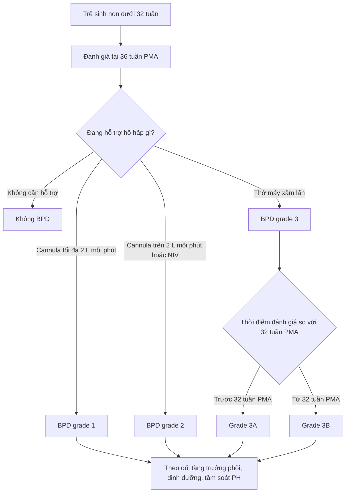
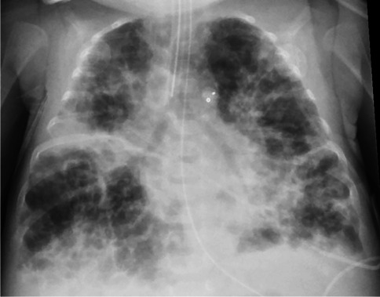
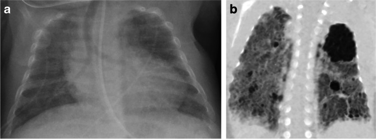
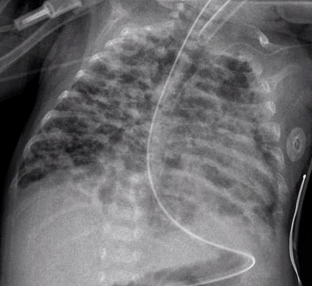

# 606 — Bệnh phổi mạn tính ở trẻ sinh non (BPD): phân độ NICHD 2018 / Jensen 2019, hình ảnh & theo dõi

**Tags:** `pattern:bpd` `pattern:u-khi` `pattern:bubbly-cystic` `pattern:mo-ke` `vung:phoi-nhi` `score:NICHD-2018` `score:Jensen-2019` `protocol:X-quang-nguc-nhi` `protocol:CT-nguc-nhi` `protocol:MRI-UTE`
**Mức chắc chắn (certainty):** tổng hợp y văn (literature synthesis) — tự biên từ bài tổng quan có hình ảnh gốc (Higano et al., *Pediatr Radiol* 2022, PMC8921108; Dini et al., *Front Pediatr* 2024, PMC11303306) và nghiên cứu đoàn hệ (Ito et al., *Clin Exp Pediatr* 2026, PMC12963941), không gắn một bệnh án đơn lẻ.

## 1. Tổng quan bệnh học – cơ chế hình ảnh: phổi "ít phế nang, nhiều khoảng khí"

- **Định nghĩa lâm sàng:** BPD (bronchopulmonary dysplasia) là **nhu cầu oxy/hỗ trợ hô hấp kéo dài tới 36 tuần tuổi sau kinh nguyệt (post-menstrual age, PMA)** ở trẻ sinh **dưới 32 tuần**. Đây là bệnh phổi mạn hay gặp nhất của trẻ cực non; tỷ lệ **20–75%** giữa các trung tâm (khác biệt về dân số, tiêu chuẩn và chiến lược thông khí), và **trên 50%** ở một số đoàn hệ trẻ rất non.
- **Bệnh học:** không phải "viêm phổi kéo dài" mà là **rối loạn phát triển phế nang và mạch máu phổi** — phế nang to, thưa, vách mỏng bất thường; mao mạch phổi giảm và tái cấu trúc. Bốn trục tổn thương: **oxy hóa quá mức (oxidative stress)**, **viêm**, **loạn sinh mạch (dysregulated angiogenesis)** và **sửa chữa mô bất thường**. Trước sinh: chorioamnionitis, bất thường bánh nhau, chậm tăng trưởng, yếu tố gen; sau sinh: thông khí áp lực, oxy, nhiễm trùng, dinh dưỡng kém.
- **TẠI SAO phim thay đổi theo thời gian — "ba thì" của BPD:**
  1. **Ngày 1:** hạt mịn lan tỏa ± phế quản hơi = **RDS** (thiếu surfactant) — xem [610](../610-suy-ho-hap-so-sinh-va-di-dang-phoi/lesson.md).
  2. **Tuần 1–2:** mờ đục/"phổi rỉ dịch" (**leaky lung**) — khoảng **55%** trẻ non tháng tiến triển tới thì này; chỉ **11%** trong số đó sáng lại hoàn toàn.
  3. **Tuần 3–4 trở đi:** **ứ khí + đám mờ thô + bóng khí "bubbly/cystic"** — phế nang đã bị tổn thương thoát khí vào khoảng kẽ và tạo các khoang khí nhỏ; nhu mô còn lại xẹp/đông đặc rải rác. Đây là hình ảnh đặc trưng của BPD "kinh điển" (thể Northway).
- **TẠI SAO bóng khí "đen" trên X-quang:** khí có đậm độ rất thấp (**−1000 HU** trên CT), nhu mô phổi lành khoảng **−700 đến −900 HU**; chênh lệch này tạo **vùng sáng** trên phim. Bóng khí BPD **không có vách rõ như nang thật**, phân bố **rải rác hai bên**, xen kẽ đám mờ — khác nang bẩm sinh (CPAM) thường **khu trú một thùy, có vách, chiếm thể tích**.
- **TẠI SAO ứ khí:** đường thở nhỏ dễ xẹp khi thở ra + mất đàn hồi phổi → khí bị "giam" thì thở ra; trên phim thấy **cơ hoành dẹt, khoang liên sườn rộng, phổi căng** — dấu hiệu **thể tích phổi tăng**, ngược với RDS cấp (thể tích thấp).
- **Ngưỡng định lượng quan trọng:**
  - **Bubbly/cystic trên X-quang ngày 28** dự báo **oxy tại nhà** mạnh hơn cả tuổi thai, cân nặng, chorioamnionitis; trẻ **không có** thay đổi này chỉ **2%** cần oxy tại nhà (đoàn hệ **> 8.000** trẻ, dẫn qua PMC8921108).
  - **Tăng áp lực động mạch phổi (BPD-PH)** gặp **20–40%** ở BPD nặng — tiên lượng xấu, nhập viện nhiều hơn, tử vong cao hơn (PMC8921108).
  - **Tracheobronchomalacia** gặp **10–48%** trẻ BPD được nội soi phế quản (PMC8921108).
  - BPD nặng làm **giảm khả năng khuếch tán** dù thể tích phế nang bình thường — hệ quả của giảm số phế nang, không phải "phổi nhỏ".

## 2. Mẫu hình + chẩn đoán phân biệt theo vị trí & thời điểm (Gamut)

- **Mẫu hình "BPD điển hình" (trung tâm, hai bên, đối xứng):** ứ khí toàn phổi + **đám mờ thô dạng lưới/đường** + **bóng khí nhỏ rải rác** ở trẻ **< 32 tuần**, đang hoặc vừa cai hỗ trợ hô hấp, chụp quanh **36 tuần PMA**.
- **Gamut theo "thời điểm xuất hiện":**
  - **Cấp, ngày 1–7:** RDS (hạt mịn, thể tích thấp), TTN (đủ tháng, mổ đẻ, ứ khí + dịch rãnh), MAS (già tháng, đám thô), **PIE** (bóng khí tuyến tính/tổ ong **cố định**, xuất hiện đột ngột trên nền thở máy) — xem [611](../611-ro-khi-nang-pie-tran-khi-ap-luc-nhu-nhi/lesson.md).
  - **Bán cấp, tuần 2–4:** viêm phổi do **RSV/ virus** (ứ khí + xẹp vi mô, không có bóng khí mạn), **viêm phổi hít sặc** (đám mờ thùy dưới phải, lặp lại cùng vị trí), **phù phổi** (tim to, Kerley).
  - **Mạn, sau 36 tuần PMA:** **BPD**; **CPAM type 1/2** (nang lớn một thùy, chẩn đoán trước sinh); **congenital lobar overinflation/CLO** (một thùy căng, đẩy trung thất); **giãn phế quản** (CF, sau nhiễm trùng — thành phế quản dày, dấu ấn nhẫn); **PIG** (pulmonary interstitial glycogenosis — mờ kẽ lan tỏa ở trẻ non tháng, hiếm); **Wilson–Mikity** (thể cũ ở trẻ non tháng không thở máy, bóng khí muộn).
- **Gamut theo biến chứng (đọc thêm trên CT/MRI):** BPD + **tracheobronchomalacia** (đường thở xẹp thì thở ra), BPD + **PH** (thất phải giãn, vách liên thất dẹt), BPD + **giãn phế quản**, BPD + **tăng trưởng phổi không đều**.
- **Mnemonic "BUBBLY":** **B**ronchopulmonary dysplasia (bóng khí hai bên, non tháng), **U**nexplained air-trapping (ứ khí thì thở ra), **B**irth weight thấp, **B**ilateral coarse opacities, **L**eaky lung giai đoạn sớm, **Y**oung gestational age (< 32 tuần).

## 3. Bảng so sánh phân biệt (ma trận đối chiếu)

| Thực thể (entity) | Hình ảnh điển hình (XR/CT) | Chốt vào (rule-in) | Chốt loại (rule-out) | Gợi ý xác nhận |
|---|---|---|---|---|
| **BPD** | Hai bên, đối xứng: ứ khí + đám mờ thô + bóng khí nhỏ; CT: mosaic, dày thành phế quản, dải/tam giác dưới màng phổi | **Trẻ < 32 tuần + còn cần hỗ trợ hô hấp tại 36 tuần PMA + ứ khí/bóng khí hai bên** | Bóng khí **khu trú một thùy có vách rõ** → CPAM; bóng khí **tuyến tính cố định xuất hiện cấp** → PIE | Chẩn đoán **lâm sàng**; X-quang để theo dõi, CT/MRI khi cần phenotype |
| **PIE** | Bóng khí li ti/tuyến tính **dọc mạch–phế quản**, thùy căng, **cố định** | **Xuất hiện cấp trên nền thở máy; bóng khí cố định, không đổi tư thế** | Bóng khí **rải rác hai bên, xuất hiện muộn, kèm đám mờ thô** → BPD | X-quang lặp lại 24–48 giờ; CT thì thở ra |
| **CPAM type 1** | **Nang lớn > 2 cm**, một thùy, vách rõ, có thể đẩy trung thất | **Nang lớn khu trú + chẩn đoán trước sinh/thai nhi** | Tổn thương **hai bên, đối xứng, không có nang trội** → BPD | CT ngực (không cấp cứu); MRI thai |
| **CLO (lobar overinflation)** | Một thùy **quá sáng, căng**, mạch thưa, đẩy trung thất; thường thùy trên trái | **Một thùy căng + đẩy trung thất + mạch thưa khu trú** | Ứ khí **toàn phổi hai bên** → BPD/PIE | CT thì hít vào–thở ra |
| **Viêm tiểu phế quản/viêm phổi virus** | Ứ khí + xẹp vi mô, đám mờ quanh rốn phổi, **không có bóng khí mạn** | **Sốt, ho, RSV dương; tổn thương thay đổi nhanh theo đợt** | Bóng khí **tồn tại qua nhiều lần chụp, không theo đợt nhiễm** → BPD | PCR virus; X-quang lặp lại |
| **Giãn phế quản (CF/sau nhiễm)** | Thành phế quản dày, **dấu ấn nhẫn**, đường ray, tắc nhầy | **Phế quản giãn không hồi phục + tắc nhầy + viêm xoang** | Phế quản **không giãn**, chỉ dày quanh phổi non tháng → BPD | HRCT; test mồ hôi/CFTR |
| **BPD + PH** | Cung động mạch phổi giãn, thất phải to, vách liên thất **dẹt thì tâm thu** | **Siêu âm tim: vận tốc hở ba lá > 2,8 m/s hoặc thất phải giãn** | Tim to do shunt trái–phải (PDA/VSD) không kèm tăng áp phổi | Siêu âm tim là chốt; MRI tim khi cần |

## 4. Protocol chụp + hệ phân độ chuẩn hóa

- **X-quang ngực:** AP nằm ngửa tại giường, **không dùng thường quy để chẩn đoán BPD**; vai trò chính là **theo dõi biến chứng** (PIE, tràn khí, xẹp, viêm phổi) và **đánh giá ứ khí/bóng khí** khi lâm sàng thay đổi. Chụp lặp lại **theo chỉ định**, không theo lịch cố định.
- **CT ngực (low-dose):** chỉ định khi cần **đánh giá đường thở trung tâm (tracheobronchomalacia)**, **mosaic/ứ khí**, hoặc **trước can thiệp**. Kỹ thuật: lát **≤ 1 mm**, liều thấp theo ALARA; có thể chụp **thì hít vào – thở ra** hoặc **động (4D)** để thấy đường thở xẹp; trẻ không hợp tác thường cần **an thần** — cân nhắc lợi/hại.
- **MRI phổi UTE/ZTE:** không tia X; **TE cực ngắn (0,05–0,1 ms)** mới thấy được nhu mô phổi (T2* phổi 0,5–3 ms nên chuỗi Cartesian thường "mất" tín hiệu). Chỉ dùng trong nghiên cứu/chuyên sâu; **siêu âm tim vẫn là chuẩn sàng lọc PH**.
- **Hệ phân độ (bắt buộc ghi rõ phiên bản):**
  - **NICHD 2001:** nhẹ (khí trời tại 36 tuần PMA), trung bình (**FiO₂ < 0,30**), nặng (**FiO₂ ≥ 0,30** hoặc thở áp lực dương).
  - **NICHD 2018 (Higgins):** đánh giá tại **36 tuần PMA** — **grade I:** cannula ≤ **2 L/phút**; **grade II:** cannula > **2 L/phút** hoặc **NIPPV**; **grade III:** **thở máy xâm lấn**, chia **IIIA** (đánh giá < 32 tuần PMA) và **IIIB** (≥ 32 tuần PMA).
  - **Jensen 2019 (NICHD NRN):** **grade 1** cannula ≤ **2 L/phút**; **grade 2** > **2 L/phút** hoặc NIV; **grade 3** thở máy xâm lấn — **bất kể FiO₂**. Xây dựng trên **2.677** trẻ < 32 tuần; dự báo **tử vong/bệnh hô hấp nặng** và **tử vong/NDI trung bình–nặng** tốt hơn NICHD 2001, dù ưu thế không đồng nhất ở 11 nghiên cứu sau.
  - **Phân loại Nhật Bản 2023 (MHLW)** dùng **SGA + hình ảnh bubbly/cystic + chorioamnionitis** để phân tầng sớm; trong 194 trẻ, **bubbly/cystic** là yếu tố độc lập (**aOR 10,88; KTC 4,43–26,72**) cho BPD nặng — hình ảnh có giá trị tiên lượng, không chỉ mô tả.

- **Theo dõi & điều trị (định lượng):**
  - **Mục tiêu SpO₂ 90–95%** (Mỹ); nhắm **85–89%** làm tăng tử vong trước xuất viện, không giảm BPD.
  - **Caffeine sớm (< 3 ngày)** giảm BPD/ngưng thở; liều duy trì **10–20 mg/kg/ngày** (nhóm liều cao cai máy tốt hơn, giảm BPD trung bình–nặng).
  - **Corticoid sau sinh:** dexamethasone liều thấp **DART 0,89 mg/kg trong 10 ngày** giảm BPD nhưng tăng nguy cơ thủng ruột, chậm tăng trưởng, di chứng thần kinh — **không dùng thường quy**.
  - **Surfactant, thông khí bảo vệ phổi, dinh dưỡng đủ năng lượng** là nền tảng; **vitamin A** từng được dùng nhưng bằng chứng không đồng nhất.
  - **BPD-PH:** sàng lọc bằng siêu âm tim; **20–40%** ở BPD nặng; cân nhắc **sildenafil** và **thông tim** khi nặng — phối hợp tim mạch.
  - **Theo dõi dài hạn:** chức năng hô hấp, tái nhập viện do RSV, tăng trưởng, phát triển thần kinh; nguy cơ **COPD sớm** ở tuổi trưởng thành.

## 5. Biến thể bình thường và cạm bẫy

- **"Bubbly" ở trẻ non tháng không luôn là BPD:** **PIE** cũng tạo bóng khí, nhưng xuất hiện **cấp**, **dọc mạch**, **cố định**; PIE có thể thoái triển trong vài ngày, còn BPD là tổn thương **mạn, hai bên, kèm đám mờ thô**.
- **Chẩn đoán BPD là lâm sàng, không phải X-quang:** trẻ **36 tuần PMA** vẫn cần cannula **2 L/phút** vì lý do khác (tim, thần kinh, dinh dưỡng) có thể bị gán nhầm BPD; ngược lại, **X-quang đẹp không loại trừ BPD**.
- **Đừng đoán mức FiO₂ trên phim:** không thể suy ra FiO₂ từ độ đen của phổi; phải đọc **bảng lâm sàng** (loại hỗ trợ, lưu lượng, FiO₂).
- **Tuyến ức to** ở trẻ nhỏ có thể giả "khối trung thất trước" hoặc làm mờ vùng trên tim; **không** nhầm với khối u — kiểm tra hình dạng cánh buồm, không đẩy khí quản.
- **Tim to trên phim** ở BPD có thể do **thất phải giãn/PHTN** hoặc do **PDA/VSD**; đừng mặc định "tim to sinh lý".
- **Satisfaction of search:** thấy bóng khí BPD rồi bỏ sót **tràn khí màng phổi** hoặc **PIE** đi kèm — luôn kiểm tra bờ phổi tạng, trung thất và khoang màng tim.
- **Ảnh chụp quá sớm** (< 28 ngày) không dùng để phân độ BPD; phân độ chỉ có nghĩa tại **36 tuần PMA** (hoặc lúc xuất viện nếu sớm hơn, tùy tiêu chuẩn).

## 6. Tự lượng giá — Blind Quiz

**Ca 1 — Trẻ sinh 25 tuần, hiện 36 tuần PMA, vẫn thở máy. Mô tả phổi trước khi xem đáp án.**

- Gợi ý lâm sàng: sinh cực non, còn nội khí quản, có dụng cụ đóng ống động mạch.
- Câu hỏi: (1) Hai dấu hiệu chính trên phim? (2) Phân độ BPD theo NICHD 2018/Jensen 2019? (3) Ba chẩn đoán phân biệt cần loại?

<b>Bấm để hiện đáp án (findings + chẩn đoán)</b>

- **Dấu hiệu:** phổi **căng (ứ khí)**, cơ hoành dẹt; **đám mờ thô hỗn hợp vùng sáng–tối**, nhiều **bóng khí nhỏ** rải rác hai bên; trẻ còn nội khí quản.
- **Chẩn đoán:** **BPD nặng — grade 3** (thở máy xâm lấn tại 36 tuần PMA); nếu đánh giá trước 32 tuần PMA là **3A**, từ 32 tuần là **3B**.
- **Phân biệt:** PIE (bóng khí cấp, dọc mạch, cố định), viêm phổi virus/RSV (thay đổi theo đợt), CPAM (nang khu trú một thùy) — ở đây tổn thương **hai bên, đối xứng, mạn** phù hợp BPD.
- **Nguồn ảnh:** Higano NS et al., *Pediatr Radiol* 2022, PMC8921108 Fig. 1, CC BY 4.0.

**Ca 2 — Trẻ sinh 23 tuần, chụp ở 38 tuần PMA: X-quang và một lát CT ngực.**

- Câu hỏi: CT **thêm được thông tin gì** mà X-quang không cho? Dấu hiệu nào gợi **ứ khí/mosaic**?

<b>Bấm để hiện đáp án (findings + chẩn đoán)</b>

- **X-quang (a):** phổi căng, đám mờ thô và vùng sáng không đều — BPD.
- **CT (b):** **mosaic giảm–tăng đậm độ** (ứ khí từng vùng), **dày thành phế quản**, dải mờ và vùng nang nhỏ; CT còn giúp đánh giá **đường thở trung tâm** (tracheobronchomalacia) và mức độ ứ khí — những thứ X-quang không thấy.
- **Chẩn đoán:** BPD; CT dùng để **phenotype/đánh giá biến chứng**, không phải tiêu chuẩn chẩn đoán.
- **Nguồn ảnh:** Higano NS et al., *Pediatr Radiol* 2022, PMC8921108 Fig. 3, CC BY 4.0.

**Ca 3 — Phim ngực của một trẻ BPD đã biết: vì sao không phải CPAM?**

- Câu hỏi: mô tả mẫu hình; nêu **hai lý do** loại CPAM.

<b>Bấm để hiện đáp án (findings + chẩn đoán)</b>

- **Dấu hiệu:** **đám mờ thô hai bên** + vùng sáng/ứ khí; thay đổi **lan tỏa, đối xứng**, không có nang lớn chiếm thể tích.
- **Vì sao không CPAM:** (1) CPAM thường **khu trú một thùy**, có **nang lớn/vách rõ**, có thể **đẩy trung thất**; (2) tổn thương ở đây **hai bên, đối xứng**, phù hợp bệnh phổi mạn của trẻ non tháng.
- **Nguồn ảnh:** Pulmonological, Wikimedia Commons, **CC BY-SA 3.0**.

## Bài liên quan chéo
- [610 – Suy hô hấp sơ sinh: RDS, TTN, MAS & CDH](../610-suy-ho-hap-so-sinh-va-di-dang-phoi/lesson.md) (thì sớm của BPD)
- [611 – Khí kẽ phổi (PIE) & tràn khí áp lực ở nhũ nhi](../611-ro-khi-nang-pie-tran-khi-ap-luc-nhu-nhi/lesson.md) (bóng khí cấp — phân biệt)
- [605 – Siêu âm phổi có điểm (LUS) ở sơ sinh](../605-sieu-am-phoi-diem-so-sinh/lesson.md) (ngưỡng surfactant, dự báo BPD)
- [613 – Viêm tiểu phế quản ở nhũ nhi (RSV)](../613-viem-tieu-phe-quan-nhi/lesson.md) (đợt cấp trên nền BPD)
- [614 – Bệnh tiểu phế quản tắc nghẽn & Swyer–James](../614-benh-tieu-phe-quan-tac-nghen-BO-Swyer-James/lesson.md) (mosaic mạn)
- [619 – Di chứng hô hấp sau hoại tử phổi & cắt thùy](../619-di-chung-ho-hap-sau-hoai-tu-phoi-cat-thuy/lesson.md) (giãn phế quản, phổi bó)
- [600 – Tổng quan Hệ Nhi khoa](../600-tong-quan-nhi-khoa/lesson.md)

> Không dùng để chẩn đoán độc lập khi chưa có người hướng dẫn.
