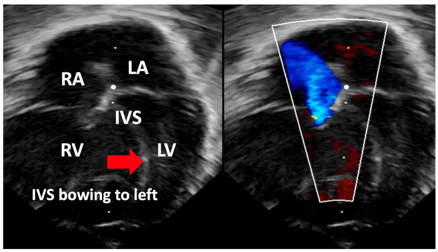
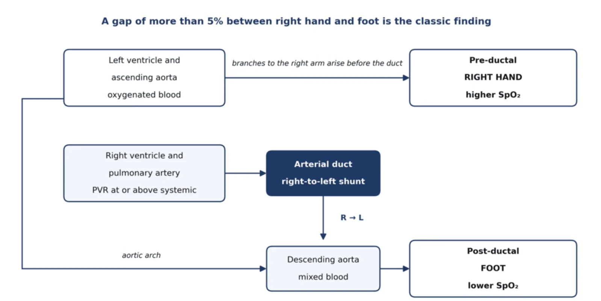
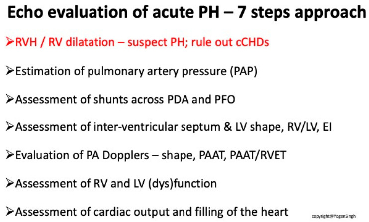
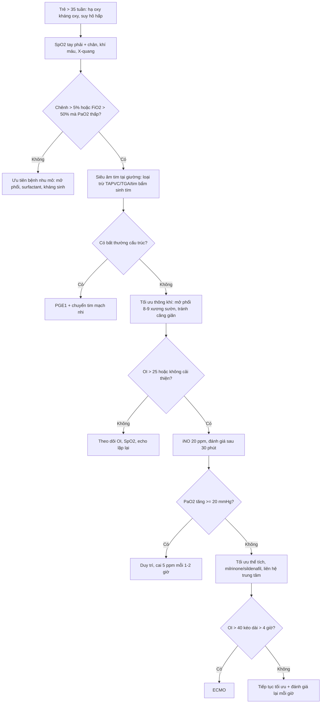
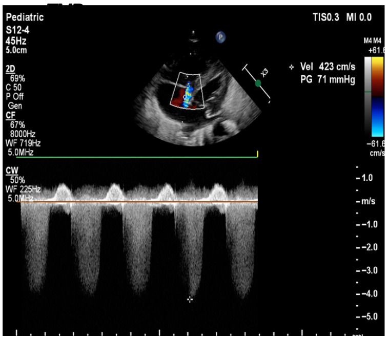
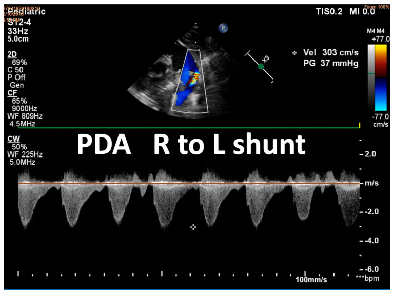
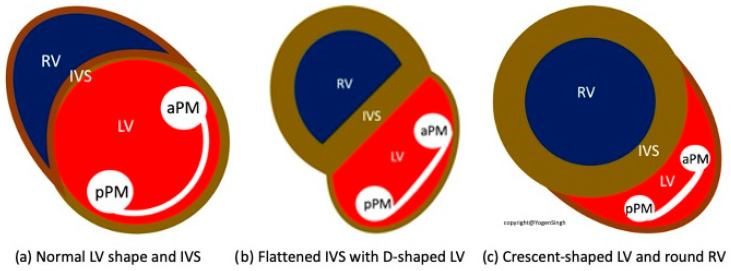

# 607 — Tăng áp lực động mạch phổi dai dẳng ở sơ sinh (PPHN): siêu âm tim tại giường, iNO & ngưỡng ECMO

**Tags:** `pattern:tang-ap-dong-mach-phoi` `pattern:shunt-phai-trai` `pattern:ha-oxy-khang-tri` `vung:phoi-nhi` `vung:tim` `score:OI` `protocol:sieu-am-tim-so-sinh` `protocol:iNO`
**Mức chắc chắn (certainty):** tổng hợp y văn (literature synthesis) — ghép **một tổng quan thực hành cho đơn vị sơ sinh cấp 2** (Cureus 2026, PMC13652105), **một tổng quan có hình siêu âm minh họa đầy đủ** (Biomedicines 2025, PMC12561312) và **một bài về phenotype/thời điểm** (J Perinatol 2026, PMC13680266). Số liệu lấy từ bảng/chú thích bài gốc; **các ngưỡng khác nhau giữa guideline được ghi rõ nguồn**, không gộp thành một con số duy nhất.

## 1. Tổng quan bệnh học – cơ chế hình ảnh

- **Định nghĩa sinh lý:** PPHN là **thất bại giảm sức cản mạch phổi (PVR) sau sinh** → áp lực động mạch phổi **bằng hoặc vượt áp lực hệ thống** → máu **shunt phải–trái qua ống động mạch (PDA) và/hoặc lỗ bầu dục (PFO)** → **hạ oxy không tương xứng với bệnh nhu mô phổi**. Vì vậy PPHN là **hội chứng sinh lý**, không phải một chẩn đoán nguyên nhân.
- **Phương trình phải thuộc:** **PAP trung bình = (PVR × lưu lượng máu phổi) + PCWP**. Ba nhánh sinh lý tương ứng ba phenotype: (1) **PVR tăng, nhu mô phổi bình thường** (thể điển hình — maladaptation); (2) **PVR tăng + nhu mô phổi bất thường** (CDH, loạn sản phổi, thiểu sản phổi); (3) **lưu lượng/áp lực tĩnh mạch phổi tăng** (hẹp tĩnh mạch phổi, rối loạn chức năng thất trái — nhóm 2 WSPH).
- **TẠI SAO hạ oxy "không đáp ứng oxy":** oxy là **giãn mạch phổi mạnh**, nhưng khi máu đã **đi tắt qua ống động mạch/lỗ bầu dục** thì oxy thêm **không đi qua phổi** → không sửa được shunt. Đây là điểm khác biệt cốt lõi với bệnh nhu mô (RDS, viêm phổi) nơi tăng FiO₂ vẫn cải thiện PaO₂.
- **TẠI SAO chênh SpO₂ tay phải – chân:** nhánh động mạch **cấp máu tay phải nằm TRƯỚC ống động mạch (pre-ductal)**, còn động mạch chủ xuống **sau ống (post-ductal)**. Khi có shunt phải–trái qua PDA, máu đã khử oxy đổ vào động mạch chủ xuống → **SpO₂ chân thấp hơn tay phải**.
- **TẠI SAO siêu âm tim thấy được áp lực phổi (vật lý):**
  - **Dòng hở ba lá (TR):** chênh áp RV–RA tính theo **Bernoulli rút gọn ΔP = 4 × Vmax²**; **PASP = 4 × (TR Vmax)² + áp lực nhĩ phải (ước 3–10 mmHg)**. Vận tốc TR **càng cao = chênh áp càng lớn**. TR **chỉ có ở 60–85%** ca PPHN — **không có TR không loại trừ PPHN**.
  - **Vách liên thất (IVS):** vách là màng mềm giữa hai buồng; **vị trí vách do chênh áp RV–LV quyết định**, không do cơ tim dày. Khi áp phổi **50–100% áp hệ thống** → **vách dẹt, thất trái hình chữ D**; khi áp phổi **> áp hệ thống** → **thất trái hình lưỡi liềm, thất phải tròn**.
  - **Shunt qua PDA/PFO:** hướng dòng = hướng chênh áp; **phải–trái = áp phổi > áp chủ**, **hai chiều = hai áp lực gần bằng nhau** (PPHN trung bình), **trái–phải = áp phổi thấp hơn**.
  - **PAAT (pulmonary arterial acceleration time):** khi PVR/compliance mạch phổi bất thường, thời gian tăng tốc dòng phổi **ngắn lại** và **PAAT/RVET giảm**. Ngưỡng số cụ thể **khác nhau giữa các nghiên cứu — chưa có ngưỡng chuẩn thống nhất**; dùng để **theo dõi xu hướng**, không để chẩn đoán đơn độc.

*Hình: RV giãn và **vách liên thất đẩy sang trái** — dấu hiệu áp lực thất phải ≥ thất trái. Nguồn: Chojnacka K et al., *Biomedicines* 2025, PMC12561312 Fig. 2, CC BY 4.0.*

- **Ngưỡng định lượng bắt buộc nhớ:**
  - **Chỉ số oxy hóa OI = (MAP × FiO₂ × 100) / PaO₂**; **OI < 10 nhẹ**, **10–25 trung bình**, **> 25 nặng**; **iNO khi OI > 25** (guideline quốc tế) hoặc **> 15–20** (một số mạng lưới UK); **ECMO khi OI > 40 kéo dài > 4 giờ** (ELSO 2017), **liên hệ trung tâm ECMO khi OI > 25–30**.
  - **Chênh SpO₂ pre–post ductal > 5% là dấu hiệu kinh điển**; chênh **5–10%** ủng hộ shunt phải–trái qua PDA nhưng **không đủ chẩn đoán**; một guideline dùng ngưỡng **> 4%** kèm **FiO₂ > 50% hoặc PaO₂ < 8 kPa** và suy hô hấp ở thai **> 35 tuần**.
  - **iNO:** khởi đầu **20 ppm**, đáp ứng = **PaO₂ tăng ≥ 20 mmHg trong 30 phút**; **half-life 2–6 giây**; có thể thử **40–80 ppm** nếu không đáp ứng; trẻ non tháng khởi đầu **5–10 ppm**.
  - **BNP > 850 pg/mL** dự báo cần iNO (độ nhạy cao; ngưỡng chưa chuẩn hóa).
  - **Tỷ lệ:** PPHN gặp **0,1–0,6%** trẻ sơ sinh; **~40%** (một mạng lưới UK) hoặc **~1/3** (tổng quan 2026) **không đáp ứng iNO**; **NNT = 5** để tránh một ca ECMO.
  - **Thời điểm:** PPHN **điển hình (maladaptation) hết bệnh trong 10 ngày đầu**; **< 1/3** ca PPHN **không điển hình (loạn sản phổi)** đạt mốc cai máy/thuốc trong 10 ngày → nghĩ **DevLD** (ACD, TBX4, đột biến surfactant).

## 2. Mẫu hình + chẩn đoán phân biệt theo vị trí (gamut)

*Hình: cơ chế chênh SpO₂ — tay phải nhận máu trước ống, chân nhận máu sau ống đã trộn máu khử oxy. Nguồn: Mohamed E et al., *Cureus* 2026, PMC13652105 Fig. 1, CC BY 4.0.*

- **Mẫu hình 1 — hạ oxy + chênh pre/post ductal + phổi "tương đối sạch":** thể **maladaptation** (vô căn, sau ngạt, nhiễm trùng, mẹ dùng NSAID/SSRI). Đây là PPHN "kinh điển".
- **Mẫu hình 2 — hạ oxy + phổi bất thường trên X-quang:** **MAS** (đám thô + ứ khí), **RDS** (hạt kính mờ), **viêm phổi/sepssis**, **thiểu sản phổi**, **CDH** (quai ruột trong lồng ngực, trung thất lệch). PPHN **có thể đồng thời** với bệnh nhu mô — không loại trừ nhau.
- **Mẫu hình 3 — sốc/tưới máu kém + tím:** **bệnh tim bẩm sinh tím** (TAPVC, TGA, teo phổi, Fallot nặng, teo ba lá, Ebstein, hẹp van ĐMC/gián đoạn cung chủ, HLHS). **Bắt buộc loại trừ trước khi kết luận PPHN.**
- **Mẫu hình 4 — PPHN "không hết" sau 10 ngày:** **loạn sản phổi (DevLD)** — ACD (FOXF1), **TBX4**, đột biến **ABCA3/SFTPB/SFTPC/NKX2-1**, Trisomy 21; cần **gen + CT phổi + cân nhắc sinh thiết**.
- **Mẫu hình 5 — PPHN do tim trái (nhóm 2):** **FGR, con mẹ đái tháo đường, HIE, non tháng, hẹp đường ra thất trái** → áp lực đổ đầy thất trái cao, phù phổi; điều trị **khác** (lusitropy/milrinone, giảm thể tích), **không chỉ giãn mạch phổi**.
- **Phân bố theo bệnh nền (dịch tễ):** MAS, ngạt chu sinh, nhiễm khuẩn (đặc biệt **GBS**), viêm phổi, thiểu sản phổi/ối ít, vỡ ối kéo dài; **đa hồng cầu và hạ calci** có thể góp phần; mẹ dùng **aspirin, NSAID, SSRI** là yếu tố liên quan.

## 3. Bảng so sánh phân biệt (ma trận đối chiếu)

| Thực thể (entity) | Hình ảnh / lâm sàng điển hình | Chốt vào (rule-in) | Chốt loại (rule-out) | Gợi ý xác nhận |
|---|---|---|---|---|
| **PPHN thể maladaptation (điển hình)** | Trẻ đủ tháng/gần đủ tháng, hạ oxy kháng oxy, **chênh SpO₂ > 5%**, X-quang phổi sạch hoặc bệnh nhu mô nhẹ; echo: **vách dẹt, TR, shunt phải–trái** | **PVR cao + shunt phải–trái + loại trừ tim bẩm sinh + hết bệnh trong ~10 ngày** | Hết shunt sau 10 ngày, không đáp ứng giãn mạch → nghĩ loạn sản/tim trái | Echo tại giường; đáp ứng iNO |
| **PPHN + bệnh nhu mô (MAS/RDS/viêm phổi)** | X-quang **đám thô, hạt kính mờ, đông đặc**; PaO₂ thấp **đồng đều hai vị trí** (không chênh) | **Tổn thương nhu mô + giảm compliance; chênh SpO₂ có thể KHÔNG có** | Phổi hoàn toàn sạch, chênh rõ → thể mạch máu thuần | X-quang; siêu âm phổi; đáp ứng surfactant |
| **CDH** | Quai ruột trong lồng ngực, **trung thất lệch**, thiểu sản phổi cùng bên | **Quai ruột + lệch trung thất + thiểu sản phổi** | Lồng ngực bình thường, không lệch trung thất | X-quang; echo (đánh giá PH) |
| **TAPVC (hội chứng tim trái giả)** | Tím + **phù phổi/ tĩnh mạch phổi giãn**, không đáp ứng oxy; X-quang có thể **phù phổi** | **Echo không thấy tĩnh mạch phổi đổ về nhĩ trái** | Tĩnh mạch phổi đổ về nhĩ trái bình thường | **Echo + Doppler màu bắt buộc**; chuyển tim mạch nhi |
| **TGA / teo phổi / Fallot nặng** | Tím sớm, **không chênh SpO₂ rõ**, echo bất thường cấu trúc | **Bất thường cấu trúc trên echo** | Cấu trúc tim bình thường | Echo; **PGE1 5–10 ng/kg/phút** khi nghi tổn thương phụ thuộc ống |
| **PPHN do tim trái (nhóm 2)** | FGR/IDM/HIE, **phù phổi**, thất trái giãn/yếu, hở van hai lá | **Rối loạn chức năng thất trái + áp lực đổ đầy cao** | Thất trái bình thường, không phù phổi | Echo (chức năng LV, PCWP ước tính) |
| **PPHN do loạn sản phổi (DevLD)** | **Không cai được máy sau 10 ngày**, PH nặng kéo dài, có thể **tràn khí tái diễn**, bất thường gen | **PH kéo dài > 10 ngày + hình ảnh/gen loạn sản** | Cai oxy/thuốc trong tuần đầu | CT phổi độ phân giải cao; panel gen; sinh thiết chọn lọc |
| **Nhiễm khuẩn huyết/viêm phổi** | Sốt/mẹ sốt, CRP tăng, **sốc**, giảm tưới máu | **Cấy máu dương + đáp ứng kháng sinh/vận mạch** | Cấy âm, không ổ nhiễm | Cấy máu, CRP, X-quang |

## 4. Protocol chụp/đánh giá + phân tầng điều trị

### 4.1 Đánh giá tại giường (7 bước siêu âm tim)
1. **Hình thái & loại trừ tim bẩm sinh** (đặc biệt **TAPVC**, TGA, teo phổi, hẹp đường ra trái).
2. **Ước lượng áp lực động mạch phổi** qua **TR Vmax** (PASP = 4 × Vmax² + RAP).
3. **Shunt qua PDA và PFO** (hướng, hai chiều, phải–trái).
4. **Vách liên thất & hình dạng thất trái** (O / D / lưỡi liềm) ± **chỉ số lệch tâm (EI)**.
5. **Doppler động mạch phổi:** hình dạng sóng, **PAAT**, **PAAT/RVET**.
6. **Chức năng RV và LV** (TAPSE, FAC, Tei).
7. **Cung lượng tim và đổ đầy** (IVC, đánh giá đáp ứng điều trị lặp lại).

*Hình: 7 bước có thứ tự — bắt đầu bằng loại trừ tim bẩm sinh, kết thúc bằng cung lượng tim. Nguồn: Chojnacka K et al., *Biomedicines* 2025, PMC12561312 Chart 1, CC BY 4.0.*

- **Theo dõi:** **SpO₂ trước và sau ống liên tục**, khí máu **ghi rõ vị trí lấy mẫu** (OI tính từ mẫu **sau ống** mới dùng cho tiêu chuẩn ECMO), **OI lặp lại theo xu hướng** (không dùng một giá trị đơn), lactate, huyết áp xâm lấn, X-quang ngực.
- **Mục tiêu:** SpO₂ trước ống **93–97%** với PaO₂ **55–80 mmHg** (một tổng quan) hoặc **95–98%** với **chênh < 5%** (một mạng lưới UK) — **hai đích khác nhau, ghi rõ nguồn**; **tránh tăng oxy** (FiO₂ > 0,6 không hiệu quả khi shunt ngoài phổi và làm nặng tổn thương phổi). **PaCO₂ 4,5–5,5 kPa, pH 7,35–7,45**, **không tăng thông khí**.
- **Thông khí:** đặt nội khí quản khi cần **FiO₂ > 45–50%** trên hỗ trợ không xâm lấn; **mở phổi đến 8–9 xương sườn sau** trên X-quang — **tối ưu thể tích, không tối đa** (xẹp làm tăng PVR trong vài phút, nhưng **căng giãn cũng tăng PVR**). Surfactant nếu có RDS (đồng thuận châu Âu 2022).
- **An thần/giảm đau:** giảm kích thích (tiếng ồn, thao tác); **morphine truyền 5–20 µg/kg/giờ (tối đa 40)**, **fentanyl 2 µg/kg** khi cần.

### 4.2 Thang thuốc (liều lấy từ bảng bài gốc)
| Thuốc | Liều | Chỉ định / lưu ý |
|---|---|---|
| **iNO** | **20 ppm** (5–20 ppm); tăng 40–80 ppm nếu không đáp ứng | Thuốc **duy nhất được đăng ký**; đáp ứng trong **30 phút**; theo dõi **methemoglobin** (mỗi 12 giờ; xử lý nếu > 2%, giữ < 5%) |
| **Sildenafil** | IV: **0,4 mg/kg trong 3 giờ**, duy trì **0,067 mg/kg/giờ**; uống **0,5 mg/kg** → **1–3 mg/kg mỗi 6 giờ** | Bậc 2 sau iNO; **first-line khi không có iNO**; IV gây hạ huyết áp nhiều hơn |
| **Milrinone** | **0,2–1 µg/kg/phút** | Khi **giảm cung lượng/thất trái yếu**, không đáp ứng iNO; **hạ huyết áp** — bù thể tích trước |
| **Bosentan** | **1–2 mg/kg mỗi 12 giờ** (uống) | Cứu hộ; theo dõi **men gan, hemoglobin** |
| **Iloprost / epoprostenol** | Iloprost khí dung **1–2,5 µg/kg mỗi 2–4 giờ**; epoprostenol **1–2 ng/kg/phút** (tối đa 50–80) | Cứu hộ trong ca kháng trị; dữ liệu sơ sinh hạn chế |
| **PGE1** | **5–10 ng/kg/phút** | Duy trì ống động mạch khi nghi tổn thương phụ thuộc ống / giảm hậu tải RV |

- **Cai iNO:** giảm **5 ppm mỗi 1–2 giờ** đến 5 ppm, rồi **1 ppm**; **không ngừng đột ngột** (co thắt phổi dội ngược). Thường cai được **trong 5 ngày**; kéo dài hơn → nghĩ bệnh phổi phát triển.
- **ECMO:** **OI > 40 kéo dài > 4 giờ** (ELSO 2017 supplement) là tiêu chuẩn kinh điển; guideline ELSO 2020 mô tả **không có ngưỡng số cố định**; thực tế **liên hệ trung tâm khi OI > 25–30** để chuẩn bị vận chuyển.

## 5. Biến thể bình thường và cạm bẫy

- **Không có chênh SpO₂ KHÔNG loại trừ PPHN:** chênh mất khi **cung lượng thất phải thấp, ống động mạch nhỏ/đã đóng, shunt chủ yếu qua lỗ bầu dục, hoặc shunt cân bằng hai chiều**. Ngược lại, **chênh thu hẹp khi điều trị** là dấu hiệu cải thiện.
- **Hạ oxy đồng đều hai vị trí = nghĩ nhu mô**, nhưng **PPHN thường đi kèm bệnh nhu mô** — đừng vì "không chênh" mà bỏ PPHN.
- **Không có TR trên echo không loại trừ PPHN:** TR chỉ có ở **60–85%**; khi thiếu TR phải dựa vào **hình dạng vách, shunt, PAAT, chức năng RV**.
- **Bẫy đơn vị OI — sai 7,5 lần:** PaO₂ tính bằng **kPa** phải đổi sang **mmHg (× 7,5)**; bài gốc nêu ví dụ nhập 5,3 kPa trực tiếp cho OI ≈ **264** thay vì giá trị đúng. Luôn ghi **đơn vị + vị trí lấy mẫu**.
- **Bẫy "test tăng oxy":** một số guideline **không còn dùng** (có thể gây hại do tăng oxy) và **không phân biệt được** với tim bẩm sinh tím; nếu buộc phải dùng vì không có echo, **không được dùng kết quả để loại trừ tim bẩm sinh hay trì hoãn PGE1**.
- **Bẫy "tăng huyết áp để đẩy shunt trái–phải":** nâng huyết áp lên trên sinh lý có thể cải thiện oxy tạm thời nhưng **không làm giảm PVR** và **không nên làm**; đánh giá đáp ứng bằng **oxy + chênh SpO₂ + lactate + nước tiểu**, không bằng con số huyết áp.
- **Bẫy "kiềm hóa":** tăng thông khí/bicarbonate có thể cải thiện PaO₂ ngắn hạn nhưng **không có lợi ích dài hạn**, có thể **giảm lưu lượng máu não**.
- **Bẫy "phổi sạch = không PPHN":** PPHN vô căn có **X-quang gần như bình thường** dù hạ oxy nặng.
- **Bẫy "iNO là đủ":** **~1/3–40%** không đáp ứng; **CDH không cải thiện với iNO**; phải **mở phổi trước khi iNO** (iNO không tới vùng phổi xẹp).
- **Bẫy "ngừng iNO nhanh":** co thắt phổi dội ngược, tụt SpO₂ đột ngột dù trước đó "không đáp ứng".

## 6. Tự lượng giá — Blind Quiz

**Ca 1 — Sơ sinh 39 tuần, MAS, hạ oxy nặng dù FiO₂ 1,0; siêu âm tim tại giường có dòng hở ba lá.**

- Câu hỏi: Ước tính áp lực động mạch phổi tâm thu (PASP)? Mức độ nặng? Cần lưu ý gì khi không có TR?

<b>Bấm để hiện đáp án (findings + chẩn đoán)</b>

- **TR Vmax = 4,23 m/s → ΔP = 4 × 4,23² ≈ 71,6 mmHg** (máy hiện **PG 71 mmHg**). **PASP = 71 + áp lực nhĩ phải (3–10 mmHg) ≈ 74–81 mmHg** → tăng áp phổi **nặng** ở trẻ sơ sinh.
- Công thức: **PASP = 4 × (TR Vmax)² + RAP**; vận tốc càng cao, chênh áp RV–RA càng lớn.
- **TR chỉ có ở 60–85%** ca PPHN — nếu không có TR, dùng **vách liên thất (D/lưỡi liềm), hướng shunt, PAAT, chức năng RV** để đánh giá.
- Nguồn ảnh: Chojnacka K et al., *Biomedicines* 2025, PMC12561312 Fig. 3, CC BY 4.0.

**Ca 2 — Sơ sinh 2 ngày tuổi, hạ oxy, chênh SpO₂ tay–chân 8%; siêu âm tim thấy dòng qua ống động mạch.**

- Câu hỏi: Hướng shunt? Nói gì về áp lực phổi so với áp lực hệ thống? Vì sao chân có SpO₂ thấp hơn?

<b>Bấm để hiện đáp án (findings + chẩn đoán)</b>

- Dòng **phải–trái qua PDA** (phổ Doppler nằm **dưới đường zero**, Vmax **3,03 m/s**, PG **37 mmHg**) → **áp lực động mạch phổi cao hơn áp lực động mạch chủ**.
- Vì **động mạch dưới đòn phải xuất phát trước ống**, tay phải nhận máu đã qua phổi; **động mạch chủ xuống nhận thêm máu khử oxy qua ống** → **SpO₂ chân thấp hơn tay phải**, chênh **8%** (> 5%).
- Shunt **hai chiều** thường gặp ở PPHN **trung bình**; shunt **phải–trái hoàn toàn** gợi ý mức nặng hơn.
- Nguồn ảnh: Chojnacka K et al., *Biomedicines* 2025, PMC12561312 Fig. 4, CC BY 4.0.

**Ca 3 — Sơ sinh 36 tuần, PPHN đang điều trị; bác sĩ mô tả "thất trái hình chữ D" trên mặt cắt ngắn cạnh ức.**

- Câu hỏi: "Chữ D" tương ứng khoảng áp lực phổi nào? Hình lưỡi liềm nói gì? Vì sao vách lại đổi hình?

<b>Bấm để hiện đáp án (findings + chẩn đoán)</b>

- **O (bình thường/mild):** áp phổi bình thường hoặc tăng nhẹ. **D — vách dẹt:** áp phổi **50–100% áp lực hệ thống**. **Lưỡi liềm — thất trái dẹt, thất phải tròn:** áp phổi **> áp lực hệ thống** (nặng nhất).
- Cơ chế: vách liên thất là màng mềm, **vị trí do chênh áp RV–LV quyết định**; khi RV ≥ LV, vách bị đẩy sang trái và dẹt ở **thì cuối tâm thu**.
- Giá trị thực hành: đánh giá **nhanh độ nặng** khi **không đo được TR**; nhưng **không thay thế** đo áp lực và đánh giá chức năng thất.
- Nguồn ảnh: Chojnacka K et al., *Biomedicines* 2025, PMC12561312 Fig. 8, CC BY 4.0.

**Ca 4 — Trẻ 38 tuần, PPHN, iNO 20 ppm 6 giờ không cải thiện; bác sĩ định ngừng iNO ngay và tăng FiO₂ lên 1,0.**

- Câu hỏi: Hai quyết định này đúng hay sai? Xử trí đúng?

<b>Bấm để hiện đáp án (findings + chẩn đoán)</b>

- **Sai cả hai.** Ngừng iNO đột ngột gây **co thắt phổi dội ngược** (half-life 2–6 giây) → tụt oxy nặng; phải **giảm 5 ppm mỗi 1–2 giờ** đến 5 ppm rồi **1 ppm**.
- **Tăng FiO₂ lên 1,0** không giúp khi shunt ngoài phổi và **gây hại** (gốc tự do, tăng PVR); mục tiêu **SpO₂ trước ống 93–97%**, tránh tăng oxy.
- Xử trí đúng: **kiểm tra và mở phổi** (xẹp phổi làm iNO không tới được), **tối ưu thể tích/huyết áp**, thêm **milrinone nếu giảm cung lượng**, **sildenafil** nếu không có iNO/không đáp ứng, **liên hệ trung tâm** khi **OI > 25–30**, chuẩn bị ECMO khi **OI > 40 kéo dài > 4 giờ**.
- Nguồn: PMC12561312 (iNO, cai liều, FiO₂) và PMC13652105 (ngưỡng OI, ECMO), CC BY 4.0.

## Bài liên quan chéo
- [605 — Siêu âm phổi có điểm (LUS) ở sơ sinh](../605-sieu-am-phoi-diem-so-sinh/lesson.md) — phân biệt bệnh nhu mô phổi (RDS, TTN) với PPHN "phổi sạch".
- [606 — BPD: bệnh phổi mạn tính ở trẻ sinh non](../606-bpd-tre-sinh-non/lesson.md) — tăng áp phổi thứ phát sau BPD (nhóm 3 WSPH).
- [686 — Tăng áp lực động mạch phổi & hạ oxy mạn trong bệnh phổi mạn nhi](../686-tang-ap-luc-dong-mach-phoi-benh-phoi-man-nhi/lesson.md) — phần **mạn tính** sau giai đoạn sơ sinh.
- [610 — Suy hô hấp sơ sinh & dị dạng phổi](../610-suy-ho-hap-so-sinh-va-di-dang-phoi/lesson.md) — tiếp cận chung suy hô hấp sơ sinh.
- [604 — Chọc/dẫn lưu màng ngoài tim ở nhũ nhi](../604-dan-luu-mang-ngoai-tim-nhu-nhi/lesson.md) — biến chứng tràn khí màng ngoài tim khi thông khí áp lực cao.
- [611 — Khí kẽ phổi (PIE) & tràn khí áp lực ở nhũ nhi](../611-ro-khi-nang-pie-tran-khi-ap-luc-nhu-nhi/lesson.md) — biến chứng của thông khí áp lực ở trẻ PPHN.

## Ảnh
- `images/607_chenh-spo2_Illu_PMC13652105-Fig1.jpg` — sơ đồ chênh SpO₂ pre/post ductal, CC BY 4.0 (Mohamed E et al., *Cureus* 2026).
- `images/607_rv-gian-bow-septum_ECHO_PMC12561312-Fig2.jpg` — RV giãn, vách liên thất đẩy sang trái, CC BY 4.0 (Chojnacka K et al., *Biomedicines* 2025).
- `images/607_tran-tricuspid_ECHO_PMC12561312-Fig3.jpg` — Doppler liên tục dòng hở ba lá (Vmax 4,23 m/s), CC BY 4.0.
- `images/607_pda-shunt_ECHO_PMC12561312-Fig4.jpg` — shunt phải–trái qua PDA (Vmax 3,03 m/s), CC BY 4.0.
- `images/607_hinh-dang-that_Illu_PMC12561312-Fig8.jpg` — ba mức dẹt vách liên thất, CC BY 4.0.
- `images/607_phac-do-7-buoc_Illu_PMC12561312-Chart1.jpg` — 7 bước đánh giá tăng áp phổi, CC BY 4.0.
- Chi tiết nguồn/giấy phép từng file: `images/CREDITS.md`; link gốc: `sources.md`.

> Không dùng để chẩn đoán độc lập khi chưa có người hướng dẫn.
