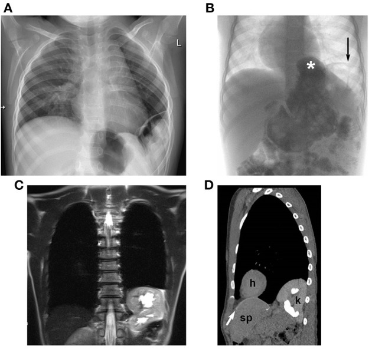
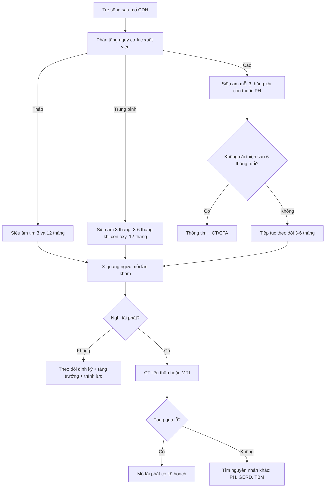
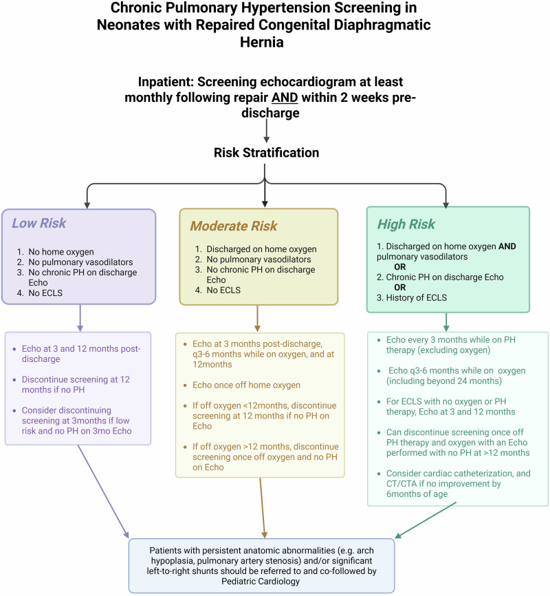

# 608 — Theo dõi sau mổ thoát vị hoành bẩm sinh (CDH): tái phát, tăng áp phổi, trào ngược & dinh dưỡng / Post-CDH repair follow-up

**Tags:** `pattern:tai-phat-cdh` `pattern:tang-ap-phoi` `pattern:trao-nguoc-day-thuc-quan` `vung:co-hoanh-nhi` `vung:phoi-nhi` `protocol:X-quang-nguc-nhi` `protocol:sieu-am-tim` `protocol:UGI` `score:CDHSG-defect-size`
**Mức chắc chắn (certainty):** tổng hợp y văn (literature synthesis) — tự biên từ 4 nghiên cứu đoàn hệ/sơ đồ mở: theo dõi X-quang phát hiện tái phát (Zahn KB và cs., *Front Pediatr* 2021, PMC8719630); sàng lọc tăng áp phổi mạn (Byrd CE và cs., *J Perinatol* 2026, PMC13290494); tăng trưởng 1.247 trẻ (Eur J Pediatr 2025, PMC12594663); tái nhập viện & tử vong muộn toàn quốc (JAMA Netw Open 2026, PMC13316603). Không gắn một bệnh án đơn lẻ.

## 1. Tổng quan bệnh học – cơ chế hình ảnh: "mổ xong" không phải "hết bệnh"

- **Dịch tễ:** CDH (congenital diaphragmatic hernia) gặp **1/3.000–5.000** trẻ sinh sống; **85–90%** là lỗ Bochdalek **bên trái**. Trong đoàn hệ 508 sơ sinh mổ mở tại Mannheim, **sống tới khi xuất viện 81%**; trong số sống, **90%** tham gia chương trình theo dõi dọc.
- **Bộ ba bệnh sinh:** (1) **giảm sản nhu mô phổi**, (2) **bất thường mạch máu phổi** (ít mao mạch, tái cấu trúc), (3) **rối loạn chức năng tim** (thất trái giảm sản tương đối). Vì vậy sau khi đóng lỗ hoành, phổi **vẫn không bình thường**: FRC, độ giãn và sức cản đường thở còn bất thường ở **6 tháng tuổi**, và vẫn bất thường ở **23 tuổi** — nặng nhất ở nhóm ECMO.
- **TẠI SAO phổi vẫn "lớn lên" nhưng không "lành":** sau mổ, thể tích phổi tăng khoảng **8 mL/tuần** (đối chiếu MRI thai), nhưng tăng thể tích chủ yếu do **giãn các đơn vị còn lại**, không tạo thêm phế nang–mạch máu mới. Trên X-quang, phổi bên mổ có thể **sáng hơn, mạch máu thưa** vĩnh viễn — đây là di chứng, không phải tái phát.
- **TẠI SAO tái phát xảy ra:** cơ hoành được đóng **dưới lực căng** (đặc biệt khi phải dùng mảnh ghép), trẻ lớn nhanh làm lỗ hoành **rộng tương đối**; tổ chức xơ co kéo miệng vá; tăng áp lực ổ bụng (táo bón, ho, bú mạnh) đẩy tạng lên. Kết quả: **tạng thoát vị lại** hoặc hình thành **thoát vị hoành–thực quản thứ phát** (hiatal hernia).
- **TẠI SAO X-quang là công cụ sàng lọc đầu tay:** khí trong ruột có đậm độ **−1000 HU**, mô mềm **20–60 HU**, xương **> 300 HU**; quai ruột trong ngực tạo **vùng sáng có vách** hoặc **mức khí–dịch** trên nền phổi, còn gan lạc chỗ tạo **khối mờ đặc** ở đáy phổi. Chênh lệch đậm độ này đủ để phát hiện phần lớn tái phát trên phim **nằm ngửa tại giường** — không cần CT thường quy.
- **Ngưỡng định lượng nằm lòng (đoàn hệ Mannheim, 326 trẻ theo dõi ≥ 2 năm):**
  - **38 biến chứng hoành ở 31 trẻ** = **9,5%** người bệnh; trong đó **63% tái phát thật**, **21% thoát vị hoành–thực quản thứ phát**, **16% cả hai**.
  - **51,4%** chẩn đoán trong **năm đầu**, **31,4%** trong **năm thứ hai**, **8,6%** lúc **2–4 tuổi**, **8,6%** sau **4 tuổi**.
  - **92,1%** phát hiện **bằng hình ảnh** khi còn không triệu chứng; **43,2%** hoàn toàn **không triệu chứng**; **2,6%** đến với **tắc ruột cấp do nghẹt**.
  - Yếu tố nguy cơ: **CDH trái RR 8,5** (KTC 1,2–61), **vá thành bụng RR 3,2** (1,8–5,8), **gan lên ngực RR 2,5** (1,2–5,3); lỗ **C–D: 17/100** so với **A–B: 1/40** (p = 0,02). **Tái phát lần hai gặp ở 19,3%** số trẻ đã tái phát.
- **TẠI SAO tăng áp phổi (PH) mạn là "bệnh thứ hai":** mạch phổi giảm sản → **PVR cao**; thêm tổn thương do thở máy, nhiễm trùng, hít sặc → tái cấu trúc mạch. Ba kiểu huyết động (theo định luật Ohm **PAP = PBF × PVR + LAp**): **do sức cản** (hay nhất), **do lưu lượng** (PDA/VSD hoặc thuốc giãn mạch quá liều), **sau mao mạch** (rối loạn chức năng thất trái, hẹp tĩnh mạch phổi). Điều trị **khác và đôi khi ngược nhau**, nên phải phân kiểu trước khi dùng thuốc.
- **Ngưỡng PH mạn (đề xuất, chưa có đồng thuận):** PAP tăng trên siêu âm tim **≥ 3 tháng sau mổ** hoặc **tại lúc xuất viện**, kèm xét nhu cầu oxy/thuốc. Tỷ lệ: **4,5–38%** ở trẻ 2–5 tuổi (meta-analysis, chọn lọc làm sai lệch khoảng cao); **11,6%** cần thuốc PH lúc xuất viện (CHNC); **8,7%** trong đoàn hệ Pháp; **1/3** trẻ sau ECLS; **1/10** trẻ 8 tuổi có PH khi gắng sức dù nghỉ bình thường.
- **Trào ngược & dinh dưỡng — vì sao hay gặp:** cơ hoành–trụ hoành bị mổ, góc His đổi, áp lực ổ bụng tăng, phổi giảm sản làm phối hợp bú–thở kém. Trong 916 trẻ theo dõi: **18,0%** có triệu chứng trào ngược, nhưng chỉ **13,4%** có bằng chứng khách quan (nội soi/24 giờ pH–trở kháng/đối quang); **9,6%** trào ngược nặng trên đối quang; **6,9%** phải mổ chống trào ngược. **Triệu chứng không dự báo được mức độ** — đây là lý do không được chỉ dựa vào hỏi bệnh.
- **Tăng trưởng (1.247 trẻ, theo dõi tới 18 tuổi):** ở **6 tháng**, cân nặng z-score **−1,47** (đủ tháng) và **−2,45** (non tháng); **33,3%** và **59,4%** nhẹ cân vừa–nặng. Đến **2 tuổi** còn **13,8%** và **26,8%**; đến **10 tuổi** vẫn **−0,75** và **−0,86** z-score. Kết luận: **bắt kịp một phần, không hoàn toàn** — cần theo dõi z-score, không nhìn cân nặng tuyệt đối.
- **Tái nhập viện & tử vong muộn (1.028 trẻ sống xuất viện, Pháp):** **72,5%** tái nhập viện trong **3 năm**; **76,6%** các lần tái nhập xảy ra trong **năm đầu**; trung vị lần đầu **176 ngày**. Nguyên nhân: **hô hấp/nhiễm 27,6%** (viêm tiểu phế quản 14,7%), **dinh dưỡng–tiêu hóa 14,9%** (sợ ăn 7,7%, chậm tăng cân 3,6%, trào ngược 5,0%), **biến chứng ngoại khoa 16,9%** (tắc ruột 8,1%, tái phát 4,5%). **Tử vong muộn 1,4%** (14/1.028), **11/14 trong 2 năm đầu**, một nửa liên quan CDH (PH kháng trị, biến chứng mở khí quản); **sinh non HR 3,94**, **còn nuôi ăn qua ống lúc xuất viện HR 5,09**.

## 2. Mẫu hình + chẩn đoán phân biệt theo vị trí & triệu chứng (Gamut)

- **Ba câu hỏi bắt buộc khi đọc phim theo dõi:** (1) **đường cơ hoành có liên tục** bên mổ? (2) **có quai ruột/mô đặc lạc chỗ** trong ngực? (3) **trung thất–tim có lệch** so với phim trước? Thiếu cả ba **không loại trừ** tái phát nhỏ.
- **Gamut theo mẫu hình X-quang:**
  - **Vùng sáng có vách/mức khí–dịch ở đáy phổi bên mổ:** tái phát CDH (ruột non), thoát vị hoành–thực quản thứ phát (dạ dày), **hang phổi/áp-xe** (hiếm), **nang phổi bẩm sinh còn lại**.
  - **Khối mờ đặc đáy phổi, bờ trên cong:** **gan lạc chỗ** (tái phát thể "liver-up"), xẹp thùy dưới, tràn dịch màng phổi khu trú — phân biệt bằng **siêu âm tại giường** (gan có mạch máu trong nhu mô) hoặc **MRI/CT**.
  - **Trung thất lệch sang bên mổ:** tái phát (đẩy ngược), xẹp phổi bên mổ (kéo), tràn khí màng phổi bên đối diện (đẩy), **xoay mảnh ghép**.
  - **Cơ hoành cao, bờ cong đều, không có quai ruột:** **liệt/eventration cơ hoành** sau mổ — khác tái phát; chẩn đoán bằng **so phim hít vào–thở ra** hoặc **siêu âm/fluoroscopy** thấy chuyển động nghịch thường.
  - **Phổi bên mổ sáng hơn, mạch thưa:** **giảm sản phổi tồn dư** — bình thường ở trẻ CDH, không phải tràn khí.
- **Gamut theo triệu chứng ("vì sao trẻ không tiến triển"):**
  - **Thở nhanh, khó cai oxy, tím khi bú:** PH mạn, **tracheobronchomalacia** (xem [602](../602-tracheobronchomalacia-o-tre-bpd/lesson.md)), hẹp phế quản, **hít sặc do trào ngược**, tái phát.
  - **Nôn tái diễn, sợ ăn, chậm tăng cân:** trào ngược, **hẹp môn vị**, **tắc ruột do dính**, tái phát, **rối loạn nuốt** sau thời gian dài thở máy.
  - **Đau bụng cấp + nôn + khó thở:** **nghẹt tạng thoát vị** — cấp cứu ngoại khoa, không chờ nội soi.
  - **Ho ra máu/thiếu máu:** loét do ống dạ dày, viêm thực quản, hiếm khi tổn thương mạch.
- **Mnemonic "DIA-PHRAGM":** **D**efect size lớn (C–D), **I**ntrathoracic liver/stomach, **A**bdominal wall patch, **P**rematurity, **H**iatal hernia, **R**ecurrence, **A**spiration/GERD, **G**rowth failure, **M**ortality muộn.

## 3. Bảng so sánh phân biệt (ma trận đối chiếu)

| Thực thể (entity) | Hình ảnh điển hình | Chốt vào (rule-in) | Chốt loại (rule-out) | Gợi ý xác nhận |
|---|---|---|---|---|
| **Tái phát thật tại lỗ vá** | X-quang: quai ruột/mức khí–dịch **sát vị trí vá**, mất đường cơ hoành; CT: khiếm khuyết thành bụng–ngực | **Khiếm khuyết cơ hoành + tạng qua lỗ + so phim cũ thấy mới** | **Cơ hoành liên tục trên mọi lát + không tạng lạc chỗ** → loại | X-quang 2 bình diện; CT khi mờ; mổ xác nhận |
| **Thoát vị hoành–thực quản thứ phát** | Dạ dày **nằm trên hoành**, "dấu bánh mì" quanh thực quản; đối quang: dạ dày cạnh thực quản | **Dạ dày trên hoành + tiền sử CDH trái có dạ dày lên ngực** | Dạ dày dưới hoành, không trào ngược đối quang → loại | Đối quang đường tiêu hóa trên; CT |
| **Liệt/eventration cơ hoành** | Cơ hoành **cao, cong mượt**, không quai ruột; **nghịch thường thì thở** | **Chuyển động nghịch thường trên fluoroscopy/siêu âm** | Có **khiếm khuyết + tạng qua lỗ** → tái phát, không phải liệt | Siêu âm/fluoroscopy; so phim hít–thở |
| **Giảm sản phổi tồn dư** | Phổi bên mổ **sáng, mạch thưa**, thể tích nhỏ, không mức dịch | **Ổn định qua nhiều năm, không đẩy trung thất** | **Mới xuất hiện + đẩy trung thất** → tái phát/tràn khí | So phim cũ; CT khi nghi ngờ |
| **Bệnh phổi mạn/BPD–PH** | Phổi ứ khí, đám mờ; tim to; **cung ĐMP giãn** | **Siêu âm tim: TR > 2,8 m/s hoặc vách liên thất dẹt thì tâm thu** | Siêu âm bình thường **không loại trừ PH khi gắng sức** | Siêu âm tim định kỳ; thông tim khi nặng |
| **Trào ngược bệnh lý** | Đối quang: trào ngược lên thực quản trên; **không có tiêu chuẩn vàng trên X-quang** | **AET ≥ 6% hoặc ≥ 80 lần trào/24 giờ trên pH–trở kháng** | **Đối quang bình thường không loại trừ** — triệu chứng cũng không dự báo | pH–trở kháng 24 giờ + nội soi |
| **Tắc ruột do dính** | Mức khí–dịch nhiều tầng, quai giãn, **không có tạng trong ngực** | **Quai giãn + mức dịch + không tạng ngực** | Có tạng ngực → tái phát/nghẹt | X-quang bụng; CT có cản quang |

*Tái phát CDH không chỉ thấy trên X-quang: (A) X-quang bé trai 2 tuổi — tái phát bên; (B) đối quang bé trai 4 tuổi — thoát vị hoành–thực quản (\*) và tái phát bên (→); (C) MRI và (D) CT liều thấp bé gái 10 tuổi — thận trái lên ngực gây ứ nước thận vừa. Nguồn: Zahn KB và cs., Front Pediatr 2021, PMC8719630 Fig. 3, CC BY 4.0.*

## 4. Protocol theo dõi + sàng lọc tăng áp phổi

- **Nguyên tắc:** CDH là bệnh **đa hệ, theo dõi suốt đời**; mỗi lần khám phải làm **cân đo + z-score**, **X-quang ngực**, **siêu âm tim theo phân tầng**, **thính lực**, **phát triển thần kinh**, và hỏi **trào ngược/sợ ăn/đau bụng**.
- **Lịch theo dõi tham chiếu (Mannheim, sau mổ mở):**

| Tuổi | X-quang ngực | Siêu âm tim | Đối quang/pH–trở kháng | Thính lực | Chức năng hô hấp | Thần kinh |
|---|---|---|---|---|---|---|
| Sơ sinh – 1 tuổi (mỗi 3 tháng) | Mỗi lần khám | Theo phân tầng PH | Khi có triệu chứng | Lúc sinh, 1 tuổi | – | Sàng lọc |
| 1–2 tuổi (mỗi 6 tháng) | Mỗi lần khám | Theo phân tầng | Khi có triệu chứng | – | – | Đánh giá |
| 2–5 tuổi (mỗi năm) | Mỗi năm | Khi có chỉ định | Khi có triệu chứng | – | Từ 5 tuổi | Đánh giá |
| 6–21 tuổi (mỗi 2–3 năm) | Mỗi lần khám | Khi có chỉ định | Khi có triệu chứng | – | Mỗi lần khám | Khi cần |

- **Sàng lọc tăng áp phổi mạn theo nguy cơ** (Byrd và cs., 2026):
  - **Nguy cơ thấp** (không oxy tại nhà, không thuốc PH, siêu âm lúc xuất viện bình thường, không ECLS): siêu âm lúc **3 và 12 tháng**; **ngừng sàng lọc ở 12 tháng** nếu không PH.
  - **Nguy cơ trung bình** (oxy tại nhà, không thuốc PH, không ECLS): siêu âm **3 tháng**, rồi **3–6 tháng** khi còn oxy, và **12 tháng**; ngừng khi **cai oxy và không PH**.
  - **Nguy cơ cao** (oxy **và** thuốc PH, hoặc PH lúc xuất viện, hoặc **có ECLS**): siêu âm **mỗi 3 tháng** khi còn thuốc, **3–6 tháng** khi còn oxy (kể cả sau 24 tháng); **thông tim** và **CT/CTA** nếu không cải thiện sau **6 tháng tuổi**.
- **Siêu âm tim đọc gì:** hướng shunt qua PDA, **vận tốc hở ba lá** (TR) để ước tính PAP tâm thu, **vị trí vách liên thất** và **chỉ số lệch tâm thì tâm thu** (định lượng, đáng tin hơn mô tả "vách dẹt"). TR không đo được ở nhiều trẻ → phải phối hợp nhiều dấu hiệu, không kết luận từ một phép đo.
- **Khi nào chụp CT:** X-quang **không kết luận** (mờ đáy phổi, nghi gan lạc chỗ, nghi thoát vị khu trú), hoặc **trước mổ tái phát** để đánh giá kích thước lỗ, mảnh ghép, tạng thoát vị và mạch máu. Dùng **liều thấp, lát ≤ 1 mm, ALARA**; **MRI** thay thế khi cần đánh giá tạng đặc (thận, gan) mà không muốn tia X.
- **Cấp cứu nghi nghẹt tạng:** **sonde dạ dày giải áp + CT bụng–ngực có cản quang tĩnh mạch** (không dùng baryt khi nghi tắc), hội chẩn ngoại nhi ngay; **không** chờ đối quang đường tiêu hóa.

## 5. Biến thể bình thường và cạm bẫy

- **Tái phát không triệu chứng là quy luật, không phải ngoại lệ:** **43,2%** trẻ tái phát hoàn toàn không có triệu chứng; **92,1%** được phát hiện nhờ hình ảnh. Vì vậy **không được "cho về" chỉ vì trẻ khỏe**.
- **Mảnh ghép PTFE thường không thấy rõ trên X-quang:** "không thấy mảnh ghép" **không** đồng nghĩa "chưa mổ" hay "miệng vá nguyên vẹn". Đừng dùng sự hiện diện của mảnh ghép làm tiêu chuẩn.
- **Bóng hơi dạ dày nằm dưới hoành không loại trừ tái phát:** gan, thận, ruột non có thể lên ngực trong khi dạ dày vẫn đúng chỗ — đây là lý do phải nhìn **toàn bộ đáy phổi** và so phim cũ.
- **"Viêm phổi tái diễn cùng một chỗ"** có thể là **quai ruột thoát vị** với mức khí–dịch (giả hang/giả nang). Trước khi cho kháng sinh đợt thứ ba, hãy **chụp lại và so phim**.
- **Phim nằm ngửa, thì thở ra ở nhũ nhi** làm cơ hoành "cao" giả tạo và phổi "mờ" giả tạo; luôn so với phim trước và, nếu nghi ngờ, chụp **nghiêng hoặc nằm sấp**.
- **Tràn khí màng phổi bên đối diện** sau mổ CDH có thể bị bỏ sót vì phổi bên mổ vốn đã "sáng"; kiểm tra **bờ phổi tạng** và **trung thất** thay vì độ đen tuyệt đối.
- **Không chẩn đoán PH từ một lần siêu âm khi trẻ đang khóc:** trẻ khóc làm áp lực lồng ngực tăng, TR tăng giả; cần **đo lặp lại khi trẻ nằm yên**, và đánh giá **khi gắng sức** (1/10 trẻ 8 tuổi chỉ có PH khi gắng sức).
- **Triệu chứng trào ngược không tương quan với mức độ:** **18,0%** có triệu chứng nhưng chỉ **13,4%** có bằng chứng khách quan; **đối quang bình thường không loại trừ** trào ngược bệnh lý.
- **Tăng trưởng phải đọc bằng z-score:** một trẻ 10 tuổi "nặng 26 kg" có thể vẫn thấp hơn −2 z-score; dùng cân nặng tuyệt đối sẽ bỏ sót suy dinh dưỡng.
- **Satisfaction of search:** thấy tái phát rồi dừng lại, bỏ sót **PH**, **trào ngược**, **hẹp phế quản** hoặc **tắc ruột do dính** đi kèm.

## 6. Tự lượng giá — Blind Quiz

**Ca 1 — Bé trai 2 tuổi, từng mổ CDH trái lúc sơ sinh, nay khám định kỳ, không triệu chứng. Đọc phim trước khi mở đáp án.**

- Gợi ý lâm sàng: hoàn toàn khỏe, chỉ khám theo lịch.
- Câu hỏi: (1) Dấu hiệu chính ở đáy phổi trái? (2) Nghĩ tái phát hay di chứng phổi? (3) Bước tiếp theo nếu phim không rõ?

<b>Bấm để hiện đáp án (findings + chẩn đoán)</b>

- **Dấu hiệu:** mất đường cong cơ hoành trái kèm **vùng sáng có vách** ở đáy phổi trái (panel A) — tương ứng quai ruột thoát vị lại; trung thất không lệch đáng kể.
- **Chẩn đoán:** **tái phát CDH bên trái** dù **không triệu chứng** — phù hợp với dữ liệu 43,2% tái phát không triệu chứng và 92,1% phát hiện bằng hình ảnh.
- **Bước tiếp theo:** nếu X-quang không rõ, **CT liều thấp hoặc MRI** (panel C–D) để xác định tạng thoát vị, kích thước lỗ và liên quan mảnh ghép; sau đó **mổ tái phát có kế hoạch** trước khi nghẹt.
- **Phân biệt:** giảm sản phổi tồn dư (ổn định, không có quai ruột), liệt cơ hoành (bờ cong mượt, không tạng), thoát vị hoành–thực quản thứ phát (dạ dày trên hoành).
- **Nguồn ảnh:** Zahn KB và cs., *Front Pediatr* 2021, PMC8719630 Fig. 3, CC BY 4.0.

**Ca 2 — Bé gái 8 tháng, mổ CDH trái có vá mảnh ghép, xuất viện với oxy tại nhà. Nay thở nhanh khi bú, không sốt, X-quang không thấy tái phát. Hỏi gì và làm gì?**

- Câu hỏi: (1) Ba nguyên nhân hàng đầu? (2) Siêu âm tim cần đo gì? (3) Khi nào chụp CT/thông tim?

<b>Bấm để hiện đáp án (findings + chẩn đoán)</b>

- **Ba nguyên nhân:** (1) **PH mạn** (nhóm nguy cơ trung bình–cao vì còn oxy tại nhà và có mảnh ghép), (2) **trào ngược/hít sặc** (18,0% có triệu chứng, nhưng phải khách quan hóa), (3) **tracheobronchomalacia** hoặc hẹp phế quản — đặc biệt nếu có tiếng thở rít thì thở ra và khó cai oxy.
- **Siêu âm tim:** hướng shunt PDA, **TR để ước tính PAP tâm thu**, **vị trí vách liên thất** và **chỉ số lệch tâm thì tâm thu**; đánh giá chức năng thất trái (kiểu sau mao mạch) và lưu lượng phổi (kiểu do lưu lượng).
- **Chụp CT/thông tim:** thông tim khi **không cải thiện sau 6 tháng tuổi**, khi cần phân biệt kiểu huyết động trước khi dùng thuốc, hoặc khi nghi hẹp tĩnh mạch phổi; CT khi nghi tái phát mà X-quang không rõ.
- **Điểm cần nhớ:** **không dùng thuốc giãn mạch phổi một cách mù** — kiểu **do lưu lượng** và **sau mao mạch** có thể nặng lên khi giãn mạch.
- **Nguồn:** Byrd CE và cs., *J Perinatol* 2026, PMC13290494 (sơ đồ phân tầng); Zahn KB và cs., *Front Pediatr* 2021, PMC8719630 (tái phát); số liệu trào ngược: *Pediatr Surg Int* 2026, PMC13186794.

*Sơ đồ sàng lọc tăng áp phổi mạn: nguy cơ thấp — siêu âm 3 và 12 tháng rồi dừng; trung bình — 3 tháng, 3–6 tháng khi còn oxy, 12 tháng; cao — mỗi 3 tháng khi còn thuốc, 3–6 tháng khi còn oxy, thông tim/CT nếu không cải thiện sau 6 tháng tuổi. Nguồn: Byrd CE và cs., J Perinatol 2026, PMC13290494 Fig. 2, CC BY 4.0.*

## Bài liên quan chéo
- [600 – Tổng quan Nhi khoa](../600-tong-quan-nhi-khoa/lesson.md)
- [610 – Suy hô hấp sơ sinh: RDS, TTN, MAS & CDH](../610-suy-ho-hap-so-sinh-va-di-dang-phoi/lesson.md) (chẩn đoán & cấp cứu ban đầu)
- [606 – BPD: bệnh phổi mạn tính ở trẻ sinh non](../606-bpd-tre-sinh-non/lesson.md) (PH và bệnh phổi mạn)
- [602 – Tracheobronchomalacia ở trẻ BPD](../602-tracheobronchomalacia-o-tre-bpd/lesson.md) (nguyên nhân khó cai máy)
- [611 – PIE & tràn khí áp lực ở nhũ nhi](../611-ro-khi-nang-pie-tran-khi-ap-luc-nhu-nhi/lesson.md)
- [083 – Nuôi ăn qua sonde & biến chứng mạn](../083-nuoi-an-qua-sonde/lesson.md) (khi trẻ còn phụ thuộc ống ăn)
- [082 – Bại não & an toàn nuốt](../082-bai-nao-an-toan-nuot/lesson.md) (đánh giá hít sặc)

> Không dùng để chẩn đoán độc lập khi chưa có người hướng dẫn.
