# 609 — Ống dẫn lưu màng phổi (chest tube) ở trẻ: kỹ thuật – vị trí lý tưởng – biến chứng – thời điểm rút / Chest tube in children: technique, ideal position, complications & timing of removal

**Tags:** `pattern:ong-dan-luu` `pattern:tran-khi-mang-phoi` `pattern:ro-khi` `vung:mang-phoi` `vung:thanh-nguc` `protocol:chest-tube` `protocol:sieu-am-thanh-nguc`
**Mức chắc chắn (certainty):** ca nguyên văn (verbatim case) — neo vào các ca nguyên văn có hình ảnh: (1) **chèn ép tim do đặt ống** ở trẻ 34 tuần (Grandmougin et al., *Front Pediatr* 2025, PMC12103966); (2) **ống gấp khúc → tái tràn khí** ở trẻ 13 tuổi (Basnet et al., *Cureus* 2025, PMC11926534); (3) **ống lạc vào nhu mô phổi** (Qsous & Zamvar, *Cureus* 2023, PMC10745075); (4) **ống lạc vào phế quản gốc trái** (Sullivan et al., *Cureus* 2024, PMC11491131); (5) **phù phổi tái nở** ở trẻ 5 tuổi (Weldetsadik & Demisse, *Ethiop J Health Sci* 2022, PMC9113034); (6) **khí dưới da sau kỹ thuật trocar** ở sơ sinh (Jilani et al., *Cureus* 2024, PMC10849260). Bổ sung tổng hợp y văn mở (kỹ thuật, an toàn mạch liên sườn, thời điểm rút).

## 1. Tổng quan bệnh học – cơ chế hình ảnh

- **Ống dẫn lưu màng phổi (chest tube, intercostal drain)** đưa vào **khoang màng phổi** để (a) **hút khí** (tràn khí màng phổi, rò khí) hoặc (b) **dẫn dịch** (tràn dịch/máu/mủ), nhằm **phục hồi áp lực âm trong khoang màng phổi** để phổi nở lại.
- **Vì sao phải "nối kín nước" (underwater seal):** khoang màng phổi bình thường có áp lực **âm hơn khí trời**; nếu hở ra khí trời, khí sẽ **trào ngược vào** màng phổi. Hệ thống **van nước (water-seal)** chỉ cho khí/dịch thoát ra mà không cho khí vào lại; **buồng điều áp** đặt mức hút mong muốn; **buồng thu** chứa dịch. Đây là lý do ống phải **đặt dưới mức ngực** và **không được gập/kẹp tùy tiện**.
- **Vì sao đọc được vị trí trên hình:** ống dẫn lưu là **vật đậm (radiopaque)** (PVC/silicone có **sọc cản quang**), nên đường đi thấy được trên X-quang/CT. Đầu ống đúng vị trí phụ thuộc **mục tiêu khí hay dịch**:
  - **Khí** nhẹ → dồn **phía trước và trên** → đầu ống hướng **lên trước – đỉnh phổi** (ở trẻ lớn: liên sườn 2, trước–giữa đường nách; ở nhũ nhi: **liên sườn 4–5, đường trước–giữa nách**).
  - **Dịch** nặng → dồn **sau và dưới** → đầu ống hướng **ra sau – xuống đáy**.
- **Kích thước ống — quy đổi định lượng:** hệ **French (Fr/Ch)** = **chu vi ngoài**; **đường kính (mm) ≈ Fr ÷ 3** (12 Fr ≈ 4 mm). **Ống nhỏ (small-bore, 8–14 Fr)** dùng phổ biến cho tràn khí/tràn dịch ít; **ống lớn (20–28 Fr)** cho mủ đặc/máu cục. Bằng chứng: **14 Fr pigtail ≈ 28–32 Fr** trong tràn máu màng phổi do chấn thương (ít đau hơn).
- **Ngưỡng/TK định lượng nền tảng:**
  - **Đặt ống làm giảm nguy cơ tái phát & phổi nở lại: thành công 80–90%**; nhưng tràn khí **rò dai dẳng** gặp nhiều ở tràn khí thứ phát (SSP).
  - **Hút liên tục quá sớm/áp lực cao** → **phù phổi tái nở (re-expansion pulmonary edema, RPE)** ở trẻ tràn khí hoàn toàn/lâu ngày; dùng **−10 đến −20 cmH₂O**, tránh hút ngay sau đặt.
  - **Khâu cố định ống làm giảm tuột ống: 6,6% so với 14,8%** (không khâu).

## 2. Mẫu hình + chẩn đoán phân biệt theo vị trí (gamut)

- **Ống ĐÚNG vị trí và hoạt động:** đầu ống **trong khoang màng phổi** (theo mục tiêu khí/dịch), **không nằm trong nhu mô/khe liên thùy/trung thất**; hệ thống **có dao động cột nước (swinging)** khi thở; rò khí **giảm dần**.
- **Ống LẠC (malposition) theo vị trí:**
  - **Trong nhu mô phổi (intraparenchymal):** đầu ống **chui vào nhu mô** → không dẫn được khí/dịch, **rò khí dai dẳng**; có thể **hút khí nhu mô** gây tổn thương thêm.
  - **Trong khe liên thùy (intrafissural):** đầu ống kẹt giữa hai lá → kém hiệu quả.
  - **Trong trung thất / phế quản gốc:** đầu ống **chui vào phế quản gốc** (nhất là **bên trái** do hướng ống) → đe dọa tắc/thủng đường thở.
  - **Ngoài lồng ngực / dưới da:** ống tuột/lạc ra mô mềm → **khí dưới da**, không dẫn màng phổi.
- **Biến chứng tại chỗ/muộn:**
  - **Gấp khúc (kinking)** = nguyên nhân phổ biến nhất của **ống không hoạt động → tái tràn khí** trong viện; **gỡ gấp là xử trí**.
  - **Chèn ép tim (cardiac tamponade)** do đầu ống **xuyên cơ tim/màng tim** — biến chứng **hiếm nhưng tử vong**, đã ghi nhận ở trẻ non tháng.
  - **Phù phổi tái nở (RPE):** phù phổi **không do tim**, sau **giải phóng khí/dịch nhanh** ở phổi xẹp lâu — **hiếm, có thể tử vong**.
  - **Tổn thương động mạch liên sườn (intercostal artery)** do đâm **dưới bờ sườn** → **tràn máu màng phổi**; phòng bằng **đâm NGAY TRÊN bờ sườn dưới** (trong tam giác an toàn).
  - **Khí dưới da (subcutaneous emphysema):** thường do **kỹ thuật trocar**/ống lạc; sờ **lạo xạo (crepitus)**.
- **Mnemonic sàng lọc:** sau đặt ống mà **không cải thiện** → hỏi theo thứ tự **"ống đúng vị trí chưa? ống có bị gấp/tắc không? có biến chứng mới (chèn ép tim/phù phổi) không?"** — chụp lại là bắt buộc.

## 3. Bảng so sánh phân biệt (ma trận đối chiếu)

| Thực thể (entity) | Hình ảnh điển hình | Chốt vào (rule-in) | Chốt loại (rule-out) | Gợi ý xác nhận |
|---|---|---|---|---|
| Ống đúng vị trí, hoạt động | Đầu ống trong khoang màng phổi theo mục tiêu, dao động cột nước | **Đầu ống trong màng phổi + cột nước dao động theo nhịp thở** | Đầu ống trong nhu mô/khe liên thùy/trung thất → ống lạc | X-quang thẳng + nghiêng; siêu âm màng phổi |
| Ống gấp khúc / tắc (không hoạt động) | Ống gấp ở thành ngực/ống nối; tái tràn khí dù ống "còn nguyên" | **Tái tràn khí trong khi ống còn tại chỗ + nhìn/gỡ được chỗ gấp** | Tái tràn khí KHÔNG có gấp + ống kẹt nhu mô → do lạc/không hiệu quả | Kiểm tra bằng mắt ống + hệ thống; X-quang lại |
| Ống lạc vào NHU MÔ | Đầu ống tận trong nhu mô phổi (X-quang/CT) | **Đầu ống nằm trong nhu mô, rò khí dai dẳng** | Đầu ống trong khoang màng phổi (dù hình dạng cong) → không phải lạc nhu mô | **CT ngực** (chuẩn; X-quang có thể bỏ sót) |
| Ống lạc vào PHẾ QUẢN gốc | Đầu ống trong phế quản gốc (thường **trái**) | **Đầu ống trong lòng phế quản gốc trên CT (± nội soi)** | Đầu ống vùng rốn phổi ngoài lòng phế quản → không phải | CT ngực + nội soi phế quản |
| Chèn ép tim do ống | Tim to/đè ép; ống xuyên tới tim; sốc | **Sốc + ống tới vùng tim; siêu âm tim thấy dịch màng tim/đè ép** | Ống nằm trong khoang màng phổi xa tim → không phải | **Siêu âm tim cấp cứu** + X-quang/CT |
| Phù phổi tái nở (RPE) | Mờ phổi một/two bên **sau khi hút nhanh** khí/dịch | **Mờ phổi mới xuất hiện ngay sau giải phóng màng phổi lớn** | Mờ phổi có từ trước, không đổi sau hút → bệnh nền | X-quang trước/sau; lâm sàng |
| Khí dưới da | Dải khí mô mềm thành ngực/cổ/bụng, crepitus | **Dải khí mô mềm + sờ lạo xạo** | Có bờ phổi tạng → tràn khí màng phổi kèm theo | Lâm sàng + X-quang |

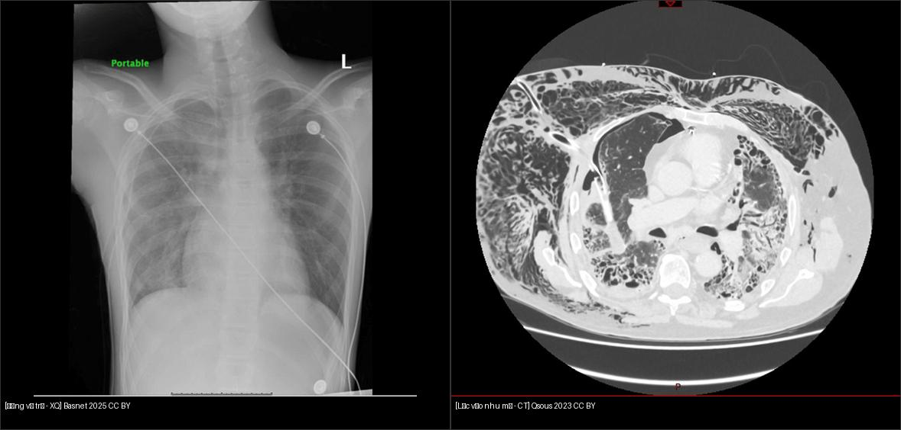
*Trái: ống dẫn lưu **đúng vị trí** — đường ống xuống trong khoang màng phổi, phổi nở. Phải (CT ngực): **ống lạc vào nhu mô phổi phải** — đầu ống tận trong nhu mô, kèm khí dưới da; đây là nguyên nhân **rò khí dai dẳng** điển hình. Nguồn: Basnet P et al., *Cureus* 2025 (PMC11926534) + Qsous G & Zamvar V, *Cureus* 2023 (PMC10745075), CC BY 4.0. Ảnh ghép letterbox.*

## 4. Protocol chụp + hệ phân độ/điểm chuẩn hóa

- **Vị trí đặt ống — "tam giác an toàn" (safe triangle):** **sau cơ ngực lớn (pectoralis major) và trước cơ lưng rộng (latissimus dorsi)**, đỉnh dưới nách, đáy ở liên sườn 4–5 (trẻ lớn: **liên sườn 4–5, đường trước–giữa nách**; tránh tuyến vú, tránh nếp nách sâu). **Nhũ nhi:** ống nhỏ (8–14 Fr) đặt **liên sườn 4–5 trước–giữa nách** để hướng đầu ống lên **đỉnh trước** (khí nhẹ).
- **Kỹ thuật an toàn mạch máu:** bó mạch liên sườn (**tĩnh mạch – động mạch – thần kinh**) nằm ở **rãnh sườn dưới**, bờ dưới xương sườn → **đâm đi trên bờ SƯỜN DƯỚI** để tránh (tam giác an toàn + kim đi sát trên xương). **Siêu âm Doppler màu (CDUS)** có thể thấy động mạch liên sườn và các **biến thể** (động mạch **nằm cao giữa khoang sườn**, **thân chung**) trước khi đâm (Marchi et al., *J Clin Med* 2025, PMC12429508) — **chưa thành khuyến cáo thường quy** nhưng hữu ích khi bệnh sử chảy máu/tái can thiệp.
- **Kích thước ống (Fr ≈ mm × 3):** tràn khí/tràn dịch ít → **8–14 Fr**; mủ đặc/máu cục → **20–28 Fr**; **14 Fr pigtail tương đương 28–32 Fr** cho tràn máu do chấn thương.
- **Hệ thống & hút:** **hút −10 đến −20 cmH₂O** khi cần; **TRÁNH hút ngay sau đặt** (nguy cơ **RPE**); hệ **van nước** giữ mức hút theo cột nước. Với trẻ sơ sinh, hệ **ba buồng kinh điển** không đáng tin ở mức **dưới −10 cmH₂O**; hệ **kỹ thuật số** chính xác hơn ở mức thấp nhưng có **xả (flush) tự động làm áp lực vọt tới −30 cmH₂O** (Anzinger et al., *Children* 2026, PMC11987057) → cần cân nhắc ở trẻ non tháng.
- **Khâu cố định:** khâu **giảm tuột ống (6,6% so với 14,8%)**; chỉ giữ **10–15 ngày** sau rút.
- **Thời điểm RÚT ống (timing of removal):**
  - **Trẻ em (bằng chứng tốt nhất — sau mổ tim):** rút khi **dịch < 6 mL/kg trong 8 giờ** (hoặc **< 60 mL/8 giờ nếu ≥ 10 kg**) — **rút sớm** giảm thời gian ống **3 so với 4,9 ngày (~40%)** mà **không tăng biến chứng** (tái tích dịch 2,8% vs 1%; tràn khí sau rút 2,8% vs 4%); quy trình cũ **< 6 mL/kg/ngày** (Jijeh et al., *Crit Care Explor / Pediatr Crit Care Med* 2025, PMC12140733).
  - **Người lớn (đối chiếu):** ngưỡng **200–500 mL/ngày**.
  - **Nguyên tắc chung:** **hết rò khí (hết sủi bọt) trong ≥ 24 giờ** + **phổi nở hoàn toàn** trên X-quang + **dịch dưới ngưỡng** → rút. **Kẹp ống thử (clamping) trước rút KHÔNG làm giảm tái phát** (tái phát 14,0% vs 12,6%) và có thể gây **tràn khí áp lực (0,4%)** (Veale et al., *Chest*→*CHEST* 2026, PMC12975392; meta Kazemloo et al., 2026, PMC13334743).
- **Flowchart xử trí ống dẫn lưu ở trẻ:**

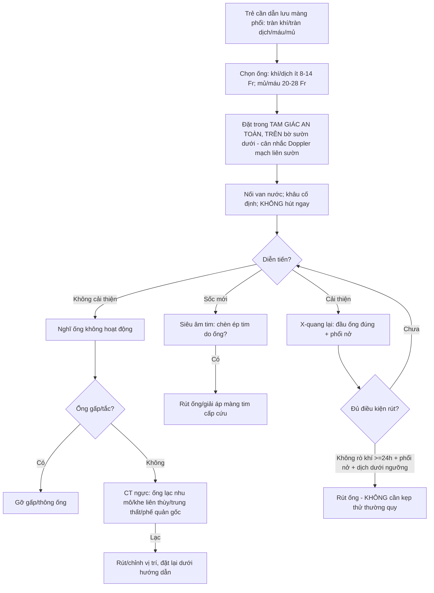

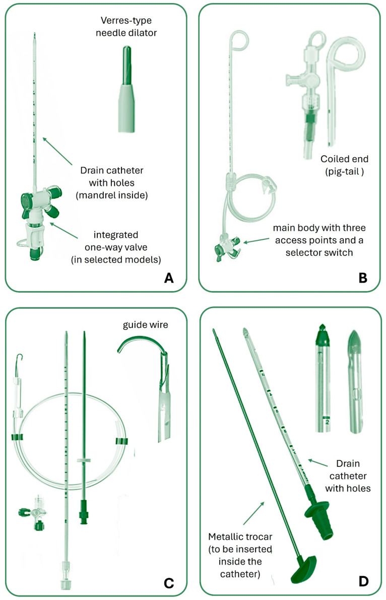
*Các loại ống dẫn lưu màng phổi: (A) ống thẳng đầu kim Verres; (B) **ống pigtail**; (C) ống thẳng có dây dẫn (kỹ thuật Seldinger); (D) ống lớn; và các loại đầu ống tương ứng. **Pigtail** ít đau, hiệu quả tương đương với tràn khí/dịch không đặc; **ống lớn** cho mủ đặc/máu cục (xem mục 4). Nguồn: Sorino C et al., *J Clin Med* 2024 (PMC11547156), CC BY 4.0.*

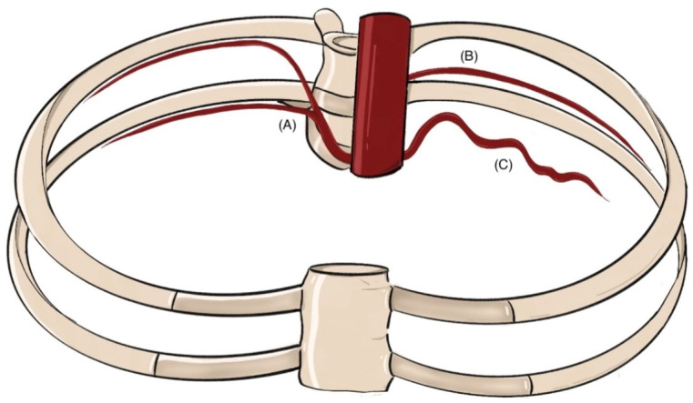
*Sơ đồ hệ động mạch liên sườn: **động mạch liên sườn sau** từ ĐMC ngực, **trước** từ động mạch ngực trong; bó mạch chạy ở **rãnh sườn dưới** → **đâm trên bờ sườn dưới** để tránh. Siêu âm **Doppler màu** có thể phát hiện **biến thể (mạch nằm cao, thân chung)** trước khi đâm. Nguồn: Marchi G et al., *J Clin Med* 2025 (PMC12429508), CC BY 4.0.*

## 5. Biến thể bình thường và cạm bẫy

- **Phù phổi tái nở (RPE):** dễ xảy ra khi **hút nhanh/áp lực cao** ở trẻ **tràn khí/tràn dịch hoàn toàn, lâu ngày**. Ca trẻ 5 tuổi tử vong sau dẫn lưu tràn khí (Weldetsadik & Demisse, PMC9113034). → **Không hút ngay**, đặt −10 đến −20 cmH₂O, theo dõi sát X-quang sau thủ thuật.
- **Kỹ thuật trocar ở trẻ sơ sinh:** ống cứng trocar **dễ gây khí dưới da/biến chứng** so với kỹ thuật dilator/Seldinger → ưu tiên **ống nhỏ – kỹ thuật ít sang chấn** ở sơ sinh (Jilani et al., PMC10849260).
- **Kẹp ống trước rút — thói quen "vô hại"?** Bằng chứng lớn nhất (n = 791) cho thấy **kẹp thử không giảm tái phát** và có thể **gây tràn khí áp lực (0,4%)** → **không kẹp thường quy**; nếu kẹp thì cần theo dõi sát và X-quang (Veale et al., PMC12975392).
- **Ống "chạy"/tuột:** **khâu cố định giảm tuột 6,6% vs 14,8%**; nhìn **vị trí lỗ đánh dấu** trên ống so với da mỗi ca trực.
- **Sỏi bỏ sót (satisfaction of search):** thấy tràn khí rồi dừng → bỏ sót **ống lạc, khí dưới da, hoặc tổn thương mạch máu** (tràn máu màng phổi muộn). Luôn đọc lại ống và thành ngực.
- **Bẫy "ống còn nguyên = còn tác dụng":** **gấp khúc** là nguyên nhân phổ biến nhất của ống không hoạt động — kiểm tra bằng mắt toàn bộ đường ống và hệ thống nước.
- **Bẫy biến thể mạch:** động mạch liên sườn có thể **nằm cao giữa khoang sườn** (không ở rãnh dưới) → đâm theo "bờ sườn dưới" cổ điển vẫn có thể trúng mạch; cân nhắc **Doppler** ở bệnh nhân nguy cơ cao (Marchi et al., PMC12429508).

## 6. Tự lượng giá — Blind Quiz ngay trên trang tĩnh

> Ảnh trơn ở NGOÀI, dấu hiệu + chẩn đoán giấu trong khối "bấm để hiện đáp án". Mở trên Pages: tự đoán rồi bấm mở đáp án.

**Ca 1 — Trẻ 13 tuổi cao gầy, tràn khí phổi phải, tái tràn khí ngày thứ 2.**

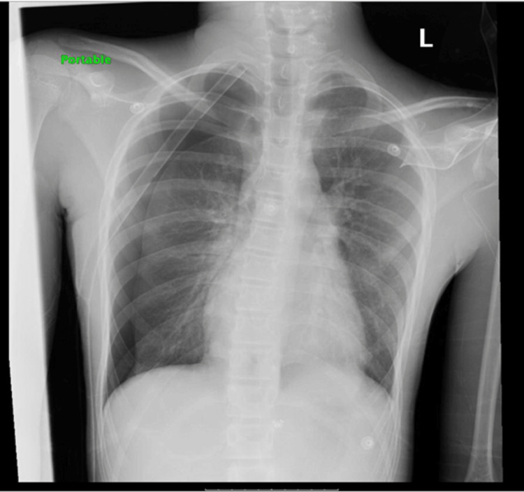

- Gợi ý: sau đặt ống ngực 3 buồng, phổi nở tốt; **ngày 2 tái tràn khí 50%** dù ống vẫn tại chỗ.
- Câu hỏi: Nguyên nhân tái tràn khí? Xác nhận và xử trí bằng gì?

<b>Bấm để hiện đáp án (findings + chẩn đoán)</b>

- Dấu hiệu: **tái tràn khí 50% bên phải, phổi xẹp**, ống vẫn ở vị trí phải.
- Chẩn đoán: **ống không hoạt động do GẤP KHÚC (kinking)**. Xử trí: **gỡ chỗ gấp** → phổi nở lại, không cần đặt lại ống. Đây là biến chứng **phổ biến nhất** của ống dẫn lưu.
- Nguồn ảnh: Basnet P et al., *Cureus* 2025 (PMC11926534), CC BY 4.0.

**Ca 2 — Rò khí dai dẳng dù ống "đúng chỗ".**

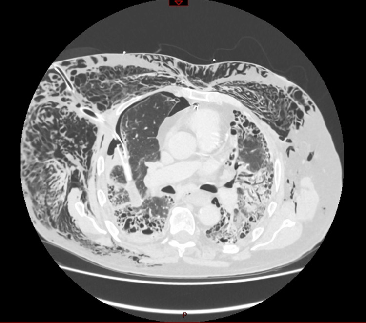

- Gợi ý: bệnh nhân có rò khí kéo dài, khí dưới da tăng dần dù đã đặt ống dẫn lưu.
- Câu hỏi: Đầu ống nằm ở đâu? Vì sao ống không giải quyết được rò khí? Xử trí?

<b>Bấm để hiện đáp án (findings + chẩn đoán)</b>

- Dấu hiệu: trên CT ngực, **đầu ống dẫn lưu chui vào NHU MÔ phổi phải**, kèm **khí dưới da** lan rộng.
- Chẩn đoán: **ống lạc vào nhu mô (malposition)** gây **rò khí dai dẳng (persistent air leak)**; ống không giao tiếp với khoang màng phổi. Xử trí: **chỉnh/rút và đặt lại ống đúng vị trí** dưới hướng dẫn hình ảnh; CT ngực là chìa khóa vì X-quang có thể bỏ sót.
- Nguồn ảnh: Qsous G & Zamvar V, *Cureus* 2023 (PMC10745075), CC BY 4.0.

**Ca 3 — Biến chứng nguy hiểm của catheter pigtail.**

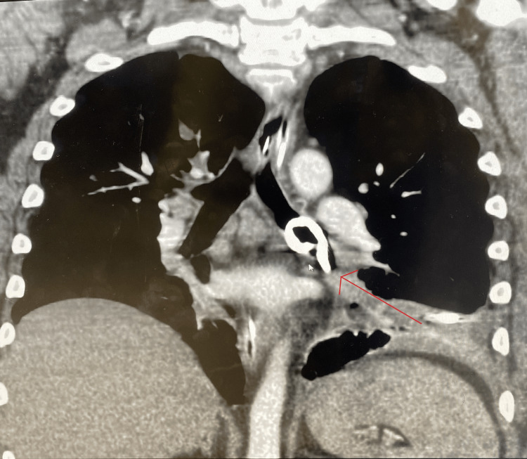

- Gợi ý: bệnh nhân tràn dịch cạnh viêm phổi, đặt catheter pigtail; **tình trạng xấu đi**.
- Câu hỏi: Đầu catheter nằm ở đâu? Vì sao nguy hiểm?

<b>Bấm để hiện đáp án (findings + chẩn đoán)</b>

- Dấu hiệu: CT ngực (thì mạch **vành**) — **catheter màng phổi chui vào PHẾ QUẢN GỐC TRÁI** (panic: chồng với đường thở).
- Chẩn đoán: **ống lạc vào phế quản gốc** — nguy cơ **tắc/ngạt**, thủng phế quản. Xử trí: **rút catheter, đặt ống ngực phẫu thuật đúng vị trí** (ca này xác nhận bằng nội soi phế quản).
- Nguồn ảnh: Sullivan EM et al., *Cureus* 2024 (PMC11491131), CC BY 4.0.

**Ca 4 — Biến chứng tử vong: chèn ép tim.**

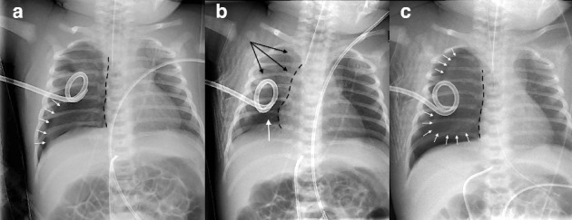

- Gợi ý: trẻ **34 tuần**, đặt ống dẫn lưu cho **tràn khí áp lực phải**; sau đó **suy sụp huyết động**.
- Câu hỏi: Dấu hiệu bất thường? Nguyên nhân được cho là gì (đây là ca đầu tiên được báo cáo)?

<b>Bấm để hiện đáp án (findings + chẩn đoán)</b>

- Dấu hiệu: các phim sau đặt ống cho thấy **đường ống đi tới vùng tim**, bóng tim/dịch màng tim bất thường; siêu âm tim xác nhận **dịch màng tim chèn ép**.
- Chẩn đoán: **chèn ép tim do đặt ống** — **ca đầu tiên được báo cáo** do **xuyên cơ tim/màng tim** khi cố dẫn lưu tràn khí áp lực ở trẻ non tháng (34 tuần). Xử trí: **rút ống/giải áp màng tim cấp cứu**.
- Nguồn ảnh: Grandmougin D et al., *Front Pediatr* 2025 (PMC12103966), CC BY 4.0.

**Ca 5 — Phù phổi tái nở ở trẻ.**

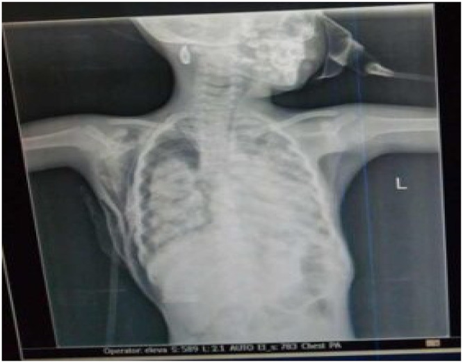

- Gợi ý: trẻ **5 tuổi**, dẫn lưu tràn khí; sau vài giờ **phổi nở nhưng mờ dần hai bên**, oxy hóa xấu đi.
- Câu hỏi: Biến chứng gì? Vì sao xảy ra và làm sao phòng?

<b>Bấm để hiện đáp án (findings + chẩn đoán)</b>

- Dấu hiệu: (theo dõi) ban đầu **tràn khí phải**; sau dẫn lưu vài giờ, phổi **nở ra nhưng ĐỤC hai bên** — **phù phổi tái nở (re-expansion pulmonary edema, RPE)**.
- Chẩn đoán: **RPE** — phù phổi **không do tim** sau **giải phóng khí/dịch nhanh** ở phổi xẹp lâu; **hiếm nhưng có thể tử vong**. Phòng: **không hút ngay**, hút **−10 đến −20 cmH₂O**, giải phóng từ từ, X-quang theo dõi sau thủ thuật.
- Nguồn ảnh: Weldetsadik AY & Demisse AG, *Ethiop J Health Sci* 2022 (PMC9113034), CC BY-NC 4.0 (giữ nguyên bản, không ghép).

**Ca 6 — Khí dưới da sau đặt ống ở sơ sinh.**

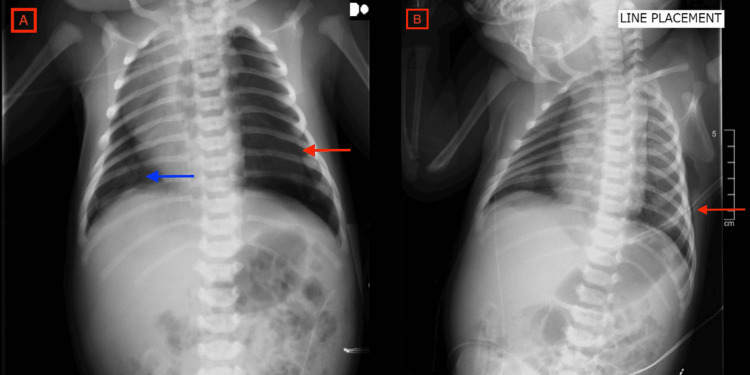

- Gợi ý: sơ sinh, đặt ống dẫn lưu bằng **kỹ thuật trocar**; sờ thành ngực **lạo xạo**.
- Câu hỏi: Dấu hiệu (mũi tên)? Vì sao kỹ thuật trocar liên quan?

<b>Bấm để hiện đáp án (findings + chẩn đoán)</b>

- Dấu hiệu: (A) ngày 1 — **khí dưới da** ngực/đùi mới xuất hiện (mũi tên đỏ); (B) ngày 3 — **khí dưới da lan rộng** trước và sau lồng ngực; (C) ngày 6 — **khí dưới da tồn dư** nhưng tràn khí đã hết.
- Chẩn đoán: **khí dưới da sau đặt ống bằng kỹ thuật trocar** ở trẻ sơ sinh; khí dưới da thường **tự tiêu** nhưng cần chọn **kỹ thuật ít sang chấn** (dilator/Seldinger, ống nhỏ).
- Nguồn ảnh: Jilani TS et al., *Cureus* 2024 (PMC10849260), CC BY 4.0.

**Ca 7 — Kiểm tra vị trí ống sau đặt.**

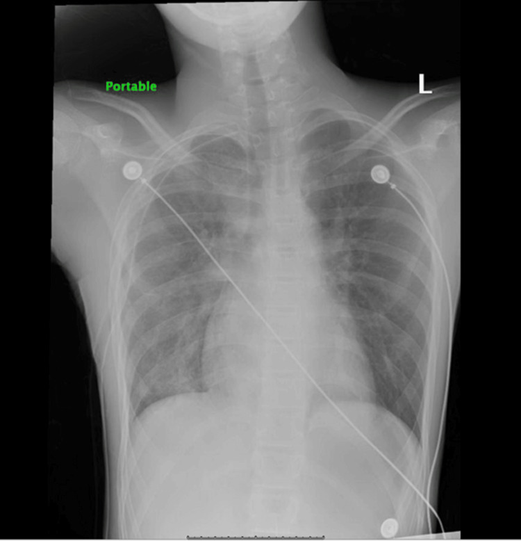

- Câu hỏi: Đầu ống nằm trong khoang màng phổi hay nhu mô? Nhìn gì để kết luận?

<b>Bấm để hiện đáp án (findings + chẩn đoán)</b>

- Dấu hiệu: ống dẫn lưu đi xuống trong **khoang màng phổi phải**, phổi nở lại — **vị trí đúng**, không có đầu ống tận trong nhu mô.
- Kết luận: ống đúng vị trí → xác nhận bằng **X-quang thẳng/nghiêng** sau đặt (và đọc lại đường đi toàn bộ ống + hệ thống).
- Nguồn ảnh: Basnet P et al., *Cureus* 2025 (PMC11926534), CC BY 4.0.

## Bài liên quan chéo
- [600 – Tổng quan Nhi khoa](../600-tong-quan-nhi-khoa/lesson.md)
- [616 – Biến chứng viêm phổi nhi: empyema & hoại tử phổi](../616-bien-chung-viem-phoi-nhi-empyema-hoai-tu/lesson.md) (khi nào dẫn lưu mủ màng phổi)
- [617 – Hội chứng rò khí ở nhũ nhi: tràn khí màng phổi & trung thất](../617-hoi-chung-ro-khi-o-nhu-nhi/lesson.md) (AP-ratio quyết định can thiệp)
- [618 – Rò phế quản–màng phổi & rò khí dai dẳng ở trẻ](../618-ro-phe-quan-mang-phoi-va-ro-khi-dai-dang-o-tre/lesson.md) (rò dai dẳng dù ống đúng vị trí)
- [619 – Di chứng hô hấp sau hoại tử phổi & cắt thùy ở trẻ](../619-di-chung-ho-hap-sau-hoai-tu-phoi-cat-thuy/lesson.md) (phổi bó/trapped lung)
- [611 – Khí kẽ phổi (PIE) & tràn khí áp lực ở nhũ nhi](../611-ro-khi-nang-pie-tran-khi-ap-luc-nhu-nhi/lesson.md)

## Ảnh
- Tên file: `609_slug_Modality_SourceID.jpg`; nguồn + giấy phép từng ảnh trong `images/CREDITS.md`.
- Ảnh **CC BY 4.0** cho phép tải/ghép; **`609_phu-phoi-tai-no_XR_PMC9113034.jpg` là CC BY-NC 4.0 — giữ nguyên bản**.

> Không dùng để chẩn đoán độc lập khi chưa có người hướng dẫn.
