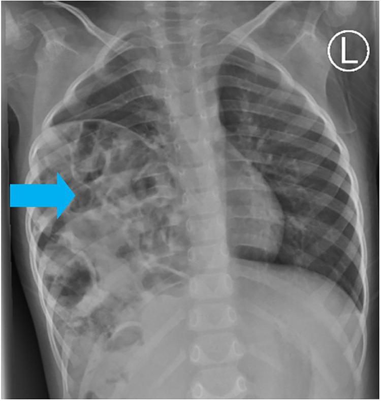
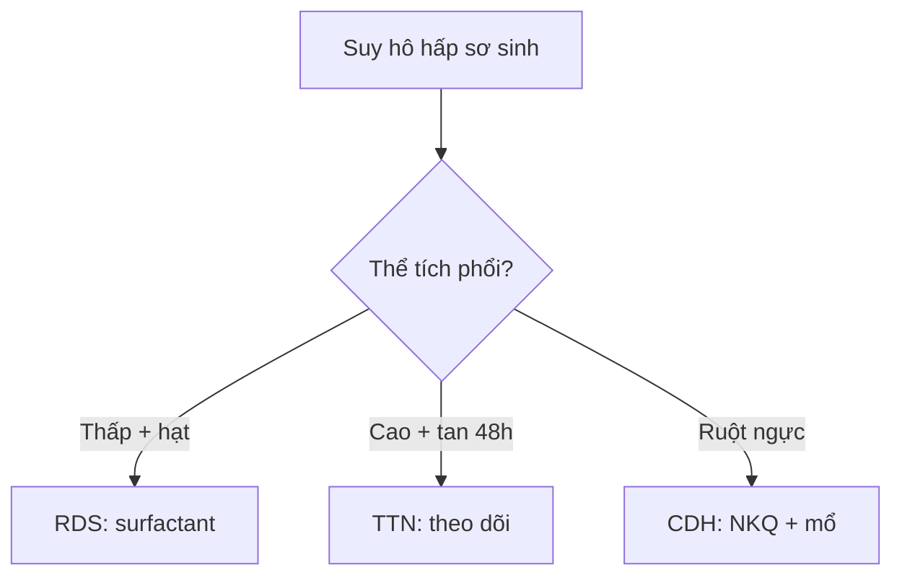

# 610 — Suy hô hấp sơ sinh: RDS, TTN, MAS & CDH / Neonatal distress

**Tags:** `pattern:suy-ho-hap-so-sinh` `vung:phoi-nhi` `protocol:X-quang-so-sinh`
**Mức chắc chắn (certainty):** tổng hợp y văn (literature synthesis) — nhóm tự biên từ y văn mở, chưa gắn ca nguyên văn đơn lẻ.

## 1. Tổng quan — thể tích phổi đọc trước, hạt-khí đọc sau

- Surfactant giảm sức căng phế nang — TẠI SAO non tháng (< 34 tuần) xẹp lan tỏa: thiếu surfactant → xẹp + **thể tích thấp (< 7 cung sườn sau)** + hạt kính mờ + phế quản hơi (RDS).
- Dịch phổi chậm hấp thu (mổ đẻ đủ tháng) — TẠI SAO TTN ứ khí + dịch rãnh liên thùy + Kerley B mà **tự sạch 48–72 giờ**: dịch chỉ kẹt tạm, không xẹp thật.
- Phân su gây tắc-van + viêm — TẠI SAO MAS vừa xẹp vừa ứ khí + tràn khí 20–40%: cục phân su chặn từng phần (van 1 chiều) + toàn phần xen kẽ.
- CDH Bochdalek trái 85%: ruột lên ngực qua khe sau-ngoài — **CẤM bóp bóng mask** (khí vào ruột chèn tim phổi!).

## 2. Gamut suy hô hấp sơ sinh (Gamut)

- **Non tháng + xẹp + hạt + phế quản hơi:** RDS — surfactant + CPAP/thở máy (coi chừng PIE).
- **Đủ tháng mổ đẻ + ứ khí + Kerley + sạch 48–72h:** TTN — oxy + theo dõi (đừng kháng sinh mù).
- **Già tháng + phân su + đám thô + tràn khí:** MAS — hút + thở máy + ECMO khi nặng.
- **Ruột ngực trái + trung thất lệch + bụng lõm:** CDH — nội khí quản + sonde dạ dày + mổ (cấm mask!).

## 3. Bảng so sánh phân biệt (ma trận đối chiếu)

| Thực thể (entity) | Hình ảnh điển hình | Chốt vào (rule-in) | Chốt loại (rule-out) | Gợi ý xác nhận |
|---|---|---|---|---|
| RDS | **Xẹp < 7 sườn + hạt kính mờ + phế quản hơi** | **Non tháng + xẹp + hạt** | Ứ khí + tan 48h → TTN | Surfactant + CPAP |
| TTN | **Ứ khí + dịch rãnh + Kerley + sạch 48–72h** | **Mổ đẻ + tự sạch** | Xẹp + hạt → RDS | Oxy + theo dõi |
| MAS | **Căng > 9 sườn + đám thô + tràn khí 20–40%** | **Phân su + xẹp-ứ xen kẽ** | Ruột ngực → CDH | Hút + máy + ECMO |
| CDH | **Ruột ngực trái + lệch trung thất + bụng lõm** | **Quai ruột ngực + Bochdalek 85% trái** | Nang phổi → CPAM | NKQ + sonde + mổ, cấm mask |

*Đa quai ruột ngực phải — CDH muộn dễ nhầm viêm phổi/tràn khí. Nguồn: Lodhia et al., Radiol Case Rep 2024 Fig. 5, CC BY-NC-ND 4.0 (giữ nguyên bản).*

## 4. Protocol X-quang sơ sinh

- **X-quang nằm + đếm cung sườn + sonde dạ dày** (CDH: sonde cuộn trong ngực!); siêu âm phổi khi phân vân RDS/TTN.

## 5. Cạm bẫy

- **CDH muộn giả viêm phổi/tràn khí** đặt dẫn lưu vào ruột! — quai ruột + bụng lõm là CT trước mọi dẫn lưu.
- **Bóp bóng mask CDH** = tử vong — NKQ + sonde là luật.
- **TTN kháng sinh mù** — sạch 48–72h + đủ tháng mổ đẻ là theo dõi.

## 6. Tự lượng giá — Blind Quiz

**Ca 1 — Trẻ 2 tuổi ho khò khè tái diễn, kháng sinh không đỡ. Đọc X-quang.**

- Hỏi: bóng gì trong ngực phải? CDH hay viêm phổi? Đặt dẫn lưu được không?

<b>Bấm để hiện đáp án</b>

- Dấu hiệu (findings): đa quai ruột nửa ngực phải (mũi tên xanh).
- Chẩn đoán (diagnosis): **thoát vị hoành bẩm sinh muộn (CDH)** — CT xác nhận + mổ (cấm dẫn lưu mù, cấm bóp mask!).
- Nguồn: Lodhia et al., Fig. 5, CC BY-NC-ND 4.0 (nguyên bản).

**Ca 2 — Non 30 tuần + xẹp + hạt + phế quản hơi:** RDS hay TTN? Thuốc gì? *(Bảng mục 3.)*

<b>Bấm để hiện đáp án</b>

- **RDS:** surfactant + CPAP (TTN là đủ tháng + tự sạch 48–72h).

## Bài liên quan chéo
- [600 – Tổng quan Nhi](../600-tong-quan-nhi-khoa/lesson.md)
- [031 – Viêm phổi](../031-viem-phoi-mau-hinh/lesson.md) (người lớn)
- [045 – Hoành](../045-thanh-nguc-hoanh/lesson.md) (Bochdalek)

> Không dùng để chẩn đoán độc lập khi chưa có người hướng dẫn.
