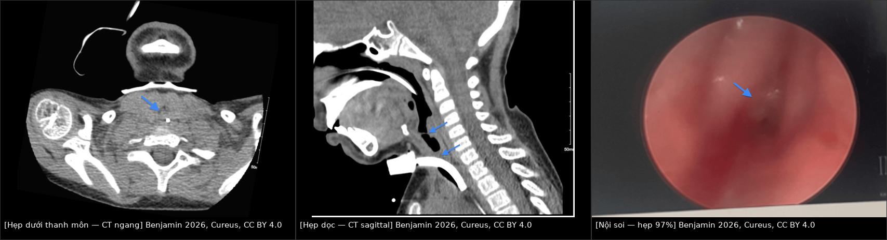
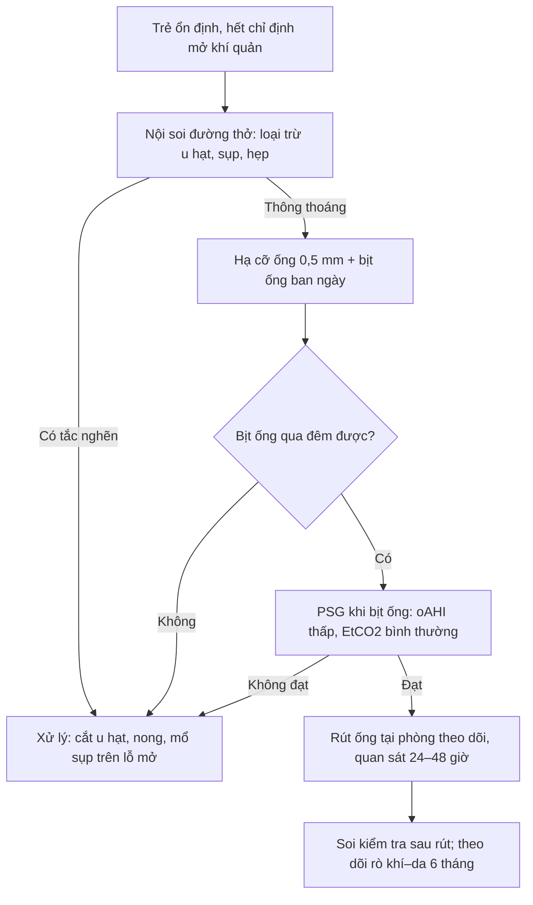
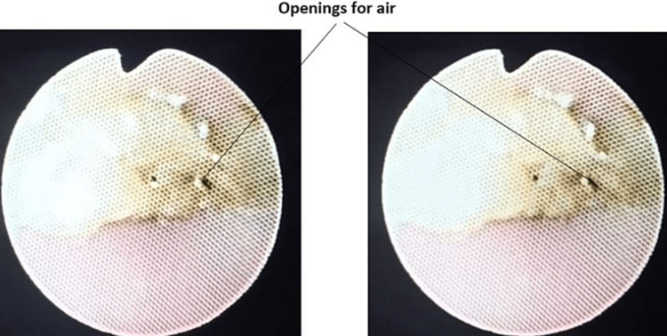
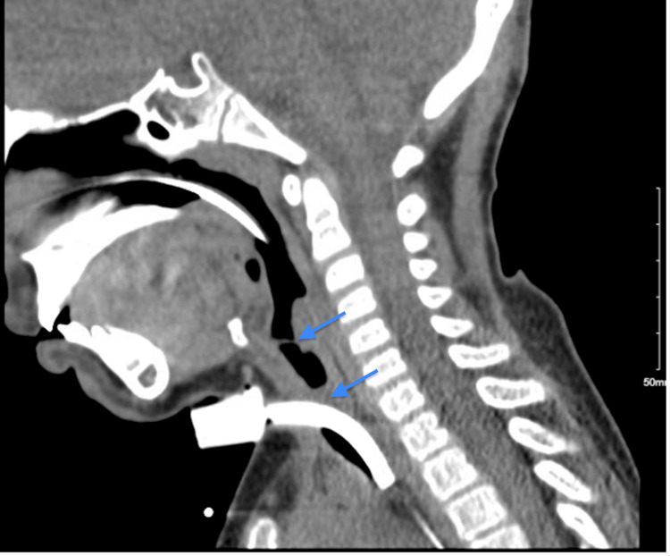

# 6100 — Chăm sóc, biến chứng & cai ống mở khí quản ở trẻ / Pediatric tracheostomy: complications, surveillance imaging and decannulation

**Tags:** `pattern:hep-duong-tho` `pattern:u-hat` `vung:duong-tho-nhi` `vung:co` `protocol:CT-co-nguc` `protocol:X-quang-nguc`
**Mức chắc chắn (certainty):** tổng hợp y văn (literature synthesis) — ghép số liệu từ các đoàn hệ mở: 175 trẻ theo dõi nội soi sau mở khí quản (Suresh R và cs., *Laryngoscope Investig Otolaryngol* 2024, PMC10866584); 126 trẻ về u hạt và biến chứng sớm (Reddy PD và cs., *Am J Otolaryngol* 2024); 68 trẻ < 2 tuổi về cỡ ống và khoảng cách tới carina (Eljamri S và cs., *Otolaryngol Head Neck Surg* 2025, PMC12461770); tổng quan hệ thống 24 giao thức cai ống/1.395 trẻ (Verma R và cs., *Pediatr Pulmonol* 2021); cùng ca nguyên văn bỏng đường thở có ảnh CT/nội soi (Benjamin P và cs., *Cureus* 2026, PMC13484941) và ca tắc ống do vảy tiết (Akhtar AB và cs., *Cureus* 2022, PMC9375839). Không gắn một bệnh án đơn lẻ cho phần số liệu.

## 1. Tổng quan bệnh học – cơ chế hình ảnh: vì sao "ống nhỏ đi 0,5 mm" đổi hẳn sinh lý

- **Vật lý dòng khí — định luật Poiseuille:** sức cản đường thở **R ∝ 1/r⁴**. Giảm đường kính trong (internal diameter, ID) từ **4,0 xuống 3,5 mm** là giảm bán kính **12,5%**, nhưng **tăng sức cản ~67%** ((1/0,875)⁴ = 1,67). Vì thế mỗi lần **hạ cỡ ống 0,5 mm** khi cai ống là một "test gắng sức" thật sự, không phải thủ tục hành chính — và một **nửa milimet u hạt** ở trẻ sơ sinh (khí quản ~3,5–4 mm) tương đương **hẹp 25–30% tiết diện** ở người lớn.
- **Vì sao u hạt (granulation tissue) mọc:** ống là vật lạ **cọ xát niêm mạc** + **ứ đọng chất tiết** quanh lỗ mở + **nhiễm khuẩn màng sinh học (biofilm)** → viêm mạn → mô hạt. Trong 126 trẻ, u hạt gặp **81,0%**, chủ yếu **quanh lỗ mở 69,8%** và **trên lỗ mở (suprastomal) 34,9%**; **hạch/u hạt trên lỗ mở** là thứ chắn ngay trên đầu ống nên **cản cai ống** dù phổi bình thường. Ciprofloxacin/dexamethasone khí dung làm **giảm số đợt** u hạt sau khi bắt đầu (z = 3,88; p < 0,001) nhưng **không** làm nhóm dùng thuốc có ít u hạt hơn (92,4% vs 61,7%) — vì thuốc được kê chính vì đã có u hạt (confounding by indication).
- **Vì sao sụp thành trước trên lỗ mở (suprastomal collapse) và biến dạng chữ A (A-frame deformity):** ống tì vào **sụn khí quản phía trước** và vòng sụn bị **thiếu máu – tiêu sụn**; khi rút ống, đoạn trên lỗ mở mất giá đỡ → **lồi vào lòng khi thở ra**. Trong 175 trẻ: **sụp trên lỗ mở 55%** (trung bình sau **17,7 tháng**, ước tính **73,7% ở 5 năm**), **biến dạng chữ A 18%** (ước tính **32,8% ở 5 năm**); **56% (18/32)** biến dạng chữ A xuất hiện **sau khi đã cai ống**, ước tính **36,1% trong 3 năm sau cai**. Mở khí quản **càng sớm (tuổi nhỏ)** càng dễ sụp: mỗi năm tuổi lớn hơn, nguy cơ sụp **giảm (OR 0,92; 95% CI 0,86–0,99)**.
- **Vì sao tắc ống là nguyên nhân tử vong hàng đầu:** lòng ống **hẹp sẵn** (trẻ 8 tuổi dùng ống **6,0 mm không bóng**), chất tiết khô tạo **vảy tiết (crust)** bít gần kín; trẻ **không ho được qua ống** và **không nói được** nên dấu hiệu báo trước rất nghèo nàn — ca của Akhtar cho thấy **không thể thông khí sau khởi mê dù trước đó không có dấu hiệu báo động**. Vì vậy **hình ảnh không bao giờ được thay cho việc soi/kiểm tra ống cấp cứu**, nhưng X-quang/CT lại là cách duy nhất nhìn **vị trí và đường kính** ống trong lòng khí quản.
- **Vì sao CT là modality chốt cho hẹp khí quản:** khí quản trẻ **mềm, di động**, nên hẹp **động (malacia)** chỉ thấy khi **chụp thì thở ra/hít vào** hoặc CT động; còn hẹp **cố định do xơ/sụn** thấy rõ trên **CT ngang/dọc/coronal** với **lòng khí quản < 50%** diện tích dự kiến theo tuổi. Ca bỏng đường thở: nội soi **hẹp dưới thanh môn 97%**, dính dây thanh **99%**, và **u hạt bít hoàn toàn** dưới thanh môn; CT ngang/dọc xác nhận **hẹp ở dưới thanh môn và đoạn khí quản gần** — tức tổn thương **hai tầng**, đúng như hình ghép dưới đây.

## 2. Mẫu hình + chẩn đoán phân biệt theo vị trí (Gamut)

- **Mẫu hình "trẻ có ống mở khí quản đột nhiên xấu":** tắc ống (vảy tiết/nút nhầy) → **không thông khí được, bóng không lên, SpO₂ tụt nhanh**; **rơi ống (accidental decannulation) 13,6%**; **chảy máu lỗ mở 7,2%**; hoặc **sụp trên lỗ mở** khi vừa bịt (cap) ống.
- **Gamut theo tầng tổn thương (đọc CT/nội soi từ trên xuống):**
  - **Thanh môn – dưới thanh môn:** dính dây thanh, hẹp dưới thanh môn (Myer–Cotton I–IV), u hạt dưới thanh môn.
  - **Ngay trên lỗ mở (suprastomal):** **sụp thành trước**, u hạt "nắp", biến dạng chữ A.
  - **Tại lỗ mở (stomal):** u hạt quanh lỗ, hẹp vòng sụn, rò khí–da (tracheocutaneous fistula).
  - **Dưới lỗ mở (infrastomal):** u hạt do đầu ống tì, hẹp do bóng/ống quá cỡ.
  - **Xa (distal):** ống quá sâu → **đầu ống vào phế quản gốc phải**, tắc nút nhầy, xẹp phổi một bên.
- **Gamut theo hình thái trên CT:** hẹp **chu vi** (xơ/sụn) vs **hẹp do thành trước lồi** (A-frame/suprastomal collapse) vs **lòng bị lấp bởi khối mô mềm trong lòng** (u hạt/nút nhầy) vs **hẹp động thì thở ra** (malacia, xem bài 602).
- **Ba câu hỏi phải trả lời trên mọi phim kiểm tra:** (1) **đầu ống ở đâu** so với carina; (2) **đường kính ống** có vừa khí quản không (ống quá lớn → thiếu máu niêm mạc, quá nhỏ → tăng sức cản); (3) **có tổn thương thành khí quản** (u hạt, sụp, hẹp) — phần quyết định **cai ống được hay không**.

## 3. Bảng so sánh phân biệt (ma trận đối chiếu)

| Thực thể (entity) | Hình ảnh điển hình (X-quang/CT/nội soi) | Chốt vào (rule-in) | Chốt loại (rule-out) | Gợi ý xác nhận |
|---|---|---|---|---|
| **Tắc ống do vảy tiết/nút nhầy** | X-quang: ống **không đổi vị trí**, phổi có thể bình thường; nhìn trực tiếp lòng ống thấy **mảng vàng–nâu bít lỗ** | **Không thông khí được qua ống dù ống đúng vị trí**; thấy **crust trong lòng ống** | Ống **sai vị trí** (đầu ống lệch/cao/thấp) hoặc **rơi ống** | Soi/kiểm tra ống ngay; X-quang để loại trừ lệch vị trí |
| **U hạt (granulation)** | CT: **khối mô mềm trong lòng**, bờ không đều, cùng tầng với lỗ mở; nội soi: đỏ, dễ chảy máu | U hạt **quanh/trên lỗ mở** hoặc **dưới thanh môn**, **tăng theo thời gian** dùng ống | Hẹp **cân xứng do sụn** (vòng xơ nhẵn, không có khối trong lòng) | Nội soi ống mềm + sinh thiết nếu không điển hình |
| **Sụp trên lỗ mở (suprastomal collapse)** | CT thì **thở ra**: thành trước **lồi vào**, lòng còn **hình liềm**; 55% trẻ có, **73,7% ở 5 năm** | Sụp **khi bịt ống/thở ra**, hồi phục khi thở vào/PEEP | Hẹp **cố định mọi thì** = hẹp xơ/sụn | CT động hoặc nội soi khi thở tự nhiên |
| **Biến dạng chữ A (A-frame)** | CT: khí quản **hình chữ A**, thành bên dày, **18%**; **56%** xuất hiện **sau cai ống** | Hình chữ A + tiền sử mở khí quản **lúc rất nhỏ** | Hẹp dưới thanh môn (tổn thương **cao hơn**, sát dây thanh) | CT coronal + nội soi |
| **Hẹp khí quản mắc phải (stenosis)** | CT: **lòng < 50%** diện tích dự kiến, đoạn hẹp **ngắn, nhẵn**; nội soi: vòng xơ | Đo được **đường kính nhỏ nhất** và **chiều dài đoạn hẹp** (quyết định nong/cắt nối) | **Malacia** (lòng thay đổi theo thì thở) | CT ≤ 1 mm + nội soi toàn bộ đường thở |
| **Rò khí–da (tracheocutaneous fistula)** | Lỗ mở **không đóng sau 6 tháng**; **49%** trẻ phải đóng bằng phẫu thuật | Lỗ mở **tồn tại > 6 tháng** sau cai, thấy đường hầm da–khí quản | Lỗ mở **đang lành** (< 6 tháng) | Đo kích thước lỗ, nội soi kiểm tra đường hầm |
| **Ống quá sâu (endobronchial)** | X-quang: **đầu ống dưới carina**, thường vào **phế quản gốc phải**; xẹp phổi trái | Đầu ống **dưới carina** hoặc **xẹp/xẹp–xẹp phổi đối bên** | Đầu ống **trên carina 10–15 mm** | Rút ống 1–2 cm rồi chụp lại |

## 4. Protocol chụp + hệ phân độ & quy trình cai ống

- **X-quang ngực/ngực–cổ thẳng:** phim **đầu tiên sau đặt ống 24 giờ** và **sau mỗi lần đổi cỡ ống**. Trên 68 trẻ < 2 tuổi, **khoảng cách từ lỗ mở đến carina** tương quan với **cân nặng (ρ = 0,403; p = 0,0007)** mạnh hơn **tuổi (ρ = 0,291; p = 0,02)** — nên chọn cỡ/độ dài ống **theo cân nặng** ở nhóm này.
- **Cạm bẫy định lượng quan trọng:** đo **khoảng cách đầu ống–carina trên X-quang KHÔNG tương quan với đo qua nội soi/soi khí quản** (Eljamri 2025, Fig 1) — X-quang dùng để **loại trừ lệch vị trí thô**, không dùng để "đo chính xác" độ sâu. **Khoảng cách ống–carina càng ngắn** thì **biến cố nặng càng nhiều (p = 0,03)**; biến cố nặng (rơi ống/tử vong) gặp **24% (16/68)**, biến cố nhẹ **27,9% (19/68)**.
- **CT cổ–ngực xoắn ốc, lát ≤ 1 mm, không cần cản quang** khi nghi **hẹp/u hạt/sụp** hoặc trước khi quyết định **nong bóng – cắt nối**. Với hẹp động: **CT 2 thì hít vào – thở ra** (hoặc CT 4D) để phân biệt **malacia** với **hẹp cố định**.
- **Nội soi là "gold standard" của cai ống:** **96% (23/24)** giao thức trong tổng quan 1.395 trẻ dùng **nội soi đường thở** trước cai; **83% bịt ống (capping)**, **58% hạ cỡ ống (downsizing)**, **8% ống có lỗ (fenestration)**; đo trao đổi khí bằng **đa ký giấc ngủ 72%**, **oximetry 56%**, **khí máu 17%**, **capnography 17%**.
- **Đa ký giấc ngủ (PSG) khi bịt ống — ngưỡng định lượng:** nhóm được cai có **oAHI 1,7 vs 5,4 sự kiện/giờ (p = 0,03)**, **RDI 2,4 vs 7,6 (p = 0,006)**, **EtCO₂ đỉnh 50,0 vs 58,7 torr (p = 0,009)**; **83% (38/46)** được cai sau PSG. Không có biến chứng sau cai trước khi ra viện.
- **Quy trình cai ống theo bước (tổng hợp giao thức):**

- **Số liệu kết cục để tư vấn gia đình:** cai ống thành công **21% (39/184)** trong đoàn hệ Nhật (trung vị **3,6 năm** có ống; nhóm nhiễm trùng cai **0,7 năm**); **tỷ lệ thành công mỗi lần thử 58% (33/57)** ở Glasgow (thất bại hay gặp **ngày 2 — lúc bịt ống**); **91% (61/67)** ở Ấn Độ khi có **X-quang mô mềm cổ + nội soi**. Trẻ **BPD** có ống lâu hơn (**3,4 vs 1,8 năm**) và **tăng áp phổi là yếu tố dự báo tử vong (aHR 1,99; 95% CI 1,17–3,38)**, không phải BPD.

## 5. Biến thể bình thường và cạm bẫy

- **Biến thể bình thường:** ống **hơi chếch** theo trục khí quản; **bóng ống** (nếu dùng) làm lòng khí quản **căng tròn** trên CT — đừng đọc là hẹp; **khí trong mô mềm quanh lỗ mở ngay sau đặt ống** vài milimét là bình thường, **lan rộng + tràn khí trung thất** mới bệnh lý.
- **Cạm bẫy 1 — "X-quang bình thường" không loại trừ tắc ống:** đo trên X-quang **không tương quan** với vị trí thật trên nội soi; trẻ có thể **tắc hoàn toàn bằng vảy tiết mà phim phổi sạch**. Ca của Akhtar: **không thông khí được sau khởi mê** dù trước đó không có dấu hiệu.
- **Cạm bẫy 2 — u hạt giả "nang" hoặc "phù niêm mạc":** u hạt **cùng tầng với lỗ mở**, **bờ không đều**, **tăng dần**; còn phù sau mổ **giảm nhanh trong 1–2 tuần**.
- **Cạm bẫy 3 — hẹp "động" bị bỏ sót trên CT tĩnh:** chụp lúc **thở máy áp lực dương** sẽ **"giằng" đường thở mở ra**; muốn thấy **malacia/sụp trên lỗ mở** phải chụp **thì thở ra** hoặc **nội soi khi trẻ thở tự nhiên** (bài học từ 602).
- **Cạm bẫy 4 — bỏ sót tầng thứ hai:** ca bỏng đường thở có **cả hẹp dưới thanh môn 97% và dính dây thanh 99%**; sửa một tầng vẫn không cai được ống. Vì vậy **nội soi toàn bộ từ thanh môn đến carina** là bắt buộc, không chỉ nhìn qua ống.
- **Cạm bẫy 5 — rò khí–da bị coi là "lỗ mở chưa lành":** **49% (63/129)** trẻ phải **đóng rò bằng phẫu thuật**; yếu tố nguy cơ: **đặt ống lúc nhỏ hơn, thời gian có ống dài hơn, có TBM**.

## 6. Tự lượng giá — Blind Quiz

**Ca 1 — trẻ 4 tuổi, bỏng mặt–đường thở, đã mở khí quản ngày thứ 3**

- Gợi ý lâm sàng: bỏng lửa vùng mặt, thở rít tăng dần sau khi bỏng, đã mở khí quản.
- Câu hỏi: Tổn thương ở **tầng nào**? Dấu hiệu nào trên CT quyết định **không thể cai ống** ngay? Cần thêm thông tin gì trước khi nong?

<b>Bấm để hiện đáp án (findings + chẩn đoán)</b>

- Dấu hiệu (findings): CT ngang — **khối mô mềm lấp gần kín lòng khí quản đoạn gần** (mũi tên xanh); CT dọc — **hẹp dưới thanh môn** (mũi tên trên) **và hẹp đoạn khí quản gần** (mũi tên dưới); nội soi — **lỗ thông còn ~3%** (hẹp **97%**).
- Chẩn đoán (diagnosis): **hẹp dưới thanh môn + hẹp khí quản gần sau bỏng đường thở**, kèm **u hạt bít hoàn toàn** và **dính dây thanh 99%** — tổn thương **hai tầng**, nên phải **cắt u hạt + gỡ dính + tiêm triamcinolone** rồi mới cai ống theo bước (bịt ống, PSG).
- Vì sao: bỏng nhiệt/hóa chất gây **phù – thiếu máu niêm mạc – xơ**; vùng **dưới thanh môn là chỗ hẹp nhất của đường thở trẻ** nên là nơi hẹp nặng nhất.
- Nguồn ảnh: Benjamin P và cs., *Cureus* 2026 (PMC13484941), CC BY 4.0 — Hình 1–3.

**Ca 2 — trẻ 8 tuổi có ống mở khí quản cỡ 6,0 mm, vào phòng mổ để chụp MRI**

- Gợi ý lâm sàng: không thông khí được sau khởi mê, bóng không lên, trước đó trẻ "vẫn ổn".
- Câu hỏi: Nguyên nhân tắc? Vì sao phim phổi trước đó có thể bình thường? Xử trí đầu tay?

<b>Bấm để hiện đáp án (findings + chẩn đoán)</b>

- Dấu hiệu (findings): lòng ống **bị bít gần kín bởi vảy tiết vàng–nâu**; chỉ còn **vài lỗ thông nhỏ** (mũi tên "openings for air"), đủ cho trẻ thở lúc nghỉ nhưng **không đủ khi gắng sức/gây mê**.
- Chẩn đoán (diagnosis): **tắc ống mở khí quản do vảy tiết (mucus plug/crust)** — biến chứng **hay gặp nhất** ở trẻ có ống.
- Vì sao phim bình thường: X-quang chỉ thấy **vị trí ống**, không thấy **lòng ống bị lấp**; và **sức cản tăng theo 1/r⁴** nên một lỗ nhỏ vẫn đủ khí khi nghỉ nhưng sập khi cần lưu lượng cao.
- Nguồn ảnh: Akhtar AB và cs., *Cureus* 2022 (PMC9375839), CC BY 4.0 — Hình 1.

**Ca 3 — trẻ 18 tháng, mở khí quản lúc 2 tháng vì BPD, nay bịt ống 2 giờ thì thở rít**

- Gợi ý lâm sàng: BPD, đã mở khí quản từ rất sớm, hạ cỡ ống 0,5 mm và bịt ống thì rít, SpO₂ giảm.
- Câu hỏi: Ba khả năng giải thích? Dấu hiệu nào phân biệt **sụp trên lỗ mở** với **hẹp cố định**? Cần chụp gì?

<b>Bấm để hiện đáp án (findings + chẩn đoán)</b>

- Dấu hiệu (findings): trên CT dọc, **thành trước khí quản trên đầu ống lồi vào lòng khi thở ra**; khi thở vào/PEEP lòng mở lại; đoạn hẹp **ngắn, ngay trên lỗ mở**.
- Chẩn đoán (diagnosis): **sụp trên lỗ mở (suprastomal collapse)** — gặp **55%** trẻ sau mở khí quản, **73,7% ở 5 năm**; mở ống lúc càng nhỏ càng dễ (OR 0,92 mỗi năm tuổi).
- Phân biệt: **hẹp cố định** không đổi theo thì thở, bờ xơ nhẵn, thường **dưới thanh môn**; **malacia** thay đổi theo thì → cần **CT 2 thì hoặc nội soi khi thở tự nhiên**.
- Nguồn ảnh: Benjamin P và cs., *Cureus* 2026 (PMC13484941), CC BY 4.0 — Hình 3 (minh họa vị trí ống và đoạn khí quản gần; ca gốc là bỏng đường thở, không phải BPD — dùng làm hình định vị, không đại diện bệnh cảnh ca 3).

## Bài liên quan chéo
- [602 – Tracheobronchomalacia ở trẻ BPD](../602-tracheobronchomalacia-o-tre-bpd/lesson.md)
- [606 – BPD ở trẻ sinh non](../606-bpd-tre-sinh-non/lesson.md)
- [612 – Cấp cứu đường thở trên ở trẻ em](../612-cap-cuu-duong-tho-tren-tre-em/lesson.md)
- [3005 – U máu dưới thanh môn ở nhũ nhi](../3005-u-mau-duoi-thanh-mon-nhu-nhi/lesson.md)
- [3047 – Hẹp khí quản sau đặt nội khí quản ở trẻ](../3047-hep-khi-quan-sau-dat-noi-khi-quan-o-tre/lesson.md)
- [607 – Tăng áp phổi sơ sinh (PPHN)](../607-tang-ap-phoi-so-sinh-pphn/lesson.md)

## Ảnh
- `images/composite_hep-duoi-thanh-mon.jpg` — ghép CT ngang + CT dọc + nội soi, Benjamin 2026 (PMC13484941), CC BY 4.0.
- `images/6100_cai-ong-mo-khi-quan_Anh_Cureus-PMC9375839-Fig1.jpg` — Akhtar 2022 (PMC9375839), CC BY 4.0.
- Nguồn, giấy phép từng ảnh: `images/CREDITS.md`.

> Không dùng để chẩn đoán độc lập khi chưa có người hướng dẫn.
