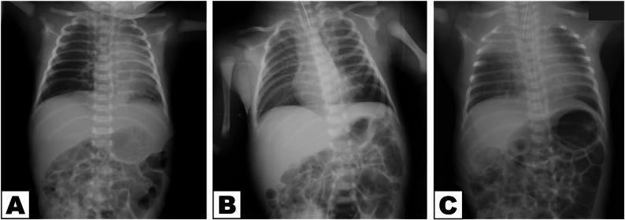
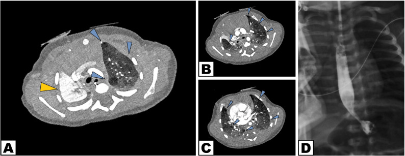
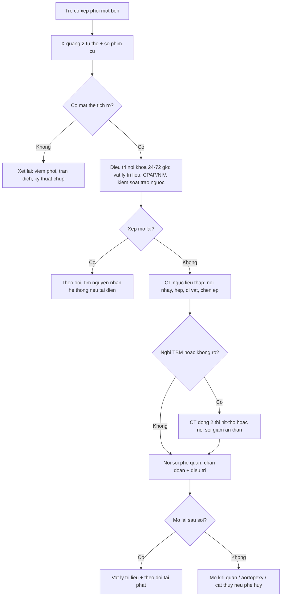
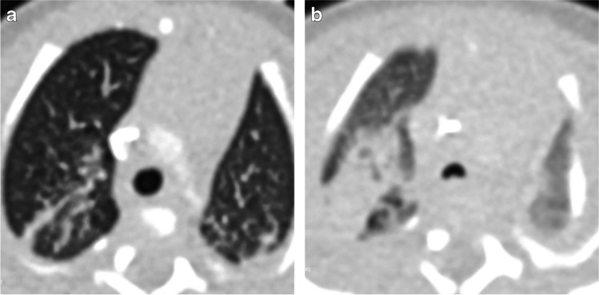
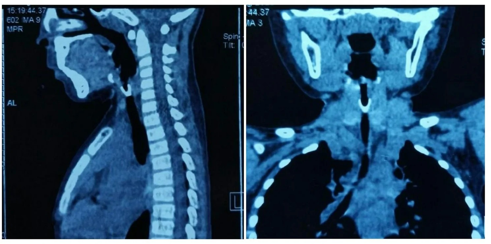

# 6101 — Xẹp phổi một bên tái diễn ở trẻ BPD/TBM: nút nhầy, hẹp phế quản, dị vật hay chèn ép? / Recurrent unilateral atelectasis in BPD/tracheobronchomalacia

**Tags:** `pattern:xep-phoi` `pattern:mat-the-tich` `pattern:u-khi` `vung:phoi-nhi` `anatomy:phex-quan` `protocol:X-quang-nguc` `protocol:CT-nguc-lieu-thap` `protocol:noi-soi-phe-quan` `incidentaloma:khong`
**Mức chắc chắn (certainty):** tổng hợp y văn (literature synthesis) — ghép **đoàn hệ 81 trẻ BPD chụp HRCT** (Front Pediatr 2022, PMC9530466), **đoàn hệ 56 trẻ BPD độ 3 nội soi phế quản** (Pediatr Pulmonol 2025, PMC12606695), **tổng quan hình ảnh BPD** (Pediatr Radiol 2022, PMC8921108), **nghiên cứu CXR vs CT ở 71 trẻ nghi dị vật đường thở** (Children (Basel) 2025, PMC12384725), **ca dị vật phế quản có CT** (BMC Pediatr 2026, PMC13711882), **ca rối loạn chuyển động lông mao (PCD) biểu hiện xẹp phổi tái diễn** (BMC Pediatr 2026, PMC13383552) và **nghiên cứu hội chứng thùy giữa ở trẻ hen** (Front Pediatr 2023, PMC9939435). Không có ca do nhóm tự chụp.

> **Câu hỏi thực hành:** bé trai **14 tháng**, sinh **26 tuần**, BPD, đang mở khí quản; 3 tháng nay **xẹp thùy trên phải tái diễn 2 lần**, mỗi lần **thở rít thì thở ra** và tăng oxy. X-quang có **mờ thùy trên phải + hạch**. Câu hỏi: **xẹp do nút nhầy, do TBM, do hẹp phế quản, do dị vật, hay do chèn ép mạch máu — và khi nào cần nội soi phế quản?**
> Bài chốt **bốn quyết định**: **(1) xẹp tái diễn CÙNG một thùy = bệnh đường thở khu trú, phải tìm nguyên nhân cơ học; (2) X-quang xác nhận mất thể tích, CT liều thấp trả lời “tắc ở đâu, do gì”; (3) nội soi phế quản là tiêu chuẩn vàng và vừa chẩn đoán vừa điều trị (hút nút nhầy, gắp dị vật, nong); (4) TBM có thể bị “che” bởi PEEP/an thần — nội soi lần đầu bỏ sót tới 35%.** Nối [602 – TBM ở trẻ BPD](../602-tracheobronchomalacia-o-tre-bpd/lesson.md), [606 – BPD ở trẻ sinh non](../606-bpd-tre-sinh-non/lesson.md), [6100 – Chăm sóc & cai ống mở khí quản](../6100-cham-soc-va-cai-ong-mo-khi-quan-tre/lesson.md), [3047 – Hẹp khí quản sau đặt nội khí quản](../3047-hep-khi-quan-sau-dat-noi-khi-quan-o-tre/lesson.md).

## 1. Tổng quan bệnh học – cơ chế hình ảnh: vì sao “xẹp phổi” là chuyện của đường thở, không phải của nhu mô

- **Định nghĩa:** xẹp phổi (atelectasis) là **giảm thể tích khí trong phổi** do đường thở mất thông khí và/hoặc phổi mất lực mở. Trên hình ảnh, chốt chẩn đoán là **dấu hiệu mất thể tích (volume loss)**, không phải “độ đậm của vùng mờ”: **khe di lệch về phía tổn thương, trung thất lệch cùng bên, cơ hoành nâng, cung sườn sát nhau**, và **phế quản hơi** chỉ còn khi tắc **không hoàn toàn**.
- **TẠI SAO trẻ BPD/TBM hay xẹp tái diễn:** ba cơ chế cộng hưởng —
  1. **Đường thở mềm, dễ xẹp (TBM):** sụn yếu + màng sau rộng → thì thở ra lòng phế quản xẹp **> 50%**, khí bị “nhốt” rồi hấp thu → xẹp phân thùy/thùy.
  2. **Chất nhầy quánh + ho yếu:** viêm mạn, ít đàn hồi, cơ hô hấp yếu (nhất là khi có mở khí quản) → **nút nhầy (mucus plug)** bít phế quản thùy.
  3. **Phổi ít đàn hồi và ứ khí:** vùng phổi ứ khí chèn ép vùng bên cạnh, làm xẹp dễ hơn; **thông khí chọn lọc** hoặc **PEEP** có thể mở lại nhưng cũng có thể **che mất chẩn đoán**.
- **Số liệu nền:** trong **81 trẻ BPD** chụp HRCT 40–50 tuần tuổi sau kinh, **24,69% có TBM** và **49,38% có tăng áp phổi**; điểm HRCT **không khác biệt** giữa có/không TBM, tức **CT tĩnh không đủ để loại trừ TBM** (Front Pediatr 2022, PMC9530466).
- **TẠI SAO nội soi lần đầu dễ bỏ sót:** trong **56 trẻ BPD độ 3**, TBM gặp **66%** khi nội soi lặp lại nhưng **lần đầu chỉ 41%** — **bỏ sót 35%**; **77%** ca bỏ sót có **an thần sâu hơn** lần sau, trung vị phát hiện muộn **6,7 tuần** (Pediatr Pulmonol 2025, PMC12606695). Nguyên nhân: **PEEP và gây mê “giằng” đường thở mở ra**, mất dấu xẹp động.
- **TẠI SAO vị trí hay gặp là thùy giữa phải và lưỡi:** phế quản thùy giữa **hẹp, đi góc nhọn**, **tuần hoàn phụ (collateral ventilation) kém** → dễ xẹp và khó mở lại; gọi là **hội chứng thùy giữa (middle lobe syndrome, MLS)**. Ở trẻ hen, MLS gặp **1,62% (56/3.528)**; trong 35 trẻ hen có xẹp thùy giữa/lưỡi, **15 trẻ tái diễn** (Front Pediatr 2023, PMC9939435).
- **Dị vật — nguyên nhân “không được bỏ qua”:** **89,7%** dị vật là chất hữu cơ; **43,7%** nằm ở **phế quản gốc phải**; chỉ **~11%** dị vật **cản quang**, nên **X-quang bình thường không loại trừ**. Trong 71 trẻ nội soi vì nghi dị vật: **CXR độ nhạy 94,9%, độ đặc hiệu 71,0%**; **CT độ nhạy 63,2%, độ đặc hiệu 100%** (Children (Basel) 2025, PMC12384725). Con số này nhắc: **CT không thay thế nội soi**, và **X-quang âm tính vẫn phải nội soi nếu bệnh sử điển hình**.
- **Xẹp “di chuyển” (shifting atelectasis) là cờ đỏ của nguyên nhân hệ thống:** xẹp lần lượt **thùy này rồi thùy khác**, tái diễn nhiều đợt → nghĩ **rối loạn chuyển động lông mao (primary ciliary dyskinesia, PCD)**, **xơ nang (cystic fibrosis)**, **hít sặc**, **suy giảm miễn dịch**, chứ không chỉ là “nút nhầy đơn thuần”.

## 2. Mẫu hình + chẩn đoán phân biệt theo cơ chế và vị trí (Gamut)

- **Theo cơ chế — 4 tầng “từ trong ra ngoài”:**
  - **Trong lòng (intraluminal):** **nút nhầy** (hay nhất ở BPD/mở khí quản), **bã nhầy dạng phế quản (plastic bronchitis)**, **cục máu đông**, **dị vật**.
  - **Thành (mural):** **TBM/bronchomalacia**, **hẹp phế quản** sau đặt nội khí quản/mở khí quản, **u hạt (granuloma)** quanh ống, **u nội phế quản** (carcinoid, papillomatosis — hiếm ở trẻ).
  - **Ngoài thành (extrinsic):** **chèn ép mạch máu** (động mạch phổi giãn, ống động mạch, quai ĐMC đôi), **hạch to**, tim to.
  - **Nhu mô/màng phổi:** **tràn dịch, tràn khí**, xẹp do chèn ép; **bệnh phổi hạn chế**.
- **Theo vị trí:** **thùy giữa phải/lưỡi** (MLS) · **thùy trên trái** (phế quản gốc trái dài, dễ tắc) · **phế quản gốc phải** (dị vật) · **toàn một bên phổi** (tắc phế quản gốc, dị vật lớn, hẹp khí quản) · **nhiều thùy di chuyển** (PCD/CF/hít sặc).
- **Mnemonic “MALT” cho xẹp một bên tái diễn:** **M**ucus (nút nhầy/bã) · **A**irway collapse (TBM, malacia) · **L**esion in the lumen (dị vật, u) · **T**hird-party compression (mạch máu/hạch). Thêm **S**ystemic (PCD/CF/aspiration) khi xẹp **đổi vị trí**.
- **Mẫu hình gợi ý trên phim:** **mờ thùy + khe di lệch + không có phế quản hơi** = tắc **hoàn toàn** (nút nhầy, dị vật, hẹp); **mờ thùy + còn phế quản hơi** = tắc **không hoàn toàn** hoặc xẹp do chèn ép; **mờ hình ngón tay (finger-in-glove)** = ứ nhầy phế quản; **thay đổi nhanh sau khi đặt PEEP/nội soi** = TBM/nút nhầy.

## 3. Bảng so sánh phân biệt (ma trận đối chiếu)

| Thực thể | Hình ảnh điển hình | Chốt vào (rule-in) | Chốt loại (rule-out) | Gợi ý xác nhận |
|---|---|---|---|---|
| **Nút nhầy (mucus plug)** | Mờ thùy/phan thùy, **khe di lệch**, không phế quản hơi; CT: **dạng ống/phân nhánh đậm độ mô mềm trong lòng phế quản**, có thể “finger-in-glove” | **Xẹp cấp sau đợt ho/viêm + mở lại ngay sau hút/nội soi** | Tổn thương **không mở lại** sau hút, có **chồi trong lòng** → nghĩ u/hẹp | Nội soi phế quản hút kiểm tra; so phim cũ |
| **TBM/bronchomalacia** | Xẹp **thì thở ra**, ứ khí; CT động: lòng giảm **> 50%** thì thở ra; X-quang có thể bình thường | **Xẹp > 50% khi thở ra + khó cai máy/thở rít thì thở ra + xẹp cùng vị trí tái diễn** | Đường thở **mở đều** khi thở ra; không xẹp động | Nội soi ống mềm **giảm an thần, chỉnh PEEP**; CT 2 thì (bài 602) |
| **Hẹp phế quản/khí quản** | Hẹp khu trú tại **vị trí ống thông/ống mở khí quản**, dày thành, hẹp **cố định** cả thì hít vào–thở ra | **Tiền sử đặt ống > 1–2 tuần + hẹp cố định + khó cai ống** | Lòng mềm, chỉ xẹp khi thở ra → TBM, không phải hẹp xơ | Nội soi + CT lát mỏng; đo Myer–Cotton (bài 3047) |
| **Dị vật** | Mờ thùy **một bên**, ứ khí bù trừ; **chỉ ~11% cản quang**; CT có thể thấy vật cản | **Bệnh sử sặc/khởi phát đột ngột + xẹp/hít vào một bên + ho từng cơn** | Bệnh sử mạn, nhiều thùy, không có yếu tố sặc | **Nội soi phế quản** (không chờ CT); CXR Se 94,9%/Sp 71,0%, CT Se 63,2%/Sp 100% |
| **Chèn ép mạch máu** | Hẹp **từ ngoài vào**, mạch máu lớn cạnh phế quản; xẹp tái diễn khi mạch giãn | **Hình ảnh chèn ép + mạch máu lớn (ĐM phổi, quai ĐMC) + xẹp khi bú/khóc** | Không thấy mạch chèn ép, lòng phế quản đều | CT có cản quang/CTA; siêu âm tim |
| **MLS (thùy giữa/lưỡi)** | Mờ thùy giữa/lưỡi, **khe di lệch**, tái diễn nhiều đợt; hay ở trẻ hen | **Xẹp thùy giữa/lưỡi tái diễn + hen + ít đáp ứng giãn phế quản** | Xẹp thùy khác, một đợt duy nhất | CT + nội soi loại trừ tắc; FEV1 (bài hen) |
| **PCD/CF (nguyên nhân hệ thống)** | **Xẹp đổi thùy qua nhiều đợt**, ứ khí lan tỏa, viêm mũi xoang, (PCD: có thể kèm **situs inversus**, nhưng **không bắt buộc**) | **Xẹp “di chuyển” + viêm mũi xoang mạn + tiền sử sơ sinh** | Xẹp cố định một thùy, không triệu chứng mũi xoang | Nội soi + xét nghiệm lông mao/mồ hôi; CT ngực |

*Trẻ sơ sinh có xẹp phổi tái diễn: **(A)** ngày 4 — giảm thông khí toàn bộ phổi trái; **(B)** 2 giờ sau đặt nội khí quản và thông khí áp lực dương — phổi trái **mở lại rõ**; **(C)** ngày 6 — **xẹp thùy trên phải mới**. Kiểu **đổi vị trí** này gợi ý nguyên nhân **hệ thống (PCD/CF/hít sặc)**, không phải một nút nhầy đơn thuần. Nguồn: BMC Pediatr 2026 (PMC13383552), **CC BY-NC-ND 4.0**, nguyên bản.*

*Cùng bệnh nhi, CT ngực có cản quang ngày 19: **(A–C)** xẹp **thùy trên phải** (mũi tên vàng) và **ứ khí rải rác** các thùy (mũi tên xanh); **(D)** lưu đồ baryt không thấy rò khí–thực quản/trào ngược. CT trả lời “tắc ở đâu, phổi bên cạnh thế nào”, nhưng **không thay thế nội soi** để tìm nguyên nhân trong lòng. Nguồn: BMC Pediatr 2026 (PMC13383552), **CC BY-NC-ND 4.0**, nguyên bản.*

## 4. Protocol: từ X-quang đến nội soi — và ngưỡng can thiệp

- **Bước 1 — X-quang ngực 2 tư thế (thẳng + nghiêng), luôn so phim cũ:** xác nhận **mất thể tích** (khe/trung thất/cơ hoành), tìm **mức khí–dịch, ứ khí bù trừ, dị vật cản quang**. Ở trẻ có ống mở khí quản: kiểm tra **vị trí đầu ống, u hạt, hẹp do ống**. X-quang **không loại trừ dị vật** (~11% cản quang).
- **Bước 2 — CT ngực liều thấp khi câu hỏi là “tắc ở đâu / do gì”:** lát **0,625 mm**, **80 kV**, **CTDIvol ~0,89 mGy**, **DLP ~15,4 mGy·cm** (Front Pediatr 2022, PMC9530466). Đọc theo **đường thở**: lòng phế quản có **nút nhầy/bã**, **hẹp cố định**, **chèn ép từ ngoài**, **dị vật**, **ứ nhầy hình ngón tay**; đánh giá **phổi bên cạnh (ứ khí, xẹp, giãn phế quản)**.
- **Bước 3 — CT động/2 thì hít–thở khi nghi TBM:** độ nhạy **75–100%** (riêng tracheomalacia **37,5%**), độ đặc hiệu **48–97%**, liều **< 2 mSv** (Pediatr Radiol 2022, PMC8921108). Luôn chụp **có và không PEEP** nếu trẻ đang thở áp lực dương — vì PEEP **che mất** xẹp động.
- **Bước 4 — nội soi phế quản ống mềm (tiêu chuẩn vàng + điều trị):**
  - **Chỉ định:** xẹp **không mở sau 24–72 giờ** điều trị nội khoa, xẹp **tái diễn cùng vị trí**, nghi **dị vật**, nghi **TBM** (khó cai máy), nghi hẹp/u.
  - **Kỹ thuật để không bỏ sót TBM:** **giảm an thần tối thiểu**, giữ trẻ **tự thở**, đánh giá **3 đoạn** (khí quản xa, phế quản gốc phải, trái) ở **thì thở ra**; nếu đang PEEP, **hạ PEEP từng bước** để tìm **“PEEP tối thiểu giữ đường thở mở ≤ 50% xẹp”** (Pediatr Pulmonol 2025, PMC12606695).
  - **Điều trị trong cùng lần soi:** hút/rửa nút nhầy, gắp dị vật, nong bóng chỗ hẹp, đặt stent (hiếm), lấy mẫu BAL.
- **Bước 5 — biện pháp hỗ trợ và bắc cầu:**
  - **Vật lý trị liệu hô hấp** (dẫn lưu tư thế, rung lồng ngực, ho có hỗ trợ), **tư thế nằm nghiêng phổi bên lành** khi xẹp một bên nặng.
  - **CPAP/NIV/PEEP** để “giằng” đường thở mềm; **thông khí chọn lọc** (đẩy ống vào phế quản bên lành hoặc bóng chèn) khi xẹp một bên gây thiếu oxy nặng.
  - **Kiểm soát trào ngược/hít sặc**, điều trị nhiễm trùng, tối ưu dinh dưỡng; **tránh thuốc ức chế ho** ở trẻ có nút nhầy.
- **Bước 6 — can thiệp khi thất bại:** **mở khí quản** (nếu chưa) cho TBM lan tỏa/hẹp trên; **aortopexy/tracheopexy** cho TBM do chèn ép màng sau; **cắt thùy** chỉ khi thùy **đã phá hủy, giãn phế quản, không hồi phục** và gây triệu chứng.
- **Theo dõi:** đếm **số đợt xẹp/năm**, **số đợt nhập viện**, **nhu cầu oxy**, **tăng trưởng**; chụp lại **chỉ khi có thay đổi lâm sàng**, không chụp định kỳ.

*Trẻ sinh **25 tuần**, 31 tuần tuổi sau kinh: **(a)** CT với **PEEP 14 cm H₂O** — khí quản mở; **(b)** bỏ PEEP — **khí quản xẹp rõ**. Đây là lý do **phải chụp/soi ở điều kiện không PEEP** mới thấy TBM; ảnh cũng giải thích vì sao xẹp phổi “đỡ” ngay sau khi tăng áp lực đường thở. Nguồn: Pediatr Radiol 2022 (PMC8921108), **CC BY 4.0**, nguyên bản.*

*CT ngực trẻ có dị vật khí–phế quản: **vật cản trong lòng phế quản** (nhóm dị vật hữu cơ chiếm **89,7%**, hay gặp **phế quản gốc phải 43,7%**). CT **đặc hiệu 100%** nhưng **độ nhạy chỉ 63,2%** — âm tính không loại trừ, phải nội soi nếu bệnh sử phù hợp. Nguồn: BMC Pediatr 2026 (PMC13711882), **CC BY 4.0**, nguyên bản.*

## 5. Biến thể bình thường và cạm bẫy

- **Bẫy 1 — gọi “viêm phổi” cho mọi vùng mờ:** viêm phổi **không làm mất thể tích** (có thể còn tăng nhẹ), khe **không di lệch**, có **phế quản hơi**; xẹp phổi có **mất thể tích**. Điều trị kháng sinh nhiều đợt cho “viêm phổi tái phát” trong khi thực chất là **xẹp do tắc** là lỗi hay gặp.
- **Bẫy 2 — nút nhầy giả u:** ứ nhầy phế quản tạo **khối đậm độ mô mềm hình ngón tay**, có thể bị đọc là u. Dấu phân biệt: **theo phân nhánh phế quản**, **mờ đi sau khi ho/hút**, không xâm lấn.
- **Bẫy 3 — X-quang bình thường không loại trừ dị vật:** chỉ **~11%** dị vật cản quang; CXR có độ nhạy cao nhưng **độ đặc hiệu 71%**, còn CT **độ nhạy 63,2%**. **Bệnh sử + nội soi** quyết định.
- **Bẫy 4 — PEEP/an thần che mất TBM:** nội soi lần đầu bỏ sót **35%**; **77%** ca bỏ sót được soi lại dưới **an thần nhẹ hơn**. Đừng kết luận “không có TBM” sau một lần soi dưới gây mê sâu.
- **Bẫy 5 — xẹp “di chuyển” vẫn quy cho nút nhầy:** xẹp **đổi thùy** nhiều đợt phải tìm **PCD/CF/hít sặc/suy giảm miễn dịch**; trẻ PCD có thể có **situs inversus** (nhưng nhiều ca **situs solitus**), viêm mũi xoang mạn, và **xẹp ngay từ sơ sinh**.
- **Bẫy 6 — bỏ qua ống mở khí quản:** ở trẻ có trach, xẹp có thể do **u hạt quanh ống, ống lệch, hẹp trên ống, tắc ống bằng nút nhầy** — luôn kiểm tra **ống và vị trí đầu ống** trước khi quy cho phổi.
- **Bẫy 7 — mở lại quá nhanh thùy xẹp mạn:** có thể gây **phù phổi tái mở (re-expansion pulmonary edema)**; mở từ từ, theo dõi SpO₂ và hình ảnh sau 1–2 giờ.
- **Bẫy 8 — chụp CT lặp lại:** mỗi lần CT là **~0,9 mGy** ở trẻ nhỏ nhưng tích lũy theo năm; chỉ chụp khi **thay đổi câu hỏi lâm sàng**, ưu tiên **X-quang + nội soi**.

## 6. Tự lượng giá — Blind Quiz

**Ca 1 — Bé 14 tháng, BPD, mở khí quản, xẹp thùy trên phải tái diễn. Nhìn 3 phim, mô tả trước.**

- Hỏi: Có mất thể tích không? Vì sao phổi trái “mở lại” ở (B)? Kiểu tái diễn này gợi ý gì?

<b>Bấm để hiện đáp án (findings + chẩn đoán)</b>

- Dấu hiệu: **(A)** giảm thông khí toàn phổi trái, trung thất hơi lệch trái; **(B)** sau đặt nội khí quản + thông khí áp lực dương, phổi trái **mở lại**; **(C)** ngày 6, **xẹp thùy trên phải mới**.
- Chẩn đoán: **xẹp phổi tái diễn, đổi vị trí** — gợi ý nguyên nhân **hệ thống** (PCD/CF/hít sặc) hoặc **đường thở mềm bị xẹp** (TBM), không phải một nút nhầy đơn thuần.
- Vì sao (B) mở lại: **áp lực dương “giằng” đường thở** — vừa là dấu chẩn đoán, vừa là điều trị tạm.
- Nguồn ảnh: BMC Pediatr 2026 (PMC13383552), CC BY-NC-ND 4.0.

**Ca 2 — Cùng bệnh nhi, CT ngực.**

- Hỏi: CT thêm được thông tin gì so với X-quang? Có cần nội soi không?

<b>Bấm để hiện đáp án</b>

- Dấu hiệu: **(A–C)** xẹp **thùy trên phải** (mũi tên vàng) + **ứ khí rải rác** (mũi tên xanh); **(D)** không rò khí–thực quản, không trào ngược.
- Giá trị: CT xác định **vị trí và mức xẹp**, đánh giá **phổi bên cạnh**, loại trừ **chèn ép/dị tật mạch máu**, nhưng **không thấy nút nhầy nhỏ/nguyên nhân trong lòng**.
- Cần nội soi: **có** — xẹp tái diễn + đổi vị trí cần lấy mẫu BAL, loại trừ tắc, đánh giá TBM dưới an thần tối thiểu.
- Nguồn ảnh: BMC Pediatr 2026 (PMC13383552), CC BY-NC-ND 4.0.

**Ca 3 — Trẻ 26 tuần, BPD, khó cai máy; CT có và không PEEP.**

- Hỏi: Vì sao (a) và (b) khác nhau? Nếu chỉ chụp (a), kết luận gì sẽ sai?

<b>Bấm để hiện đáp án</b>

- Dấu hiệu: **(a)** PEEP **14 cm H₂O** — khí quản mở; **(b)** bỏ PEEP — **khí quản xẹp** (TBM).
- Kết luận sai nếu chỉ xem (a): “đường thở bình thường” → bỏ sót TBM, tiếp tục tăng PEEP mà không can thiệp đúng.
- Liên hệ: nội soi lần đầu bỏ sót **35%** TBM khi an thần sâu/PEEP cao; cần **hạ PEEP từng bước** và đánh giá **thì thở ra** (bài 602).
- Nguồn ảnh: Pediatr Radiol 2022 (PMC8921108), CC BY 4.0.

## Bài liên quan chéo

- [602 – Tracheobronchomalacia ở trẻ BPD: chẩn đoán động học & can thiệp](../602-tracheobronchomalacia-o-tre-bpd/lesson.md)
- [606 – BPD ở trẻ sinh non](../606-bpd-tre-sinh-non/lesson.md)
- [6100 – Chăm sóc, biến chứng & cai ống mở khí quản ở trẻ](../6100-cham-soc-va-cai-ong-mo-khi-quan-tre/lesson.md)
- [3047 – Hẹp khí quản mắc phải sau đặt nội khí quản](../3047-hep-khi-quan-sau-dat-noi-khi-quan-o-tre/lesson.md)
- [612 – Cấp cứu đường thở trên ở trẻ em](../612-cap-cuu-duong-tho-tren-tre-em/lesson.md)
- [031 – Viêm phổi mẫu hình (phân biệt đông đặc vs xẹp)](../031-viem-phoi-mau-hinh/lesson.md)

> Không dùng để chẩn đoán độc lập khi chưa có người hướng dẫn.
