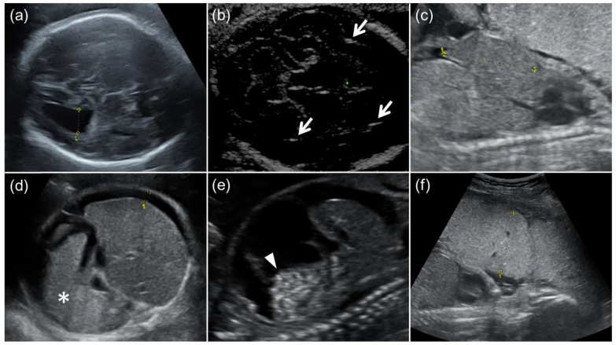
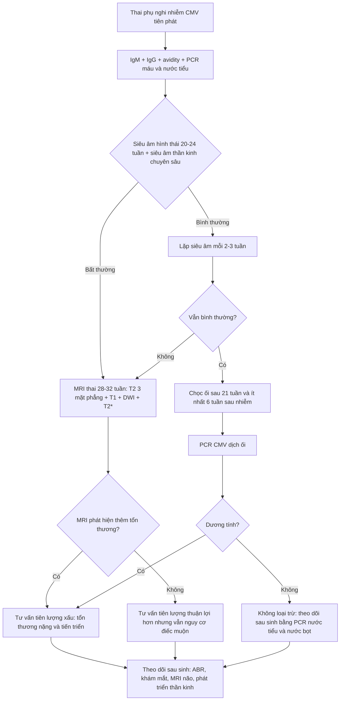
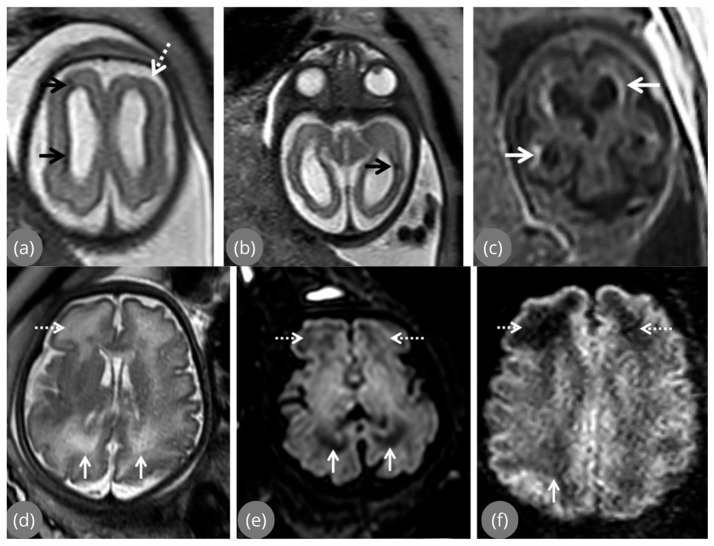
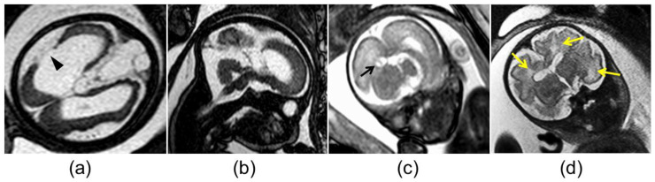

# 6102 — Nhiễm CMV bào thai (congenital CMV): vôi hóa quanh não thất, thiểu sản tiểu não mắc phải vs di truyền và quyết định tầm soát – tư vấn

**Tags:** `pattern:voi-hoa-quanh-nao-that` `pattern:bat-thuong-vo-nao` `pattern:thi-u-san-tieu-nao` `vung:nao-thai` `vung:nhau-thai` `protocol:MRI-thai` `protocol:sieua-am-thai`
**Mức chắc chắn (certainty):** tổng hợp y văn (literature synthesis) — tổng hợp từ 1 tổng quan hệ thống 59 nghiên cứu về siêu âm/MRI thai (Stefanska 2026), 1 đoàn hệ 18 thai CMV có/không chậm tăng trưởng (Tanimura 2023), 1 đoàn hệ 45 thai (Zhong 2026), 1 tổng quan về nhiễm CMV trong thai kỳ (Auriti 2026) và 2 đoàn hệ điều trị valacyclovir; mọi số liệu đối chiếu trực tiếp PMCID ghi trong `sources.md`.

## 1. Tổng quan bệnh học – cơ chế hình ảnh

- **Tác nhân – dịch tễ:** cytomegalovirus (CMV) là herpesvirus DNA sợi đôi, lây dọc từ mẹ sang thai qua nhau thai (transplacental). Huyết thanh dương tính ở **> 80% phụ nữ tuổi sinh sản** toàn cầu; tỷ lệ nhiễm bẩm sinh (congenital CMV – cCMV) khoảng **0,64%** (khoảng 0,2–2,4% tùy quần thể). Đây là nguyên nhân **không do di truyền** hàng đầu của điếc tiếp nhận (sensorineural hearing loss) và chậm phát triển ở trẻ.
- **Vì sao thời điểm nhiễm quan trọng hơn mức độ nhiễm:** nguy cơ di chứng **muộn** (late sequelae) của nhiễm tiên phát (primary infection) là **23% khi nhiễm 3 tháng đầu**, chỉ **0,1% khi nhiễm 3 tháng giữa** và **0% khi nhiễm 3 tháng cuối** (gộp phân tích của Chatzakis và Ville, dẫn qua Auriti 2026). Nói cách khác: nhiễm **muộn** truyền bệnh nhiều hơn nhưng **ít để lại di chứng thần kinh** hơn; nhiễm **sớm** mới là cửa sổ nguy hiểm vì não thai đang ở giai đoạn sinh sản – di trú tế bào mạnh nhất.
- **TẠI SAO vôi hóa lại nằm QUANH NÃO THẤT:** CMV hướng tế bào nội mô mạch máu và tế bào thần kinh đệm. Vùng **ma trận mầm (germinal matrix)** quanh não thất bên là nơi giàu mạch nhất và là nơi sinh sản tế bào thần kinh mạnh nhất trong 3 tháng giữa → viêm nội mạc, thiếu máu cục bộ, hoại tử rồi **lắng đọng canxi phosphate vô định hình**. Canxi có **hệ số suy giảm tuyến tính (attenuation) rất cao**, nên trên siêu âm là **echo dày kèm bóng lưng (acoustic shadowing)**, trên CT là **HU > 100** (không đo được trên MRI), trên MRI T2/T2* là **giảm tín hiệu** do thiếu proton tự do.
- **TẠI SAO có nang dưới nội tủy (subependymal pseudocyst):** hoại tử – tiêu mô tại ma trận mầm tạo khoang chứa dịch, thành do tế bào thần kinh đệm phản ứng. Dịch tự do → **T2 tăng tín hiệu mạnh**, **T1 giảm**, không ngấm thuốc, thường xếp thành chuỗi dọc thành não thất.
- **TẠI SAO có bất thường vỏ não (polymicrogyria, pachygyria, heterotopia):** viêm làm **gián đoạn quá trình di trú (neuronal migration)** và sắp xếp lớp vỏ từ tuần 12–24. Hệ quả là vỏ não **dày bất thường, nhiều nếp nhăn nhỏ, bờ chất trắng–vỏ mờ nhòe** trên T2; đây là tổn thương **thường chỉ thấy trên MRI**, đặc biệt khi khu trú ở **thùy thái dương**.
- **TẠI SAO có thiểu sản tiểu não (cerebellar hypoplasia):** lớp hạt ngoài (external granular layer) của tiểu não sinh sản mạnh nhất vào 3 tháng giữa; CMV phá hủy lớp này → tiểu não **nhỏ, khe lá rộng, hạch răng cưa giảm thể tích**, có thể kèm **thiểu sản cầu não**. Đây là điểm giao thoa nguy hiểm với **thiểu sản cầu–tiểu não di truyền (pontocerebellar hypoplasia – PCH)** — cùng hình ảnh tiểu não nhỏ nhưng cơ chế và tiên lượng hoàn toàn khác.
- **Ngưỡng định lượng dùng trong bài (theo Stefanska 2026, Table 2):** dãn não thất bên (ventriculomegaly) khi **> 10 mm**; **≥ 15 mm = nặng**; bể lớn (cisterna magna) **≥ 8 mm = rộng**; đầu nhỏ (microcephaly) khi chu vi đầu **< −2 SD**. Trong đoàn hệ Tanimura, **dãn não thất 1,3 cm ở 31 tuần** là ví dụ mức "trung bình".
- **Tần suất tổn thương trên siêu âm (Stefanska 2026, Table 3):** dãn não thất **6,1%**, vôi hóa nội sọ **6,3%**, đầu nhỏ **6%**, ruột echo dày **13%**, chậm tăng trưởng (FGR/SGA) **9%**, cổ trướng **4,2%**, gan–lách to **3,8%**, đa ối **< 1%**, thiểu ối **3,4%**, nhau dày–vôi hóa **2%**. Các tỷ lệ này là **trên toàn bộ thai nhiễm CMV**, không phải trên thai có triệu chứng — vì đa số thai nhiễm không có bất thường nào trên siêu âm.
- **Giới hạn của siêu âm (đoàn hệ Tanimura, 8 thai FGR + 10 thai không FGR):** độ nhạy phát hiện dãn não thất chỉ **66,7% ở nhóm FGR vs 88,9% ở nhóm không FGR**; vôi hóa nội sọ **20% ở cả hai nhóm**; gan to **40% vs 100%**. Kết luận thực hành: **FGR làm siêu âm kém nhạy hơn**, dễ bỏ sót CMV.
- **Giá trị cộng thêm của MRI (đoàn hệ 95 thai có siêu âm chuyên sâu bình thường):** MRI phát hiện thêm bất thường cấu trúc ở **10,5%**; trong số đó **dị dạng phát triển vỏ não 40%**, **bệnh não phá hủy chất trắng 20%**, **vôi hóa ma trận mầm/hạch nền 10%**, **bất thường phức hợp 30%**. Không có bất thường **não thất, quanh não thất, đường giữa hay hố sau** nào chỉ thấy trên MRI. **Tải lượng virus dịch ối > 100.000 copies/mL** là yếu tố dự báo độc lập của việc MRI phát hiện thêm tổn thương.

## 2. Mẫu hình + chẩn đoán phân biệt theo vị trí (gamut)

- **Mẫu hình A — vôi hóa dạng chấm/đường QUANH NÃO THẤT + nang dưới nội tủy:** gamut hẹp nhất gồm **CMV bào thai**, **toxoplasmosis bẩm sinh**, **nhiễm lymphocytic choriomeningitis virus (LCMV)**, **Zika bào thai** (vôi hóa thường ở ranh giới vỏ–chất trắng hơn là quanh não thất) và **bệnh não do interferon type I (Aicardi–Goutières)** — thể "nhiễm trùng giả" di truyền. **CMV là nguyên nhân hay gặp nhất** khi vôi hóa **ôm quanh não thất** và có **nang dưới nội tủy**.
- **Mẫu hình B — bất thường vỏ não (polymicrogyria/pachygyria) đơn độc hoặc kèm dãn não thất:** gamut gồm CMV, Zika, thiếu máu–giảm tưới máu não mạn (đặc biệt trong song thai một bánh nhau), bệnh ty thể, đột biến **GPR56/TUBB2B/TUBA1A**; và **"giả polymicrogyria" do artifact chuyển động/perfusion trên MRI thai** — bắt buộc loại trừ trước khi kết luận.
- **Mẫu hình C — tiểu não nhỏ / thiểu sản cầu–tiểu não:** phân biệt **CMV mắc phải** với **PCH di truyền** (RELN, TSEN54, EXOSC3…), **Dandy–Walker**, **Chiari II**, **thiểu sản tiểu não do thuốc/teratogen**. Chốt phân biệt: CMV có **bằng chứng nhiễm + tổn thương chất trắng/vôi hóa/nang**, PCH di truyền thường **đơn độc, đối xứng, không vôi hóa**, có thể kèm cầu não nhỏ và **tiền sử gia đình**.
- **Mẫu hình D — đầu nhỏ (microcephaly) ± vôi hóa lan tỏa:** CMV, toxoplasmosis, Zika, Aicardi–Goutières, đầu nhỏ di truyền (microcephaly primary hereditary – MCPH), ngộ độc rượu bào thai. Đầu nhỏ **< −3 SD** kèm vôi hóa quanh não thất gần như chốt CMV.
- **Mẫu hình E — bất thường ngoài thần kinh đơn độc (ruột echo dày, gan–lách to, cổ trướng, nhau dày):** CMV, toxoplasmosis, parvovirus B19, hội chứng truyền máu song thai, bất thường nhiễm sắc thể. **Không được chẩn đoán CMV chỉ dựa trên ruột echo dày** — phải phối hợp huyết thanh học/PCR.
- **Gợi nhớ lâm sàng – hình ảnh:** **P**eriventricular calcification + **C**ysts subependymal + **C**ortical malformation + **C**erebellar hypoplasia = **4C của CMV**. Càng nhiều chữ C, xác suất CMV càng cao và tiên lượng càng xấu.

## 3. Bảng so sánh phân biệt (ma trận đối chiếu)

| Thực thể (entity) | Hình ảnh điển hình (US/MRI thai) | Chốt vào (rule-in) | Chốt loại (rule-out) | Gợi ý xác nhận |
|---|---|---|---|---|
| **CMV bào thai** | Vôi hóa **quanh não thất** dạng chấm/đường, nang dưới nội tủy, dãn não thất, polymicrogyria (thùy thái dương), tiểu não nhỏ | **Vôi hóa quanh não thất + nang dưới nội tủy + IgM/IgG avidity thấp hoặc PCR dịch ối dương** | Vôi hóa rải rác khắp nhu mô, không nang dưới nội tủy → nghĩ toxoplasmosis | Siêu âm chuyên sâu lặp 2–3 tuần; MRI 28–32 tuần; PCR CMV dịch ối sau 21 tuần |
| **Toxoplasmosis bẩm sinh** | **Vôi hóa rải rác** vỏ não/hạch nền, dãn não thất nặng (do viêm màng não), đầu nhỏ; viêm hắc–võng mạc | **Vôi hóa rải rác + dãn não thất tiến triển + tổn thương mắt** | Vôi hóa khu trú quanh não thất + nang dưới nội tủy → nghĩ CMV | Huyết thanh học toxoplasma (IgM/IgG avidity), PCR dịch ối, soi đáy mắt sau sinh |
| **Zika bào thai** | Vôi hóa ở **ranh giới vỏ–chất trắng**, **mỏng vỏ**, dãn não thất, thể tích não giảm, có thể **arthrogryposis** | **Mỏng vỏ + vôi hóa ranh giới + dịch tễ vùng lưu hành** | Vôi hóa quanh não thất dày, nang dưới nội tủy → nghĩ CMV | RT-PCR Zika huyết thanh/nước tiểu mẹ, IgM thai; siêu âm khớp |
| **PCH di truyền** | Tiểu não nhỏ **đối xứng**, cầu não nhỏ, bán cầu tiểu não nhẵn; **không vôi hóa**, không nang dưới nội tủy | **Bất thường đối xứng cầu–tiểu não + không bằng chứng nhiễm + tiền sử gia đình** | Có vôi hóa/nang quanh não thất, bất đối xứng → nghĩ CMV | MRI thai + MRI sau sinh; panel gen PCH; tư vấn di truyền (bài 675, 659) |
| **Aicardi–Goutières** | Vôi hóa hạch nền/vỏ, teo não, thanh dịch lympho bào tăng; hình ảnh giống "nhiễm trùng" | **Vôi hóa + tăng interferon alpha/lympho bào dịch não tủy + không tìm được tác nhân** | PCR CMV dương + vôi hóa quanh não thất đặc trưng → nghĩ CMV | Gen TREX1/RNASEH2; interferon signature |
| **Thiếu máu–giảm tưới máu (song thai)** | Tổn thương chất trắng quanh não thất, polymicrogyria, teo vỏ **ở thai nhỏ hơn** | **Bối cảnh song thai một bánh nhau, chênh lệch cân nặng, không bằng chứng nhiễm** | Vôi hóa + nang dưới nội tủy + PCR dương → CMV | Siêu âm Doppler, MRI thai, theo dõi song thai (bài 566, 587) |
| **Giả polymicrogyria (artifact)** | Bờ vỏ "nhăn" thoáng qua, **đổi giữa các lát cắt/lần chụp**, thường ở vùng gần xương sọ | **Bất thường biến mất khi chụp lại hoặc đổi chuỗi xung** | Bất thường **hằng định** trên nhiều mặt cắt + kèm vôi hóa/dãn não thất | Chụp lại MRI cùng phiên hoặc lần sau; đối chiếu siêu âm chuyên sâu |

*Siêu âm thai 24–31 tuần: (a) dãn não thất bên 1,3 cm; (b) vôi hóa nội sọ (mũi tên); (c) gan to; (d) lách to + cổ trướng; (e) cổ trướng + ruột echo dày; (f) nhau dày 5,1 cm. Nguồn: Tanimura 2023, CC BY 4.0.*

## 4. Protocol chụp + hệ phân tầng/điểm chuẩn hóa

**Bước 1 — xác định nhiễm ở mẹ (không chờ hình ảnh):**
- **IgM + IgG + độ ái lực IgG (avidity):** avidity **thấp** gợi ý nhiễm trong **3 tháng gần đây**; avidity **trung gian** có thể kéo dài tới **6 tháng**; avidity **cao trong 3 tháng đầu** xác nhận nhiễm cũ. Sau **21 tuần**, avidity trung bình–cao **không loại trừ** nhiễm tiên phát.
- **PCR CMV** máu và nước tiểu mẹ; xét nghiệm lặp **14–16 tuần** ở người huyết thanh âm tính (theo Auriti 2026).

**Bước 2 — siêu âm là tuyến đầu:**
- **Siêu âm hình thái 20–24 tuần** + **siêu âm thần kinh chuyên sâu (neurosonography)**, ưu tiên **đầu dò âm đạo** khi ngôi đầu để tăng độ phân giải vùng quanh não thất.
- Thai có nguy cơ: **lặp mỗi 2–3 tuần** cho tới cuối thai kỳ, vì tổn thương có thể **xuất hiện muộn** dù lần đầu bình thường.
- Đo và ghi số: **đường kính sừng sau não thất bên (atrial diameter)**, bể lớn, chu vi đầu theo bách phân vị, chiều dài gan, độ dày nhau.

**Bước 3 — MRI thai khi có chỉ định:**
- **Thời điểm: 28–32 tuần** (vỏ não đã phân tách đủ), lặp lại cuối thai kỳ nếu cần đánh giá tiến triển.
- **Chuỗi xung tối thiểu:** T2 SSFSE/HASTE 3 mặt phẳng (sagittal, axial, coronal), T1, **DWI/ADC**, **T2\*** (để thấy vôi hóa/blooming).
- Chỉ định: siêu âm **nghi ngờ hoặc không kết luận**, siêu âm bình thường nhưng **tải lượng virus dịch ối > 100.000 copies/mL**, hoặc cần tiên lượng trước tư vấn.
- **Giá trị tiên lượng:** bất thường **nặng và tiến triển** (dãn não thất ≥ 15 mm tăng dần, đầu nhỏ, tổn thương phá hủy) liên quan kết cục thần kinh xấu; bất thường **nhẹ, khu trú, ổn định** (dãn < 15 mm, nang dưới nội tủy đơn độc, vôi hóa khu trú) thường diễn tiến thuận lợi **nhưng không loại trừ điếc muộn**.

**Bước 4 — chọc ối (amniocentesis) để xác định nhiễm bào thai:**
- Thời điểm chuẩn: **sau 21 tuần** và **ít nhất 6 tuần sau thời điểm mẹ nhiễm** (ISUOG 2020, dẫn qua Zhong 2026) — chọc sớm hơn dễ **âm tính giả** vì virus chưa đủ thời gian nhân lên/thải vào dịch ối.
- Xét nghiệm: **PCR CMV dịch ối**.
- **Phản biện nguồn (bắt buộc đọc):** trong đoàn hệ 82 thai của Arcieri 2026, **chọc ối dương chỉ có độ nhạy 41,7%** cho nhiễm CMV ở trẻ sơ sinh (độ đặc hiệu 97,9%, NPV 86,8%). Con số này **thấp hơn nhiều** so với quan niệm "chọc ối gần như chốt", nên **kết quả âm không loại trừ nhiễm** — phải theo dõi sau sinh bằng PCR nước tiểu/nước bọt.

**Bước 5 — dự phòng bằng thuốc (đang tranh luận, không phải chuẩn bắt buộc toàn cầu):**
- **Valacyclovir 8 g/ngày** ở mẹ nhiễm tiên phát quanh thụ thai hoặc 3 tháng đầu, bắt đầu càng sớm càng tốt, **đến lúc chọc ối ở 20 tuần**; gộp 3 nghiên cứu (527 thai phụ) cho thấy giảm nhiễm sơ sinh và giảm chấm dứt thai vì bất thường nặng, **tác dụng nặng 2,1%** (Auriti 2026).
- **Globulin miễn dịch kháng CMV:** **không** chứng minh hiệu quả trong thử nghiệm ngẫu nhiên lớn (dừng vì vô hiệu), **không khuyến cáo thường quy**.

**Bước 6 — theo dõi sau sinh (không được bỏ):**
- **PCR CMV nước tiểu/nước bọt trong 3 tuần đầu** (sau 3 tuần không phân biệt được nhiễm bẩm sinh với nhiễm chu sinh).
- **Đo thính lực (ABR) sơ sinh** và **lặp lại** vì điếc có thể xuất hiện muộn; **khám mắt**, **MRI não** khi có triệu chứng/bất thường trước sinh; theo dõi phát triển thần kinh.

## 5. Biến thể bình thường và cạm bẫy

- **Nang dưới nội tủy đơn độc ở thai non tháng** có thể là biến thể thoáng qua; nhưng **chuỗi nang dọc thành não thất + vôi hóa** thì không bình thường. Đừng gọi "nang màng nhện" cho tổn thương nằm **trong** thành não thất.
- **Bể lớn rộng ≥ 8 mm** có thể gặp ở thai bình thường; chỉ có ý nghĩa khi kèm **tiểu não nhỏ/khe lá rộng** hoặc bằng chứng nhiễm.
- **Vôi hóa sinh lý** ở **đám rối mạch mạc (choroid plexus)** thường **khu trú, đối xứng, không kèm nang/dãn não thất** — khác vôi hóa quanh não thất lan theo thành.
- **Cạm bẫy 1 — chỉ đọc T2:** vôi hóa **giảm tín hiệu mờ** trên T2, rất dễ bỏ sót; phải xem **T2\*** hoặc đối chiếu siêu âm.
- **Cạm bẫy 2 — "giả polymicrogyria":** bờ vỏ nhăn giả do **chuyển động thai/perfusion**, thường **đổi giữa các lát cắt**; luôn chụp lại trước khi kết luận dị dạng vỏ.
- **Cạm bẫy 3 — gán mọi tiểu não nhỏ cho CMV:** nếu **không có vôi hóa, không nang, không bằng chứng nhiễm**, phải nghĩ **PCH di truyền** và tư vấn di truyền — tiên lượng và nguy cơ tái phát khác hoàn toàn.
- **Cạm bẫy 4 — tin tuyệt đối vào chọc ối:** độ nhạy thấp (41,7% trong một đoàn hệ) → **âm tính không loại trừ**.
- **Cạm bẫy 5 — bỏ theo dõi thính lực vì "siêu âm bình thường":** thai nhiễm CMV có siêu âm bình thường vẫn có **6,5% nghe kém** và **3,1% kết cục phát triển bất thường**; trẻ không triệu chứng vẫn có **8–15% di chứng muộn**, trong đó **điếc tới 13,5%**.
- **Cạm bẫy 6 — đo chu vi đầu khi ngôi bất thường/đầu dẹt** gây chẩn đoán sai đầu nhỏ; đo lại bằng siêu âm đầu dò âm đạo và đối chiếu bách phân vị theo tuổi thai.

## 6. Tự lượng giá — Blind Quiz

**Ca 1 — Thai 31 tuần, mẹ nhiễm CMV tiên phát ở tuần 12. Nhìn hình, mô tả trước khi mở đáp án.**

- Gợi ý lâm sàng: thai 31 tuần, không bất thường ngoài thần kinh; mẹ IgM dương, avidity thấp.
- Câu hỏi: (1) Dấu hiệu chính trong ảnh (a) và (b) là gì, đo bao nhiêu? (2) Ba chẩn đoán phân biệt? (3) Dấu hiệu nào chốt CMV hơn toxoplasmosis?

<b>Bấm để hiện đáp án (findings + chẩn đoán)</b>

- Dấu hiệu: (a) **dãn não thất bên mức trung bình, đường kính sừng sau 1,3 cm ở 31 tuần**; (b) **ổ echo dày trong nhu mô quanh não thất kèm bóng lưng** = vôi hóa nội sọ.
- Chẩn đoán: **nhiễm CMV bào thai** — vôi hóa **quanh não thất** + dãn não thất là mẫu hình kinh điển; toxoplasmosis thường vôi hóa **rải rác** và dãn não thất do viêm màng não nặng hơn.
- Việc cần làm: MRI 28–32 tuần (T2 3 mặt phẳng + DWI + T2\*), chọc ối sau 21 tuần (đã đủ thời gian), tư vấn nguy cơ di chứng và kế hoạch theo dõi ABR sau sinh.
- Nguồn: Tanimura 2023, **CC BY 4.0**, PMCID PMC9857471.

**Ca 2 — Thai 30 tuần, MRI não. Tìm vôi hóa và bất thường vỏ não.**

- Gợi ý lâm sàng: siêu âm trước đó chỉ "dãn não thất nhẹ"; mẹ nhiễm CMV 3 tháng đầu.
- Câu hỏi: (1) Ảnh (a) và (c) cho thấy gì? (2) Ảnh (d) mô tả tổn thương gì và tại sao T2 tăng tín hiệu? (3) Vì sao MRI quan trọng ở ca này?

<b>Bấm để hiện đáp án (findings + chẩn đoán)</b>

- (a) **Bất thường tín hiệu khu trú cạnh não thất** (mũi tên đen) + **polymicrogyria thùy trán** (mũi tên đứt trắng): vỏ dày, nhiều nếp nhăn nhỏ, bờ vỏ–chất trắng mờ.
- (c) **Vôi hóa** (mũi tên trắng): giảm tín hiệu trên T2; (d) **tăng tín hiệu chất trắng** trán và chẩm do phù/viêm – mất myelin.
- Vì sao MRI quan trọng: dị dạng vỏ não và tổn thương chất trắng **thường bị siêu âm bỏ sót**, đặc biệt khi khu trú ở thùy thái dương; MRI đổi tiên lượng và tư vấn.
- Nguồn: Stefanska 2026, **CC BY 4.0**, PMCID PMC13207999.

**Ca 3 — Thai 29 tuần, tiểu não nhỏ. CMV hay bệnh di truyền?**

- Gợi ý lâm sàng: tiểu não nhỏ, không vôi hóa rõ; mẹ không có bằng chứng nhiễm, không tiền sử gia đình.
- Câu hỏi: (1) Mô tả (a), (b), (c). (2) Nếu PCR CMV âm, bạn nghĩ gì? (3) Xét nghiệm/tư vấn tiếp theo?

<b>Bấm để hiện đáp án (findings + chẩn đoán)</b>

- (a) **Dị dạng vỏ não + schizencephaly** (đầu mũi tên); (b) **thiểu sản thùy giun tiểu não (vermian hypoplasia)**; (c) **nang giả ở sừng sau não thất** (mũi tên đen); (d) **tăng tín hiệu chất trắng** (mũi tên vàng).
- Nếu PCR CMV âm và không có vôi hóa: nghĩ **PCH di truyền** hoặc bất thường di truyền khác — không được mặc định CMV chỉ vì "tiểu não nhỏ".
- Tiếp theo: panel gen PCH (TSEN54, EXOSC3, RELN…), MRI sau sinh, tư vấn di truyền và nguy cơ tái phát (thường 25% nếu lặn).
- Nguồn: Tanimura 2023, **CC BY 4.0**, PMCID PMC9857471. **Phản biện:** ca gốc thuộc đoàn hệ CMV, nên đây là hình ảnh **CMV có thiểu sản tiểu não**; dùng ca này để dạy **phân biệt**, không dùng để chứng minh PCH.

## Bài liên quan chéo
- [675 — Tư vấn tiền sản & MRI thai hố sau: thiểu sản cầu–tiểu não/PCH](../675-tu-van-tien-san-mri-ho-sau/lesson.md)
- [659 — Thiểu sản cầu–tiểu não (PCH) & loạn dưỡng chất trắng giảm myelin POLR3B](../659-thieu-san-cau-tieu-nao-pch-polr3b/lesson.md)
- [655 — HIE sơ sinh + Chiari/Dandy-Walker/bất sản thể chai](../655-hie-so-sinh-va-di-dang-bam-sinh-than-kinh/lesson.md)
- [657 — Dị tật hố sau khác: Joubert & rhombencephalosynapsis](../657-di-dang-ho-sau-joubert-rhombencephalo/lesson.md)
- [566 — Song thai: xác định màng đệm/màng ối & TTTS/TAPS](../566-song-thai-chorionicity-TTTS-TAPS/lesson.md)

> Không dùng để chẩn đoán độc lập khi chưa có người hướng dẫn.
