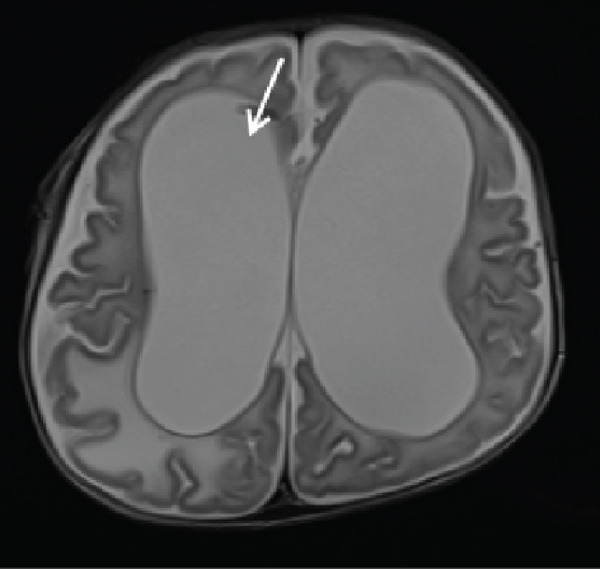
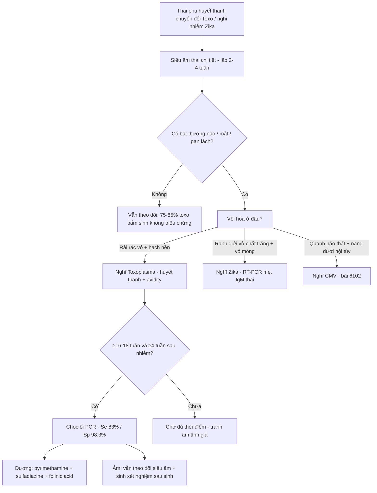
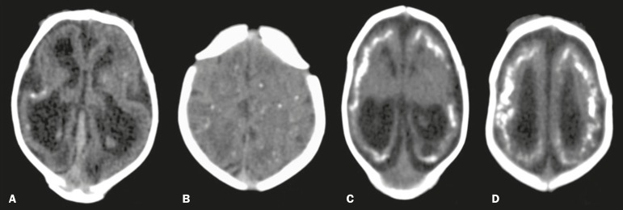
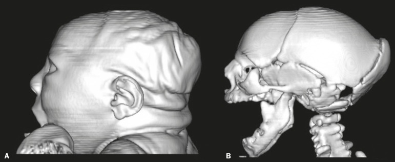
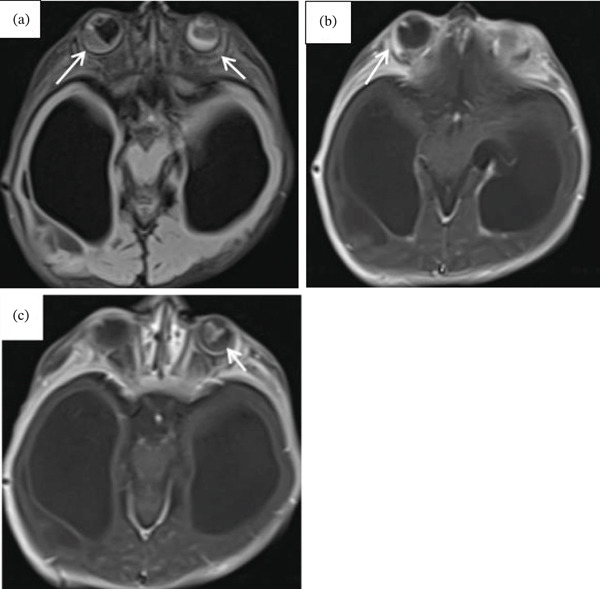

# 6103 — Nhiễm Toxoplasma và Zika bào thai (congenital toxoplasmosis & congenital Zika): vôi hóa rải rác vs vôi hóa ranh giới vỏ–chất trắng

**Tags:** `pattern:voi-hoa-noi-so` `pattern:dan-nao-that` `pattern:viem-hac-vong-mac` `pattern:mong-vo-nao` `vung:nao-thai` `vung:mat` `protocol:MRI-thai` `protocol:sieua-am-thai` `incidentaloma:khong`
**Mức chắc chắn (certainty):** tổng hợp y văn (literature synthesis) — 1 nghiên cứu 235 ca huyết thanh chuyển đổi (PMC11858150), 1 tổng quan chẩn đoán (PMC11671817), 1 phân tích gộp điều trị (PMC12029831), 1 đoàn hệ 16 sơ sinh Zika có CT (PMC6290748), 1 tổng quan Zika (PMC11943202) và 1 ca nguyên văn toxo không điển hình (PMC13051784). Mọi số liệu đối chiếu PMCID trong `sources.md`; bài **không** thay thế bài 6102 (CMV) mà bổ sung 2 hàng còn thiếu của bảng TORCH.

## 1. Tổng quan bệnh học – cơ chế hình ảnh

- **Toxoplasma gondii (ký sinh trùng nguyên bào):** lây qua thịt sống, rau quả/nước nhiễm oocyst từ phân mèo. Nhiễm tiên phát ở mẹ → **nhiễm huyết tương (tachyzoite)** → qua nhau thai → thai. Toàn cầu **~190.000 ca toxo bẩm sinh/năm**, tỷ lệ **1–14/10.000 trẻ sinh sống** tùy vùng.
- **Vì sao nguy cơ truyền TĂNG theo tuổi thai nhưng độ NẶNG GIẢM:** nhau thai dày và diện trao đổi tăng dần → truyền dễ hơn về cuối thai; nhưng 3 tháng đầu là cửa sổ **sinh sản – di trú tế bào thần kinh**, nên tổn thương nặng nhất. Nghiên cứu Pháp **5.000 ca huyết thanh chuyển đổi**: truyền **2,2% ở tuần 6**, **23,0% ở tuần 18**, **56,0% ở tuần 30**.
- **TẠI SAO vôi hóa RẢI RÁC (khác CMV):** toxo lan theo **đường máu** tới nơi có mao mạch dày (ranh giới vỏ–chất trắng, **hạch nền**, đồi thị) → ổ **hoại tử** nhỏ rải rác → **canxi hóa loạn dưỡng** trong mô hoại tử (canxi phosphate vô định hình). Canxi có hệ số suy giảm rất cao → **siêu âm: echo dày + bóng lưng; CT: > 100 HU**; MRI T2/T2* giảm tín hiệu. CMV thì ưu tiên **ma trận mầm quanh não thất** nên vôi hóa **quanh não thất**.
- **TẠI SAO dãn não thất nặng:** viêm màng não – não thất do toxo gây **viêm nội mạc ống Sylvius + tắc hấp thu dịch não tủy** → **não úng thủy tắc nghẽn** (ca điển hình: dãn hai não thất bên rất lớn, vỏ não mỏng như tờ giấy). Đây là lý do **hydrocephalus** nằm trong tam chứng, chứ không chỉ "dãn nhẹ".
- **TẠI SAO viêm hắc–võng mạc:** võng mạc giàu mao mạch, ký sinh trùng tạo **nang trong tế bào võng mạc** → viêm hoại tử hắc–võng mạc, thường **hai bên, tái phát**, để lại **sẹo teo + tăng sắc tố**. Trên MRI: **dày, tăng tín hiệu T1 sau tiêm ở lớp hắc–võng mạc** (ca Fig. 3); đáy mắt sau sinh là chốt.
- **Vì sao đa số KHÔNG có triệu chứng:** **75–85%** trẻ nhiễm toxo bẩm sinh bình thường khi khám sơ sinh; **~20%** có dấu hiệu lâm sàng. Tam chứng cổ điển (dãn não thất + vôi hóa nội sọ + viêm hắc–võng mạc) **nay ít gặp đầy đủ**, và **có thể không có vôi hóa** (ca nguyên văn: dãn não thất + tổn thương dạng vòng ngấm thuốc + viêm hắc–võng mạc hai bên, **không vôi hóa**).
- **Zika (flavivirus):** hướng tế bào **tiền thân thần kinh** → giảm sinh sản tế bào thần kinh, **vỏ mỏng, giảm thể tích não**, vôi hóa tại **ranh giới vỏ–chất trắng dưới vỏ**, đầu nhỏ nặng, **arthrogryposis** do tổn thương neuron vận động tủy. Dịch Brazil 2016: **> 4.300 ca đầu nhỏ**.
- **Số liệu định lượng của Zika trên CT (16 sơ sinh, PMC6290748):** **giảm thể tích não 81,2%**; **vôi hóa 100%** (dạng chấm 56,2%, thô 43,7%), **luôn ở ranh giới vỏ–dưới vỏ**, **thùy trán 100%**, **thùy đỉnh 68,7%**, **thùy chẩm 50%**, **thùy thái dương 43,7%**, hạch nền **12,5%**, đồi thị **25%**, thân não **12,5%**; **dãn não thất 93,7%**, **colpocephaly 62,5%**, **xương chẩm nhô 56,2%**, **thiểu sản tiểu não 18,7%**; **đầu nhỏ 12/16 (75%)**.

## 2. Mẫu hình + chẩn đoán phân biệt theo vị trí (gamut)

- **Mẫu hình A — vôi hóa RẢI RÁC (vỏ + hạch nền) + dãn não thất tiến triển + viêm hắc–võng mạc:** **toxoplasmosis bẩm sinh**; phân biệt **LCMV** (rất giống toxo, cần PCR), **Aicardi–Goutières** (vôi hóa hạch nền + lympho bào dịch não tủy tăng), **nhiễm trùng mẹ dùng thuốc/ngộ độc**.
- **Mẫu hình B — vôi hóa QUANH NÃO THẤT + nang dưới nội tủy + bất thường vỏ não:** **CMV** (xem bài 6102) — vôi hóa **mảnh, đường viền quanh não thất**, không rải rác.
- **Mẫu hình C — vôi hóa RANH GIỚI VỎ–CHẤT TRẮNG + vỏ mỏng + đầu nhỏ + arthrogryposis:** **Zika bẩm sinh**; phân biệt **giả nhiễm trùng do thiếu máu–giảm tưới máu (song thai)**, **đầu nhỏ di truyền (MCPH)**, **ngộ độc rượu bào thai**.
- **Mẫu hình D — tổn thương DẠNG VÒNG ngấm thuốc, không vôi hóa:** **toxo thể hoại tử – áp-xe não** (ca nguyên văn); phân biệt **áp-xe vi khuẩn**, **di căn/u nguyên bào**, **tổn thương do CMV** (thường không tạo vòng ngấm thuốc rõ).
- **Mẫu hình E — bất thường ngoài thần kinh đơn độc (gan–lách to, ruột echo dày, cổ trướng, FGR, nhau dày):** toxo, CMV, Zika, rubella, giang mai, parvovirus B19, bất thường nhiễm sắc thể.
- **Gợi nhớ:** **T**oxo = **T**án xạ (rải rác) + **T**hủy hoại (vòng ngấm thuốc) + **T**ật mắt; **Z**ika = **Z**one dưới vỏ (ranh giới vỏ–chất trắng) + **Z**ero cortex (vỏ mỏng).

## 3. Bảng so sánh phân biệt (ma trận đối chiếu)

| Thực thể (entity) | Hình ảnh điển hình (US/MRI/CT) | Chốt vào (rule-in) | Chốt loại (rule-out) | Gợi ý xác nhận |
|---|---|---|---|---|
| **Toxoplasmosis bẩm sinh** | **Vôi hóa rải rác** vỏ + hạch nền (**50–80%** ca có vôi hóa), **dãn não thất nặng/tắc nghẽn**, viêm hắc–võng mạc hai bên, có thể **tổn thương vòng ngấm thuốc** | **Vôi hóa rải rác + dãn não thất tiến triển + tổn thương mắt + huyết thanh học mẹ dương** | Vôi hóa **chỉ quanh não thất** + nang dưới nội tủy → CMV; **không có bất thường não** không loại trừ (75–85% không triệu chứng) | IgG/IgM + **avidity**, PCR dịch ối, soi đáy mắt sau sinh, IgM/IgA sơ sinh |
| **CMV bẩm sinh** | **Vôi hóa quanh não thất** dạng chấm/đường, nang dưới nội tủy, polymicrogyria thùy thái dương, tiểu não nhỏ | **Vôi hóa quanh não thất + nang dưới nội tủy + PCR dịch ối dương** | Vôi hóa **rải rác hạch nền/vỏ + tổn thương mắt** → toxo | PCR CMV dịch ối sau 21 tuần; MRI 28–32 tuần (bài 6102) |
| **Zika bẩm sinh** | **Vôi hóa ranh giới vỏ–chất trắng** (**trán 100%**), **vỏ mỏng**, giảm thể tích não, dãn não thất, colpocephaly, **arthrogryposis**, xương chẩm nhô | **Vôi hóa dưới vỏ + vỏ mỏng + đầu nhỏ + dịch tễ vùng lưu hành** | Vôi hóa **quanh não thất** + não thất bình thường → không phải Zika điển hình | RT-PCR Zika huyết thanh/nước tiểu mẹ, IgM thai; siêu âm khớp |
| **LCMV bẩm sinh** | Giống toxo: vôi hóa rải rác, dãn não thất, viêm hắc–võng mạc, đầu nhỏ | **Hình ảnh giống toxo nhưng huyết thanh toxo âm + tiền sử chuột hamster** | Không phân biệt được bằng hình ảnh | RT-PCR LCMV; dịch tễ tiếp xúc |
| **Aicardi–Goutières** | Vôi hóa **hạch nền/vỏ**, teo não, thanh dịch lympho bào tăng; giống "nhiễm trùng" nhưng không tìm được tác nhân | **Vôi hóa + lympho bào dịch não tủy tăng + interferon alpha tăng** | PCR toxo/CMV dương → nhiễm trùng thực sự | Gen TREX1/RNASEH2; interferon signature |
| **Thiếu máu–giảm tưới máu (song thai)** | Tổn thương chất trắng quanh não thất, polymicrogyria, teo vỏ ở **thai nhỏ hơn** | **Song thai một bánh nhau + chênh cân nặng + không bằng chứng nhiễm** | Vôi hóa rải rác + tổn thương mắt + huyết thanh dương → toxo | Doppler, MRI thai, theo dõi song thai |

*MRI não sơ sinh 2 tháng tuổi: **dãn hai não thất bên rất lớn**, vỏ não mỏng, não úng thủy tắc nghẽn (mũi tên: vùng ống Sylvius/lỗ Monro). Cùng ca: không có vôi hóa nội sọ trên CT — nhắc rằng **thiếu vôi hóa không loại trừ toxo**. Nguồn: Case Rep Radiol 2026 (PMC13051784), CC BY 4.0.*

## 4. Protocol chụp + hệ phân tầng chẩn đoán

- **Siêu âm thai (first-line):** lặp **mỗi 2–4 tuần** khi mẹ có huyết thanh chuyển đổi; tìm **dãn não thất > 10 mm** (≥ 15 mm = nặng), vôi hóa nội sọ, gan–lách to, ruột echo dày, cổ trướng, nhau dày, FGR. Siêu âm có thể **bình thường** ở thai nhiễm.
- **MRI thai:** bổ sung khi siêu âm nghi ngờ hoặc khi cần đánh giá vỏ não/hố sau; thời điểm hợp lý **28–32 tuần** (bài 6102). Với Zika, MRI có thể **không thấy vôi hóa** trong khi siêu âm/CT thấy.
- **Chẩn đoán xác định toxo:** huyết thanh mẹ (IgM, IgG, **avidity**) → **chọc ối ≥ 16–18 tuần và ≥ 4 tuần sau nhiễm mẹ** → **PCR dịch ối: độ nhạy 83%, độ đặc hiệu 98,3%** (phân tích gộp). Chọc ối sớm hơn dễ **âm tính giả**.
- **Điều trị (theo tuổi thai):** **spiramycin** đến **tuần 16**; sau 16 tuần, nếu PCR ối dương hoặc siêu âm có tổn thương → **pyrimethamine + sulfadiazine + acid folinic**. Phân tích gộp: con của mẹ **có điều trị nhiễm 18%** so với **58%** ở nhóm không điều trị.
- **Sau sinh (bắt buộc, cả khi thai kỳ "bình thường"):** IgM/IgA + IgG lặp tới **12 tháng** (IgG mẹ thoáng qua), **soi đáy mắt**, **đo thính lực**, siêu âm/CT não; theo dõi thị lực tới **tuổi trưởng thành** vì viêm hắc–võng mạc có thể xuất hiện muộn.

## 5. Biến thể bình thường và cạm bẫy

- **Cạm bẫy 1 — "không vôi hóa = không phải toxo":** ca nguyên văn có **dãn não thất + tổn thương vòng ngấm thuốc + viêm hắc–võng mạc hai bên nhưng KHÔNG vôi hóa**. Vôi hóa chỉ có ở **50–80%** ca toxo; chẩn đoán dựa **huyết thanh + mắt + não**, không dựa một dấu hiệu.
- **Cạm bẫy 2 — bỏ sót Zika trên MRI:** vôi hóa ranh giới vỏ–chất trắng **có thể không thấy trên MRI**, chỉ thấy trên **siêu âm/CT** — ca 16 sơ sinh dùng CT mới phát hiện được. Nghi Zika thì phải có **CT hoặc siêu âm qua thóp**.
- **Cạm bẫy 3 — IgG mẹ dương tính = nhiễm thai?** Không. IgG dương chỉ nói mẹ **đã từng nhiễm**; cần **IgM + avidity thấp** hoặc **PCR dịch ối** mới chứng minh nhiễm thai.
- **Cạm bẫy 4 — chọc ối quá sớm:** trước **4 tuần sau nhiễm mẹ** hoặc trước **16–18 tuần** → **âm tính giả**; phải chờ đủ cửa sổ.
- **Cạm bẫy 5 — IgM âm ở cuối thai:** IgM có thể đã âm khi nhiễm muộn; **không loại trừ** bằng IgM đơn thuần, phải theo dõi IgG trẻ tới 12 tháng.
- **Cạm bẫy 6 — nhầm tổn thương vòng ngấm thuốc với u:** trong bối cảnh nhiễm toxo, tổn thương vòng ở ranh giới vỏ–chất trắng là **hoại tử do ký sinh trùng**, không phải u; điều trị đặc hiệu trước, không sinh thiết mù.
- **Biến thể bình thường:** **echo dày ruột non đơn độc** hoặc **dãn nhẹ não thất 10–12 mm** có thể gặp ở thai bình thường → không chẩn đoán nhiễm trùng chỉ dựa vào một dấu hiệu.

## 6. Tự lượng giá — Blind Quiz

**Ca 1 — Sơ sinh 2 tháng, đầu to nhanh, bú kém, vàng da kéo dài > 1 tháng.**

- Gợi ý: mẹ không khám thai, có **sốt nhẹ 3 tháng giữa**, không xét nghiệm.
- Câu hỏi: Mô tả bất thường chính? Nêu 3 chẩn đoán phân biệt và xét nghiệm chốt.

<b>Bấm để hiện đáp án (findings + chẩn đoán)</b>

- Dấu hiệu: **dãn hai não thất bên rất lớn**, vỏ não mỏng, **não úng thủy tắc nghẽn**; không thấy vôi hóa trên CT cùng ca.
- Chẩn đoán: **toxoplasmosis bẩm sinh** — huyết thanh xác nhận; kèm **viêm hắc–võng mạc hai bên** (Fig. 3 dưới) và **tổn thương vòng ngấm thuốc** ở bán cầu phải/thùy trán trái.
- Phân biệt: CMV (vôi hóa quanh não thất), Zika (vôi hóa dưới vỏ, vỏ mỏng), LCMV (giống toxo).
- Nguồn ảnh: Case Rep Radiol 2026 (PMC13051784), CC BY 4.0.

**Ca 2 — Sơ sinh đầu nhỏ, CT sọ không cản quang.**

- Gợi ý: mẹ sốt phát ban 3 tháng đầu thai kỳ, vùng có dịch Zika.
- Câu hỏi: Vôi hóa nằm ở đâu? Khác CMV/toxo thế nào?

<b>Bấm để hiện đáp án (findings + chẩn đoán)</b>

- Dấu hiệu: vôi hóa **dạng chấm (A,B)** và **thô (C,D)** ở **ranh giới vỏ–chất trắng dưới vỏ**, kèm **giảm thể tích não**, **dãn não thất** và **colpocephaly** (A,C).
- Chẩn đoán: **Zika bẩm sinh** — trong loạt 16 sơ sinh: **vôi hóa 100% ở ranh giới vỏ–dưới vỏ (trán 100%, đỉnh 68,7%)**, dãn não thất **93,7%**, colpocephaly **62,5%**, đầu nhỏ **75%**.
- Khác biệt: CMV → **quanh não thất**; toxo → **rải rác cả hạch nền/vỏ** + tổn thương mắt.
- Nguồn ảnh: Radiol Bras 2018 (PMC6290748), Fig. 1, CC BY 4.0.

**Ca 3 — Trẻ 2 tháng, đầu nhỏ nặng, chẩn đoán Zika; ảnh dựng 3D hộp sọ.**

- Câu hỏi: Hai dấu hiệu hình thái nào trên ảnh? Chúng nói gì về thời điểm nhiễm?

<b>Bấm để hiện đáp án (findings + chẩn đoán)</b>

- Dấu hiệu: **đầu nhỏ nặng có nếp da gấp (A)**, **xương chẩm nhô + khớp sọ chồng lên nhau (B)** — hộp sọ "xẹp" do não không phát triển.
- Ý nghĩa: tổn thương xảy ra **khi não còn đang tăng sinh mạnh (3 tháng đầu)**; xương chẩm nhô gặp ở **56,2%** loạt 16 ca.
- Nguồn ảnh: Radiol Bras 2018 (PMC6290748), Fig. 3, CC BY 4.0.

**Ca 4 — Ảnh mắt: bé gái 2 tháng, không nhìn theo vật.**

<b>Bấm để hiện đáp án (findings + chẩn đoán)</b>

- Dấu hiệu: **(a)** FLAIR trục — tăng tín hiệu **hắc–võng mạc hai bên** (mũi tên); **(b,c)** T1 sau tiêm xóa mỡ — **ngấm thuốc tương ứng** hai bên; phía sau là **não thất dãn rất lớn**.
- Chẩn đoán: **viêm hắc–võng mạc do toxo bẩm sinh**, hai bên; là lý do phải **soi đáy mắt mọi trẻ nghi nhiễm**, kể cả khi không có triệu chứng thần kinh.
- Nguồn ảnh: Case Rep Radiol 2026 (PMC13051784), Fig. 3, CC BY 4.0.

## Bài liên quan chéo
- [6102 – Nhiễm CMV bào thai](../6102-nhiem-cmv-bao-thai/lesson.md) — hàng "vôi hóa quanh não thất" của cùng bảng TORCH
- [600 – Tổng quan Nhi khoa](../600-tong-quan-nhi-khoa/lesson.md) — bản đồ hệ Nhi
- [566 – Song thai: chorionicity, TTTS & TAPS](../566-song-thai-chorionicity-TTTS-TAPS/lesson.md) — phân biệt tổn thương do thiếu máu–giảm tưới máu
- [675 – Tư vấn tiền sản & MRI hố sau](../675-tu-van-tien-san-mri-ho-sau/lesson.md) — phân biệt đầu nhỏ và bất thường hố sau
- [560 – Nhau cài răng lược (PAS)](../560-nhau-cai-rang-luoc-PAS-cap-cuu-san/lesson.md) — bối cảnh sản khoa, không liên quan trực tiếp
- [582 – Biến chứng tiêu hóa–niệu sau xạ trị phụ khoa](../582-bien-chung-tieu-hoa-nieu-sau-xa-tri-phu-khoa/lesson.md) — bối cảnh sản khoa, không liên quan trực tiếp

> Không dùng để chẩn đoán độc lập khi chưa có người hướng dẫn.
