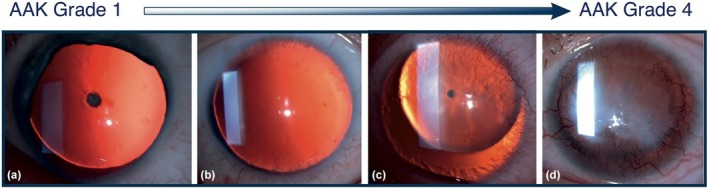
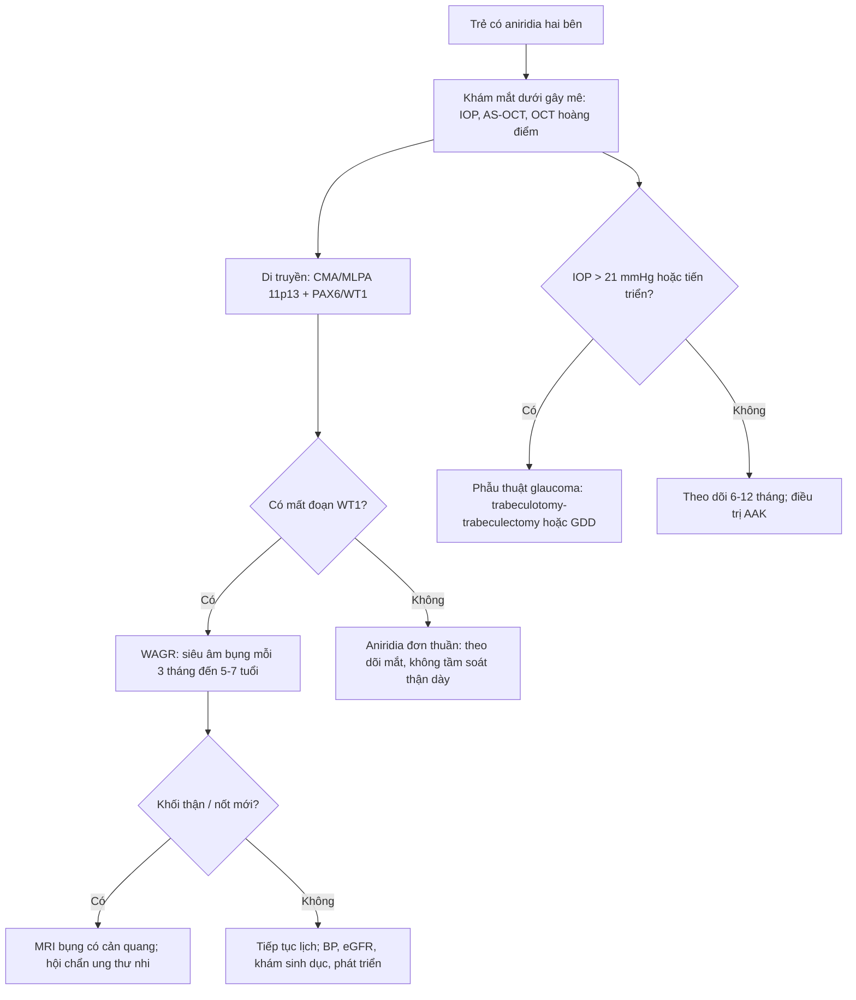
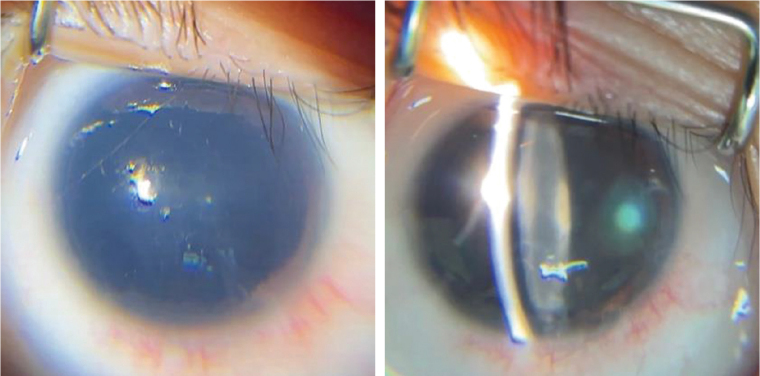
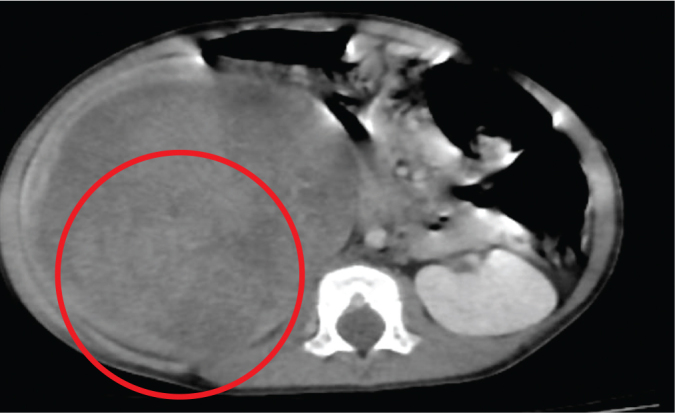
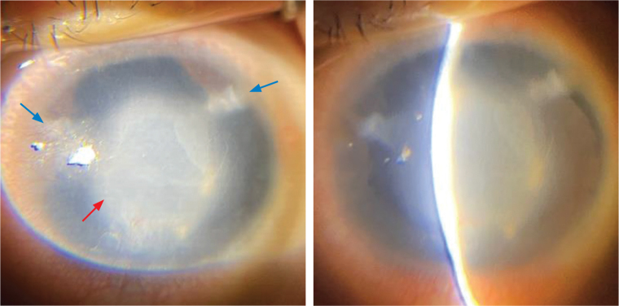

# 6104 — Aniridia bẩm sinh & hội chứng WAGR: mắt, gen 11p13 và tầm soát Wilms / Congenital aniridia and WAGR syndrome

**Tags:** `pattern:aniridia` `pattern:glaucoma` `pattern:khoi-than` `vung:mat` `vung:o-bung-nhi` `score:WAGR-surveillance` `protocol:US-3-thang` `incidentaloma:o-nguyen-bao-than`
**Mức chắc chắn (certainty):** tổng hợp y văn (literature synthesis) + ca nguyên văn (verbatim case) — ca WAGR có aniridia và glaucoma (Lim-Tanjutco PA, Yap-Veloso MIR, Acta Med Philipp 2026, PMC13281451) đối chiếu GeneReviews PAX6/WAGR, đoàn hệ SIOP-RTSG WAGR (Hol JA et al., Cancer 2021, PMC7894534) và bài tổng quan AAK 2026 (PMC13460364).

## 1. Tổng quan — vì sao "không thấy mống mắt" lại là bệnh hệ thống

- **Aniridia là thiểu sản (hypoplasia), không phải mất hoàn toàn mống mắt.** Mống mắt còn lại một **gờ gốc (iris root remnant)** — vì thế đáy mắt trông "đen thẳm" nhưng vẫn có mô mống mắt ở góc tiền phòng. Tần suất **1/40.000–1/100.000**; khoảng **2/3** ca có tiền sử gia đình (di truyền trội NST thường), **1/3** do đột biến mới.
- **TẠI SAO:** gen **PAX6 (11p13)** là yếu tố phiên mã chủ đạo cho phát triển mắt. Một bản gen (haploinsufficiency) đủ gây:
  - **thiểu sản mống mắt** và **dính/góc tiền phòng kém phát triển** → glaucoma;
  - **thiểu sản hố hoàng điểm (foveal hypoplasia)** — gần như toàn bộ bệnh nhân — → **rung giật nhãn cầu (nystagmus)**, giảm thị lực, sợ ánh sáng;
  - **thiểu sản gai thị**, đục thể thủy tinh, và **thiếu hụt tế bào gốc vùng rìa (limbal stem cell deficiency)** → **bệnh giác mạc do aniridia (aniridia-associated keratopathy — AAK)**.
- **WAGR = mất đoạn liên tiếp 11p13 gồm PAX6 và WT1.** Đây là lý do một bệnh nhân "chỉ khám mắt" lại phải tầm soát **u nguyên bào thận (Wilms tumor — WT)**. Tần suất WAGR **1/500.000–1/1.000.000**; nguy cơ WT **45–60%**, tuổi trung vị **22 tháng (6–44 tháng)**, **37,5%** hai bên, **78,9%** có ổ nguyên bào thận; **u đối bên muộn có thể xuất hiện tới 7 năm** sau chẩn đoán (Hol JA et al., PMC7894534).
- **Glaucoma trong aniridia tới 75%**, theo hai cơ chế: **bất sản góc bẩm sinh** (nhũ nhi) và **góc đóng tiến triển** do gờ mống mắt/góc hẹp về sau. Vì vậy **nhãn áp bình thường lúc sinh KHÔNG loại trừ glaucoma** — phải đo lại nhiều lần.
- **Thị lực trung bình rất kém:** WAGR **20/500** ở mắt tốt hơn, so với **20/125** ở aniridia không hội chứng (Lim-Tanjutco 2026). Phần lớn giảm thị lực do **thiểu sản hố hoàng điểm**, không chỉ do glaucoma.
- **AAK (Lagali độ 1–4):** bắt đầu bằng **pannus giác mạc/khô mắt**, tiến tới **mờ giác mạc, sẹo, tân mạch**; gần như mọi bệnh nhân có biểu hiện khi trưởng thành. **Phẫu thuật (nhất là mổ glaucoma/cataract) có thể làm AAK nặng lên** — phải cân nhắc trước mỗi can thiệp.
- **Vì sao hình ảnh học quan trọng:** **AS-OCT/UBM** đo gờ mống mắt, độ mở góc, độ dày giác mạc khi giác mạc còn trong; **OCT hoàng điểm** chứng minh **mất hố hoàng điểm** (các lớp võng mạc trong còn liên tục) — giải thích rung giật nhãn cầu mà không cần "đoán mù". **Siêu âm bụng** là phần không thể thiếu của cùng một bệnh cảnh.

*Thang Lagali: (a) độ 1 — pannus nhẹ; (b) độ 2 — mờ giác mạc lan; (c) độ 3 — tân mạch và mờ đậm; (d) độ 4 — giác mạc đục hoàn toàn, không còn thấy chi tiết tiền phòng. Ảnh: Szentmáry N et al., Acta Ophthalmol 2026;104:604–615 (PMC13460364, Fig. 1), CC BY 4.0.*

## 2. Mẫu hình + chẩn đoán phân biệt theo vị trí (Gamut)

- **Mẫu hình 1 — "gần như không thấy mống mắt":**
  - **Aniridia bẩm sinh (PAX6):** hai bên, đồng tử rất rộng, **thiểu sản hố hoàng điểm**, rung giật nhãn cầu, sợ ánh sáng.
  - **Coloboma mống mắt:** khuyết **hình chìa khóa**, thường **inferonasal**, một bên; phần còn lại của mống mắt bình thường; **không có thiểu sản hố hoàng điểm** đi kèm.
  - **Axenfeld–Rieger (PITX2/FOXC1):** **vòng cung sau giác mạc (posterior embryotoxon)**, dải mống mắt bám vào góc, **loạn sản góc**; mống mắt có thể thiểu sản nhưng **không mất gần toàn bộ**.
  - **Peters anomaly:** **dính trung tâm giác mạc–mống mắt/thể thủy tinh**, đục giác mạc trung tâm từ nhỏ.
  - **ICE syndrome (iridocorneal endothelial):** **một bên ở người trưởng thành**, corectopia, mống mắt teo "búa bạc", dính góc — không phải bệnh nhi.
  - **Chấn thương/iatrogenic, viêm màng bồ đào dính mống mắt:** tiền sử rõ; **mống mắt bị kéo dính**, không thiểu sản đối xứng hai bên.
  - **Bạch tạng (albinism):** mống mắt **vẫn thấy được** nhưng trong suốt, chiếu sáng xuyên; không có khuyết mống mắt thật.
- **Mẫu hình 2 — "aniridia + khối thận":**
  - **WAGR (mất đoạn 11p13):** aniridia + WT/ổ nguyên bào thận + **bất thường sinh dục** + **chậm phát triển**.
  - **Denys–Drash (WT1 exon 8/9):** bệnh thận màng trong, DSD 46,XY, WT; **không có aniridia** — nhưng cùng nhóm WT1.
  - **Frasier (WT1 intron 9):** DSD 46,XY, gonadoblastoma, WT muộn hơn; **không aniridia**.
  - **Mất đoạn WT1 đơn thuần:** WT hai bên/nguy cơ cao, **không aniridia**.
- **Mẫu hình 3 — "aniridia + chậm phát triển":** WAGR; **WAGRO** (WAGR + béo phì, mất đoạn lớn hơn); **Gillespie syndrome** (ITPR1, một số ca PAX6) — aniridia + **thất điều tiểu não**, không có WT.
- **Mẹo nhớ WAGR:** **W**ilms, **A**niridia, **G**enitourinary malformation, **R**etardation of mental development — nay dùng **chậm phát triển (developmental delay)** thay cho "retardation".

*Cùng một "kiểu hình aniridia" nhưng do nhiều gen: **A — PAX6**: (a) aniridia + glaucoma, (b) Axenfeld + Peters, (c) Peters; **B — CYP1B1**: aniridia/Peters kèm glaucoma; **C — FOXC1**: aniridia, Peters, Axenfeld; **D — PITX2**: Axenfeld hai bên. Bài học: **không được gọi "aniridia" là một bệnh duy nhất** — hình thái tiền phòng + gen quyết định nguy cơ glaucoma và hướng tầm soát. Ảnh: Nishina S et al., Ophthalmol Sci 2026;6:101339 (PMC13524468, Fig. 2), CC BY 4.0.*

## 3. Bảng so sánh phân biệt (ma trận đối chiếu)

| Thực thể (entity) | Hình ảnh điển hình (AS-OCT/UBM, đáy mắt, bụng) | Chốt vào (rule-in) | Chốt loại (rule-out) | Gợi ý xác nhận |
|---|---|---|---|---|
| **WAGR (11p13 deletion)** | Aniridia hai bên gần toàn bộ; **OCT: mất hố hoàng điểm**; siêu âm: khối thận đặc, có thể hai bên; ổ nguyên bào thận giảm âm | **Aniridia + bất thường sinh dục/chậm phát triển + khối thận**; mất đoạn **PAX6 + WT1** | Aniridia đơn độc, không khối thận, gen PAX6 đơn thuần → không phải WAGR | **CMA/MLPA 11p13**, WT1 sequencing; siêu âm bụng mỗi 3 tháng |
| **Aniridia đơn thuần (PAX6)** | Aniridia hai bên, thiểu sản hố hoàng điểm, **không khối thận** | **Đột biến PAX6**, không mất WT1; WT risk thấp | Mất đoạn 11p13 lan tới WT1 → WAGR | PAX6 sequencing + MLPA; siêu âm bụng theo tuổi |
| **Gillespie syndrome** | Aniridia + **thất điều tiểu não**, chậm phát triển; không khối thận | **ITPR1** (hoặc PAX6 hiếm); khám thần kinh bất thường | Không có thất điều, không chậm phát triển → aniridia đơn thuần | Gen ITPR1/PAX6; MRI tiểu não |
| **WAGRO** | WAGR + **béo phì sớm**; mất đoạn lớn hơn | **Béo phì + WAGR**; mất đoạn lan rộng | WAGR không béo phì | CMA toàn hệ gen |
| **Denys–Drash / Frasier (WT1)** | **Không aniridia**; bệnh thận màng trong/DSD; khối thận | **WT1 missense/splice + bệnh thận + DSD** | Có aniridia → nghĩ WAGR/PAX6, không phải DDS đơn thuần | WT1 sequencing; sinh thiết thận; eGFR |
| **Coloboma mống mắt** | Khuyết **hình chìa khóa inferonasal**, một bên; hố hoàng điểm bình thường | **Khuyết khu trú + bờ mống mắt liên tục** | Thiểu sản toàn bộ hai bên + rung giật → aniridia | Soi đáy mắt, OCT hoàng điểm; tầm soát coloboma thị thần kinh |
| **Axenfeld–Rieger** | **Posterior embryotoxon**, dải mống mắt, loạn sản góc; có thể glaucoma | **Vòng cung sau giác mạc + dải mống mắt** | Không có vòng cung sau, mống mắt mất gần toàn bộ → aniridia | Gen PITX2/FOXC1; AS-OCT góc |
| **ICE syndrome** | **Một bên**, corectopia, mống mắt teo, dính góc; người lớn | **Một bên + corectopia + bề mặt nội mô "búa bạc"** | Hai bên, trẻ em → aniridia bẩm sinh | Soi giác mạc đồng tử, AS-OCT; không có chỉ định tầm soát WT |

- **Phân biệt cốt lõi:** **aniridia = hai bên + thiểu sản hố hoàng điểm + rung giật nhãn cầu**; **coloboma = một bên + khuyết khu trú**; **WAGR = aniridia + bất thường sinh dục/chậm phát triển + nguy cơ WT 45–60%**.

## 4. Protocol chụp/đánh giá + hệ phân độ & sơ đồ quyết định

- **Khám mắt trẻ dưới gây mê (examination under anesthesia — EUA) khi nghi aniridia:**
  - **Nhãn áp:** Perkins hoặc iCare; đo **cả hai mắt**, lặp lại vì giác mạc mờ/độ dày giác mạc ảnh hưởng số đo.
  - **Đường kính giác mạc** (caliper): ca WAGR trong bài có **10,5 mm** — nhỏ hơn bình thường (microcornea nhẹ).
  - **Sinh hiển vi đèn khe:** gờ mống mắt, độ sâu tiền phòng, thể thủy tinh, AAK (Lagali 1–4).
  - **Gonioscopy** nếu giác mạc trong; **UBM** nếu giác mạc đục — đánh giá góc, gờ mống mắt, mỏm thể mi.
  - **AS-OCT** đo gờ mống mắt/độ mở góc; **OCT hoàng điểm** tìm **mất hố hoàng điểm**; **siêu âm B** nếu không thấy đáy mắt.
  - **Khúc xạ/đo thị lực** theo tuổi; đánh giá rung giật, sợ ánh sáng.
- **Theo dõi mắt:** nhãn áp **mỗi 6–12 tháng** (dày hơn nếu glaucoma); AAK mỗi lần khám; OCT/AS-OCT khi thay đổi thị lực.
- **Ngưỡng điều trị glaucoma:** nhãn áp **> 21 mmHg** hoặc **tiến triển gai thị/giác mạc**; ở trẻ, **phẫu thuật là trục chính**, thuốc chỉ cầu nối. Số liệu từ ca WAGR:
  - **Goniotomy đơn thuần** khi đã tăng nhãn áp: thành công dài hạn chỉ **0–20%** — không phù hợp khi giác mạc đục.
  - **Trabeculectomy:** thành công **83%** trong theo dõi 10 năm.
  - **Glaucoma drainage device (GDD):** **83,3%** ở 1 tháng, **66,6%** ở 1 năm.
  - **Phối hợp trabeculectomy–trabeculotomy:** **79,9%** đạt IOP ≤ 21 mmHg ở 1 năm; ca này đạt **10–15 mmHg** sau mổ.
  - Trung bình cần **2,8 lần phẫu thuật** để kiểm soát nhãn áp → tư vấn trước cho gia đình.
- **Điều trị AAK:** nước mắt nhân tạo, gel/lid uống, kính bảo vệ, **bandage contact lens**; **ghép tế bào gốc vùng rìa** khi thiếu hụt; **keratoprosthesis** ở thể nặng — nhưng **tránh mổ khi chưa cần** vì mổ làm AAK nặng hơn.
- **Tầm soát hệ thống khi có aniridia:**
  - **Siêu âm bụng cả hai thận mỗi 3 tháng đến 5–7 tuổi** nếu là WAGR (bài [648](../648-hoi-chung-de-mac-wilms-tam-soat-nephroblastomatosis/lesson.md)); đo chiều dài thận, tìm nốt vỏ, **không sinh thiết qua da** khi nghi ổ nguyên bào thận.
  - **Huyết áp, urinalysis, creatinine/eGFR** mỗi lần khám; khám sinh dục/DSD; đánh giá phát triển.
  - **Di truyền:** **CMA (chromosomal microarray)** cho mất đoạn 11p13; **MLPA** khi CMA âm nhưng lâm sàng mạnh; **PAX6/WT1 sequencing**; karyotype nếu mất đoạn lớn.
  - **Tư vấn gia đình:** PAX6 trội → **50%** cho con; WAGR thường **de novo** nhưng vẫn cần tư vấn và tầm soát anh chị em khi có bất thường.

## 5. Biến thể bình thường và cạm bẫy

- **"Aniridia" không có nghĩa là không còn mống mắt:** gờ gốc vẫn hiện diện; **AS-OCT** phân biệt với coloboma và với mống mắt bị kéo dính.
- **Nhãn áp bình thường lúc sinh không loại trừ glaucoma:** đo lại dưới gây mê, đối chiếu **đường kính giác mạc, gai thị, AS-OCT**; glaucoma có thể xuất hiện muộn.
- **Giác mạc đục che góc:** đừng mổ goniotomy "mù"; dùng **UBM** và chọn **phẫu thuật phối hợp/GDD**.
- **Rung giật nhãn cầu do thiểu sản hố hoàng điểm**, không phải bằng chứng của mù hoàn toàn — đừng bỏ qua đánh giá thị lực chức năng.
- **AAK dễ bị bỏ qua giai đoạn sớm:** ghi **Lagali 1–4** mỗi lần khám; mổ glaucoma/cataract có thể làm AAK tiến triển.
- **Sinh thiết thận qua da ở trẻ có ổ nguyên bào thận:** nguy cơ gieo mầm/upstaging; ưu tiên **MRI + hội chẩn**, không sinh thiết.
- **Siêu âm bụng âm lúc sinh không loại trừ WAGR:** WT có thể xuất hiện sau; **tiếp tục mỗi 3 tháng đến 5–7 tuổi**, nhất là khi có mất đoạn WT1.
- **CMA âm không loại trừ hoàn toàn:** mất đoạn nhỏ/dị tượng có thể dưới độ phân giải; dùng **MLPA/sequencing** khi lâm sàng điển hình.
- **Không gọi tất cả aniridia là WAGR:** aniridia đơn thuần do PAX6 có nguy cơ WT thấp; **gen quyết định lịch tầm soát**.
- **WAGRO dễ bị bỏ sót béo phì:** cân đo chiều cao/BMI mỗi lần khám; mất đoạn lớn hơn → tư vấn di truyền.

## 6. Tự lượng giá — Blind Quiz

**Ca 1 — Bé trai 19 tháng, hai mắt "đen", rung giật nhãn cầu từ nhỏ. Nhìn ảnh, mô tả trước:**

- Gợi ý: mắt phải; đồng tử 9 mm, không phản ứng ánh sáng; giác mạc 10 × 10 mm.
- Hỏi: dấu hiệu chính? 3 chẩn đoán phân biệt? bước tiếp theo ngoài khám mắt?

<b>Bấm để hiện đáp án (findings + chẩn đoán)</b>

- **Gần như toàn bộ mống mắt không thấy**, đồng tử rất rộng, tiền phòng sâu, thể thủy tinh trong — **aniridia bẩm sinh**. Đây là **thiểu sản mống mắt**, không phải mất mô hoàn toàn.
- Phân biệt: **coloboma mống mắt** (khuyết khu trú, một bên), **Axenfeld–Rieger** (vòng cung sau giác mạc), **chấn thương/viêm dính mống mắt** (một bên, tiền sử).
- Bước tiếp theo: **đo nhãn áp dưới gây mê**, AS-OCT/UBM góc, OCT hoàng điểm; **siêu âm bụng** + khám sinh dục/phát triển; **CMA/MLPA 11p13** tìm WAGR.
- **Nguồn ca:** Lim-Tanjutco PA, Yap-Veloso MIR, Acta Med Philipp 2026;60:126–132 (PMC13281451, Fig. 3), **CC BY-NC-ND 4.0** (nguyên bản).

**Ca 2 — Cùng bệnh nhi, bụng to, tiểu máu, khối hông lưng phải. Nhìn CT, mô tả trước:**

- Hỏi: mô tả khối? chẩn đoán? vì sao ca này buộc phải tầm soát thận?

<b>Bấm để hiện đáp án</b>

- **Khối đặc lớn 11,5 × 10,2 × 10,9 cm** ở nửa trên thận phải, **ngấm thuốc không đồng nhất**, có vùng **dịch/hoại tử dạng nang**, **không vôi hóa**, bờ rõ — hình ảnh **u nguyên bào thận (Wilms)**.
- Đây là **W** của WAGR: bệnh nhi có aniridia + bất thường sinh dục + chậm phát triển + **mất đoạn toàn bộ WT1**; khối thận là **WT**.
- Vì vậy **aniridia hai bên ở trẻ phải kèm siêu âm bụng định kỳ** — không được chỉ khám mắt.
- **Nguồn ca:** Lim-Tanjutco PA, Yap-Veloso MIR, Acta Med Philipp 2026 (PMC13281451, Fig. 1), **CC BY-NC-ND 4.0** (nguyên bản).

**Ca 3 — Mắt trái cùng bệnh nhi: đục giác mạc trung tâm, nhãn áp 65 mmHg. Nhìn ảnh, mô tả trước:**

- Hỏi: dấu hiệu? chẩn đoán? chọn phẫu thuật nào khi giác mạc đục?

<b>Bấm để hiện đáp án</b>

- **Đục giác mạc trung tâm 6 × 7 mm** (mũi tên đỏ) + **hai vết mờ nhỏ ở 10 giờ và 2 giờ** (mũi tên xanh) — di chứng mổ cataract trước đó. Giác mạc 10 × 10 mm, **IOP 65 mmHg**, không bắt màu fluorescein.
- Chẩn đoán: **glaucoma do aniridia + AAK/đục giác mạc**; cần phân biệt **phù giác mạc do nhãn áp cao** với **sẹo AAK**.
- Vì giác mạc đục **không thể goniotomy**; ca này được mổ **phối hợp trabeculectomy–trabeculotomy**, sau mổ **IOP 10–15 mmHg**; tiên lượng thị lực vẫn dè dặt vì thiểu sản hố hoàng điểm.
- **Nguồn ca:** Lim-Tanjutco PA, Yap-Veloso MIR, Acta Med Philipp 2026 (PMC13281451, Fig. 4), **CC BY-NC-ND 4.0** (nguyên bản).

## Bài liên quan chéo
- [648 – Hội chứng dễ mắc u nguyên bào thận: BWS, WAGR, Denys–Drash & lịch tầm soát siêu âm](../648-hoi-chung-de-mac-wilms-tam-soat-nephroblastomatosis/lesson.md)
- [639 – Khối thận đặc ở trẻ: Wilms vs CMN vs RCC](../639-khoi-than-o-tre-wilms-cmn-rcc/lesson.md)
- [651 – Đánh giá đáp ứng & theo dõi sau điều trị Wilms](../651-danh-gia-dap-ung-sau-dieu-tri-wilms/lesson.md)
- [6700 – Biến chứng muộn & chuyển tiếp ở người sống sót sau Wilms](../6700-di-chung-muon-sau-wilms-va-chuyen-tiep/lesson.md)
- [442 – Glaucoma trên OCT](../442-glaucoma-OCT/lesson.md)
- [451 – Hệ thống mắt: tiếp cận hình ảnh](../451-he-thong-mat/lesson.md)
- [483 – Sàng lọc thị lực trẻ mầm non](../483-sang-loc-thi-luc-tre-mam-non/lesson.md)

## Ảnh
- `6104_ca1_mat_AMP-60-9-13093-g003.jpg`, `6104_ca2_CT_AMP-60-9-13093-g001.jpg`, `6104_ca3_mat_AMP-60-9-13093-g004.jpg` — **CC BY-NC-ND 4.0**, nguyên bản, không crop/ghép.
- `6104_tien-phong-theo-gen_PMC13524468-Fig2-CCBY.jpg` — CC BY 4.0.
- `6104_aak-lagali-do_PMC13460364-Fig1-CCBY.jpg` — CC BY 4.0.
- Không tạo ảnh ghép cho bài này vì 3/5 ảnh là **CC BY-NC-ND** (không được biến đổi/ghép).
- Nguồn + giấy phép từng ảnh: `images/CREDITS.md`.

> Không dùng để chẩn đoán độc lập khi chưa có người hướng dẫn.
