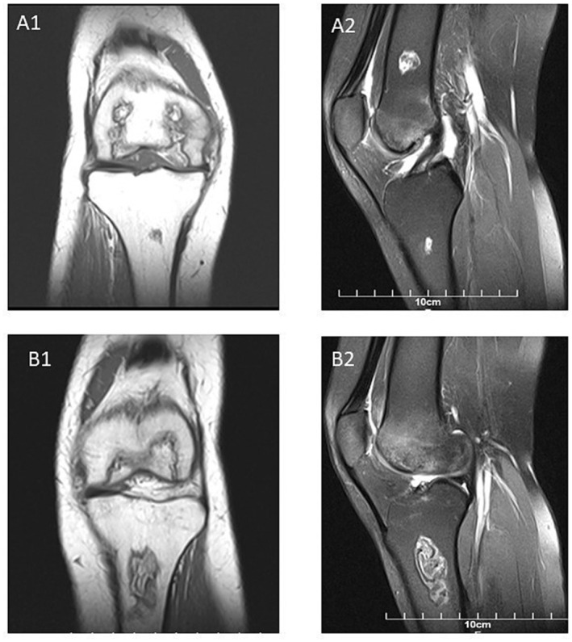
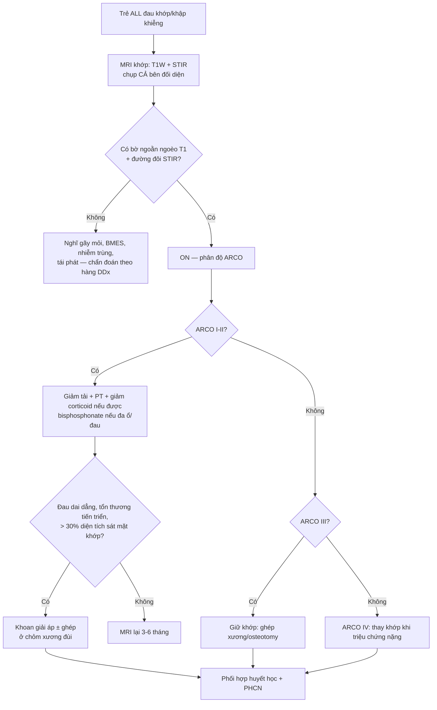
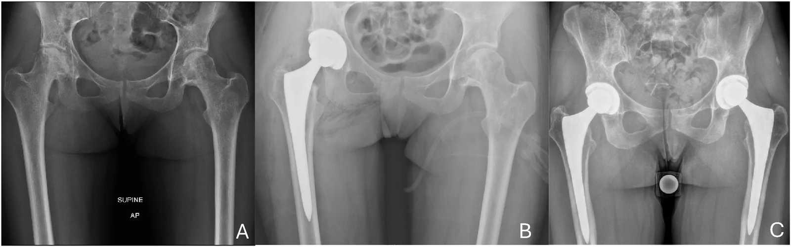
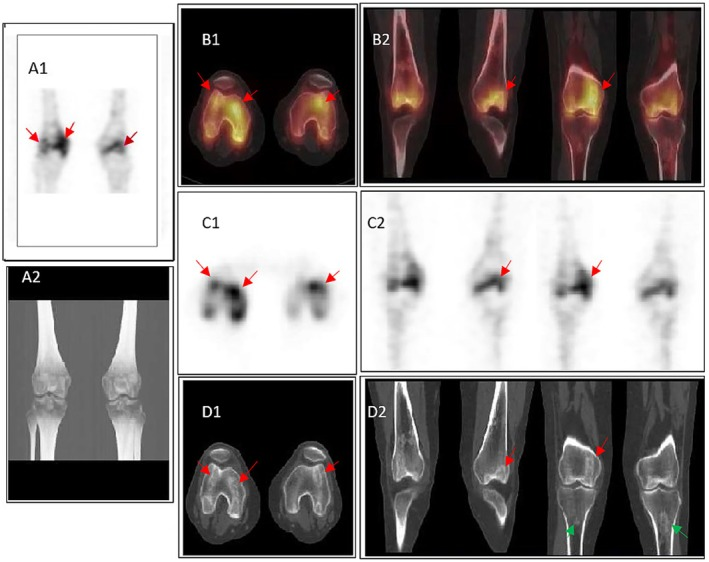

# 6105 — Hoại tử xương ở trẻ điều trị ALL: dấu "đường đôi" trên MRI, phân độ ARCO & ngưỡng can thiệp / Osteonecrosis in pediatric ALL

**Tags:** `pattern:hoai-tu` `pattern:dau-khop` `vung:co-xuong` `vung:khop-goi` `vung:khop-hang` `score:ARCO` `protocol:MRI-khop` `protocol:MRI-toan-than` `incidentaloma:ton-thuong-sun-xuong`
**Mức chắc chắn (certainty):** tổng hợp y văn (literature synthesis) + ca nguyên văn (verbatim case) — ca gối hai bên ở trẻ 17 tuổi ALL/AML sau ghép tế bào gốc (Haghighi F et al., Clin Case Rep 2026;14:e73212, PMC13482015) đối chiếu đoàn hệ quốc gia Áo 1.127 trẻ (Arnold K et al., EJHaem 2026;7:e70263, PMC13289583), đoàn hệ ANZCHOG (Padhye B et al., Cancer Med 2016;5:960–967, PMC4864825) và bài tổng quan điều trị theo bậc (Dermott M et al., J POSNA 2026;17:100460, PMC13682489).

> **Điểm chốt của bài:** đau khớp ở trẻ đang điều trị ALL **không được mặc định là "đau do corticoid"**. X-quang **bình thường trong giai đoạn sớm** (ARCO I); **MRI là chuẩn chẩn đoán**, và dấu **"đường đôi" (double-line sign)** + **bờ ngoằn ngoèo (serpiginous) giảm tín hiệu T1** là chốt vào. Trẻ ≥ 10 tuổi có nguy cơ cao gấp hơn 10 lần, tổn thương **đa ổ 70–85%**, nên chụp **cả bên đối diện** và tìm ổ không triệu chứng.

## 1. Tổng quan — hoại tử xương hình thành thế nào và vì sao ALL là bối cảnh điển hình

- **Định nghĩa:** hoại tử xương (osteonecrosis — ON, còn gọi hoại tử vô mạch/avascular necrosis) là **chết tế bào xương và tủy xương do thiếu máu cục bộ**. Vùng chết không tự tái tạo; cơ thể phản ứng bằng **mô hạt + xơ hóa + đặc xương** quanh ổ chết → tạo **ranh giới địa lý (geographic border)**. Đây là lý do hình ảnh không phải "một nốt mờ" mà là **một vùng có bờ**.
- **TẠI SAO ở trẻ ALL — 4 cơ chế cộng dồn:**
  1. **Corticoid liều cao, kéo dài** (dexamethasone 10 mg/m²/ngày × 21 ngày; prednisolone 60 mg/m²/ngày × 28 ngày): làm **phì đại tế bào mỡ tủy** → tăng áp lực trong xương, **thuyên tắc mỡ**, ức chế tạo xương và **gây apoptosis tế bào xương** → giảm vi tuần hoàn.
  2. **L-asparaginase:** tăng lipid máu và tăng đông, **cộng hưởng với corticoid** khi dùng đồng thời.
  3. **Methotrexate:** tăng homocysteine → tổn thương nội mạc, tắc vi mạch.
  4. **Xạ trị vùng chịu lực > 20–35 Gy** và các thuốc gây độc mạch khác.
- **Vì sao đúng vị trí đó:** ON thích **đầu xương dài chịu lực** — **chỏm xương đùi, đầu dưới xương đùi, đầu trên xương chày, đầu trên xương cánh tay** — nơi mạch máu tận cùng, ít tuần hoàn bàng hệ và chịu tải. Sụn khớp không có mạch nên **không bị hoại tử trực tiếp**, nhưng khi xương dưới sụn sụp → sụn mất chỗ tựa và thoái hóa thứ phát.
- **Ngưỡng dịch tễ (số liệu phải nhớ):**
  - Đoàn hệ quốc gia Áo **1.127 trẻ** điều trị AIEOP-BFM ALL 2000/2009: **73 ca ON có triệu chứng**, **nguy cơ tích lũy 5 năm 7% ± 1%**; **trung vị 1,64 năm** từ chẩn đoán; **10–18 tuổi 22% ± 3%** so với **1–9 tuổi 2% ± 0%**; **tuổi là yếu tố tiên đoán độc lập duy nhất** (Arnold 2026, PMC13289583).
  - Đoàn hệ ANZCHOG: **18/251 = 7,2%**; **> 10 tuổi 29%**; trung vị **1,15 năm** (0,25–2,12); **70% còn triệu chứng** khi theo dõi cuối; 3 ca phải thay khớp (Padhye 2016, PMC4864825).
  - Khi **chụp MRI tầm soát có hệ thống**, tỷ lệ ON **tới ~72%**; **đa ổ 70–85%**; ở tuổi ≥ 15 nguy cơ **~16%** so với **< 2%** ở trẻ nhỏ (Dermott 2026, PMC13682489 — tổng hợp).
  - **79%** ca sẽ phát triển ON **trong vòng 1 năm đầu** sau khi bắt đầu corticoid; **17,7%** trẻ > 10 tuổi có ON trên MRI protocol-driven vào cuối liệu trình (nghiên cứu St. Jude, dẫn trong Padhye 2016).
  - **Hậu quả dài hạn:** **~50%** còn triệu chứng sau 5 năm; trong số ON **nặng**, **67%** phải thay khớp và **20%** còn đau mạn (van Atteveld 2021, PMC8018109).
- **Vì sao hình ảnh trông như vậy (vật lý + mô bệnh):**
  - **T1W:** mỡ tủy chết **vẫn còn mỡ** → vùng trung tâm **sáng tương đối**; bờ hoạt tính xơ/đặc xương **giảm tín hiệu** → **bờ ngoằn ngoèo tối**. Đây là "chữ ký" của ổ địa lý.
  - **STIR/T2 fat-sat:** mỡ bị triệt → **phù tủy quanh ổ sáng lên**; lớp mô hạt trong bờ **sáng**, lớp xơ ngoài **tối** → **đường đôi (double-line sign)**.
  - **X-quang:** chỉ thấy **đặc xương, dấu liềm (crescent sign), sụp/xẹp** khi bệnh đã tiến triển — **không loại trừ ON** khi còn bình thường.

## 2. Mẫu hình + chẩn đoán phân biệt theo vị trí (Gamut)

- **Mẫu hình A — ổ "địa lý" dưới sụn ở đầu xương chịu lực (một hoặc hai bên):**
  - **ON do điều trị ALL** (bài này): bờ ngoằn ngoèo T1, **đường đôi** trên STIR, trung tâm giữ tín hiệu mỡ, thường **đối xứng/đa ổ**.
  - **Gãy mỏi/xẹp do corticoid (insufficiency fracture):** dải giảm tín hiệu **thẳng, vuông góc với vỏ xương**, không có trung tâm mỡ; vị trí kinh điển cổ xương đùi, đốt sống, xương cùng.
  - **Phù tủy xương thoáng qua (bone marrow edema syndrome — BMES):** phù lan tỏa **không có bờ địa lý**, tự hồi phục; không có bờ T1 tối rõ.
  - **Viêm xương tủy cấp (osteomyelitis):** sốt/đau khu trú, phù mô mềm, **phá hủy vỏ, phản ứng màng xương**, ổ áp-xe; không có "đường đôi".
  - **Thâm nhiễm tủy do bạch cầu/relapse:** giảm tín hiệu T1 **lan tỏa, không bờ**, kèm hạch/gan lách; cần tủy đồ nếu nghi.
  - **CRMO (viêm xương tủy đa ổ tái diễn mạn):** đa ổ, **phản ứng màng xương**, không có bờ địa lý điển hình; bệnh nhân thường đau + sưng, không đi khập khiễng đơn thuần.
- **Mẫu hình B — đau gối đơn thuần ở trẻ ALL:** nghĩ theo thứ tự **ON (dưới sụn) → gãy mỏi → nhiễm trùng khớp/xương (trẻ giảm miễn dịch!) → thâm nhiễm/tái phát → CRMO/OCD**. Viêm khớp nhiễm khuẩn ở trẻ giảm bạch cầu có thể **không sốt rõ** — không được bỏ qua dịch khớp.
- **Mẫu hình C — đa ổ/bilat:** ON do điều trị (70–85%), CRMO, di căn/tái phát, bệnh mô liên kết. **Đa ổ + bối cảnh corticoid = ON cho đến khi chứng minh khác.**
- **Mnemonic "STEROID":** **S**ubchondral geographic (dưới sụn, có bờ) · **T**1 dark serpiginous rim (bờ tối ngoằn ngoèo) · **E**dema on STIR (phù quanh) · **R**elative central fat (trung tâm giữ mỡ) · **O**ld steroid/high dose (tiền sử corticoid) · **I**nfarct line/double line (đường đôi) · **D**istribution weight-bearing epiphysis (đầu xương chịu lực).

## 3. Bảng so sánh phân biệt (ma trận đối chiếu)

| Thực thể (entity) | Hình ảnh điển hình | Chốt vào (rule-in) | Chốt loại (rule-out) | Gợi ý xác nhận |
|---|---|---|---|---|
| **ON do corticoid (ARCO I–II)** | Ổ **địa lý** dưới sụn, **bờ T1 tối ngoằn ngoèo**, trung tâm giữ mỡ, **đường đôi** trên STIR | **Bờ ngoằn ngoèo + đường đôi + bối cảnh corticoid** | Bờ thẳng vuông góc vỏ + không có trung tâm mỡ → gãy mỏi; phù lan không bờ → BMES | MRI khớp (T1 + STIR), đối chiếu bên đối diện |
| **Gãy mỏi / xẹp do corticoid** | Dải giảm tín hiệu **thẳng**, phù tủy quanh, có thể **đường gãy trên CT** | **Dải thẳng + vị trí chịu lực + không bờ địa lý** | Có bờ ngoằn ngoèo + đường đôi → ON | MRI/CT; X-quang muộn mới thấy |
| **BMES (phù tủy thoáng qua)** | Phù tủy **lan tỏa**, không bờ, không sụp; hồi phục 6–12 tháng | **Phù không bờ + tự giảm theo thời gian** | Bờ T1 tối rõ + tổn thương dạng địa lý → ON | MRI lặp lại 3–6 tháng |
| **Viêm xương tủy cấp** | Phù tủy + **phá hủy vỏ, phản ứng màng xương**, phù mô mềm, áp-xe | **Sốt/đau khu trú + phá vỏ + phù mô mềm** | Vỏ nguyên vẹn, không phù mô mềm → ON | MRI + CRP/máu; chọc hút khi có ổ mủ |
| **Thâm nhiễm tủy/tái phát bạch cầu** | Giảm T1 **lan tỏa, không bờ**, tủy xương loang lổ, hạch/gan lách | **Không bờ địa lý + bối cảnh huyết học** | Có bờ địa lý + đường đôi → ON | Tủy đồ/PET-CT nếu nghi |
| **CRMO** | Đa ổ, **phản ứng màng xương**, phù tủy, không đường đôi | **Đa ổ + màng xương + đau/sưng** | Bờ địa lý + đường đôi + corticoid → ON | MRI toàn thân, loại trừ nhiễm trùng |
| **OCD (loạn sản xương – sụn khớp gối)** | Mảnh xương–sụn **tách bờ ở vùng tiếp khớp**, thường mặt trong lồi cầu đùi | **Mảnh tách + sụn phủ + khớp gối thiếu niên** | Tổn thương trong tủy, không liên quan mặt khớp → ON | MRI khớp gối (T2/PD) |

*Ca 17 tuổi ALL/AML sau ghép tế bào gốc, đau gối tiến triển. **A1** (T1W coronal gối phải): ổ địa lý ở lồi cầu đùi và đầu trên xương chày với **bờ giảm tín hiệu ngoằn ngoèo**, trung tâm còn tín hiệu mỡ. **A2** (STIR sagittal): phù tủy và **dấu đường đôi**. **B1/B2** gối trái: nhiều ổ địa lý, đường đôi rõ. Nguồn: Haghighi F et al., Clin Case Rep 2026;14:e73212 (PMC13482015, Fig. 1), CC BY 4.0.*

### Ba dấu hiệu phải đọc thành tiếng khi soi MRI
- **Bờ ngoằn ngoèo (serpiginous border) trên T1:** chốt vị trí ổ chết; bờ **càng dày, càng tối** = phản ứng xơ/đặc xương càng mạnh.
- **Đường đôi (double-line sign) trên T2/STIR:** **lớp trong sáng** (mô hạt tái tạo) + **lớp ngoài tối** (xơ/đặc xương). Đây là dấu **đặc hiệu nhất** của ON, phân biệt với phù tủy đơn thuần.
- **Dấu liềm (crescent sign) trên X-quang/CT:** đường sáng dưới sụn = **gãy xương dưới sụn**, tức đã sang **ARCO III** — mốc chuyển từ "bảo tồn" sang "giữ khớp bằng phẫu thuật".

## 4. Protocol chụp + phân độ ARCO + sơ đồ xử trí

### 4.1 Protocol MRI — "một chuỗi xung, ba câu trả lời"
- **Chuỗi xung tối thiểu:** **T1W không triệt mỡ** (coronal) + **STIR hoặc PD/T2 fat-sat** (coronal + sagittal), lát **3–4 mm**, FOV **toàn khớp** (gồm cả đầu xương đối diện).
- **Không cần gadolinium** để chẩn đoán ON; chỉ tiêm khi nghi nhiễm trùng/u.
- **Chụp cả bên đối diện** dù chỉ một bên đau: **đa ổ 70–85%**, và ổ bên kia thay đổi quyết định (bảo tồn hai bên vs can thiệp một bên).
- **Khi nào mở rộng toàn thân:** trẻ **≥ 10 tuổi** có ON ở một ổ, đau nhiều vị trí, hoặc trước khi quyết định phẫu thuật → **MRI toàn thân (T1 + STIR)** nếu có; **18F-NaF PET/CT** là lựa chọn thay thế ở trung tâm có điều kiện (vai trò tiên lượng **chưa được chuẩn hóa**).
- **Thời điểm:** MRI **ngay khi có đau/khập khiễng** — không chờ hết liệu trình. Ở nhóm nguy cơ cao, cân nhắc **MRI tầm soát cuối giai đoạn induction/reinduction** (chưa có đồng thuận; **79%** ca ON xuất hiện trong năm đầu).
- **Theo dõi:** lâm sàng + MRI lặp **mỗi 3–6 tháng** giai đoạn đầu, sau đó giãn ra; chụp lại ngay khi đau tăng hoặc có triệu chứng cơ học.
- **X-quang:** chụp nền và theo dõi — nhưng **X-quang bình thường KHÔNG loại trừ ON** (ARCO I).

### 4.2 Phân độ ARCO 2019 (bảng gốc cho chỏm xương đùi; áp dụng cho khớp khác là **ngoại suy** có kiểm soát)

| ARCO | X-quang | MRI | Ý nghĩa điều trị |
|---|---|---|---|
| **I** | Bình thường | **Bất thường tín hiệu tủy** (T1 thấp, T2/STIR cao), **chưa biến dạng** | Còn hồi phục — bảo tồn, theo dõi sát |
| **II** | **Đặc xương/kyst**, chưa sụp | Ổ **giới hạn rõ**, **đường viền khớp còn nguyên** | Trước sụp — cân nhắc **khoan giải áp** nếu có triệu chứng |
| **III** | **Dấu liềm**, sụp dưới sụn, chưa dẹt | **Gãy xương dưới sụn**, đường viền khớp bắt đầu hỏng | Nguy cơ tiến triển cao — **giữ khớp**: ghép xương/osteotomy |
| **IV** | Mặt khớp **dẹt**, thoái hóa thứ phát | Xác nhận sụp + thoái hóa | **Thay khớp** khi triệu chứng nặng |

- **Ngưỡng tiên lượng sụp khớp:** tổn thương **> 30% diện tích** và **sát mặt khớp** → nguy cơ sụp/thay khớp cao (Padhye 2016). Đây là lý do phải **đo diện tích và khoảng cách tới mặt khớp** trong báo cáo, không chỉ ghi "có ON".
- **Điều trị theo bậc:**
  - **ARCO I–II:** giảm tải/đai hỗ trợ, vật lý trị liệu, **giảm liều corticoid nếu phác đồ cho phép** (phối hợp huyết học — không tự ngừng); **bisphosphonate** (zoledronic acid) có bằng chứng tốt nhất về **giảm đau/chức năng** nhưng **chưa chứng minh ngăn sụp**; **khoan giải áp (core decompression)** khi đau dai dẳng/tổn thương tiến triển, chủ yếu ở chỏm xương đùi.
  - **ARCO III:** phẫu thuật giữ khớp (ghép xương mác mạch máu, osteochondral autograft/allograft, osteotomy) — chọn theo vị trí, kích thước, sụn còn lại và mức trưởng thành xương.
  - **ARCO IV:** thay khớp; ở trẻ cần cân nhắc **tuổi, còn lớn** và khả năng thay lại.
- **Bằng chứng yếu cần nói rõ với gia đình:** khoan giải áp **chưa được chứng minh giảm nguy cơ sụp** trong tổng quan; bisphosphonate chủ yếu giảm đau. Đừng hứa "mổ là khỏi".

## 5. Biến thể bình thường & cạm bẫy

- **Cạm bẫy 1 — "X-quang bình thường nên không phải ON".** Trong đoàn hệ ANZCHOG, **83%** ca lúc chẩn đoán ON chỉ có **ARCO I–II trên X-quang** (15/18 ca). Ở ARCO I, X-quang **hoàn toàn bình thường**; chỉ MRI mới thấy.
- **Cạm bẫy 2 — quy đau khớp cho "đau do corticoid/giai đoạn tăng trưởng".** Đau do corticoid là đau cơ, không có điểm đau xương, không khập khiễng; ON đau **khi chịu tải, giảm khi nghỉ**. Trẻ **≥ 10 tuổi** đau gối/đau háng **phải chụp MRI** — đừng chờ.
- **Cạm bẫy 3 — bỏ sót ổ đối bên.** **70–85% đa ổ**; ổ bên kia có thể **không triệu chứng** nhưng quyết định chiến lược (theo dõi, can thiệp sớm, thay đổi phác đồ).
- **Cạm bẫy 4 — tưởng đặc xương trên X-quang là "lành".** Đặc xương sau 5 tháng chỉ là **sửa chữa/xơ hóa**, **không chứng minh khỏi** và **không loại trừ tiến triển** (ca Fig. 4, PMC13482015). Phải đối chiếu MRI.
- **Cạm bẫy 5 — tủy đỏ sinh lý ở trẻ.** Tủy đỏ **đối xứng**, T1 **hơi sáng hơn cơ/đĩa đệm**, không có bờ địa lý, không phù trên STIR. Áp dụng học thuyết tín hiệu tủy: **thay thế tủy thật = T1 tối hơn cơ/đĩa**; tủy đỏ **không** phải ON.
- **Cạm bẫy 6 — sụn tăng trưởng (physis).** Đường sụn tăng trưởng **sáng trên T2, tối trên T1**, chạy ngang đối xứng; đừng đọc thành "dải hoại tử". Ổ ON nằm **trong đầu xương** (epiphysis) hoặc **sát mặt khớp**, không trùng physis.
- **Cạm bẫy 7 — coi SPECT/CT/xạ hình là "chốt mức độ".** Ca dưới đây cho thấy **hoạt tính lệch nhau giữa đùi và chày**; xạ hình phản ánh **chuyển hóa sửa chữa**, không thay thế MRI để phân độ ARCO.
- **Cạm bẫy 8 — tự ngừng corticoid.** Giảm liều chỉ khi **phác đồ ung thư cho phép** và có bàn với huyết học; ngừng đột ngột có thể làm bệnh nền bùng phát.

*Ca 18 tuổi ALL nguy cơ rất cao, dùng corticoid kéo dài. **A:** ON chỏm xương đùi hai bên, **sụp xương dưới sụn bên phải**. **B:** thay khớp háng phải. **C:** thay khớp háng hai bên. Đây là ARCO IV — minh họa vì sao phải bắt ON **trước khi sụp**. Nguồn: Dermott M et al., J POSNA 2026;17:100460 (PMC13682489, Fig. 3), CC BY-NC-ND 4.0 — nguyên bản, không chỉnh sửa.*

## 6. Tự lượng giá — Blind Quiz

**Ca 1 — Trẻ 17 tuổi ALL sau ghép, đau gối hai bên. MRI đã xác định ON. Xạ hình SPECT/CT được chụp thêm.**

- Hỏi: vì sao **lồi cầu đùi ngấm mạnh** còn **tổn thương xương chày ngấm rất ít**? Điều này có làm thay đổi phân độ ARCO hay chỉ định mổ không?

<b>Bấm để hiện đáp án</b>

- **Ngấm mạnh ở lồi cầu đùi** tương ứng **đặc xương rõ trên CT** — vùng đang **sửa chữa/tái tạo mạnh**; **xương chày ngấm ít** dù có ổ ON và đặc xương nhẹ → **hoạt tính không đồng nhất giữa các ổ**, có thể do **giai đoạn sửa chữa khác nhau**.
- **Không** dùng xạ hình để phân độ ARCO hay quyết định mổ: ARCO dựa trên **MRI/X-quang** (cấu trúc, sụp). SPECT/CT chỉ là **thông tin bổ sung** về hoạt tính; **vai trò tiên lượng sụp chưa được chuẩn hóa**.
- Nguồn: Haghighi F et al., Clin Case Rep 2026;14:e73212 (PMC13482015), CC BY 4.0.

**Ca 2 — Trẻ 15 tuổi ALL, 3 tuần sau đợt dexamethasone, đau gối phải khi đi lại, X-quang bình thường.**

- Hỏi: bước tiếp theo? Có được kết luận "đau do corticoid" và theo dõi không?

<b>Bấm để hiện đáp án</b>

- **Chụp MRI khớp gối NGAY** (T1W + STIR), **cả gối trái**; nếu đau háng thì chụp thêm khớp háng.
- **Không** kết luận đau do corticoid: X-quang bình thường là **bình thường ở ARCO I**, và **79%** ca ON xuất hiện trong năm đầu corticoid; tuổi 15 thuộc nhóm **nguy cơ cao nhất** (22% ở 10–18 tuổi).
- Nếu MRI âm mà đau dai dẳng: **MRI lặp lại 3–6 tháng**, tìm gãy mỏi/nhiễm trùng/tái phát; cân nhắc MRI toàn thân.

**Ca 3 — Trẻ 12 tuổi, ON chỏm xương đùi ARCO II, tổn thương 35% diện tích, sát mặt khớp, đau khi đi lại.**

- Hỏi: chọn theo dõi đơn thuần, khoan giải áp, hay thay khớp? Cần nói gì với gia đình về bằng chứng?

<b>Bấm để hiện đáp án</b>

- **Trước sụp (ARCO II) + có triệu chứng + > 30% diện tích, sát mặt khớp** → **phẫu thuật giữ khớp**, thường **khoan giải áp** ở chỏm xương đùi ± ghép; kèm **giảm tải, vật lý trị liệu**, và bàn với huyết học về **giảm liều corticoid nếu phác đồ cho phép**.
- **Không thay khớp** (chỉ ARCO IV); **không chỉ theo dõi đơn thuần** vì nguy cơ sụp cao.
- **Nói rõ giới hạn bằng chứng:** khoan giải áp chủ yếu **giảm đau/cải thiện chức năng**, **chưa chứng minh ngăn sụp**; bisphosphonate giảm đau nhưng không phải điều trị triệt để. Tiên lượng phụ thuộc **kích thước, vị trí và sụp mặt khớp**.

## Bài liên quan chéo
- [300 – Tổng quan Hệ Cơ – Xương – Khớp](../300-tong-quan-he-co-xuong-khop/lesson.md) (học thuyết vùng chuyển tiếp + tín hiệu tủy)
- [361 – MRI khớp háng: AVN, ARCO/Ficat, FAI](../361-khop-hang/lesson.md) (phân độ và đọc ổ chỏm xương đùi)
- [684 – Tăng triglyceride do asparaginase ở trẻ ALL](../684-tang-triglyceride-asparaginase-all-nhi/lesson.md) (TG độ 3/4 → ON OR 4,27; vì sao phải tìm ON khi đau khớp)
- [511 – Đau cơ–khớp do thuốc ức chế aromatase & sức khỏe xương](../511-aimss-dau-co-khop-do-uc-che-aromatase/lesson.md) (đau khớp do thuốc ở người lớn — đối chiếu)
- [640 – Khớp háng nhi: DDH, Perthes, SCFE](../640-khop-hang-nhi-DDH-Perthes-SCFE-va-NAT/lesson.md) (chẩn đoán phân biệt đau háng ở trẻ)
- [370 – Nhiễm trùng cơ xương khớp](../370-nhiem-trung-msk/lesson.md) (viêm xương tủy — hàng DDx sốt/đau xương)

> Không dùng để chẩn đoán độc lập khi chưa có người hướng dẫn.
