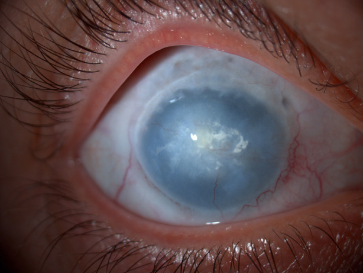
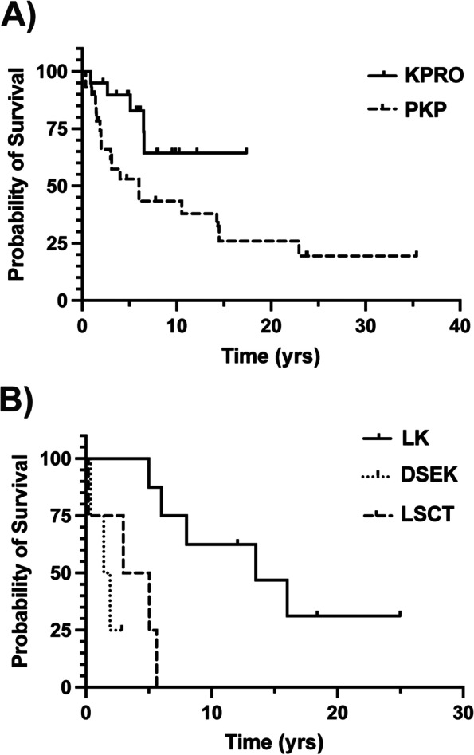
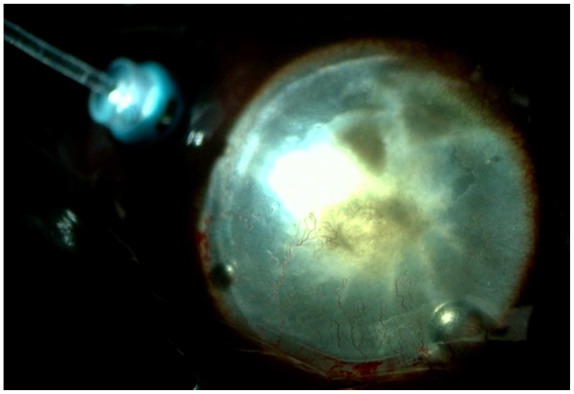
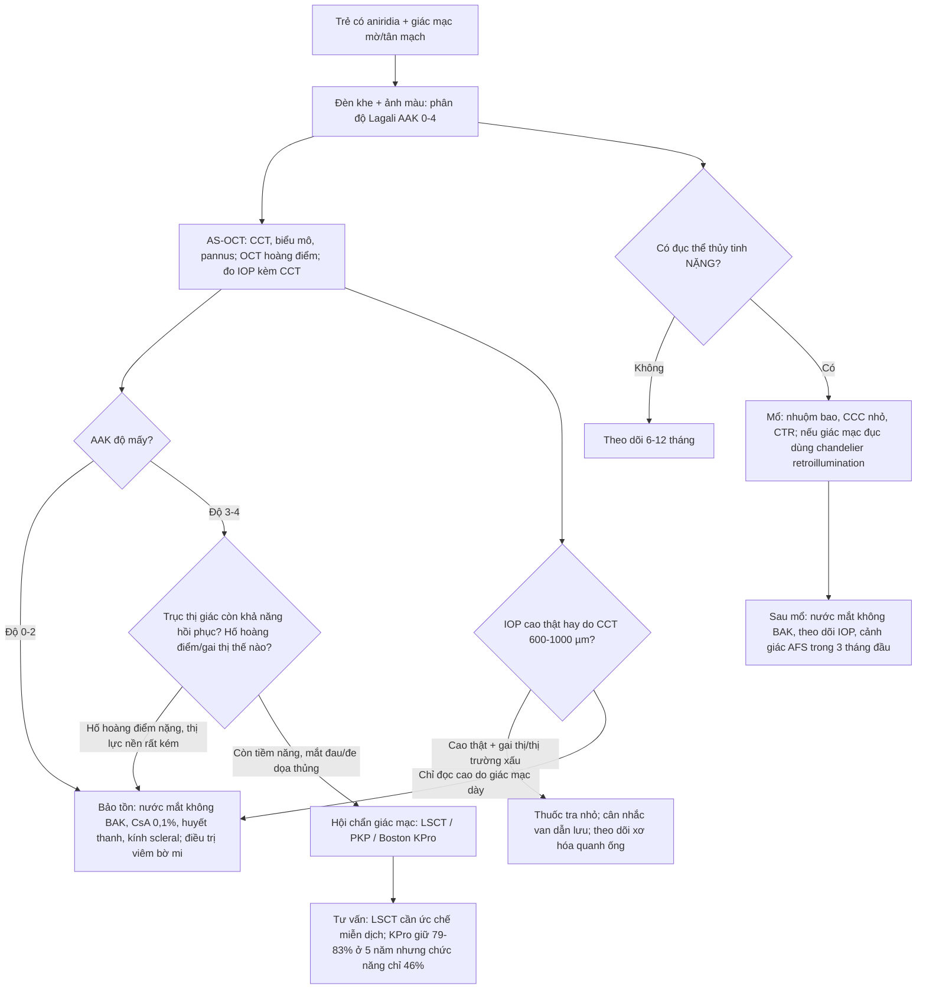
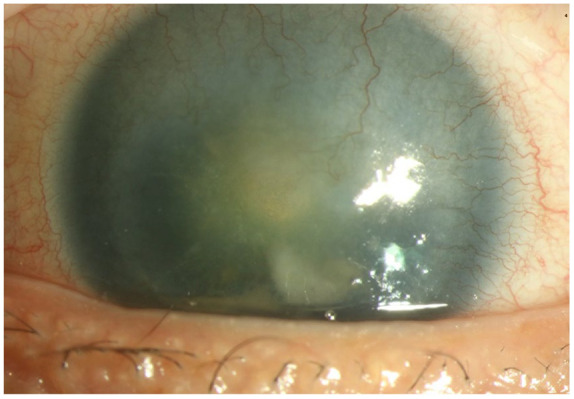
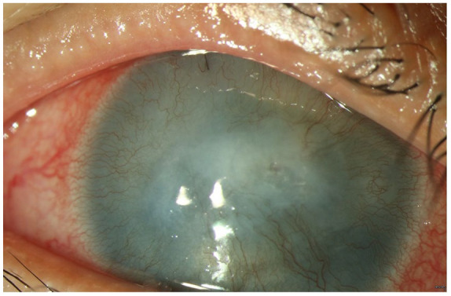

# 6106 — Bệnh giác mạc do aniridia (AAK): phân độ Lagali, khi nào mổ giác mạc – thể thủy tinh và bẫy "mổ xong vẫn mờ" / Aniridia-associated keratopathy: grading and surgical timing

**Tags:** `pattern:aak` `pattern:lscd` `pattern:mo-giac-mac` `pattern:tan-mach-giac-mac` `vung:mat` `vung:be-mat-nhan-cau` `score:Lagali-AAK` `score:LSCD` `protocol:AS-OCT` `protocol:IVCM`
**Mức chắc chắn (certainty):** tổng hợp y văn (literature synthesis) + ca nguyên văn (verbatim case) — hai ca phẫu thuật thể thủy tinh trên giác mạc đục (Hu J, Hu CC, Ther Adv Ophthalmol 2024, PMC11605765); đối chiếu hướng dẫn châu Âu ANIRIDIA-NET (Romano D et al., Acta Ophthalmol 2026, PMC13058686), sổ bộ Homburg 556 mắt (Fries FN et al., Klin Monbl Augenheilkd 2024, PMC10954372), đoàn hệ 188 mắt của Đại học Michigan (Jacobson A, Mian SI, Bohnsack BL, BMC Ophthalmol 2022, PMC9131660) và loạt Boston KPro (Dyer A et al., Front Med 2021, PMC8514767).

## 1. Tổng quan — vì sao giác mạc "mờ dần" trong aniridia, và vì sao mờ chưa phải là chỉ định mổ

- **AAK không phải "loạn dưỡng giác mạc" mà là thiếu hụt tế bào gốc vùng rìa (limbal stem cell deficiency — LSCD).** Aniridia gặp **1/64.000–96.000** trẻ sinh sống; AAK là kiểu hình giác mạc của **đơn bội PAX6 (haploinsufficiency)** — không phải biến chứng ngẫu nhiên.
- **Chuỗi cơ chế (TẠI SAO hình ảnh trông như vậy):**
  1. **PAX6 thiếu một bản** → hàng rào tế bào gốc ở **vùng rìa (palisades of Vogt)** không duy trì được → **LSCD**;
  2. biểu mô **kết mạc (có tế bào cốc — goblet cell)** di cư lên giác mạc → **conjunctivalization**: giác mạc mất tính trong, bề mặt không đều, bắt màu fluorescein;
  3. **viêm mạn + mất đặc quyền "vô mạch"** → **tân mạch nông** mọc từ rìa vào, kèm **pannus xơ dưới biểu mô**;
  4. pannus dày lên, **đục, xơ hóa, có thể vôi hóa** → mờ trục thị giác.
- **Khô mắt và mất cảm giác giác mạc là phần của bệnh, không phải "khô mắt thường":** tuyến Meibomius kém phát triển, phản xạ tiết nước mắt bị phá vỡ do **giảm mật độ/độ dài/độ phân nhánh của đám rối thần kinh dưới đáy biểu mô**, sợi thần kinh **dày hơn** nhưng ít hơn; **mật độ keratocyte giảm**; tế bào nội mô có **lắng đọng tăng phản xạ** và đường kính giảm theo độ nặng AAK.
- **Điểm dễ đọc sai nhất: giác mạc dày lên mà KHÔNG do phù nội mô.** Chiều dày trung tâm **~600 µm ở giai đoạn sớm, tới ~1 mm ở giai đoạn muộn**, trong khi **mật độ nội mô bình thường hoặc cao hơn bình thường** — giả thuyết là giác mạc không hoàn tất chu trình "mỏng hóa" bào thai. Hệ quả kép: (a) **nhãn áp đo bằng áp kế tiếp xúc bị đọc CAO giả** trên giác mạc dày; (b) đừng chẩn đoán "phù giác mạc" rồi ghép nội mô — nội mô không phải chỗ hỏng.
- **Dịch tễ định lượng (sổ bộ Homburg, 556 mắt, tuổi trung bình 20,1 ± 20,1):** AAK độ ≥ 1 ở **82,8%** mắt — độ 0 **17,2%**, độ 1 **32,0%**, độ 2 **19,2%**, độ 3 **12,0%**, độ 4 **11,1%**, độ 5 **8,0%** (= **31,1%** đã vào nhóm nặng độ 3–5). Kèm theo: **glaucoma thứ phát 55,5%**, **thiểu sản hố hoàng điểm 71,4%**, **bất thường gai thị bẩm sinh 40,3%**, rung giật nhãn cầu **93,7%**, aniridia hoàn toàn **57,5%**.
- **Vì sao KHÔNG được "thấy mờ là mổ":** thị lực kém trong aniridia phần lớn do **thiểu sản hố hoàng điểm + glaucoma**, không do giác mạc. Trong đoàn hệ 188 mắt, thị lực LogMAR **lúc nhập viện và lúc kết thúc theo dõi không khác nhau có ý nghĩa**, và **ghép xuyên (PKP) / KPro lại gắn với thị lực CUỐI kém hơn** — tức can thiệp giác mạc cứu được nhãn cầu, không cứu được thị lực. Đây là chốt tư vấn trước mổ.
- **Tuổi khởi phát:** AAK có thể xuất hiện **ngay thập niên đầu**, nhưng **tuổi chẩn đoán trung vị ~33 tuổi** — nghĩa là "trẻ chưa mờ nhiều" không loại trừ tiến triển; cần ghi ảnh và phân độ mỗi lần khám.

*AAK độ 4 (Lagali) trên aniridia PAX6 cổ điển: **thiếu hụt tế bào gốc vùng rìa**, tân mạch giác mạc lan tỏa, **pannus đục** và **vôi hóa** trung tâm. Đây là "điểm cuối" của chuỗi conjunctivalization → xơ hóa. Ảnh: Hall J et al., Ophthalmol Ther 2025;14:835–856 (PMC12006658, Fig. 1), CC BY-NC 4.0.*

## 2. Mẫu hình + chẩn đoán phân biệt theo vị trí (Gamut)

- **Mẫu hình A — "mờ giác mạc hai bên + tân mạch từ rìa vào, kèm thiểu sản mống mắt":** nghĩ **AAK** trước tiên. Ba biến thể cần phân biệt bằng *vị trí và tốc độ*:
  - **AAK (PAX6):** tiến triển **chậm, nhiều năm**, đối xứng không hoàn toàn, bắt đầu ở **rìa**, kèm khô mắt, thiểu sản hố hoàng điểm, rung giật.
  - **LSCD do bỏng hóa chất / hội chứng Stevens–Johnson / TEN:** tiền sử rõ, khởi phát **nhanh**, có thể một bên (bỏng), kèm **dính cùng đồ, hở mi, khô nặng**.
  - **LSCD do kính tiếp xúc / nhiều lần mổ nội nhãn:** tiền sử đeo kính hoặc phẫu thuật; **không có thiểu sản mống mắt**.
- **Mẫu hình B — "giác mạc tương đối trong nhưng thị lực rất kém":** **thiểu sản hố hoàng điểm**, thiểu sản gai thị, rung giật nhãn cầu. Đừng mổ giác mạc ở nhóm này.
- **Mẫu hình C — "mờ đục tiến triển nhanh SAU mổ nội nhãn":** **hội chứng xơ hóa do aniridia (aniridia fibrosis syndrome — AFS)**: xơ hóa tiền phòng/dịch kính, màng co kéo, **bong võng mạc co kéo** trong vài tuần tới vài tháng sau mổ — phản ứng xơ mạnh hơn hẳn người không aniridia.
- **Mẫu hình D — "đục giác mạc từ lúc sinh":** **sclerocornea**, **Peters anomaly**, **CHED** (phù giác mạc lan, dày gấp 2–3 lần), **glaucoma bẩm sinh** với **vết rạn Haab**; các thể này **không có tân mạch kiểu LSCD tiến triển** và không đáp ứng với điều trị bề mặt.
- **Mẫu hình E — "mờ + lắng đọng":** **loạn dưỡng đa dạng** (MPS: mờ đều, không tân mạch), **cystinosis** (tinh thể), **loạn dưỡng nội mô**; bệnh toàn thân/tầm soát khác hẳn AAK.
- **Mẫu hình F — "aniridia giả":** **FOXC1/PITX2 (Axenfeld–Rieger)**, **CYP1B1**, coloboma hai bên — mống mắt thiểu sản *kèm loạn sản góc*, nhưng **AAK không phải trục chính**; điều trị và tiên lượng khác (xem bài [6104](../6104-aniridia-bam-sinh-va-hoi-chung-wagr/lesson.md)).

## 3. Bảng so sánh phân biệt (ma trận đối chiếu)

| Thực thể (entity) | Hình ảnh điển hình (đèn khe / AS-OCT / IVCM) | Chốt vào (rule-in) | Chốt loại (rule-out) | Gợi ý xác nhận |
|---|---|---|---|---|
| **AAK (PAX6)** | Tân mạch nông từ rìa, pannus trong, **CCT 600 µm → 1 mm**, biểu mô dày/không đều, **mật độ sợi thần kinh giảm** | **Hai bên + thiểu sản mống mắt + thiểu sản hố hoàng điểm**; tiến triển chậm nhiều năm; khô mắt từ nhỏ | Một bên, khởi phát cấp sau bỏng/thuốc → không phải AAK | Phân độ **Lagali 0–4**; AS-OCT + IVCM; gen PAX6 |
| **LSCD do bỏng/SJS** | Thiếu biểu mô giác mạc, **dính cùng đồ**, mất rìa khu trú/toàn bộ, tân mạch nhanh | **Tiền sử hóa chất/Stevens–Johnson**, khởi phát ngày–tuần, có thể một bên | Hai bên, tiến triển nhiều năm, có thiểu sản mống mắt → AAK | Hỏi bệnh sử; soi đèn khe; nhuộm fluorescein |
| **Glaucoma bẩm sinh** | **Vết rạn Haab** (đứt Descemet ngang), giác mạc to (buphthalmos), **AL dài**, gai thị lõm sâu | **Nhãn áp cao + giác mạc to + vết rạn Haab**; một/hai bên | Giác mạc dày đều 600–1000 µm, không rạn, mật độ nội mô bình thường → AAK | Đo IOP (hiệu chỉnh CCT), AL, OCT gai; **không nhầm CCT dày với phù** |
| **Peters anomaly** | **Đục trung tâm từ lúc sinh** + dính mống mắt–giác mạc, có thể dính thể thủy tinh | Đục **trung tâm bẩm sinh** + dải dính trước | Đục lan từ rìa vào, khởi phát sau sinh → AAK/LSCD | Soi đèn khe; AS-OCT tiền phòng; khám GLV |
| **Sclerocornea** | Giác mạc **đục trắng sữa toàn bộ từ sinh**, không phân biệt rìa–củng mạc, **không tân mạch** | Đục đặc từ sinh + mất ranh giới rìa | Có tân mạch từ rìa, giác mạc còn vùng trong → không phải sclerocornea | AS-OCT; đánh giá nhãn cầu; tư vấn |
| **CHED** | **Phù giác mạc lan cả hai mắt**, dày gấp 2–3 lần, **không tân mạch**, đục tăng khi thức | Đục đều hai bên từ nhỏ, bề mặt nhẵn, **không pannus** | Tân mạch + pannus + bắt màu fluorescein → AAK | AS-OCT (pachymetry rất cao); theo dõi |
| **AFS (xơ hóa sau mổ)** | **Màng xơ tiền phòng**, co kéo thể thủy tinh/võng mạc, **bong võng mạc co kéo** sau mổ vài tuần | **Tiền sử mổ nội nhãn gần đây** + màng xơ co kéo tiến triển nhanh | Không tiền sử mổ, tiến triển chậm nhiều năm → AAK | Siêu âm B/OCT; hội chẩn võng mạc; **không hút dịch kính đơn thuần** |
| **LSCD do kính tiếp xúc** | Thiếu biểu mô khu trú trên, tân mạch nhẹ, đau nhiều | **Tiền sử đeo kính tiếp xúc**, ngừng kính thì cải thiện | Hai bên + thiểu sản mống mắt + không đeo kính → AAK | Bệnh sử; thử ngừng kính 2–4 tuần |
| **MPS / cystinosis** | Mờ đều **không tân mạch**; cystinosis có **tinh thể** trong nhu mô | Bệnh toàn thân, tinh thể, mờ đối xứng | Tân mạch nông + pannus + bắt màu → không phải thể lắng đọng | Khám toàn thân, xét nghiệm; AS-OCT |

- **Phân biệt cốt lõi:** **AAK = hai bên + tân mạch nông từ rìa + pannus + giác mạc dày 600–1000 µm, tiến triển nhiều năm, kèm thiểu sản mống mắt/hố hoàng điểm.** Khởi phát **cấp** (ngày–tuần) hoặc **một bên** gần như luôn là nguyên nhân khác.

## 4. Protocol đánh giá + phân độ + sơ đồ quyết định

**4.1. Khám và ghi nhận (mỗi lần khám)**
- **Đèn khe + ảnh màu** (đèn khe hoặc camera di động): phân độ **Lagali AAK 0–4** (bảng dưới) + ghi **vị trí tân mạch theo giờ**, mức lan vào **2–3 mm trung tâm**.
- **Nhuộm fluorescein**: khuyết biểu mô, bắt màu không đều (dấu conjunctivalization).
- **AS-OCT bề mặt**: chiều dày biểu mô, **CCT**, độ dày pannus/xơ dưới biểu mô — dùng để theo dõi khách quan thay vì "trông mờ hơn".
- **IVCM (in vivo confocal microscopy)** khi có: **mật độ/độ dài/độ phân nhánh sợi thần kinh dưới đáy**, **mật độ tế bào Langerhans**, **mật độ keratocyte** — đây là các biến số định lượng nhạy hơn ảnh màu, nhưng hiện chủ yếu dùng trong nghiên cứu.
- **Nhãn áp**: đo **cả hai mắt**, ghi kèm CCT; ở giác mạc dày **600–1000 µm**, hãy cảnh giác **đọc cao giả** — đối chiếu gai thị/OCT RNFL và thị trường trước khi leo thang điều trị.
- **Đáy mắt/OCT hoàng điểm**: xác nhận **thiểu sản hố hoàng điểm** (giải thích thị lực kém nền) và **thiểu sản gai**.
- **Toàn thân**: huyết áp, eGFR/urinalysis, khám sinh dục/phát triển + **CMA/MLPA 11p13** nếu chưa làm (WAGR — bài [6104](../6104-aniridia-bam-sinh-va-hoi-chung-wagr/lesson.md), [648](../648-hoi-chung-de-mac-wilms-tam-soat-nephroblastomatosis/lesson.md)).

**4.2. Hai thang phân độ cần thuộc**

| Thang | 0/1 | 2 | 3 | 4 | Ý nghĩa thực hành |
|---|---|---|---|---|---|
| **Lagali AAK** | 0: không bất thường; 1: mạch/mô kết mạc **vượt rìa < 1 mm** | Xâm lấn **rìa–ngoại vi > 1 mm nhưng chừa 2–3 mm trung tâm** | Xâm lấn **cả trung tâm**, pannus còn trong | Pannus **đục, dày, tân mạch mạnh** ở trung tâm (có tác giả thêm **độ 5**) | **Độ 0–2: trục thị giác chưa bị ảnh hưởng → điều trị bảo tồn. Độ 3–4: trục thị giác đã bị → cân nhắc can thiệp, nhưng tiên lượng thị lực vẫn dè dặt** |
| **LSCD** | 1: rìa bình thường | 2: pannus **không mạch** < 3 mm | 3: pannus **có mạch** < 3 mm | 4: pannus có mạch **> 3 mm** | LSCD **độ 3–4 = 47,5%** mắt trong loạt 61 mắt; độ nặng LSCD đi kèm dùng nước mắt nhân tạo không chất bảo quản nhiều hơn (**OR 7,41**; KTC 0,76–72,40 — rất không chính xác) |

**4.3. Bậc thang điều trị (theo hướng dẫn ANIRIDIA-NET 2026 + số liệu đoàn hệ)**

1. **Bảo tồn — bắt đầu NGAY khi thấy dấu hiệu AAK sớm, thường ở nhũ nhi/trẻ nhỏ:**
   - **Nước mắt nhân tạo KHÔNG chất bảo quản** (chất bảo quản BAK độc với biểu mô và tế bào gốc vùng rìa).
   - Khô nặng hơn: **cyclosporin 0,1%**, **huyết thanh tự thân/đồng loại** dạng nhỏ mắt.
   - **Kính scleral không tiếp xúc** (giữ ẩm, che chở giác mạc mà không đè lên rìa) — khác hoàn toàn kính tiếp xúc thường.
   - Điều trị **viêm bờ mi/blepharitis**, giữ ẩm môi trường, kính râm/tinted glasses cho sợ ánh sáng.
   - **KHÔNG dùng kính tiếp xúc thường, kính màu, kính "mống mắt giả" đeo ngoài**: bề mặt nhãn cầu đã kém, nguy cơ loét/nhiễm.
2. **Giác mạc — chỉ khi trục thị giác đã mất hoặc đe dọa thủng:**
   - **Ghép tế bào gốc vùng rìa (LSCT: KLAL hoặc lr-CLAL)**: thành công **5 năm 25% – 81,4%** (dao động lớn do khác giai đoạn AAK và khác định nghĩa thành công, **không có nghiên cứu đối chứng**); **không thể tự thân** (bệnh hai bên) → **ức chế miễn dịch toàn thân lâu dài**; kỹ thuật nuôi cấy HLA-matched cho kết quả **kém** ở aniridia.
   - **Ghép xuyên (PKP)** ± LSCT: sống **5 năm 43–50%**; đoàn hệ 188 mắt: **90% (1 năm) → 43% (10 năm) → 20% (25 năm)**.
   - **Boston KPro type 1**: giữ được **1 năm 92–95%, 5 năm 79–83%, 10 năm 79%**; nhưng **thành công CHỨC NĂNG chỉ 57% (1 năm) và 46% (5 năm)**; **màng sau chân giả (RPM) 8/16 = 66%**; biến chứng trung bình **2,4 lần/ca**; **glaucoma nặng lên, viêm nội nhãn, bong/thải chân giả** — phải tư vấn rõ.
   - **Kết luận thực hành:** thành công giải phẫu **không đồng nghĩa** cải thiện thị lực; trong đoàn hệ 188 mắt, **PKP và KPro gắn với thị lực cuối KÉM hơn** (vì mổ trên mắt đã nặng). Chỉ định phải cá thể hóa, có **cam kết tái khám và ức chế miễn dịch**.

*Kaplan–Meier 188 mắt aniridia: **PKP** 90% (1 năm) → 43% (10 năm) → 20% (25 năm); **Boston KPro** 95% / 83% / 64% ở 1 / 5 / 10 năm; **LSCT** 75% (1 năm) → 25% (5 năm); **DSEK** 75% (1 năm) → 25% (2 năm); khác biệt có ý nghĩa (p = 0,0006). Chốt: **KPro sống lâu nhất nhưng là phẫu thuật cuối**, không phải lựa chọn đầu. Ảnh: Jacobson A, Mian SI, Bohnsack BL, BMC Ophthalmol 2022;22:235 (PMC9131660, Fig. 3), CC BY 4.0.*
3. **Thể thủy tinh (cataract) — trì hoãn đến khi đục NẶNG:**
   - Đục thể thủy tinh gặp **tới ~90%** bệnh nhân aniridia; nhưng phần lớn thị lực kém do **hố hoàng điểm**, nên đục nhẹ–trung bình **không cần mổ**; **trẻ hiếm khi cần**, người lớn hưởng lợi nhiều hơn.
   - **Rủi ro khi mổ sớm:** khởi phát/làm nặng **glaucoma**, **đẩy nhanh LSCD**, **mất bù nội mô**; mắt **giả thể thủy tinh** trong loạt lớn có AAK nặng hơn và glaucoma thứ phát nhiều hơn.
   - **Kỹ thuật:** nhuộm bao (**trypan blue/ICG**), **bao xơ mỏng < 8 µm và dễ rách** → **CCC nhỏ**, OVD cohesive, cân nhắc **CTR** và **đặt IOL trong bao**; tránh "đặt IOL rãnh" vì thể mi/zòn yếu.
   - **Giác mạc đục nhiều (AAK 3–4):** dùng **đèn chandelier chiếu ngược từ pars plana (retroillumination)** + nhuộm bao để thấy bao trước/nhân — kỹ thuật trong 2 ca dưới đây.

*Mổ ca 1: đèn 25G đặt qua trocar ở pars plana, **tắt đèn hiển vi**, chiếu ngược qua nhân — bao trước và các mảnh nhân hiện rõ dù giác mạc AAK độ 3. Đây là "hack" quang học: thay vì cố nhìn **xuyên** giác mạc đục, ta nhìn **xuyên qua nhân** bằng ánh sáng từ phía sau. Ảnh: Hu J, Hu CC, Ther Adv Ophthalmol 2024 (PMC11605765, Fig. 3), CC BY-NC 4.0.*
   - **Thiết bị mống mắt giả (PID)**: **không phải điều trị đầu tay**; biến chứng gộp: **glaucoma tiến triển 58,9%**, **glaucoma thứ phát 27,6%**, **AAK tiến triển 27%**, **lệch chân giả 10,6%**, **mất tế bào nội mô 9%** (chỉ với ILD).
4. **Glaucoma (43–70% bệnh nhân):** thuốc tra nhỏ **giới thiệu từ từ**, giữ lâu để hoãn mổ; **tránh brimonidine ở trẻ < 8–12 tuổi** (lơ mơ, ngủ gà); **prostaglandin hiệu quả hơn từ ~9 tuổi**, beta-blocker ưu tiên < 9 tuổi; **không có RCT** so sánh các nhóm. Phẫu thuật: **van dẫn lưu (Baerveldt/Ahmed) hoặc trabeculectomy** — nhưng **xơ hóa quanh ống/màng trên mống mắt** là dấu hiệu đe dọa thị lực sớm (loạt 15 mắt glaucoma kháng trị ở trẻ: **9 mắt = 60%** có màng xơ sau đặt Baerveldt).

## 5. Biến thể bình thường và cạm bẫy

- **"Giác mạc còn trong" không loại trừ AAK:** **17,2%** mắt trong sổ bộ Homburg ở **độ 0** lúc khám đầu; AAK tiến triển nhiều năm, tuổi chẩn đoán trung vị ~33. Phải **chụp ảnh + phân độ** mỗi lần, không dựa vào cảm nhận.
- **"Mờ giác mạc" không đồng nghĩa "phù giác mạc":** CCT **600 µm → 1 mm** với **nội mô bình thường/cao** — ghép nội mô (DSEK) là sai hướng; DSEK trong aniridia sống **75% ở 1 năm nhưng chỉ 25% ở 2 năm**.
- **Nhãn áp đọc cao giả trên giác mạc dày:** trước khi tăng thuốc/thêm mổ, đối chiếu **gai thị, OCT RNFL, thị trường**; đừng điều trị một con số.
- **Nước mắt không chất bảo quản dùng nhiều hơn ở AAK nặng (OR 7,30) là dấu hiệu ĐỘ NẶNG, không phải nguyên nhân** — nghiên cứu cắt ngang không chứng minh nhân quả; đừng kết luận "dùng nhiều nước mắt làm bệnh nặng".
- **Đừng đo thị lực rồi kết luận mổ:** trong aniridia, **thị lực nền bị chặn bởi hố hoàng điểm**; cải thiện 1–2 dòng sau mổ đục thể thủy tinh (ca dưới: 20/2000 → 20/200; đếm ngón tay → 20/1000) vẫn có thể **không đổi chất lượng sống** — phải nói trước.
- **Mổ sớm = tự chuốc AAK nặng hơn:** phẫu thuật nội nhãn là yếu tố **đẩy nhanh LSCD**; ở trẻ, cataract nhẹ **không mổ** là quyết định đúng, không phải "chờ đợi thụ động".
- **AFS (xơ hóa sau mổ) là cạm bẫy chết người:** màng xơ tiền phòng → co kéo → **bong võng mạc co kéo**; gặp ở bệnh nhân **đã mổ nhiều lần**. Ca báo cáo: nữ 41 tuổi, tiền sử lr-CLAL + nhiều lần mổ nội nhãn, **bong võng mạc co kéo + PVR độ C sau 52 ngày**; điều trị phẫu thuật + **methotrexate nội dịch kính 200 µg/0,05 mL mỗi 2 tuần × 5 lần rồi hàng tháng**, giữ được võng mạc áp và thị lực **20/125** sau 13 tháng (báo cáo đơn lẻ, chưa phải chuẩn).
- **Không phải mọi "mống mắt thiếu" là PAX6:** FOXC1/PITX2/CYP1B1 có loạn sản góc và tiên lượng khác; **gen quyết định** nguy cơ Wilms và hướng theo dõi.
- **Tránh kính tiếp xúc mọi loại** (kể cả kính màu thẩm mỹ): bề mặt nhãn cầu AAK không chịu được thiếu oxy/ma sát; **kính scleral không tiếp xúc** là ngoại lệ có chỉ định.

## 6. Tự lượng giá — Blind Quiz

**Ca 1 — Nam 45 tuổi, aniridia PAX6, mắt trái nhìn kém. Nhìn ảnh, mô tả trước:**

- Gợi ý: mắt phải đã mổ thể thủy tinh năm 9 tuổi, hiện **aphakia + bệnh lý bọng nước**, đã ghép xuyên + màng ối; glaucoma hai bên.
- Hỏi: mô tả giác mạc? phân độ? thị lực 20/2000 thì làm gì tiếp?

<b>Bấm để hiện đáp án (findings + chẩn đoán)</b>

- **Tân mạch và mô kết mạc lan vào phần trung tâm giác mạc**, pannus còn tương đối trong — **AAK độ 3 (Lagali)**. Thể thủy tinh: **đục nhân + đục bao sau trung tâm**.
- Đây là ca **giác mạc đục đủ để che bao trước/nhân** → chọn **phaco + IOL với đèn chandelier 25G chiếu ngược từ pars plana**, nhuộm bao bằng **ICG**, tắt đèn hiển vi khi bật chandelier.
- Kết quả: thị lực **20/2000 → 20/200 sau 3 tuần**. **Phản biện:** 20/200 vẫn là mù pháp lý; mắt phải đã mù do **aphakia + bệnh lý bọng nước + glaucoma** — đúng như cảnh báo "mổ sớm ở trẻ để lại hậu quả".
- **Nguồn ca:** Hu J, Hu CC, Ther Adv Ophthalmol 2024;16:25158414241302879 (PMC11605765, Fig. 1), **CC BY-NC 4.0**.

**Ca 2 — Nữ 46 tuổi, chị của ca 1, mắt phải mờ từ nhỏ. Nhìn ảnh, mô tả trước:**

- Gợi ý: mắt trái đã **ECCE + màng ối** 1 năm trước, thị lực từ đếm ngón tay 30 cm lên 20/1000.
- Hỏi: vì sao ca này khó mổ hơn ca 1? kỹ thuật nào giúp? tiên lượng?

<b>Bấm để hiện đáp án</b>

- **Toàn bộ giác mạc bị pannus dày, đục, tân mạch lan tỏa** — **AAK độ 4 (Lagali)**; thị lực **đếm ngón tay 30 cm**.
- Khó hơn vì **không còn vùng giác mạc trong để nhìn bao trước** và **không có hình ảnh đỏ đồng tử** (không mống mắt) — phải dựa hoàn toàn vào **retroillumination** và nhuộm bao.
- Sau phaco + IOL có chandelier: **đếm ngón tay 30 cm → 20/1000 sau 3 tuần**. **Phản biện:** mức cải thiện nhỏ, đúng với dữ liệu đoàn hệ rằng **thành công giải phẫu không đi kèm cải thiện thị lực lớn**; phải tư vấn trước và cân nhắc nguy cơ AFS.
- **Nguồn ca:** Hu J, Hu CC, Ther Adv Ophthalmol 2024 (PMC11605765, Fig. 2), **CC BY-NC 4.0**.

**Ca 3 — Ảnh minh họa "điểm cuối" của AAK (không phải ca lâm sàng riêng). Nhìn ảnh, mô tả trước:**

- Hỏi: dấu hiệu nào cho biết đây là AAK chứ không phải viêm giác mạc? nếu bệnh nhân này hỏi "ghép giác mạc có sáng lại không", trả lời thế nào?

<b>Bấm để hiện đáp án</b>

- **Tân mạch nông xuất phát từ rìa lan vào**, **pannus đục dày**, **vôi hóa trung tâm**, không có ổ loét/giác mạc đồ mủ điển hình của viêm nhiễm → **AAK độ 4** trên aniridia PAX6.
- Trả lời trung thực: **PKP sống 43% ở 10 năm, 20% ở 25 năm**; **KPro giữ 79–83% ở 5 năm nhưng thành công chức năng chỉ 46%**, **RPM 66%**, cần **ức chế miễn dịch/theo dõi lâu dài**, và thị lực còn bị chặn bởi **thiểu sản hố hoàng điểm + glaucoma**. Mổ để **giữ mắt và giảm đau**, không phải để "nhìn rõ như người bình thường".
- **Nguồn ảnh:** Hall J et al., Ophthalmol Ther 2025 (PMC12006658, Fig. 1), **CC BY-NC 4.0**.

## Bài liên quan chéo
- [6104 – Aniridia bẩm sinh & hội chứng WAGR: gen 11p13, glaucoma, AAK & tầm soát Wilms](../6104-aniridia-bam-sinh-va-hoi-chung-wagr/lesson.md)
- [648 – Hội chứng dễ mắc u nguyên bào thận: BWS, WAGR, Denys–Drash & lịch tầm soát siêu âm](../648-hoi-chung-de-mac-wilms-tam-soat-nephroblastomatosis/lesson.md)
- [442 – Glaucoma trên OCT](../442-glaucoma-OCT/lesson.md)
- [451 – Hệ thống mắt: tiếp cận hình ảnh](../451-he-thong-mat/lesson.md)
- [483 – Sàng lọc thị lực trẻ mầm non](../483-sang-loc-thi-luc-tre-mam-non/lesson.md)
- [485 – Khúc xạ & lý liệt điều tiết ở trẻ mầm non](../485-khuc-xa-ly-liet-dieu-tiet-tre-mam-non/lesson.md)
- [499 – Hattersley–Urano (WFS1 trội) & theo dõi thị giác](../499-hattersley-urano-wfs1-troi/lesson.md)

## Ảnh
- `6106_aak-do4_LSCD_OphthalmolTher_PMC12006658-Fig1.jpg` — AAK độ 4 + LSCD + vôi hóa (Hall J et al., Ophthalmol Ther 2025) — **CC BY-NC 4.0**.
- `6106_ca1_aak-do3_TherAdvOphthalmol_PMC11605765-Fig1.jpg` — AAK độ 3 trước mổ thể thủy tinh (Hu J, Hu CC, 2024) — **CC BY-NC 4.0**.
- `6106_ca2_aak-do4_TherAdvOphthalmol_PMC11605765-Fig2.jpg` — AAK độ 4 trước mổ thể thủy tinh (Hu J, Hu CC, 2024) — **CC BY-NC 4.0**.
- `6106_ca1_mo-chandelier_TherAdvOphthalmol_PMC11605765-Fig3.jpg` — đèn chandelier chiếu ngược giúp thấy nhân/bao trước (Hu J, Hu CC, 2024) — **CC BY-NC 4.0**.
- `6106_song-sot-mo-giac-mac_BMCOphthalmol_PMC9131660-Fig3.jpg` — đường sống PKP/LSCT/KPro (Jacobson A et al., BMC Ophthalmol 2022) — **CC BY 4.0**.
- 3/5 ảnh là **CC BY-NC** → bài **không tạo ảnh ghép** (tránh biến đổi). Nguồn + giấy phép từng ảnh: `images/CREDITS.md`.

> Không dùng để chẩn đoán độc lập khi chưa có người hướng dẫn.
