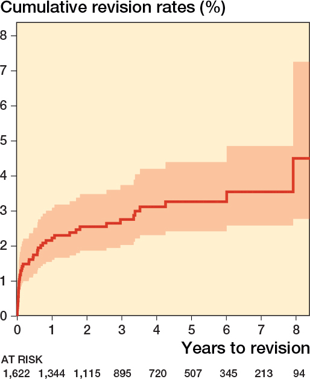
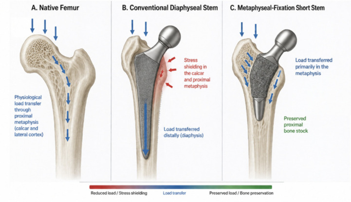
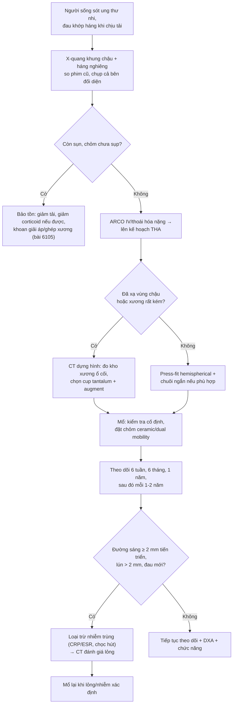
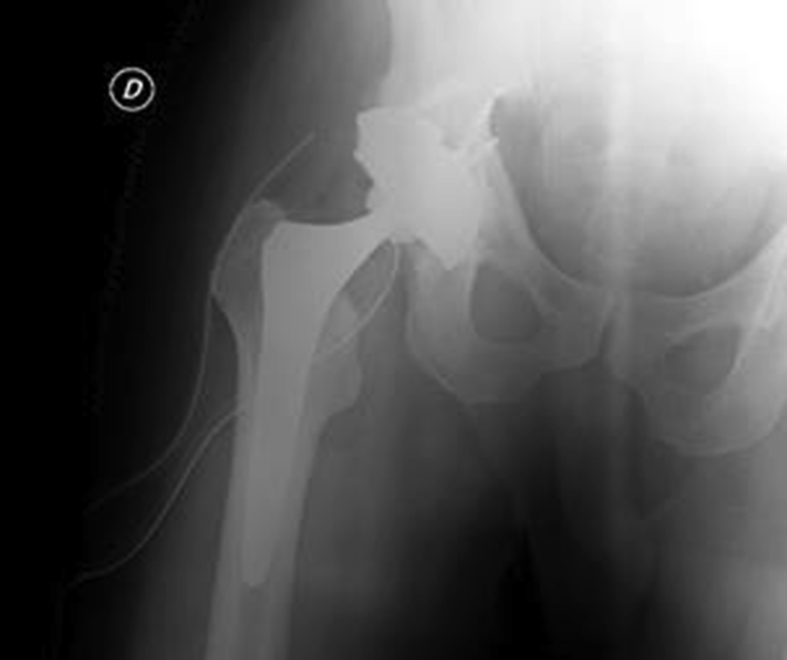

# 6107 — Thay khớp háng ở người sống sót ung thư nhi: chọn implant, ngưỡng lỏng khớp & lịch theo dõi / Total hip arthroplasty in childhood cancer survivors

**Tags:** `pattern:thay-khop` `pattern:long-khop` `pattern:hoai-tu-chom-dui` `vung:khop-hang` `vung:co-xuong` `score:ARCO` `score:DeLee-Charnley` `protocol:X-quang-khop-hang` `protocol:CT-khop-hang`
**Mức chắc chắn (certainty):** tổng hợp y văn (literature synthesis) — ghép dữ liệu sổ đăng ký khớp háng Đức (Elliott J et al., Acta Orthop 2026, PMC12766173; Zellner AA et al., Arthroplasty 2026, PMC13445652), đoàn hệ THA ở trẻ ≤ 16 tuổi (Van de Velde SK et al., J Child Orthop 2017;11:428, PMC5725768), tổng quan chọn implant bảo tồn xương (Perulli R et al., J Clin Med 2026;15:5894, PMC13467515), phân tích gộp stem ngắn (Jiang Y et al., BMC Musculoskelet Disord 2026, PMC13640355), kết quả cup tantalum trên xương đã xạ (De Paolis M et al., Acta Orthop Traumatol Turc 2019, PMC6599415) và chức năng dài hạn của người sống sót có hoại tử xương (DeFeo BM et al., Phys Ther 2020, PMC7246066).

> **Điểm chốt của bài:** người sống sót ung thư nhi cần THA thường **còn 40–60 năm tuổi thọ khớp**, nên câu hỏi không phải "có mổ được không" mà là **"implant nào để lần mổ thứ hai vẫn còn xương"**. Sổ đăng ký Đức (1.622 THA ở tuổi ≤ 30) cho thấy **99% dùng chuôi không cement, 97% chỏm ceramic, nguy cơ mổ lại tích lũy 8 năm chỉ 4,6% (KTC 95% 2,8–7,3)** — nhưng **bệnh háng nhi (Perthes, cắt xương chậu) làm tăng nguy cơ mổ lại 2,8–4,3 lần**. Vì vậy: **bảo tồn xương là ưu tiên số một**, **và mọi đau khớp sau mổ phải loại trừ nhiễm trùng trước khi gọi là "lỏng khớp"**.

## 1. Tổng quan — vì sao người sống sót ung thư nhi là nhóm "khớp háng khó"

- **Ai cần mổ:** (1) **hoại tử chỏm xương đùi (ON) giai đoạn ARCO IV** sau corticoid/ALL — trong số ON nặng, **67% phải thay khớp** và **20% còn đau mạn**; (2) **thoái hóa thứ phát sau xạ trị vùng chậu**; (3) di chứng **bệnh háng nhi** (Perthes, DDH, trượt đầu xương đùi) đã phẫu thuật; (4) **sau cắt u xương/limb salvage** vùng đầu trên xương đùi.
- **Vì sao khó hơn người già — 4 lý do cơ học/sinh học:**
  1. **Xương đã xạ (irradiated bone)** — bộ ba **giảm tế bào, giảm mạch máu, giảm oxy (hypocellular – hypovascular – hypoxic)**: xương không tích hợp được với bề mặt implant, **nguy cơ lỏng và nhiễm trùng cao hơn**, và xương quanh khớp **đặc xương, giòn**.
  2. **Xương đã hóa trị + corticoid** — giảm mật độ xương, mỏng vỏ, **dễ lún (subsidence) và gãy quanh chuôi**.
  3. **Còn 40–60 năm tuổi thọ** — nguy cơ **mổ lại suốt đời tới ~35%** ở người trẻ hoạt động mạnh (Perulli 2026, PMC13467515); mỗi lần mổ lại **mất thêm xương**.
  4. **Mô mềm quanh khớp yếu** sau mổ u/xạ → **trật khớp** và **yếu cơ dạng háng**.
- **Vì sao hình ảnh trông như vậy (vật lý + cơ sinh):**
  - **Stress shielding (bảo vệ ứng suất — định luật Wolff):** chuôi cứng chạy dài trong ống tủy **lấy hết lực** → xương hành xương phía trên **teo dần** (mỏng vỏ, giảm mật độ trên X-quang vùng Gruen 1 và 7). Chuôi **ngắn cố định ở hành xương** truyền lực sát cổ xương đùi hơn → **giữ mật độ xương hành xương** (phân tích gộp 6 RCT, 398 bệnh nhân: **SMD 0,59 tại vùng Gruen 1 lúc 12 tháng**, p = 0,002) (PMC13640355).
  - **Lỏng vô khuẩn (aseptic loosening):** hạt mài mòn (polyethylene, kim loại) → đại thực bào tiết cytokine → **tiêu xương quanh implant** → **đường sáng (radiolucent line) tiến triển ≥ 2 mm** và **lún chuôi > 2 mm** trên X-quang.
  - **Đặc xương do xạ** làm **mất tương phản** giữa xương và implant trên phim → khó đọc đường sáng; cần **so phim nền** và **CT khi nghi ngờ**.
- **Ngưỡng định lượng của nhóm trẻ (sổ đăng ký Đức, 2013–2023):**
  - **1.622 THA / 1.452 bệnh nhân ≤ 30 tuổi**, tuổi trung bình **26 (11–30)**, 56% nam; chẩn đoán: **thoái hóa thứ phát 72%**, **ON 22%**, **loạn sản háng 3,2%**.
  - **99% không cement**, **97% chỏm ceramic**; theo dõi trung bình **3,7 năm**; **47 ca mổ lại**; **nguy cơ mổ lại tích lũy 8 năm 4,6% (2,8–7,3)**; nguyên nhân mổ lại hay gặp nhất là **nhiễm trùng 11 ca (0,7%)**.
  - **Yếu tố nguy cơ mổ lại:** **Perthes đã mổ HR 4,3 (1,9–9,6)**, **cắt xương chậu HR 2,8 (1,1–7,5)**, **loạn sản háng HR 3,4 (1,3–8,5)** (PMC12766173).
  - **THA ở trẻ ≤ 16 tuổi:** 24 khớp (18 trẻ), tuổi trung bình **14,6 (11–16)**, không cement, theo dõi **3,8 năm (1–8)**: **không ca mổ lại, không đường sáng, không mòn** — nhưng tác giả nhấn mạnh **chưa đủ dài để nói về tuổi thọ implant** (PMC5725768).
  - **Xương đã xạ:** 12 THA trên nền xạ trị (liều trung bình **5.500 cGy**, 3.000–13.600), cup tantalum, theo dõi **68 tháng (38–136)**: **không ca nào mổ lại vì lỏng vô khuẩn**, 1 ca **lỏng nhiễm khuẩn**, 2 ca **trật khớp** điều trị bảo tồn, **Harris hip score 46 → 85,3** (PMC6599415).
  - **Chức năng dài hạn:** người sống sót có ON (n = 135) so với không ON (n = 1.560): **sức gấp mu cổ chân 16,50 vs 24,17 N·m/kg**, **Timed Up & Go 5,66 vs 5,12 giây**; nhóm **ON háng đã mổ là nhóm yếu nhất** (13,75 N·m/kg; đi bộ 6 phút **523,5 vs 572,1 m**) (PMC7246066).

## 2. Mẫu hình + chẩn đoán phân biệt theo vị trí (Gamut)

- **Mẫu hình A — chỏm xương đùi sụp/dẹp, khớp háng đau khi chịu tải (ARCO IV):** ON do corticoid (nhóm chính), ON sau ghép tế bào gốc, ON do rượu/idopathic — hình ảnh chốt là **mất hình cầu chỏm, hẹp khe khớp, đặc xương dưới sụn**.
- **Mẫu hình B — khớp háng thoái hóa sau xạ trị vùng chậu:** hẹp khe khớp không đều, **đặc xương ổ cối trên**, có thể **gãy cổ xương đùi do xạ**; khác ON ở chỗ **tổn thương cả hai mặt khớp** và **tiền sử xạ trong trường chiếu**.
- **Mẫu hình C — đau sau THA ở người sống sót:** theo thứ tự cần loại trừ **nhiễm trùng (PJI) → lỏng vô khuẩn → trật/không vững → gãy quanh implant → ARMD/pseudotumor (nếu metal-on-metal) → đau quy chiếu cột sống**.
- **Mẫu hình D — khối quanh implant:** **u tái phát/di căn** (ung thư nhi), **pseudotumor do MoM**, **tụ máu/thoát dịch bạch mạch** — cần MRI có thuật toán giảm kim loại (MAVRIC/WARP) hoặc CT.
- **Gamut theo cơ chế:** **cơ học (lỏng, gãy, trật)** vs **nhiễm trùng** vs **sinh học (ARMD, phản ứng mô mềm)** vs **ung thư** — mỗi nhóm quyết định **mổ lại hay không** khác nhau.
- **Mnemonic "PAIN HIP":** **P**eri-prosthetic infection · **A**septic loosening · **I**nstability/dislocation · **N**europathic/spine referral · **H**eterotopic ossification · **I**mplant failure (fracture/ARMD) · **P**ersistence of tumor.

## 3. Bảng so sánh phân biệt (ma trận đối chiếu)

| Thực thể (entity) | Hình ảnh điển hình | Chốt vào (rule-in) | Chốt loại (rule-out) | Gợi ý xác nhận |
|---|---|---|---|---|
| **Lỏng vô khuẩn (aseptic loosening)** | **Đường sáng tiến triển ≥ 2 mm** quanh cup/chuôi (DeLee–Charnley / Gruen), **lún chuôi > 2 mm**, thay đổi vị trí cup | **Đường sáng TIẾN TRIỂN so phim nền + lún + đau khi chịu tải** | Đường sáng **không đổi nhiều năm**, CRP/ESR bình thường → theo dõi | X-quang lặp 6–12 tháng, so cùng tư thế; CT khi khó |
| **Nhiễm trùng quanh implant (PJI)** | Có thể **bình thường trên phim sớm**; tiêu xương quanh implant, phản ứng màng xương, khí mô mềm (muộn) | **Đau + CRP/ESR tăng + dịch khớp đục/mủ**, **1–2 mẫu cấy cùng loại vi khuẩn**, lỗ rò | CRP/ESR bình thường + dịch trong + không lỗ rò → ít nghĩ PJI | **Chọc hút khớp trước kháng sinh 2 tuần**; cấy + tế bào học; alpha-defensin |
| **Trật/không vững khớp** | Chỏm **ra khỏi cup**, lệch trục chuôi; đo **góc nghiêng cup 40 ± 10°**, **anteversion 15 ± 10°** | **Trật tái diễn + cup sai vị trí/yếu cơ dạng** | Cup đúng vị trí + cơ dạng tốt + không trật → loại | X-quang 2 bình diện; CT đo anteversion |
| **Gãy quanh implant (periprosthetic fracture)** | Đường gãy quanh chuôi/cup, **phân loại Vancouver (A/B/C)**, có/không lỏng | **Gãy + đau đột ngột + không tải được** | Không đường gãy, chỉ mỏng vỏ do stress shielding → không phải gãy | X-quang + CT; đánh giá lỏng chuôi |
| **ARMD/pseudotumor (metal-on-metal)** | **Khối mô mềm quanh khớp**, dịch, phá xương, **nang giả**; kim loại trong máu tăng | **Tiền sử MoM + khối/dịch quanh khớp + ion Co/Cr tăng** | Không MoM, không khối → loại | MRI MAVRIC, siêu âm; ion cobalt/chromium |
| **Cốt hóa lạc chỗ (heterotopic ossification)** | **Đám đặc xương ngoài khớp**, phân độ **Brooker I–IV** | **Xương lạc chỗ Brooker ≥ II + hạn chế vận động** | Không đám đặc xương ngoài khớp → loại | X-quang 3–6 tháng sau mổ; CT |
| **U tái phát/di căn quanh implant** | **Khối mô mềm bắt thuốc**, tiêu xương bờ không rõ, **không tôn trọng ranh giới implant** | **Tiền sử ung thư + khối mô mềm + tiêu xương tiến triển** | Không khối mô mềm, tổn thương chỉ quanh interface → cơ học | MRI/CT có cản quang, PET-CT, sinh thiết |
| **Đau quy chiếu cột sống/thần kinh** | Khớp háng **bình thường**, đau lan theo dermatome, nghiệm pháp cột sống dương | **Đau không liên quan tải khớp + hình ảnh khớp sạch + đáp ứng block** | Hình ảnh khớp có bất thường tương ứng điểm đau → không quy chiếu | MRI cột sống thắt lưng, block chẩn đoán |

*Kaplan–Meier từ sổ đăng ký khớp háng Đức: **1.622 THA ở tuổi ≤ 30**, nguy cơ mổ lại tích lũy **4,6% (KTC 95% 2,8–7,3) ở 8 năm**; số khớp còn theo dõi giảm từ 1.622 xuống **94 ở năm thứ 8** (bảng at-risk). Nguồn: Elliott J, Wu Y, Steinbrück A, Grimberg AW. Acta Orthop 2026 (PMC12766173, Fig. 2), CC BY 4.0.*

### Ba câu phải trả lời trước khi chọn implant
- **Xương còn bao nhiêu?** (chất lượng hành xương, đã xạ chưa, có lỏng cũ, có biến dạng giải phẫu) → quyết định **chuôi ngắn/bảo tồn vs chuôi tiêu chuẩn vs có cement**.
- **Còn bao nhiêu năm?** (tuổi, dự kiến sống) → **ưu tiên khả năng mổ lại**, không chỉ tuổi thọ implant.
- **Cơ dạng và mô mềm thế nào?** (sau cắt u vùng chậu, sau xạ) → quyết định **chỏm lớn/dual mobility**.

## 4. Protocol chụp + chọn implant + lịch theo dõi

### 4.1 Trước mổ
- **X-quang khung chậu thẳng + háng nghiêng**, **có vật chuẩn tỉ lệ**; **chụp cả bên đối diện** để so và phát hiện ON đối bên (ON đa ổ **70–85%** ở trẻ — bài 6105).
- **CT khung chậu có dựng hình** khi: đã xạ vùng chậu, có implant cũ, biến dạng ổ cối, cần đánh giá **kho xương ổ cối** và **anteversion**.
- **Templating** trên phim chuẩn tỉ lệ; **đo offset và chênh chiều dài chân** trước mổ (người sống sót thường đã có lệch chiều dài do bệnh nền).
- **Loại trừ nhiễm trùng trước mổ:** CRP, ESR, bạch cầu; chọc hút khớp nếu từng mổ/tiêm; **ngừng kháng sinh ≥ 2 tuần trước cấy**.

### 4.2 Chọn implant theo chất lượng xương (bảng quyết định)

| Tình huống | Cup | Chuôi | Chỏm | Lý do |
|---|---|---|---|---|
| **ON ARCO IV, xương tốt, < 30 tuổi** | Press-fit hemispherical, không cement | **Ngắn, cố định hành xương** (nếu giải phẫu phù hợp) | **Ceramic ≥ 32 mm** | Giữ xương hành xương cho lần mổ sau; ceramic giảm mài mòn |
| **Xương đã xạ, ổ cối đặc/giòn** | **Cup tantalum + augment ± vít**, có thể cần cup revision | Không cement có rãnh xử lý, hoặc **có cement** nếu xương rất kém | Ceramic/dual mobility | Tantalum tích hợp xương xốp tốt: 12 ca xạ trị **không lỏng vô khuẩn** (PMC6599415) |
| **Cơ dạng yếu/đã cắt u vùng chậu** | Cup tiêu chuẩn ± **dual mobility** | Tùy xương | **Dual mobility** hoặc chỏm ≥ 36 mm | Giảm trật khớp khi cơ dạng mất chức năng |
| **Trẻ ≤ 16 tuổi, còn lớn** | Không cement | **Ngắn/tiêu chuẩn tùy kích thước** | Ceramic | 24 khớp ≤ 16 tuổi: **không mổ lại ở 3,8 năm**, nhưng **chưa đủ dài** (PMC5725768) |
| **Xương rất kém, không thể cố định không cement** | Có cement (XPE) | **Có cement** | Ceramic | Ở ≥ 75 tuổi cup cemented XPE tương đương; < 75 tuổi press-fit ưu thế (PMC13445652) |

- **Bằng chứng cần nói rõ với gia đình:** chuôi ngắn **giữ mật độ xương tốt hơn trong 1 năm đầu** (SMD 0,59 vùng Gruen 1) nhưng **chưa chứng minh giảm tỷ lệ mổ lại** — đây là **điểm thay thế (surrogate endpoint)** (PMC13640355). Không hứa "implant này không bao giờ phải mổ lại".

### 4.3 Theo dõi sau mổ — ngưỡng hành động
- **Mốc chụp:** **6 tuần** (nền) → **6 tháng** → **1 năm** → **mỗi 1–2 năm**; chụp thêm **ngay khi đau mới** hoặc sau chấn thương.
- **Đo và ghi mỗi lần:** góc nghiêng cup (**mục tiêu 40 ± 10°**), anteversion (**15 ± 10°**), lún chuôi, **chiều dài chân**, đường sáng theo **DeLee–Charnley (I–III)** và **Gruen (1–7)**.
- **Ngưỡng nghi lỏng:** **đường sáng tiến triển ≥ 2 mm** hoặc **liên tục quanh toàn chu vi**, **lún > 2 mm**, **di lệch cup > 2°** so phim nền → **CT ± chọc hút** trước khi mổ lại.
- **Ngưỡng nghi nhiễm:** **CRP/ESR tăng** không giải thích + đau + dịch khớp đục; **cấy 1–2 mẫu** trước kháng sinh.
- **Tầm soát dài hạn ở người sống sót:** đánh giá **mật độ xương (DXA)**, **chức năng cơ (gấp mu cổ chân, Timed Up & Go)**, và **biến chứng muộn của điều trị ung thư** (xạ, anthracycline) — nhóm ON háng đã mổ là nhóm yếu nhất (PMC7246066).

*So sánh ba cấu hình: **A. xương đùi tự nhiên** (lực truyền qua hành xương và vỏ bên); **B. chuôi dài tiêu chuẩn** — lực dồn xuống **thân xương (diaphysis)**, gây **stress shielding** ở hành xương (mũi tên đỏ); **C. chuôi ngắn cố định hành xương** — lực truyền chủ yếu ở **hành xương**, **giữ kho xương gần**. Nguồn: Perulli R, Graci C, Vitiello R, et al. J Clin Med 2026;15:5894 (PMC13467515, Fig. 1), CC BY 4.0.*

## 5. Biến thể bình thường & cạm bẫy

- **Cạm bẫy 1 — đọc mọi đường sáng là "lỏng".** Đường sáng **< 2 mm, không tiến triển, không triệu chứng** quanh cup không cement là **bình thường** (lớp xơ lành). Chỉ **tiến triển/liên tục/≥ 2 mm** mới nghi lỏng.
- **Cạm bẫy 2 — bỏ qua nhiễm trùng vì phim "sạch".** PJI **mạn** có thể **không có dấu hiệu X-quang** trong nhiều tháng; **CRP/ESR + chọc hút** là bắt buộc trước khi mổ lại vì "lỏng".
- **Cạm bẫy 3 — quy đau đùi cho chuôi.** Đau mặt trước đùi sau THA không cement hay do **vi chuyển động của chuôi** hoặc **tendinopathy**, không chỉ do lỏng; so phim nền và đánh giá **đau khi khởi động/chịu tải**.
- **Cạm bẫy 4 — đặc xương do xạ làm mất tương phản.** Trên xương đã xạ, **đường sáng khó thấy**; cần **so phim cùng tư thế, cùng kV**, hoặc **CT có thuật toán giảm kim loại**.
- **Cạm bẫy 5 — stress shielding sinh lý.** Mỏng vỏ hành xương tiến triển chậm **không kèm đau, không đường sáng** là **đáp ứng sinh lý** — đừng mổ lại; nhưng nếu **kèm lún/đau**, đó là **dấu hiệu thất bại cố định**.
- **Cạm bẫy 6 — chênh chiều dài chân có sẵn từ trước.** Người sống sót có thể đã lệch **do bệnh nền/u/xạ**; đo và ghi **trước mổ** để không quy oan cho phẫu thuật.
- **Cạm bẫy 7 — bỏ sót ON đối bên.** ON ở trẻ **đa ổ 70–85%**; đau háng bên mổ xong có thể là **ON bên chưa mổ** — chụp cả khung chậu, không chỉ khớp đau.
- **Cạm bẫy 8 — mổ quá sớm khi còn bảo tồn được.** ARCO I–III có thể **giữ khớp** (khoan giải áp/ghép xương); đặt implant ở ARCO II–III làm **mất cơ hội bảo tồn** và tăng số lần mổ lại (bài 6105).

*Cùng ca với Hình 1 (khung chậu sau xạ): THA với **cup revision tantalum, augment và 4 vít** cố định vào xương ổ cối đã xạ/đặc. Trong loạt 12 THA trên xương đã xạ (liều trung bình 5.500 cGy), **không ca nào mổ lại vì lỏng vô khuẩn** ở 68 tháng. Nguồn: De Paolis M, Zucchini R, Romagnoli C, et al. Acta Orthop Traumatol Turc 2019 (PMC6599415, Fig. 2), CC BY-NC-ND 4.0 — nguyên bản, không chỉnh sửa.*

## 6. Tự lượng giá — Blind Quiz

**Ca 1 — Nữ 25 tuổi, sống sót sarcoma xương chậu đã xạ 55 Gy, đau háng 2 năm, X-quang: hẹp khe khớp và đặc xương ổ cối. Phim sau mổ:**

- Hỏi: vì sao chọn **cup tantalum + augment + vít** thay vì cup press-fit thường? Nguy cơ chính cần theo dõi là gì?

<b>Bấm để hiện đáp án (findings + chẩn đoán)</b>

- **Findings:** ổ cối đặc xương do xạ, kho xương kém; cup được cố định bằng **tantalum (trabecular metal) + augment + 4 vít**.
- **Lý do:** xương đã xạ **giảm tế bào/mạch máu**, khó liền xương; tantalum có **ma sát cao và cấu trúc xốp** giúp tích hợp vào xương xốp còn lại — loạt 12 ca xạ trị **không lỏng vô khuẩn** ở 68 tháng.
- **Theo dõi:** đường sáng quanh cup (DeLee–Charnley), **trật khớp** (2/12 ca trong loạt), **nhiễm trùng** (1/12 ca lỏng nhiễm khuẩn) — và **tái phát u** vì nền ung thư.
- Nguồn: De Paolis M et al., Acta Orthop Traumatol Turc 2019 (PMC6599415), CC BY-NC-ND 4.0.

**Ca 2 — Nam 24 tuổi, ON chỏm xương đùi hai bên sau ALL, đã THA không cement bên phải 2 năm, đau háng phải tăng dần. Bảng sống còn dưới đây là dữ liệu sổ đăng ký cho nhóm tuổi này.**

- Hỏi: nguy cơ mổ lại 8 năm là bao nhiêu? Ba yếu tố nào làm nguy cơ này tăng mạnh? Bước tiếp theo trên bệnh nhân đang đau?

<b>Bấm để hiện đáp án (findings + chẩn đoán)</b>

- **Nguy cơ mổ lại tích lũy 8 năm: 4,6% (KTC 95% 2,8–7,3)** — thấp hơn nhiều so với lo ngại "mổ ở tuổi 20 sẽ hỏng ngay".
- **Ba yếu tố tăng nguy cơ:** **Perthes đã phẫu thuật (HR 4,3)**, **cắt xương chậu (HR 2,8)**, **loạn sản háng (HR 3,4)**; nhiễm trùng là nguyên nhân mổ lại hay gặp nhất (**0,7%**).
- **Bước tiếp theo:** **loại trừ nhiễm trùng trước** (CRP/ESR, chọc hút khớp nếu nghi), so **phim nền** tìm **đường sáng ≥ 2 mm/lún > 2 mm**, rồi **CT** nếu phim không kết luận; **chụp cả háng trái** vì ON đa ổ.
- Nguồn: Elliott J et al., Acta Orthop 2026 (PMC12766173), CC BY 4.0.

**Ca 3 — Bệnh nhân 18 tuổi, ON ARCO IV một bên, xương hành xương còn tốt, hoạt động thể thao, dự kiến sống > 60 năm. Chọn chuôi nào?**

- Hỏi: chuôi ngắn giữ được gì, và **bằng chứng đến đâu**? Có nên hứa "chuôi ngắn ít phải mổ lại hơn"?

<b>Bấm để hiện đáp án (findings + chẩn đoán)</b>

- **Giữ được:** lực truyền qua **hành xương**, giảm **stress shielding** ở vùng Gruen 1 — phân tích gộp 6 RCT (398 bệnh nhân): **SMD 0,59 lúc 12 tháng** (p = 0,002), vùng Gruen 7 tại 6 tháng **SMD 0,65**.
- **Giới hạn bằng chứng:** mật độ xương là **điểm thay thế**; **chưa chứng minh giảm lỏng/mổ lại** trong dữ liệu sổ đăng ký quy mô lớn. Không hứa "ít phải mổ lại hơn".
- **Chọn hợp lý:** chuôi ngắn **nếu giải phẫu hành xương phù hợp** và phẫu thuật viên có kinh nghiệm; nếu xương hành xương kém/đã xạ → cân nhắc chuôi tiêu chuẩn hoặc có cement.
- Nguồn: Perulli R et al., J Clin Med 2026 (PMC13467515), CC BY 4.0; Jiang Y et al., BMC Musculoskelet Disord 2026 (PMC13640355), CC BY-NC-ND 4.0 (số liệu).

## Bài liên quan chéo
- [6105 – Hoại tử xương ở trẻ điều trị ALL](../6105-hoai-tu-xuong-o-tre-dieu-tri-ALL/lesson.md) (ARCO I–IV, ngưỡng > 30% diện tích, khi nào chuyển THA)
- [361 – MRI khớp háng: AVN, ARCO/Ficat, FAI](../361-khop-hang/lesson.md) (đọc ổ chỏm xương đùi trên MRI)
- [640 – Khớp háng nhi: DDH, Perthes, SCFE](../640-khop-hang-nhi-DDH-Perthes-SCFE-va-NAT/lesson.md) (bệnh háng nhi — yếu tố nguy cơ mổ lại cao nhất)
- [300 – Tổng quan Hệ Cơ – Xương – Khớp](../300-tong-quan-he-co-xuong-khop/lesson.md) (học thuyết vùng chuyển tiếp, tín hiệu tủy)
- [178 – Di căn xương RCC & biến chứng cơ học](../178-di-can-xuong-RCC-bien-chung-co-hoc/lesson.md) (implant trong xương bệnh lý — đối chiếu)

> Không dùng để chẩn đoán độc lập khi chưa có người hướng dẫn.
