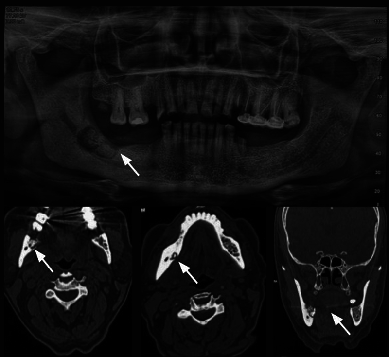
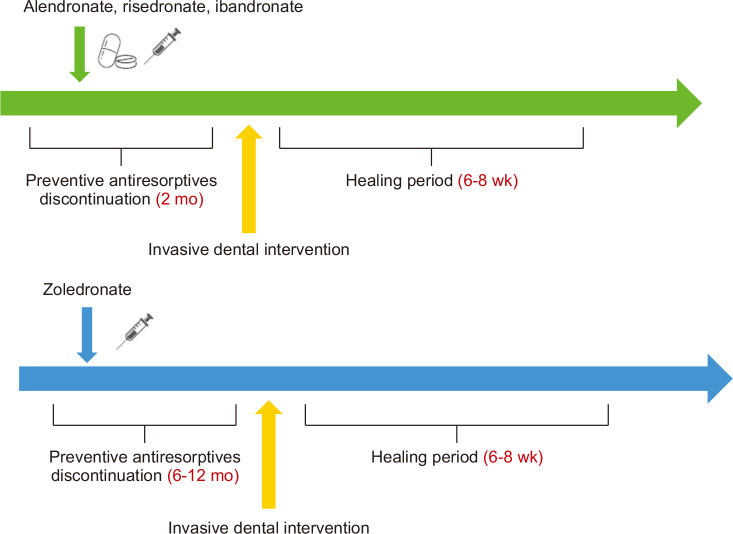
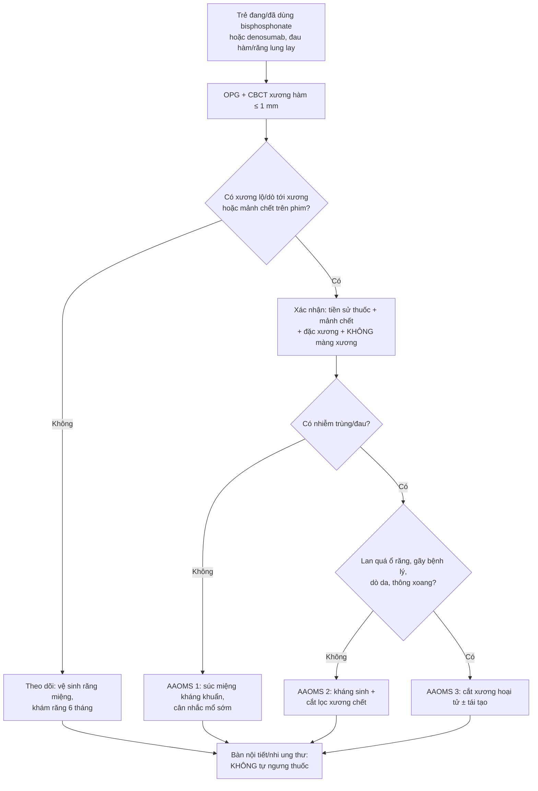
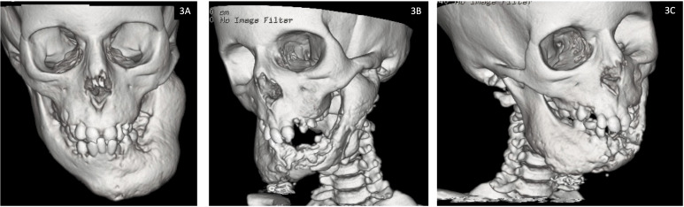
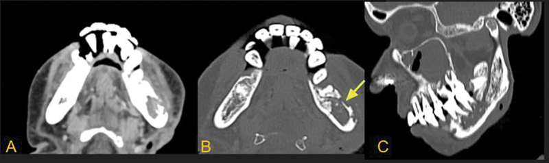

# 6108 — Hoại tử xương hàm do thuốc (MRONJ) ở trẻ: mảnh xương chết trên CBCT/CT, phân độ AAOMS & ngưỡng ngưng thuốc / Medication-related osteonecrosis of the jaw in children

**Tags:** `pattern:hoai-tu-xuong-ham` `pattern:sequestrum` `pattern:mat-xuong` `vung:xuong-ham` `vung:ham-duoi` `score:AAOMS` `protocol:CBCT` `protocol:CT-xuong-ham` `protocol:MRI-xuong-ham` `incidentaloma:mat-xuong-ham`
**Mức chắc chắn (certainty):** tổng hợp y văn (literature synthesis) — ghép định nghĩa/phân độ AAOMS 2022 qua đồng thuận Hàn Quốc 2025 (Kim JW et al., JKAOMS 2025;51:333, PMC12766015) và châu Á–Thái Bình Dương 2026 (Taguchi A et al., Osteoporos Sarcopenia 2026, PMC13069298) với số liệu nhi khoa (tổng quan hệ thống 1.284 trẻ, J Oral Maxillofac Surg 2026;84(4), PMID 41344384; đoàn hệ 178 trẻ, J Oral Maxillofac Surg 2024, PMID 38950582), hình ảnh hàm (Justine D et al., Indian J Radiol Imaging 2025, PMC12169932) và ca ONJ tiến triển ở trẻ (Pieridou C et al., Front Endocrinol 2023;14:1258340, PMC10619726).

> **Điểm chốt của bài:** MRONJ ở trẻ **cực hiếm** — **1 ca trong 1.284 trẻ** dùng thuốc kháng tiêu xương, và **0/178** trẻ trong một đoàn hệ 16 năm; ca duy nhất được báo cáo **chưa xuất hiện trước khi mọc răng vĩnh viễn**. Vì vậy khi thấy **hoại tử xương hàm ở trẻ KHÔNG có tiền sử bisphosphonate/denosumab**, phải nghĩ **bệnh xương cứng di truyền, viêm xương tủy, LCH hay u ác** — không được dán nhãn MRONJ. Ngược lại, trẻ **đang** dùng thuốc mà có **mảnh xương chết + đặc xương quanh ổ tiêu** trên CBCT/CT, **không phản ứng màng xương**, thì chốt là MRONJ và phân độ AAOMS quyết định **mổ sớm hay bảo tồn**.

## 1. Tổng quan — vì sao thuốc kháng tiêu xương làm xương hàm chết, và vì sao trẻ khác người lớn

- **Cơ chế (pathophysiology):** bisphosphonate gắn vào hydroxyapatite, bị **nhập bào bởi osteoclast** → ức chế men farnesyl pyrophosphate synthase → osteoclast **ngừng hoạt động và chết theo chương trình**. Denosumab là kháng thể **anti-RANKL**, chặn trục RANK–RANKL → **ngừng biệt hóa và sống sót của osteoclast**. Hệ quả chung: **tái tạo xương giảm mạnh, vi tổn thương tích lũy, không sửa chữa được**, kèm tác động **kháng tạo mạch** khi phối hợp thuốc ức chế VEGF → vùng xương **thiếu máu, hoại tử, không tự thải**.
- **Vì sao đúng xương hàm:** hàm là xương **duy nhất xuyên qua niêm mạc** (ổ răng, túi nha chu, ống tuỷ răng) nên **nhiễm khuẩn khu trú** luôn sẵn; xương hàm **tái tạo rất nhanh** (ổ răng lành thường 6–8 tuần) nên **càng phụ thuộc osteoclast**; niêm mạc mỏng, dễ rách khi nhai/nhổ răng → **cửa vào vi khuẩn**. Ba yếu tố này giải thích vì sao **cùng một thuốc** lại gây hoại tử ở hàm chứ không ở xương đùi.
- **Vì sao hình ảnh trông như vậy (vật lý + mô bệnh):**
  - **Xương chết giữ nguyên khoáng chất** nhưng **mất tủy xương và mạch máu** → trên CT **đậm (đặc xương, thường > 500 HU; xương vỏ 700–1.500 HU, xương xốp 150–400 HU)**, không có tăng sinh mạch; quanh nó là **mô hạt viêm tái tạo** → **viền tiêu xương (radiolucent halo)**. Bộ đôi **"mảnh xương chết đậm + viền sáng"** chính là dấu chốt.
  - **MRI:** xương chết **mất tín hiệu mỡ tủy** → **T1 thấp**; **không có nước tự do** → **T2/STIR thấp** (khác phù tủy do viêm, STIR rất sáng); **không ngấm thuốc** ở trung tâm, chỉ **viền mô hạt ngấm** quanh mảnh chết.
  - **Không có phản ứng màng xương** (khác viêm xương tủy): màng xương cần **mạch máu và màng xương còn sống** — trong MRONJ cả hai đã mất. Đây là dấu **loại trừ** quan trọng nhất trên phim (Justine 2025, PMC12169932).
- **Ngưỡng định lượng phải nhớ (người lớn, dùng làm mốc so sánh):**
  - Liều thấp (loãng xương): **0,025–0,136%/năm**, tương đương **21–283 ca/100.000 người-năm**; bằng chứng cho **"ngưng thuốc trước nhổ răng"** vẫn **chưa đủ** (đồng thuận châu Á–Thái Bình Dương 2026, PMC13069298).
  - Nguy cơ **tăng dần theo thời gian dùng, đặc biệt sau 12 tháng**, và **tăng vọt** với **zoledronate tĩnh mạch liều cao** hoặc **denosumab 120 mg/tháng** (chỉ định ung thư) (đồng thuận Hàn Quốc 2025, PMC12766015).
- **Số liệu NHI KHOA (phần quyết định cách đọc phim):**
  - Tổng quan hệ thống 6 nghiên cứu, **1.284 trẻ** dùng bisphosphonate/denosumab: **chỉ 1 ca MRONJ**; thời gian phơi nhiễm trung vị **4,6 năm** (IQR 2,3–6,3); yếu tố nguy cơ nêu được là **dùng bisphosphonate dài hạn + vệ sinh răng miệng kém**; ca duy nhất **không xuất hiện trước khi mọc răng vĩnh viễn** (PMID 41344384).
  - Đoàn hệ **178 trẻ** (tuổi trung bình **11,7 ± 6,1**), 164 dùng bisphosphonate (92,1%) và 14 dùng denosumab (7,9%): **0 ca ONJ**; denosumab gây **tăng canxi máu/đau xương nặng 28,6% vs 1,2%** so với bisphosphonate → nhóm tác giả **khuyến nghị bisphosphonate là lựa chọn đầu tay ở trẻ** (PMID 38950582).
  - Ở **trẻ loãng xương/osteogenesis imperfecta**, tài liệu ghi **chưa có ca MRONJ nào dù liều tích lũy cao hơn người lớn**; liều tĩnh mạch hay dùng: **pamidronate 0,5–1 mg/kg/ngày × 3 ngày** mỗi **6–8 tuần đến 3–4 tháng**; **zoledronate 0,02 mg/kg (< 2 tuổi) / 0,035 (2–5 tuổi) / 0,05 mg/kg (> 5 tuổi)** mỗi **3/4/6 tháng**; duy trì **0,025 mg/kg/năm** (Baroncelli GI et al., J Endocrinol Invest 2026, PMC13498659).
  - Denosumab ở trẻ dùng **70 mg/m²** (5 bệnh nhi 8–17 tuổi, có **chụp hàm kiểm tra trước điều trị**) (Battaglia T et al., Case Rep Pediatr 2025, PMC12695419).

## 2. Mẫu hình + chẩn đoán phân biệt theo vị trí (Gamut)

- **Mẫu hình A — ổ tiêu xương có mảnh chết đậm ở thân/góc hàm dưới, sau ổ răng (hay gặp nhất):** MRONJ, osteoradionecrosis (ORN), viêm xương tủy mạn (Garré), di căn/đa u tủy.
- **Mẫu hình B — đặc xương lan tỏa + dày xương (sclerotic) một bên hàm:** MRONJ thể đặc xương, Garré, loạn sản xơ (fibrous dysplasia), bệnh xương cứng (osteopetrosis/OSMD).
- **Mẫu hình C — tiêu xương "răng lơ lửng" (floating teeth) + khối mô mềm:** u ác (carcinoma xâm nhập, di căn), LCH, đa u tủy — **không có mảnh chết** điển hình, mô mềm **bắt thuốc**.
- **Mẫu hình D — trẻ không dùng thuốc kháng tiêu xương mà hoại tử hàm tiến triển:** bệnh xương cứng di truyền (LRRK1/OSMD), osteopetrosis, viêm xương tủy do vi khuẩn, thiếu máu bất sản/giảm bạch cầu chu kỳ, xạ trị cũ.
- **Gamut theo vị trí:** **hàm dưới 60–70%** (thân/góc hàm, vùng răng cối) > hàm trên; **một bên**, hiếm hai bên; tổn thương **bắt đầu từ ổ răng** hoặc **niêm mạc lợi**.
- **Mnemonic "JAW BONE":** **J**aw pain/loose teeth (đau hàm, răng lung lay) · **A**ntiresorptive history (tiền sử thuốc) · **W**ell-defined sequestrum (mảnh chết đậm trong ổ tiêu) · **B**one sclerosis quanh ổ · **O**ral fistula/exposed bone · **N**o periosteal reaction · **E**xtent beyond alveolar bone = stage 3.

## 3. Bảng so sánh phân biệt (ma trận đối chiếu)

| Thực thể (entity) | Hình ảnh điển hình (CBCT/CT/MRI) | Chốt vào (rule-in) | Chốt loại (rule-out) | Gợi ý xác nhận |
|---|---|---|---|---|
| **MRONJ** | Ổ tiêu **rõ bờ**, **mảnh xương chết đậm ở trung tâm**, **đặc xương lan tỏa** quanh ổ, **KHÔNG phản ứng màng xương**; MRI: mảnh chết T1/T2 thấp, không ngấm | **Tiền sử bisphosphonate/denosumab + mảnh chết + đặc xương + không màng xương** | Có phản ứng màng xương rõ, phù mô mềm lan, sốt cao → viêm xương tủy; tiền sử xạ → ORN | CBCT/CT xương hàm; MRI T1 + STIR; phân độ AAOMS |
| **Osteoradionecrosis (ORN)** | **Tiêu vỏ xương bờ không rõ**, ưu thế **mặt ngoài (buccal)**, xen lẫn **đậm–sáng**, **không khối mô mềm** | **Tiền sử xạ trị vùng hàm ≥ 60 Gy**, tổn thương **trong trường xạ**, không mảnh chết rõ | Tiền sử thuốc kháng tiêu xương + mảnh chết đậm + đặc xương → MRONJ | So phim xạ trị, mô tả trường chiếu; MRI tìm mô mềm |
| **Viêm xương tủy hàm do vi khuẩn (kể cả Garré)** | **Phản ứng màng xương** (tia, "vỏ hành"), dày xương, phá vỏ, **phù cơ cắn/cơ masseter**, có thể mức khí | **Sốt, sưng đau cấp, phản ứng màng xương + phù mô mềm** | Không màng xương + mảnh chết đậm + đặc xương = MRONJ | CT + CRP/bạch cầu; cấy mủ/xương |
| **ONJ do bệnh xương cứng di truyền (OSMD/LRRK1, osteopetrosis)** | Xương hàm **đặc xương lan tỏa** + hoại tử tiến triển nhiều năm ở trẻ; 3D-CT thấy **mất dần xương hàm** | **Trẻ, không dùng thuốc kháng tiêu xương, đặc xương toàn thân, tiền sử gia đình** | Có tiền sử bisphosphonate/denosumab → MRONJ | Skeletal survey, X-quang xương dài, gen LRRK1 |
| **Langerhans cell histiocytosis (LCH)** | Tiêu xương **bờ đục lỗ (punched-out)**, "răng lơ lửng", có thể phản ứng màng xương; tổn thương da/tiêu xương khác | **Trẻ nhỏ + tiêu xương đa ổ + "floating teeth" + tổn thương ngoài xương** | Xương chết đậm trung tâm + đặc xương quanh = MRONJ | Sinh thiết (CD1a/CD207), PET-CT toàn thân |
| **Di căn/đa u tủy ở hàm** | Tiêu xương **bờ không rõ hoặc bờ rõ**, **không mảnh chết**, mô mềm bắt thuốc, có thể phá vỏ | **Tiền sử ung thư, đa ổ, mô mềm bắt thuốc, không đặc xương quanh** | Có mảnh chết + đặc xương + không mô mềm → MRONJ | MRI có cản quang, sinh thiết, xét nghiệm máu |
| **Nhiễm nấm (mucormycosis)/lao hàm** | Phá xương **lan nhanh**, khí trong mô mềm, phù mặt; lao: tiêu xương + hang | **Sốt, phù mặt nhanh, khí mô mềm (mucor) / ho kéo dài, phản ứng màng xương (lao)** | Không có phù mô mềm nhanh/khí → MRONJ | Soi/cấy nấm, PCR lao, CT mô mềm |
| **Loạn sản xơ (fibrous dysplasia)** | **Kính mờ (ground-glass)**, dày xương, **không đau, không mảnh chết**, bờ chuyển tiếp rộng | **Kính mờ + dày xương + không đau nhiều năm** | Có mảnh chết/viền tiêu/hốc mủ → MRONJ hoặc nhiễm trùng | CT xương hàm; theo dõi |

*Ca 68 tuổi đa u tủy, dùng zoledronic acid 2 năm. **Trên:** OPG — ổ tiêu rõ bờ ở thân hàm dưới phải, **mảnh xương chết đậm ở trung tâm** (mũi tên), đặc xương lan tỏa quanh ổ. **Dưới:** CT xương hàm (axial + coronal) — mảnh chết trong ổ tiêu, **không có phản ứng màng xương**. Nguồn: Justine D, Bhalla AS, Manchanda S, Bhutia O, Roychoudhury A. Indian J Radiol Imaging 2025 (PMC12169932, Fig. 11), CC BY-NC-ND 4.0 — nguyên bản, không chỉnh sửa.*

### Ba dấu hiệu phải đọc thành tiếng
- **Mảnh xương chết (sequestrum):** đậm trên CT, **không ngấm thuốc**, nằm trong ổ sáng — dấu **chốt vào**.
- **Đặc xương quanh ổ (reactive sclerosis):** viền đậm không đều quanh ổ tiêu — phản ứng của xương còn sống, **không phải u**.
- **Vắng phản ứng màng xương:** nếu có **màng xương/tia/vỏ hành**, hãy đổi hướng sang **viêm xương tủy hoặc u**.

## 4. Protocol chụp + phân độ AAOMS + ngưỡng ngưng thuốc

### 4.1 Protocol hình ảnh
- **Bước 1 — OPG (panoramic):** sàng lọc, thấy ổ tiêu, răng lung lay, mảnh chết lớn; **không đủ** để đánh giá vỏ xương và mảnh chết nhỏ.
- **Bước 2 — CBCT hoặc CT xương hàm lát mỏng ≤ 1 mm, cửa sổ xương:** FOV **phủ cả hai hàm + khớp thái dương–hàm**; đánh giá **vỏ ngoài/vỏ trong, sàn xoang, ống răng dưới, mảnh chết, đường rò xương**.
- **Bước 3 — MRI (T1W + STIR ± sau tiêm) khi cần đo lan:** mảnh chết **T1/T2 thấp, không ngấm**; **STIR sáng** ở tủy quanh = viêm còn hoạt tính; giúp phân biệt **phù tủy do viêm vs thâm nhiễm u**.
- **Bước 4 — không sinh thiết thường quy** trong MRONJ điển hình (nguy cơ làm nặng, gieo rắc); **sinh thiết chỉ khi nghi u/LCH/nấm** hoặc tổn thương không điển hình.
- **Trẻ:** ưu tiên **CBCT liều thấp** (ALARA); **không chụp lặp lại nhiều lần** — dùng OPG + CBCT một lần đủ cho phân độ; ghi nhận **mầm răng** (không đọc thành ổ tiêu).

### 4.2 Phân độ AAOMS (qua đồng thuận Hàn Quốc 2025 — bảng gốc)

| Phân độ | Định nghĩa | Xử trí |
|---|---|---|
| **At-risk** | Không có xương lộ/hoại tử, có tiền sử dùng thuốc | Không điều trị; **giáo dục + vệ sinh răng miệng + theo dõi răng định kỳ** |
| **0** | **Không có xương lộ**, nhưng **đau hàm không giải thích, dị cảm, răng lung lay** hoặc **thay đổi trên phim** | Điều trị triệu chứng; **theo dõi sát lâm sàng + hình ảnh** |
| **1** | Xương lộ/hoại tử hoặc **dò thăm được tới xương**, **không nhiễm trùng, không triệu chứng** | Súc miệng kháng khuẩn; theo dõi; **có thể can thiệp mổ sớm** để đạt lành |
| **2** | Xương lộ/hoại tử **có nhiễm trùng** (đỏ, mủ) **và đau** | Kháng sinh + súc miệng; **mổ lấy xương chết/cắt lọc được khuyến cáo mạnh** |
| **3** | Như độ 2 **+ lan quá vùng ổ răng** (bờ dưới hàm, ngành lên, xoang hàm), **gãy bệnh lý, dò ra da, thông miệng–xoang/miệng–mũi** | Kháng sinh + giảm đau; **cắt xương hoại tử ± tái tạo** |

- **Định nghĩa gốc (3 tiêu chuẩn):** (1) đang/đã dùng thuốc kháng tiêu xương đơn thuần hoặc phối hợp thuốc điều hòa miễn dịch/kháng tạo mạch; (2) **xương lộ hoặc dò thăm tới xương > 8 tuần** — nhưng **được chẩn đoán sớm hơn nếu xác nhận hoại tử trên lâm sàng/hình ảnh**; (3) **không có tiền sử xạ trị hàm** và **không có u nguyên phát/di căn ở hàm** (PMC12766015).
- **Ngưỡng "ngưng thuốc" (drug holiday) — khác nhau theo thuốc:**
  - **Bisphosphonate uống:** tạm ngưng **2 tháng** trước thủ thuật xâm lấn (PMC12766015; hình dưới).
  - **Zoledronate tĩnh mạch:** tạm ngưng **6–12 tháng** trước thủ thuật (hình PMC12766015).
  - **Denosumab:** **mổ 3–4 tháng sau mũi tiêm cuối** (tránh nguy cơ **gãy xương dội ngược/rebound** nếu ngưng quá lâu) (PMC12766015).
  - **Thời gian lành sau thủ thuật: 6–8 tuần** trước khi xét làm lành (hình PMC12766015).
  - **Bằng chứng còn yếu:** đồng thuận châu Á–Thái Bình Dương 2026 kết luận **chưa đủ bằng chứng** cho lợi ích ngưng thuốc trước nhổ răng ở nhóm loãng xương (PMC13069298) — phải **cân bằng nguy cơ gãy xương** và bàn với bác sĩ điều trị.
- **Trẻ — khác biệt cốt lõi:** **nguy cơ MRONJ rất thấp** nhưng **nguy cơ ngưng thuốc** (gãy xương, **tăng canxi máu dội ngược sau ngưng denosumab**) lại **cao**; **không tự ngưng** — quyết định phải có **bác sĩ nội tiết/nhi ung thư + phẫu thuật hàm mặt**.

*Sơ đồ ngưng thuốc dự phòng: **bisphosphonate uống** ngưng **2 tháng** trước thủ thuật xâm lấn; **zoledronate** ngưng **6–12 tháng**; sau thủ thuật cần **6–8 tuần** lành trước khi đánh giá. Nguồn: Kim JW, Kong SH, Kim JY, et al. J Korean Assoc Oral Maxillofac Surg 2025;51:333 (PMC12766015, Fig. 1), CC BY-NC 4.0.*

## 5. Biến thể bình thường & cạm bẫy

- **Cạm bẫy 1 — dán nhãn MRONJ cho trẻ không dùng thuốc.** Ca trẻ 12 tuổi bên dưới (OSMD/LRRK1) có hoại tử hàm **tiến triển 5 năm** nhưng **không hề dùng kháng tiêu xương**; nguyên nhân là **xương cứng di truyền**. Hỏi tiền sử thuốc **trước khi** đọc phim.
- **Cạm bẫy 2 — tưởng "không màng xương" là lành tính.** Vắng màng xương **chốt MRONJ**, nhưng **không loại trừ u ác xâm nhập** — nếu có **mô mềm bắt thuốc/răng lơ lửng**, vẫn phải sinh thiết.
- **Cạm bẫy 3 — nhầm ORN với MRONJ.** ORN: **tiền sử xạ**, tổn thương **bờ không rõ, ưu thế mặt ngoài hàm**, **không mảnh chết đậm rõ**. MRONJ: **mảnh chết đậm + đặc xương quanh**, thường **vùng ổ răng sau**.
- **Cạm bẫy 4 — nhầm viêm xương tủy (Garré) với MRONJ.** Garré có **phản ứng màng xương, dày xương, phù cơ cắn** và **sốt/đau cấp**; MRONJ **âm ỉ, không màng xương**.
- **Cạm bẫy 5 — mầm răng ở trẻ.** Nang mầm răng (follicle) là **ổ sáng đều, bờ vỏ mảnh, quanh thân răng chưa mọc** — **không phải ổ tiêu**; đừng đọc thành hoại tử. Ngược lại, **răng vĩnh viễn mọc trong vùng xương chết** là dấu bệnh thật.
- **Cạm bẫy 6 — artifact kim loại.** Trám amalgam/implant gây **vệt sáng–tối (beam hardening)** trên CBCT, có thể **giả "mảnh chết"**; đổi cửa sổ, chụp lại trục khác hoặc dùng CT.
- **Cạm bẫy 7 — độ 0 dễ bị bỏ qua.** **Không có xương lộ** nhưng **đau hàm/dị cảm/răng lung lay** đã là **AAOMS 0** — bỏ qua sẽ tiến triển tới độ 2–3.
- **Cạm bẫy 8 — ngưng thuốc "cho an toàn".** Ở trẻ, ngưng bisphosphonate có thể **gãy xương**, ngưng denosumab có thể **tăng canxi máu nặng**; quyết định **luôn phối hợp**.

*Bệnh nhi (em của ca chỉ điểm) có **loạn sản sụn hành xương đặc (OSMD, đột biến LRRK1)**: **3A** lúc 7 tuổi — mất xương hàm dưới phải; **3B–3C** lúc 12 tuổi — **hoại tử lan rộng hàm dưới và hàm trên**, mất xương tiến triển. **Không dùng bisphosphonate/denosumab** → đây là **ONJ do bệnh xương cứng**, không phải MRONJ. Nguồn: Pieridou C, Sabir A, Lancashire J, et al. Front Endocrinol 2023;14:1258340 (PMC10619726, Fig. 3), CC BY 4.0.*

## 6. Tự lượng giá — Blind Quiz

**Ca 1 — Nam 68 tuổi, đa u tủy, zoledronic acid 2 năm, đau góc hàm phải, có lỗ rò mủ ở lợi. Nhìn OPG + CT, mô tả trước.**

- Hỏi: dấu hiệu chốt trên phim là gì? Có phản ứng màng xương không? Phân độ AAOMS và hướng xử trí?

<b>Bấm để hiện đáp án (findings + chẩn đoán)</b>

- **Findings:** ổ tiêu **rõ bờ** ở thân hàm dưới phải, **mảnh xương chết đậm ở trung tâm**, **đặc xương lan tỏa** quanh ổ; **không có phản ứng màng xương**; có **dò mủ** trên lâm sàng.
- **Chẩn đoán:** **MRONJ độ 2** (xương hoại tử + nhiễm trùng + đau). Mảnh chết đậm + đặc xương quanh + vắng màng xương là bộ ba chốt.
- **Xử trí:** kháng sinh + súc miệng kháng khuẩn; **cắt lọc/lấy xương chết** (can thiệp sớm cho kết cục tốt hơn bảo tồn đơn thuần); bàn với huyết học về thuốc.
- Nguồn: Justine D et al., Indian J Radiol Imaging 2025 (PMC12169932, Fig. 11), CC BY-NC-ND 4.0.

**Ca 2 — Trẻ 12 tuổi, hội chứng xương cứng, không dùng thuốc kháng tiêu xương, mặt biến dạng tăng dần 5 năm. So sánh CT 3D hai thời điểm.**

- Hỏi: có phải MRONJ không? Cần hỏi gì và xét nghiệm gì để chốt nguyên nhân?

<b>Bấm để hiện đáp án (findings + chẩn đoán)</b>

- **Findings:** mất xương hàm dưới phải từ 7 tuổi, đến 12 tuổi **hoại tử lan cả hàm trên và hàm dưới**, **đặc xương toàn thân** (xương sọ, xương dài) trên phim khác.
- **Chẩn đoán:** **ONJ do bệnh xương cứng di truyền (OSMD, LRRK1)** — **KHÔNG phải MRONJ** vì không có tiền sử kháng tiêu xương.
- **Cần làm:** hỏi kỹ **mọi thuốc đã dùng** (kể cả đơn của tuyến trước), skeletal survey, X-quang xương dài, **gen LRRK1**; tầm soát anh chị em (bệnh nhân này là em của ca chỉ điểm).
- Nguồn: Pieridou C et al., Front Endocrinol 2023;14:1258340 (PMC10619726, Fig. 3), CC BY 4.0.

**Ca 3 — Bệnh nhân xạ trị sau mổ u tuyến mang tai 3 năm, đau và chảy mủ vùng góc hàm trái. CT xương hàm:**

- Hỏi: dấu hiệu nào nghiêng về ORN hơn MRONJ? Cần hỏi thêm gì?

<b>Bấm để hiện đáp án (findings + chẩn đoán)</b>

- **Findings:** **tiêu vỏ xương bờ không rõ**, ưu thế **mặt ngoài (buccal)** hàm dưới trái, xen lẫn **đậm–sáng**, **không có khối mô mềm**, **không mảnh chết đậm rõ**.
- **Chẩn đoán:** **osteoradionecrosis (ORN)** sau xạ trị vùng mang tai — chốt bằng **tiền sử xạ + vị trí trong trường chiếu**.
- **Cần hỏi:** tổng liều xạ và trường chiếu, thời gian sau xạ, có dùng bisphosphonate/denosumab không (có thể **phối hợp** cả hai).
- Nguồn: Justine D et al., Indian J Radiol Imaging 2025 (PMC12169932, Fig. 10), CC BY-NC-ND 4.0.

## Bài liên quan chéo
- [6105 – Hoại tử xương ở trẻ điều trị ALL](../6105-hoai-tu-xuong-o-tre-dieu-tri-ALL/lesson.md) (corticoid/bisphosphonate ở trẻ ung thư, phân độ ARCO)
- [370 – Nhiễm trùng cơ xương khớp](../370-nhiem-trung-msk/lesson.md) (viêm xương tủy — hàng DDx sốt/đau xương)
- [233 – Viêm tai ngoài ác tính lan nền sọ](../233-viem-tai-ngoai-ac-tinh-nen-so/lesson.md) (nhiễm trùng xương nền sọ mạn ở người già/đái tháo đường)
- [300 – Tổng quan Hệ Cơ – Xương – Khớp](../300-tong-quan-he-co-xuong-khop/lesson.md) (học thuyết vùng chuyển tiếp, tín hiệu tủy)
- [684 – Tăng triglyceride do asparaginase ở trẻ ALL](../684-tang-triglyceride-asparaginase-all-nhi/lesson.md) (biến chứng thuốc ở trẻ ung thư — đối chiếu cách theo dõi)

> Không dùng để chẩn đoán độc lập khi chưa có người hướng dẫn.
