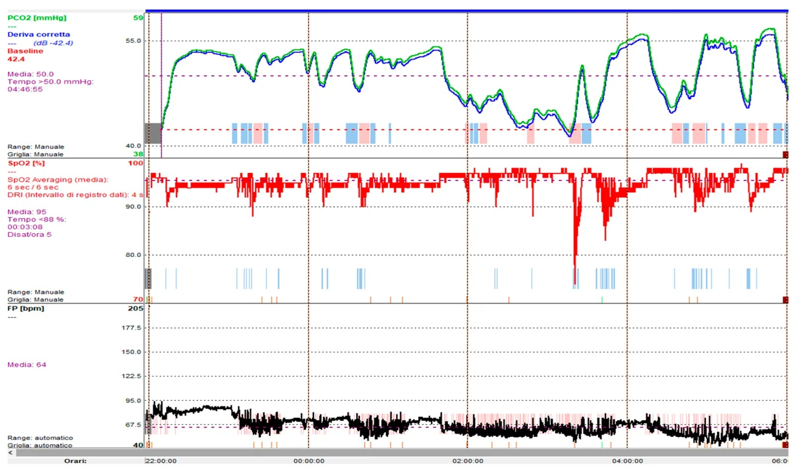
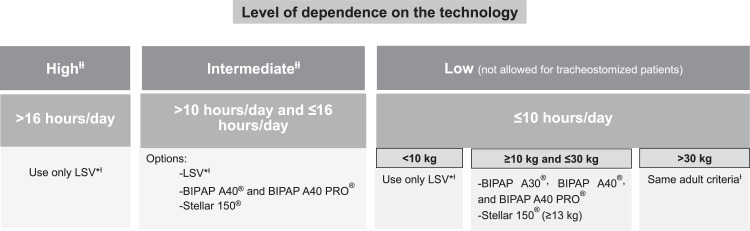
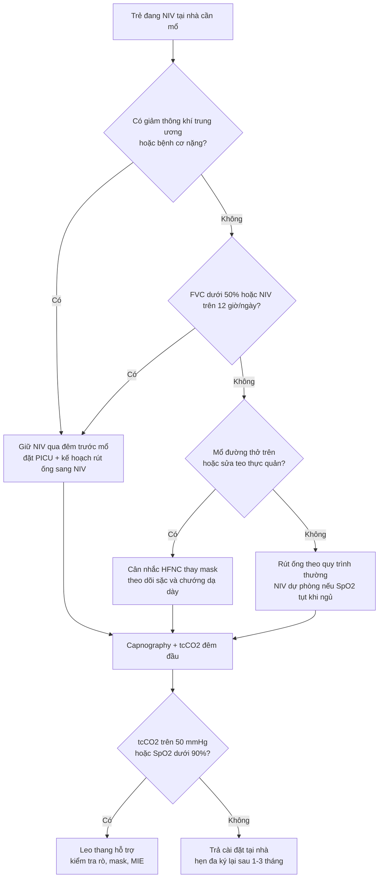
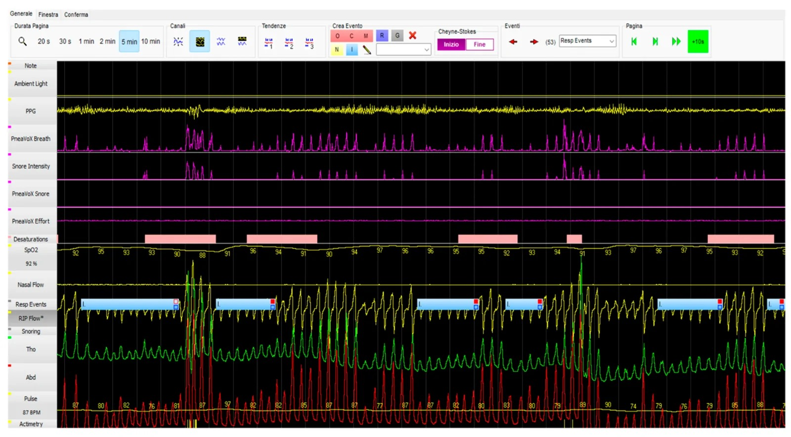

# 6109 — Trẻ thông khí không xâm nhập (NIV) tại nhà quanh mổ: giữ hay ngắt, giao diện nào, ngưỡng hậu phẫu / Children on home non-invasive ventilation around surgery

**Tags:** `pattern:giam-thong-khi-khi-ngu` `pattern:suy-ho-hap-man` `vung:long-nguc` `vung:duong-tho` `score:AHI` `score:FVC` `protocol:NIV-tai-nha` `protocol:chu-phau-nhi`

**Mức chắc chắn (certainty):** tổng hợp y văn (literature synthesis) — khuyến cáo **hỗ trợ hô hấp dài hạn tại nhà ở trẻ** của Hội Hô hấp Nhi Thụy Sĩ (*Respiration* 2026, **PMC13152260**, CC BY-NC 4.0); tổng quan **thông khí tại nhà** của *Braz J Anesthesiol* 2025 (**PMC11872580**, CC BY 4.0); **357 trẻ bệnh lý phức tạp mổ hàn cột sống** với số liệu NIV hậu phẫu (*Children* 2026, **PMC13605538**, CC BY 4.0); **507 trẻ dùng NIV dài hạn** (Alberta, *Pediatr Pulmonol* 2023, **PMID 37701936**); **1 ca nguyên văn** SMA type 2 mổ Nissen robot (*Front Surg* 2026, **PMC13635347**, CC BY 4.0). Số liệu **riêng cho "NIV tại nhà + phẫu thuật" ở trẻ còn mỏng** — chỗ nào chưa có bằng chứng bài ghi rõ "chưa rõ".

> **Câu chốt:** Trẻ đang NIV tại nhà **không phải** "trẻ khỏe vì đã có máy". Trong phòng mổ trẻ **thường ổn** — chỗ sập là **6–24 giờ sau rút ống**, khi thuốc mê–opioid còn, trẻ nằm ngửa, đau không dám ho, và **mất dần drive hô hấp khi vào REM**. Vì vậy câu hỏi chu phẫu không phải "có cần thở máy không" mà là **"rút ống sang cái gì, ở đâu, và ai theo dõi tcCO₂ trong đêm đầu"**.

## 1. Tổng quan bệnh học – cơ chế hình ảnh

- **Dịch tễ (số phải nhớ):** thông khí tại nhà ở trẻ vẫn **hiếm nhưng không còn lẻ tẻ**. Đoàn hệ dọc lớn nhất (Hà Lan, *Eur J Pediatr* 2025, **PMC12568881**) cho thấy **11%** trẻ cai được hoàn toàn, **18%** khởi đầu bằng **NIV rồi phải chuyển sang thông khí xâm nhập (IPPV)**. Trong **507 trẻ** dùng NIV dài hạn (Alberta, **PMID 37701936**), tuổi khởi trị trung vị **7,5 tuổi**, và **93%** có **ít nhất 1 biến cố bất lợi liên quan NIV** ngay lần theo dõi đầu.
- **TẠI SAO giảm thông khí xuất hiện ĐÊM trước ngày:** khi ngủ, đặc biệt **REM**, trương lực cơ liên sườn và cơ phụ **mất** → thông khí chỉ còn hoành; ở trẻ bệnh cơ–thần kinh hoành đã yếu, **độ nhạy trung tâm với CO₂ giảm**, nên **PaCO₂ tăng trước khi SpO₂ giảm**. Định nghĩa thực hành (AASM, dẫn trong **PMC13152260**): **giảm thông khí khi ngủ = pCO₂ > 50 mmHg trong > 25% tổng thời gian ngủ**; ngưỡng nhạy hơn cho bệnh cơ–thần kinh là **tcCO₂ > 50 mmHg trong > 2% thời gian ngủ** (dùng trong **PMC13605538**).
- **TẠI SAO phim ngực của trẻ NIV "trông tệ hơn" mà trẻ vẫn ổn:** NIV giữ **PEEP 4–6 cmH₂O** → **FRC tăng**, đáy phổi mở; khi tháo máy đi mổ, phổi **xẹp lại trong 10–20 phút** → **xẹp đáy hai bên + giảm thể tích** trên phim chụp ngay sau rút ống **không** đồng nghĩa thất bại, mà là **mất PEEP**. Ngược lại, **khí trong dạ dày** nhiều là dấu của **nuốt khí (aerophagia)** do mask/áp lực — trên phim dễ bị đọc nhầm thành **liệt ruột/tắc ruột**.
- **Vật lý của mạch NIV tại nhà (giải thích vì sao không được "đổi máy tùy tiện"):** máy tại nhà dùng **mạch một nhánh có rò chủ ý (single-limb circuit with intentional leak)**; CO₂ được **thải qua lỗ rò** và qua van thở. Nếu dán kín mask/mũi (để "khỏi rò") → **CO₂ tái hít**; nếu rò quá nhiều → **Vt sụt, không đồng bộ máy–bệnh nhi**, mà **số Vt trên máy lại "đẹp"**. Vì vậy khi chuyển sang máy ICU (mạch hai nhánh, không rò chủ ý) phải **tính lại Vt/áp lực**, không bê nguyên cài đặt.
- **Cài đặt chuẩn (dùng để đối chiếu khi trẻ vào mổ):** khởi đầu **IPAP 8 / EPAP 4 cmH₂O**, sau chuẩn độ **IPAP 10–14 / EPAP 4–6 cmH₂O**, **Vt 6–10 mL/kg**; CPAP cho OSA **8 ± 3 cmH₂O**; nhịp dự phòng đặt **quanh nhịp thở của trẻ 2–3 nhịp**. **NIV > 12–16 giờ/ngày** là dấu hiệu **cần cân nhắc chuyển sang xâm nhập** (**PMC13152260**).
- **TẠI SAO hậu phẫu là cửa sổ nguy hiểm:** thuốc mê còn tồn lưu + **opioid giảm drive** + đau làm **ức chế ho** + nằm ngửa làm **FRC giảm** → giảm thông khí xuất hiện **muộn hơn** giờ hồi tỉnh. Số liệu thực: **357 trẻ** mổ hàn cột sống (**PMC13605538**) — **20 trẻ (5,6%)** đang NIV trước mổ, **11 trẻ** được khởi trị NIV/CPAP ngay trong đợt chu phẫu (10 ca chỉ định **dựa trên kết quả đa ký/polygraphy**); hậu phẫu **48 trẻ (13%)** cần NIV, **33 (9%)** thở máy xâm nhập, **22 (6%)** CPAP, **1 trẻ mở khí quản** sau 3 lần rút ống thất bại; nằm PICU trung vị **4 ngày**. Ở nhóm **bệnh cơ–thần kinh** (n = 34): **35% cần NIV hậu phẫu**, **15% cần thở máy xâm nhập**.
- **Số liệu "đắt" cho hội chẩn:** ở **48 trẻ vẹo cơ–thần kinh** (*BMJ Paediatr Open* 2025, **PMC11836852**), **54,1%** có biến chứng sớm, và **dùng NIV tại nhà là yếu tố dự báo độc lập**, làm **tăng 1,8 ngày PICU** (chi tiết ở [043](../043-cham-soc-ho-hap-quanh-mo-tis-eos/lesson.md)).

*Hình: trẻ bệnh cơ–thần kinh, theo dõi **tcCO₂ + SpO₂ + nhịp tim** qua đêm trước mổ. TcCO₂ trung bình **50,0 mmHg**, thời gian **tcCO₂ > 50 mmHg = 4 giờ 46 phút**; SpO₂ trung bình **95%**, thời gian **< 88% = 3 phút 08 giây**, **5 cơn giảm bão hòa/giờ**. Đây là "đơn thuốc" để chỉnh NIV **trước** ngày mổ. Nguồn: Basilicata S và cộng sự, Children 2026;13(9):1170, PMCID PMC13605538, CC BY 4.0.*

## 2. Mẫu hình + chẩn đoán phân biệt theo vị trí (Gamut)

- **Mẫu hình cần nhận ra:** "trẻ có máy thở ở nhà, mang theo mặt nạ + máy vào viện để mổ một bệnh khác". Việc đầu tiên **không phải** đọc phim mà là **phân nhóm theo lý do cần NIV** — vì lý do quyết định rủi ro hậu phẫu:
  - **Tắc nghẽn khi ngủ (OSA)**: béo phì, **Prader–Willi**, Down, hội chứng đầu–mặt. Mổ **amidan/VA** có thể **chữa khỏi** → phải **chuẩn độ lại** sau mổ, không mặc định dùng tiếp cài đặt cũ.
  - **Bệnh cơ–thần kinh (NMD)**: SMA, loạn dưỡng cơ Duchenne, thoái hóa cơ. Nguy cơ **cao nhất** (35% cần NIV hậu phẫu), dễ **sặc**, **ho yếu** → cần **MIE/cough assist**.
  - **Trung tâm (CCHS)** và **giảm thông khí trung ương**: không "tự thở" khi ngủ → **không được ngắt NIV qua đêm** dù trẻ tỉnh táo ban ngày.
  - **Bệnh phổi–đường thở**: BPD/non tháng, loạn sản phế quản–phổi, hẹp dưới thanh môn, mềm sụn khí quản.
  - **Thành ngực**: Jarcho–Levin, loạn sản xương, di chứng mở ngực.
- **Nhánh theo LOẠI MỔ (quyết định giữ/ngắt NIV):**
  - **Mổ đường thở trên** (amidan, VA, nội soi thanh quản): NIV **qua mask che mũi-miệng** sau mổ **tăng nguy cơ sặc** và **chướng dạ dày** → ưu tiên **HFNC** hoặc **NIV mũi** với theo dõi sát.
  - **Mổ bụng–tiêu hóa** (Nissen, mở gastrostomy): **nuốt khí** và **căng dạ dày** làm hạn chế hoành → giảm dung tích; cần **mở van dạ dày** và hạ áp lực đỉnh.
  - **Mổ cột sống**: nguy cơ cao nhất (số liệu mục 1) → **rút ống sang NIV có kế hoạch**, không "thử rút ống".
  - **Mổ tim**: NIV hậu phẫu **an toàn và có lợi** ở trẻ (giảm công thở, tránh đặt lại ống) — nhưng **sau sửa teo thực quản** NIV **nguy hiểm** (nguy cơ sặc/rò) (*J Cardiothorac Vasc Anesth* 2022, **PMID 33893015**).
- **Nhánh theo hình ảnh (khi trẻ xấu đi sau mổ):** xẹp phổi do mất PEEP / viêm phổi hít / tràn khí màng phổi (hiếm, nhưng có khi dùng MIE áp lực cao) / chướng dạ dày do nuốt khí / phù thanh quản sau rút ống / tổn thương da do mask.
- **Gamut "trẻ NIV tại nhà vào viện vì khó thở" — 4 câu hỏi chốt:** (1) **Máy có chạy đúng không** (pin, mạch rò, mask cũ rách)? (2) **Cài đặt còn phù hợp không** (trẻ đã tăng cân/tuổi)? (3) **Có bệnh mới chồng** (viêm phổi, xẹp phổi, tràn khí)? (4) **Có biến chứng của chính NIV** (loét da, midface hypoplasia, chướng dạ dày, sặc)?

*Sơ đồ: chọn thiết bị **NIV/xâm nhập tại nhà ở trẻ** theo **mức phụ thuộc (số giờ/ngày)**, **có mở khí quản hay không** và **cân nặng** — lý do "máy của người lớn" không dùng được cho trẻ **< 10 kg**. Nguồn: Fagondes SC và cộng sự, Braz J Anesthesiol 2025;75(3):844595, PMCID PMC11872580, CC BY 4.0.*

## 3. Bảng so sánh phân biệt (ma trận đối chiếu)

| Thực thể (entity) | Hình ảnh / dấu hiệu điển hình | Chốt vào (rule-in) | Chốt loại (rule-out) | Gợi ý xác nhận |
|---|---|---|---|---|
| **Giảm thông khí còn tồn lưu sau mê/opioid** | Phim ngực **bình thường hoặc giảm thể tích nhẹ**; không đám mờ | **tcCO₂ > 50 mmHg** (hoặc tăng > 10 mmHg so nền) + **SpO₂ tụt khi ngủ**, tỉnh táo ban ngày | Đám mờ **mới** một thùy + sốt → nghĩ viêm phổi thay vì chỉ giảm thông khí | **Capnography/tcCO₂ qua đêm**, khí máu mao mạch; đối chiếu cài đặt NIV tại nhà |
| **Xẹp phổi do mất PEEP** | **Giảm thể tích đáy phổi hai bên**, mờ hình đĩa, không có phế quản hơi trung tâm | Xẹp **xuất hiện sau khi tháo NIV**, cải thiện sau **vài giờ NIV/Vt lớn hơn** | Đông đặc **có phế quản hơi** + sốt/CRP tăng → nhiễm trùng | So phim **trước mổ (đang NIV)** với phim **sau rút ống**; siêu âm phổi |
| **Viêm phổi hít (aspiration)** | Đám mờ **thùy dưới phải** hoặc hai bên, **mới**, kèm tràn dịch nhỏ | **Sặc rõ** (nôn, cho ăn sớm) + đám mờ mới **trong 24–48 giờ** | Đám mờ **mờ nhạt, đối xứng quanh rốn phổi** + không sặc → nghĩ phù do áp lực/mất PEEP | X-quang lặp lại 24–48 giờ; cấy đờm khi có đờm |
| **Chướng dạ dày do nuốt khí (aerophagia)** | **Bóng hơi dạ dày lớn**, đẩy hoành lên, **không mức dịch–hơi** điển hình, không giãn ruột non | Trẻ **NIV mask mũi-miệng/áp lực cao**; xẹp đáy phổi **hai bên** do hoành cao | **Mức dịch–hơi + giãn ruột** → nghĩ tắc ruột/liệt ruột thật | Mở van dạ dày/đặt sonde; **không** kết luận tắc ruột chỉ vì bóng hơi lớn |
| **Tràn khí màng phổi** | **Đường màng phổi** + mất mạch phổi ngoại vi, có thể **tràn khí trung thất** | Đường màng phổi **mới** ở trẻ vừa **MIE áp lực cao**/thở áp lực | Đường **mờ, không đổi** giữa 2 phim → nếp da/gấp mạc | Siêu âm phổi (mất lung sliding) + phim nghiêng; lâm sàng |
| **Tổn thương da/midface do mask** | **Loét sống mũi/gò má**, hằn dây; **hẹp hàm trên** khi dùng nhiều năm | Vết loét **đúng vị trí đè** của mask đang dùng | Ban lan tỏa + sốt → nghĩ nhiễm trùng da thay vì do mask | Khám da mỗi lần thăm khám; đổi mask luân phiên điểm tì |

- **Ảnh đối chiếu bổ sung:** `images/6109_niv-tai-nha-quanh-mo_Polygraphy_PMC13605538-F3.jpg` (đa ký hô hấp trước mổ) dùng làm "phim nền chức năng" cho ca 2 ở mục (6).

## 4. Protocol chụp/theo dõi + hệ phân độ và ngưỡng xử trí

- **Trước mổ — 6 việc, mỗi việc có ngưỡng:**
  1. **Xác nhận chỉ định NIV còn đúng:** đa ký/polygraphy gần nhất; ngưỡng **AHI > 5/giờ**, **ODI > 10/giờ**, **SpO₂ min < 88%**, **tcCO₂ > 50 mmHg > 2% thời gian ngủ** (**PMC13605538**); AASM: **pCO₂ > 50 mmHg > 25% TST**.
  2. **Đo chức năng hô hấp nếu làm được:** **FVC < 50%** dự đoán = nhóm nguy cơ cao (043). Ở trẻ không hợp tác, thay bằng **capnography khi ngủ** + **ho (cough peak flow)**.
  3. **Kiểm tra thiết bị:** pin dự phòng, mạch rò, **mask dự phòng cùng cỡ**, **MIE** nếu ho yếu. Máy tại nhà **không được** đưa vào phòng MRI (không an toàn trong từ trường) — chuyển sang máy ICU/bệnh viện.
  4. **Không ngắt NIV qua đêm trước mổ** ở trẻ có giảm thông khí trung ương/bệnh cơ nặng; cho **ăn theo khuyến cáo nhịn đói** và **hút sạch miệng** trước khi đặt mask.
  5. **Kế hoạch rút ống ghi trước trong hồ sơ:** "extubate to NIV" với **cài đặt cụ thể**, không ghi "theo diễn biến".
  6. **Đặt chỗ PICU** nếu: **NMD + FVC < 50%**, **NIV > 12 giờ/ngày**, mổ cột sống/ngực–bụng lớn, hoặc **đã từng thất bại cai máy**.
- **Trong mổ:** nếu cần mê toàn thân → **đặt nội khí quản** (mask NIV trong phòng mổ vừa rò vừa che tầm nhìn, không an toàn khi thông khí kém). Với thủ thuật ngắn dưới an thần, có thể **giữ NIV mũi** nhưng phải có **capnography** và người có thể đặt ống ngay. Tránh **succinylcholine** ở bệnh cơ (ca SMA2, **PMC13635347**).
- **Ngay sau rút ống (30 phút đầu):** rút ống **trực tiếp lên NIV** với **cài đặt tại nhà** (ca nguyên văn: **IPAP 16 / EPAP 13 cmH₂O**, FiO₂ 21%, rút ống sau **2 giờ 43 phút** hậu phẫu, **không biến cố trong 24 giờ** — **PMC13635347**); nếu **không dung nạp/không đạt Vt** → **NIV mũi** hoặc **CPAP**, không "cố mask mũi-miệng" ở trẻ vừa mổ đường thở.
- **Ngưỡng hậu phẫu phải ghi trong hồ sơ (dùng chung):** **tcCO₂ > 50 mmHg** kéo dài, **SpO₂ < 90%** khi thở khí trời, **nhịp thở tăng > 2 SD theo tuổi**, **thất bại 2 lần thử cai NIV trong 1 đêm**, hoặc **thất bại nuốt/ứ đờm** → **leo thang hỗ trợ**, không chờ "sáng mai".
- **Theo dõi sau ra viện:** khám lại **1–3 tháng** sau khởi trị rồi **mỗi 3–6 tháng**; **sau MỖI can thiệp (kể cả phẫu thuật) phải làm lại đa ký/polygraphy** để xác nhận cài đặt còn hiệu quả (**PMC13152260**) — đây là điểm hay bị bỏ: trẻ mổ xong về nhà với **cài đặt của 2 năm trước**.

- **Hệ phân độ dùng trong bài (không có RADS riêng cho "NIV quanh mổ"):** phân tầng nguy cơ theo **3 biến** — **(1) mức phụ thuộc NIV** (< 8 giờ/ngày = thấp; 8–12 = trung bình; **> 12–16 giờ/ngày hoặc đã mở khí quản = cao**), **(2) FVC** (≥ 70% / 50–70% / < 50%), **(3) loại mổ** (ngoại vi < đường thở trên < bụng–ngực < cột sống). **≥ 2 mức "cao"** → PICU + rút ống sang NIV có kế hoạch.

## 5. Biến thể bình thường và cạm bẫy

- **Biến thể bình thường:** (1) **Bóng hơi dạ dày** lượng vừa ở trẻ NIV mask là bình thường, nhất là sau bú/ăn; (2) **đường màng phổi mờ** do nếp da/gấp mạc ở trẻ nhỏ, không đổi giữa 2 phim; (3) **tim to "giả"** do phim chụp nằm ngửa ở trẻ NIV (hoành cao) — đối chiếu phim trước mổ.
- **Cạm bẫy 1 — "đã có NIV tại nhà nghĩa là ổn định":** **93%** trẻ dùng NIV dài hạn có **≥ 1 biến cố bất lợi**; hay gặp nhất là **tổn thương da 20%** và **rò khí không chủ ý 19%** (**PMID 37701936**). Rò khí làm **Vt hiển thị sai** → "máy báo tốt" mà trẻ vẫn giảm thông khí.
- **Cạm bẫy 2 — đọc "cải thiện" từ con số trên máy:** khi rò tăng, máy **tăng áp lực bù**, Vt hiển thị vẫn đủ; dấu hiệu thật là **tcCO₂ tăng** và **giấc ngủ phân mảnh**, không phải con số Vt.
- **Cạm bẫy 3 — chướng dạ dày bị đọc thành tắc ruột:** tỷ lệ **nuốt khí ở trẻ NIV tại nhà "chưa rõ"** vì trẻ **hiếm khi kêu** (**PMC11921066**); xử trí là **hạ áp lực đỉnh, tư thế nửa ngồi, mở van dạ dày**, không phải mổ.
- **Cạm bẫy 4 — mask mũi-miệng ở trẻ vừa mổ đường thở/bụng:** mask mũi-miệng/full-face **tăng nguy cơ sặc, loét da và kém dung nạp**; **mask mũi** an toàn hơn vì vẫn thở được nếu máy hỏng (**PMC13152260**).
- **Cạm bẫy 5 — coi thường biến chứng mạn của mask:** **hẹp hàm trên (midface hypoplasia) 3–37%**, cao hơn ở trẻ nhỏ; **triệu chứng mũi 5–38%**; **~1/3** trẻ có biến chứng thiết bị. Vì vậy **luân phiên mask** và **khám răng–hàm** định kỳ là một phần của "chu phẫu" ở trẻ sắp mổ hàm mặt.
- **Cạm bẫy 6 — bỏ qua ca "êm":** trong đoàn hệ 357 trẻ, **ca duy nhất phải mở khí quản lại nằm ở nhóm đa ký BÌNH THƯỜNG**, không phải nhóm rối loạn (**PMC13605538**). Đừng dùng "đa ký bình thường" để hạ mức theo dõi ở trẻ bệnh cơ nặng.

## 6. Tự lượng giá — Blind Quiz ngay trên trang tĩnh (không cần app)

**Ca 1 — Trẻ 11 tuổi bệnh cơ–thần kinh, NIV tại nhà 8 giờ/đêm, sắp mổ hàn cột sống**

- Gợi ý lâm sàng: ban ngày tỉnh táo, khí máu mao mạch bình thường; mẹ nói trẻ "ngủ hay vặn mình".
- Câu hỏi: (1) Ba bất thường trên bản ghi? (2) Có nên hoãn mổ để chỉnh NIV không? (3) Ngưỡng nào phải ghi vào kế hoạch hậu phẫu?

<b>Bấm để hiện đáp án (findings + chẩn đoán)</b>

- Dấu hiệu: **tcCO₂ trung bình 50,0 mmHg**, **> 50 mmHg trong 4 giờ 46 phút**; **SpO₂ trung bình 95%**, **5 cơn giảm bão hòa/giờ**, thời gian **< 88% = 3 phút 08 giây**; nhịp tim trung bình 64/phút.
- Chẩn đoán: **giảm thông khí khi ngủ mạn tính** (ngưỡng nghiên cứu: tcCO₂ > 50 mmHg > 2% TST) — "êm" trên khí máu ban ngày là **đặc trưng**, vì CO₂ chỉ tăng khi mất trương lực cơ ở REM.
- Xử trí: **chỉnh NIV trước mổ** (tăng IPAP theo chuẩn độ, kiểm tra rò) thay vì hoãn mổ vô thời hạn; ghi ngưỡng hậu phẫu **tcCO₂ > 50 mmHg / SpO₂ < 90%** và đặt PICU.
- Nguồn ảnh: Basilicata S và cộng sự, Children 2026;13(9):1170, PMCID PMC13605538, CC BY 4.0.

**Ca 2 — Trẻ 6 tuổi Down + béo, NIV tại nhà vì OSA, mổ amidan–VA**

- Gợi ý lâm sàng: ngáy to, ngưng thở khi ngủ; mask **mũi**; SpO₂ nền 95%.
- Câu hỏi: (1) Dấu hiệu chính trên bản ghi? (2) Sau mổ amidan–VA nên **giữ NIV cũ** hay **chuẩn độ lại**? (3) Vì sao không chọn mask mũi-miệng ngay sau mổ?

<b>Bấm để hiện đáp án (findings + chẩn đoán)</b>

- Dấu hiệu: **chuỗi cơn giảm bão hòa xuống 87–88%** kèm **sự kiện hô hấp (Resp Events)** lặp lại, **RIP flow** giảm từng đợt, nhịp tim dao động 74–97/phút.
- Chẩn đoán: **OSA** (đa ký/polygraphy); sau **cắt amidan–VA**, chỉ định NIV có thể **mất** → phải **đa ký lại**, không mặc định giữ cài đặt cũ.
- Vì sao: mask mũi-miệng sau mổ họng **tăng sặc, chướng dạ dày và kém dung nạp**; **mask mũi** cho phép thở tự nhiên nếu máy hỏng.
- Nguồn ảnh: cùng bài PMC13605538, CC BY 4.0.

**Ca 3 — Nữ 23 tuổi SMA type 2 (khởi phát ở tuổi nhi), NIV 9 giờ/đêm, mổ Nissen robot vì trào ngược nặng**

- Gợi ý lâm sàng: **FVC 25%**, FEV₁ 22% dự đoán; mở miệng < 5 mm, cổ cố định; đã từng **đặt ống thất bại** bằng đèn soi trực tiếp và video.
- Câu hỏi: (1) Vì sao **không** dùng succinylcholine? (2) Rút ống ở đâu và lên cái gì? (3) Ba ngưỡng theo dõi 24 giờ đầu?

<b>Bấm để hiện đáp án (findings + chẩn đoán)</b>

- Kỹ thuật: **đặt ống qua mũi bằng ống soi mềm 3,7 mm** với ống nội khí quản **5,5 mm có cuff**, thành công **1 lần, < 2 phút**, không tụt bão hòa; tránh **succinylcholine** (nguy cơ tăng kali/phản ứng bất thường ở bệnh cơ).
- Rút ống: sau **2 giờ 43 phút**, rút **trực tiếp lên NIV dự phòng IPAP 16 / EPAP 13 cmH₂O, FiO₂ 21%**; **không biến cố hô hấp trong 24 giờ**; ra viện ngày hậu phẫu 5.
- Ngưỡng: **tcCO₂ > 50 mmHg**, **SpO₂ < 90%**, **ho yếu/ứ đờm** (cân nhắc MIE) — và **đa ký lại** trước khi trả cài đặt tại nhà.
- Nguồn ca: Wong MCY và cộng sự, Front Surg 2026;13:1964655, PMCID PMC13635347, CC BY 4.0.

## Bài liên quan chéo
- [043 – Chăm sóc hô hấp quanh mổ & cai máy ở trẻ TIS/EOS](../043-cham-soc-ho-hap-quanh-mo-tis-eos/lesson.md)
- [048 – Hội chứng lồng ngực không đủ (TIS/VEPTR)](../048-hoi-chung-long-nguc-khong-du-tis-veptr/lesson.md)
- [600 – Tổng quan Nhi khoa](../600-tong-quan-nhi-khoa/lesson.md)
- [6121 – Rò tụy sau mổ tụy ở trẻ](../6121-ro-tuy-sau-mo-tuy-o-tre/lesson.md)

## Ảnh
- `6109_niv-tai-nha-quanh-mo_Capnography_PMC13605538-F4.jpg` — capnography + oximetry qua đêm (CC BY 4.0, PMC13605538).
- `6109_niv-tai-nha-quanh-mo_Polygraphy_PMC13605538-F3.jpg` — đa ký hô hấp trước mổ (CC BY 4.0, PMC13605538).
- `6109_niv-tai-nha-quanh-mo_So-do_PMC11872580-F3.jpg` — sơ đồ chọn thiết bị (CC BY 4.0, PMC11872580).
- Nguồn + giấy phép từng ảnh: `images/CREDITS.md`; link bài gốc: `sources.md`.

> Không dùng để chẩn đoán độc lập khi chưa có người hướng dẫn.
