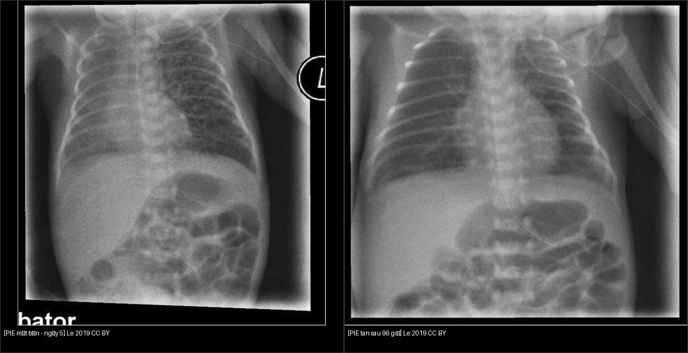
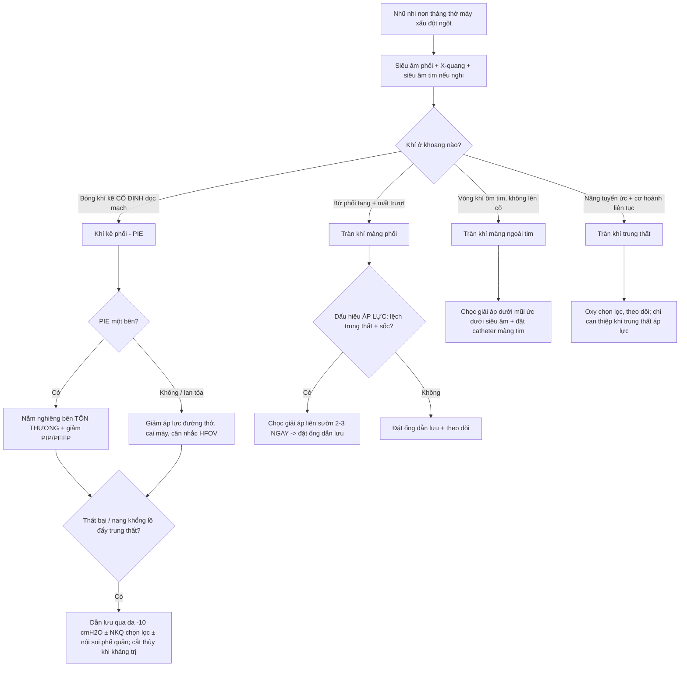
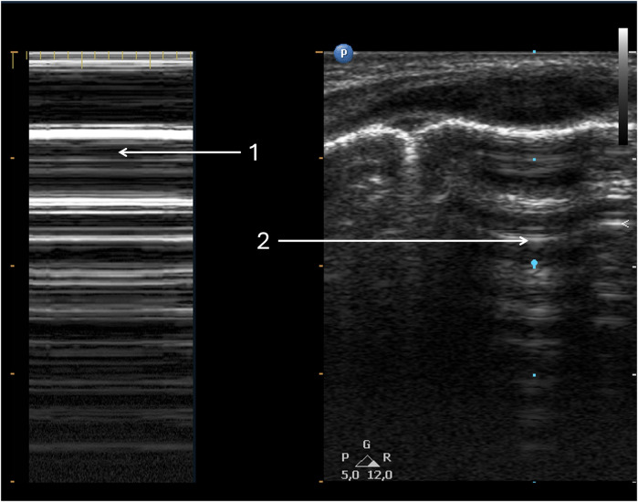
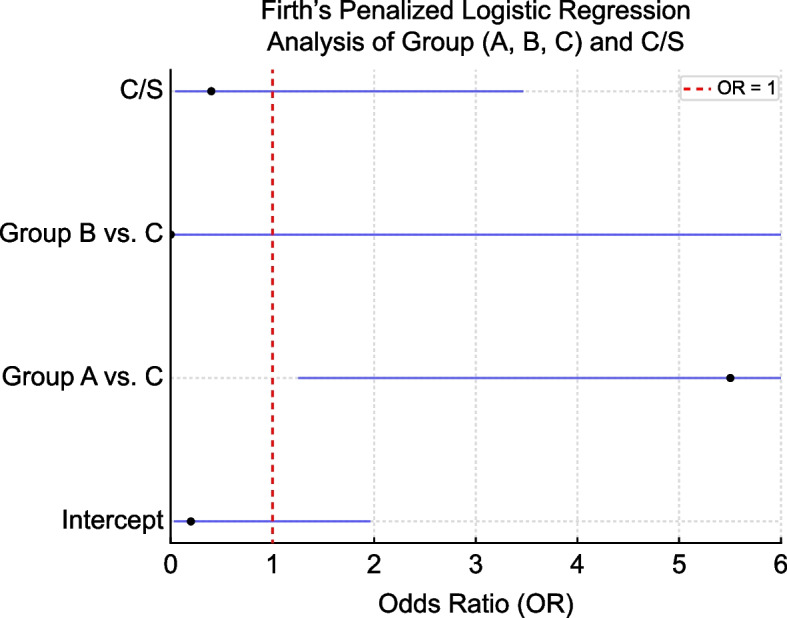
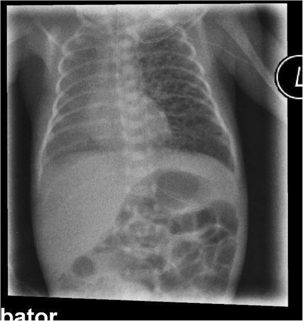
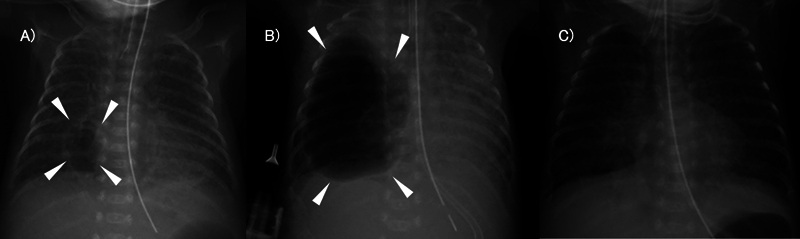
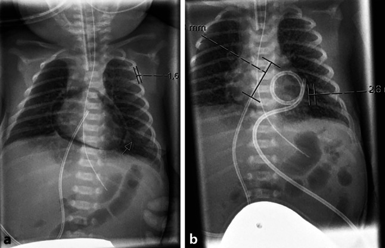
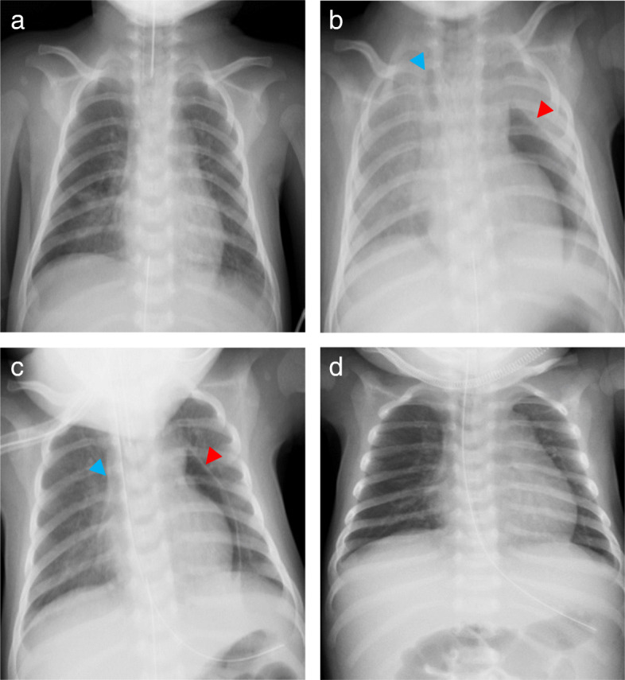
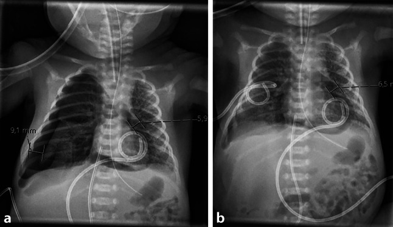

# 611 — Khí kẽ phổi (PIE) & tràn khí áp lực ở nhũ nhi: HFOV, nằm nghiêng bên tổn thương, nội soi phế quản chọn lọc; tràn khí màng ngoài tim / Pulmonary interstitial emphysema & tension air-leak in neonates

**Tags:** `pattern:pie` `pattern:tran-khi-ap-luc` `pattern:tran-khi-mang-ngoai-tim` `vung:phoi` `vung:trung-that` `protocol:HFOV` `protocol:sieu-am-phoi` `protocol:X-quang-nguc-nhi`
**Mức chắc chắn (certainty):** ca nguyên văn (verbatim case) — neo vào **ba ca nguyên văn** có hình ảnh: (1) trẻ cực nhẹ cân **327 g** PIE khổng lồ một bên, khỏi nhờ **dẫn lưu qua da** (Hoshina et al., *Cureus* 2024, PMC11068432); (2) trẻ **28+1 tuần/990 g** PIE một bên khỏi hoàn toàn sau **96 giờ nằm nghiêng bên tổn thương**, không cần thở máy (Lei et al., *BMC Pediatr* 2019, PMC6676513); (3) **tràn khí màng ngoài tim áp lực** ở nhũ nhi (Meyer et al., *JTCVS Tech* 2024, PMC11347491; Tani et al., *JA Clin Rep* 2020, PMC7541804). Bổ sung bằng tổng hợp y văn mở (siêu âm phổi, HFOV "sigh breath", cơ chế Macklin).

## 1. Tổng quan bệnh học – cơ chế hình ảnh

- **Khí kẽ phổi (pulmonary interstitial emphysema, PIE)** là một đích của **hội chứng rò khí (air-leak syndrome)** ở nhũ nhi — xem [617](../617-hoi-chung-ro-khi-o-nhu-nhi/lesson.md) cho các đích khác (tràn khí màng phổi, tràn khí trung thất, khí phúc mạc). PIE là khi khí bị "giam" trong **khoảng kẽ quanh mạch–quanh phế quản** thay vì thoát vào khoang màng phổi/trung thất.
- **Vì sao rò vào KHOẢNG KẼ (cơ chế Macklin):** phế nang non tháng **chưa trưởng thành** (mạng đàn hồi thưa, thành mỏng) + **áp lực xuyên phổi cao** (thở máy, CPAP, hồi sức bóng) → phế nang căng vỡ → khí men theo **mạc quanh mạch máu** (MAIN the perivascular sheath) ngược về rốn phổi. Vì đi dọc mạch máu nên trên phim **bóng khí kẽ nằm thành chuỗi/đám dọc mạch phổi và nhánh phế quản**, không tự do đổi chỗ khi đổi tư thế.
- **Vì sao thấy trên hình — vật lý:** khí cản tia X cực thấp (**−1000 HU** trên CT, so nhu mô phổi lành −700 đến −900 HU) → **đen** trên X-quang và **đen** trên CT. Chìa khóa phân biệt là **hình thái + vị trí**: bóng khí kẽ **li ti/tuyến tính, cố định dọc mạch máu** (PIE) khác với **dải khí tự do tách bờ phổi tạng khỏi thành ngực** (tràn khí màng phổi) khác với **khí bao quanh tim** (tràn khí màng ngoài tim).
- **Vì sao PIE nguy hiểm:** khối khí kẽ **chèn ép các nhánh mạch máu nhỏ** quanh nó → thông khí chết (dead space) tăng, **CO₂ tăng**; PIE một bên gây **đẩy trung thất**, cản trở dẫn lưu phổi và là **tiền thân của tràn khí màng phổi áp lực**. Thể **PIE dai dẳng** có thể tạo **nang khí khổng lồ (giant pulmonary cyst)** chèn ép phổi lành.
- **Ngưỡng định lượng & bối cảnh:**
  - **HFOV thêm "sigh breath" (thì thở bù) làm TĂNG tràn khí áp lực:** nghiên cứu đoàn hệ trẻ **22–25 tuần** thở HFOV cứu nguy (n = 64) — tràn khí áp lực **10/64 = 15,6%** trong **12–96 giờ**; nhóm có xẹp phổi **được sigh** có nguy cơ cao hơn rõ rệt (**OR 5,5; KTC 1,2–23,9; p = 0,02**) (Kurimoto et al., *Pediatr Neonatol / J Neonatal Perinatal Med* 2025, PMC12542469). → "Sigh" KHÔNG phải biện pháp an toàn cho cực non tháng.
  - **PIE một bên khỏi nhờ tư thế:** trẻ **28+1 tuần/990 g** PIE trái ngày 5 (pCO₂ 40→55 mmHg, FiO₂ 0,21→0,28) — **nằm nghiêng bên tổn thương** trên nẹp + HFNC, **khỏi hoàn toàn sau 96 giờ**, không tiến triển bệnh phổi mạn (Lei et al., 2019, PMC6676513).
  - **PIE khổng lồ kháng trị:** trẻ **327 g**, nang phổi phải từ ngày 9, đường kính **34 mm** ngày 28 kèm đẩy trung thất → khỏi nhờ **dẫn lưu qua da rồi hút −10 cmH₂O trong 3 ngày** (Hoshina et al., 2024, PMC11068432).
  - **Tràn khí màng ngoài tim (pneumopericardium)** ở nhũ nhi **tử vong cao**, thường gắn với **thông khí áp lực dương**; chẩn đoán được **trên siêu âm tim trước khi huyết động sụp** (Meyer et al., 2024, PMC11347491).

## 2. Mẫu hình + chẩn đoán phân biệt theo vị trí (gamut)

- **Khoảng kẽ phổi (interstitial) — PIE:** bóng khí **li ti/tuyến tính**, xếp dọc mạch phổi và quanh phế quản, **thùy căng giãn**, **cố định**. PIE **một bên** hay gặp ở phổi có tổn thương nặng hơn → đẩy trung thất sang bên đối diện.
- **Khoang màng phổi (pleural) — tràn khí màng phổi (tension):** dải đen có **bờ phổi tạng**, **mất mạch máu băng qua**; khi **áp lực (tension)** → **lệch trung thất, tim xa bên tổn thương, dấu rãnh sâu (deep sulcus sign)** ở trẻ nằm ngửa.
- **Trung thất (mediastinal):** khí **nâng tuyến ức (dấu cánh buồm — spinnaker-sail)**, **dấu cơ hoành liên tục**, dấu V Naclerio, lan lên cổ — xem [617](../617-hoi-chung-ro-khi-o-nhu-nhi/lesson.md).
- **Màng ngoài tim (pericardial) — tràn khí màng ngoài tim:** **vòng khí ôm sát bóng tim**, **KHÔNG lan lên cổ**, **KHÔNG có bờ phổi tạng**; có thể gây **chèn ép tim (tamponade)** → mạch nghịch, tụt huyết áp.
- **Khí dưới da (subcutaneous):** dải khí trong mô mềm thành ngực/cổ/bụng, sờ **lạo xạo (crepitus)** — thường đi kèm PIE/tràn khí trung thất.
- **Mnemonic sàng lọc:** nhũ nhi non tháng thở máy **xấu đột ngột** → luôn trả lời câu hỏi **"khí đang ở KHOANG NÀO?"** trước khi quyết định can thiệp, vì **PIE có thể không cần chọc**, còn **tràn khí màng ngoài tim/tràn khí áp lực thì cần giải áp ngay**.

## 3. Bảng so sánh phân biệt (ma trận đối chiếu)

| Thực thể (entity) | Hình ảnh điển hình | Chốt vào (rule-in) | Chốt loại (rule-out) | Gợi ý xác nhận |
|---|---|---|---|---|
| Khí kẽ phổi (PIE) | Bóng khí li ti/tuyến tính dọc mạch–phế quản, thùy căng giãn, **cố định** | **Bóng khí kẽ CỐ ĐỊNH dọc mạch phổi, không đổi khi đổi tư thế** | **Dải khí có bờ phổi tạng, đổi chỗ theo tư thế → tràn khí màng phổi** | X-quang lặp lại; siêu âm phổi (không thấy điểm phổi khu trú) |
| Tràn khí màng phổi (kể cả áp lực) | Rãnh sâu, bờ phổi tạng, không mạch vượt qua; tension → lệch trung thất | **Bờ phổi tạng tách khỏi thành ngực + mất trượt màng phổi / điểm phổi trên siêu âm** | **Khí nâng tuyến ức + cơ hoành liên tục → trung thất** | Siêu âm phổi (điểm phổi, mã vạch), X-quang thẳng/nghiêng tay |
| Tràn khí màng ngoài tim | Vòng khí **ôm sát tim**, không có bờ phổi tạng | **Vòng khí bao quanh bóng tim, KHÔNG lan lên cổ** | **Dải khí giữa tim và cơ hoành + lên cổ → trung thất** | **Siêu âm tim** (thấy trước khi sụp huyết động); X-quang thẳng–nghiêng |
| Khí dưới da / trung thất | Dải khí mô mềm cổ–ngực, crepitus | **Dải khí mô mềm + tuyến ức bị nâng** | Có bờ phổi tạng → PTX kèm theo | Lâm sàng (crepitus) + X-quang |

*Trái: PIE trái lan tỏa, **đẩy nhẹ trung thất sang phải** (ngày 5). Phải: sau **96 giờ nằm nghiêng bên tổn thương + HFNC**, **không còn nang khí**, trung thất về lại giữa (ngày 9). Đây là bằng chứng "tư thế có thể là điều trị" cho PIE một bên ở trẻ cực non tháng. Nguồn: Lei X et al., *BMC Pediatr* 2019, CC BY 4.0. Ảnh ghép letterbox.*

## 4. Protocol chụp + hệ phân độ/điểm chuẩn hóa

- **Siêu âm phổi (lung ultrasound, LUS) tại giường — đầu tay ở NICU:** thay thế nhiều phim X-quang, **không bức xạ**, làm tại giường, không cần vận chuyển. Với **tràn khí màng phổi**: **mất trượt màng phổi (lung sliding)**, **A-line sắc nét, mất B-line**, M-mode **dấu "mã vạch"/"tầng bình lưu" (barcode/stratosphere sign)**, và dấu đặc hiệu nhất — **"điểm phổi" (lung point)** tại ranh giới vùng rò khí/vùng phổi lành (Jagła et al., *J Clin Med* 2025, PMC12500432).
- **X-quang ngực thẳng (AP, trẻ nằm ngửa):** tìm bóng khí kẽ cố định, đẩy trung thất, rãnh sâu, khí dưới da. **X-quang nghiêng tay** khi khó thấy tràn khí.
- **Siêu âm tim** khi nghi **tràn khí màng ngoài tim**: vòng khí ôm tim + giảm chức năng; đây là cách **phát hiện sớm trước khi huyết động sụp**.
- **Điều trị PIE — nguyên tắc giảm áp lực đường thở (theo bậc):**
  1. **Giảm áp lực xuyên phổi:** hạ **PIP/PEEP/mAP**, cai máy nhanh khi được; tránh **sigh breath** (bằng chứng TĂNG tràn khí áp lực, OR 5,5).
  2. **Tư thế nằm nghiêng bên tổn thương (positional therapy)** cho **PIE MỘT BÊN**: đặt bên rò **xuống dưới** để phổi lành thông khí ưu tiên — ca 990 g khỏi hoàn toàn sau **96 giờ**.
  3. **HFOV** khi thông khí thường thất bại (giảm thể tích khí lưu thông, tránh sang chấn thể tích).
  4. **Liệu pháp bảo tồn thất bại + PIE khổng lồ/đẩy trung thất:** **dẫn lưu qua da** nang khí (**hút −10 cmH₂O**, ca 327 g dẫn lưu 3 ngày), **đặt ống nội khí quản CHỌN LỌC một bên** (selective intubation) để "nghỉ" bên tổn thương, **nội soi phế quản chọn lọc** bịt/hút nhánh rò, và cuối cùng **cắt thùy** (lobectomy) trong ca kháng trị.
- **Điều trị tràn khí áp lực / tràn khí màng ngoài tim:** **chọc giải áp ngay** (tràn khí màng phổi áp lực: liên sườn 2–3 cạnh xương ức; màng ngoài tim: đường dưới mũi ức dưới siêu âm) → **đặt ống dẫn lưu**.
- **Cạm bẫy huyết động:** ở bệnh nhân có **thông màng ngoài tim–khí trời** (như sau chọc/dẫn lưu màng tim), **áp lực đường thở dương (PPV) có thể CHỮA** tràn khí màng ngoài tim (tăng áp lực trong lồng ngực chặn khí bị hút vào), trong khi **hít vào gắng sức** (do hẹp đường thở trên, liệt dây thanh) lại **hút khí vào màng tim** (Tani et al., 2020, PMC7541804).
- **Flowchart xử trí PIE / tràn khí áp lực ở nhũ nhi:**

*Tràn khí màng phổi trên siêu âm phổi: (1) M-mode **dấu "mã vạch"/"tầng bình lưu" (barcode sign)** — mất trượt màng phổi; (2) cùng vùng trên 2D. Siêu âm giúp **phát hiện trước X-quang** và lặp lại tại giường. Nguồn: Jagła M et al., *J Clin Med* 2025 (PMC12500432), CC BY 4.0.*

*Forest plot (hồi quy Firth): nhóm **có xẹp phổi được sigh breath** (Group A) có **OR 5,5 (KTC 1,2–23,9; p = 0,02)** so với nhóm chứng (Group C) — "sigh" làm tăng tràn khí áp lực ở trẻ **22–25 tuần**. Nguồn: Kurimoto T et al., 2025 (PMC12542469), CC BY 4.0.*

## 5. Biến thể bình thường và cạm bẫy

- **PIE thoáng qua tự tiêu** ở đa số trẻ → **không vội can thiệp**; nhưng PIE **dai dẳng/một bên đẩy trung thất** phải theo dõi sát vì dễ tạo nang khổng lồ và tràn khí áp lực.
- **Bẫy "sigh breath" tưởng an toàn:** thêm thì thở bù vào HFOV để "mở phổi" lại **tăng tràn khí áp lực** ở cực non tháng (OR 5,5) — không dùng thường quy.
- **Bẫy ngụy biện "PPV luôn làm nặng tràn khí màng ngoài tim":** khi có **thông màng tim–khí trời**, **PPV có thể chữa**, còn **hít vào gắng sức** (hẹp đường thở trên) lại **hút khí vào màng tim** — nhớ siêu âm tim và đánh giá cơ chế.
- **Không nhầm PIE với tràn khí màng phổi:** PIE **không cần chọc/đặt ống**; đặt ống vào PIE không những vô ích mà còn thủng nang khí. Xác nhận bằng **bóng khí cố định dọc mạch** (X-quang) và **mất/không mất trượt** (siêu âm).
- **Bỏ sót đồng thời (satisfaction of search):** thấy PIE rồi dừng → bỏ sót **tràn khí màng phổi/trung thất/màng tim kèm theo** (cùng một đợt rò khí, nhiều đích). Luôn đọc đủ các khoang.
- **Siêu âm tim che khuất bởi khí:** nếu "không thấy tim" trên siêu âm tim gấp, **nghĩ tràn khí màng ngoài tim** và kiểm tra cửa sổ khác trước khi kết luận hình ảnh kém (Meyer et al., 2024).
- **Dấu hiệu trẻ nằm ngửa che tràn khí:** khí dồn **trước và đáy** → tìm **rãnh sâu** hoặc chuyển sang **siêu âm nghiêng tay**.

## 6. Tự lượng giá — Blind Quiz ngay trên trang tĩnh

> Ảnh trơn ở NGOÀI, dấu hiệu + chẩn đoán giấu trong khối "bấm để hiện đáp án". Mở trên Pages: tự đoán rồi bấm mở đáp án.

**Ca 1 — Trẻ 28+1 tuần/990 g, PIE một bên ngày 5.**

- Gợi ý lâm sàng: rất non tháng, đang CPAP mũi + HFNC, pCO₂ tăng 40→55 mmHg, FiO₂ tăng lên 0,28.
- Câu hỏi: Mô tả dấu hiệu chính và bên tổn thương? Xử trí đầu tay (không dùng máy thở)?

<b>Bấm để hiện đáp án (findings + chẩn đoán)</b>

- Dấu hiệu: **PIE trái lan tỏa** — bóng khí kẽ xếp dọc mạch phổi trái, thùy trái căng giãn, **đẩy nhẹ trung thất sang phải**.
- Chẩn đoán: **PIE một bên** ở trẻ cực non tháng. Xử trí: **nằm nghiêng bên tổn thương (trái) trên nẹp + HFNC** → **khỏi hoàn toàn sau 96 giờ**, không tiến triển bệnh phổi mạn.
- Nguồn ảnh: Lei X et al., *BMC Pediatr* 2019 (PMC6676513), CC BY 4.0.

**Ca 2 — PIE khổng lồ kháng trị ở trẻ cực nhẹ cân.**

- Gợi ý: trẻ **327 g**, thở SIMV; nang phổi phải xuất hiện ngày 9, **đường kính 34 mm ngày 28** kèm đẩy trung thất dù đã nằm nghiêng + HFOV + corticoid.
- Câu hỏi: Ba mốc phim (A, B, C) ứng với các thời điểm nào? Lựa chọn nào đã cứu trẻ?

<b>Bấm để hiện đáp án (findings + chẩn đoán)</b>

- Dấu hiệu: (A) ngày 9 — PIE xuất hiện; (B) ngày 29 — nang khổng lồ lớn nhất; (C) ngày 32 — sau rút catheter, nang xẹp.
- Chẩn đoán: **nang khí do PIE dai dẳng** kháng trị → **dẫn lưu qua da rồi hút −10 cmH₂O trong 3 ngày** (không biến chứng). Đây là lựa chọn khi bảo tồn thất bại.
- Nguồn ảnh: Hoshina Y et al., *Cureus* 2024 (PMC11068432), **CC BY-NC-ND — giữ nguyên bản**.

**Ca 3 — Tràn khí màng ngoài tim ở nhũ nhi non tháng.**

- Gợi ý: trẻ 29 tuần, phát hiện **trên siêu âm tim** khi khó thấy bóng tim; kèm tràn khí màng phổi phải.
- Câu hỏi: (a) và (b) khác nhau thế nào? Vì sao chẩn đoán sớm quan trọng?

<b>Bấm để hiện đáp án (findings + chẩn đoán)</b>

- Dấu hiệu: (a) **vòng khí tròn ôm sát bóng tim** — tràn khí màng ngoài tim; (b) sau **đặt catheter màng tim**, khí hết.
- Chẩn đoán: **tràn khí màng ngoài tim**. Phát hiện **trước khi huyết động sụp** (trên siêu âm tim) rồi **chọc/dẫn lưu màng tim** giúp cải thiện sống còn; đây là biến chứng **tử vong cao**.
- Nguồn ảnh: Meyer S et al., 2024 (PMC11347491), CC BY 4.0.

**Ca 4 — Tràn khí màng ngoài tim áp lực: 4 thì diễn tiến.**

- Gợi ý: nhũ nhi 28 ngày sau mổ cung chủ, liệt dây thanh quặt, khó thở tăng dần.
- Câu hỏi: Bốn panel a–d tương ứng các mốc nào? Vì sao **thông khí áp lực dương lại CHỮA** được ở đây?

<b>Bấm để hiện đáp án (findings + chẩn đoán)</b>

- Dấu hiệu: (a) ngay sau chọc màng tim; (b) trước đặt lại nội khí quản (~2,5 giờ sau nhập ICU); (c) 10 phút sau đặt lại nội khí quản; (d) sau rút ống dẫn lưu. **Mũi tên đỏ = tràn khí màng ngoài tim; mũi tên xanh = tràn khí trung thất.**
- Chẩn đoán: **tràn khí màng ngoài tim do "hút khí" qua lỗ dẫn lưu khi hít vào gắng sức** (hẹp đường thở trên). **PPV làm tăng áp lực lồng ngực → chặn khí vào màng tim → khỏi**.
- Nguồn ảnh: Tani M et al., *JA Clin Rep* 2020 (PMC7541804), CC BY 4.0.

**Ca 5 — Bằng chứng "sigh breath" làm hại.**

- Câu hỏi: Trục hoành biểu diễn gì? Nhóm nào tăng nguy cơ và mức tăng bao nhiêu?

<b>Bấm để hiện đáp án (findings + chẩn đoán)</b>

- Dấu hiệu: **OR** trên trục hoành, đường tham chiếu **OR = 1**; **Group A (xẹp phổi + sigh) vs C** cho **OR 5,5 (KTC 1,2–23,9; p = 0,02)**.
- Chẩn đoán/kết luận: **sigh breath trong HFOV làm tăng tràn khí áp lực** ở trẻ **22–25 tuần**; tránh dùng thường quy.
- Nguồn ảnh: Kurimoto T et al., 2025 (PMC12542469), CC BY 4.0.

**Ca 6 — Khí dưới da sau tràn khí.**

- Gợi ý: cùng trẻ ca 3, sau đặt ống dẫn lưu màng phổi.
- Câu hỏi: Dấu hiệu mũi tên chỉ gì? Có cần can thiệp riêng không?

<b>Bấm để hiện đáp án (findings + chẩn đoán)</b>

- Dấu hiệu: (a) X-quang — **tràn khí màng phổi phải**; (b) sau **đặt catheter pigtail**, phổi nở.
- Liên hệ: cùng đợt rò khí ở trẻ non tháng, khí lan **dưới da** (crepitus) và các khoang; **khí dưới da thường tự tiêu**, điều trị là xử lý nguyên nhân (ổ dẫn lưu đúng).
- Nguồn ảnh: Meyer S et al., 2024 (PMC11347491), CC BY 4.0.

## Bài liên quan chéo
- [600 – Tổng quan Nhi khoa](../600-tong-quan-nhi-khoa/lesson.md)
- [610 – Suy hô hấp sơ sinh & dị dạng phổi](../610-suy-ho-hap-so-sinh-va-di-dang-phoi/lesson.md)
- [616 – Biến chứng viêm phổi nhi: empyema & hoại tử phổi](../616-bien-chung-viem-phoi-nhi-empyema-hoai-tu/lesson.md)
- [617 – Hội chứng rò khí ở nhũ nhi (tràn khí màng phổi & trung thất)](../617-hoi-chung-ro-khi-o-nhu-nhi/lesson.md) (các đích rò khí khác + AP-ratio)
- [618 – Rò phế quản–màng phổi & rò khí dai dẳng ở trẻ](../618-ro-phe-quan-mang-phoi-va-ro-khi-dai-dang-o-tre/lesson.md)
- [609 – Ống dẫn lưu màng phổi (chest tube) ở trẻ](../609-ong-dan-luu-mang-phoi-o-tre/lesson.md) (kỹ thuật – vị trí – biến chứng – khi nào rút)

## Ảnh
- Tên file: `611_slug_Modality_SourceID.jpg`; nguồn + giấy phép từng ảnh trong `images/CREDITS.md`.
- Các ảnh X-quang/siêu âm/forest plot đều **CC BY 4.0**, **trừ** `611_pie-khong-lo_XR_PMC11068432.jpg` là **CC BY-NC-ND (giữ nguyên bản)**.

> Không dùng để chẩn đoán độc lập khi chưa có người hướng dẫn.
