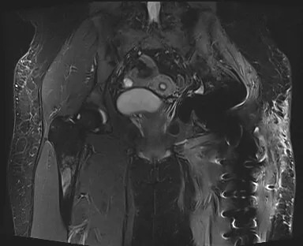
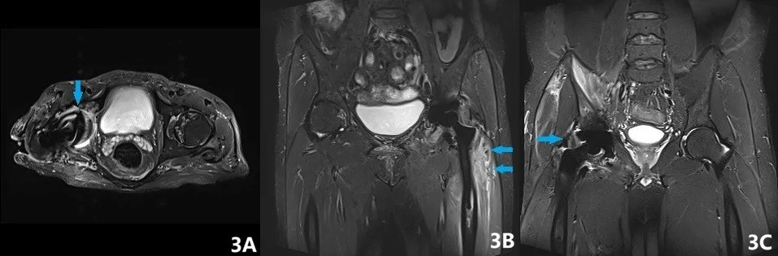
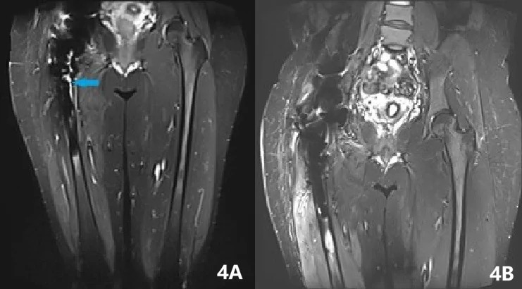
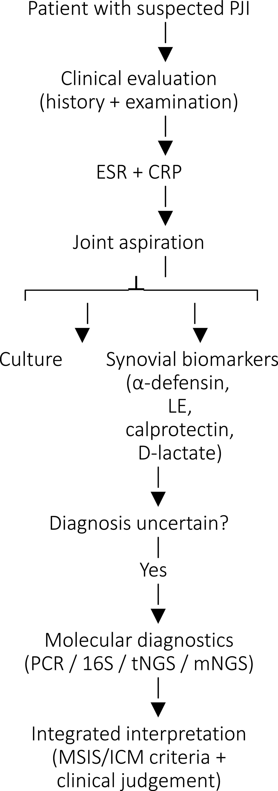
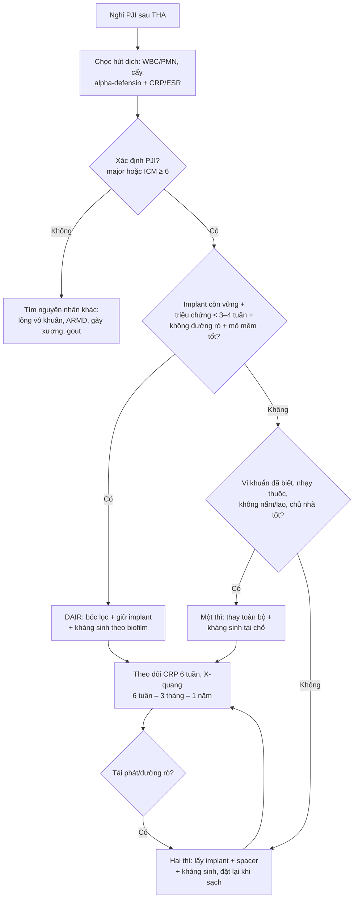
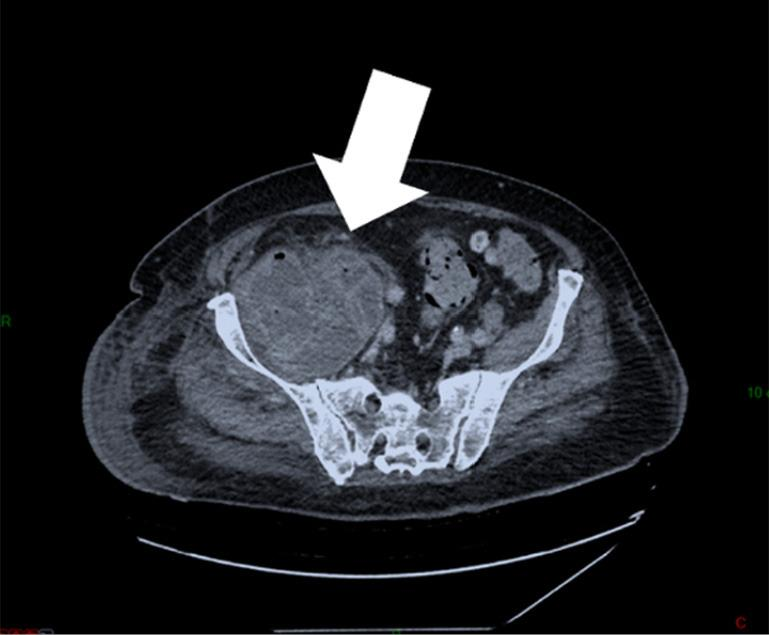
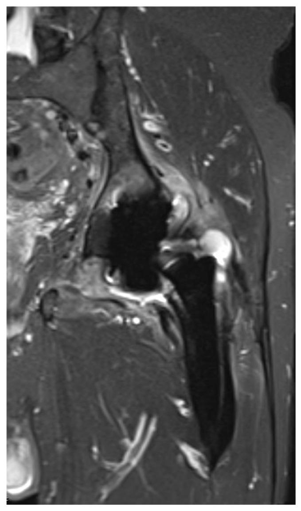

# 6110 — Nhiễm trùng quanh khớp nhân tạo (PJI) sau thay khớp háng ở người trẻ: chẩn đoán, MARS MRI & chọn DAIR – một thì – hai thì / Periprosthetic joint infection after THA

**Tags:** `pattern:long-khop` `pattern:dich-quanh-khop` `pattern:phu-mo-quanh-khop` `pattern:khuyet-xuong-quanh-khop` `pattern:khi-trong-khop` `vung:khop-hang` `vung:co-xuong` `score:ICM-2018` `score:MSIS` `protocol:X-quang-khop-hang` `protocol:CT-khop-hang` `protocol:MRI-MARS` `incidentaloma:dich-quanh-khop`
**Mức chắc chắn (certainty):** tổng hợp y văn (literature synthesis) — ghép tổng quan biomarker/ chẩn đoán (Saadeh JE et al., Orthop Res Rev 2026;18:634292, PMC13577183), khung chọn một thì/hai thì (Ference DA et al., JBJS Rev 2026, PMC13489767), kết quả DAIR theo vi sinh (Sheldon AN et al., PLoS One 2026, PMC13505891), MRI đánh giá lan ra ngoài bao khớp (Khury F et al., J Clin Med 2026;15:480, PMC12841734), giá trị MARS MRI sau đặt spacer (Lin Z et al., Bone Joint Res 2026, PMC13541391), ca giả u nhiễm khuẩn sau MoM-THA (Zgolli A et al., AME Case Rep 2026;10:69, PMC13062803) và tử vong nội viện toàn quốc (Reinhard J et al., Bone Jt Open 2024, PMC11045279).

> **Điểm chốt của bài:** PJI **không loại trừ bằng X-quang bình thường** và **không chẩn đoán bằng một xét nghiệm**. Ở người trẻ sau THA, câu hỏi thực hành là **"giữ được implant hay không"**: **DAIR** chỉ hợp lý khi **implant còn vững + triệu chứng < 3–4 tuần + không có đường rò + vi khuẩn nhạy thuốc + mô mềm còn tốt**; còn lại phải **một thì hoặc hai thì**. Trên hình ảnh, **MARS MRI là modality mạnh nhất để thấy dịch/phù/ngấm màng hoạt dịch quanh khớp** (Se **78,3%**, Sp **81,8%**), trong khi **CT** để tìm **khuyết xương, khí, mảnh xương** và **X-quang** để theo dõi **đường sáng tiến triển**.

## 1. Tổng quan — vì sao PJI khó chẩn đoán, và vì sao hình ảnh trông như vậy

- **Sinh bệnh học (pathophysiology):** vi khuẩn bám vào **bề mặt kim loại/ cement/ polyethylene** tạo **màng sinh học (biofilm)** — vi khuẩn trong biofilm **dung nạp kháng sinh gấp 10–1.000 lần** so với dạng tự do, và **hệ miễn dịch không tiếp cận được**. Vì vậy **cấy dịch khớp có thể âm**, **CRP có thể chỉ tăng nhẹ**, và tổn thương hình ảnh **tiến triển chậm**.
- **Vì sao X-quang thường bình thường sớm:** PJI **không phá xương ngay**; dấu X-quang là **hệ quả muộn** của **tiêu xương quanh implant** — đường sáng **≥ 2 mm**, **tiến triển theo thời gian**, **subsidence (lún chuôi)**, **gãy lớp cement**, **phản ứng màng xương**. Một phim bình thường ở tháng đầu **không loại trừ** PJI.
- **Vì sao CT hữu ích:** CT **nhìn xuyên kim loại tốt hơn MRI**, thấy **khuyết xương quanh ổ cối/chuôi**, **khí trong khớp/mô mềm** (dấu rất đặc hiệu cho nhiễm trùng), **mảnh xương/xi măng**, **tụ dịch có vỏ**. Nhược điểm: **beam hardening, photon starvation** gây vệt giả; dùng **cửa sổ xương + kernel giảm kim loại**.
- **Vì sao MRI cần MARS:** kim loại tạo **bất đồng cảm từ (susceptibility)** → **mất tín hiệu + dồn tín hiệu** quanh implant; chuỗi thường **không đọc được mô quanh khớp** (ảnh minh họa dưới). **MARS (metal artifact reduction sequence)** — VAT, SEMAC, đa thu nhận — giảm artifact, cho thấy **phù tủy tại mặt phân cách xương–kim loại**, **phù mô quanh khớp**, **dịch khớp**, **ngấm màng hoạt dịch**. Trong loạt 34 ca sau đặt spacer: **MARS MRI Se 78,26%, Sp 81,82%**; **phù tủy có Sp 90,91%, PPV 95,0%, NPV 71,43%**; **dịch khớp có Se 86,96%** (PMC13541391).
- **Vì sao PJI lan ra ngoài bao khớp:** bao khớp nhân tạo **không kín**; dịch nhiễm có thể chạy vào **cơ mông, cơ chậu–thắt lưng, khoang mông, ống bịt**. Loạt 46 ca PJI có MRI trước mổ lại: **97,8% có bất thường**, **73,9% có tụ dịch quanh khớp**, **65,2% lan ngoài bao** — **vùng mấu chuyển lớn 17,4%, cơ chậu–thắt lưng 15,2%, cơ trước–bên 13,0%** (PMC12841734). Bỏ sót phần ngoài bao = **bóc lọc không hết**, tái phát.
- **Số liệu nền phải nhớ:**
  - PJI là **nguyên nhân mổ lại phổ biến thứ hai** sau lỏng vô khuẩn ở THA (PMC13489767).
  - Ở người **≤ 30 tuổi** (sổ đăng ký Đức, **1.622 THA**): nhiễm trùng là lý do mổ lại ở **11 ca (0,7%)** — thấp nhưng **mỗi lần mổ lại mất thêm xương** (PMC12766173, đã tổng hợp ở bài 6107).
  - **Tử vong nội viện của PJI: 3,5%** (52.286 ca, Đức 2019–2022) (PMC11045279) — không phải bệnh lành tính.
  - **DAIR** (173 ca): **sạch nhiễm 66,5%**; **nấm thất bại nhiều hơn (OR 0,06; KTC 0,011–0,31)**; **cấy âm dễ thành công hơn (OR 3,91)** (PMC13505891).
  - **Một thì vs hai thì** ở PJI háng mạn: một nghiên cứu báo **thành công 2 năm 97% vs 91%**; hai thì vẫn cần cho **nấm, chủ nhà suy yếu, đã thất bại mổ nhiễm trước đó, hoặc nơi không có protocol chuẩn** (PMC13489767).

*MRI thường (không MARS) ở bệnh nhân THA: **mất tín hiệu và dồn tín hiệu quanh chuôi/ổ cối**, không thể đánh giá mô quanh khớp — đây là lý do **không được kết luận "không có tụ dịch"** trên chuỗi thường. Nguồn: Lin Z, Lin L, Liu M, Zhang C, Zhang W, Chen Y, Wu C, Huang Z, Guan Z, Fang X. Bone Joint Res 2026 (PMC13541391, Fig. 2), CC BY 4.0.*

## 2. Mẫu hình + chẩn đoán phân biệt theo vị trí và thời điểm (gamut)

- **Theo thời điểm — quyết định gamut:**
  - **Sớm (< 3 tháng sau mổ):** **tụ máu/seroma**, **nhiễm vết mổ cấp** (S. aureus), **hoại tử da/mô mềm**, **trật khớp**. Hình ảnh: dịch, phù, khí; **không vội gọi lỏng khớp**.
  - **Trung gian (3–24 tháng):** **PJI mạn do biofilm** (CoNS, Cutibacterium), **lỏng vô khuẩn sớm**, **phản ứng hạt (particle disease)**. Hình ảnh **nghèo nàn**, CRP có thể chỉ **10–30 mg/L**.
  - **Muộn (> 24 tháng):** **PJI do lây nhiễm máu** (da, răng, tiết niệu, tiêu hóa) — khởi phát **cấp, sốt, đau dữ dội**, cấy máu có thể dương; **ARMD/giả u** ở THA metal-on-metal (MoM).
- **Mẫu hình A — đường sáng quanh implant tiến triển:** PJI vs **lỏng vô khuẩn**. Chốt: **đường sáng > 2 mm, lan > 50% chu vi, tiến triển trên 2 phim**, **subsidence**, **gãy cement** — nhưng **cả hai đều có**, nên **không phân biệt được chỉ bằng X-quang**.
- **Mẫu hình B — khuyết xương khu trú (osteolysis):** **bệnh hạt** (particle disease) vs **PJI**. Bệnh hạt thường **bờ rõ, nhiều ổ, không dịch**, bệnh nhân **không sốt**; PJI có **dịch, phù mô, ngấm màng hoạt dịch** trên MRI.
- **Mẫu hình C — tụ dịch quanh khớp ± vỏ ngấm thuốc:** **PJI (áp-xe)** vs **seroma** vs **giả u ARMD**. Chốt: **khí trong dịch**, **vỏ dày/ngấm**, **phù mô lan**, **đường rò** → PJI; **giả u** thường **không khí**, có **mảnh kim loại**, bệnh nhân **MoM**.
- **Mẫu hình D — khí trong khớp/mô mềm:** **PJI** (đặc hiệu cao) vs **khí sau mổ < 2 tuần** vs **hoại tử mô mềm**. Khí **sau 2–3 tuần** hoặc **khí mới xuất hiện** = nhiễm trùng cho đến khi chứng minh ngược.
- **Mẫu hình E — phản ứng màng xương/dày vỏ:** **PJI mạn**, **gãy xương quanh implant**, **di căn/u**. Phản ứng màng xương **không giải thích** ở bệnh nhân THA lâu năm → **phải loại PJI/u**.
- **Theo vị trí:** **ổ cối** (vùng DeLee–Charnley I–III), **chuôi** (Gruen 1–7), **mấu chuyển lớn**, **cơ chậu–thắt lưng**, **khoang bịt**. Đau **mặt trước háng** gợi ý **ổ cối/psoas**; đau **mông** gợi ý **cơ mông/khối ngoài bao**.

## 3. Bảng so sánh phân biệt (ma trận đối chiếu)

| Thực thể (entity) | Hình ảnh điển hình (X-quang/CT/MRI MARS) | Chốt vào (rule-in) | Chốt loại (rule-out) | Gợi ý xác nhận |
|---|---|---|---|---|
| **PJI** | Đường sáng **tiến triển**; CT: **khuyết xương + khí + tụ dịch có vỏ**; MRI: **dịch khớp, phù mô, ngấm màng hoạt dịch, phù tủy tại mặt phân cách** | **Đường rò tới khớp**, **2 cấy dương cùng loài**, **dịch có khí**, **phù + ngấm màng hoạt dịch lan ngoài bao** | Không dịch, không phù, đường sáng **< 2 mm không tiến triển**, CRP/ESR bình thường | Chọc hút dịch: WBC/PMN, alpha-defensin, cấy; ICM 2018; MARS MRI |
| **Lỏng vô khuẩn** | Đường sáng **quanh chuôi/ổ cối**, **không tiến triển nhanh**, **không dịch**; không khí | **Đường sáng > 2 mm + di lệch + đau tăng dần** nhưng **CRP/ESR thấp**, dịch **không mủ** | Dịch đục/khí/phù mô lan → PJI | So phim cũ; chọc hút loại trừ; theo dõi 3–6 tháng |
| **Bệnh hạt (particle osteolysis)** | **Khuyết xương bờ rõ, nhiều ổ**, quanh implant; **không phù mô** | **Tiền sử implant lâu năm + khuyết xương không đau/đau cơ học** | Dịch/khí/phù mô → PJI | CT đánh giá khuyết xương; MRI nếu cần |
| **ARMD/giả u (MoM)** | **Khối quanh khớp**, **mảnh kim loại**, **không khí**; có thể **chèn ép mạch chậu**; CT vỏ ngấm | **MoM + khối + ADL/ALVAL + kim loại trong mô** | Dịch mủ/khí/đường rò → PJI | MRI MARS; siêu âm; nồng độ cobalt/chromium; mô học |
| **Gãy xương quanh implant** | Đường gãy **qua mấu chuyển/chuôi**, di lệch; **không dịch** | **Chấn thương/đau đột ngột + đường gãy rõ** | Dịch/khí + sốt → PJI | X-quang 2 bình diện; CT nếu kín |
| **Viêm khớp tinh thể (gout/pseudogout)** | Dịch khớp **không mủ**, **không khí**; X-quang có thể **vôi hóa sụn** | **Tinh thể trong dịch khớp**, cấy âm | Khí/dịch mủ/đường rò → PJI | Soi dịch tìm tinh thể; CRP thường tăng nhẹ |
| **Phản ứng quá mẫn kim loại** | **Phù mô, ngấm màng hoạt dịch**, **không mủ/khí** | **Tiền sử dị ứng kim loại + patch test**; cấy âm | Dịch mủ/khí/2 cấy dương → PJI | Patch test; loại trừ nhiễm trùng trước |

### Ba dấu hiệu phải đọc thành tiếng
- **Đường sáng tiến triển > 2 mm:** dấu X-quang của **lỏng** — nhưng **không phân biệt nhiễm/vô khuẩn**.
- **Khí trong khớp/mô mềm sau 2–3 tuần:** gần như **đặc hiệu cho PJI**; khí sớm sau mổ có thể là khí lành.
- **Phù tủy tại mặt phân cách xương–kim loại + phù mô lan ngoài bao trên MARS:** **chốt vào PJI**, đặc biệt khi **phù tủy có Sp 90,9%, PPV 95%** (PMC13541391).

*MARS MRI ở PJI háng: **(A)** phù tủy xương, **(B)** phù mô quanh khớp, **(C–D)** dịch trong ổ khớp (mũi tên xanh). Đây là bộ ba **quyết định mức lan nhiễm** trước bóc lọc/đặt spacer. Nguồn: Lin Z et al., Bone Joint Res 2026 (PMC13541391, Fig. 3), CC BY 4.0.*

*Bệnh nhân nữ 36 tuổi, đau háng phải **> 1 năm**, sốt **1 tuần** sau mổ: **(A)** trước bóc lọc — phù/ngấm quanh khớp; **(B)** sau bóc lọc — giảm phù, dùng để quyết định **thời điểm đặt lại implant**. Nguồn: Lin Z et al., Bone Joint Res 2026 (PMC13541391, Fig. 4), CC BY 4.0.*

## 4. Protocol chẩn đoán + tiêu chuẩn ICM 2018 + chọn phẫu thuật

### 4.1 Trình tự hình ảnh
- **Bước 1 — X-quang khớp háng 2 bình diện:** so với phim **ngay sau mổ** và phim cũ; tìm **đường sáng, lún chuôi, gãy cement, gãy xương, khí**.
- **Bước 2 — CT khớp háng (lát ≤ 1 mm, kernel giảm kim loại):** **khuyết xương quanh ổ cối/chuôi**, **khí**, **mảnh xương/cement**, **tụ dịch có vỏ**; đánh giá **khối xương còn lại trước mổ lại**.
- **Bước 3 — MRI MARS (nếu có):** **dịch khớp, phù tủy, phù mô, ngấm màng hoạt dịch**, **lan ngoài bao** (cơ mông, psoas, khoang bịt). Dùng **STIR/T2 fat-sat** để giảm ảnh hưởng cảm từ.
- **Bước 4 — y học hạt nhân khi còn nghi ngờ:** **xạ hình xương 3 pha** (nhạy nhưng **kém đặc hiệu** trong 12–24 tháng đầu sau mổ), **WBC scan/ WBC–tủy xương**, **FDG-PET/CT** (nhạy cao, **dương giả do viêm/hạt**).
- **Bước 5 — chọc hút dịch khớp (arthrocentesis) TRƯỚC kháng sinh:** **WBC, PMN%, cấy, tinh thể, alpha-defensin**; nếu khô, **rửa khớp rồi lấy dịch**; **ngừng kháng sinh ≥ 2 tuần** trước cấy khi an toàn.

*Lưu đồ thực hành khi nghi PJI: **lâm sàng → ESR + CRP → chọc hút dịch khớp → cấy + biomarker dịch (alpha-defensin, leukocyte esterase, calprotectin, D-lactate) → nếu chưa rõ: PCR/16S/NGS → diễn giải tích hợp theo MSIS/ICM + lâm sàng**. Lưu ý bước **ngừng kháng sinh trước cấy** và **không dựa vào một xét nghiệm**. Nguồn: Saadeh JE, Saad R, Assaf F, Osman R, Chami AA, Harb BA, Ghanem W, Badra M, Moucharafieh R. Orthop Res Rev 2026;18:634292 (PMC13577183, Fig. 1), CC BY-NC 4.0.*

### 4.2 Tiêu chuẩn ICM 2018 (bản thực hành)

| Nhóm | Tiêu chí | Ngưỡng |
|---|---|---|
| **Tiêu chuẩn chính (major)** | **Đường rò thông với khớp**, hoặc **2 cấy mô/dịch dương cùng một loài vi khuẩn** | Có 1 tiêu chí = **PJI** |
| **Tiêu chuẩn phụ (minor)** | **CRP** | **> 10 mg/L** (hoặc **D-dimer > 860 ng/mL**) |
| | **ESR** | **> 30 mm/giờ** |
| | **Dịch khớp: WBC** | **> 3.000 tế bào/μL** (hoặc **leukocyte esterase ++**) |
| | **Dịch khớp: PMN** | **> 80%** |
| | **Alpha-defensin** | **Dương tính** |
| | **Cấy một mẫu dương** | **1 mẫu** |
| **Tổng điểm** | Cộng điểm theo ICM 2018 | **≥ 6 = nhiễm**; **2–5 = chưa kết luận**; **0–1 = không nhiễm** |

- **Lưu ý người trẻ:** **CRP/ESR có thể bình thường trong PJI mạn do CoNS**; **không được loại trừ chỉ vì xét nghiệm âm**. Ngược lại, **CRP tăng sau mổ 2–3 ngày** là sinh lý (half-life ~19 giờ) — **đừng chọc/kháng sinh chỉ vì CRP còn cao trong tuần đầu**.
- **Alpha-defensin:** meta-analysis 2016: **Se 1,00, Sp 0,95**; **calprotectin** (618 ca) **Se ~92%, Sp ~93%**; **D-lactate** ( > 200 ca) **Se ~92%, Sp ~89%** (PMC13577183). Đây là các **xét nghiệm bổ trợ**, không thay **cấy + lâm sàng**.

### 4.3 Chọn phẫu thuật (DAIR – một thì – hai thì)

- **DAIR thất bại thường gặp:** sạch nhiễm **66,5%** toàn loạt; **nấm OR 0,06** (thất bại gần như chắc chắn); **cấy âm OR 3,91** (dễ thành công hơn) (PMC13505891). **DAIR không phù hợp** khi **implant lỏng, đường rò lâu, mô mềm hoại tử, vi khuẩn đa kháng**.
- **Người trẻ — ưu tiên bảo tồn xương:** mỗi lần lấy implant **mất thêm xương ổ cối/chuôi**; **một thì** giữ **chiều dài chân và khối xương**, nhưng **chỉ khi** chọn được bệnh nhân và có **protocol chuẩn**. **Hai thì** vẫn là lựa chọn an toàn cho **nấm, vi khuẩn khó, chủ nhà suy yếu, thất bại trước đó** (PMC13489767).
- **Sau mổ:** **kháng sinh 6 tuần** (hoặc lâu hơn theo vi khuẩn/ mô), **CRP theo tuần**, **X-quang 6 tuần – 3 tháng – 1 năm**, **cảnh báo tái phát** nếu **đau tăng + CRP tăng + dịch mới**.

*CT khung chậu thì có cản quang: **tụ dịch có vỏ ngấm thuốc trong cơ chậu–thắt lưng phải**, sát implant — **giả u nhiễm khuẩn** ở bệnh nhân THA metal-on-metal. Khối đã có từ 2019 (khi đó gọi là "viêm bao hoạt dịch psoas") và **chèn ép tĩnh mạch chậu**, gây **huyết khối sâu** trước khi được chẩn đoán PJI. Bệnh nhân tử vong **32 ngày sau mổ hai thì** — bài học: **khối quanh khớp ở MoM phải loại trừ nhiễm trùng và theo dõi định kỳ**. Nguồn: Zgolli A, Issaoui H, Razanabola F, Odri G. AME Case Rep 2026;10:69 (PMC13062803, Fig. 3), CC BY-NC-ND 4.0 — nguyên bản, không chỉnh sửa.*

## 5. Biến thể bình thường & cạm bẫy

- **Cạm bẫy 1 — đọc MRI thường quanh implant.** Artifact kim loại **che mất dịch/áp-xe**; nếu không có MARS, **không được kết luận "không nhiễm"**. Đổi sang **CT** hoặc **chọc hút**.
- **Cạm bẫy 2 — gọi mọi dịch quanh khớp là áp-xe.** **Seroma sau mổ** có thể tồn tại **nhiều tuần**, bờ mỏng, **không khí**, bệnh nhân **không sốt**. Áp-xe: **vỏ dày ngấm, khí, phù mô lan, dịch đục**.
- **Cạm bẫy 3 — "giả u là vô khuẩn".** Giả u ARMD **có thể bị nhiễm** (ca trên); **không khí/đường rò/dịch mủ** đổi hoàn toàn chẩn đoán. Ở MoM, **nguy cơ PJI cao hơn** và hai bệnh **bắt chước nhau** (PMC13062803).
- **Cạm bẫy 4 — CRP bình thường = loại trừ PJI.** **PJI mạn CoNS** thường **CRP 10–30 mg/L**, thậm chí bình thường; **cấy mô/ sonication** mới là chuẩn.
- **Cạm bẫy 5 — kháng sinh trước khi lấy dịch.** Làm **giảm độ nhạy cấy**; nếu đã dùng, ghi rõ và **cấy mô + sonication** khi mổ.
- **Cạm bẫy 6 — khí sớm sau mổ.** Khí trong **2 tuần đầu** có thể là **khí lành sau phẫu thuật**; khí **sau 3 tuần** hoặc **khí mới** = nhiễm.
- **Cạm bẫy 7 — đường sáng < 2 mm ở implant không cement.** **Đường sáng mảnh, không tiến triển** ở vùng tiếp giáp có thể là **bình thường**; chỉ có giá trị khi **≥ 2 mm, lan rộng, tiến triển**.
- **Cạm bẫy 8 — tiêm corticoid vào khớp "để giảm đau".** Nếu chưa loại trừ PJI, **tiêm corticoid làm nặng nhiễm và che triệu chứng** — chống chỉ định.
- **Cạm bẫy 9 — bỏ sót phần ngoài bao.** **65,2%** PJI lan ra ngoài bao; bóc lọc chỉ trong khớp → **tái phát**. Luôn đọc **cơ mông, psoas, khoang bịt** trên MRI/CT.

## 6. Tự lượng giá — Blind Quiz

**Ca 1 — đau háng sau THA, MRI trước mổ lại**

- Bệnh nhân sau THA, đau háng tăng dần, CRP tăng; MRI khớp háng trước mổ lại như hình.
- Câu hỏi: Findings? Dịch đã lan ra đâu? Điều này thay đổi kế hoạch mổ thế nào?

<b>Bấm để hiện đáp án (findings + chẩn đoán)</b>

- Dấu hiệu: **tụ dịch lớn trong khớp**, **ngấm/thickening bao khớp**, **phù cơ quanh khớp**, **phù tủy tại mặt phân cách xương–kim loại** — phù hợp **PJI có lan ngoài bao**.
- Vị trí lan hay gặp: **mấu chuyển lớn 17,4%, cơ chậu–thắt lưng 15,2%, cơ trước–bên 13,0%** (PMC12841734).
- Kế hoạch: **bóc lọc cả phần ngoài bao**, cân nhắc **đường vào rộng hơn**, lấy mẫu mô **nhiều vị trí** để cấy; nếu implant lỏng → **một/hai thì** thay vì DAIR.
- Nguồn ảnh: Khury F et al., J Clin Med 2026;15:480 (PMC12841734, Fig. 2), CC BY 4.0.

**Ca 2 — sau đặt spacer, đã sạch chưa?**

- Bệnh nhân nữ 36 tuổi, đau háng phải **> 1 năm**, sốt **1 tuần** sau mổ; đã bóc lọc và đặt spacer. MARS MRI trước (A) và sau (B).
- Câu hỏi: Dấu hiệu nào cho biết còn nhiễm? Khi nào đặt lại implant?

<b>Bấm để hiện đáp án (findings + chẩn đoán)</b>

- Dấu hiệu còn nhiễm: **phù tủy tại mặt phân cách**, **phù mô quanh khớp**, **dịch khớp** còn nhiều; **phù tủy** có **Sp 90,9%, PPV 95%**, **dịch khớp** có **Se 87,0%** (PMC13541391).
- Đặt lại khi: **lâm sàng ổn, CRP/ESR giảm, dịch khớp âm/cấy âm**, **MARS MRI hết phù/dịch**; không chỉ dựa vào một xét nghiệm.
- Bẫy: MARS MRI **Se 78,3%/Sp 81,8%** — không đủ để một mình quyết định; phải phối hợp **cấy + CRP + lâm sàng**.
- Nguồn ảnh: Lin Z et al., Bone Joint Res 2026 (PMC13541391, Fig. 4), CC BY 4.0.

**Ca 3 — khối quanh khớp ở bệnh nhân THA metal-on-metal**

- Bệnh nhân có THA MoM, nhập viện vì **đau háng cấp + sốt**; CT khung chậu có cản quang như hình. Tiền sử **huyết khối tĩnh mạch sâu** và **phù chân** được cho là do ung thư tiền liệt tuyến.
- Câu hỏi: Chẩn đoán hình ảnh? Vì sao khối này gây huyết khối? Bài học theo dõi?

<b>Bấm để hiện đáp án (findings + chẩn đoán)</b>

- Dấu hiệu: **tụ dịch có vỏ ngấm thuốc trong cơ chậu–thắt lưng**, sát implant = **giả u (pseudotumor) bị nhiễm**; khối đã có từ **2019** và **chèn ép tĩnh mạch chậu** → **huyết khối sâu**.
- Chẩn đoán: **PJI trên nền ARMD/giả u MoM**; mô học: **đại thực bào + mảnh kim loại + ổ mủ**.
- Bài học: **MoM THA cần theo dõi có quy trình** (MRI MARS/ siêu âm, cobalt–chromium); **khối quanh khớp không được bỏ qua**; nhiễm có thể **âm thầm nhiều năm** và **tử vong** (ca này tử vong **32 ngày** sau hai thì).
- Nguồn ảnh: Zgolli A et al., AME Case Rep 2026;10:69 (PMC13062803, Fig. 3), CC BY-NC-ND 4.0 — nguyên bản, không chỉnh sửa.

## Bài liên quan chéo
- [6107 – Thay khớp háng ở người sống sót ung thư nhi: chọn implant, ngưỡng lỏng khớp & theo dõi](../6107-thay-khop-hang-nguoi-song-sot-ung-thu-nhi/lesson.md) — nền tảng THA ở người trẻ, nguy cơ mổ lại và nhiễm 0,7%.
- [300 – Tổng quan Hệ Cơ – Xương – Khớp](../300-tong-quan-he-co-xuong-khop/lesson.md) — bản đồ DDx xương/khớp và vùng chuyển tiếp.
- [301 – Protocol MSK](../301-protocol-msk/lesson.md) — chọn modality, ALARA, protocol khớp háng.
- [6108 – Hoại tử xương hàm do thuốc (MRONJ) ở trẻ](../6108-hoai-tu-xuong-ham-MRONJ-o-tre/lesson.md) — ổ nhiễm xa gây PJI lây nhiễm máu.

## Ảnh
- Tên file: `6110_pji_<Modality>_<SourceID>-FigN.jpg`; nguồn + giấy phép từng ảnh trong `images/CREDITS.md`.
- Ảnh **CC BY 4.0** dùng/ghép được khi ghi nguồn; ảnh **CC BY-NC-ND 4.0** dùng học phi thương mại, **giữ nguyên bản, không crop/ghép**.
- Không tải ảnh từ AuntMinnie/RSNA; ca lẻ chỉ dẫn link trong `sources.md`.

> Không dùng để chẩn đoán độc lập khi chưa có người hướng dẫn. Số liệu lấy từ toàn văn các bài ghi trong `sources.md`; số nào chưa kiểm chứng ghi "chưa rõ".
