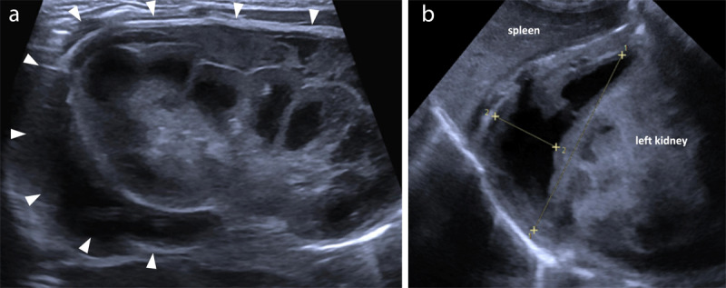
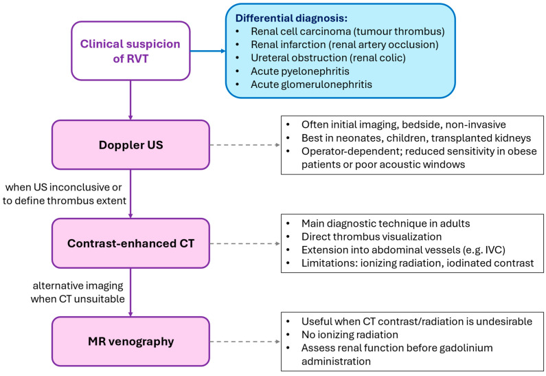
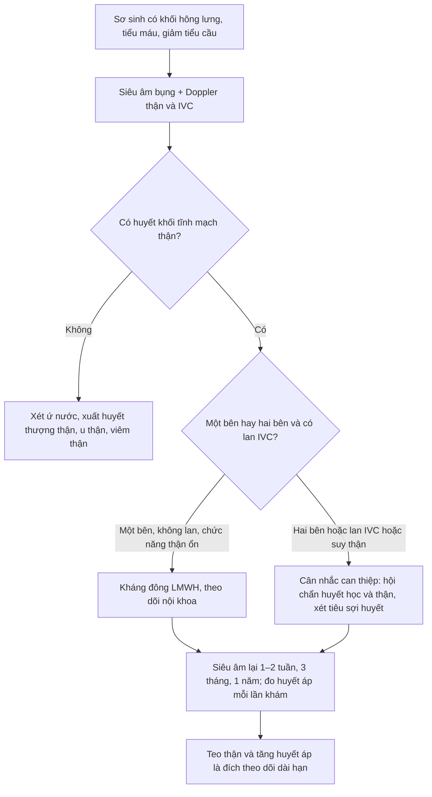
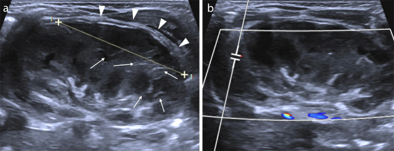
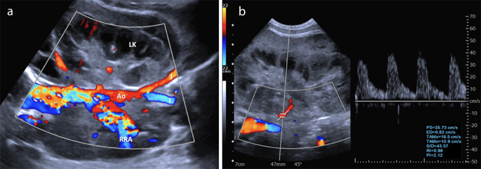
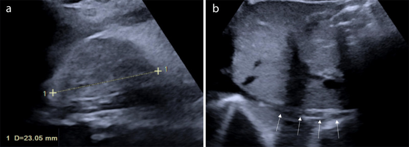

# 6111 — Huyết khối tĩnh mạch thận ở trẻ sơ sinh: thận to, mất dòng tĩnh mạch và tăng RI

**Tags:** `pattern:huyet-khoi-tinh-mach` `pattern:than-to` `pattern:giam-tuoi-mau-than` `pattern:xuat-huyet-thuong-than` `vung:than` `vung:thuong-than` `protocol:sieu-am-Doppler` `protocol:CTV-bung` `incidentaloma:than-to-so-sinh`
**Mức chắc chắn (certainty):** tổng hợp y văn (literature synthesis) — ghép **ca nguyên văn huyết khối tĩnh mạch thận chu sinh có hình ảnh siêu âm–Doppler đầy đủ từ lúc cấp tới teo thận sau 1 năm** (J Belg Soc Radiol 2023, PMC10540703), **tổng quan tự sự về huyết khối tĩnh mạch thận** (Diagnostics 2026, PMC13298574) và **ca huyết khối thận–tĩnh mạch chủ dưới không do catheter ở sơ sinh** (Open Access Maced J Med Sci 2018, PMC6182507).

> **Câu hỏi thực hành:** sơ sinh **đủ tháng, ngày thứ 4**, nhập NICU vì **khối vùng hông lưng trái 7 cm**, da tái, **huyết sắc tố 8,7 g/dL**, tiểu cầu giảm. Siêu âm tại giường: **thận trái to, vỏ tăng âm, có dịch quanh thận**; Doppler **không thấy dòng tĩnh mạch thận**. Câu hỏi: **đây là huyết khối tĩnh mạch thận hay xuất huyết thượng thận? Có phải chụp CT không? Có dùng kháng đông không, và thận có hồi phục?**
> Bài chốt **ba việc của người siêu âm sơ sinh**: **(1) nhận ra "thận to + mất dòng tĩnh mạch + RI tăng" là chữ ký của huyết khối tĩnh mạch thận (renal vein thrombosis, RVT); (2) phân biệt với xuất huyết thượng thận, ứ nước, huyết khối động mạch thận; (3) biết rằng thận thường KHÔNG hồi phục — teo thận và tăng huyết áp là đích theo dõi dài hạn.** Nối [157 – Bệnh thận đa nang ADPKD/ARPKD](../157-benh-than-da-nang-adpkd-arpkd/lesson.md), [151 – U thận đặc](../151-u-than-dac/lesson.md), [691 – Siêu âm và soi quanh catheter ở trẻ](../691-soi-bang-quang-va-soi-quanh-catheter-o-tre/lesson.md).

## 1. Tổng quan bệnh học – cơ chế hình ảnh: vì sao thận sơ sinh "sưng lên rồi teo đi"

- **Sinh lý bệnh (Virchow ở trẻ sơ sinh):** huyết khối **bắt đầu trong các tĩnh mạch nhỏ nội thận** (tĩnh mạch gian tiểu thùy, gian thùy) rồi lan ra **tĩnh mạch thận chính** và **tĩnh mạch chủ dưới (inferior vena cava, IVC)** — vì vậy nhiều tác giả cho rằng tên đúng hơn là **"huyết khối tĩnh mạch thận" (renal venous thrombosis)** chứ không chỉ "huyết khối tĩnh mạch thận" đơn thuần (Diagnostics 2026, PMC13298574). Ba yếu tố khởi phát đặc trưng ở sơ sinh: **giảm thể tích/dòng chảy chậm**, **tổn thương nội mạc** (catheter rốn, nhiễm khuẩn huyết) và **tăng đông** (yếu tố V Leiden, prothrombin G20210A, thiếu protein C/antithrombin).
- **TẠI SAO thận to:** tắc dòng ra tĩnh mạch → **áp lực mao mạch cầu thận tăng** → **phù nề và xuất huyết nhu mô**; bao thận căng, dễ **vỡ bao và máu quanh thận**. Đây là lý do thận có thể **to gấp rưỡi** bình thường: trong ca nguyên văn, **thận trái 7 cm** so với **giá trị trung bình 4,5 ± 0,3 cm** ở tuổi này (J Belg Soc Radiol 2023, PMC10540703).
- **TẠI SAO "vỏ tăng âm + vệt tăng âm tủy thận" (echogenic medullary streaks):** huyết khối lấp các tĩnh mạch gian thùy/gian tiểu thùy tạo các **dải tăng âm hình nan hoa** trên nền tủy giảm âm; sau **2–3 tuần** các huyết khối nhỏ **vôi hóa** → đốm tăng âm kèm bóng lưng, rồi **teo thận** (Diagnostics 2026, PMC13298574). Đây là chuỗi **"phù → vôi hóa → teo"**, không phải ba bệnh khác nhau.
- **TẠI SAO RI tăng và phổ động mạch đổi:** tắc tĩnh mạch làm **áp lực mô kẽ tăng** → **sức cản dòng động mạch tăng**; trên Doppler thấy **RI tăng, dòng tâm trương giảm hoặc đảo**. Ca minh họa có **RI 0,88 và PI 2,12** ở động mạch thận trái (J Belg Soc Radiol 2023, PMC10540703, Figure 3b). Cần nhớ **RI bình thường ở sơ sinh đã cao** (tới ~0,8 ở trẻ nhỏ), nên **phải so với thận đối diện** chứ không dùng ngưỡng người lớn.
- **Dịch tễ (ngưỡng định lượng):** **2,2/100.000 trẻ sinh sống** (Đức, có triệu chứng) và **13/100.000 ở trẻ đẻ non**; Canada **~2,6/100.000** (dao động 1,6–3,4) giai đoạn 1992–2016; RVT chiếm **12,5–15,5%** các ca huyết khối thuyên tắc ở sơ sinh; **thận trái gặp nhiều hơn thận phải ~2,8 lần** (tĩnh mạch trái dài hơn, nhiều nhánh hơn, đi qua khe giữa động mạch chủ và động mạch mạc treo tràng trên) (Diagnostics 2026, PMC13298574).

*Siêu âm sơ sinh ngày thứ 4: **(a)** thận trái to, **vỏ tăng âm**, **dải dịch/máu quanh thận dày** (đầu mũi tên); **(b)** **xuất huyết thượng thận trái** kèm vùng hóa lỏng giảm âm, cạnh lách và cực trên thận trái. Đây là chữ ký của RVT chu sinh: **thận to + máu quanh thận + xuất huyết thượng thận cùng bên**. Nguồn: J Belg Soc Radiol 2023 (PMC10540703), CC BY 4.0, nguyên bản.*

## 2. Mẫu hình + chẩn đoán phân biệt theo vị trí và theo mức lan (gamut)

- **Gamut theo mức lan của huyết khối:** **nội thận (nhánh nhỏ)** → **tĩnh mạch thận chính** → **IVC** (tới hợp lưu tĩnh mạch gan) → **nhĩ phải** (nguy cơ **thuyên tắc phổi**, được báo cáo **12–18%** ở người lớn có RVT). Lan sang **tĩnh mạch thượng thận trái** gây **xuất huyết thượng thận (8–32% các ca)**; lan sang **tĩnh mạch sinh dục trái** gây **ứ máu tiểu khung/giãn tĩnh mạch thừng tinh**.
- **Gamut theo bên:** **một bên** (đa số, thận đối diện bù trừ) · **hai bên** (nguy cơ **suy thận cấp**, chỉ định can thiệp tích cực hơn) · **một bên + IVC** (nguy cơ huyết khối lan và tái phát).
- **Gamut theo bối cảnh:** **tự phát ở sơ sinh khỏe** (thường có yếu tố di truyền) · **sau catheter rốn** · **sau ngạt/nhiễm khuẩn huyết/tụt huyết áp** · **mất nước, đa hồng cầu** · **mẹ đái tháo đường** (17% trong một đoàn hệ) · **hội chứng thận nhiễm mỡ** (ở trẻ lớn hơn).
- **Năm nhóm chính của "khối hông lưng" sơ sinh (nhóm tự biên để nhớ, không phải thang điểm):** **ứ nước thận** · **xuất huyết thượng thận** · **u nguyên bào thận/nephroblastomatosis** (hiếm < 6 tháng) · **viêm thận–bể thận mủ** · **huyết khối tĩnh mạch thận**. Thêm **huyết khối động mạch thận** (thận teo, vỏ mất tín hiệu, **không có thận to**) và **bệnh thận nang** (nhiều nang, không có khối đặc).

## 3. Bảng so sánh phân biệt (ma trận đối chiếu)

| Thực thể (entity) | Hình ảnh điển hình | Chốt vào (rule-in) | Chốt loại (rule-out) | Gợi ý xác nhận |
|---|---|---|---|---|
| **Huyết khối tĩnh mạch thận (RVT)** | **Thận to**, vỏ tăng âm, **mất phân biệt vỏ–tủy**, **vệt tăng âm tủy thận**, huyết khối trong tĩnh mạch thận/IVC, **không có dòng tĩnh mạch**, **RI tăng (0,88)**, máu quanh thận | **Thận to + mất dòng tĩnh mạch + RI tăng so với bên đối diện** | Thận nhỏ, không có huyết khối, dòng tĩnh mạch đầy đủ → không phải RVT | Doppler màu + phổ; CTV khi cần xác định mức lan |
| **Xuất huyết thượng thận** | Khối **trên thận**, hình **tam giác/bầu dục**, tăng âm rồi giảm âm theo ngày, **không có dòng**; thận bên dưới **bình thường** | **Khối trên thận tách khỏi thận, thận bình thường** | Khối nằm trong thận, thận to, mất dòng tĩnh mạch → RVT | Siêu âm lặp lại sau 1–2 tuần; không cần can thiệp |
| **Ứ nước thận (hydronephrosis)** | **Bể thận giãn**, các đài giãn, **không có khối đặc**; có thể teo nhu mô nếu mạn | **Giãn bể thận + không có huyết khối** | Không giãn bể thận, có huyết khối trong tĩnh mạch → RVT | Siêu âm bàng quang–niệu quản; MAG3 nếu cần |
| **Huyết khối động mạch thận** | Thận **nhỏ/không to**, vỏ **mất tín hiệu**, **không có dòng động mạch**, RI không đo được | **Mất dòng động mạch + thận không to** | Có dòng động mạch, thận to → RVT | Doppler màu; CTA/CTV nếu nghi |
| **U nguyên bào thận (Wilms)/nephroblastomatosis** | Khối **đặc trong thận**, bờ rõ, có thể **huyết khối tĩnh mạch do u xâm lấn** | **Khối đặc có cấu trúc u + tuổi > 6 tháng** | Thận to lan tỏa, không có khối đặc khu trú → RVT | CT/MRI; **huyết khối do u KHÔNG đáp ứng kháng đông** |
| **Viêm thận–bể thận mủ (pyonephrosis)** | Thận to, **dịch đặc trong bể thận**, thành dày, tăng tưới máu vỏ | **Sốt + dịch lợn cợn trong bể thận + tăng tưới máu** | Không có dịch bể thận, mất dòng tĩnh mạch → RVT | Siêu âm + cấy máu/nước tiểu |

*Thuật toán của bài tổng quan: **nghi RVT → siêu âm Doppler** (đầu tay, tại giường, không xâm lấn; tốt ở sơ sinh và thận ghép; **phụ thuộc người làm, giảm độ nhạy khi béo/khó cửa sổ**) → **CT có cản quang** khi siêu âm không kết luận hoặc cần xác định mức lan (nhìn trực tiếp huyết khối, lan vào IVC; hạn chế: bức xạ + i-ốt) → **MRV** khi không dùng được CT. Hộp chẩn đoán phân biệt của hình liệt kê **u thận (huyết khối do u)**, **nhồi máu thận (tắc động mạch)**, **tắc niệu quản**, **viêm thận–bể thận cấp**, **viêm cầu thận cấp**. Nguồn: Diagnostics 2026 (PMC13298574), CC BY 4.0, nguyên bản.*

## 4. Protocol chụp + ngưỡng xử trí

- **Siêu âm là đầu tay, không cần chuẩn bị, không cản quang:** bắt buộc **3 chuỗi** — **(1) B-mode**: kích thước thận (so với bên đối diện và bảng theo tuổi/cân nặng), độ dày vỏ, phân biệt vỏ–tủy, vệt tủy, dịch quanh thận; **(2) Doppler màu**: dòng trong tĩnh mạch thận và IVC, dòng trong nhu mô; **(3) Doppler phổ**: **RI và PI của động mạch thận**, so **hai bên**. Độ nhạy–độ đặc hiệu của Doppler so với chụp tĩnh mạch cũ là **85–100% / 56–75%** — đủ để **khởi đầu**, không đủ để loại trừ khi cửa sổ kém (Diagnostics 2026, PMC13298574).
- **CT tĩnh mạch (CTV) khi:** cần **xác định mức lan vào IVC/nhĩ phải**, siêu âm không kết luận, hoặc cân nhắc can thiệp. **MRV** thay thế khi muốn tránh bức xạ/i-ốt, nhưng **thường cần gây mê** ở sơ sinh.
- **Ngưỡng hình ảnh cần ghi vào phiếu:** **đường kính dài thận (mm) hai bên**, **tỷ lệ so với bên đối diện**, **RI hai bên**, **vị trí đầu huyết khối** (tĩnh mạch thận/IVC/nhĩ), **có xuất huyết thượng thận kèm không**, **có máu quanh thận không**.
- **Xử trí theo mức lan và chức năng thận:**

- **Kháng đông (anticoagulation):** là **nền tảng** điều trị RVT không do u. Thực hành trong các đoàn hệ sơ sinh: **LMWH hoặc UFH 4–12 tuần** (trung vị **8 tuần**); **không có khác biệt về tiêu huyết khối** giữa nhóm **< 6 tuần** và **> 6 tuần** (tiêu một phần **71,4% vs 73,4%**, tiêu hoàn toàn **28,6% vs 13,3%**, p = 0,46). Hướng dẫn chung cho huyết khối thuyên tắc ở trẻ: **6 tuần** với huyết khối có yếu tố khởi phát đã hết, **6–12 tháng** với huyết khối không rõ nguyên nhân (Diagnostics 2026, PMC13298574).
- **Theo dõi sau 2 tuần (mốc "thận đang đổi cấu trúc"):** thận **giảm kích thước** nhưng **mất phân biệt vỏ–tủy** và xuất hiện **vệt tăng âm tủy thận**; Doppler có thể **mất gần hoàn toàn dòng mạch trong thận** dù huyết khối tĩnh mạch chính còn — đây là dấu hiệu **nhồi máu nhu mô đang tiến triển**, không phải "đang hồi phục".

*Siêu âm lặp lại sau 2 tuần ở cùng bệnh nhi: **(a)** máu quanh thận mỏng đi (đầu mũi tên) nhưng **mất phân biệt vỏ–tủy**, xuất hiện **vệt tăng âm tủy thận** (mũi tên); **(b)** Doppler **gần như mất hoàn toàn dòng mạch trong thận trái**. Bài học: **kích thước giảm không đồng nghĩa thận hồi phục** — cấu trúc nhu mô mới là dấu hiệu tiên lượng. Nguồn: J Belg Soc Radiol 2023 (PMC10540703), CC BY 4.0, nguyên bản.*

- **Tiêu sợi huyết (thrombolysis) chỉ khi hai bên + suy thận:** trong **27 sơ sinh**, 4 ca tiêu sợi huyết (đều hai bên) có **biến chứng chảy máu 75% vs 0%** so với LMWH/hỗ trợ (p = 0,05) và **tiêu huyết khối tương đương 75% vs 75%** (p = 1,00) — lợi ích chưa rõ, nguy cơ chảy máu rõ (Diagnostics 2026, PMC13298574). Với **một bên, không suy thận**, có khuyến nghị **không điều trị đặc hiệu** tới **29%** ca trong loạt tư vấn 72 sơ sinh.

## 5. Biến thể bình thường và cạm bẫy

- **Thận sơ sinh "bình thường" đã tăng âm và có múi:** vỏ tăng âm hơn người lớn, phân biệt vỏ–tủy rõ; **đừng gọi là RVT** nếu **không có thận to, không có huyết khối, dòng tĩnh mạch đầy đủ** — luôn so **hai bên** và so với **bảng kích thước theo tuổi**.
- **RI cao là sinh lý ở sơ sinh:** ngưỡng người lớn (**RI > 0,70**) không dùng được; phải dùng **so sánh bên–bên** và **bối cảnh lâm sàng** (khối, tiểu máu, giảm tiểu cầu).
- **"Không thấy dòng" có thể do máy, không phải do tắc:** ở sơ sinh lưu lượng rất thấp — hạ **PRF/scale**, dùng **power Doppler**, đặt cửa sổ đúng trục tĩnh mạch, và lặp lại sau khi ủ ấm bệnh nhi **trước khi kết luận tắc**.
- **Huyết khối có thể đồng âm (isoechoic)** và **không thấy trên B-mode** — chỉ thấy khi **không có dòng** và **tĩnh mạch giãn**; đừng bỏ qua vì "không thấy cục".
- **Xuất huyết thượng thận cùng bên che lấp thận:** khối trên thận có thể là **máu tụ**, không phải u; nếu thận bên dưới bình thường thì **không mặc định là RVT** — nhưng ngược lại, **RVT có thể gây xuất huyết thượng thận** (8–32%), nên khi thấy máu thượng thận **phải khảo sát tĩnh mạch thận**.
- **Bẫy "thỏa mãn tìm kiếm" với IVC:** đã thấy huyết khối tĩnh mạch thận là dừng — nhưng **lan lên IVC** thay đổi tiên lượng và thời gian kháng đông; luôn chạy dọc IVC tới hợp lưu tĩnh mạch gan.
- **Hai bên = suy thận cấp:** đừng bỏ sót thận đối diện; và **huyết khối do u (Wilms) không đáp ứng kháng đông** — nếu thấy **khối đặc trong thận** kèm huyết khối, hướng chẩn đoán khác.

## 6. Tự lượng giá — Blind Quiz

**Ca 1 — Sơ sinh ngày thứ 4, khối hông lưng trái 7 cm.**

- Gợi ý lâm sàng: đủ tháng, da tái, Hb 8,7 g/dL, tiểu cầu giảm, chưa đặt catheter rốn.
- Câu hỏi: Mô tả hai bất thường chính. Chẩn đoán nào bao trùm cả hai? Cần khảo sát thêm mạch nào ngay trên cùng buổi siêu âm?

<b>Bấm để hiện đáp án (findings + chẩn đoán)</b>

- Dấu hiệu (findings): **(a)** thận trái **to**, vỏ **tăng âm**, **dải dịch/máu quanh thận** (đầu mũi tên); **(b)** **khối xuất huyết thượng thận trái** có vùng hóa lỏng giảm âm.
- Chẩn đoán (diagnosis): **huyết khối tĩnh mạch thận trái chu sinh** gây **nhồi máu–xuất huyết nhu mô, vỡ bao (máu quanh thận)** và **lan sang tĩnh mạch thượng thận** (xuất huyết thượng thận cùng bên, gặp **8–32%**).
- Vì sao: tắc dòng ra → áp lực mao mạch cầu thận tăng → phù, xuất huyết, thận to; nhánh thượng thận trái đổ vào tĩnh mạch thận trái nên dễ bị tắc theo.
- Cần làm ngay: **Doppler tĩnh mạch thận và IVC** để xác định mức lan, **Doppler phổ động mạch thận** để đo RI.
- Nguồn ảnh: J Belg Soc Radiol 2023 (PMC10540703), CC BY 4.0, nguyên bản.

**Ca 2 — Cùng bệnh nhi, Doppler động mạch thận trái.**

- Gợi ý lâm sàng: đang theo dõi RVT trái đã xác định.
- Câu hỏi: Phổ động mạch thận cho thấy gì (đọc số)? Vì sao tắc tĩnh mạch lại làm RI tăng? Có cần chụp CT ngay không?

<b>Bấm để hiện đáp án</b>

- Dấu hiệu (findings): **(a)** Doppler màu: **không có dòng trong tĩnh mạch thận trái và các nhánh nhỏ**, còn **dòng động mạch thận đối diện (RRA) và động mạch chủ (Ao) tăng rõ**; **(b)** phổ động mạch thận trái: **dòng tâm trương giảm**, **RI 0,88**, **PI 2,12**.
- Chẩn đoán (diagnosis): **RVT trái** với **tăng sức cản động mạch do tăng áp lực mô kẽ** — không phải hẹp động mạch thận.
- Vì sao: tắc dòng ra → phù nhu mô → áp lực mô kẽ tăng → sức cản dòng vào tăng → RI tăng và dòng tâm trương giảm/đảo.
- Có cần CT ngay không: **không bắt buộc** nếu siêu âm đã rõ và không nghi lan IVC; **CTV** khi cần xác định mức lan hoặc cân nhắc can thiệp.
- Nguồn ảnh: J Belg Soc Radiol 2023 (PMC10540703), CC BY 4.0, nguyên bản.

**Ca 3 — Cùng bệnh nhi sau 1 năm.**

- Gợi ý lâm sàng: đã điều trị enoxaparin, tái khám định kỳ, huyết áp cần theo dõi.
- Câu hỏi: Thận trái bây giờ ra sao (đọc số đo)? Tĩnh mạch chủ dưới có gì? Vì sao vẫn phải theo dõi huyết áp nhiều năm?

<b>Bấm để hiện đáp án</b>

- Dấu hiệu (findings): **(a)** thận trái **teo**, đường kính dài **23,05 mm**; **(b)** **IVC hình chỉ (filiform)** với các mũi tên chỉ đoạn hẹp–xơ sau huyết khối.
- Chẩn đoán (diagnosis): **teo thận trái sau RVT** + **xơ hẹp tĩnh mạch chủ dưới** — di chứng cố định, không hồi phục.
- Vì sao phải theo dõi huyết áp: teo thận sau RVT đi kèm **tăng huyết áp mạn**: **22,0% (13/59)** tăng huyết áp nặng cần thuốc sau trung vị **4,0 năm**; **32,5% (13/40)** sau **3,7 năm**; **38,8% (33/85)** sau trung vị **11,1 năm**, nguy cơ **gấp 15,7 lần** trẻ không có RVT (Diagnostics 2026, PMC13298574).
- Phản biện nguồn: đây là **một ca nguyên văn**; tỷ lệ teo thận trong các đoàn hệ dao động lớn (**67%** tới **81,8–90,9%** số thận bị ảnh hưởng) — không dùng một ca để suy ra tiên lượng cá nhân.
- Nguồn ảnh: J Belg Soc Radiol 2023 (PMC10540703), CC BY 4.0, nguyên bản.

## Bài liên quan chéo
- [151 – U thận đặc: phân biệt u nguyên phát và di căn](../151-u-than-dac/lesson.md)
- [157 – Bệnh thận đa nang ADPKD/ARPKD](../157-benh-than-da-nang-adpkd-arpkd/lesson.md)
- [691 – Siêu âm và soi quanh catheter ở trẻ](../691-soi-bang-quang-va-soi-quanh-catheter-o-tre/lesson.md)
- [635 – Dị tật tiết niệu nhi: SFU, VUR, PUV](../635-di-tat-tiet-nieu-nhi-SFU-VUR-PUV/lesson.md)
- [600 – Tổng quan Nhi khoa](../600-tong-quan-nhi-khoa/lesson.md)

> Không dùng để chẩn đoán độc lập khi chưa có người hướng dẫn.
