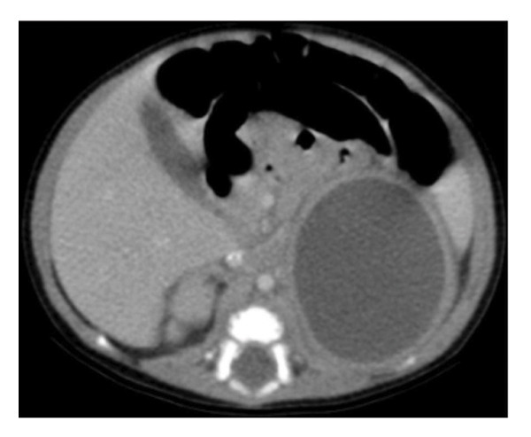
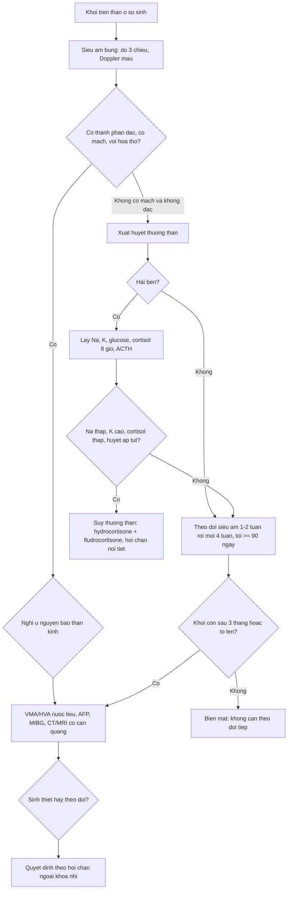
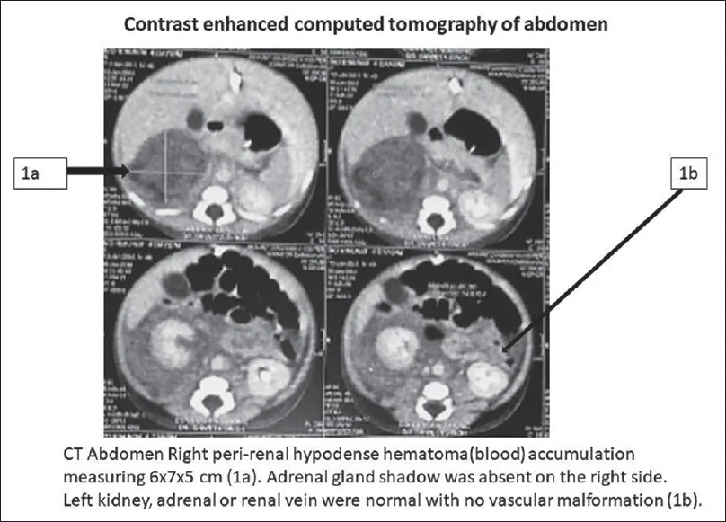
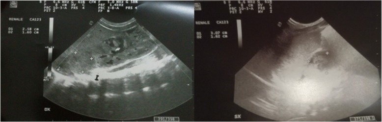
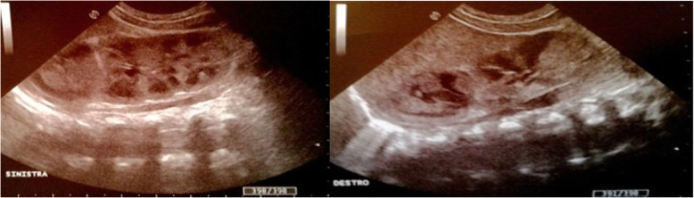
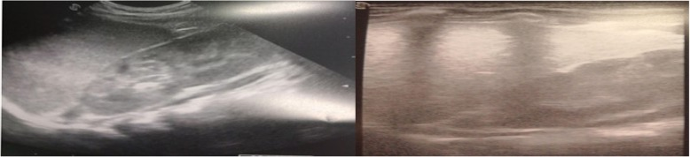

# 6112 — Xuất huyết thượng thận ở trẻ sơ sinh: khối trên thận "đổi hình theo ngày"

**Tags:** `pattern:khoi-thuong-than` `pattern:thay-doi-theo-thoi-gian` `pattern:khong-tuoi-mau` `vung:thuong-than` `vung:than` `protocol:sieu-am-so-sinh` `protocol:CT-bung-co-can-quang` `incidentaloma:khoi-thuong-than-so-sinh`
**Mức chắc chắn (certainty):** tổng hợp y văn (literature synthesis) — ghép **một ca theo dõi siêu âm liên tục từ ngày 1 tới ngày 88** (Ital J Pediatr 2019, PMC6507044), **một ca xuất huyết thượng thận dạng nang có CT đối chiếu** (Case Rep Pediatr 2026, PMC12950900), **một ca vỡ thượng thận gây sốc giảm thể tích** (J Indian Assoc Pediatr Surg 2026, PMC13614821) và **so sánh 36 máu tụ với 40 u nguyên bào thần kinh trên CT** (World J Oncol 2024, PMC10807921).

> **Câu hỏi thực hành:** sơ sinh **đủ tháng, ngày thứ 3**, đẻ khó phải đẩy bụng, **khối vùng hông lưng phải 4 cm**, da tái, **huyết sắc tố tụt từ 16,5 xuống 11,8 g/dL**, vàng da nhẹ. Siêu âm thấy **khối trên thận phải, hỗn hợp âm, không có dòng chảy**. Câu hỏi: **máu tụ thượng thận hay u nguyên bào thần kinh? Có phải chụp CT? Theo dõi bao lâu thì được coi là "hết"? Khi nào phải xét suy thượng thận?**
> Bài chốt **ba việc**: **(1) đọc khối thượng thận theo TRỤC THỜI GIAN** (tăng âm → hóa lỏng → nang → vôi hóa → biến mất trong **20–165 ngày**); **(2) phân biệt với u nguyên bào thần kinh bằng cấu trúc + mạch + xét nghiệm, không bằng một lần chụp**; **(3) hai bên hoặc có triệu chứng thì phải xét suy thượng thận (Na⁺, K⁺, glucose, cortisol)**. Nối [6111 – Huyết khối tĩnh mạch thận sơ sinh](../6111-huyet-khoi-tinh-mach-than-so-sinh/lesson.md), [630 – U bụng nhi: neuroblastoma vs Wilms](../630-u-bung-nhi-neuroblastoma-vs-wilms/lesson.md), [151 – U thận đặc](../151-u-than-dac/lesson.md).

## 1. Tổng quan bệnh học – cơ chế hình ảnh: vì sao khối này "tự đổi hình"

- **Vì sao thượng thận sơ sinh dễ chảy máu:** tuyến **lớn gấp 10–20 lần** người lớn tính theo cân nặng, được nuôi bởi **3 động mạch thượng thận với 50–60 nhánh** đổ vào vỏ tuyến xốp, còn **tĩnh mạch phải đổ trực tiếp vào tĩnh mạch chủ dưới** — nên chỉ một thay đổi áp lực tĩnh mạch hay một lực chèn ép (gan – cột sống) là đủ gây vỡ. Thượng thận **phải chiếm ~70%** các ca (đoàn hệ CT mới: **86,1%**), **hai bên 5–10%** (Ital J Pediatr 2019, PMC6507044; J Indian Assoc Pediatr Surg 2026, PMC13614821).
- **Dịch tễ (ngưỡng định lượng):** **0,2–0,55%** trẻ sinh sống (Case Rep Pediatr 2026, PMC12950900) — trong khi một đoàn hệ khác ghi **1,7–2,1/1000 (0,17–0,21%)** (BMC Pediatr 2022, PMC9069721); gặp ở **trẻ đủ tháng nhiều hơn**, nam nhiều hơn trong các loạt ca — nhưng đoàn hệ CT 76 sơ sinh cho thấy **tỉ lệ nam 52,8% vs 62,5% không khác biệt** (p = 0,391), tức "nam chiếm ưu thế" là **thiên lệch báo cáo**, không phải sinh học chắc chắn (World J Oncol 2024, PMC10807921).
- **TẠI SAO hình ảnh đổi theo ngày (vật lý của cục máu):** máu tụ trải qua chuỗi **co cục (clot retraction) → ly giải hồng cầu → hóa lỏng → tái hấp thu hoặc vôi hóa**. Trên siêu âm: **ngày 0–3 tăng âm, đặc, to**; **1–2 tuần** hóa lỏng → **hỗn hợp âm, ổ giảm âm trung tâm, mức dịch–dịch, vách**; **~2 tháng** thành **nang trống âm**; **1/3 ca vôi hóa**, có thể **sớm ngay 1–2 tuần** (Ital J Pediatr 2019, PMC6507044). Trên CT: cục máu cấp **50–80 HU**, **không ngấm thuốc**, viền mỏng ngấm thuốc là **mô thượng thận bị ép**, **không có thành phần đặc** (Case Rep Pediatr 2026, PMC12950900).
- **TẠI SAO thiếu máu và vàng da:** máu nằm trong khoang kín bị ly giải → **vàng da gián tiếp** (đỉnh **11,7 mg/dL**) và **Hb tụt** (ca thực tế **15,2 → 7,5 g/dL**; ca khác **19,6 → 15,8** trong 3 ngày đầu) (PMC12950900; PMC9069721).
- **Thời gian "hết":** biến mất hoàn toàn trong **20–165 ngày**, phần lớn **3–3,5 tháng**, tối đa **9 tháng**; vì vậy mốc theo dõi tối thiểu là **90 ngày**, và **khối còn sau mốc này là lý do nghĩ u** (Ital J Pediatr 2019, PMC6507044; BMC Pediatr 2022, PMC9069721).

## 2. Mẫu hình + chẩn đoán phân biệt theo vị trí và theo "trục thời gian" (gamut)

- **Trục thời gian (đặc trưng riêng của xuất huyết thượng thận — không bệnh nào khác có):** tăng âm đặc (ngày 0–3) → hỗn hợp âm + mức dịch (tuần 1–2) → nang teo dần (tuần 2–8) → vôi hóa viền ở **1/3 ca** → biến mất. **Một khối "đổi hình" qua 2 lần siêu âm cách nhau 1–2 tuần gần như loại u đặc**.
- **Theo vị trí:** **trên thận, tách khỏi thận** (thượng thận) · **trong thận** (u nguyên bào thận, nang trên thận, ổ áp-xe) · **dưới cơ hoành, đáy phổi trái** (phổi biệt lập ngoài thùy dưới hoành) · **sau phúc mạc giữa/khoang cạnh sống** (u quái sau phúc mạc, hạch thần kinh) · **gan phải** (u gan, máu tụ dưới bao).
- **Sáu hàng chính của "khối thượng thận sơ sinh":** **xuất huyết thượng thận** · **u nguyên bào thần kinh** · **áp-xe thượng thận** · **nang thượng thận/lymphangioma** · **phổi biệt lập ngoài thùy dưới hoành** · **tăng sản thượng thận bẩm sinh thể khối (hai bên, đối xứng)**. Thêm: **thận đôi có cực trên ứ nước**, **u quái sau phúc mạc**, **huyết khối tĩnh mạch thượng thận trong RVT** (bài 6111).
- **Mnemonic "NAH"** để không quên 3 việc: **N**o flow (không có dòng chảy trong khối) – **A**ge (đổi hình theo tuổi khối) – **H**ormone (bilateral → kiểm tra hormon).

## 3. Bảng so sánh phân biệt (ma trận đối chiếu)

| Thực thể (entity) | Hình ảnh điển hình | Chốt vào (rule-in) | Chốt loại (rule-out) | Gợi ý xác nhận |
|---|---|---|---|---|
| **Xuất huyết thượng thận (NAH)** | Khối trên thận, hình **tam giác/bầu dục**, tăng âm rồi hóa lỏng, **không có dòng chảy**, thận bên dưới **bình thường** | **Đổi cấu trúc qua 2 lần siêu âm + không có mạch trong khối + thận bình thường** | Khối **đặc, có mạch, không đổi sau 3 tháng** → nghĩ u | Siêu âm lặp **1–2 tuần**, rồi hằng tháng tới **≥ 90 ngày** |
| **U nguyên bào thần kinh (neuroblastoma)** | Khối **đặc**, có thể **vôi hóa thô**, **có mạch**, bờ không đều, có thể vượt đường giữa, **phát hiện trước sinh 75%** | **Có mạch trong khối + vôi hóa + không teo theo thời gian + LDH/ferritin cao** | **Không có mạch, teo dần, không vôi hóa** → NAH | **VMA/HVA nước tiểu**, MIBG, sinh thiết; theo dõi 3 tháng |
| **Áp-xe thượng thận** | Khối **dịch dày, vách, khí trong khối**, thành ngấm thuốc, **to lên** dù đã kháng sinh | **Sốt + CRP cao + khí/vách + thành ngấm thuốc** | Khối giảm dần, không thành ngấm, không khí → NAH | Chọc hút/dẫn lưu + cấy khi nghi áp-xe |
| **Nang thượng thận / lymphangioma** | **Trống âm thuần**, thành mỏng, **không đổi hình nhanh**, có thể vách mảnh | **Thuần dịch, không tăng âm ban đầu, không co nhỏ nhanh** | Có **phần đặc/tăng âm thoái triển** → NAH | Siêu âm; MRI nếu cần |
| **Phổi biệt lập dưới hoành** | Khối **đặc**, **có mạch nuôi từ động mạch chủ**, thường **bên trái**, sát cơ hoành | **Thấy nhánh động mạch nuôi từ ĐMC** | Không có mạch nuôi từ ĐMC, có chuỗi hóa lỏng → NAH | **CTA** tìm động mạch nuôi (không dùng siêu âm đơn thuần) |
| **Tăng sản thượng thận bẩm sinh thể khối** | **Hai bên, đối xứng**, giữ hình tuyến, không có ổ dịch | **Hai bên đối xứng + Na⁺ thấp/K⁺ cao + 17-OHP cao** | Một bên, có ổ dịch/hóa lỏng → NAH | 17-OHP, điện giải, cortisol |

**Số liệu tách NAH khỏi u nguyên bào thần kinh (76 sơ sinh, CT):** phát hiện **trước sinh 11,1% (NAH) vs 75,0% (u)** (p < 0,001); **bên phải 86,1% vs 52,5%** (p = 0,003); **cân nặng 3,56 vs 4,50 kg**; **LDH 667 vs 299 U/L**; **ferritin 574 vs 319 µg/L**; **NSE 31,95 vs 45,65 ng/mL**; **bác sĩ CĐHA đọc mù đạt AUC 0,831 (độ chính xác 81,6%)**, mô hình học máy **AUC 0,985** (World J Oncol 2024, PMC10807921). U nguyên bào thần kinh có tỉ lệ **~1,75/100.000** trẻ — hiếm hơn xuất huyết thượng thận nhiều lần (Ital J Pediatr 2019).

*CT có cản quang ở sơ sinh **12 ngày tuổi** (nhiễm khuẩn huyết E. coli): khối **giảm mật độ đồng nhất** vùng thượng thận trái, **viền mỏng ngấm thuốc**, **không vôi hóa, không thành phần đặc** — hình ảnh của **máu tụ đã hóa lỏng**, không phải u. Đây là lý do **CT chỉ dùng khi siêu âm không kết luận**, không dùng để "theo dõi cho chắc". Nguồn: Case Rep Pediatr 2026 (PMC12950900), CC BY 4.0, nguyên bản.*

## 4. Protocol chụp + ngưỡng xử trí

- **Siêu âm là đầu tay, không cần chuẩn bị, không bức xạ:** đầu dò **linear 7–12 MHz** (sơ sinh), quét **mặt cắt vành/xiên qua hông lưng hai bên**, đo **3 chiều**, ghi **âm độ (tăng/hỗn hợp/trống âm), vách, mức dịch, vôi hóa**, bật **color/power Doppler** để chứng minh **không có dòng chảy trong khối**. Bắt buộc thêm: **hai thận + tĩnh mạch thận + tĩnh mạch chủ dưới** (NAH và RVT đi cùng nhau) và **hai thượng thận** (bên đối diện có thể bị bỏ sót).
- **Lịch theo dõi tối thiểu:** **1–2 tuần**, sau đó **mỗi 4 tuần** tới khi biến mất; **không kết luận "hết" trước 90 ngày** vì trung vị 3–3,5 tháng, tối đa 9 tháng.
- **CT có cản quang khi:** khối **có thành phần đặc/ngấm thuốc**, **vôi hóa thô**, **còn sau 3 tháng**, **to lên**, nghi **áp-xe**, hoặc **chuẩn bị mổ**. Dùng **liều thấp, một thì tĩnh mạch cửa**; tránh lặp CT — mỗi lần vẫn là một liều bức xạ trên trẻ sơ sinh.
- **MRI** thay thế khi cần đánh giá mô máu mà không muốn bức xạ: **T1 sáng (methemoglobin)**, **T2 thay đổi theo giai đoạn**, không ngấm thuốc — nhưng sơ sinh thường phải **gây mê/ủ ấm**, cân nhắc lợi ích.
- **Xét nghiệm phải lấy cùng lúc:** **công thức máu, bilirubin, glucose, Na⁺, K⁺**; **cortisol 8 giờ sáng + ACTH** nếu **hai bên** hoặc có **tụt huyết áp, nôn, hạ Na⁺, tăng K⁺, hạ đường huyết**; **VMA/HVA nước tiểu + AFP** nếu nghi u.

- **Suy thượng thận — ngưỡng và bằng chứng:** hiếm nhưng **thường xuất hiện trong tuần đầu** và **gần như chỉ ở ca hai bên**; biểu hiện có thể **im lặng** rồi **tụt huyết áp, nôn, hạ Na⁺, tăng K⁺, hạ đường huyết**. Ca minh họa: **cortisol 8 giờ sáng 2,82 µg/dL** (bình thường **5–25**), sau đó **ACTH 353 pg/mL** (bình thường **< 46**), phải dùng **hydrocortisone 1 mg/kg/ngày + fludrocortisone 0,01 mg/kg** và **vẫn điều trị ở 16 tháng** (BMC Pediatr 2022, PMC9069721). Vì vậy: **không dùng một cortisol "bình thường" lúc còn sốc để loại trừ** — làm lại khi ổn định, và hỏi ý kiến nội tiết.
- **Sốc do vỡ thượng thận:** khối máu tụ **6 × 7 × 5 cm** quanh thận, **mất bóng thượng thận**, hồi sức + điều trị bảo tồn thành công; **VMA nước tiểu bình thường** giúp loại u (J Indian Assoc Pediatr Surg 2026, PMC13614821).

*Vỡ thượng thận phải ở sơ sinh đủ tháng: **(1a)** máu tụ giảm mật độ quanh thận phải **6 × 7 × 5 cm**, **không thấy bóng thượng thận phải**; **(1b)** thận, thượng thận và tĩnh mạch thận **bên trái bình thường**, không có bất thường mạch. Bé nhập viện vì **suy hô hấp và sốc ngày đầu** — đây là mặt nguy hiểm của bệnh cảnh "khối hông lưng tình cờ". Nguồn: J Indian Assoc Pediatr Surg 2026 (PMC13614821), CC BY-NC-SA 4.0, nguyên bản.*

## 5. Biến thể bình thường và cạm bẫy

- **Thượng thận sơ sinh "bình thường" đã to và tăng âm:** hình **chữ Y/chữ V ngược/wishbone** ôm cực trên thận; trong **vài ngày đầu** lớp vỏ bào thai thoái triển có thể **không đều âm**. Đừng gọi là khối nếu **giữ hình tuyến, không có ổ dịch, không có hiệu ứng khối** — và luôn so **hai bên**.
- **Vôi hóa sớm KHÔNG đồng nghĩa u:** **1/3** ca xuất huyết thượng thận vôi hóa, có thể **ngay 1–2 tuần**; cái phân biệt là **vôi hóa viền + khối teo dần**, còn u thì **đặc, có mạch, không teo**.
- **"To lên" ở tuần 2–5 là hóa lỏng, không phải tiến triển:** ca minh họa **4,0 × 4,5 cm (ngày 12) → ~5 × 4 cm (ngày 36)** rồi **nhỏ dần và biến mất sau ngày 45** — nếu chỉ nhìn một mốc sẽ tưởng áp-xe/u (PMC12950900).
- **CT có thể bỏ sót:** máu tụ **đồng mật độ** với cơ/mô xung quanh ở giai đoạn muộn; **siêu âm nhạy hơn ở giai đoạn sớm**, nên "CT âm tính" không loại trừ nếu siêu âm thấy khối.
- **AFP cao là sinh lý ở sơ sinh** — đừng dùng AFP đơn thuần để "chẩn đoán u"; **VMA/HVA bình thường cũng không loại trừ tuyệt đối** u nguyên bào thần kinh thể biệt hóa.
- **Bỏ sót bên đối diện** (satisfaction of search): đã thấy máu tụ phải là dừng — nhưng **hai bên 5–10%**, và **hai bên mới là nhóm suy thượng thận**.
- **Suy thượng thận giả dạng nhiễm trùng huyết:** nôn, hạ Na⁺, tăng K⁺, hạ đường huyết ở sơ sinh có khối thượng thận **có thể là suy thượng thận hoặc giả suy thượng thận** (pseudohypoaldosteronism) — điện giải và cortisol rẻ hơn một lần nhập ICU (J Educ Teach Emerg Med 2021, PMC10332690).
- **Bìu sưng tím ở sơ sinh:** máu có thể chảy theo **ống phúc mạc** xuống bìu gây **"acute scrotum"**; siêu âm bìu thấy máu tụ nhưng **phải chụp cả thượng thận** trước khi nghĩ xoắn (Discoveries 2025, PMC12323913).

## 6. Tự lượng giá — Blind Quiz

**Ca 1 — Sơ sinh 12 ngày, nhiễm khuẩn huyết E. coli, siêu âm tình cờ thấy khối trên thận trái 4 × 4,5 cm.**

- Gợi ý lâm sàng: sốt, CRP cao, cấy nước tiểu E. coli; không có tiền sử chấn thương.
- Câu hỏi: Khối **ngấm thuốc hay không**? Có **vôi hóa/thành phần đặc**? Ba chẩn đoán phân biệt? Có cần chọc/dẫn lưu ngay không?

<b>Bấm để hiện đáp án (findings + chẩn đoán)</b>

- Dấu hiệu (findings): khối **giảm mật độ đồng nhất** vùng thượng thận trái, **viền mỏng ngấm thuốc**, **không có thành phần đặc, không vôi hóa**, không xâm lấn tạng lân cận.
- Chẩn đoán (diagnosis): **xuất huyết thượng thận đã hóa lỏng (máu tụ dạng nang)**; phân biệt: **áp-xe thượng thận** (thành dày ngấm thuốc, khí, sốt dai dẳng), **u nguyên bào thần kinh dạng nang** (có mạch/đặc, không teo), **u quái**.
- Vì sao không chọc ngay: không có ổ dịch hoại tử, bệnh nhi ổn định, khối **giảm dần** trên siêu âm lặp lại — điều trị **bảo tồn + kháng sinh** là đủ.
- Nguồn ảnh: Case Rep Pediatr 2026 (PMC12950900), CC BY 4.0, nguyên bản.

**Ca 2 — Sơ sinh đủ tháng đẻ khó, siêu âm ngày 1 và ngày 15.**

- Gợi ý lâm sàng: vai bị kẹt khi sinh, tụ máu dưới da đầu, vàng da tăng dần.
- Câu hỏi: Mô tả âm độ và bờ khối. Vì sao khối **không có dòng chảy** lại là thông tin quan trọng? Hai tuần sau em kỳ vọng thấy gì?

<b>Bấm để hiện đáp án</b>

- Dấu hiệu (findings): **hai khối trên thận hai bên**, bờ rõ, **hỗn hợp âm**, có **ổ giảm âm trung tâm**, thận bên dưới bình thường; thước đo trên màn hình: **2,16 × 1,60 cm** (phải) và **3,07 × 1,62 cm** (trái).
- Chẩn đoán (diagnosis): **xuất huyết thượng thận hai bên** sau sinh khó.
- Vì sao "không dòng chảy" quan trọng: u đặc (nguyên bào thần kinh) **có mạch**; máu tụ **không có mạch** — Doppler là chốt **rule-in** rẻ nhất.
- Hai tuần sau (đối chiếu ảnh dưới): **hóa lỏng** với **mức dịch–dịch, vách, ổ trống âm** — khối có thể **to hơn một chút** rồi mới teo.

- Ảnh ngày 15: **isoechoic–anechoic**, có **thành phần đặc nhỏ + mức dịch + vách**, **không có mạch** — đúng chuỗi hóa lỏng, **không phải áp-xe** vì không có thành ngấm thuốc/khí và bệnh nhi không sốt.
- Nguồn ảnh: Ital J Pediatr 2019 (PMC6507044), CC BY 4.0, nguyên bản.

**Ca 3 — Cùng bệnh nhi, siêu âm ngày 88: có phải đã "hết" không?**

- Gợi ý lâm sàng: đã ngừng hydrocortisone ở ngày 88, tăng cân tốt, không triệu chứng.
- Câu hỏi: Hình thượng thận hai bên bây giờ thế nào? Vì sao mốc 90 ngày lại quan trọng? Nếu ở ngày 180 vẫn còn khối thì làm gì?

<b>Bấm để hiện đáp án</b>

- Dấu hiệu (findings): **không còn khối**, thượng thận trở về **hình tuyến mảnh**, thận và xoang thận bình thường.
- Chẩn đoán (diagnosis): **hồi phục hoàn toàn sau xuất huyết thượng thận hai bên** — mốc **88 ngày**, nằm trong khoảng **20–165 ngày**.
- Vì sao 90 ngày: trung vị 3–3,5 tháng; **hết trước 90 ngày là bình thường**, **còn sau 90 ngày phải theo dõi tiếp và bắt đầu nghĩ u** nếu **đặc/có mạch/vôi hóa thô**.
- Nếu còn ở ngày 180: **siêu âm + Doppler**, cân nhắc **MRI/CT** và **VMA/HVA**, hội chẩn ngoại nhi — **không chọc sinh thiết mù** một khối có thể là máu tụ đang teo.
- Nguồn ảnh: Ital J Pediatr 2019 (PMC6507044), CC BY 4.0, nguyên bản.

## Bài liên quan chéo
- [6111 – Huyết khối tĩnh mạch thận ở trẻ sơ sinh: thận to, mất dòng tĩnh mạch và tăng RI](../6111-huyet-khoi-tinh-mach-than-so-sinh/lesson.md)
- [630 – U bụng nhi: neuroblastoma vs Wilms](../630-u-bung-nhi-neuroblastoma-vs-wilms/lesson.md)
- [151 – U thận đặc: phân biệt u nguyên phát và di căn](../151-u-than-dac/lesson.md)
- [605 – Siêu âm phổi điểm sơ sinh](../605-sieu-am-phoi-diem-so-sinh/lesson.md)
- [635 – Dị tật tiết niệu nhi: SFU, VUR, PUV](../635-di-tat-tiet-nieu-nhi-SFU-VUR-PUV/lesson.md)
- [3044 – Catheter tĩnh mạch trung tâm ở trẻ](../3044-catheter-tinh-mach-trung-tam-o-tre/lesson.md)
- [600 – Tổng quan Nhi khoa](../600-tong-quan-nhi-khoa/lesson.md)

## Ảnh
- 5 ảnh, tất cả **tải về nguyên bản** (không crop, không ghép), ghi nguồn + giấy phép từng ảnh trong `images/CREDITS.md`.
- **Không tạo composite:** mỗi nguồn đã tự ghép **panel theo thời điểm** (ngày 1 / ngày 15 / ngày 88; 1a–1b), ghép thêm sẽ làm mất nhãn của tác giả và gây hiểu sai về cùng một bệnh nhi.

> Không dùng để chẩn đoán độc lập khi chưa có người hướng dẫn.
