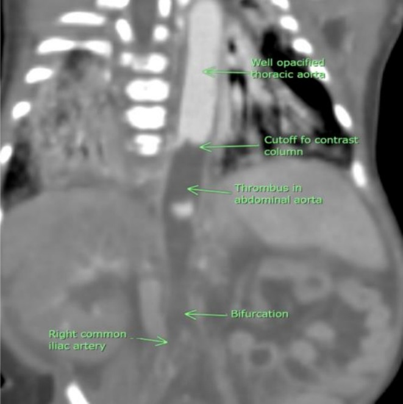
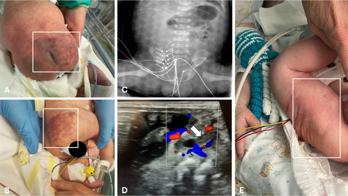
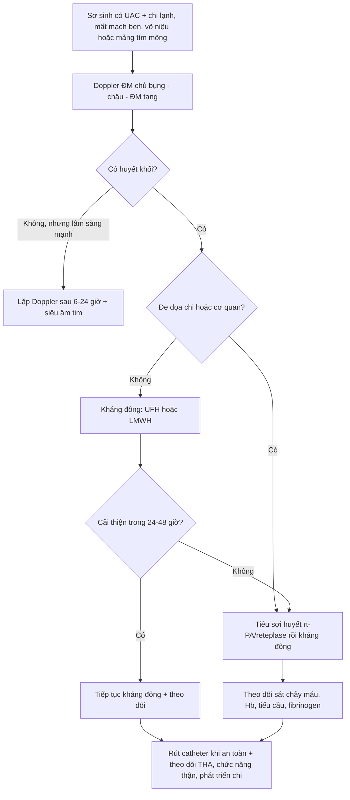
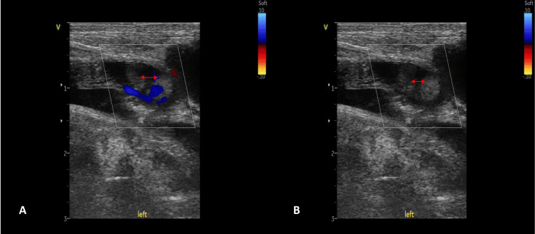

# 6113 — Huyết khối động mạch chủ ở sơ sinh sau catheter động mạch rốn: chẩn đoán bằng Doppler, và khi nào chỉ kháng đông – khi nào phải tiêu sợi huyết

**Tags:** `pattern:huyet-khoi-dong-mach` `pattern:thieu-mau-chi` `pattern:hoai-tu` `pattern:vo-nieu` `vung:dong-mach-chu` `vung:chi-duoi` `vung:than` `protocol:sieu-am-Doppler` `protocol:CTA` `incidentaloma:khong`
**Mức chắc chắn (certainty):** tổng hợp y văn (literature synthesis) — ghép **ca nguyên văn huyết khối động mạch chủ bụng sau catheter rốn có phân tích điều trị** (Cureus 2024, PMC11246179), **ca huyết khối động mạch chậu trong ở trẻ đang hạ thân nhiệt điều trị** (Australas J Ultrasound Med 2025, PMC12461416), **hai ca huyết khối động mạch chủ "tự phát" do mất nước tăng natri với CTA đầy đủ** (Clinical Case Reports 2025, PMC12318815), **ca huyết khối động mạch đùi–thận ở trẻ sinh đôi có thoát vị hoành** (Cureus 2025, PMC12413998), **đoàn hệ 235 trẻ đặt catheter động mạch rốn vị trí cực thấp (ultralow)** (J Vasc Access 2026, PMC13380652) và **tổng quan có bảng khuyến cáo ASH/ISTH về huyết khối sơ sinh** (J Clin Med 2026, PMC13513004).

> **Câu hỏi thực hành:** sơ sinh **34 tuần**, ngày thứ 7 sau đặt catheter động mạch rốn (**UAC**) vì suy hô hấp. Điều dưỡng gọi vì **hai chi dưới lạnh, tím, không bắt được mạch bẹn**, vùng mông phải có **mảng da tím loang**; nước tiểu **0,4 mL/kg/giờ**, huyết áp **78/46 mmHg** (cao hơn trước).
> Câu hỏi: **huyết khối ở đâu? có phải chụp CT không? kháng đông đủ chưa hay phải tiêu sợi huyết? catheter xử lý thế nào?**
> Bài chốt **ba quyết định của bác sĩ CĐHA sơ sinh**: **(1) nhận ra "mất mạch bẹn + chi lạnh + vô niệu" là tắc động mạch chủ–chậu, không phải sốc; (2) Doppler tại giường là đầu tay, CTA chỉ khi cần xác định mức lan/nhánh; (3) phân tầng "đe dọa chi/cơ quan" để chọn kháng đông hay tiêu sợi huyết.** Nối [3045 – Catheter rốn ở sơ sinh (UVC/UAC)](../3045-catheter-ron-so-sinh-uvc-uac/lesson.md), [6111 – Huyết khối tĩnh mạch thận sơ sinh](../6111-huyet-khoi-tinh-mach-than-so-sinh/lesson.md), [622 – Tắc ruột sơ sinh](../622-tac-ruot-so-sinh/lesson.md).

## 1. Tổng quan bệnh học – cơ chế hình ảnh: vì sao một catheter 3 mm lại làm tắc cả động mạch chủ

- **Sinh lý bệnh (tam giác Virchow ở sơ sinh):** (1) **tổn thương nội mạc** do catheter cứng cọ vào thành mạch; (2) **dòng chảy chậm/ứ** vì catheter chiếm gần hết lòng động mạch rốn–chậu và cản dòng quanh đầu catheter; (3) **tăng đông "sinh lý"** — trẻ sơ sinh có **nồng độ antithrombin, protein C, protein S thấp** và hoạt tính tiêu sợi huyết giảm, nên khi có thêm catheter thì **huyết khối hình thành ngay tại đầu catheter rồi lan ngược/xuôi**. Bài tổng quan ASH mô tả đúng là "cân bằng cầm máu phát triển" của trẻ sơ sinh, và **catheter là yếu tố nguy cơ có thể sửa được lớn nhất** (J Clin Med 2026, PMC13513004).
- **TẠI SAO huyết khối lại "chọn" động mạch chủ bụng:** đầu catheter UAC vị trí cao nằm ở **T6–T9**, tức **ngay trên hoặc ngang các lỗ động mạch thận (L1) và động mạch mạc treo tràng trên (L1)**. Huyết khối mọc quanh đầu catheter tại đó sẽ che **lỗ nhánh tạng** trước khi lan xuống chạc ba chậu — vì vậy **cùng một huyết khối** có thể gây **thiếu máu chi dưới + suy thận + tăng huyết áp + hoại tử ruột**. Ngược lại, **UAC vị trí thấp (L3–L4)** nằm dưới các nhánh tạng, nên biến chứng chủ yếu là **chi dưới**. (Vị trí chuẩn và bảng đối chiếu: xem [3045](../3045-catheter-ron-so-sinh-uvc-uac/lesson.md).)
- **TẠI SAO huyết khối thường im lặng:** huyết khối **không tắc hoàn toàn** vẫn cho dòng quanh rìa đủ nuôi chi ở trẻ nằm yên, nên **44% trẻ có UAC vị trí cao có huyết khối động mạch chủ/động mạch chậu mà không có triệu chứng** (so sánh trong J Vasc Access 2026, PMC13380652). Vì vậy **"không có triệu chứng" không phải bằng chứng loại trừ** — đây là lý do các nghiên cứu sàng lọc bằng Doppler tìm ra tỷ lệ cao hơn nhiều so với tỷ lệ biến chứng lâm sàng.
- **Ngưỡng định lượng – tần suất (theo phương pháp phát hiện):**
  - Huyết khối động mạch ở trẻ **có UAC: ~8–20%**; **gộp toàn bộ catheter động mạch ở sơ sinh: 21%** (tổng quan có hệ thống dẫn trong J Clin Med 2026, PMC13513004).
  - Gộp theo loại catheter rốn: **UAC 8,2% (KTC 95%: 1,91–18,20)**, UVC **6,5% (2,28–12,61)** — tức **huyết khối động mạch không hiếm hơn huyết khối tĩnh mạch là bao** (J Clin Med 2026, PMC13513004).
  - **Vị trí cực thấp (ultralow – đầu catheter ở ngã ba động mạch rốn và động mạch chậu trong, đặt dưới hướng dẫn siêu âm): 0/235 trẻ có huyết khối**, biến cố khác **4,8%** (tụt catheter 2,1%, chảy máu kéo dài sau rút 2,1%, nhiễm khuẩn huyết liên quan catheter 0,44%) (J Vasc Access 2026, PMC13380652). Con số này **không chứng minh vị trí thấp tốt hơn** (không randomized, theo dõi ngắn), nhưng cho thấy **chiến lược "catheter ngắn, không đi qua lòng động mạch chủ"** là hướng giảm huyết khối.
  - **Heparin dự phòng trong lòng catheter** (0,25–1 U/mL; **25–200 U/kg/ngày**) **kéo dài thời gian thông catheter nhưng KHÔNG giảm tỷ lệ huyết khối** — đừng dùng nó để "yên tâm" (J Clin Med 2026, PMC13513004).
- **TẠI SAO hình ảnh trông như vậy:**
  - **Siêu âm B-mode:** huyết khối cấp là **khối hồi âm thấp–trung bình lấp lòng mạch**, có thể **đồng hồi âm với máu chảy chậm** → dễ bỏ sót nếu chỉ nhìn 2D. Đây là lý do **bắt buộc Doppler màu**: vùng **không có tín hiệu màu** trong lòng mạch, bờ tín hiệu **lõm vào** ("meniscus") là dấu hiệu gián tiếp mạnh.
  - **Theo thời gian:** huyết khối cũ **tăng hồi âm, co nhỏ, có thể vôi hóa** và tái thông một phần — nên **hình ảnh thay đổi theo tuần**, không phải "một hình ảnh cố định".
  - **CTA:** huyết khối là **khuyết thuốc (filling defect)/cột thuốc bị cắt (cutoff)** trong lòng động mạch; phần xa **mờ đi** và xuất hiện **tuần hoàn bàng hệ**. Trong ca mất nước tăng natri, CTA cho thấy **cột thuốc bị cắt ở đoạn cuối động mạch chủ ngực xuống/đầu động mạch chủ bụng**, **hai thận tưới máu kém** và **mạng bàng hệ dưới thận** (Clinical Case Reports 2025, PMC12318815, Figure 3).

*CTA bụng (dựng coronal) ở sơ sinh 14 ngày bị mất nước tăng natri: động mạch chủ ngực **ngấm thuốc tốt**, rồi **cột thuốc bị cắt (cutoff)** ngay trên đoạn bụng; **huyết khối lấp lòng động mạch chủ bụng**; **hai thận tưới máu rất kém**, thận trái còn mờ hơn; phía dưới có **bàng hệ** và chạc ba chậu còn thấy. Đây là "chữ ký" của huyết khối động mạch chủ: **cutoff + giảm tưới máu tạng + bàng hệ**. Nguồn: Clinical Case Reports 2025 (PMC12318815), CC BY-NC-ND 4.0, nguyên bản (giữ nguyên nhãn của tác giả).*

## 2. Mẫu hình + chẩn đoán phân biệt theo vị trí huyết khối (gamut)

- **Gamut theo vị trí (quyết định triệu chứng):**
  - **Dưới động mạch thận (ĐM chủ bụng thấp → chạc ba → ĐM chậu):** **mất/giảm mạch bẹn hai bên**, chi lạnh tái, chậm làm đầy mao mạch, đau/không cử động, **hoại tử đầu chi**. Đây là thể hay gặp nhất và là thể của ca Cureus 2024 (huyết khối **1/3 dưới ĐM chủ bụng lan vào hai ĐM chậu ngoài**).
  - **Ngang/trên động mạch thận:** **vô niệu, tiểu máu, tăng huyết áp do mạch máu thận (renovascular)**, suy thận cấp; thận có thể **nhồi máu toàn bộ** (ca sinh đôi 34 tuần, PMC12413998: huyết khối ĐM chậu–đùi **và** ĐM thận, nhồi máu thận lan rộng, **PSV ĐM thận trái 21,77 cm/s kèm dòng tâm trương đảo**).
  - **Động mạch mạc treo tràng trên:** bụng chướng, **viêm ruột hoại tử (NEC)** — ca UAC gây NEC đã được báo cáo (World J Clin Cases 2021, PMC8362557), và đây là lý do **không được dừng ở chẩn đoán NEC** khi trẻ có UAC.
  - **Động mạch chậu trong:** **mông/vùng hông tím loang, loét, hoại tử da** — ca điển hình: trẻ đủ tháng hạ thân nhiệt điều trị, UAC **lạc vào động mạch chậu trong phải**, xuất hiện **mảng tím ở mông và hông phải**, siêu âm Doppler **6 giờ sau rút catheter** thấy **huyết khối trong ĐM chậu trong phải**, điều trị **UFH 10 IU/kg/giờ**, tổn thương da **hết trong 36 giờ**, **dòng chảy tái lập sau 48 giờ** (Australas J Ultrasound Med 2025, PMC12461416).
  - **Động mạch tủy sống (nhánh ĐM chủ):** **liệt mềm/giảm vận động chi dưới** — hiếm nhưng là biến chứng được nêu trong tổng quan (PMC13513004).
- **Gamut theo bối cảnh:**
  - **Do catheter (đa số):** UAC, catheter ĐM đùi (sau thông tim), catheter ĐM quay.
  - **"Tự phát" ở sơ sinh:** **mất nước tăng natri do bú kém** (đặc biệt tuần 2–3), nhiễm khuẩn huyết, đa hồng cầu, mẹ đái tháo đường, bệnh tim bẩm sinh, giảm thể tích/tăng đông.
  - **Do bệnh lý mạch:** hẹp eo động mạch chủ (coarctation), loạn sản mạch, hội chứng Loeys–Dietz (không nên nhầm với huyết khối).
- **Gamut hình ảnh của "chi dưới lạnh/tím ở sơ sinh":** **huyết khối ĐM chủ–chậu** · **coarctation** (mạch yếu nhưng **có từ trước**, không đau/hoại tử) · **co thắt mạch do lạnh/đau** (mạch yếu thoáng qua, ấm lại khi ủ ấm) · **sốc nhiễm khuẩn** (chi lạnh nhưng mạch bẹn còn, có dấu hiệu tuần hoàn kém toàn thân) · **huyết khối tĩnh mạch** (chi **sưng to**, không mất mạch) · **huyết khối do ổ nhiễm trùng từ catheter** (sốt, cấy máu dương).

## 3. Bảng so sánh phân biệt (ma trận đối chiếu)

| Thực thể (entity) | Hình ảnh điển hình | Chốt vào (rule-in) | Chốt loại (rule-out) | Gợi ý xác nhận |
|---|---|---|---|---|
| **Huyết khối ĐM chủ do UAC** | Khối hồi âm trong lòng ĐM chủ bụng, **mất tín hiệu màu**, bờ tín hiệu lõm; CTA: **cutoff/filling defect** + bàng hệ | **Mất tín hiệu màu trong lòng mạch + tiền sử UAC + chi lạnh/mất mạch bẹn** | Có dòng màu đầy đủ trong lòng ĐM chủ và ĐM chậu, mạch bẹn đều → không phải huyết khối | Doppler tại giường; CTA khi cần mức lan/nhánh tạng |
| **Huyết khối ĐM chậu trong (UAC lạc vị trí)** | Đầu catheter lệch sang **ĐM chậu trong**; huyết khối **trong ĐM chậu trong**; da mông/hông tím | **Catheter lạc + mảng tím mông/hông cùng bên** | Catheter đúng trục, da bình thường → không phải | POCUS xác định catheter; Doppler ĐM chậu trong |
| **Coarctation (hẹp eo ĐM chủ)** | Hẹp eo sau ĐM dưới đòn trái; **mạch bẹn yếu hai bên từ lúc sinh**, không đau; X-quang: dấu **"3"**, khuyết sườn | **Mạch yếu có từ trước + chênh HA tay/chân + không có huyết khối trong lòng** | Có khối trong lòng mạch, mạch yếu **mới xuất hiện sau đặt catheter** | Siêu âm tim + Doppler eo; CTA/MRA khi cần |
| **Huyết khối ĐM thận** | Thận **nhỏ/không to**, **mất tín hiệu động mạch**, RI không đo được; vỏ giảm tín hiệu | **Mất dòng động mạch thận + vô niệu** | Có dòng ĐM thận, thận to → huyết khối tĩnh mạch (bài 6111) | Doppler thận; CTA |
| **Huyết khối tĩnh mạch thận (RVT)** | **Thận to**, mất dòng tĩnh mạch, **RI tăng (0,88)**, huyết khối trong TM thận/IVC | **Thận to + mất dòng tĩnh mạch** | Thận không to, **mất dòng động mạch** → huyết khối động mạch | Doppler; CTV (bài 6111) |
| **Co thắt mạch do lạnh/đau** | Mạch yếu thoáng qua, **da ấm lại sau ủ ấm**, Doppler bình thường | **Hồi phục trong 15–30 phút khi ủ ấm** | Không hồi phục, có khối trong lòng → huyết khối | Ủ ấm + Doppler lại |
| **Sốc nhiễm khuẩn** | Chi lạnh, CRT kéo dài **toàn thân**, mạch bẹn còn, HA tụt, lactat cao | **Sốt + tụt HA + lactat cao + mạch bẹn còn** | Mất mạch bẹn khu trú + HA tăng → huyết khối | Cấy máu, lactat, Doppler |

*Ca trẻ đủ tháng hạ thân nhiệt điều trị, UAC lạc vào **động mạch chậu trong phải**: **(A, B)** mảng da tím loang vùng mông/hông phải; **(C)** X-quang bụng cho thấy catheter đi lệch; **(D)** Doppler màu: khối trong lòng mạch (mũi tên trắng) **không có tín hiệu màu**, dòng chỉ đi quanh rìa; **(E)** tổn thương da hồi phục sau rút catheter. Đây là ví dụ "huyết khối nhỏ nhưng đúng vị trí" — nếu chỉ nhìn X-quang sẽ bỏ sót. Nguồn: Australas J Ultrasound Med 2025 (PMC12461416), CC BY 4.0, nguyên bản.*

## 4. Protocol chụp + ngưỡng xử trí

- **Siêu âm Doppler là đầu tay, tại giường, không cản quang, không bức xạ:** đầu dò **linear 7–12 MHz** (sơ sinh rất nông), khảo sát **ĐM chủ bụng từ trên ĐM thận → chạc ba → hai ĐM chậu → ĐM đùi chung**, **so sánh hai bên**. Ghi tối thiểu: **đường kính lòng mạch, vị trí và chiều dài huyết khối, có/không tín hiệu màu, phổ Doppler (PSV, có đảo dòng tâm trương không)**. Ca có huyết khối thận ghi **PSV 21,77 cm/s và dòng tâm trương đảo** (PMC12413998) — **dòng tâm trương đảo là dấu hiệu tắc nặng**, không phải "khó đo".
- **Hạn chế của siêu âm phải nói rõ trong phiếu:** khí ruột, phân su, vết mổ, đầu dò ấn lún có thể **làm mất tín hiệu màu giả**; và **huyết khối đồng hồi âm có thể không thấy trên 2D**. Vì vậy **một lần siêu âm bình thường không loại trừ** nếu lâm sàng mạnh — lặp lại sau **6–24 giờ** (đúng như ca PMC12461416: siêu âm **6 giờ sau rút catheter** mới thấy huyết khối).
- **CTA bụng–chậu có cản quang:** chỉ định khi **(1)** siêu âm không kết luận; **(2)** cần xác định **mức lan lên ĐM thận/ĐM mạc treo tràng trên**; **(3)** cân nhắc can thiệp. Ở sơ sinh dùng **liều i-ốt thấp theo cân nặng, kVp thấp, giới hạn trường chụp từ ĐM chủ ngực dưới đến chạc ba** (ALARA); **không chụp lặp lại nhiều lần** — thay bằng Doppler.
- **Siêu âm tim** (bắt buộc): tìm **huyết khối trong nhĩ phải/ống động mạch**, đánh giá chức năng thất và **tăng áp phổi** — huyết khối ĐM chủ có thể kèm huyết khối tĩnh mạch rốn lan lên nhĩ (xem 3045).
- **Xét nghiệm hỗ trợ, không chẩn đoán:** công thức máu, tiểu cầu, INR/aPTT, fibrinogen, D-dimer, lactat, creatinin, điện giải (đặc biệt **Na⁺** trong thể mất nước); **sàng lọc tăng đông** chỉ làm khi có chỉ định (yếu tố V Leiden, prothrombin G20210A, protein C/S, antithrombin) — không cấp cứu.
- **Ngưỡng xử trí (theo bảng khuyến cáo ASH/ISTH tóm tắt trong J Clin Med 2026, PMC13513004):**

- **Chi tiết liều đã dùng trong các ca nguyên văn (không phải khuyến cáo tuyệt đối):** **UFH 75 IU/kg bolus + 28 IU/kg/giờ** duy trì (PMC11246179); **UFH 10 IU/kg/giờ** cho huyết khối nhỏ ở ĐM chậu trong (PMC12461416); **enoxaparin 1,5 mg/kg mỗi 12 giờ** ở trẻ suy thận, và **1 mg/kg mỗi 12 giờ trong 5 tháng** ở ca thứ hai (PMC12318815). Bài tổng quan nêu rõ **thời gian kháng đông cho huyết khối động mạch sơ sinh chưa được định nghĩa bằng thử nghiệm** — phải cá thể hóa (J Clin Med 2026, PMC13513004).
- **Catheter rốn xử lý thế nào:** **rút catheter** khi đã chẩn đoán huyết khối và không còn chỉ định theo dõi huyết áp/khí máu (ca PMC12461416 rút ngay, hồi phục trong 36–48 giờ). Nếu vẫn cần đường động mạch, **đặt lại ở vị trí khác** (ĐM quay) thay vì giữ catheter đang có huyết khối. **Không rút rồi "chờ" mà không kháng đông** ở thể đe dọa chi.
- **Tiêu sợi huyết:** **rt-PA/reteplase** (ca PMC11246179 dùng **reteplase đường động mạch** sau khi heparin thất bại) — chỉ định khi **đe dọa chi/cơ quan**, và phải **theo dõi chảy máu, Hb, fibrinogen, tiểu cầu**; **không dùng thay kháng đông** ở thể nhẹ.
- **Ngoại khoa:** **lấy huyết khối/kỹ thuật nội mạch** chỉ khi **thất bại tiêu sợi huyết + hoại tử lan** hoặc **nhồi máu ruột/thận không hồi phục**; xu hướng hiện nay là **cắt cụt giới hạn/để tự rụng** phần hoại tử khô thay vì cắt cụt rộng (PMC11246179). **Không mổ "cho chắc"** khi chi còn hồi phục.
- **Theo dõi sau ra viện (bắt buộc ghi vào giấy ra viện):** **huyết áp** (tăng HA do mạch thận có thể xuất hiện **sau nhiều tháng**), **creatinin/eGFR**, **siêu âm thận** (teo thận), **chiều dài chi** và **mạch bẹn** mỗi lần khám; ca mất nước tăng natri cần theo dõi **tăng HA kéo dài** (PMC12318815 dùng 5 thuốc hạ áp và lọc màng bụng).

*Trẻ sinh đôi 34 tuần có thoát vị hoành, sau đặt UAC: **(A)** Doppler màu ĐM đùi trái — **huyết khối trong lòng mạch** (mũi tên đỏ hai đầu), chỉ còn dòng quanh rìa; **(B)** cùng vị trí, tín hiệu màu gần như mất hoàn toàn. Ở ca này huyết khối lan tới **ĐM thận** gây nhồi máu thận, nhấn mạnh: **thấy huyết khối ở đùi thì phải khảo sát ngược lên ĐM chủ và ĐM tạng**, không dừng ở "huyết khối ĐM đùi". Nguồn: Cureus 2025 (PMC12413998), CC BY 4.0, nguyên bản.*

## 5. Biến thể bình thường và cạm bẫy

- **Mạch bẹn khó bắt ở sơ sinh** vì mạch nhỏ và lớp mỡ: **đừng kết luận mất mạch** nếu chưa dùng Doppler; ngược lại **đừng bỏ qua** vì "trẻ lạnh".
- **"Không thấy huyết khối" trên một lần siêu âm:** huyết khối **đồng hồi âm** và **dòng màu có thể bị gain thấp** → luôn **tăng gain, giảm scale, đổi góc 30–60°**, so sánh với bên đối diện; lặp lại sau 6–24 giờ khi lâm sàng mạnh.
- **Ảo ảnh "không có dòng" do đầu dò ấn mạnh** (compression) — đặc biệt ở ĐM chậu nông; **giảm áp lực đầu dò** rồi lặp lại.
- **Coarctation giả:** trẻ có UAC bị **mạch bẹn yếu hai bên** rất dễ bị gán "hẹp eo"; **huyết khối ĐM chủ cũng gây yếu mạch hai bên**. Chốt bằng **Doppler thấy khối trong lòng** + **không có chênh huyết áp tay–chân kiểu coarctation** + **không có dấu hiệu trên siêu âm tim**.
- **Satisfaction of search:** thấy **NEC** trên X-quang bụng là dừng — **NEC do tắc ĐM mạc treo tràng trên** cần CTA/Doppler để không bỏ sót nguyên nhân mạch.
- **Huyết khối "tự phát" do mất nước tăng natri:** trẻ **bú kém, sụt cân, Na⁺ cao** — nếu chỉ nghĩ "nhiễm khuẩn huyết" sẽ bỏ qua **huyết khối ĐM chủ**; CTA/Doppler là chốt (PMC12318815).
- **Catheter "đúng vị trí" trên X-quang vẫn có thể lạc:** X-quang chỉ là hình chiếu; **POCUS xác định catheter nằm trong động mạch nào** (ca PMC12461416: lạc vào ĐM chậu trong dù phim không rõ). Xem thêm 3045 về **di lệch 50–90% trong 72 giờ**.
- **Đừng nhầm huyết khối ĐM chủ với huyết khối tĩnh mạch rốn:** tĩnh mạch rốn đi vào **gan**, gây huyết khối **tĩnh mạch cửa** (bài 6114) — **chi lạnh/mất mạch bẹn không phải biểu hiện của nó**.

## 6. Tự lượng giá — Blind Quiz ngay trên trang tĩnh

**Ca 1 — Trẻ đủ tháng hạ thân nhiệt điều trị, mông phải tím loang sau đặt UAC. Nhìn ảnh, mô tả trước.**

- Gợi ý lâm sàng: **đủ tháng, HIE, đang hạ thân nhiệt**, xuất hiện **mảng tím da mông/hông phải** vài giờ sau đặt UAC; mạch bẹn phải yếu hơn trái.
- Câu hỏi: Tổn thương da gợi ý mạch nào? Trên Doppler (panel D) dấu hiệu chốt là gì? Xử trí và tiên lượng?

<b>Bấm để hiện đáp án (findings + chẩn đoán)</b>

- **Findings:** catheter lạc vào **động mạch chậu trong phải** (panel C); Doppler màu (panel D) có **khối trong lòng mạch không có tín hiệu màu**, dòng chỉ quanh rìa; da vùng mông/hông phải tím loang (A, B) do **thiếu máu vùng chi phối của ĐM chậu trong** (cơ mông, da vùng hông).
- **Chẩn đoán:** **huyết khối ĐM chậu trong sau UAC lạc vị trí** — không phải "viêm da" hay "loét do tư thế".
- **Xử trí trong ca:** **rút catheter**, **UFH 10 IU/kg/giờ**, chăm sóc da; da hồi phục **36 giờ**, **dòng chảy tái lập sau 48 giờ** trên Doppler.
- **Vì sao chốt được:** khối trong lòng mạch + mất tín hiệu màu + phân bố da đúng lãnh thổ ĐM chậu trong; hồi phục sau khi bỏ nguyên nhân (catheter) và kháng đông.
- Nguồn ảnh: Australas J Ultrasound Med 2025 (PMC12461416), CC BY 4.0.

**Ca 2 — Sơ sinh 14 ngày bú kém, co giật, vô niệu; CTA bụng.**

- Gợi ý lâm sàng: **14 ngày tuổi, đủ tháng, bú kém, sụt cân, Na⁺ máu cao, vô niệu, tăng huyết áp**; không có catheter động mạch.
- Câu hỏi: Mô tả chỗ cột thuốc bị cắt. Vì sao thận tưới máu kém? Chẩn đoán và điều trị?

<b>Bấm để hiện đáp án (findings + chẩn đoán)</b>

- **Findings:** **cột thuốc bị cắt (cutoff)** ở đoạn cuối ĐM chủ ngực xuống/đầu ĐM chủ bụng; **huyết khối lấp lòng ĐM chủ bụng**; **hai thận tưới máu kém**, thận trái mờ hơn; **bàng hệ** dưới chỗ tắc; không thấy huyết khối trong nhĩ.
- **Chẩn đoán:** **huyết khối động mạch chủ bụng "tự phát" do mất nước tăng natri** (không liên quan catheter) — nguyên nhân vô niệu + suy thận + tăng HA.
- **Vì sao thận kém:** huyết khối nằm **ngang/trên lỗ ĐM thận**, nên dù ĐM thận không tắc hoàn toàn, **áp lực tưới máu giảm** và **nhồi máu/hoại tử vỏ** xảy ra; bàng hệ không đủ bù.
- **Điều trị trong ca:** bù dịch/điện giải, kháng sinh, **enoxaparin 1,5 mg/kg mỗi 12 giờ** (ca 1) và **1 mg/kg mỗi 12 giờ trong 5 tháng** (ca 2), kiểm soát HA, lọc màng bụng khi cần.
- Nguồn ảnh: Clinical Case Reports 2025 (PMC12318815), CC BY-NC-ND 4.0 — **ảnh nguyên bản, không cắt/ghép**.

**Ca 3 — Sinh non 34 tuần, thoát vị hoành, sau UAC: chân trái lạnh, không bắt được mạch đùi.**

- Gợi ý lâm sàng: **34 tuần, thoát vị hoành, thở máy HFOV + iNO**, đặt UAC; sau mổ vá hoành **chân trái lạnh, mất mạch đùi trái**, tiểu ít.
- Câu hỏi: Dấu hiệu trên Doppler? Vì sao phải khảo sát thêm ĐM thận và ĐM chủ? Chẩn đoán?

<b>Bấm để hiện đáp án (findings + chẩn đoán)</b>

- **Findings:** Doppler ĐM đùi trái có **huyết khối trong lòng mạch** (mũi tên đỏ), **mất gần hoàn toàn tín hiệu màu** ở panel B; Doppler ĐM thận trái **PSV 21,77 cm/s, dòng tâm trương đảo** → tắc nặng; thận trái nhồi máu lan rộng.
- **Chẩn đoán:** **huyết khối ĐM chậu–đùi kèm huyết khối/giảm tưới máu ĐM thận sau UAC**, biến chứng của catheter rốn ở trẻ có thoát vị hoành.
- **Vì sao phải khảo sát ngược lên:** huyết khối ở đùi chỉ là **phần ngọn**; nguồn gốc ở **ĐM chủ bụng quanh đầu catheter**, nơi có thể che **ĐM thận/ĐM mạc treo** — bỏ qua là bỏ sót nhồi máu tạng.
- **Bài học:** **đau/thiếu máu chi + vô niệu** ở trẻ có UAC = khảo sát **toàn bộ trục ĐM chủ–chậu–thận**, không chỉ chỗ đau.
- Nguồn ảnh: Cureus 2025 (PMC12413998), CC BY 4.0.

## Bài liên quan chéo
- [3045 – Catheter rốn ở sơ sinh (UVC/UAC): vị trí, biến chứng](../3045-catheter-ron-so-sinh-uvc-uac/lesson.md) — vị trí chuẩn, di lệch, huyết khối tĩnh mạch cửa.
- [6111 – Huyết khối tĩnh mạch thận ở trẻ sơ sinh](../6111-huyet-khoi-tinh-mach-than-so-sinh/lesson.md) — thể tĩnh mạch, thận to + RI tăng.
- [6112 – Xuất huyết thượng thận ở trẻ sơ sinh](../6112-xuat-huyet-thuong-than-so-sinh/lesson.md) — khối hông lưng sơ sinh.
- [091 – Ho ra máu ồ ạt & nút mạch động mạch phế quản](../091-ho-ra-mau-oat-nut-mach-dong-mach-phe-quan/lesson.md) — nguyên lý can thiệp mạch máu (tham khảo kỹ thuật).
- [932 – An toàn bức xạ trong can thiệp dưới CT/DSA](../932-an-toan-buc-xa-ct-dsa/lesson.md) — ALARA khi chụp CTA sơ sinh.

> Không dùng để chẩn đoán độc lập khi chưa có người hướng dẫn.
