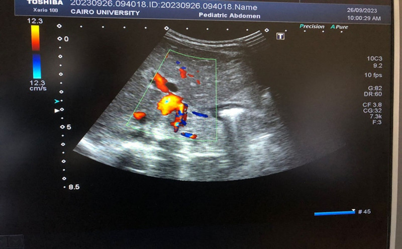
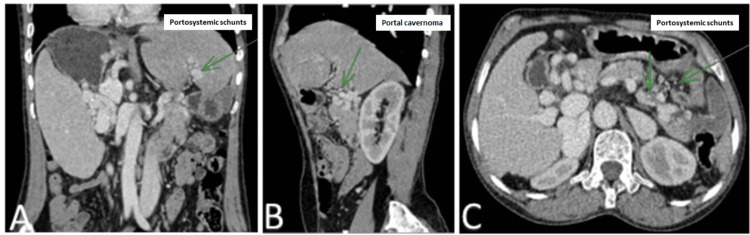
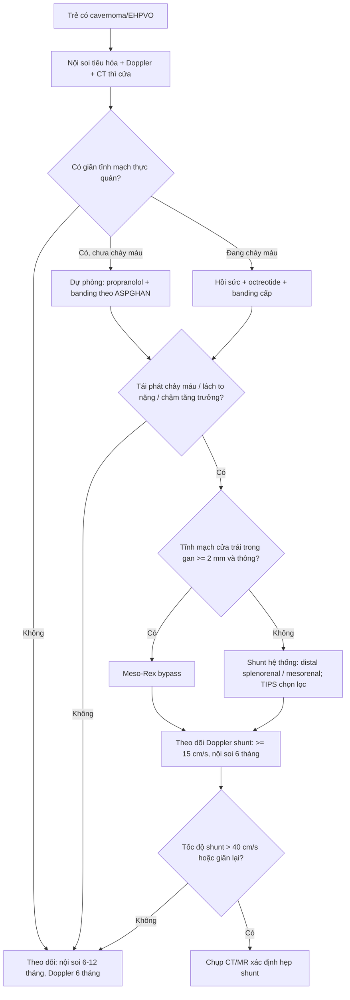
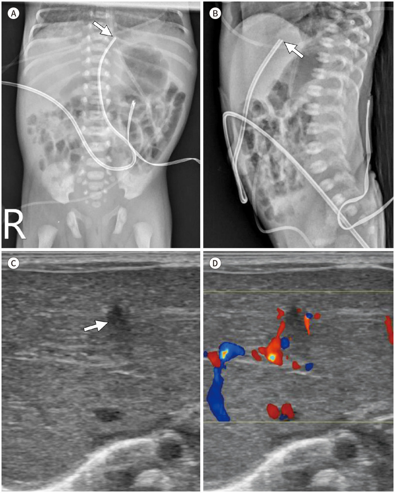
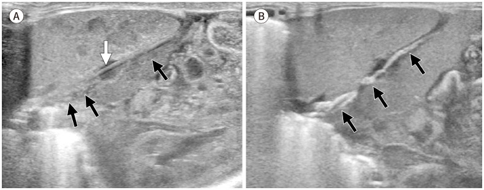
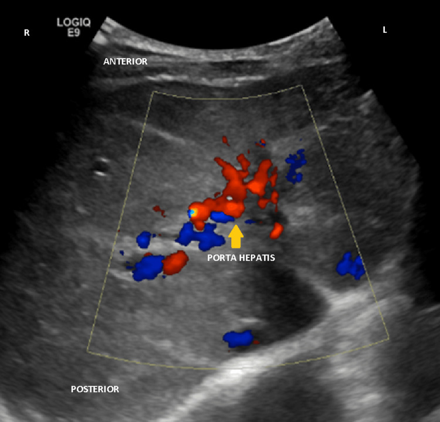

# 6114 — Di chứng muộn của huyết khối tĩnh mạch cửa sau catheter rốn: portal cavernoma, tăng áp cửa và khi nào cần nối cửa–chủ

**Tags:** `pattern:cavernoma` `pattern:tang-ap-cua` `pattern:lach-to` `pattern:gian-tinh-mach-thuc-quan` `pattern:cham-tang-truong` `vung:gan` `vung:lach` `protocol:sieu-am-Doppler` `protocol:CT-tinh-mach-cua` `protocol:MRCP`
**Mức chắc chắn (certainty):** tổng hợp y văn (literature synthesis) — ghép **ca trẻ 5 tuổi nôn máu do cavernoma sau catheter rốn có CT 3 bình diện** (Cureus 2024, PMC11367683), **ca trẻ 7 tuổi cavernoma có Doppler và nội soi** (Cureus 2025, PMC11930788), **ca sơ sinh non tháng có UVC sai vị trí → huyết khối tĩnh mạch cửa** (J Korean Soc Radiol 2023, PMC10265250), **ca 3 tháng tuổi cavernoma sau UVC** (Medicine 2025, PMC11789905), **đoàn hệ toàn quốc 62 bệnh nhân EHPVO theo dõi tới 18,8 tuổi** (Liver Int 2026, PMC12968599), **loạt 6 trẻ mổ shunt (5 Meso-Rex)** (J Clin Med 2025, PMC12608255), **so sánh 43 trẻ Meso-Rex bypass vs transposition** (Front Pediatr 2022, PMC9490082), **khuyến cáo APSPGHAN 2026 về chích xơ/banding** (Pediatr Gastroenterol Hepatol Nutr 2026, PMC12816376), **tổng quan portal cavernoma cholangiopathy** (Hepatol Commun 2025, PMC12520217) và **tổng quan huyết khối sơ sinh có bảng ASH/ISTH** (J Clin Med 2026, PMC13513004).

> **Câu hỏi thực hành:** bé trai **5 tuổi**, **nôn ra máu tươi** 2 lần trong 24 giờ, da xanh, **lách to 2 cm dưới bờ sườn**, **không vàng da, không báng**. Xét nghiệm: **Hb 5,4 g/dL**, **tiểu cầu 118.000/µL**, men gan và albumin **bình thường**. Mẹ kể bé **nằm NICU 10 ngày sau sinh, có đặt catheter rốn**.
> Câu hỏi: **tại sao trẻ chảy máu tiêu hóa mà gan "bình thường"? cavernoma là gì? có phải xơ gan không? khi nào chỉ banding/propranolol, khi nào phải mổ nối cửa–chủ (Meso-Rex)?**
> Bài chốt **bốn việc**: **(1) huyết khối tĩnh mạch cửa sau UVC gặp ở 19% trẻ có catheter và phần lớn tiến triển thành cavernoma nhiều năm sau; (2) hình ảnh chốt là mạng bàng hệ quanh rốn gan với dòng tĩnh mạch, KHÔNG phải khối u; (3) gan không xơ nhưng tăng áp cửa thật, nên **xơ gan là chẩn đoán sai thường gặp**; (4) chỉ định can thiệp tính bằng **mức giãn tĩnh mạch + số lần chảy máu**, và **Meso-Rex chỉ làm được khi tĩnh mạch cửa trái trong gan còn ≥ 2 mm**.** Nối [3045 – Catheter rốn ở sơ sinh](../3045-catheter-ron-so-sinh-uvc-uac/lesson.md), [6113 – Huyết khối động mạch chủ sau UAC](../6113-huyet-khoi-dong-mach-chu-so-sinh-uac/lesson.md), [176 – TIPS: theo dõi shunt](../176-tips-dips-theo-doi-shunt/lesson.md), [183 – Giảm đường kính shunt và HE kháng trị sau TIPS](../183-giam-duong-kinh-shunt-va-HE-khang-tri-sau-tips/lesson.md).

## 1. Tổng quan bệnh học – cơ chế hình ảnh: từ một huyết khối 3 mm tới giãn tĩnh mạch thực quản 5 năm sau

- **Đường đi của catheter tĩnh mạch rốn (UVC) và chỗ "gây án":** UVC đi từ **tĩnh mạch rốn** vào **tĩnh mạch cửa trái**, rồi thường qua **ống tĩnh mạch (ductus venosus)** vào IVC. Nếu đầu catheter **dừng trong hệ cửa** (quá thấp, lạc vào tĩnh mạch cửa phải/trái) thì catheter **cọ nội mạc, cản dòng và tạo huyết khối ngay tại nhánh cửa** — đây là cơ chế của **huyết khối tĩnh mạch cửa (portal vein thrombosis, PVT) ở sơ sinh**. Dung dịch ưu trương (TPN, canxi, kháng sinh) qua catheter càng làm tổn thương nội mạc nặng hơn (J Korean Soc Radiol 2023, PMC10265250).
- **Ngưỡng định lượng – tần suất PVT sau UVC:** gộp **11 nghiên cứu, 1.086 trẻ (1.052 có catheter): 200 ca PVT = 19%**, dao động **0–49%**; **truyền máu/trao đổi máu qua catheter làm tăng nguy cơ (p = 0,0024)**; **vị trí đầu catheter không dự báo được PVT (p = 0,4636)** (J Pediatr (Rio J) 2026, PMC13285700 — cùng phân tích đã dùng ở bài 3045). Điều này có nghĩa: **không thể "đặt đúng vị trí là yên tâm"**, và **không thể loại trừ vì đầu catheter đẹp trên phim**.
- **Không phải mọi PVT đều thành cavernoma:** trong 100 trẻ sơ sinh được siêu âm, **43% có PVT không triệu chứng** và **56% tan hoàn toàn khi theo dõi** (dẫn trong Cureus 2024, PMC11367683). Nhưng phần **không tan** sẽ **tổ chức hóa, xơ hóa và tái thông bằng mạng mạch nhỏ** — gọi là **cavernoma (cavernous transformation of the portal vein)**. Vì vậy **siêu âm bình thường lúc ra viện không cho phép "đóng hồ sơ"**.
- **TẠI SAO thành "cavernoma" chứ không phải "tĩnh mạch cửa hẹp":** khi tĩnh mạch cửa chính bị tắc mạn, các **tĩnh mạch nhỏ quanh ống mật, quanh tá tràng và tĩnh mạch vành vị** giãn ra để đưa máu về gan (bàng hệ **hướng gan**). Trên siêu âm màu, chúng tạo **"serpiginous mixed color sign"** — một **chùm mạch rắn ngoằn ngoèo, nhiều màu** ở rốn gan. Trên CT, đó là **các cấu trúc mạch nhỏ ngấm thuốc dày đặc quanh rốn gan** thay cho **một tĩnh mạch cửa chính không thấy/không ngấm** (J Korean Soc Radiol 2023, PMC10265250).
- **TẠI SAO tăng áp cửa mà gan KHÔNG xơ:** tắc nằm **trước xoang gan (prehepatic/pre-sinusoidal)** — chướng ngại là **ống tĩnh mạch lớn**, không phải nhu mô gan. Gan vẫn nhận máu động mạch qua **đáp ứng đệm động mạch gan (hepatic arterial buffer response)**, nên **albumin, bilirubin, INR thường bình thường** và **không có báng** (báng chỉ 8,3% các ca). Đây là điểm khác biệt cốt lõi với xơ gan — và là lý do nhiều trẻ bị chẩn đoán nhầm là **bệnh máu (lách to + giảm tiểu cầu)** hoặc **loét dạ dày**.
- **TẠI SAO lách to và giảm tiểu cầu:** áp lực tĩnh mạch lách tăng → **sung huyết tủy đỏ lách** → lách to; **giữ và phá hủy tiểu cầu** trong lách → **giảm tiểu cầu, thiếu máu**. Trong ca 5 tuổi: **Hb 5,4 g/dL, tiểu cầu 118.000/µL**, lách 2 cm dưới bờ sườn (PMC11367683).
- **TẠI SAO giãn tĩnh mạch thực quản:** máu từ hệ cửa tìm đường tắt qua **tĩnh mạch vành vị → tĩnh mạch thực quản → tĩnh mạch azygos**. Thành tĩnh mạch thực quản mỏng, nằm dưới niêm mạc → **vỡ khi áp lực tăng hoặc khi ăn thức ăn cứng**. Đây là lý do **~50% trẻ biểu hiện lần đầu bằng nôn máu**, và **> 90% có lách to** (PMC11367683).
- **TẠI SAO chậm tăng trưởng:** giảm dòng máu cửa tới gan làm **giảm yếu tố tăng trưởng giống insulin (IGF-1)** và tạo **đề kháng hormone tăng trưởng**; **50% trẻ EHPVO chậm tăng trưởng** (PMC11367683). Sau khi lưu thông cửa được phục hồi (Meso-Rex), tăng trưởng thường cải thiện — đây là một lý do **mổ sớm** ở trẻ có shunt khả thi.
- **TẠI SAO vàng da/viêm đường mật có thể xuất hiện muộn:** mạng cavernoma **chèn ép ống mật chủ và ống gan** → **portal cavernoma cholangiopathy (portal biliopathy)**: hẹp, giãn đường mật trên chỗ hẹp, sỏi sắc tố. Tỷ lệ **4–92%** (trung bình không gia trọng **45,2%**), tăng lên **67,0%** khi khảo sát bằng **MRCP/ERCP**; **~25% có triệu chứng** (Hepatol Commun 2025, PMC12520217). Đây là lý do **không được chỉ nhìn mạch mà bỏ đường mật** ở trẻ EHPVO có vàng da/đau hạ sườn phải/sốt.
- **Diễn tiến tự nhiên (số liệu đoàn hệ):** **62 bệnh nhân EHPVO** theo dõi tới **trung vị 18,8 tuổi (13,1–27,1)**: **giãn tĩnh mạch thực quản 97%** phát hiện ở **trung vị 5,5 tuổi (3,4–7,6)**; **58% có ít nhất một lần chảy máu**; mỗi bệnh nhân trải qua **9 lần nội soi (4–15)** và **6 lần chích xơ/banding (4–10)**; **79% được mổ shunt**, **thông shunt 86% (42/49)** (Liver Int 2026, PMC12968599). Đây là căn bệnh **kéo dài nhiều thập kỷ**, không phải "một đợt xuất huyết rồi khỏi".

*Siêu âm Doppler màu: **chùm mạch ngoằn ngoèo quanh rốn gan** ("serpiginous mixed color sign") thay cho tĩnh mạch cửa chính — hình ảnh của **cavernoma**. Ở ca này trẻ 3 tháng tuổi có tiền sử UVC thời kỳ sơ sinh, kèm teo đường mật bẩm sinh (một tình huống hiếm gặp nhưng đáng nhớ: **hai bệnh gan mật cùng lúc**). Nguồn: Medicine 2025 (PMC11789905), CC BY 4.0, nguyên bản.*

## 2. Mẫu hình + chẩn đoán phân biệt theo vị trí và mức lan (gamut)

- **Gamut theo vị trí tắc (quyết định khả năng phẫu thuật):**
  - **Chỉ tĩnh mạch cửa chính** — còn **tĩnh mạch cửa trái trong gan đoạn Rex** → **làm được Meso-Rex**.
  - **Tĩnh mạch cửa chính + tĩnh mạch lách** → lách to nặng, giảm tiểu cầu; vẫn có thể Rex nếu đoạn trong gan tốt.
  - **Tĩnh mạch cửa chính + tĩnh mạch mạc treo tràng trên** → nguy cơ **thiếu máu ruột non**, khó tạo shunt meso-Rex (cần đoạn SMV tốt).
  - **Lan vào nhánh trong gan hai bên** → **không còn "cửa vào"**, chỉ còn **shunt hệ thống** hoặc **TIPS**.
  - **Huyết khối tĩnh mạch lách đơn thuần** → **tăng áp cửa "phía trái"** (giãn tĩnh mạch dạ dày, lách to) **nhưng tĩnh mạch cửa chính bình thường** — không gọi là EHPVO.
- **Gamut theo hình ảnh ở rốn gan ("khối quanh rốn gan"):**
  - **Cavernoma** (mạch, có dòng tĩnh mạch, nhiều nhánh).
  - **Nang ống mật chủ (choledochal cyst)** — cấu trúc dạng nang, không có dòng, có thể đè tĩnh mạch cửa.
  - **Giả phình/túi phình động mạch gan** — có dòng **động mạch**, phổ đập.
  - **Hạch rốn gan / u đường mật (cholangiocarcinoma)** — khối đặc, không có dòng kiểu mạch, có thể gây hẹp đường mật.
  - **U máu thể hang (cavernous hemangioma)** — ngấm thuốc kiểu **nốt ngoại vi → trung tâm**, không phải mạng mạch đưa máu về gan.
- **Gamut theo nguyên nhân tăng áp cửa ở trẻ:** **EHPVO sau UVC/viêm rốn** · **xơ gan** (teo đường mật bẩm sinh sau Kasai, viêm gan, bệnh chuyển hóa) · **xơ gan bẩm sinh/loạn sản mạch cửa (PSVD)** · **Budd–Chiari** · **tắc tĩnh mạch lách** · **dò động–tĩnh mạch cửa** · **tăng áp cửa do tăng lưu lượng (shunt bẩm sinh lớn)**.
- **Mẫu hình kinh điển để nhớ:** **trẻ lớn 5–10 tuổi + nôn máu + lách to + gan bình thường + men gan/albumin bình thường + tiền sử catheter rốn** = **EHPVO/cavernoma**. Bộ ba này **loại trừ xơ gan** tốt hơn bất kỳ một xét nghiệm đơn lẻ nào. Đa số ca **không được phát hiện lúc sơ sinh** mà **đến ở tuổi 6–10** (PMC11367683).

## 3. Bảng so sánh phân biệt (ma trận đối chiếu)

| Thực thể (entity) | Hình ảnh điển hình | Chốt vào (rule-in) | Chốt loại (rule-out) | Gợi ý xác nhận |
|---|---|---|---|---|
| **EHPVO / cavernoma sau UVC** | **Không thấy tĩnh mạch cửa chính**; **chùm mạch ngoằn ngoèo quanh rốn gan** có dòng tĩnh mạch; **lách to**; gan **bờ nhẵn, không báng** | **Cavernoma + lách to + tiền sử catheter rốn + chức năng gan bình thường** | Có tĩnh mạch cửa chính bình thường, không bàng hệ → không phải EHPVO | Doppler màu + CT thì cửa (50–70 giây) |
| **Xơ gan** | Gan **teo, bờ gồ ghề**, **báng**, vành gan không đều, **tuần hoàn bàng hệ**; lách to | **Báng + albumin thấp + INR tăng + bờ gan gồ ghề** | Không báng, albumin/INR bình thường, bờ gan nhẵn → **không phải xơ gan** | Elastography, CT/MRI, sinh thiết khi cần |
| **Budd–Chiari** | Tĩnh mạch gan **hẹp/tắc**, gan **to**, **báng**, **đảo ngược dòng cửa**; "nutmeg liver" | **Tắc tĩnh mạch gan + báng + gan to** | Tĩnh mạch gan thông, không báng → không phải | Doppler tĩnh mạch gan, CT tĩnh mạch |
| **Teo đường mật bẩm sinh sau Kasai** | **Đường mật trong gan giãn**, gan xơ dần, **vàng da tăng bilirubin trực tiếp**, lách to | **Vàng da ứ mật từ sơ sinh + không có túi mật + xơ gan** | Bilirubin bình thường, không ứ mật → không phải | MRCP, HIDA, sinh thiết |
| **Tắc tĩnh mạch lách đơn thuần** | **Tĩnh mạch cửa chính bình thường**; tĩnh mạch lách tắc; giãn tĩnh mạch **dạ dày**, lách to | **Chỉ tĩnh mạch lách tắc + cửa chính thông** | Tĩnh mạch cửa chính tắc/cavernoma → EHPVO | CT thì cửa; Doppler |
| **Nang ống mật chủ** | **Nang dạng túi** ở rốn gan, **không có dòng**, có thể đè tĩnh mạch cửa | **Nang không dòng + giãn đường mật trong gan** | Cấu trúc có dòng tĩnh mạch, nhiều nhánh → cavernoma | MRCP (không cần ERCP ở trẻ) |
| **Giả phình động mạch gan** | Túi **có dòng động mạch**, phổ **đập**, có thể vôi hóa | **Phổ động mạch trong túi + tiền sử can thiệp/viêm** | Dòng tĩnh mạch chậm, nhiều nhánh nhỏ → cavernoma | CTA/Doppler; can thiệp nếu vỡ |

*CT có cản quang thì tĩnh mạch cửa ở trẻ 5 tuổi nôn máu: **(A)** coronal, **(B)** parasagittal, **(C)** axial — **không thấy tĩnh mạch cửa chính**, thay bằng **chùm mạch cavernoma** ở rốn gan (mũi tên xanh) và **các shunt cửa–hệ thống** (mũi tên xanh lá). Gan **bờ nhẵn, không báng**; lách to. Đây là bộ ảnh chốt chẩn đoán EHPVO và cũng là bản đồ để **đo đoạn tĩnh mạch cửa trái trong gan trước khi tính Meso-Rex**. Nguồn: Cureus 2024 (PMC11367683), CC BY 4.0, nguyên bản.*

## 4. Protocol chụp + ngưỡng xử trí

- **Siêu âm Doppler là đầu tay (nhịn ăn 3–4 giờ nếu có thể, đầu dò convex 5–8 MHz + linear cho rốn gan):**
  - **B-mode:** kích thước gan/lách (lách **hai cực**), bờ gan, báng, **đường kính tĩnh mạch cửa** và **đoạn trong gan (Rex)**, có/không thấy tĩnh mạch cửa chính.
  - **Doppler màu:** **cavernoma** (chùm mạch nhiều màu quanh rốn gan), **chiều dòng** (hướng gan bình thường; **đảo dòng = tăng áp cửa nặng**), dòng trong tĩnh mạch lách/mạc treo tràng trên, **huyết khối cũ tăng âm/vôi hóa** trong lòng mạch.
  - **Ngưỡng cần ghi:** **đường kính tĩnh mạch cửa trái đoạn Rex (mm)** — vì **< 2 mm là chống chỉ định tương đối của Meso-Rex** (J Clin Med 2025, PMC12608255); **kích thước lách**, **số lượng bàng hệ**, **có/không huyết khối tĩnh mạch mạc treo**.
  - Hạn chế: khí ruột, trẻ khóc, không nhịn ăn → **dòng cửa giảm giả tạo**; cần lặp lại khi trẻ hợp tác.
- **CT có cản quang thì tĩnh mạch cửa (portal venous phase, ~50–70 giây; dựng coronal MIP):** chỉ định khi **cần bản đồ trước mổ (Meso-Rex/shunt)**, siêu âm không kết luận, hoặc nghi biến chứng. Cần trả lời 5 câu: **(1) tĩnh mạch cửa chính có không? (2) đoạn Rex dài/đường kính bao nhiêu? (3) tĩnh mạch lách/SMV có thông? (4) mức giãn tĩnh mạch thực quản/dạ dày? (5) có báng, có khối gan, có hẹp đường mật?** Ở trẻ dùng **liều i-ốt theo cân nặng, kVp thấp, giới hạn trường** (ALARA).
- **MRI/MRCP:** lựa chọn khi **nghi portal biliopathy** (vàng da, đau hạ sườn phải, sốt) hoặc cần tránh bức xạ; **MRCP là phương thức chính xác nhất** cho tổn thương đường mật do cavernoma (Hepatol Commun 2025, PMC12520217).
- **Nội soi tiêu hóa (EGD):** **tiêu chuẩn vàng** về mức giãn tĩnh mạch, không thay bằng hình ảnh. Khuyến cáo **ASPGHAN 2026**: **banding (EVL) là phương thức ưu tiên cho cả dự phòng và điều trị** ở trẻ (Pediatr Gastroenterol Hepatol Nutr 2026, PMC12816376). Đánh giá: **độ giãn, dấu hiệu "red wale", số cột**.
- **Lịch theo dõi (đề xuất, chưa có thử nghiệm ngẫu nhiên ở trẻ):** nội soi lúc chẩn đoán; **lặp 6–12 tháng** khi còn giãn tĩnh mạch chưa điều trị; **siêu âm Doppler mỗi 6 tháng**; **công thức máu + chiều cao/cân nặng mỗi lần khám**; **MRCP** khi có triệu chứng đường mật; **đo áp lực cửa** không cần thường quy.
- **Ngưỡng can thiệp:**

- **Số liệu kết quả để tư vấn gia đình:**
  - **Banding/chích xơ:** trong đoàn hệ 62 bệnh nhân, mỗi trẻ trải qua **9 lần nội soi (4–15)** và **6 lần banding/chích xơ (4–10)**; **58% từng chảy máu**. Sau khi có shunt, **số lần nội soi giảm còn 8 (4–12) so với 25 (9–27) ở nhóm không mổ (p = 0,01)**; trong 5 năm cuối chỉ **3/62 (5%)** còn chảy máu (Liver Int 2026, PMC12968599).
  - **Meso-Rex:** **5/6 (83%) shunt còn thông** sau trung bình **4 năm**; **tất cả giãn tĩnh mạch thoái triển rõ sau 6 tháng**; **4/6 hết giãn tĩnh mạch** ở lần nội soi cuối; **1 ca hẹp sớm** phải mổ lại + nong sau 3 tháng; **tiểu cầu và bạch cầu tăng ở 5/6** (J Clin Med 2025, PMC12608255). **Tĩnh mạch cửa trái < 2 mm là lý do chuyển sang mesorenal shunt** ở ca còn lại.
  - **Meso-Rex bypass (MRB) vs transposition (MRT):** **43 trẻ**, biến chứng shunt **9,1% vs 23,8%** (p = 0,191), **mổ lại 4,5% vs 19%** (p = 0,138) — xu hướng thuận MRB, nhưng **chưa đủ cỡ mẫu để kết luận** (Front Pediatr 2022, PMC9490082).
  - **Theo dõi shunt bằng Doppler:** **vận tốc ≥ 15 cm/s là ngưỡng tối thiểu** sau mổ; **~40 cm/s là bình thường**, **tăng cao bất thường gợi ý hẹp shunt** và cần CT/MR (J Clin Med 2025, PMC12608255).
  - **Chất lượng sống:** trẻ EHPVO có **điểm PedsQL thấp hơn trẻ khỏe ở mọi lĩnh vực (p < 0,001, effect size r ≈ 0,8)** — nghĩa là bệnh ảnh hưởng thực sự tới học tập/vận động, không chỉ "xét nghiệm" (J Indian Assoc Pediatr Surg 2026, PMC13614806).
- **Kháng đông có vai trò gì ở giai đoạn muộn:** **KHÔNG.** Với PVT **không tắc hoàn toàn và đã có tăng áp cửa**, khuyến cáo là **theo dõi, không kháng đông**; kháng đông đặt ra ở **PVT cấp/tắc hoàn toàn mới**, không phải cavernoma đã hình thành (J Clin Med 2026, PMC13513004). Đây là điểm dễ làm sai: **không kê heparin "cho chắc"** cho trẻ đã có varices.

## 5. Biến thể bình thường và cạm bẫy

- **"Gan bình thường" không loại trừ EHPVO:** nhu mô gan có thể **hoàn toàn bình thường** (không xơ) trong khi **tĩnh mạch cửa đã mất**. Phải **nhìn rốn gan**, không chỉ nhìn nhu mô.
- **Nhầm cavernoma với u mạch máu/nang:** cavernoma **có dòng tĩnh mạch, nhiều nhánh, đổi màu theo thì**; nang **không dòng**; u máu ngấm **từ ngoại vi vào**. Không chọc dò "khối rốn gan" khi chưa loại cavernoma.
- **Chẩn đoán nhầm xơ gan:** trẻ **lách to + giảm tiểu cầu + giãn tĩnh mạch** rất dễ bị gán xơ gan; nhưng **albumin/INR bình thường, không báng, gan bờ nhẵn** là ba dấu hiệu **loại trừ**. Ngược lại, đừng vì "gan không xơ" mà bỏ qua tăng áp cửa.
- **Tĩnh mạch cửa "bình thường" nhưng dòng đảo ngược:** trong tăng áp cửa nặng, dòng có thể **hepatofugal**; đo **chiều dòng** quan trọng hơn đo đường kính. Đường kính **không tương quan chặt với áp lực cửa**.
- **Không thấy huyết khối cấp trên siêu âm:** huyết khối mới **đồng hồi âm**, chỉ thấy **mất dòng**; nếu trẻ sơ sinh có UVC và nghi ngờ, **lặp siêu âm sau 5–7 ngày** — ca PMC10265250 phát hiện **huyết khối tĩnh mạch cửa trái ở ngày thứ 7** với **hình ảnh đồng–giảm âm, mất tín hiệu màu**, và **huyết khối cũ vôi hóa** ở lần sau.
- **Bỏ sót huyết khối tĩnh mạch lách:** lách to + giãn tĩnh mạch dạ dày nhưng **tĩnh mạch cửa chính thông** → **tăng áp cửa trái**, xử trí khác (cắt lách/embolization), **không phải EHPVO**.
- **CT sai thì:** chụp **thì động mạch** sẽ thấy cavernoma **mờ**, dễ kết luận "không có bất thường". Bắt buộc **thì tĩnh mạch cửa** (50–70 giây) và **dựng MIP coronal**.
- **Trẻ có UVC "đúng vị trí" vẫn có thể PVT:** vị trí đầu catheter **không dự báo PVT (p = 0,4636)**; yếu tố nguy cơ mạnh hơn là **truyền máu qua catheter (p = 0,0024)** và **nhiễm khuẩn** (J Pediatr (Rio J) 2026, PMC13285700). Đừng bỏ theo dõi chỉ vì phim đẹp.
- **Đừng quên đường mật:** trẻ EHPVO **vàng da/ngứa/tăng ALP** cần **MRCP** tìm portal biliopathy; **25% cavernoma có triệu chứng đường mật** và có thể là lý do nhập viện **nhiều năm sau** (Hepatol Commun 2025, PMC12520217).

*Trẻ sinh non, UVC đặt **quá thấp, ra trước và lệch trái** so với vị trí lý tưởng: **(A, B)** X-quang bụng thẳng/nghiêng ngày 0 với đầu catheter (mũi tên); **(C)** siêu âm B-mode ngày 7: **huyết khối đồng–giảm âm trong tĩnh mạch cửa trái** (mũi tên); **(D)** Doppler màu: **mất hoàn toàn tín hiệu màu** trong tĩnh mạch cửa trái. Đây là **thời điểm "cửa sổ" để phát hiện** trước khi cavernoma hình thành. Nguồn: J Korean Soc Radiol 2023 (PMC10265250), CC BY-NC 4.0, nguyên bản.*

*Cùng bệnh nhi, mặt cắt dọc gan: **(A)** UVC (mũi tên trắng) đi **xuyên qua tĩnh mạch cửa trái vào ống tĩnh mạch**, kèm **tổn thương hồi âm hỗn hợp** quanh catheter (mũi tên đen); **(B)** hình ảnh tương ứng với **huyết khối tổ chức hóa**. Bài học hình ảnh: **catheter nằm trong lòng tĩnh mạch cửa = nguồn huyết khối**; khi thấy catheter "đi qua" một mạch lớn, phải khảo sát Doppler ngay và lặp lại sau vài ngày. Nguồn: J Korean Soc Radiol 2023 (PMC10265250), CC BY-NC 4.0, nguyên bản.*

## 6. Tự lượng giá — Blind Quiz ngay trên trang tĩnh

**Ca 1 — Bé trai 5 tuổi nôn máu, lách to, Hb 5,4 g/dL. Nhìn CT, mô tả trước.**

- Gợi ý lâm sàng: **5 tuổi**, nôn máu 2 lần, **lách 2 cm dưới bờ sườn**, **không vàng da, không báng**; tiền sử **catheter rốn 10 ngày** lúc sơ sinh; men gan/albumin bình thường.
- Câu hỏi: Tĩnh mạch cửa chính có thấy không? Cấu trúc quanh rốn gan là gì? Vì sao gan không xơ mà vẫn tăng áp cửa? Bước tiếp theo?

<b>Bấm để hiện đáp án (findings + chẩn đoán)</b>

- **Findings:** **không thấy tĩnh mạch cửa chính**; thay bằng **chùm mạch cavernoma** ở rốn gan (mũi tên xanh) và **các shunt cửa–hệ thống**; **lách to**; gan **bờ nhẵn**, **không báng**; không thấy khối gan.
- **Chẩn đoán:** **EHPVO/portal cavernoma sau catheter tĩnh mạch rốn**, biến chứng **giãn tĩnh mạch thực quản** (đã chảy máu).
- **Vì sao gan không xơ:** tắc **trước xoang**, nhu mô gan được nuôi bằng động mạch gan; **albumin/INR bình thường, không báng** là bằng chứng.
- **Bước tiếp theo:** **nội soi tiêu hóa** (banding nếu giãn độ ≥ 2), **propranolol**, **đo tĩnh mạch cửa trái đoạn Rex** để tính **Meso-Rex**; theo dõi **chiều cao, tiểu cầu, lách**.
- **Trong ca gốc:** trẻ được **octreotide + chẹn beta**, **3 lần banding** với tiến triển tốt trong khi chờ mổ (Cureus 2024, PMC11367683).
- Nguồn ảnh: Cureus 2024 (PMC11367683), CC BY 4.0.

**Ca 2 — Bé gái 7 tuổi, nhiều đợt nôn máu, lách 11,6 cm. Siêu âm bụng.**

- Gợi ý lâm sàng: **7 tuổi**, nhập viện nhiều lần vì **xuất huyết tiêu hóa trên**, **lách 11,6 cm**, **không vàng da**; nội soi có **3 búi giãn tĩnh mạch thực quản lớn**.
- Câu hỏi: Hình ảnh Doppler gợi ý gì? Có cần chọc dò/sinh thiết gan không? Điều trị ban đầu?

<b>Bấm để hiện đáp án (findings + chẩn đoán)</b>

- **Findings:** **chùm mạch ngoằn ngoèo, nhiều màu** ở rốn gan (**cavernoma**), tĩnh mạch cửa chính không thấy; lách to; **không có khối đặc**.
- **Chẩn đoán:** **cavernomatous transformation of the portal vein (CTPV)**, tăng áp cửa do tắc cửa mạn — ở ca này không nêu rõ nguyên nhân sơ sinh nhưng **CTPV là nguyên nhân tăng áp cửa hàng đầu ở trẻ**.
- **Không cần sinh thiết gan** khi hình ảnh + lâm sàng điển hình và gan không xơ; sinh thiết chỉ khi nghi bệnh nhu mô.
- **Điều trị trong ca:** **propranolol + spironolactone/furosemide**, **banding 3 búi giãn**; theo dõi tái phát và cân nhắc shunt nếu tái phát.
- Nguồn ảnh: Cureus 2025 (PMC11930788), CC BY 4.0.

**Ca 3 — Sơ sinh non tháng có UVC, siêu âm gan ngày 7.**

- Gợi ý lâm sàng: **non tháng**, UVC đặt từ ngày 0, **đầu catheter nằm thấp hơn vị trí lý tưởng**; ngày 7 siêu âm gan định kỳ.
- Câu hỏi: Dấu hiệu trên B-mode và Doppler? Vì sao phải lặp siêu âm? Nguy cơ lâu dài?

<b>Bấm để hiện đáp án (findings + chẩn đoán)</b>

- **Findings:** **huyết khối đồng–giảm âm trong tĩnh mạch cửa trái** (panel C), **mất tín hiệu màu** trên Doppler (panel D); đầu catheter nằm **dưới, ra trước và lệch trái** so với vị trí lý tưởng.
- **Chẩn đoán:** **huyết khối tĩnh mạch cửa liên quan UVC sai vị trí**, giai đoạn cấp (ngày 7).
- **Vì sao lặp siêu âm:** huyết khối cấp có thể **tan (56%)** hoặc **tổ chức hóa → cavernoma**; cần theo dõi **vài tuần đến vài tháng**, và **nhiều năm** vì tăng áp cửa có thể xuất hiện ở tuổi **6–10**.
- **Nguy cơ lâu dài:** **cavernoma, giãn tĩnh mạch thực quản, lách to, chậm tăng trưởng, portal biliopathy** — cần **theo dõi tăng trưởng + nội soi khi có dấu hiệu**.
- Nguồn ảnh: J Korean Soc Radiol 2023 (PMC10265250), CC BY-NC 4.0.

## Bài liên quan chéo
- [3045 – Catheter rốn ở sơ sinh (UVC/UAC): vị trí, biến chứng, huyết khối cửa 19%](../3045-catheter-ron-so-sinh-uvc-uac/lesson.md) — tiền đề của bài này.
- [6113 – Huyết khối động mạch chủ ở sơ sinh sau UAC](../6113-huyet-khoi-dong-mach-chu-so-sinh-uac/lesson.md) — "người anh em" động mạch của cùng một catheter.
- [6111 – Huyết khối tĩnh mạch thận ở trẻ sơ sinh](../6111-huyet-khoi-tinh-mach-than-so-sinh/lesson.md) — huyết khối tĩnh mạch sơ sinh, tiên lượng teo thận.
- [176 – TIPS: theo dõi shunt](../176-tips-dips-theo-doi-shunt/lesson.md) — theo dõi shunt cửa–hệ thống.
- [183 – Giảm đường kính shunt và HE kháng trị sau TIPS](../183-giam-duong-kinh-shunt-va-HE-khang-tri-sau-tips/lesson.md) — biến chứng shunt hệ thống.
- [151 – U thận đặc](../151-u-than-dac/lesson.md) — DDx khối ổ bụng ở trẻ (khác cavernoma).

> Không dùng để chẩn đoán độc lập khi chưa có người hướng dẫn.
