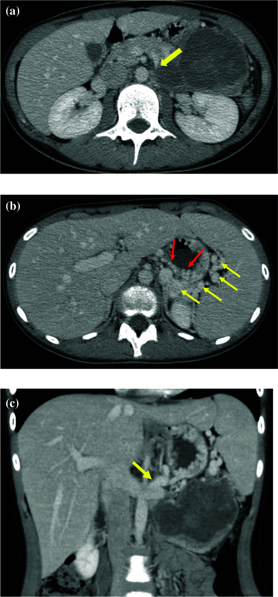
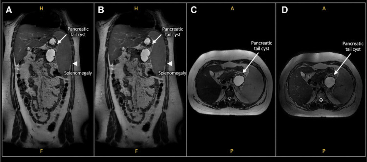
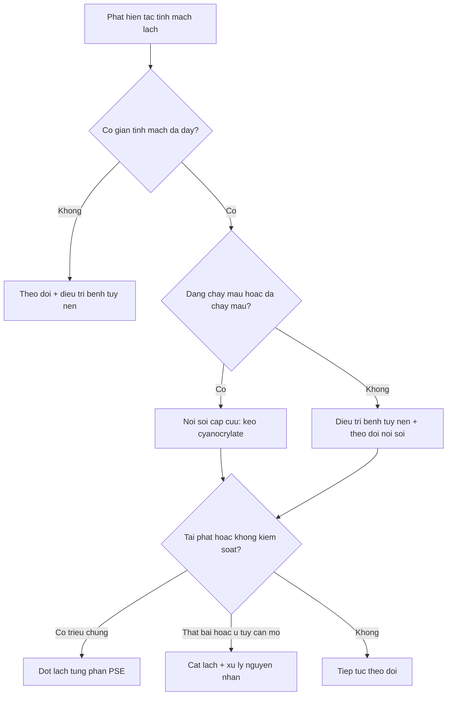
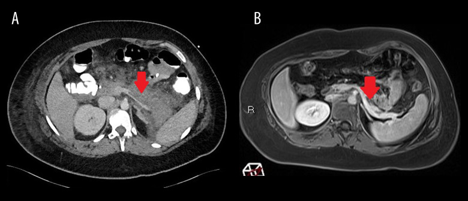

# 6115 — Tăng áp cửa phía trái do tắc tĩnh mạch lách ở trẻ: giãn tĩnh mạch dạ dày đơn độc, tĩnh mạch cửa chính vẫn thông

**Tags:** `pattern:gian-tinh-mach-da-day` `pattern:lach-to` `pattern:tang-ap-cua` `pattern:huyet-khoi-tinh-mach` `pattern:hep-tinh-mach` `vung:lach` `vung:da-day` `vung:tuy` `protocol:CT-3-thi` `protocol:sieu-am-Doppler` `protocol:noi-soi-tieu-hoa` `score:Sarin`
**Mức chắc chắn (certainty):** tổng hợp y văn (literature synthesis) — ghép **ca trẻ 12 tuổi có u đặc–nhầy nhú tụy đuôi gây hẹp tĩnh mạch lách, lách to tồn tại sau mổ và phải cắt lách sau 9 tháng** (Surg Case Rep 2024, PMC11551083), **ca trẻ 15 tuổi có nang tụy đuôi – huyết khối tĩnh mạch lách – giãn tĩnh mạch dạ dày đơn độc – chảy máu tiêu hóa** (Cureus 2026, PMC13282029), **loạt 2 trẻ 9 và 13 tuổi huyết khối tĩnh mạch lách sau viêm tụy cấp được điều trị bằng kháng đông** (Am J Case Rep 2022, PMC9706476), **ca trẻ 11 tuổi viêm tụy cấp có huyết khối tĩnh mạch lách** (Cureus 2022, PMC9506509), **đoàn hệ 207 bệnh nhân tăng áp cửa do bệnh tụy theo dõi 34,1 tháng** (BMC Gastroenterol 2026, PMC13112925), **tổng quan quản lý tăng áp cửa phía trái sau cắt khối tá tụy** (Dig Dis 2024, PMC10997249) và **loạt 12 trẻ đốt lách từng phần vì cường lách do tăng áp cửa** (Front Radiol 2026, PMC13038971).

> **Câu hỏi thực hành:** bé gái **12 tuổi**, **đau hông lưng trái kèm sốt nhẹ**, siêu âm thấy **khối nang–đặc ở đuôi tụy 8,3 × 5,3 × 7,1 cm** và **lách 12,3 × 5,2 cm**; CT có **tĩnh mạch lách hẹp như "mỏ chim"** ngay cạnh khối và **mạng mạch giãn quanh đáy vị, rốn lách**. Xét nghiệm: **tiểu cầu 189.000/µL** (không cường lách), **không vàng da, không báng**.
> Câu hỏi: **tĩnh mạch cửa chính vẫn thông thì có phải "tăng áp cửa" không? tại sao chỉ giãn tĩnh mạch dạ dày mà không giãn tĩnh mạch thực quản? khi mổ bóc u, có giữ được lách không?**
> Bài chốt **bốn việc**: **(1) tắc tĩnh mạch lách đơn thuần gây tăng áp cửa "phía trái" — áp lực tĩnh mạch cửa chính bình thường nhưng áp lực tĩnh mạch lách và dạ dày tăng; (2) hình ảnh chốt là giãn tĩnh mạch đáy vị kèm lách to và tĩnh mạch cửa chính thông; (3) chảy máu do varices dạ dày ở nhóm này **không thường gặp nhưng chảy máu thì nặng**, nên không cắt lách dự phòng hàng loạt; (4) giữ lách chỉ hợp lý khi tĩnh mạch lách còn tái thông — tắc đã tổ chức hóa thì phải cắt lách hoặc đốt lách từng phần.** Nối [6114 – EHPVO sau catheter rốn](../6114-ehpvo-sau-catheter-ron/lesson.md), [135 – Viêm tụy cấp theo Atlanta](../135-viem-tuy-Atlanta/lesson.md), [6113 – Huyết khối động mạch chủ sơ sinh](../6113-huyet-khoi-dong-mach-chu-so-sinh-uac/lesson.md).

## 1. Tổng quan bệnh học – cơ chế hình ảnh: tại sao "cửa chính thông" mà vẫn tăng áp cửa

- **Định nghĩa:** tăng áp cửa phía trái (left-sided/sinistral portal hypertension, LSPH) là **tăng áp lực trong hệ tĩnh mạch lách do tắc hoặc hẹp tĩnh mạch lách**, trong khi **tĩnh mạch cửa chính còn thông** và **chức năng gan bình thường** (Surg Case Rep 2024, PMC11551083). Đây là thể **tăng áp cửa khu trú (segmental)**, không phải tăng áp cửa toàn hệ.
- **Giải phẫu – đường thoát của máu:** tĩnh mạch lách nhận máu từ lách rồi đổ vào tĩnh mạch cửa. Khi tĩnh mạch lách tắc, máu lách **không còn đường về gan theo trục chính** nên đi ngược qua **tĩnh mạch dạ dày ngắn (short gastric veins)** vào **đám rối tĩnh mạch dưới niêm đáy vị**, rồi qua **tĩnh mạch vành vị (left gastric/coronary vein)** đổ về tĩnh mạch cửa. Chính đoạn "vòng tránh" này phồng lên thành **giãn tĩnh mạch đáy vị (fundal varices)** (Surg Case Rep 2024; Dig Dis 2024, PMC10997249).
- **TẠI SAO tĩnh mạch cửa chính thông mà vẫn tăng áp:** chướng ngại nằm **sau lách và trước hợp lưu cửa–mạc treo**, nên **áp lực đo ở tĩnh mạch cửa là bình thường**, còn **áp lực trong tĩnh mạch lách, tĩnh mạch dạ dày ngắn và đám rối đáy vị thì tăng**. Vì vậy **đo áp lực tĩnh mạch cửa không dùng để loại trừ LSPH** — đây là bẫy lập luận hay gặp khiến trẻ bị xếp nhầm vào nhóm "không tăng áp cửa" rồi chỉ theo dõi.
- **TẠI SAO giãn tĩnh mạch dạ dày mà ít giãn tĩnh mạch thực quản:** máu thoát qua **tĩnh mạch vành vị vào tĩnh mạch cửa có áp lực bình thường**, nên **chênh áp qua đám rối thực quản không tăng** — giãn tĩnh mạch chủ yếu khu trú ở **đáy vị**. Trong đoàn hệ 207 bệnh nhân, **giãn tĩnh mạch dạ dày đơn độc chiếm 92,3% (191/207)**, chỉ **7,7% (16/207)** có giãn cả thực quản–dạ dày; số ít có giãn thực quản thường kèm **huyết khối tĩnh mạch cửa hoặc mạc treo tràng trên** (BMC Gastroenterol 2026, PMC13112925). Đây là lý do câu "chỉ thấy giãn tĩnh mạch đáy vị, thực quản bình thường" **phải nghĩ ngay tới tắc tĩnh mạch lách**.
- **TẠI SAO lách to:** ứ máu trong lách → **sung huyết tủy đỏ** → lách to; lách to gặp ở **67,6% (140/207)** bệnh nhân trong đoàn hệ trên. **Cường lách (giảm tiểu cầu, giảm bạch cầu) lại ít gặp** trong LSPH — chỉ **1,4% (3/207)** có cường lách, khác hẳn tăng áp cửa do xơ gan hay EHPVO. Vì thế **tiểu cầu bình thường KHÔNG loại trừ LSPH** (ca 12 tuổi: tiểu cầu 189.000/µL).
- **Ngưỡng định lượng – tần suất huyết khối tĩnh mạch lách ở trẻ:** trong **72 trẻ viêm tụy cấp**, **15,4% có huyết khối tĩnh mạch tạng**, còn **viêm tụy mạn 0%**; đoàn hệ quốc tế **INSPPIRE** chỉ ghi nhận **1,2%** (Am J Case Rep 2022, PMC9706476). Ở người lớn, gộp các nghiên cứu cho **14,1%** huyết khối tĩnh mạch tạng sau viêm tụy (**22,6%** trong viêm tụy cấp, **12,4%** trong viêm tụy mạn) — tức là **cùng một bệnh tụy nhưng trẻ có tỷ lệ thấp hơn và hay gặp ở thể cấp**.
- **Nguy cơ chảy máu – con số quyết định thái độ:** theo dõi tự nhiên, **chảy máu do giãn tĩnh mạch dạ dày khoảng 4%**, và trong loạt được theo dõi **không có tử vong vì chảy máu**; **giãn tĩnh mạch thấy trên CT có nguy cơ chảy máu khoảng 5%** nhưng **thấy giãn tĩnh mạch trên nội soi thì nguy cơ cao hơn** (Cureus 2022, PMC9506509, dẫn lại y văn). Ngược lại, đoàn hệ 207 bệnh nhân có **24 ca chảy máu (11,6% thô) trong trung vị 34,1 tháng**, và ước tính **tích lũy tới ~30% sau 3 năm** — tức là **nhóm bệnh tụy hoạt động, có giãn tĩnh mạch rõ, chảy máu nhiều hơn con số "4%" cổ điển** (PMC13112925).
- **Yếu tố dự báo chảy máu (đa biến, đoàn hệ 207):** **hút thuốc HR 3,26 (1,39–7,66)**, **viêm tụy mạn HR 2,69 (1,04–6,91)**, **đái tháo đường HR 2,83 (1,20–6,65)**; **tiểu cầu cao hơn thì nguy cơ thấp hơn (HR 0,99 mỗi 10⁹/L)** (PMC13112925). Với trẻ, hút thuốc/ĐTĐ ít gặp, nhưng **viêm tụy mạn và mức độ phá hủy tụy** vẫn là trục chính.
- **TẠI SAO hình ảnh lại là "hẹp mỏ chim" (beak sign):** khi tĩnh mạch bị chèn ép từ ngoài (nang, u, phù nề tụy) hoặc bị huyết khối tổ chức hóa, cột thuốc **thuôn nhọn đột ngột** tại chỗ hẹp, phía sau **không thấy tĩnh mạch lách bình thường** mà là **chùm mạch bàng hệ**. Trên CT, huyết khối là **khuyết thuốc trong lòng mạch (filling defect)**; trên siêu âm Doppler là **mất phổ tĩnh mạch liên tục** ở đoạn tắc và **phổ động mạch hóa** ở bàng hệ. **Bắt buộc đọc ở thì tĩnh mạch cửa (60–70 giây)** — pha động mạch làm tĩnh mạch lách chưa ngấm đủ và dễ kết luận sai là "không thấy tĩnh mạch lách".

*Ba lát cắt của cùng bệnh nhi 12 tuổi có u đặc–nhầy nhú tụy đuôi: **(a)** tĩnh mạch lách bị khối u chèn ép, thuôn nhọn như **mỏ chim** (mũi tên vàng); **(b)** **bàng hệ qua tĩnh mạch dạ dày ngắn và tĩnh mạch vành vị** (mũi tên đỏ và vàng) tạo đám mạch quanh đáy vị; **(c)** mặt phẳng trục dọc cho thấy tĩnh mạch lách hẹp kéo dài và các quai bàng hệ. Đây là "chữ ký" của tăng áp cửa phía trái: **tĩnh mạch cửa chính không nằm trong ảnh vì vẫn bình thường**. Nguồn: Surgery Case Reports 2024 (PMC11551083), CC BY 4.0, nguyên bản.*

## 2. Mẫu hình + chẩn đoán phân biệt theo vị trí và theo nguyên nhân (gamut)

- **Gamut theo vị trí chướng ngại (quyết định thái độ):**
  - **Tại tụy** (hay gặp nhất ở trẻ): **viêm tụy cấp/viêm tụy mạn**, **nang giả tụy**, **u tụy** (u đặc–nhầy nhú, u nhú niêm mạc ống tụy, u nguyên bào tụy), **chấn thương tụy**.
  - **Tại lách:** **lách lạc chỗ xoắn (wandering spleen)**, chấn thương lách, sau cắt lách, nhồi máu lách.
  - **Tại tĩnh mạch:** **huyết khối tĩnh mạch lách đơn thuần**, hẹp do chèn ép, **dị dạng động–tĩnh mạch lách** (gây tăng áp cửa do tăng lưu lượng).
  - **Sau mổ:** cắt khối tá tụy/thắt tĩnh mạch lách trong mổ — nhóm được mô tả nhiều ở người lớn, chảy máu **trung bình 28 tháng sau mổ** (Dig Dis 2024, PMC10997249).
- **Gamut theo hình ảnh "giãn tĩnh mạch dạ dày đơn độc"** — 4 câu hỏi theo thứ tự:
  1. **Tĩnh mạch cửa chính có thông không?** Thông + tĩnh mạch lách tắc → **LSPH**. Tắc/cavernoma → **EHPVO** ([6114](../6114-ehpvo-sau-catheter-ron/lesson.md)).
  2. **Có dấu hiệu xơ gan không?** Bờ gan gồ ghề, báng, albumin thấp, INR tăng → **tăng áp cửa do xơ gan**; nhưng **xơ gan + huyết khối tĩnh mạch lách cùng lúc vẫn xảy ra** và là chẩn đoán khó nhất (Front Gastroenterol 2026, PMC13135999).
  3. **Có giãn tĩnh mạch thực quản không?** Có nhiều varices thực quản + báng + lách to + giảm tiểu cầu → tăng áp cửa toàn hệ.
  4. **Có khối tụy/lách/tĩnh mạch không?** Luôn truy nguyên nhân — **"LSPH" là hội chứng, không phải chẩn đoán cuối**.
- **Gamut theo tuổi:** nhũ nhi – trẻ nhỏ: **huyết khối sau viêm tụy, nang giả tụy, dị dạng mạch**; trẻ lớn – vị thành niên: **u tụy (đặc–nhầy nhú, IPMN), viêm tụy mạn do rượu/thuốc, lách lạc chỗ**.
- **Mẫu hình kinh điển:** **trẻ lớn + đau hông lưng trái/lách to + không báng + men gan bình thường + tiểu cầu bình thường + nội soi chỉ thấy giãn tĩnh mạch đáy vị** → nghĩ **LSPH do bệnh tụy**, không phải bệnh máu và không phải xơ gan.

*Bệnh nhi 15 tuổi có nang nhánh tụy đuôi: **(A–B)** T2 coronal: nang đuôi tụy (mũi tên trắng) và **lách to** (đầu mũi tên); **(C–D)** mặt phẳng trục. Trong ca này lách tăng dần **14 → 18 → 20,2 cm** trong 2 năm, kèm **huyết khối tĩnh mạch lách** và **giãn tĩnh mạch dạ dày đơn độc** — minh họa rằng LSPH là quá trình **tiến triển theo thời gian**, không phải biến chứng một lần. Nguồn: Cureus 2026 (PMC13282029), CC BY 4.0, nguyên bản.*

## 3. Bảng so sánh phân biệt (ma trận đối chiếu)

| Thực thể (entity) | Hình ảnh điển hình | Chốt vào (rule-in) | Chốt loại (rule-out) | Gợi ý xác nhận |
|---|---|---|---|---|
| **LSPH do tắc tĩnh mạch lách** | **Tĩnh mạch cửa chính thông**; tĩnh mạch lách không thấy/hẹp mỏ chim; **bàng hệ dạ dày ngắn – vành vị**; lách to; gan bờ nhẵn | **Giãn tĩnh mạch đáy vị đơn độc + tĩnh mạch lách tắc + cửa chính thông** | Có giãn tĩnh mạch thực quản nhiều + báng + albumin thấp → không phải LSPH đơn thuần | CT 3 thì (cửa 60–70 s), Doppler, nội soi |
| **EHPVO / cavernoma sau catheter rốn** | **Không thấy tĩnh mạch cửa chính**, chùm mạch ngoằn ngoèo ở rốn gan; lách to; giãn tĩnh mạch **thực quản** | **Cavernoma ở rốn gan + tiền sử catheter rốn** | Có tĩnh mạch cửa chính bình thường → không phải EHPVO | Doppler + CT thì cửa; xem [6114](../6114-ehpvo-sau-catheter-ron/lesson.md) |
| **Xơ gan** | Gan teo bờ gồ ghề, **báng**, tuần hoàn bàng hệ, lách to, giảm tiểu cầu | **Báng + albumin thấp + INR tăng + bờ gan gồ ghề** | Không báng, albumin/INR bình thường, bờ gan nhẵn → không phải xơ gan | Elastography, CT/MRI, sinh thiết khi cần |
| **Giãn tĩnh mạch dạ dày nguyên phát (IGV không tăng áp cửa)** | Varices đáy vị **không kèm lách to, không bàng hệ, tĩnh mạch lách và cửa bình thường** | **Tĩnh mạch lách + cửa bình thường, không lách to** | Có tắc tĩnh mạch lách + lách to → LSPH | CT thì cửa; nội soi; theo dõi |
| **Hẹp tĩnh mạch cửa do khối/u tụy** | Hẹp tĩnh mạch cửa chính kèm khối; bàng hệ **hướng gan**; có thể kèm huyết khối | **Hẹp/tắc tĩnh mạch cửa chính + khối chèn ép** | Tĩnh mạch cửa chính thông hoàn toàn → không phải | CT/MRI có cản quang, EUS khi cần |
| **Dị dạng động–tĩnh mạch lách** | Tĩnh mạch lách **giãn to, ngấm thuốc sớm ở pha động mạch**, lách to; chênh lưu lượng | **Ngấm thuốc sớm + giãn tĩnh mạch lách, không có huyết khối** | Có huyết khối/hẹp khu trú → LSPH | CTA/DSA, đo lưu lượng |

- Không tạo ảnh ghép: **3 ảnh thuộc 3 bệnh nhi khác nhau và 2 nhóm bệnh khác nhau** (u tụy, nang tụy, viêm tụy), ghép cạnh nhau dễ khiến người đọc tưởng cùng một ca.

## 4. Protocol chụp + phân loại giãn tĩnh mạch & thuật toán xử trí

- **Siêu âm bụng + Doppler màu là đầu tay:** đo **chiều dài lách**, khảo sát **tĩnh mạch lách từ rốn lách tới hợp lưu**, tìm **khuyết thuốc/hẹp**, ghi **có hay không phổ tĩnh mạch**, và **mô tả bàng hệ quanh đáy vị**. Siêu âm không thấy tĩnh mạch lách **không loại trừ** — phải chuyển CT.
- **CT bụng có cản quang 3 thì, lát ≤ 1 mm:** thì **động mạch** để đánh giá dị dạng/giả phình, thì **tĩnh mạch cửa 60–70 giây** (bắt buộc) để thấy huyết khối và bàng hệ, thì **muộn** để đánh giá tổ chức hóa và tưới máu tạng. Đo: **đường kính tĩnh mạch lách, chiều dài đoạn tắc, kích thước lách, đường kính varices**, và ghi rõ **tĩnh mạch cửa chính có thông hay không**.
- **Nội soi tiêu hóa trên là tiêu chuẩn vàng cho varices** — phân loại theo **Sarin**: **GOV1** (giãn theo bờ cong nhỏ, liên tục với thực quản), **GOV2** (lan tới đáy vị theo bờ cong lớn), **IGV1** (giãn đơn độc ở đáy vị), **IGV2** (varices lạc chỗ ở hang/thân vị). Kích thước: **F1 ngoằn ngoèo, F2 nút/chùm nho, F3 như khối u**. **LSPH điển hình = IGV1 hoặc GOV2**; nội soi **chỉ nhìn thực quản là bỏ sót** phần lớn tổn thương.
- **Không có hệ điểm riêng cho LSPH** — phân tầng dựa trên **Sarin + có/không chảy máu + bệnh tụy nền**. Dùng thuật toán sau:

- **Cấp cứu chảy máu:** **keo cyanoacrylate (N-butyl-2-cyanoacrylate)** là lựa chọn đầu tay cho varices dạ dày. Gộp dữ liệu người lớn: **kiểm soát chảy máu 93,9% với keo so với 79,5% với thắt vòng (p = 0,03)** (Dig Dis 2024, PMC10997249). Ở trẻ: **30 trẻ** (tuổi trung bình **7,12 ± 2,9**) đạt **cầm máu ban đầu 96,7%**, **tái chảy máu 10%** sau 48 giờ, **sốt/đau bụng 10%**, **tử vong 1 ca (3%) do nhiễm khuẩn sau mổ shunt**; liều dùng **0,5 mL keo + 0,5 mL lipiodol** (Pak J Med Sci 2018, PMC6290215). Loạt **28 trẻ** (trung vị **13 tuổi**, 8–18) có **EHPVO 89%**: **cầm máu 100%**, **tiêu varices 57%**, **tái chảy máu 14%**, **thể tích keo trung vị 2 mL (1–5)**, **14 trẻ phải mổ sau đó** (Endosc Int Open 2016, PMC5066454). Biến chứng cần nhớ: **tắc mạch do keo (0,5–4,3% ở người lớn)**.
- **Đốt lách từng phần (partial splenic embolization, PSE)** — hạ áp lực tĩnh mạch lách mà **giữ chức năng miễn dịch của lách**: loạt **12 trẻ 8–15 tuổi** (trung vị 13) được PSE vì cường lách do tăng áp cửa, **75% do huyết khối tĩnh mạch cửa**: dùng **hạt PVA 350–500 µm**, **thể tích lách đốt trung vị 40% (IQR 25–60)**; **tiểu cầu tăng có ý nghĩa (p = 0,0004)** và **bạch cầu tăng (p = 0,002)**; trong 8 trẻ nội soi lại, **75% giảm độ giãn tĩnh mạch**, **25% tiến triển** (Front Radiol 2026, PMC13038971). Biến chứng: **hội chứng sau đốt lách, áp-xe lách, nhồi máu lách** → siêu âm kiểm tra trong **10 ngày đầu**; với PVA, đánh giá mức đốt bằng **CEUS sau 2 ngày** (Dig Dis 2024).
- **Cắt lách** là biện pháp triệt để khi **tái chảy máu hoặc có triệu chứng do lách to**, và **thường phải làm cùng lúc với phẫu thuật tụy** nếu tĩnh mạch lách đã tắc không hồi phục. Hệ quả: **nguy cơ nhiễm khuẩn tối cấp sau cắt lách (OPSI)** → **tiêm phòng phế cầu, não mô cầu, Hib trước mổ** và **nhắc lại mỗi 5 năm**; ca 12 tuổi trong bài được tiêm nhắc **mỗi 5 năm** sau cắt lách (PMC11551083).
- **Kháng đông trong huyết khối tĩnh mạch lách do viêm tụy:** còn tranh luận. Hai trẻ 9 và 13 tuổi được điều trị **enoxaparin 1 mg/kg mỗi 12 giờ** rồi chuyển **rivaroxaban** (15 mg × 2/ngày trong 21 ngày, sau đó 20 mg/ngày, tổng **3 tháng**) và **huyết khối tan gần hoàn toàn trên hình ảnh lúc 3 tháng**; nhưng tổng quan hệ thống **không chứng minh lợi ích thường quy** của kháng đông trong huyết khối tĩnh mạch tạng do viêm tụy (Am J Case Rep 2022, PMC9706476). **Không dùng kháng đông khi đang có giãn tĩnh mạch dạ dày chưa xử lý.**
- **Theo dõi sau ra viện (ghi vào giấy ra viện):** **kích thước lách**, **công thức máu**, **nội soi lại theo bậc varices**, và **đau bụng/tái phát**; với trẻ đã mổ tụy giữ lách: **siêu âm Doppler tĩnh mạch lách ở mỗi lần khám** vì hẹp có thể **tồn tại và tiến triển** (ca 12 tuổi).

## 5. Biến thể bình thường và cạm bẫy

- **Lách to đơn độc ở trẻ** rất dễ bị xếp vào nhóm **bệnh máu (lymphoma, thalassemia, ITP)** — nhưng LSPH có **công thức máu gần như bình thường** (cường lách chỉ 1,4%). Bắt buộc hỏi **tiền sử viêm tụy, chấn thương bụng, đau hông lưng trái** và **khảo sát tụy** trên mọi siêu âm vì "lách to".
- **"Tĩnh mạch cửa chính thông" ≠ không tăng áp cửa.** Đây là cạm bẫy lập luận hay gặp: LSPH là **tăng áp cửa khu trú**, áp lực cửa chính bình thường. Ngược lại, **tĩnh mạch cửa tắc (EHPVO) không có nghĩa là tĩnh mạch lách cũng tắc**.
- **Chỉ chụp pha động mạch** → tĩnh mạch lách chưa ngấm thuốc, dễ báo "không thấy tĩnh mạch lách" hoặc bỏ sót huyết khối không tắc hoàn toàn. Luôn có **thì tĩnh mạch cửa 60–70 giây**.
- **Nội soi chỉ nhìn thực quản** → bỏ sót **IGV1/GOV2** ở đáy vị; varices đáy vị có thể bị **máu đọng hoặc thức ăn che**, cần **úp ngược đèn** và bơm hơi đủ.
- **Varices đáy vị giả (pseudovarices):** nếp gấp niêm mạc dày, u dưới niêm, hoặc **khối nang tụy đè vào thành vị** có thể trông như giãn tĩnh mạch trên nội soi — chốt bằng **CT thì cửa** (cấu trúc có ngấm thuốc theo tĩnh mạch mới là varices).
- **Xơ gan + huyết khối tĩnh mạch lách cùng lúc:** đây là nhóm **chẩn đoán khó nhất** vì hai cơ chế tăng áp cửa chồng lên nhau; không được kết luận "chỉ do xơ gan" rồi bỏ qua can thiệp vào tĩnh mạch lách, và cũng không được quy hết cho huyết khối (Front Gastroenterol 2026, PMC13135999).
- **Sau cắt thân tụy giữ lách:** tĩnh mạch lách có thể **hẹp vĩnh viễn** dù u đã lấy; lách to và đau có thể **tiến triển sau nhiều tháng** (ca 12 tuổi phải cắt lách sau **9 tháng**). Không hứa "giữ lách là xong".
- **Thoát mạch do keo:** sau tiêm keo, **đau ngực, ho ra máu, đau đầu, đau bụng dữ dội** = nghi **tắc mạch phổi/não/tạng do keo** → chụp CT ngay; phòng bằng **trộn lipiodol 1:1** và **bơm chậm, kiểm tra vị trí kim**.

## 6. Tự lượng giá — Blind Quiz ngay trên trang tĩnh

**Ca 1 — Bé gái 12 tuổi, đau hông lưng trái, sờ thấy lách. Nhìn 3 lát CT, mô tả trước khi mở đáp án.**

- Gợi ý lâm sàng (clinical context): 12 tuổi, **đau hông lưng trái + sốt nhẹ**, **không báng**, **tiểu cầu 189.000/µL**; siêu âm có khối nang–đặc đuôi tụy 8,3 × 5,3 × 7,1 cm, lách 12,3 × 5,2 cm.
- Câu hỏi: **(1)** Tĩnh mạch nào bị chèn ép, ở đâu? **(2)** Vì sao có đám mạch quanh đáy vị? **(3)** Ba chẩn đoán phân biệt? **(4)** Có giữ được lách khi mổ không?

<b>Bấm để hiện đáp án (findings + chẩn đoán)</b>

- **Dấu hiệu (findings):** **(a)** tĩnh mạch lách bị khối u đuôi tụy chèn ép, **thuôn nhọn kiểu mỏ chim** (mũi tên vàng); **(b)** bàng hệ qua **tĩnh mạch dạ dày ngắn và tĩnh mạch vành vị** quanh đáy vị (mũi tên đỏ/vàng); **(c)** hẹp tĩnh mạch lách kéo dài trên mặt phẳng trục dọc. Lách to; **không thấy báng**.
- **Chẩn đoán (diagnosis):** **tăng áp cửa phía trái do u đặc–nhầy nhú tụy đuôi chèn ép tĩnh mạch lách** — vì chướng ngại nằm sau lách nên **tĩnh mạch cửa chính vẫn thông** và **giãn tĩnh mạch khu trú ở đáy vị**.
- **Phân biệt:** EHPVO/cavernoma (tĩnh mạch cửa tắc), xơ gan (báng, albumin thấp), giãn tĩnh mạch dạ dày nguyên phát (không lách to, tĩnh mạch lách bình thường).
- **Diễn tiến thật của ca:** u được cắt nhưng **hẹp tĩnh mạch lách tồn tại**, lách vẫn to và đau → **cắt lách sau 9 tháng**, hết đau, **8 năm không tái phát**; tiêm phòng **mỗi 5 năm** sau cắt lách.
- Nguồn: Surgery Case Reports 2024 (PMC11551083), CC BY 4.0.

**Ca 2 — Bé gái 15 tuổi, đau bụng tái diễn 2 năm, lách to dần. MRI T2 coronal:**

- Gợi ý lâm sàng: 15 tuổi, **đau bụng từng đợt**, **lipase 107 U/L** (bình thường < 70), **lách 14 cm rồi 20,2 cm**; sau đó **nôn ra máu**.
- Câu hỏi: **(1)** Mô tả tổn thương tụy và lách. **(2)** Tĩnh mạch nào cần khảo sát thêm? **(3)** Vì sao nội soi lần đầu chỉ thấy **loét dạ dày** mà lần sau thấy **giãn tĩnh mạch**?

<b>Bấm để hiện đáp án (findings + chẩn đoán)</b>

- **Findings:** nang nhánh tụy đuôi (mũi tên trắng) **tăng dần kích thước** (2,2 cm → 5,6 → 8,1 cm) và **lách to** (đầu mũi tên); sau đó xuất hiện **huyết khối tĩnh mạch lách** và **giãn tĩnh mạch dạ dày đơn độc**.
- **Chẩn đoán:** **tăng áp cửa phía trái tiến triển do bệnh tụy** (sau cùng xác định là **u nhú niêm mạc ống tụy nhánh** — IPMN nhánh); **chảy máu từ varices đáy vị** sau một lần chỉ thấy loét.
- **Vì sao lần đầu âm tính:** varices **xuất hiện muộn** khi huyết khối tĩnh mạch lách hình thành — đây là lý do phải **nội soi lại** khi lách to thêm hoặc có máu tiêu hóa.
- **Xử trí:** **cắt thân tụy + cắt lách** sau tiêm phòng; **không còn tái phát** trên hình ảnh sau mổ.
- Nguồn: Cureus 2026 (PMC13282029), CC BY 4.0.

**Ca 3 — Bé gái 13 tuổi, viêm tụy cấp lần 2, CT bụng có cản quang:**

- Gợi ý lâm sàng: 13 tuổi, **đau thượng vị**, **lipase > 4000 U/L**; đã dùng **enoxaparin dự phòng 40 mg/ngày** từ lúc nhập viện.
- Câu hỏi: **(1)** Mũi tên đỏ chỉ gì? **(2)** Đang dự phòng kháng đông mà vẫn có huyết khối thì xử trí thế nào? **(3)** Có cần cắt lách dự phòng không?

<b>Bấm để hiện đáp án (findings + chẩn đoán)</b>

- **Findings:** **khuyết thuốc trong lòng tĩnh mạch lách** (mũi tên đỏ) trên nền **tụy phù nề, thâm nhiễm mỡ quanh tụy** — huyết khối tĩnh mạch lách **không tắc hoàn toàn** ở ca này.
- **Chẩn đoán:** **huyết khối tĩnh mạch lách sau viêm tụy cấp** — biến chứng gặp ở **15,4% trẻ viêm tụy cấp** trong một loạt 72 trẻ.
- **Xử trí:** nâng lên **liều điều trị enoxaparin 1 mg/kg mỗi 12 giờ** (theo dõi anti-Xa), sau đó **rivaroxaban 3 tháng**; **huyết khối tan** trên MRCP lúc 3 tháng. **Không cắt lách dự phòng**: nguy cơ chảy máu do varices khoảng **4%** và **không có tử vong** trong loạt theo dõi — cắt lách chỉ khi **tái chảy máu/có triệu chứng**.
- **Bài học:** huyết khối có thể xuất hiện **dù đang dự phòng** — dự phòng không thay thế được theo dõi hình ảnh khi lâm sàng xấu đi.
- Nguồn: Am J Case Rep 2022 (PMC9706476), CC BY-NC-ND 4.0, nguyên bản.

## Bài liên quan chéo
- [6114 – Di chứng muộn huyết khối tĩnh mạch cửa sau catheter rốn (EHPVO/cavernoma)](../6114-ehpvo-sau-catheter-ron/lesson.md) — tắc tĩnh mạch **cửa chính**, giãn tĩnh mạch **thực quản**.
- [6113 – Huyết khối động mạch chủ ở sơ sinh sau UAC](../6113-huyet-khoi-dong-mach-chu-so-sinh-uac/lesson.md) — cùng nhóm huyết khối tạng ở trẻ.
- [135 – Viêm tụy cấp: phân độ Atlanta & biến chứng](../135-viem-tuy-Atlanta/lesson.md) — nguồn gốc thường gặp nhất của huyết khối tĩnh mạch lách.
- [136 – U nang tụy](../136-u-nang-tuy/lesson.md) — chẩn đoán phân biệt khối nang đuôi tụy.
- [176 – TIPS: theo dõi shunt](../176-tips-dips-theo-doi-shunt/lesson.md), [183 – Giảm đường kính shunt và HE kháng trị sau TIPS](../183-giam-duong-kinh-shunt-va-HE-khang-tri-sau-tips/lesson.md) — bối cảnh tăng áp cửa toàn hệ ở người lớn.
- [3045 – Catheter rốn ở sơ sinh (UVC/UAC)](../3045-catheter-ron-so-sinh-uvc-uac/lesson.md)

> Không dùng để chẩn đoán độc lập khi chưa có người hướng dẫn.
