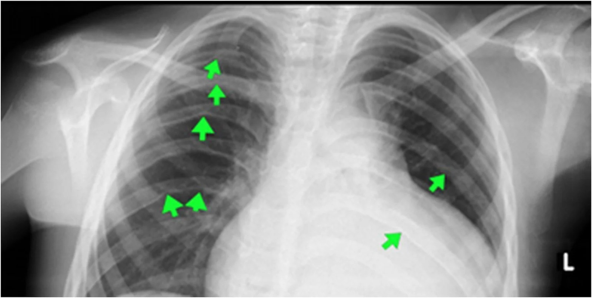
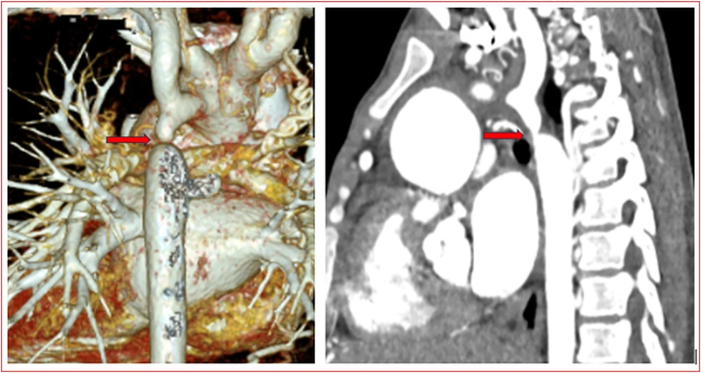
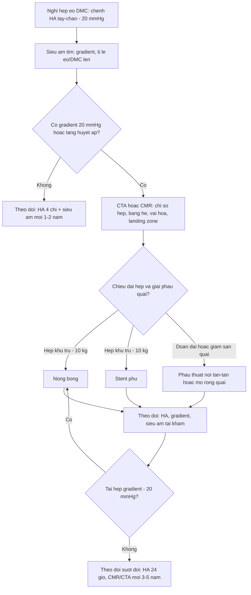
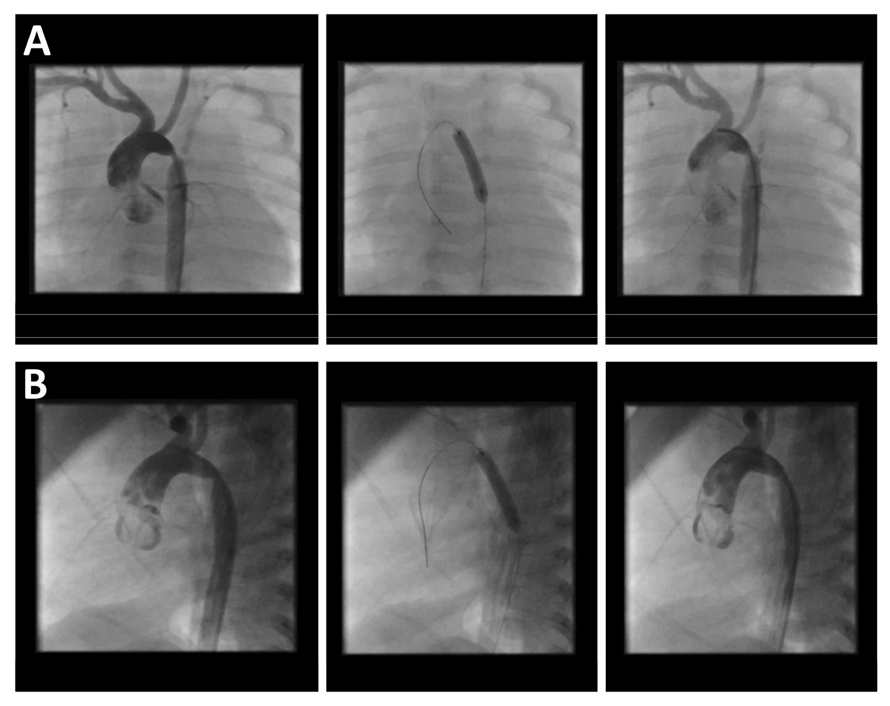
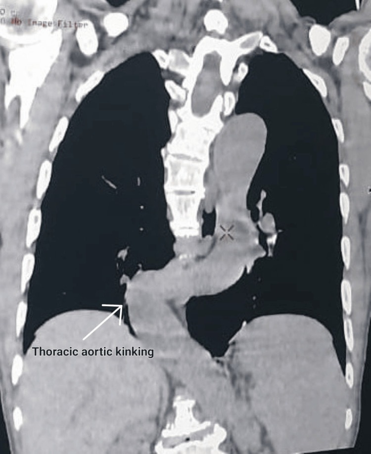

# 6116 — Hẹp eo động mạch chủ ở trẻ: dấu "3" trên phim ngực, khuyết sườn, chênh huyết áp tay–chân

**Tags:** `pattern:hep-dong-mach` `pattern:tuong-hoan-bang-he` `pattern:phi-dai-that-trai` `pattern:chênh-huyet-ap-tay-chan` `pattern:khuyet-xuong-suon` `vung:dong-mach-chu` `vung:eo-dong-mach-chu` `vung:trung-that` `vung:long-nguc` `protocol:CTA-ECG-gating` `protocol:MRI-4D-flow` `protocol:sieu-am-tim` `protocol:thong-tim` `score:gradient-20mmHg`
**Mức chắc chắn (certainty):** tổng hợp y văn (literature synthesis) — ghép **ca nam 16 tuổi nhập viện vì nhồi máu não, tình cờ phát hiện hẹp eo ĐMC chưa chẩn đoán** (Oxford Med Case Reports 2026, PMC13430965), **ca người lớn 67 tuổi gập góc ĐMC giả hẹp eo (pseudocoarctation)** (Cureus 2026, PMC13471715), **đoàn hệ 33 nhũ nhi nong bóng vì hẹp lại sau mổ** (J Cardiovasc Dev Dis 2026, PMC13607833), **tổng quan chẩn đoán–điều trị hẹp eo** (Diagnostics 2023, PMC10340190), **tổng quan can thiệp qua da & tỷ lệ can thiệp lại** (J Clin Med 2023, PMC10707478), **tổng quan hình ảnh đa phương thức** (J Clin Med 2026, PMC12898374) và **gộp 5 nghiên cứu/442 bệnh nhân về phình động mạch nội sọ** (JACC Adv 2023, PMC11198084).

> **Câu hỏi thực hành:** nam **16 tuổi** vào viện vì **yếu nửa người phải đột ngột**; huyết áp **tay 150/100 mmHg** nhưng **chân 80/50 mmHg**, **mất mạch bẹn hai bên**. Phim ngực có **khuyết bờ dưới xương sườn 4–7 bên phải**; CTA có **hẹp khu trú nặng ĐMC xuống ngay sau động mạch dưới đòn trái** kèm **mạng bàng hệ dày đặc**.
> Câu hỏi: **vì sao trẻ bị nhồi máu não lại là hẹp eo ĐMC? khuyết sườn hình thành thế nào và vì sao hiếm gặp ở nhũ nhi? khi nào được nong bóng, khi nào phải đặt stent, khi nào mổ?**
> Bài chốt **bốn việc**: **(1) chênh huyết áp tay–chân tâm thu > 20 mmHg là dấu lâm sàng bắt buộc phải đo ở MỌI trẻ tăng huyết áp; (2) chẩn đoán xác định bằng hình ảnh (siêu âm → CTA/CMR) + gradient, không dựa vào một con số; (3) can thiệp khi có tăng huyết áp/phi đại thất trái/gradient ≥ 20 mmHg, chọn nong bóng ở nhũ nhi và stent ở trẻ ≥ 10 kg; (4) sau can thiệp vẫn phải theo dõi suốt đời vì tăng huyết áp tồn lưu 25–62% và hẹp lại 30–59%.** Nối [6117 – Tăng huyết áp do mạch máu thận](../6117-tang-huyet-ap-mach-than-sau-huyet-khoi-so-sinh/lesson.md), [6113 – Huyết khối động mạch chủ sơ sinh sau UAC](../6113-huyet-khoi-dong-mach-chu-so-sinh-uac/lesson.md), [850 – Loạn sản cơ xơ (FMD) toàn thân ở trẻ](../850-loan-san-co-xo-fibromuscular-dysplasia-toan-than-o-tre/lesson.md).

## 1. Tổng quan bệnh học – cơ chế hình ảnh: tại sao hẹp một chỗ lại gây khuyết xương sườn

- **Định nghĩa – dịch tễ:** hẹp eo động mạch chủ (coarctation of the aorta, CoA) là **hẹp bẩm sinh của động mạch chủ ngực**, điển hình là **một mảng/một đai khu trú ở eo (isthmus), ngay sau nguyên ủy động mạch dưới đòn trái** — nơi ống động mạch bám vào. CoA chiếm **5–8% các dị tật tim bẩm sinh**, tỉ lệ mắc **4/10.000 trẻ sinh sống** (Diagnostics 2023, PMC10340190; J Clin Med 2023, PMC10707478).
- **TẠI SAO hẹp xuất hiện đúng ở eo:** thuyết ống động mạch (ductal theory) — **tổ chức ống động mạch lấn vào thành ĐMC**. Trong **45 mẫu mổ**, tổ chức ống động mạch chiếm **~1/2 chu vi** đoạn hẹp, so với **< 1/3** ở ĐMC bình thường; mô học có **dày nội mạc, đứt gãy mảnh xơ chun, hoại tử cystic lớp áo giữa**. Khi ống động mạch co lại sau sinh, chính dải tổ chức đó **kéo eo hẹp thêm** — nên thể nặng **sụp tuần hoàn đúng lúc ống đóng** (ngày 2–10 sau sinh) (PMC10340190).
- **TẠI SAO hẹp nhỏ lại gây chênh áp lớn:** theo **Poiseuille**, sức cản tỉ lệ nghịch với **lũy thừa 4 của bán kính** — giảm một nửa bán kính làm sức cản **tăng khoảng 16 lần**. Vì vậy một "eo" vài mm đủ tạo **gradient tâm thu 20–100 mmHg**.
- **Cạm bẫy vật lý quan trọng nhất:** gradient đo được **phụ thuộc độ giãn của hệ động mạch (compliance)**, không chỉ độ hẹp. Ở người có compliance thấp (tăng huyết áp mạn, người lớn), **gradient đo được thấp hơn mức hẹp thật** — nên định nghĩa "hẹp có ý nghĩa = gradient ≥ 20 mmHg" **có thể đánh giá thấp** bệnh (PMC10340190).
- **TẠI SAO có tuần hoàn bàng hệ:** chênh áp trên–dưới chỗ hẹp mở các đường nối **động mạch liên sườn (intercostal), động mạch vú trong (internal thoracic), động mạch cùng vai, động mạch thượng vị** — máu từ dưới đòn trái/ĐMC lên đi **ngược chiều** xuống ĐMC xuống. Đây là lý do **chi dưới vẫn tưới máu dù hẹp nặng**, và cũng là lý do **gradient có thể "giả thấp" khi bàng hệ rất phát triển**.
- **TẠI SAO khuyết xương sườn (rib notching):** động mạch liên sườn **phì đại, ngoằn ngoèo** chạy dọc **bờ dưới xương sườn**; mạch đập lâu ngày **bào mòn (pressure erosion) bờ dưới xương sườn** → khuyết hình bán nguyệt, hay gặp **sườn 4–8**, thường **hai bên** nhưng **một bên (phải) cũng đủ để nghĩ chẩn đoán** (ca 16 tuổi: sườn 4–7 phải). Vì phải mất **nhiều tháng–nhiều năm** mới bào mòn được xương, **khuyết sườn hiếm gặp ở nhũ nhi và trẻ nhỏ** — thiếu dấu hiệu này **KHÔNG loại trừ** CoA (suy luận từ cơ chế; J Clin Med 2026, PMC12898374).
- **TẠI SAO có "dấu 3" (figure-of-three sign) hoặc dấu "E":** trên phim ngực thẳng, bờ trái trung thất có **ba bậc**: quai ĐMC giãn phía trên → **eo hẹp lõm vào** → **giãn sau hẹp (post-stenotic dilatation) phình ra** phía dưới. Ba bậc đó vẽ thành chữ **"3"** (hoặc chữ **"E"** nếu nhìn như bị bào khoét). Kèm theo là **hai đường viền ĐMC xuống (double contour)** do đoạn trước và sau hẹp giãn (PMC12898374).
- **TẠI SAO tim trái phì đại:** tăng hậu tải mạn → **phì đại đồng tâm (concentric hypertrophy)**; theo **Laplace**, áp lực thành tỉ lệ với áp lực trong lòng × bán kính, nên thành dày lên để giữ áp lực thành bình thường — nhưng **giãn dần + xơ hóa** cuối cùng dẫn tới suy tim và loạn nhịp. Hệ quả mạch máu não: **phình động mạch nội sọ** gặp **3,8% (gộp 5 nghiên cứu/442 bệnh nhân)**, và **tăng huyết áp là yếu tố nguy cơ duy nhất có ý nghĩa (OR 3,1; 95% CI 1,1–8,2; p = 0,03)**; nhồi máu não có thể là **biểu hiện đầu tiên** (ca 16 tuổi) (JACC Adv 2023, PMC11198084; PMC13430965).
- **Ngưỡng định lượng phải thuộc (dùng ngay tại giường):**
  - **Chênh huyết áp tay–chân tâm thu > 20 mmHg** (đo đúng băng quấn, đủ 4 chi, cùng lúc hoặc tuần tự nhanh) → nghi CoA.
  - **Gradient đỉnh–đỉnh ≥ 20 mmHg** trên thông tim = hẹp có ý nghĩa huyết động (ESC); **gradient trung bình trên Doppler liên tục ≥ 22 mmHg** là ngưỡng tương ứng.
  - **Chỉ số hẹp eo (coarctation index)** = đường kính chỗ hẹp nhất / đường kính ĐMC tại cơ hoành: **< 0,6 = hẹp nặng** trên CTA/CMR.
  - **Tỉ lệ đường kính eo / ĐMC lên < 0,7** trên siêu âm tim từ hõm ức.
  - **Vận tốc đỉnh qua chỗ hẹp > 2 m/s**; **dòng tâm trương kéo dài ("diastolic tail") > 1 m/s**; phổ ĐMC bụng **lên sóng chậm > 50 ms và < 55 cm/s**.
  - **Tự nhiên không can thiệp:** loạt **200 bệnh nhân của Maude Abbott** cho **tử vong 50% trước 30 tuổi** (vỡ ĐMC, viêm nội tâm mạc, suy tim) (PMC10340190).
  - **Sau sửa vẫn không "khỏi":** tăng huyết áp tồn lưu **25–62%**, hẹp lại **30–59%**, mổ lại **~50% đến thập kỷ thứ 5**, chỉ **66% sống tới 70 tuổi** (PMC10340190).

*Bệnh nhân nam 16 tuổi nhập viện vì nhồi máu não: **khuyết bờ dưới xương sườn 4–7 bên phải** (mũi tên xanh) do động mạch liên sườn phì đại bào mòn xương, kèm **tỉ lệ tim/ngực tăng**. Đây là dấu hiệu "miễn phí" trên phim ngực — nhưng chỉ xuất hiện khi bàng hệ đã phát triển đủ lâu. Nguồn: Oxford Medical Case Reports 2026 (PMC13430965), CC BY 4.0, nguyên bản.*

*Cùng bệnh nhân: **dựng hình 3D (trái)** và **mặt phẳng cong theo trục mạch (phải)** cho thấy **hẹp khu trú nặng** ĐMC xuống ngay sau nguyên ủy động mạch dưới đòn trái (mũi tên đỏ), với **chùm mạch bàng hệ dày đặc** quanh đoạn hẹp. Chính mạng bàng hệ này giải thích vì sao bệnh nhân chỉ có **chênh áp 70 mmHg** thay vì sụp tuần hoàn, và vì sao bệnh có thể "im lặng" tới tuổi vị thành niên. Nguồn: Oxford Medical Case Reports 2026 (PMC13430965), CC BY 4.0, nguyên bản.*

## 2. Mẫu hình + chẩn đoán phân biệt theo tuổi và theo vị trí (gamut)

- **Gamut theo tuổi (quyết định cách trình bày):**
  - **Sơ sinh (0–28 ngày):** thể **tới hạn (critical CoA)** — ống động mạch đóng → **sốc, thở nhanh, vô niệu, toan chuyển hóa, mất mạch bẹn**; phim ngực **thường KHÔNG có khuyết sườn**; phải **giữ ống động mạch bằng prostaglandin E1** trước khi can thiệp.
  - **Nhũ nhi – trẻ nhỏ:** **kém bú, chậm tăng cân, thở nhanh, tim to**; khuyết sườn còn hiếm.
  - **Trẻ lớn – vị thành niên:** **tăng huyết áp, đau đầu, chảy máu cam, đau cách hồi chi dưới, hẹp eo phát hiện tình cờ** — đây là nhóm có **đủ dấu hiệu X-quang kinh điển** (khuyết sườn, dấu 3).
  - **Người lớn:** biến chứng của tăng huyết áp lâu năm (**nhồi máu não, phình ĐMC, bóc tách, suy tim**), hoặc **hẹp lại sau mổ**.
- **Gamut theo vị trí tổn thương:**
  - **Eo/juxtaductal** (thể hay gặp nhất, ~"đa số"): hẹp khu trú ngay sau dưới đòn trái.
  - **Trước ống (preductal):** thường kèm **giảm sản quai ĐMC** hoặc tổn thương trái phức tạp → **chi dưới tím**, ống động mạch phải mở.
  - **Hẹp ống dài (tubular hypoplasia):** hẹp lan dọc quai/ĐMC xuống — **không đặt stent được**, phải mổ.
  - **ĐMC bụng (hội chứng ĐMC giữa, mid-aortic syndrome):** hẹp ĐMC bụng ± động mạch tạng/thận → **tăng huyết áp + đau bụng + cách hồi**; nghĩ **loạn sản cơ xơ (FMD)**, **Takayasu**, **NF1** ([850](../850-loan-san-co-xo-fibromuscular-dysplasia-toan-than-o-tre/lesson.md)).
- **Gamut hình ảnh "hẹp/không thấy rõ ĐMC xuống" trên phim ngực hoặc CTA** — 7 câu hỏi theo thứ tự:
  1. **Có gradient/huyết áp chênh không?** Không chênh + không bàng hệ → **giả hẹp eo (kinking/pseudocoarctation)**, không can thiệp.
  2. **Hẹp khu trú hay đoạn dài?** Đoạn dài → **giảm sản quai**, phải mổ.
  3. **ĐMC có bị đứt đoạn thật không?** (interrupted aortic arch) — thường trẻ sơ sinh nặng, **không có dòng liên tục** trên CTA.
  4. **Có khuyết thuốc trong lòng (huyết khối) không?** → **"CoA giả" do huyết khối sau catheter động mạch rốn** ([6113](../6113-huyet-khoi-dong-mach-chu-so-sinh-uac/lesson.md)).
  5. **Thành mạch dày, ngấm thuốc, hẹp nhiều đoạn?** → **viêm mạch (Takayasu)**, hẹp do xơ sau xạ.
  6. **Hẹp do chèn ép từ ngoài?** khối trung thất, màng ngăn, phình/quai giả.
  7. **Đã mổ/can thiệp chưa?** → **hẹp lại (recoarctation)** tại miệng nối hoặc trong stent.
- **Mẫu hình kinh điển cần nhớ:** **trẻ lớn + tăng huyết áp + chênh áp tay–chân > 20 mmHg + mạch bẹn yếu/mất + khuyết sườn + dấu 3** → CoA. Nhưng **mẫu hình "không điển hình"** (như ca 16 tuổi: nhồi máu não, khuyết sườn **một bên**) vẫn là CoA — **bệnh không đọc phim, bệnh đọc bệnh nhân**.

## 3. Bảng so sánh phân biệt (ma trận đối chiếu)

| Thực thể (entity) | Hình ảnh điển hình | Chốt vào (rule-in) | Chốt loại (rule-out) | Gợi ý xác nhận |
|---|---|---|---|---|
| **Hẹp eo thật (true CoA)** | Hẹp khu trú ngay sau dưới đòn trái; **dấu 3**; **khuyết sườn 4–8**; **bàng hệ liên sườn–vú trong**; giãn sau hẹp | **Chênh huyết áp tay–chân > 20 mmHg + gradient ≥ 20 mmHg + hẹp khu trú có bàng hệ** | Không chênh áp, không bàng hệ, lòng mạch đủ rộng → không phải CoA | Siêu âm từ hõm ức (tỉ lệ eo/ĐMC lên < 0,7) → CTA/CMR (chỉ số hẹp < 0,6) |
| **Giả hẹp eo (aortic kinking / pseudocoarctation)** | **Gập góc (kinking) ở eo**, lòng mạch **không hẹp**, **KHÔNG bàng hệ**, không khuyết sườn; trung thất trên giãn | **Gập góc + lòng mạch nguyên + huyết áp 4 chi bằng nhau + không bàng hệ** | Có gradient + bàng hệ + khuyết sườn → CoA thật | CTA/CMR + **đo huyết áp 4 chi**; theo dõi định kỳ (nguy cơ phình/bóc tách) |
| **Giảm sản quai ĐMC (arch hypoplasia)** | Quai **nhỏ đều theo chiều dài**, hẹp **đoạn dài**, thường kèm CoA | **Đường kính quai < Z −2 theo tuổi** trên toàn đoạn | Hẹp khu trú một điểm, quai bình thường → CoA đơn thuần | Đo Z-score từng đoạn quai trên CTA/CMR; quyết định mổ (không stent) |
| **Đứt đoạn ĐMC (interrupted aortic arch)** | **Mất hoàn toàn dòng liên tục** giữa hai đoạn ĐMC; sơ sinh sốc khi ống đóng | **Không có dòng nối liền trên CTA/CMR** | Có dòng đi qua chỗ hẹp (dù nhỏ) → CoA | CTA/CMR + siêu âm; phẫu thuật cấp cứu |
| **"CoA giả" do huyết khối sau catheter động mạch rốn** | **Khuyết thuốc trong lòng** ĐMC bụng/ngực, có **tiền sử UAC**, chi lạnh, vô niệu | **Khuyết thuốc + tiền sử UAC + mất mạch** | Không có khuyết thuốc, hẹp do thành mạch → CoA | Siêu âm Doppler + CTA; xem [6113](../6113-huyet-khoi-dong-mach-chu-so-sinh-uac/lesson.md) |
| **Hẹp ĐMC bụng / viêm mạch (Takayasu, FMD)** | Hẹp **nhiều đoạn**, thành dày ngấm thuốc, ± phình, tổn thương **động mạch thận** | **Nhiều ổ hẹp + thành mạch dày + tổn thương tạng/thận** | Một ổ hẹp đơn độc ở eo → CoA | CTA toàn thân, MRA, xét nghiệm viêm; xem [850](../850-loan-san-co-xo-fibromuscular-dysplasia-toan-than-o-tre/lesson.md), [6117](../6117-tang-huyet-ap-mach-than-sau-huyet-khoi-so-sinh/lesson.md) |
| **Hẹp lại sau mổ/can thiệp (recoarctation)** | Hẹp tại **miệng nối** hoặc **trong stent**, gradient tăng lại | **Gradient tăng ≥ 20 mmHg tại chỗ đã sửa + hẹp mới trên hình ảnh** | Hình ảnh cũ không đổi, gradient ổn định → không hẹp lại | Siêu âm Doppler + CTA (kernel sắc để giảm blooming); nong bóng lại |

- **Không tạo ảnh ghép:** 3 ảnh của bài thuộc **3 bệnh nhân khác nhau, 3 bối cảnh khác nhau** (nhồi máu não ở trẻ 16 tuổi; nhũ nhi 2 tháng nong bóng; người lớn 67 tuổi giả hẹp eo) — ghép cạnh nhau dễ khiến người đọc tưởng cùng một ca.

## 4. Protocol chụp + thuật toán can thiệp

- **Siêu âm tim là đầu tay (mọi trẻ nghi CoA):** từ **hõm ức (suprasternal notch)** đo quai và eo, tính **tỉ lệ eo/ĐMC lên (< 0,7 = nghi hẹp)**; Doppler liên tục qua chỗ hẹp (**PSV > 2 m/s, gradient > 20 mmHg**) và **dòng tâm trương kéo dài > 1 m/s**; từ **mỏm dưới sườn** đo **thời gian lên sóng > 50 ms** và **vận tốc < 55 cm/s** ở ĐMC bụng; đánh giá **van ĐMC hai lá (BAV — gặp 25–85% ca CoA)**, phì đại thất trái, chức năng thất. Hạn chế: **cửa sổ kém, phụ thuộc người làm, bàng hệ làm sai lệch gradient** (PMC12898374).
- **CTA ngực có ECG-gating — khi cần giải phẫu chính xác/chuẩn bị can thiệp:** lát **≤ 0,625 mm**, **gated** cho gốc ĐMC và van, cản quang **1–1,5 mL/kg ở 4–6 mL/s**, phủ **từ các nhánh trên quai tới cơ hoành**; dựng **đường trục (centreline)** + mặt phẳng cong + 3D. Đo **chỉ số hẹp eo (< 0,6 = nặng)**, bản đồ **bàng hệ**, **vôi hóa chu vi nặng** (chống chỉ định nong bóng thường vì nguy cơ **vỡ ĐMC** → chọn stent phủ hoặc mổ), và **vùng neo (landing zone)** nếu định stent. Liều hiệu dụng **một chữ số mSv** — phải tối ưu ALARA vì trẻ sẽ chụp nhiều lần trong đời (PMC12898374).
- **CMR (+ 4D flow) — chuẩn vàng không bức xạ:** cho **thể tích, EF, khối cơ thất trái**, dòng chảy và **gradient ước tính**, đánh giá **phình/bóc tách** và **hình dạng quai**; ưu tiên ở trẻ cần theo dõi **suốt đời** khi hợp tác được (thường **≥ 8 tuổi** không cần gây mê). Hình dạng quai **"gothic"** (góc gấp, tỉ lệ cao/rộng tăng) tương quan với **tăng huyết áp lúc nghỉ và khi gắng sức** dù không còn hẹp — đây là lý do **hẹp eo là bệnh toàn thân của động mạch**, không chỉ một chỗ hẹp (PMC10340190).
- **Thông tim:** đo **gradient đỉnh–đỉnh ≥ 20 mmHg** = hẹp có ý nghĩa; **can thiệp luôn trong cùng buổi** nếu đủ chỉ định.
- **Chỉ định can thiệp (người lớn/trẻ lớn):** **tăng huyết áp + chênh áp tay–chân > 20 mmHg**, hoặc **gradient xâm lấn ≥ 20 mmHg (trung bình Doppler ≥ 22 mmHg)**, hoặc **có triệu chứng (phì đại thất trái, suy tim, đau cách hồi)** = chỉ định **class I**. **Bàng hệ nhiều kèm giảm tưới máu chi dưới dù gradient thấp** = **class II** (PMC12898374).
- **Chọn dụng cụ theo cân nặng/tuổi:**
  - **Nhũ nhi < 1 tuổi / < 10 kg:** **nong bóng (balloon angioplasty)** — vì stent cần sheath lớn. Loạt **68 nhũ nhi 3–12 tháng** nong bóng CoA nguyên phát: **thành công sớm 88%** (gradient < 20 mmHg), **81% không phải can thiệp lại sau 10 năm** (PMC10340190).
  - **Trẻ > 10 kg / người lớn:** **stent** ưu thế vì kết quả huyết động tốt hơn, ít phình/bóc tách/tái hẹp hơn nong bóng. Nhưng đọc kỹ dữ liệu muộn: thử nghiệm **COAST/COAST II** với stent CP cho **can thiệp lại 21%**, **phình 6,3%**, **gãy stent 24,4%** ở **48–60 tháng** — và chỉ **16%** bệnh nhân có chụp mặt cắt nên **tỉ lệ phình có thể bị đánh giá thấp** (PMC10340190).
  - **Hẹp đoạn dài, giảm sản quai, kèm bệnh van/ĐMC lên cần mổ, hoặc vôi hóa chu vi nặng:** **phẫu thuật** (nối tận–tận / mở rộng quai). Tử vong 30 ngày trong loạt hiện đại **0,54%**; biến chứng: **tổn thương thần kinh thanh quản quặt ngược, chèn ép phế quản, hẹp lại sớm**; **vá patch không còn dùng** vì tỉ lệ **phình ĐMC cao** (PMC10340190).
- **Hiệu quả nong bóng ở hẹp lại (đoàn hệ 33 nhũ nhi, mổ trong 3 tháng đầu đời, nong trong năm đầu):** tuổi mổ trung vị **21 ngày**, tuổi nong **77 ngày**; **gradient đỉnh 40,0 → 21,0 mmHg (p < 0,001)**; **gradient trung bình 13,9 → 6,7 mmHg (p = 0,02)**; **đường kính chỗ hẹp 3,2 → 4,1 mm (p < 0,001)**; **Z-score −4,2 → −2,7 (p < 0,001)**; **huyết áp tâm thu tay phải 111,8 → 88,2 mmHg (p < 0,001)**; **7% còn tăng huyết áp**; **biến chứng 12%**; **can thiệp lại 39,4%**; **có bệnh tim bẩm sinh kèm theo làm tăng nguy cơ can thiệp lại (OR 4,51)**; gradient lúc theo dõi **27,4 ± 10,2** (1 năm), **24,6 ± 8,3** (2 năm), **32,8 ± 18,8** (5 năm), **35,4 ± 23,2 mmHg** (7 năm) (PMC13607833).
- **Thuật toán xử trí:**

- **Theo dõi sau can thiệp (ghi vào giấy ra viện):** **huyết áp 4 chi mỗi lần khám** + **holter huyết áp 24 giờ hằng năm**; **siêu âm tim 6–12 tháng/lần tới khi ổn định**, sau đó **CMR/CTA mỗi 3–5 năm** để tìm **hẹp lại, phình giả, gãy stent**; **tầm soát phình động mạch nội sọ còn tranh luận** — **AHA/ACC 2018 khuyến cáo**, **ESC 2020 không khuyến cáo**; gộp dữ liệu cho **3,8%** nên **giá trị tầm soát thường quy thấp**, nhưng **nên chụp mạch não khi có triệu chứng hoặc tăng huyết áp khó kiểm soát** (PMC11198084).

*Bé 2 tháng tuổi hẹp lại **1 tháng sau mổ**: **(A)** mặt phẳng thẳng và **(B)** nghiêng, mỗi hàng gồm **trước (trái) – bóng nong (giữa) – sau (phải)**; đường kính chỗ hẹp tăng rõ sau nong. Trong đoàn hệ 33 nhũ nhi, cách này đưa **đường kính 3,2 → 4,1 mm** và **Z-score −4,2 → −2,7**, nhưng **39,4% phải can thiệp lại**. Nguồn: J Cardiovasc Dev Dis 2026 (PMC13607833), CC BY 4.0, nguyên bản.*

## 5. Biến thể bình thường và cạm bẫy

- **Giả hẹp eo (pseudocoarctation/kinking) — cạm bẫy số 1:** gập góc ĐMC ở eo trông như hẹp nhưng **lòng mạch không hẹp, không bàng hệ, huyết áp 4 chi bằng nhau, không khuyết sườn**. Ca 67 tuổi trong bài: phim ngực **giãn trung thất trên + đám mờ cạnh tim phải**, CTA có **gập góc rõ ở eo nhưng lòng mạch nguyên vẹn** → **không can thiệp**, chỉ theo dõi vì có thể **phình/bóc tách** về sau. **Đặt stent vào một "giả hẹp eo" là can thiệp iatrogenic** (PMC13471715).
- **Đo huyết áp sai là bỏ sót bệnh:** phải đo **cả 4 chi**, băng quấn **đúng kích cỡ** (băng nhỏ → trị số cao giả ở tay), và **đo đồng thời** nếu nghi ngờ. Ở bệnh nhân **suy tim/giảm cung lượng**, chênh áp có thể **mất dù hẹp nặng**.
- **Khuyết sườn không chỉ của CoA:** **u sợi thần kinh (NF1)**, **dị dạng động–tĩnh mạch thành ngực**, **tắc động mạch dưới đòn**, **shunt Blalock–Taussig cũ**, **giãn bạch mạch**; và ngược lại **CoA ở nhũ nhi thường KHÔNG có khuyết sườn** → dấu hiệu vắng mặt không loại trừ.
- **Khuyết sườn một bên:** ca 16 tuổi chỉ có **khuyết sườn phải** — do bàng hệ chủ yếu qua liên sườn phải; **không được vì "chỉ một bên" mà bỏ qua**.
- **"CoA giả" do huyết khối sau catheter động mạch rốn:** trẻ sơ sinh **chi lạnh, vô niệu, mất mạch bẹn** + **khuyết thuốc trong lòng ĐMC** — đây là **huyết khối**, không phải hẹp bẩm sinh; xử trí **kháng đông/tiêu sợi huyết**, không phải nong bóng ([6113](../6113-huyet-khoi-dong-mach-chu-so-sinh-uac/lesson.md)).
- **Gradient thấp giả:** compliance thấp (người lớn tăng huyết áp) hoặc **bàng hệ rất phát triển** làm gradient đo được **thấp hơn độ hẹp thật** → phải phối hợp **hình ảnh + triệu chứng + phì đại thất trái**, không dùng một con số để loại trừ.
- **"Đã sửa xong" ≠ khỏi bệnh:** **tăng huyết áp tồn lưu 25–62%**, **hẹp lại 30–59%**, **mổ lại ~50% đến thập kỷ thứ 5**, **chỉ 66% sống tới 70 tuổi**; quai **"gothic"** gây tăng huyết áp **dù không còn hẹp** → theo dõi suốt đời, không xuất viện không hẹn.
- **Bloom­ing do stent trên CT:** dùng **kernel sắc** và **reconstruction mỏng** để đánh giá **áp stent/ hẹp trong stent**; với **stent phủ** còn phải tìm **phình giả ở đầu stent**.
- **Van ĐMC hai lá (BAV) 25–85%:** luôn đo **gốc ĐMC/ĐMC lên** trên cùng lần chụp — bỏ sót **phình gốc ĐMC** là bỏ sót nguyên nhân tử vong chính về sau.

## 6. Tự lượng giá — Blind Quiz ngay trên trang tĩnh

**Ca 1 — Nam 16 tuổi, yếu nửa người phải đột ngột, huyết áp tay 150/100 và chân 80/50 mmHg. Nhìn hai ảnh, mô tả trước khi mở đáp án.**

- Gợi ý lâm sàng (clinical context): **16 tuổi**, đau đầu từ nhỏ, **mất mạch bẹn hai bên**, **thổi tâm thu ở vùng van ĐMC và dưới xương đòn trái**; não: **nhồi máu lớn vùng động mạch não giữa trái**, GCS 11/15.
- Câu hỏi: **(1)** Dấu hiệu trên phim ngực và trên CTA? **(2)** Vì sao huyết áp chênh tới 70 mmHg mà bệnh nhân vẫn sống tới 16 tuổi? **(3)** Ba chẩn đoán phân biệt cần loại trừ? **(4)** Liên hệ giữa hẹp eo và nhồi máu não?

<b>Bấm để hiện đáp án (findings + chẩn đoán)</b>

- **Dấu hiệu (findings):** phim ngực — **khuyết bờ dưới xương sườn 4–7 bên phải** (mũi tên xanh), **tỉ lệ tim/ngực tăng**; CTA — **hẹp khu trú nặng ĐMC xuống ngay sau động mạch dưới đòn trái** (mũi tên đỏ) + **mạng bàng hệ dày đặc** quanh đoạn hẹp; siêu âm tim có **van ĐMC hai lá hẹp vừa + phì đại thất trái đồng tâm**.
- **Chẩn đoán (diagnosis):** **hẹp eo động mạch chủ (CoA) thể khu trú, chẩn đoán muộn ở tuổi vị thành niên, biến chứng nhồi máu não**. Vì sao sống được tới 16 tuổi: **bàng hệ liên sườn–vú trong phát triển đủ** để tưới máu chi dưới, đồng thời **bào mòn bờ sườn** tạo khuyết sườn.
- **Phân biệt:** **giả hẹp eo (kinking)** — không gradient, không bàng hệ; **hẹp ĐMC bụng/FMD–Takayasu** — nhiều ổ, thành dày; **"CoA giả" do huyết khối UAC** — khuyết thuốc trong lòng, tiền sử catheter rốn.
- **Vì sao nhồi máu não:** tăng huyết áp mạn + **phình động mạch nội sọ (3,8% bệnh nhân CoA; tăng huyết áp OR 3,1)** + thay đổi huyết động não. Nguồn gốc nhồi máu ở ca này **chưa xác định chắc chắn** vì không chụp mạch não và không xét nghiệm trombophilia — đây là **hạn chế của ca, không phải bằng chứng cơ chế**.
- **Xử trí:** điều trị đột quỵ + kiểm soát huyết áp, sau ổn định **chuyển mổ sửa hẹp eo**.
- Nguồn: Oxford Medical Case Reports 2026 (PMC13430965), CC BY 4.0.

**Ca 2 — Bé 2 tháng tuổi, đã mổ hẹp eo lúc 3 tuần tuổi, nay gradient tăng lại. Nhìn ảnh chụp mạch, mô tả trước.**

- Gợi ý lâm sàng: **2 tháng tuổi**, mổ nối tận–tận **lúc 21 ngày**, siêu âm **gradient tâm thu ≥ 20 mmHg** ở miệng nối.
- Câu hỏi: **(1)** Mỗi hàng ảnh gồm những gì, thứ tự ra sao? **(2)** Đây là hẹp eo nguyên phát hay hẹp lại? **(3)** Sau nong, kỳ vọng con số nào, và tỉ lệ phải can thiệp lại?

<b>Bấm để hiện đáp án (findings + chẩn đoán)</b>

- **Findings:** mỗi hàng **trước – bóng nang (giữa) – sau nong**; **(A)** mặt phẳng thẳng, **(B)** nghiêng. Trước nong có **eo hẹp tại miệng nối**, sau nong **đường kính tăng rõ**.
- **Chẩn đoán:** **hẹp lại sau mổ (recoarctation)** — chỉ định nong bóng vì trẻ **< 10 kg**.
- **Con số kỳ vọng (đoàn hệ 33 nhũ nhi):** gradient đỉnh **40,0 → 21,0 mmHg**, đường kính **3,2 → 4,1 mm**, Z-score **−4,2 → −2,7**, huyết áp tay phải **111,8 → 88,2 mmHg**, **7% còn tăng huyết áp**, **biến chứng 12%**, **can thiệp lại 39,4%** — và **có bệnh tim bẩm sinh kèm theo thì OR can thiệp lại 4,51**.
- **Bài học:** nong bóng **an toàn và lặp lại được**, nhưng **không phải "một lần là xong"** — phải hẹn theo dõi gradient.
- Nguồn: J Cardiovasc Dev Dis 2026 (PMC13607833), CC BY 4.0.

**Ca 3 — Nam 67 tuổi, ho ra máu + phân đen, huyết áp 4 chi bằng nhau. CTA dựng mặt phẳng cong:**

- Gợi ý lâm sàng: **67 tuổi**, nhập viện vì **xuất huyết tiêu hóa**, tình cờ thấy bất thường ĐMC; **mạch ngoại vi đều, huyết áp 125/75 mmHg ở cả 4 chi**, không thổi tim.
- Câu hỏi: **(1)** Mô tả bất thường ở eo ĐMC. **(2)** Vì sao **KHÔNG** đây là hẹp eo thật? **(3)** Có cần can thiệp không, và theo dõi gì?

<b>Bấm để hiện đáp án (findings + chẩn đoán)</b>

- **Findings:** **gập góc rõ (marked angulation)** ĐMC xuống tại eo, **lòng mạch được bảo tồn**, **không hẹp có ý nghĩa**, **không tuần hoàn bàng hệ**.
- **Chẩn đoán:** **giả hẹp eo (pseudocoarctation / thoracic aortic kinking)**. Chốt loại CoA bằng **3 dấu**: không chênh huyết áp 4 chi, không bàng hệ, không khuyết sườn.
- **Xử trí:** **không can thiệp**; theo dõi định kỳ vì có thể **phình, bóc tách, chèn ép trung thất**; kèm **van ĐMC hai lá** ở một số ca nên cần đánh giá toàn bộ tim.
- **Bài học:** "hình giống hẹp" ≠ "hẹp có ý nghĩa huyết động" — **đo huyết áp 4 chi là xét nghiệm rẻ nhất và quyết định nhất**.
- Nguồn: Cureus 2026 (PMC13471715), CC BY 4.0. Ảnh có sẵn chú thích của tác giả ("Thoracic aortic kinking"), giữ nguyên.

## Bài liên quan chéo
- [6117 – Tăng huyết áp do mạch máu thận ở trẻ sau huyết khối sơ sinh](../6117-tang-huyet-ap-mach-than-sau-huyet-khoi-so-sinh/lesson.md) — **hàng DDx bắt buộc của tăng huyết áp ở trẻ**; ngưỡng huyết áp AAP 2017 và Doppler động mạch thận.
- [6113 – Huyết khối động mạch chủ ở sơ sinh sau UAC](../6113-huyet-khoi-dong-mach-chu-so-sinh-uac/lesson.md) — nguồn gốc **"CoA giả"** và theo dõi tăng huyết áp sau huyết khối.
- [850 – Loạn sản cơ xơ (FMD) toàn thân ở trẻ](../850-loan-san-co-xo-fibromuscular-dysplasia-toan-than-o-tre/lesson.md) — hẹp **nhiều ổ**, kể cả hội chứng ĐMC giữa.
- [6111 – Huyết khối tĩnh mạch thận ở trẻ sơ sinh](../6111-huyet-khoi-tinh-mach-than-so-sinh/lesson.md) — cùng nhóm biến chứng mạch máu sơ sinh, cùng đích theo dõi huyết áp.
- [010 – Giải phẫu ngực cắt lớp & biến thể](../010-giai-phau-nguc-cat-lop/lesson.md) — mốc giải phẫu quai/eo và biến thể nhánh.
- [600 – Tổng quan Nhi khoa](../600-tong-quan-nhi-khoa/lesson.md)

> Không dùng để chẩn đoán độc lập khi chưa có người hướng dẫn.
