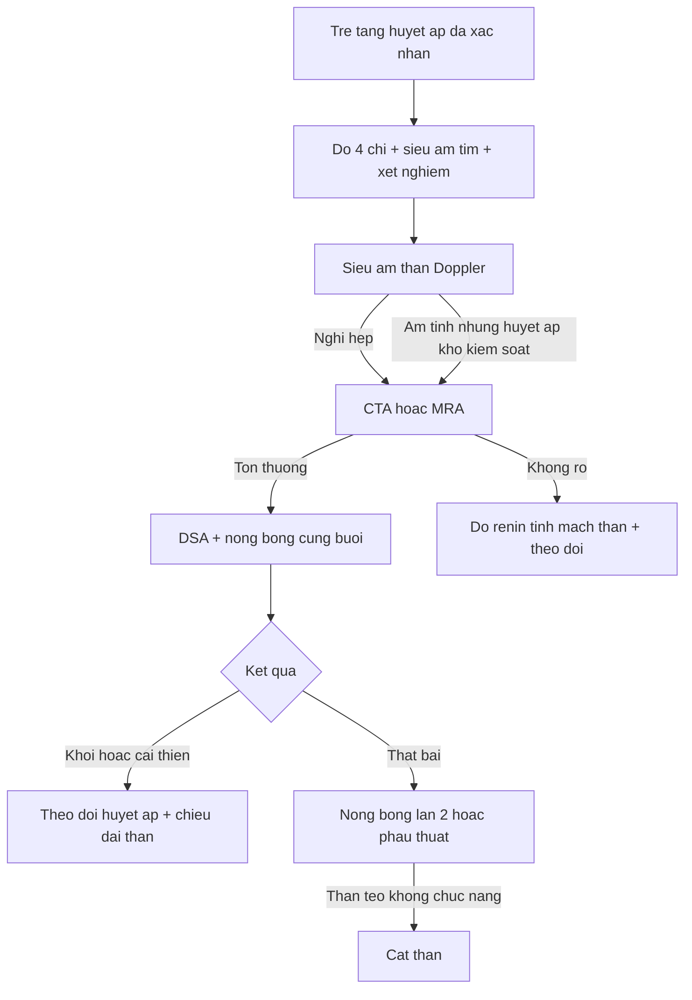
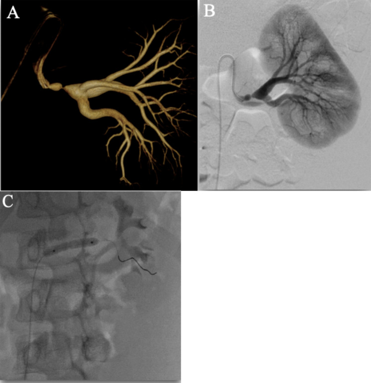
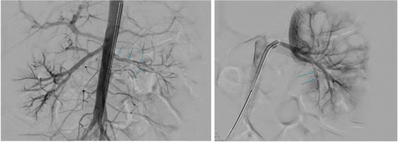
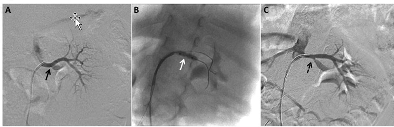

# 6117 — Tăng huyết áp do mạch máu thận ở trẻ sau huyết khối sơ sinh: Doppler, CTA/DSA, nong bóng và khi nào cắt thận

**Tags:** `pattern:hep-dong-mach-than` `pattern:than-nho` `pattern:tang-huyet-ap` `pattern:huyet-khoi-dong-mach` `pattern:teo-than` `vung:than` `vung:dong-mach-chu` `protocol:sieu-am-Doppler` `protocol:CTA` `protocol:MRA` `protocol:DSA`
**Mức chắc chắn (certainty):** tổng hợp y văn (literature synthesis) — ghép **ca sơ sinh 3 ngày tuổi huyết khối động mạch thận trái tự phát, sốc do tăng huyết áp, nong bóng cấp cứu và hồi phục hoàn toàn lúc 12 tháng** (BMC Pediatr 2025, PMC12217276), **28 trẻ/45 lần nong bóng động mạch thận theo dõi trung–dài hạn** (Pediatr Nephrol 2025, PMC12187876), **34 trẻ dưới 2 tuổi tăng huyết áp do mạch máu thận** (Eur J Pediatr 2022, PMC9395438), **bài tổng quan tiếp cận của hội thận nhi Hàn Quốc** (Child Kidney Dis 2025, PMC13587185), **bài tổng quan của bác sĩ can thiệp mạch nhi** (CVIR Endovasc 2021, PMC7790992), **loạt ảnh chụp mạch thận nhi 8 tháng – 15 tuổi** (Indian J Radiol Imaging 2023, PMC10556328), **tổng quan tăng huyết áp sơ sinh** (Clin Exp Pediatr 2022, PMC9348950) và **ca cắt thận nội soi ở trẻ 6 tháng tuổi** (JSLS 2003, PMC3015469).

> **Câu hỏi thực hành:** bé trai **sinh non 32 tuần**, từng đặt **catheter động mạch rốn 6 ngày**. Lúc **4 tháng tuổi** khám vì **bú kém, vã mồ hôi, quấy**; đo huyết áp **118/74 mmHg** (bách phân vị > 99 theo tuổi), **không phù, không tiểu máu**. Siêu âm: **thận trái 4,2 cm, thận phải 6,0 cm**, Doppler động mạch thận trái **PSV thấp, phổ tăng tốc chậm (parvus–tardus)**; creatinin bình thường, renin cao.
> Câu hỏi: **trẻ sơ sinh đã "hết" huyết khối thì vì sao 4 tháng sau mới tăng huyết áp? chênh chiều dài thận 1,8 cm có đủ chẩn đoán hẹp động mạch thận? khi nào chỉ nong bóng, khi nào đặt stent, khi nào phải cắt thận?**
> Bài chốt **bốn việc**: **(1) tăng huyết áp do mạch máu thận (renovascular hypertension) là nguyên nhân "chữa được" nhưng dễ bỏ sót vì trẻ không có triệu chứng — phải đo huyết áp 4 chi ở mọi lần khám sau huyết khối sơ sinh; (2) siêu âm Doppler là sàng lọc, nhưng **chênh chiều dài thận ≥ 1 cm + phổ parvus–tardus** mới là gợi ý, và **chụp mạch (DSA) là tiêu chuẩn vàng** — 28% tổn thương chỉ thấy trên chụp mạch; (3) **nong bóng (PTA) là lựa chọn đầu tay** kể cả ở nhũ nhi: 39,3% khỏi sau lần 1, **57,1% khỏi sau các lần nong**; (4) **stent bị tránh ở trẻ đang lớn** (hẹp lại 35,5% so với 17,4% sau nong bóng) và **cắt thận chỉ dành cho thận teo/loạn sản không còn chức năng mà huyết áp không kiểm soát**.** Nối [6113 – Huyết khối động mạch chủ sơ sinh sau UAC](../6113-huyet-khoi-dong-mach-chu-so-sinh-uac/lesson.md), [6111 – Huyết khối tĩnh mạch thận sơ sinh](../6111-huyet-khoi-tinh-mach-than-so-sinh/lesson.md), [850 – Loạn sản cơ xơ (FMD) toàn thân ở trẻ](../850-loan-san-co-xo-fibromuscular-dysplasia-toan-than-o-tre/lesson.md), [6115 – Tăng áp cửa phía trái do tắc tĩnh mạch lách](../6115-tang-ap-cua-phia-trai-tac-tinh-mach-lach/lesson.md).

## 1. Tổng quan bệnh học – cơ chế hình ảnh: từ một cục huyết khối 2 mm tới thận teo 10 năm sau

- **Cơ chế trung tâm — hệ renin–angiotensin–aldosterone:** khi động mạch thận hẹp, **áp lực tưới máu thận giảm** → **bộ máy cạnh cầu thận (juxtaglomerular apparatus)** phóng thích **renin** → **angiotensin II** gây **co mạch toàn thân** và **aldosterone** giữ muối–nước. Huyết áp tăng **không phụ thuộc thể tích** ở giai đoạn đầu, nên **trẻ có thể hoàn toàn không có triệu chứng** ngoài con số huyết áp (Child Kidney Dis 2025, PMC13587185).
- **TẠI SAO lại khởi phát sau huyết khối sơ sinh:** huyết khối động mạch thận ở sơ sinh **không phải lúc nào cũng tắc hoàn toàn**; sau khi huyết khối tan một phần hoặc tổ chức hóa, lòng mạch còn **hẹp không đều** — đây là "hẹp tồn dư" (residual stenosis). Bên cạnh đó, **thận non bị thiếu máu sẽ teo dần (atrophy)**; trong huyết khối mạch thận sơ sinh, **teo thận được mô tả ở trên 70% các ca**, kể cả khi được nhận ra và điều trị sớm (BMC Pediatr 2025, PMC12217276). Vì vậy **siêu âm thận bình thường lúc ra viện không cho phép đóng hồ sơ**.
- **TẠI SAO tăng huyết áp lại xuất hiện muộn (hàng tuần tới hàng tháng):** (1) huyết khối **lan dần** hoặc tổ chức hóa làm hẹp nặng thêm; (2) **thận teo** làm giảm số nephron và tăng renin; (3) **tăng huyết áp ở sơ sinh thường không được đo** — nhiều trẻ chỉ được phát hiện khi đã có **suy tim, phì đại thất trái, co giật hoặc suy thận**. Đây là lý do bài 6113 kết luận **theo dõi huyết áp là bắt buộc** sau huyết khối động mạch sơ sinh.
- **Ngưỡng định lượng – định nghĩa tăng huyết áp theo tuổi:**
  - **Sơ sinh:** huyết áp **> bách phân vị 95 theo tuổi sau kinh nguyệt (postmenstrual age)** được coi là tăng; **cân nhắc đánh giá và điều trị khi > bách phân vị 99**; **đích điều trị < bách phân vị 95** (Clin Exp Pediatr 2022 — tổng quan tăng huyết áp sơ sinh, PMC9348950).
  - **Trẻ ≥ 1 tuổi (AAP 2017):** tăng huyết áp = **≥ bách phân vị 95 theo tuổi/giới/chiều cao**; **bậc 1** từ 95th tới < 95th + 12 mmHg; **bậc 2** khi **≥ 95th + 12 mmHg hoặc ≥ 140/90 mmHg**. Đích điều trị: **< bách phân vị 90 hoặc < 130/80 mmHg, lấy ngưỡng thấp hơn** (Child Kidney Dis 2025, PMC13587185).
- **Ngưỡng dịch tễ:** tăng huyết áp ở trẻ gặp **3–5%**, huyết áp "cao" gặp **10–14%**; **tăng huyết áp do mạch máu thận chiếm 5–25%** các ca tăng huyết áp ở trẻ và **hẹp động mạch thận chiếm 3–25%** tăng huyết áp thứ phát (PMC13587185; CVIR Endovasc 2021, PMC7790992). Ở **sơ sinh**, nguyên nhân hàng đầu là **dị tật bẩm sinh và huyết khối–tắc mạch động mạch thận sau catheter động mạch rốn** (PMC13587185).
- **TẠI SAO Doppler thấy "parvus–tardus":** hẹp làm **giảm áp lực và mất tính xung** ở đoạn xa, nên phổ **tăng tốc chậm (kéo dài thời gian tăng tốc, acceleration time)** và **đỉnh tâm thu thấp**. Ở chỗ hẹp, **vận tốc đỉnh tâm thu (PSV) tăng** và **tỷ lệ vận tốc động mạch thận/động mạch chủ (RAR)** tăng. Ở sơ sinh, **PSV tuyệt đối rất thấp** — ca huyết khối động mạch thận sau UAC có **PSV 21,77 cm/s kèm dòng tâm trương đảo** (Cureus 2025, PMC12413998, đã dùng ở bài 6113) → **dùng ngưỡng PSV > 180–200 cm/s của người lớn ở sơ sinh là bỏ sót**; phải đọc **hình thái phổ + so bên**.
- **TẠI SAO thận nhỏ:** thiếu máu mạn → teo vỏ, giảm số nephron, thận **ngắn hơn bên đối diện**. **Chênh chiều dài thận ≥ 1 cm** được xem là dấu hiệu gián tiếp của hẹp động mạch thận (CVIR Endovasc 2021). Nhưng **thận nhỏ cũng có thể do loạn sản bẩm sinh hoặc di chứng huyết khối tĩnh mạch** — chênh chiều dài **một mình không chẩn đoán được hẹp**.
- **TẠI SAO tim bị ảnh hưởng:** tăng huyết áp kéo dài gây **phì đại thất trái**, có thể **suy tim cấp** — ca sơ sinh 3 ngày tuổi nhập viện vì **sốc, tím, làm đầy mao mạch kéo dài**, huyết áp **101/72 mmHg**, siêu âm tim giảm chức năng tâm thu thất trái; **sau nong bóng 24 giờ đã cai được nicardipine** và chức năng thất trái bình thường lại (BMC Pediatr 2025, PMC12217276). Đây là lý do **siêu âm tim thuộc bộ khảo sát ban đầu** ở trẻ tăng huyết áp nặng.

## 2. Mẫu hình + chẩn đoán phân biệt theo tuổi và theo vị trí tổn thương (gamut)

- **Gamut theo tuổi (thay đổi hoàn toàn cách nghĩ):**
  - **Sơ sinh – nhũ nhi:** **huyết khối/tắc mạch động mạch thận sau catheter động mạch rốn**, huyết khối động mạch chủ lan tới lỗ thận, **hẹp bẩm sinh**, **hội chứng động mạch chủ giữa (mid-aortic syndrome)**, loạn sản thận một bên.
  - **Trẻ nhỏ < 2 tuổi:** **hẹp động mạch thận bẩm sinh**, **hội chứng động mạch chủ giữa**, **NF1**; trong 34 trẻ dưới 2 tuổi: **76% hẹp động mạch thận chính**, **50% có hội chứng động mạch chủ giữa**, **50% tổn thương trong thận** (Eur J Pediatr 2022, PMC9395438).
  - **Trẻ lớn – vị thành niên:** **loạn sản cơ xơ (fibromuscular dysplasia, FMD)**, **Takayasu**, **NF1**, **bệnh Moyamoya/RNF213**, hẹp **động mạch thận phụ**.
- **Gamut theo vị trí tổn thương trên chụp mạch** (quyết định khả năng can thiệp): **25% ở động mạch thận chính**, **50% ở nhánh bậc 2**, **12,5% ở nhánh nhu mô xa**, **12,5% ở động mạch thận phụ**; hẹp **hai bên gặp 24–78%** trong các loạt nhi (CVIR Endovasc 2021). **Tổn thương càng xa, càng nhỏ thì nong bóng càng khó và nguy cơ mất thận càng cao** — đây là lý do phải **chụp chọn lọc từng nhánh**, không chỉ chụp động mạch chủ.
- **Gamut theo hình thái:** **hẹp lỗ (ostial)** → NF1, Takayasu, di chứng huyết khối sơ sinh; **hẹp thân kiểu "chuỗi hạt"** → FMD; **nhiều vi phình mạch nhỏ trong thận** → viêm đa động mạch (PAN); **hẹp động mạch chủ bụng + hẹp lỗ động mạch thận** → hội chứng động mạch chủ giữa (**64% vô căn**, **~60% kèm hẹp động mạch thận**).
- **Gamut theo hình ảnh "thận nhỏ một bên":** **hẹp động mạch thận** (chênh ≥ 1 cm + phổ bất thường) · **loạn sản/thận nhỏ bẩm sinh** (không hẹp, chức năng kém) · **di chứng huyết khối tĩnh mạch thận** (thận teo sau giai đoạn to) · **thận teo sau viêm thận–bể thận mạn** (sẹo, đài biến dạng) · **tổn thương do xạ trị**.
- **Mẫu hình kinh điển:** **trẻ có tiền sử catheter rốn/huyết khối sơ sinh + huyết áp tăng dần + thận một bên nhỏ hơn ≥ 1 cm + renin cao + chức năng thận bình thường** → **tăng huyết áp do mạch máu thận**; chức năng thận **bình thường không loại trừ** vì thận bên đối diện bù.

## 3. Bảng so sánh phân biệt (ma trận đối chiếu)

| Thực thể (entity) | Hình ảnh điển hình | Chốt vào (rule-in) | Chốt loại (rule-out) | Gợi ý xác nhận |
|---|---|---|---|---|
| **Hẹp động mạch thận sau huyết khối sơ sinh** | Thận một bên **nhỏ ≥ 1 cm**; hẹp/tắc lỗ hoặc thân động mạch thận; **phổ parvus–tardus**; có thể thấy **di chứng huyết khối động mạch chủ** | **Tiền sử UAC/huyết khối sơ sinh + thận nhỏ + hẹp trên chụp mạch** | Động mạch thận bình thường hai bên, thận đối xứng → không phải | CTA/DSA, renin, theo dõi huyết áp |
| **Loạn sản cơ xơ (FMD)** | Hẹp **thân và nhánh**, kiểu **chuỗi hạt** hoặc hẹp khu trú; thường **không hẹp lỗ**; có thể hẹp nhiều tầng | **Hẹp không ở lỗ + nhiều ổ + tuổi trẻ không yếu tố nguy cơ** | Hẹp lỗ đơn độc ở trẻ có NF1 → nghĩ NF1 | DSA (chuẩn), CTA/MRA; sinh thiết không cần |
| **Takayasu** | Hẹp **lỗ/tĩnh mạch chủ bụng**, thành mạch dày, có thể **phình**; kèm hẹp các nhánh khác | **Hẹp lỗ + thành dày + CRP/VS tăng + mạch chi không đều** | Thành mạch mỏng, không viêm hệ thống → FMD | MRI thành mạch, CRP/VS, PET-CT khi cần |
| **NF1** | Hẹp lỗ hoặc thân, **hẹp động mạch chủ bụng**, kèm **u sợi thần kinh, dát cà phê, u thần kinh đệm thị giác** | **Tiêu chuẩn NF1 + hẹp mạch thận** | Không có dấu hiệu NF1 → FMD/Takayasu | Khám da, MRI sọ, tư vấn di truyền |
| **Hội chứng động mạch chủ giữa** | **Hẹp động mạch chủ bụng** + hẹp lỗ động mạch thận; **huyết áp tay cao, chân thấp**; tuần hoàn bàng hệ | **Chênh huyết áp tay–chân + hẹp ĐMC bụng** | ĐMC bụng bình thường → không phải | CTA/MRA toàn thân, đo huyết áp 4 chi |
| **Thận nhỏ/loạn sản bẩm sinh (không hẹp)** | Thận nhỏ, **vỏ mỏng, không thấy động mạch thận rõ**, chức năng gần như mất; **không có hẹp khu trú** | **Thận nhỏ + không hẹp + chức năng mất** | Có hẹp khu trú trên chụp mạch → không phải loạn sản đơn thuần | DMSA/xạ hình, DSA |
| **Chèn ép từ ngoài (Wilms, u nguyên bào thần kinh)** | Khối lớn đẩy/ép động mạch thận, **thường không gây hẹp lỗ**; thận còn chức năng | **Khối + di lệch mạch, không hẹp lòng** | Mạch hẹp thật trong lòng → bệnh mạch | CT/MRI có cản quang, mô bệnh |

*Ba bước của cùng một tổn thương: **(A)** CTA trục: **hẹp động mạch thận trái kèm giãn sau hẹp (post-stenotic dilatation)** — giãn sau hẹp là dấu hiệu gián tiếp của hẹp có huyết động nghĩa; **(B)** dựng 3D xoay (rotational angiography) xác định chính xác vị trí và độ dài đoạn hẹp; **(C)** bóng nong (balloon angioplasty) bơm tại chỗ hẹp. Nguồn: CVIR Endovascular 2021 (PMC7790992), CC BY 4.0, nguyên bản.*

## 4. Protocol chụp + phân tầng huyết áp & thuật toán can thiệp

- **Bước 0 — đo huyết áp cho đúng (nếu sai thì mọi bước sau vô nghĩa):** đo **cả 4 chi** ở lần khám đầu; **huyết áp chi dưới bình thường cao hơn chi trên 10–20%**; băng quấn đúng kích thước; trẻ nhỏ/quấy cần **đo lặp và đo lúc ngủ**; nghi ngờ thì **holter huyết áp 24 giờ**. Ở sơ sinh, **huyết áp xâm lấn (động mạch) là chuẩn** khi đang dùng vận mạch.
- **Xét nghiệm tối thiểu:** tổng phân tích nước tiểu, công thức máu, điện giải, urê/creatinin, đường huyết, lipid; **renin và aldosterone** (lấy máu ở tư thế nằm và sau đứng ≥ 10 phút); **siêu âm tim** tìm phì đại thất trái; **soi đáy mắt**.
- **Siêu âm thận + Doppler là sàng lọc đầu tay:** đo **chiều dài hai thận** (chênh **≥ 1 cm** là bất thường), độ dày vỏ, hồi âm; Doppler **động mạch thận gốc và trong thận**, đo **PSV, thời gian tăng tốc (AT), RAR, chỉ số sức cản (RI)**. Ngưỡng gợi ý hẹp: **PSV > 180–200 cm/s, AT > 80 ms, RAR > 3, chênh RI > 0,05** giữa hai thận (CVIR Endovasc 2021). **Độ nhạy thấp ở trẻ nhỏ:** trong loạt dưới 2 tuổi, **siêu âm đơn thuần Se 44%, Doppler Se 63%** (Eur J Pediatr 2022) — **siêu âm âm tính không loại trừ**.
- **Chọn CTA hay MRA:** CTA **Se 88% / Sp 81%**, MRA **Se 80% / Sp 63%**; MRA **bỏ sót 10 ca** trong một loạt 127 bệnh nhân (gồm 6 ca hẹp động mạch thận chính, 2 ca nhánh chính, 2 ca nhánh phân thùy) (PMC7790992). Với trẻ, **CTA ưu thế về độ phân giải nhánh nhỏ nhưng có bức xạ** → dùng **kVp thấp, giới hạn trường chụp**, và **không lặp lại nhiều lần** (ALARA).
- **Chụp mạch số hóa xóa nền (DSA) là tiêu chuẩn vàng và là bước điều trị:** **28% tổn thương mạch ở trẻ tăng huyết áp chỉ phát hiện được trên chụp mạch**; khi huyết áp **không kiểm soát với ≥ 2 thuốc**, chụp mạch cho bất thường **khoảng 40%** (PMC7790992). Chụp **chọn lọc từng nhánh**, tìm **động mạch thận phụ** (gặp ở **37,8% – 28/74 trẻ** trong loạt 45 lần nong bóng), và **nong bóng ngay trong cùng buổi** khi tổn thương phù hợp.
- **Lấy máu tĩnh mạch thận đo renin:** tỷ lệ renin **> 1,5** giữa hai tĩnh mạch thận là có ý nghĩa; tỷ lệ **< 1,3** giữa tĩnh mạch thận bên đối diện và tĩnh mạch chủ dưới dưới thận **ủng hộ** chẩn đoán một bên (PMC7790992). Giá trị **hỗ trợ**, không thay chụp mạch.
- **Thuốc:** **thuốc ức chế men chuyển/thụ thể angiotensin (ACEi/ARB) là chống chỉ định** khi hẹp **hai bên** hoặc **chỉ còn một thận** (nguy cơ suy thận cấp); dùng **chẹn kênh canxi** (nicardipine, amlodipine) và **chẹn beta** để kiểm soát trước can thiệp. Ca sơ sinh dùng **nicardipine truyền** và **cai được trong 24 giờ sau nong bóng**.
- **Định nghĩa kết cục (dùng thống nhất khi đọc y văn):** **khỏi (cured)** = huyết áp bình thường **không cần thuốc**; **cải thiện (improved)** = giảm số thuốc/liều hoặc huyết áp < bách phân vị 95; **thất bại (failed)** = không đổi hoặc nặng hơn (Pediatr Nephrol 2025, PMC12187876).

- **Kết quả nong bóng (PTA) — số liệu để tư vấn gia đình:** gộp y văn, PTA có lợi **48,5–100%**, **khỏi 18–60%**, **cải thiện 17–65%** (PMC7790992). Loạt 28 trẻ/45 lần nong: **khỏi 39,3% sau lần 1**, **cải thiện 35,7%**, **thất bại 25%**; sau các lần nong tiếp theo (12 trẻ nong lần 2, 5 trẻ nong lần 3, có dùng **bóng cắt – cutting balloon**) → **tổng cộng 57,1% khỏi, 42,9% cải thiện**; **biến chứng nặng 8,9% (4/45)** gồm **hẹp trong stent, thoát mạch sau bóng cắt, bóc tách động mạch, co thắt mạch** (PMC12187876). Ở **trẻ dưới 2 tuổi** (20 trẻ/45 lần nong): **44% huyết áp về bình thường**, **38% cải thiện**, **19% không cải thiện**; **biến chứng 7,5% (5/66 lần chụp mạch)**; bóng dùng **2,0–2,5 mm** cho động mạch thận nhũ nhi (Eur J Pediatr 2022).
- **Stent mạch thận ở trẻ:** **tránh** vì stent **không lớn theo trẻ**, là **chỗ hẹp về sau**, và **hẹp lại sau stent 35,5% so với 17,4% sau nong bóng**; chỉ dùng khi **bóc tách không kiểm soát, hẹp tái phát nhiều lần, hoặc hẹp động mạch chủ** (PMC7790992).
- **Phẫu thuật:** bắc cầu động mạch thận, tái tạo động mạch chủ, **cắt thận**. Trong loạt dưới 2 tuổi, **4/7 trẻ mổ có huyết áp về bình thường (57%)**, 2 cải thiện, 1 không đổi; có ca **cắt thận + ghép động mạch chủ ở 1,2 tuổi**. **Cắt thận** dành cho **thận teo/loạn sản gần như mất chức năng mà huyết áp không kiểm soát** — ca trẻ **6 tháng tuổi** được **cắt thận nội soi** vì thận loạn sản gây tăng huyết áp nặng (JSLS 2003, PMC3015469).
- **Theo dõi sau can thiệp (bắt buộc):** huyết áp **mỗi 3 tháng trong năm đầu**, creatinin/eGFR, **siêu âm chiều dài thận**, và **chụp mạch lại khi huyết áp tăng trở lại** — **hẹp lại sau nong bóng gặp 17,4%**, trung vị **5,5 tháng (IQR 4–10)** cho lần nong thứ hai (Eur J Pediatr 2022).

## 5. Biến thể bình thường và cạm bẫy

- **Đo huyết áp sai là cạm bẫy số 1:** băng quấn nhỏ → **huyết áp "cao" giả**; chỉ đo tay → **bỏ sót hội chứng động mạch chủ giữa** (chân thấp hơn tay); trẻ quấy → **tăng vọt**. Luôn **đo lại 3 lần, đo 4 chi, đối chiếu băng quấn theo chu vi cánh tay**.
- **"Thận nhỏ" không đồng nghĩa "hẹp động mạch thận":** loạn sản bẩm sinh, di chứng huyết khối tĩnh mạch, viêm thận–bể thận mạn đều cho thận nhỏ. Chốt bằng **chụp mạch**, không bằng siêu âm.
- **Bỏ sót động mạch thận phụ:** **37,8% trẻ** trong loạt nong bóng có động mạch thận phụ; tổn thương ở **nhánh bậc 2 (50%)** và **nhánh nhu mô (12,5%)** dễ bị bỏ qua nếu chỉ chụp động mạch chủ. **Chụp chọn lọc** là bắt buộc.
- **Co thắt mạch do catheter (catheter-induced vasospasm)** trông giống hẹp thật: nếu thấy hẹp mới xuất hiện sau khi đã can thiệp, **bơm nitroglycerin** rồi chụp lại — trong loạt trên, co thắt mạch là một trong 4 biến chứng nặng và **hồi phục một phần với nitroglycerin/TPA**.
- **Bỏ sót bệnh nền hệ thống:** **NF1** (u sợi thần kinh, dát cà phê), **Takayasu** (mạch chi không đều, CRP tăng), **Moyamoya/RNF213** — ở các loạt Hàn Quốc, **Moyamoya chiếm 31,3% (5/16)** và **40,0% (10/25)** các ca tăng huyết áp do mạch máu thận ở trẻ; vì vậy **trẻ hẹp động mạch thận cần hỏi đau đầu/yếu nửa người và cân nhắc MRI/MRA não** (Child Kidney Dis 2025).
- **Hội chứng hạ natri–tăng huyết áp (hyponatremic hypertensive syndrome):** hẹp động mạch thận một bên có thể gây **hạ natri máu, đa niệu, tăng renin** — dễ bị chẩn đoán nhầm là **bệnh lý não–tiết niệu** hoặc **nhiễm trùng**; gặp ở trẻ có **thận nhỏ + hẹp động mạch thận**. Gặp hạ natri + tăng huyết áp ở trẻ = **đo renin và chụp mạch thận**.
- **Sau huyết khối sơ sinh, đừng chỉ theo dõi creatinin:** chức năng thận **bình thường** vì thận đối diện bù; **huyết áp mới là dấu hiệu sớm**. Ghi vào giấy ra viện: **đo huyết áp 4 chi mỗi lần khám, siêu âm chiều dài thận, creatinin** (xem [6113](../6113-huyet-khoi-dong-mach-chu-so-sinh-uac/lesson.md)).
- **Sai lầm khi tư vấn:** hứa "nong bóng là khỏi" — thực tế **25% thất bại ngay lần 1** và **17,4% hẹp lại**; cần nói rõ khả năng **nong nhiều lần** và **mổ**.
- **Ảnh giả trên MRA:** MRA **bỏ sót 10 ca** trong loạt 127 bệnh nhân và có **độ đặc hiệu chỉ 63%** → **MRA bình thường không loại trừ**; nếu huyết áp vẫn khó kiểm soát, **vẫn phải chụp mạch**.

## 6. Tự lượng giá — Blind Quiz ngay trên trang tĩnh

**Ca 1 — Bé gái 5 tuổi, tình cờ phát hiện tăng huyết áp sau tai nạn giao thông. Ảnh chụp mạch xoay 3D (A), chụp mạch thường (B), sau nong bóng (C):**

- Gợi ý lâm sàng: 5 tuổi, **tăng huyết áp phát hiện tình cờ** sau tai nạn giao thông; không có triệu chứng khác; gia đình không có tiền sử bệnh mạch.
- Câu hỏi: **(1)** Tổn thương ở đâu, loại hẹp gì? **(2)** Vì sao CTA có thể bỏ sót? **(3)** Nong bóng hay stent?

<b>Bấm để hiện đáp án (findings + chẩn đoán)</b>

- **Findings:** **(A)** dựng 3D xoay: **hẹp nặng đoạn gần động mạch thận chính trái**, kèm **giãn sau hẹp**; **(B)** chụp mạch thường xác nhận hẹp lỗ–đoạn gần; **(C)** sau nong bóng, lòng mạch mở rộng.
- **Chẩn đoán:** **tăng huyết áp do hẹp động mạch thận** (trong loạt này, **78,6% do FMD, 21,4% do NF1**); hẹp **lỗ/đoạn gần** là vị trí điển hình của **FMD thể lỗ** và của **di chứng huyết khối**.
- **Vì sao CTA có thể bỏ sót:** tổn thương **ngắn, sát lỗ, có giãn sau hẹp** dễ bị hiệu ứng thể tích che; trong loạt này **52,8% ca có chụp mạch bất thường nhưng hình ảnh trước đó không khớp**.
- **Chọn can thiệp:** **nong bóng** là đầu tay; bệnh nhi này **hết tăng huyết áp mà không cần thuốc**.
- Nguồn: Pediatr Nephrol 2025 (PMC12187876), CC BY 4.0.

**Ca 2 — Sơ sinh 3 ngày tuổi, tiểu máu đại thể, tím, làm đầy mao mạch kéo dài. Chụp mạch thận trái trước (trái) và sau nong bóng (phải):**

- Gợi ý lâm sàng: 3 ngày tuổi, **huyết áp 101/72 mmHg**, **tiểu máu đại thể**, **sốc**, creatinin bình thường; **không ghi nhận catheter rốn**; sụt **10% cân nặng** trong 3 ngày đầu.
- Câu hỏi: **(1)** Mũi tên xanh chỉ gì? **(2)** Vì sao trẻ sốc mà creatinin lại bình thường? **(3)** Xử trí, và tiên lượng thận về sau?

<b>Bấm để hiện đáp án (findings + chẩn đoán)</b>

- **Findings:** **(trái)** chụp động mạch chủ: **nhiều khuyết thuốc (mũi tên xanh) trong động mạch thận trái** — huyết khối lan dọc thân mạch; **(phải)** sau nong bóng: lòng mạch thông, **tưới máu nhu mô thận hồi phục**.
- **Chẩn đoán:** **huyết khối động mạch thận trái ở sơ sinh** (thể tự phát, yếu tố nguy cơ duy nhất là **mất nước/sụt cân**), gây **tăng huyết áp nặng → suy tim cấp** (sốc), chứ **không phải sốc nhiễm khuẩn**.
- **Vì sao creatinin bình thường:** thận đối diện còn tốt và **creatinin của mẹ còn lưu hành** ở trẻ 3 ngày tuổi — **không dùng creatinin để loại trừ**.
- **Xử trí:** **nong bóng thì đầu**; **cai nicardipine trong 24 giờ**; không dùng tiêu sợi huyết vì nguy cơ chảy máu nội sọ và nhu mô đã thiếu máu.
- **Tiên lượng:** lúc **12 tháng** huyết áp và chức năng thận bình thường, **nhưng siêu âm cho thấy thận teo** — teo thận gặp **trên 70%** ca huyết khối mạch thận sơ sinh.
- Nguồn: BMC Pediatr 2025 (PMC12217276), CC BY-NC-ND 4.0, nguyên bản.

**Ca 3 — Nhũ nhi 8 tháng tuổi, thở nhanh, huyết áp > bách phân vị 95. Chụp mạch thận (A, B, C):**

- Gợi ý lâm sàng: 8 tháng tuổi, **thở nhanh**, không phù, không tiểu máu; huyết áp **trên bách phân vị 95**; không có bệnh nền đã biết.
- Câu hỏi: **(1)** Vị trí hẹp? **(2)** Vì sao hẹp ở nhánh cực dưới lại gây tăng huyết áp? **(3)** Nếu bỏ sót thì hậu quả gì?

<b>Bấm để hiện đáp án (findings + chẩn đoán)</b>

- **Findings:** hẹp **khu trú động mạch cực dưới thận trái** (mũi tên trắng) do **dải xơ bẩm sinh**; dòng chảy chậm khác biệt; sau nong bóng lòng mạch rộng ra (C).
- **Chẩn đoán:** **hẹp động mạch thận nhánh (segmental/polar) bẩm sinh** — vẫn gây tăng huyết áp vì **phần nhu mô bị giảm tưới máu tiết renin**, dù chỉ một cực thận.
- **Vì sao dễ bỏ sót:** tổn thương **nhỏ, ở nhánh**, siêu âm khó thấy; **25% tổn thương ở động mạch chính, 50% ở nhánh bậc 2, 12,5% ở nhánh nhu mô, 12,5% ở động mạch phụ**.
- **Nếu bỏ sót:** tăng huyết áp kéo dài → **phì đại thất trái, suy tim, bệnh thận mạn**; trẻ nhỏ có thể biểu hiện **thở nhanh, bú kém, vã mồ hôi** chứ không đau đầu.
- Nguồn: Indian J Radiol Imaging 2023 (PMC10556328), CC BY-NC-ND 4.0, nguyên bản.

## Bài liên quan chéo
- [6113 – Huyết khối động mạch chủ ở sơ sinh sau UAC](../6113-huyet-khoi-dong-mach-chu-so-sinh-uac/lesson.md) — giai đoạn cấp và lịch theo dõi huyết áp.
- [6111 – Huyết khối tĩnh mạch thận ở trẻ sơ sinh](../6111-huyet-khoi-tinh-mach-than-so-sinh/lesson.md) — thể tĩnh mạch, thận to, tăng huyết áp muộn **38,8%**.
- [850 – Loạn sản cơ xơ (FMD) toàn thân ở trẻ](../850-loan-san-co-xo-fibromuscular-dysplasia-toan-than-o-tre/lesson.md) — bệnh mạch nền hay gặp nhất ở trẻ lớn.
- [436 – Takayasu và viêm động mạch tế bào khổng lồ](../436-takayasu-vs-gca/lesson.md) — hẹp lỗ, thành mạch dày.
- [6700 – Di chứng muộn sau u nguyên bào thận (Wilms)](../6700-di-chung-muon-sau-wilms-va-chuyen-tiep/lesson.md) — tăng huyết áp sau cắt thận/ghép thận.
- [6115 – Tăng áp cửa phía trái do tắc tĩnh mạch lách](../6115-tang-ap-cua-phia-trai-tac-tinh-mach-lach/lesson.md)

> Không dùng để chẩn đoán độc lập khi chưa có người hướng dẫn.
