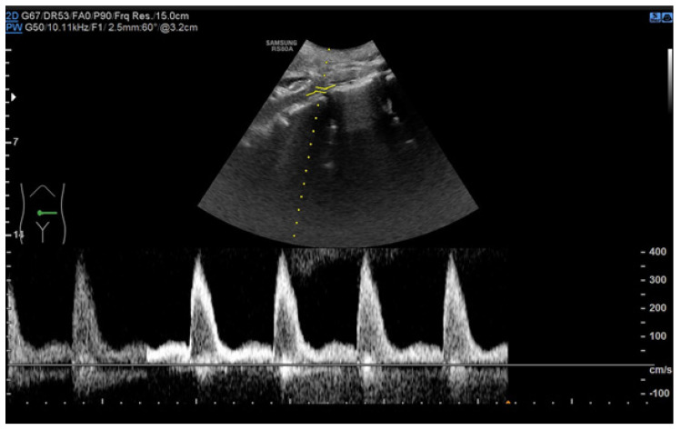
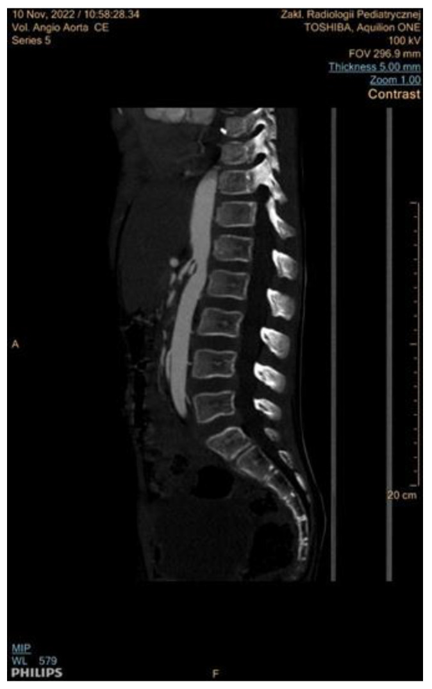
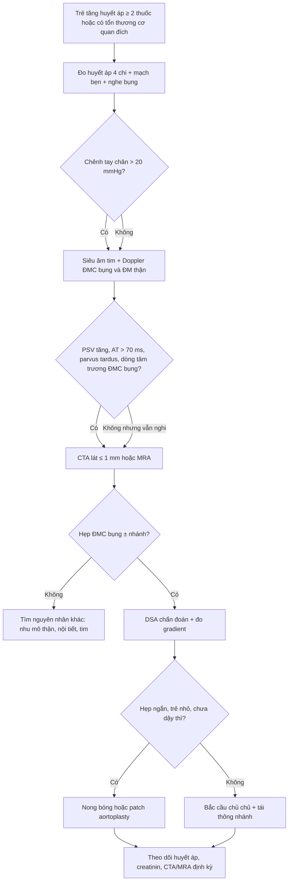
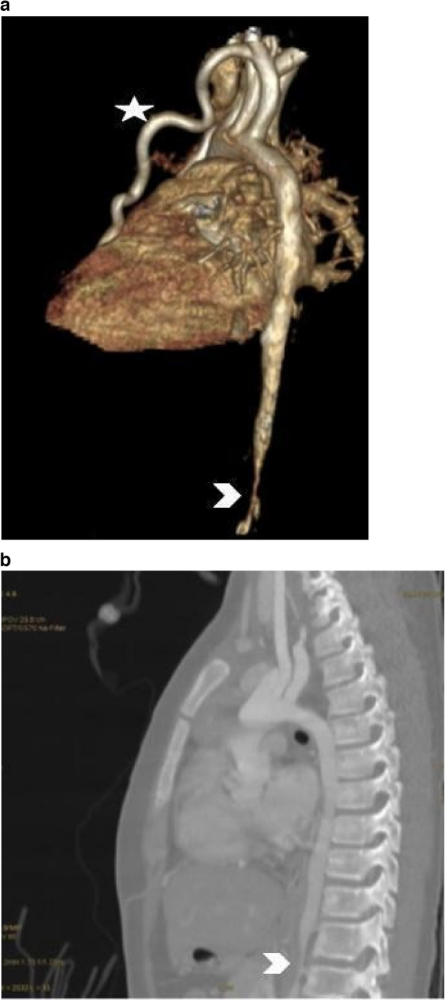
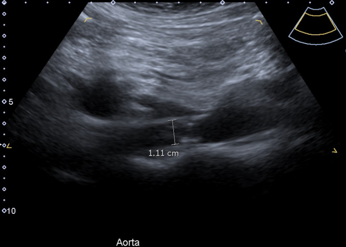

# 6118 — Hội chứng động mạch chủ giữa ở trẻ: hẹp ĐMC bụng, tăng huyết áp kháng trị và cạm bẫy "không chênh huyết áp"

**Tags:** `pattern:hep-dong-mach` `pattern:hep-doan-dai` `pattern:tuong-hoan-bang-he` `pattern:phi-dai-that-trai` `pattern:chenh-huyet-ap-tay-chan` `vung:dong-mach-chu-bung` `vung:dong-mach-than` `vung:o-bung` `protocol:sieu-am-Doppler` `protocol:CTA` `protocol:MRA` `protocol:DSA` `score:gradient-20mmHg`
**Mức chắc chắn (certainty):** tổng hợp y văn (literature synthesis) — ghép **bài tổng quan hẹp động mạch thận và hội chứng động mạch chủ giữa ở trẻ** (J Clin Med 2024, PMC11594493), **ca nam 43 tuổi với siêu âm Doppler đặc trưng** (BJR Case Rep 2021, PMC7869124), **hai bé gái 10 tuổi, một có chênh huyết áp 52 mmHg và một KHÔNG chênh** (Egypt Heart J 2026, PMC13294414) và **hai nhũ nhi 2 và 11 tháng suy tim, chẩn đoán nhầm bệnh cơ tim giãn** (Clin Case Rep 2022, PMC9715789).

> **Câu hỏi thực hành:** bé gái **10 tuổi** nhập viện vì **chóng mặt và vài cơn ngất ngắn**; huyết áp **180/100 mmHg**, đo 4 chi: **tay 150/83** nhưng **chân 98/57 mmHg** — **chênh 52 mmHg**, **mạch bẹn yếu, mạch quay nảy mạnh**, có **tiếng thổi tâm thu**. Siêu âm tim: **phì đại thất trái nhẹ**, Doppler đoạn bụng ĐMC có **dòng chảy về trước liên tục thì tâm trương**. CTA: **hẹp khu trú ĐMC bụng**, kèm **động mạch vú trong trái giãn rất mạnh**.
> Câu hỏi: **vì sao hẹp ở BỤNG mà lại giống hẹp eo ngực? động mạch vú trong giãn nói lên điều gì? nếu bé thứ hai hoàn toàn KHÔNG chênh huyết áp tay–chân thì có được loại trừ bệnh không? khi nào nong bóng, khi nào phải mổ bắc cầu?**
> Bài chốt **bốn việc**: **(1) hội chứng động mạch chủ giữa (mid-aortic syndrome, MAS) là hẹp ĐMC BỤNG ± nhánh tạng, thường idiopathy, chẩn đoán muộn vì chỉ biểu hiện bằng tăng huyết áp; (2) chênh huyết áp tay–chân > 20 mmHg là gợi ý, nhưng KHÔNG có chênh không loại trừ — bàng hệ phát triển che mất gradient; (3) Doppler (PSV tăng, AT > 70 ms, parvus–tardus trong thận) → CTA/MRA → DSA, và 28% tổn thương chỉ thấy trên DSA; (4) nong bóng chỉ là cầu nối (can thiệp lại 67% sau 5 năm ở MAS), còn bắc cầu chủ–chủ + tái thông nhánh là phẫu thuật chuẩn.** Nối [6116 – Hẹp eo động mạch chủ ở trẻ](../6116-hep-eo-dong-mach-chu-o-tre/lesson.md), [6117 – Tăng huyết áp do mạch máu thận](../6117-tang-huyet-ap-mach-than-sau-huyet-khoi-so-sinh/lesson.md), [850 – Loạn sản cơ xơ (FMD) toàn thân](../850-loan-san-co-xo-fibromuscular-dysplasia-toan-than-o-tre/lesson.md), [6113 – Huyết khối động mạch chủ sơ sinh sau UAC](../6113-huyet-khoi-dong-mach-chu-so-sinh-uac/lesson.md).

## 1. Tổng quan bệnh học – cơ chế hình ảnh: tại sao hẹp ở bụng lại giống hẹp eo ngực

- **Định nghĩa – dịch tễ:** MAS là **hẹp đoạn dài (segmental hoặc diffuse) của ĐMC bụng và/hoặc ĐMC xuống thấp**, thường kèm **hẹp lỗ nguyên ủy động mạch thận và động mạch tạng** — vì vậy còn gọi là **"hẹp eo không điển hình" (atypical coarctation)**. MAS chiếm **0,5–2% các ca hẹp động mạch chủ nói chung**; trong nhóm trẻ **tăng huyết áp do mạch máu thận**, **20–48%** có hẹp động mạch thận kèm hẹp đoạn giữa ĐMC (J Clin Med 2024, PMC11594493).
- **Tuổi chẩn đoán:** trung bình **7,1 tuổi**, sớm nhất được ghi nhận **27 tuần thai**; đa số phát hiện ở trẻ em và người trẻ < 25 tuổi, **không có khác biệt giới rõ rệt** trong các phân tích hiện đại (PMC11594493).
- **Phân bố giải phẫu (quan trọng để chọn can thiệp):** đoạn **trên thận** hay gặp nhất; sau đó là hẹp **từ trên thận xuống dưới thận** hoặc **hoàn toàn liên thận**; **chỉ dưới thận là ít gặp nhất**; **3%** chủ yếu ở **ĐMC xuống ngực**. Tổn thương nhánh rất thường gặp: **hẹp động mạch thận 66% lúc chẩn đoán, trong đó ~60% hai bên**; **chỉ hẹp lỗ nguyên ủy 35%** (nghĩa là **2/3 ca có đoạn hẹp dài/lan tỏa** — đây là lý do nong bóng hay thất bại); **động mạch mạc treo tràng trên 30%**, **thân tạng 22%**; bất thường mạch võng mạc **10%**, mạch não **3%** (PMC11594493).
- **Căn nguyên (dùng để quyết định có cần xét nghiệm gen/viêm không):** **vô căn 61–64%**, **viêm 17%** (Takayasu, các viêm mạch khác, nhiễm trùng trong tử cung như rubella), **bệnh gen 15%**, **loạn sản cơ xơ (FMD) 4%**. Trong các gia đình MAS, **~43%** tìm được đột biến (PMC11594493). Hội chứng cần nhớ: **Williams (del 7q11.23), Alagille (JAG1/NOTCH2), NF1, xơ cứng củ (TSC1/TSC2), Turner (45XO)**, thêm Marfan, Ehlers–Danlos, Loeys–Dietz, Grange, Myhre.
- **TẠI SAO hẹp ĐMC bụng lại gây tăng huyết áp "không kiểm soát":** hẹp làm **giảm áp lực tưới máu thận** → bật **hệ renin–angiotensin–aldosteron (RAAS)** → giữ muối nước + co mạch toàn thân. Vì vậy **thuốc hạ áp thông thường chỉ giảm được một phần**, còn **ACEi/ARB rất hiệu quả khi hẹp MỘT BÊN nhưng CHỐNG CHỈ ĐỊNH khi hẹp hai bên hoặc thận độc nhất** (gây suy thận cấp, phù phổi) — đây là quy tắc an toàn bắt buộc (PMC11594493).
- **TẠI SAO một chỗ hẹp vài mm tạo gradient rất lớn:** theo **Poiseuille**, sức cản tỉ lệ nghịch với **lũy thừa 4 của bán kính**; giảm nửa bán kính làm sức cản tăng **~16 lần**. Nhưng **gradient đo được còn phụ thuộc độ giãn động mạch (compliance)**: ở trẻ nhỏ mạch giãn tốt, gradient có thể **rất cao**; ở người lớn/xơ mạch, gradient **thấp hơn mức hẹp thật** (PMC11594493).
- **TẠI SAO có ca KHÔNG chênh huyết áp tay–chân:** khi **bàng hệ phát triển mạnh** (động mạch vú trong, liên sườn, thượng vị, cùng vai), máu đi vòng **nuôi chi dưới đủ** nên **áp lực chi dưới gần bằng chi trên** — đúng ca thứ hai trong loạt 2 bé gái 10 tuổi: tay **125/81**, chân **123/85 mmHg**, **mạch bẹn rõ, không chậm**; chẩn đoán nhờ **siêu âm tim thấy dòng chảy tâm trương liên tục bất thường ở ĐMC bụng**. Đây là **cạm bẫy chết người**: "không chênh" **không loại trừ MAS** (Egypt Heart J 2026, PMC13294414).
- **TẠI SAO siêu âm tim là cửa vào:** ĐMC bụng bình thường **không có dòng chảy về trước trong suốt tâm trương** (dòng tâm trương ở ĐMC xuống chỉ có khi **hẹp nặng phía trên** hoặc còn ống động mạch). Dấu hiệu **holodiastolic runoff + chậm lên sóng tâm thu** ở đoạn bụng có **giá trị gợi ý cao** và xuất hiện **trước khi** có chênh huyết áp rõ (PMC13294414).
- **TẠI SAO động mạch vú trong giãn là chìa khóa trên CTA 3D:** đây là **đường bàng hệ chính** từ dưới đòn → vú trong → thượng vị → ĐMC bụng dưới chỗ hẹp. Trên **volumetric rendering**, động mạch vú trong **giãn, ngoằn ngoèo** (dấu "star" trong ảnh) là bằng chứng **hẹp huyết động đã lâu**, giúp phân biệt hẹp "không có ý nghĩa" với hẹp thật (PMC13294414).
- **TẠI SAO MAS ở nhũ nhi lại là bệnh của SUY TIM chứ không phải tăng huyết áp:** nhũ nhi **không đo được huyết áp đáng tin**, bàng hệ chưa phát triển, cơ tim chưa phì đại kịp → biểu hiện là **suy tim sung huyết**: bú kém, thở nhanh, gan to, gallop. Hai nhũ nhi **2 và 11 tháng** đều bị chẩn đoán nhầm **bệnh cơ tim giãn** cho tới khi MRI/CT phát hiện **hẹp ĐMC từ T10 đến L2**; ca nong bóng đơn thuần **tử vong sau 2 tuần vì bóc tách ĐMC**, ca có **stent kim loại** hồi phục tốt (Clin Case Rep 2022, PMC9715789).
- **Ngưỡng định lượng phải thuộc:**
  - **Chênh huyết áp tay–chân tâm thu > 20 mmHg** = nghi MAS/hẹp eo (đo 4 chi, băng quấn đúng).
  - **Huyết áp tâm thu > 200 mmHg** là con số thường gặp trong MAS trẻ em; **26–70%** trẻ bệnh mạch thận chỉ có **tăng huyết áp đơn thuần, không triệu chứng** (PMC11594493).
  - **ĐMC bụng ngang thân tạng bình thường 21–25 mm**; ca MAS người lớn hẹp còn **11 mm**; **PSV bình thường ≤ 150 cm/s**, ca hẹp đo **360 cm/s** (BJR Case Rep 2021, PMC7869124).
  - **Doppler thận bình thường:** PSV thân ≤ **100 cm/s**, **RAR 0,8–1,0**, **AT ≤ 70 ms**, **RI 0,5–0,8**, **PI 0,78–1,33**, **AI > 3 m/s²**; **chênh RI hai thận > 0,05** gợi ý hẹp một bên (PMC11594493).
  - **Chẩn đoán hình ảnh:** DSA **Se 100%/Sp 100%**; **Doppler Se 28–88%/Sp 83–100%**; **CTA Se 84–88%/Sp 70–81%**; **MRA Se 63–80%/Sp 63–100%**; **28% tổn thương mạch chỉ thấy trên chụp mạch** (PMC11594493).

*Bé trai **8 tuổi** hội chứng động mạch chủ giữa: phổ Doppler tại chỗ hẹp ĐMC bụng đạt **PSV ~400 cm/s** (thang bên phải tới 400 cm/s), cao gấp **~2,7 lần** ngưỡng bình thường ≤ 150 cm/s. Điểm cần nhớ: **đo vận tốc tại đúng chỗ hẹp nhất, không đo ở đoạn giãn sau hẹp** — đo sai vị trí sẽ ra "bình thường" và bỏ sót. Nguồn: J Clin Med 2024 (PMC11594493), CC BY 4.0, nguyên bản.*

*Cùng bệnh nhi: **CTA sagittal MIP** cho thấy **hẹp đoạn dài** từ ĐMC xuống thấp xuống ĐMC bụng, **thành mạch dày đều, không có vôi hóa hay mảng xơ vữa** — phù hợp nguyên nhân bẩm sinh/di truyền hơn là xơ vữa. Lát cắt **5 mm**, FOV 296,9 mm. Nguồn: J Clin Med 2024 (PMC11594493), CC BY 4.0, nguyên bản.*

## 2. Mẫu hình + chẩn đoán phân biệt theo tuổi, vị trí và số ổ hẹp (gamut)

- **Gamut theo tuổi:**
  - **Nhũ nhi (2–11 tháng):** MAS bẩm sinh → **suy tim, chẩn đoán nhầm bệnh cơ tim giãn**; hẹp thường **lan từ ĐMC ngực xuống bụng**; tiên lượng nặng, dễ bóc tách khi nong bóng (PMC9715789).
  - **Trẻ 5–12 tuổi:** thể kinh điển — **tăng huyết áp nặng + tiếng thổi bụng + chênh huyết áp**; nguyên nhân hay gặp **vô căn**, **Takayasu** (châu Á), **FMD**, hội chứng gen.
  - **Vị thành niên – người trẻ:** thường **hẹp đã cố định, mạch xơ**, can thiệp nội mạch khó hơn; cần **mổ bắc cầu** nếu hẹp dài/nhiều tầng.
- **Gamut theo vị trí hẹp:**
  - **Trên thận (± thân tạng, mạc treo tràng trên):** hay gặp nhất; tăng huyết áp do mạch thận là trục chính; **nguy cơ thiếu máu ruột** (đau bụng sau ăn, sụt cân) khi hẹp cả mạc treo.
  - **Liên thận:** hẹp cả hai động mạch thận → **tăng huyết áp + suy thận**; **ACEi/ARB tuyệt đối tránh**.
  - **Dưới thận:** ít gặp; biểu hiện **đau cách hồi chi dưới, chậm phát triển chi**, tăng huyết áp chỉ khi có hẹp nhánh thận kèm theo.
  - **ĐMC xuống ngực thấp (3%):** dễ nhầm với **hẹp eo ngực**; phân biệt bằng **vị trí so với động mạch thận** trên CTA/MRA.
- **Gamut theo hình thái:** **hẹp đoạn dài lan tỏa** (vô căn/di truyền) · **hẹp nhiều ổ (string-of-beads)** (FMD) · **hẹp lỗ nguyên ủy nhánh** (Takayasu) · **hẹp + phình/bóc tách** (viêm, sau nong bóng) · **hẹp do chèn ép ngoài** (u nguyên bào thần kinh, u Wilms — hiếm nhưng phải loại trừ ở trẻ nhỏ).
- **Mnemonic "ABCDE" của tăng huyết áp mạch máu ở trẻ:** **A**orta (MAS/hẹp eo) · **B**ranch renal artery (FMD, Takayasu) · **C**ompressions (u, dây chằng cung giữa) · **D**ysplasia syndromic (Williams, Alagille, NF1, Turner) · **E**mboli/thrombus (huyết khối UAC, Loeys–Dietz).

## 3. Bảng so sánh phân biệt (ma trận đối chiếu)

| Thực thể (entity) | Hình ảnh điển hình | Chốt vào (rule-in) | Chốt loại (rule-out) | Gợi ý xác nhận |
|---|---|---|---|---|
| **MAS vô căn** | Hẹp **đoạn dài ĐMC bụng**, thành đều, **không vôi hóa**, hẹp nhánh thận/tạng; bàng hệ vú trong–thượng vị giãn | **Trẻ < 18 tuổi + tăng huyết áp kháng trị + hẹp ĐMC bụng trên CTA/MRA + 66% hẹp ĐM thận** | Hẹp khu trú ngay sau dưới đòn trái → **hẹp eo ngực (6116)**, không phải MAS | CTA/MRA → DSA; gen nếu có dị tạng kèm |
| **Takayasu ở trẻ** | Hẹp **lỗ nguyên ủy** nhiều nhánh, thành mạch **dày ngấm thuốc**, có thể **phình 11%**; hạch/vành vai | **Nữ châu Á + CRP/ESR tăng + thành ĐMC dày ngấm thuốc + hẹp nhiều nhánh** | Thành mạch mỏng, không viêm, không phình → nghĩ vô căn/FMD | ESR/CRP, PET-CT, MRA; **điều trị viêm trước khi can thiệp** |
| **FMD (loạn sản cơ xơ)** | **Hẹp nhiều ổ "chuỗi hạt"**, thường **ĐM thận + ĐM cảnh**, ít khi hẹp ĐMC dài | **Nhiều ổ hẹp + không viêm + nữ trẻ + tổn thương ngoài thận** | Hẹp một đoạn dài đơn độc → ít nghĩ FMD | CTA lát mỏng (thấy web), DSA; tầm soát mạch cảnh |
| **Hẹp eo ĐMC ngực (6116)** | Hẹp **khu trú ở eo**, dấu "3"/khuyết sườn 4–8, bàng hệ liên sườn | **Chênh huyết áp tay–chân + khuyết sườn + hẹp ngay sau ĐM dưới đòn trái** | Hẹp **dưới động mạch thận**, không khuyết sườn → MAS | Echo + CTA; đo gradient xâm lấn |
| **Hẹp ĐM thận đơn thuần (6117)** | Thận **nhỏ ≥ 1 cm**, hẹp/occlusion ĐM thận, **ĐMC bụng bình thường** | **Chênh chiều dài thận + Doppler parvus–tardus một bên + renin cao** | **ĐMC bụng hẹp đoạn dài** → MAS, không chỉ hẹp ĐM thận | CTA/DSA; đo renin hai bên |
| **Hội chứng gen (Williams, Alagille, NF1, Turner)** | Hẹp **trên thận lan tỏa + hẹp nhiều nhánh ngoài thận**; dị tạng (khuôn mặt, gan, da, sinh dục) | **Dị tạng đi kèm + hẹp lan tỏa + tiền sử gia đình** | Dị tạng âm, hẹp một ổ → vô căn | WES/CMA; khám mắt, gan, da, tim |
| **Chèn ép ngoài (u, dây chằng cung giữa)** | Hẹp **lệch một bên**, có khối mô mềm/dây chằng cắt ngang, thay đổi theo tư thế (thì thở ra) | **Khối chèn ép thấy rõ + hẹp thay đổi theo nhịp thở** | Hẹp cố định, thành mạch bệnh lý → MAS thật | CT 2 thì hít/thở ra, siêu âm động |

- **Không tạo ảnh ghép:** 4 ảnh đến từ **3 bệnh nhân khác nhau** (bé trai 8 tuổi; người lớn 43 tuổi; bé gái 10 tuổi) và **3 kỹ thuật khác nhau** (Doppler phổ, CTA sagittal MIP, CTA 3D VR) — ghép cạnh nhau dễ khiến người đọc tưởng cùng một ca.

## 4. Protocol chụp + ngưỡng xử trí + theo dõi

- **Bước 1 — Siêu âm Doppler (đầu tay, không bức xạ, trẻ hợp tác được):**
  - Đo **ĐMC bụng dọc** ở **3 mức**: trên thân tạng, ngang động mạch thận, dưới thận; ghi **đường kính (mm)** và **PSV**.
  - Đo **động mạch thận hai bên**: PSV, **RAR**, **AT**, **RI**; ghi **phổ trong nhu mô thận** (parvus–tardus = **AT > 70 ms**, mất dốc tâm thu nhanh).
  - **Hạn chế:** Se chỉ **28–88%** (khó thấy hẹp nhỏ, nhiều động mạch thận, phân nhánh sớm) — **Doppler bình thường không loại trừ**; phải chuyển CTA/MRA khi nghi (PMC11594493).
- **Bước 2 — Siêu âm tim:** tìm **phì đại thất trái**, và **dòng chảy tâm trương liên tục ở ĐMC bụng** (dấu hiệu hẹp phía trên); đo **gradient qua chỗ hẹp** nếu thấy được. Đây là **cửa vào hay bị bỏ qua** ở trẻ không có chênh huyết áp (PMC13294414).
- **Bước 3 — CTA (chuẩn không xâm lấn tốt nhất ở trẻ):**
  - **Lát ≤ 1 mm**, **MIP + VR**, **cửa sổ can thiệp bức xạ** (giảm kVp, giới hạn FOV); **không cần ECG-gating** vì ĐMC bụng ít động học.
  - Đọc: **vị trí/độ dài hẹp**, **đường kính chỗ hẹp nhất**, **tỉ lệ hẹp**, **số nhánh bị hẹp**, **bàng hệ (vú trong, liên sườn, thượng vị)**, **phình/bóc tách**, **thận nhỏ**.
  - **Se 84–88%/Sp 70–81%** — đủ để **lập kế hoạch**, nhưng **không thay DSA** (PMC11594493).
- **Bước 4 — MRA** (khi cần tránh bức xạ, theo dõi dài hạn): **Se 63–80%/Sp 63–100%**, **đánh giá thấp/hơi cao độ hẹp ở động mạch thận chính**, kém hơn CTA ở nhánh nhỏ (PMC11594493).
- **Bước 5 — DSA (chuẩn vàng + điều trị trong cùng thì):** **Se/Sp 100%**, **28% tổn thương chỉ thấy trên chụp mạch**; thực hiện **dưới mê** ở trẻ nhỏ; chụp **ĐMC bụng + ĐM thận + ĐM tạng**, có thể **nong bóng ngay** nếu tổn thương phù hợp.
- **Ngưỡng xử trí (dùng để quyết định, không chỉ mô tả):**
  - **Can thiệp khi:** tăng huyết áp không kiểm soát được bằng **≥ 2–3 thuốc**, có **tổn thương cơ quan đích** (phì đại thất trái, bệnh võng mạc, suy thận), hoặc **hẹp có ý nghĩa huyết động** (gradient ≥ 20 mmHg hoặc hẹp > 50–70% đường kính).
  - **Nong bóng ĐMC trong MAS:** chỉ chiếm **28%** các can thiệp, **can thiệp lại 67% sau 5 năm** → coi là **biện pháp cầu nối/trì hoãn**, không phải chữa khỏi (PMC11594493).
  - **Stent ĐMC bụng ở trẻ:** **hiếm**, nguy cơ **huyết khối, vỡ, giả phình**; nếu đặt phải chọn **stent nong được (balloon-expandable)** để còn nong theo tuổi.
  - **Phẫu thuật:** **bắc cầu chủ–chủ (aorto-aortic bypass)** từ ĐMC xuống thấp xuống ĐMC dưới thận + **tái thông toàn bộ nhánh hẹp** là phẫu thuật chuẩn (**55–64%** các ca mổ); **patch aortoplasty** cho **hẹp ngắn và nhũ nhi** (tôn trọng sự lớn lên); **thời điểm lý tưởng: trong hoặc sau dậy thì** (PMC11594493).
  - **Kết quả phẫu thuật:** **khỏi tăng huyết áp 36–70%**, **cải thiện 26–56%**; **74% hết tăng huyết áp sau 1 năm**, **85% ở lần theo dõi cuối (1–10 năm)**; **số thuốc trung vị 4 → 1**; **biến chứng nặng 15% (mổ) vs 6% (nong bóng)** (PMC11594493).
- **Chống chỉ định/nguyên tắc thuốc:** **ACEi/ARB chống chỉ định khi hẹp hai bên hoặc thận độc nhất**; sau nong bóng: **LMWH 1–7 ngày**, **aspirin 1 mg/kg/ngày trong 3–6 tháng** (PMC11594493).
- **Theo dõi sau can thiệp (suốt đời):** huyết áp 4 chi mỗi lần khám, creatinin/eGFR, siêu âm tim (khối lượng thất trái), **CTA/MRA 6–12 tháng rồi mỗi 2–3 năm**, tầm soát **phình nội sọ** nếu tăng huyết áp kéo dài.

## 5. Biến thể bình thường và cạm bẫy

- **Cạm bẫy 1 — "không chênh huyết áp tay–chân" bị coi là loại trừ:** đã có ca bé gái 10 tuổi **không chênh, mạch bẹn bình thường**, chẩn đoán nhờ **dòng tâm trương bất thường trên siêu âm tim**. Bàng hệ tốt + hẹp chưa đủ nặng có thể **che gradient**; **luôn siêu âm tim và đo ĐMC bụng** khi tăng huyết áp kháng trị (PMC13294414).
- **Cạm bẫy 2 — đo huyết áp sai ở trẻ:** băng quấn nhỏ/không đúng, trẻ khóc, đo một lần rồi bỏ qua → **chẩn đoán muộn nhiều năm**. Đo **4 chi, 2–3 lần, đúng băng quấn**, so với **bách phân vị theo tuổi/giới/chiều cao**.
- **Cạm bẫy 3 — nhầm với hẹp eo ngực:** hẹp eo ngực nằm **ngay sau động mạch dưới đòn trái**, có **khuyết sườn**; MAS nằm **dưới động mạch thận**, **không khuyết sườn**. Nếu chỉ đọc phim ngực sẽ bỏ sót MAS vì **phim ngực gần như bình thường**.
- **Cạm bẫy 4 — "hẹp eo giả" (pseudocoarctation/kinking):** gập góc ĐMC **không có gradient, không hẹp lòng thật**, thường ở người lớn; **không can thiệp**. Phân biệt bằng **DSA đo gradient** và **CTA thấy lòng mạch liên tục, không có màng**.
- **Cạm bẫy 5 — đọc MRA quá mức:** MRA **đánh giá cao độ hẹp** ở động mạch thận chính và **bỏ sót web FMD**; **không mổ dựa trên MRA đơn thuần** (PMC11594493).
- **Cạm bẫy 6 — dùng ACEi ở hẹp hai bên:** có thể gây **suy thận cấp, phù phổi**; trước khi kê **phải biết tổn thương một hay hai bên**.
- **Cạm bẫy 7 — nong bóng ở nhũ nhi:** ca 11 tháng nong bóng đơn thuần **tử vong vì bóc tách**; ở nhũ nhi phải cân nhắc **stent** hoặc **mổ** và có **kíp mổ tim mạch dự phòng** (PMC9715789).
- **Biến thể bình thường:** **ĐMC bụng giảm dần đường kính theo tuổi** (không phải hẹp); **dòng chảy tâm trương nhẹ ở ĐMC bụng khi còn ống động mạch** (sơ sinh) — **không gọi MAS** nếu không có hẹp thật và không có tăng huyết áp.

## 6. Tự lượng giá — Blind Quiz

**Ca 1 — Bé trai 10 tuổi, tăng huyết áp kháng trị, chưa rõ nguyên nhân:**

- Gợi ý lâm sàng: tăng huyết áp **180/100 mmHg** dù đã dùng 3 thuốc, **đau đầu tái diễn**, không yếu chi.
- Câu hỏi: phổ Doppler này bình thường hay bất thường? Đo ở đâu? Hai ngưỡng số cần đọc ngay trên hình là gì?

<b>Bấm để hiện đáp án (findings + chẩn đoán)</b>

- Dấu hiệu: **PSV ~400 cm/s** tại chỗ hẹp ĐMC bụng, **tăng gấp ~2,7 lần** ngưỡng ≤ 150 cm/s; phổ **hẹp, đỉnh nhọn**, có **aliasing**.
- Chẩn đoán: **hẹp ĐMC bụng có ý nghĩa huyết động** — cần CTA/MRA để đo độ dài và tổn thương nhánh.
- Cơ chế: bán kính giảm → theo Poiseuille sức cản tăng theo **lũy thừa 4**, nên vận tốc tăng vọt ngay tại chỗ hẹp.
- Nguồn ảnh: J Clin Med 2024 (PMC11594493), CC BY 4.0.

**Ca 2 — Bé gái 10 tuổi, chóng mặt + ngất ngắn, mạch bẹn yếu:**

- Gợi ý lâm sàng: huyết áp tay **150/83**, chân **98/57 mmHg** (chênh **52 mmHg**), **mạch quay nảy mạnh**, có tiếng thổi tâm thu.
- Câu hỏi: ngôi sao và mũi tên trỏ vào đâu? Vì sao động mạch vú trong lại giãn? Chẩn đoán là gì?

<b>Bấm để hiện đáp án (findings + chẩn đoán)</b>

- Dấu hiệu: **(a)** **động mạch vú trong trái (LIMA) giãn, ngoằn ngoèo** (ngôi sao) + **hẹp khu trú ĐMC bụng** (mũi tên); **(b)** lát sagittal: **hẹp đoạn dài** ĐMC bụng dưới cơ hoành.
- Chẩn đoán: **hội chứng động mạch chủ giữa (MAS)** — hẹp ĐMC bụng + bàng hệ vú trong–thượng vị.
- Cơ chế: chênh áp mở đường bàng hệ; LIMA giãn là **bằng chứng hẹp đã lâu**, đồng thời **giải thích vì sao chi dưới vẫn tưới máu** và vì sao có ca **không chênh huyết áp**.
- Nguồn ảnh: Egypt Heart J 2026 (PMC13294414), CC BY 4.0.

**Ca 3 — Người lớn 43 tuổi, tăng huyết áp 260 mmHg, siêu âm bụng:**

- Gợi ý lâm sàng: tăng huyết áp **260 mmHg** dù dùng 3 thuốc; **đau bụng tái diễn** nhiều năm; chức năng thận bình thường.
- Câu hỏi: con số **11 mm** có ý nghĩa gì? Bình thường đoạn này bao nhiêu? Bước tiếp theo là gì?

<b>Bấm để hiện đáp án (findings + chẩn đoán)</b>

- Dấu hiệu: **ĐMC trên thận hẹp không đều, đường kính ~11 mm** (đo 1,11 cm), trong khi **bình thường ngang thân tạng 21–25 mm** → hẹp **~50%** đường kính.
- Chẩn đoán: **MAS** (thể người trẻ/người lớn) — cần **CTA** để đánh giá đoạn hẹp, nhánh thận và bàng hệ; cân nhắc **DSA ± can thiệp**.
- Cơ chế: hẹp mạn → tăng huyết áp do RAAS + phì đại thất trái; **đau bụng tái diễn** gợi ý thiếu máu ruột do hẹp nhánh tạng.
- Nguồn ảnh: BJR Case Rep 2021 (PMC7869124), CC BY 4.0.

## Bài liên quan chéo
- [6116 – Hẹp eo động mạch chủ ở trẻ](../6116-hep-eo-dong-mach-chu-o-tre/lesson.md) (phân biệt vị trí eo ngực vs bụng)
- [6117 – Tăng huyết áp do mạch máu thận](../6117-tang-huyet-ap-mach-than-sau-huyet-khoi-so-sinh/lesson.md) (thận nhỏ, Doppler, nong bóng)
- [850 – Loạn sản cơ xơ (FMD) toàn thân ở trẻ](../850-loan-san-co-xo-fibromuscular-dysplasia-toan-than-o-tre/lesson.md) (hẹp nhiều ổ)
- [6113 – Huyết khối động mạch chủ sơ sinh sau UAC](../6113-huyet-khoi-dong-mach-chu-so-sinh-uac/lesson.md) (nguyên nhân mắc phải)
- [600 – Tổng quan Nhi khoa](../600-tong-quan-nhi-khoa/lesson.md)

## Ảnh
- 4 ảnh, **tất cả CC BY 4.0**, nguồn + giấy phép từng ảnh trong `images/CREDITS.md`.
- **Không tạo ảnh ghép** (3 bệnh nhân/3 kỹ thuật khác nhau).
- Không dùng ảnh từ bài CC BY-NC-ND (nhũ nhi suy tim) — chỉ trích số liệu.

> Không dùng để chẩn đoán độc lập khi chưa có người hướng dẫn.
