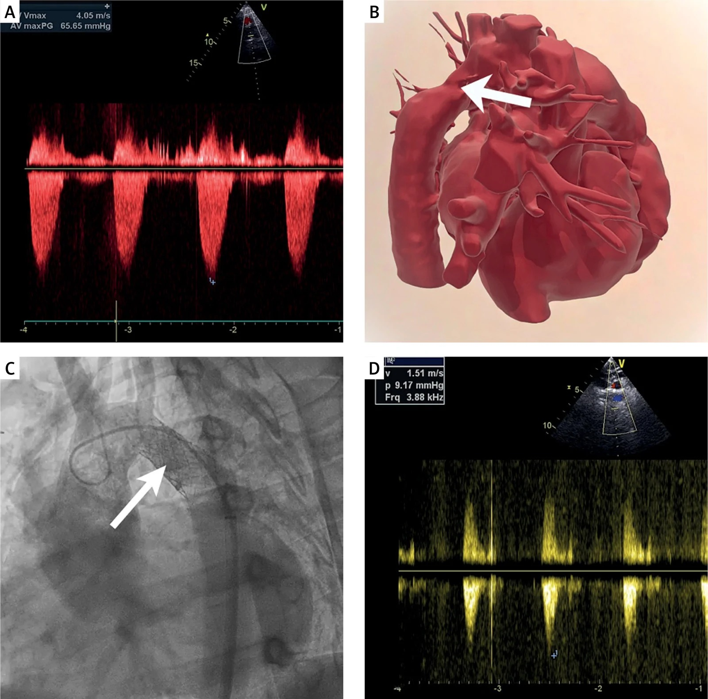
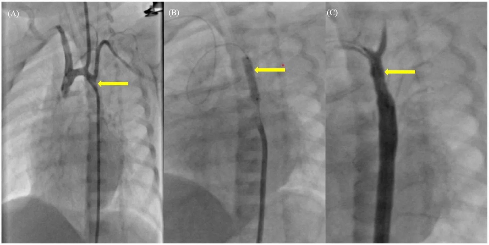
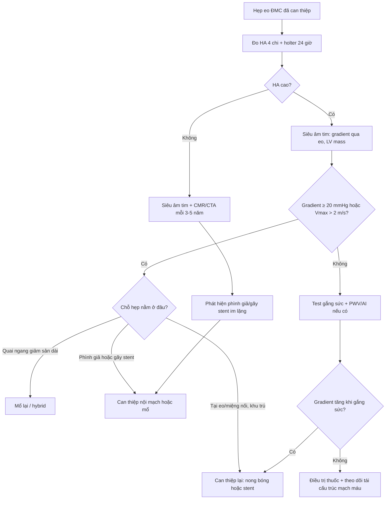
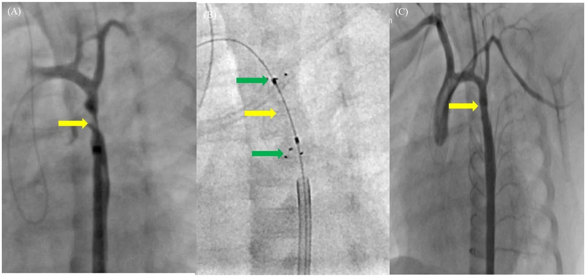
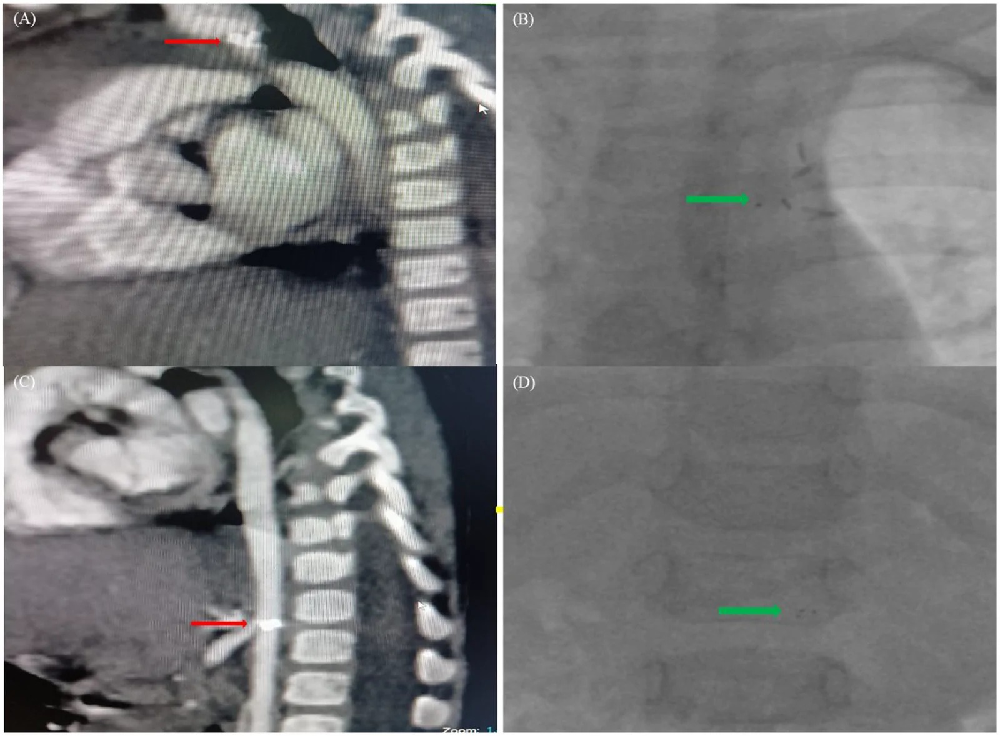

# 6119 — Tăng huyết áp tồn lưu & hẹp lại sau can thiệp hẹp eo động mạch chủ

**Tags:** `pattern:hep-dong-mach` `pattern:hep-lai` `pattern:phi-dai-that-trai` `pattern:chenh-huyet-ap-tay-chan` `pattern:gia-phinh` `vung:eo-dong-mach-chu` `vung:quai-dong-mach-chu` `vung:dong-mach-chu-nguc` `protocol:sieu-am-tim` `protocol:CTA-ECG-gating` `protocol:MRI-4D-flow` `protocol:holter-huyet-ap` `score:gradient-20mmHg` `score:CROS`
**Mức chắc chắn (certainty):** tổng hợp y văn (literature synthesis) — ghép **ca nam 27 tuổi hẹp lại sau mổ hẹp eo, tăng huyết áp kháng trị 5 thuốc, đặt stent 20 mm** (Postępy w Kardiologii Interwencyjnej 2026, PMC13721060), **ca sơ sinh 10 ngày gãy và trôi mảnh scaffold sinh học sau 6 tháng** (The Egyptian Heart Journal 2026, PMC13575008), **đoàn hệ quốc gia Anh–Wales 3.321 bệnh nhân** (Heart 2026, PMC12911588), **sổ bộ Thụy Điển 1.609 + 170 bệnh nhân** (Journal of the American Heart Association 2025, PMC12684487), **đoàn hệ 126 trẻ với điểm CROS** (Journal of Clinical Medicine 2026, PMC13607068), **119 bệnh nhân hẹp lại trong 15 năm** (Pediatric Research 2025, PMC12411270), **85 người lớn sau mổ với PWV/FMD** (Clinical Research in Cardiology 2011, PMC3079825) và **tổng quan hình ảnh đa phương thức** (Journal of Clinical Medicine 2026, PMC12898374). Số liệu không lấy từ một ca đơn lẻ; chỗ nào là suy luận từ cơ chế đều ghi rõ.

> **Câu hỏi thực hành:** nam **27 tuổi**, đã mổ hẹp eo động mạch chủ (coarctation of the aorta, CoA) lúc nhỏ, nay **tăng huyết áp kháng trị phải dùng 5 thuốc** mà huyết áp lưu động vẫn **> 150/80 mmHg**. Siêu âm tim: vận tốc đỉnh **4,05 m/s**, gradient đỉnh **65 mmHg** ở động mạch chủ xuống; CTA: hẹp **còn 11 mm trên đoạn dài 15 mm** ngay sau động mạch dưới đòn trái.
> Câu hỏi: **khi nào tăng huyết áp sau mổ là do hẹp lại còn can thiệp được, khi nào là "di chứng mạch máu" không còn chỗ để nong? ngưỡng gradient nào đủ để can thiệp lại? và sau khi nong/đặt stent thì theo dõi gì, bao lâu một lần, để không bỏ sót phình giả – gãy stent – phình mạch não?**
> Bài chốt **bốn việc**: **(1) đo huyết áp 4 chi mỗi lần khám + holter 24 giờ, vì huyết áp phòng khám không đủ để loại trừ tăng huyết áp ẩn; (2) hẹp lại = hẹp còn lại kèm gradient xâm nhập đỉnh–đỉnh ≥ 20 mmHg, không chỉ "trông hẹp"; (3) tăng huyết áp tồn lưu có hai ổ: ổ **cơ học** (nong/stent được) và ổ **mạch máu – thần kinh** (PWV tăng, FMD giảm, baroreflex đặt lại — chỉ điều trị thuốc); (4) sau can thiệp phải chụp mặt cắt định kỳ vì **gãy stent và phình giả có thể im lặng**.**

## 1. Tổng quan bệnh học – cơ chế hình ảnh: tại sao "mổ thành công" vẫn còn tăng huyết áp

- **Hai câu hỏi phải tách rời:** "còn hẹp không?" và "huyết áp còn cao không?" là **hai trục khác nhau**. Một bệnh nhân có thể **hết hẹp mà vẫn tăng huyết áp** (di chứng mạch máu), và ngược lại **hẹp lại mà huyết áp bình thường lúc nghỉ** (chỉ tăng khi gắng sức). Vì vậy mỗi lần khám phải trả lời **cả hai**, không thay thế nhau.
- **TẠI SAO hẹp lại (recoarctation) hình thành:** ba cơ chế chồng lên nhau. **(1) Mô ống động mạch còn sót** ở eo tiếp tục co và xơ hóa; **(2) miệng nối không lớn theo trẻ** — vòng suture cố định trên động mạch chủ đang phát triển, nên hẹp tương đối tăng dần khi trẻ lớn; **(3) tăng sinh nội mạc (neointimal hyperplasia) + xơ hóa** sau nong bóng hoặc sau đặt stent. Đây là lý do hẹp lại **không phải biến chứng của "một lần mổ"** mà là quá trình **nhiều năm**, đỉnh xuất hiện sớm trong năm đầu rồi kéo dài.
- **TẠI SAO nong bóng đơn thuần hay thất bại ở trẻ nhỏ:** thành động mạch chủ sơ sinh **giàu sợi chun (elastin)**, đàn hồi mạnh → sau khi bóng xẹp, thành **co hồi (elastic recoil)** gần như trở về như cũ. Trong ca sơ sinh dưới đây, gradient giảm **50 → 17 mmHg** ngay sau nong, nhưng **30 phút sau** (khi rút ống, tăng nhẹ hậu tải) gradient bật lại **42 mmHg** kèm phù phổi cấp và EF tụt **40% → 25%** — minh họa trực tiếp "thành đàn hồi + không có khung chống" (PMC13575008).
- **TẠI SAO vẫn tăng huyết áp dù hẹp đã hết — bằng chứng định lượng:** ở **85 người lớn sau mổ CoA** (trung vị mổ **0,9 tuổi**, tuổi nghiên cứu **34,6 ± 10,3**), **47 người huyết áp bình thường** vẫn có **PWV 6,8 ± 1,2 vs 5,4 ± 0,9 m/s** (p = 0,003), **augmentation index 18,6 ± 10,4% vs 13,5 ± 4,3%** (p = 0,03), **FMD 4,8 ± 2,8% vs 8,5 ± 2,3%** (p = 0,00003) so với 30 người chứng (PMC3079825). Nghĩa là: **động mạch chủ đã tái cấu trúc từ trong bào thai** (stiffness tăng, nội mạc giảm giãn) và **không "sửa" được bằng cách nong chỗ hẹp**.
- **TẠI SAO baroreflex không "reset" ngay:** trong thời gian dài, **áp lực cao ở nửa trên cơ thể** làm **baroreceptor xoang cảnh đặt lại điểm chuẩn** và tăng trương lực giao cảm. Sau khi giải phóng hẹp, điểm chuẩn này **giảm dần trong nhiều tháng–nhiều năm**, nên **tăng huyết áp tồn lưu sớm sau can thiệp không đồng nghĩa can thiệp thất bại** (suy luận từ sinh lý baroreflex; đối chiếu diễn tiến lâm sàng trong PMC13721060: bệnh nhân giảm thuốc **từ 5 → 3** trong theo dõi, không cắt đột ngột).
- **TẠI SAO hẹp nhỏ vẫn tạo gradient lớn:** theo **Poiseuille**, sức cản tỉ lệ nghịch với **lũy thừa 4 bán kính** → giảm 1/2 bán kính làm sức cản tăng ~16 lần. Vì vậy một đoạn hẹp **11 mm** trong lòng mạch **20 mm** vẫn đủ tạo gradient **65 mmHg** (PMC13721060).
- **Ngưỡng định lượng phải thuộc (dùng ngay tại giường):**
  - **Chênh huyết áp tay–chân tâm thu > 20 mmHg** = dấu hiệu lâm sàng của hẹp có ý nghĩa; đo **cả 4 chi**, dùng **băng quấn đúng cỡ**, trẻ nhỏ đo **tay phải** (tay trái có thể sai sau mổ subclavian flap).
  - **Gradient xâm nhập đỉnh–đỉnh ≥ 20 mmHg** (hoặc **gradient trung bình Doppler liên tục ≥ 22 mmHg**) = ngưỡng can thiệp khi có tăng huyết áp/phì đại thất trái/triệu chứng; **hẹp lại cũng lấy ngưỡng ≥ 20 mmHg** (ESC, qua PMC12898374).
  - **Vận tốc đỉnh > 2 m/s** và **dòng tâm trương kéo dài ("diastolic tail") > 1 m/s** ở động mạch chủ xuống = hẹp có ý nghĩa huyết động (PMC12898374).
  - **Chỉ số hẹp (coarctation index)** = đường kính chỗ hẹp nhất / đường kính động mạch chủ tại cơ hoành **< 0,6** trên CTA/CMR = hẹp nặng (PMC10340190).
  - **Tăng huyết áp ở trẻ ≥ 1 tuổi (AAP 2017):** **bậc 2 = ≥ bách phân vị 95 + 12 mmHg hoặc ≥ 140/90 mmHg**; đích điều trị **< bách phân vị 90 hoặc < 130/80**, lấy ngưỡng thấp hơn.
  - **Dịch tễ hẹp lại:** gộp các nghiên cứu 30 năm **12%** (dao động **6–50%**); **sổ bộ Thụy Điển: 15% sau mổ (249/1.609) và 35% sau can thiệp qua da (59/170)**; **tự do hẹp lại 91% / 89% / 88% / 86% / 85%** ở **1 / 5 / 10 / 20 / 30–50 năm** (PMC12684487).
  - **Tăng huyết áp tồn lưu:** **23% (168/736)** người sau mổ được điều trị tăng huyết áp trong sổ bộ; **20% ở nhóm có hẹp lại vs 11% ở nhóm không** (p < 0,05); **23–32%** vẫn có huyết áp cao tại phòng khám dù đang điều trị (PMC12684487).
  - **Can thiệp lại:** **13,3%** trong 10 năm ở **3.321 trẻ** (Anh–Wales), trung vị **157 ngày** (IQR 63–611); **can thiệp qua da lần đầu có HR 3,7** so với mổ đơn thuần; tử vong 10 năm **3,7%** (PMC12911588).

*Nam 27 tuổi, hẹp lại sau mổ CoA, tăng huyết áp kháng trị 5 thuốc. (A) Doppler liên tục: **Vmax 4,05 m/s, gradient đỉnh 65,65 mmHg**. (B) Mô hình 3D in từ CT để chọn stent. (C) Stent Co-Cr 33 mm nong tới 20 mm. (D) Sau can thiệp: **Vmax 1,51 m/s, gradient 9,17 mmHg**. Nguồn: Postępy w Kardiologii Interwencyjnej 2026 (PMC13721060), CC BY-NC-SA 4.0 — nguyên bản.*

## 2. Mẫu hình + chẩn đoán phân biệt theo vị trí (gamut)

- **Nguyên tắc:** đặt "chỗ hẹp" lên **trục dọc động mạch chủ** rồi hỏi tổn thương nằm **trước, tại hay sau chỗ đã can thiệp**. Cùng một mức tăng huyết áp nhưng vị trí quyết định **nong lại được hay phải mổ**.
- **Tại chỗ can thiệp (miệng nối/vị trí stent):** hẹp lại do tăng sinh nội mạc hoặc do stent **nong không hết (underexpansion)**, **stent gãy/trôi mảnh**, **stent quá ngắn** để hở đoạn hẹp, hoặc **mảng xơ tiến triển** quanh stent.
- **Trước chỗ can thiệp (quai động mạch chủ):** **giảm sản quai ngang (transverse arch hypoplasia)** — nguyên nhân tăng huyết áp tồn lưu **hay bị bỏ sót nhất** vì "đã nong đúng chỗ eo" nhưng quai vẫn nhỏ; **quai dạng gothic** (góc nhọn, hẹp chức năng); **hẹp lỗ nguyên ủy động mạch dưới đòn trái**.
- **Sau chỗ can thiệp (động mạch chủ xuống):** **phình thật**, **phình giả (pseudoaneurysm)** ở chỗ can thiệp, **bóc tách (dissection)**, **gãy stent**; các tổn thương này **không gây hẹp** nhưng gây **tăng huyết áp do thay đổi compliance** và có nguy cơ vỡ.
- **Ngoài động mạch chủ (gamut tăng huyết áp thứ phát):** **hẹp động mạch thận** (đặc biệt trong hội chứng động mạch chủ giữa — bài 6118), **hẹp eo ĐMC bụng**, **u tủy thượng thận**, **cường giáp**, **hẹp nhu mô thận**; và **tăng huyết áp nguyên phát** (béo phì, tiền sử gia đình) — chiếm phần lớn ở trẻ lớn.
- **"Giả hẹp lại" (pseudorecoarctation):** **gập góc (kinking)** ở eo, **giả hẹp eo (pseudocoarctation)** — hình ảnh hẹp nhưng **không có gradient**; nong/stent vào đây là **can thiệp oan** (bài 6116). Ngược lại, **đo gradient sai** (bàng hệ lớn, ống thông nhỏ, đầu đo ở xa chỗ hẹp) làm **hẹp thật bị đánh giá thấp**.
- **Mnemonic 3 tầng "TRƯỚC – TẠI – SAU":**
  - **T**rước: **T**ransverse arch (giảm sản quai), **T**úi phình quai.
  - **T**ại: **T**ăng sinh nội mạc, **T**hiếu nong (underexpansion), **T**hrombus trong stent.
  - **S**au: **S**tent gãy, **S**tent trôi, **S**accular phình giả, **S**tiffness (độ cứng thành mạch).

## 3. Bảng so sánh phân biệt (ma trận đối chiếu)

| Thực thể | Hình ảnh điển hình | Chốt vào (rule-in) | Chốt loại (rule-out) | Gợi ý xác nhận |
|---|---|---|---|---|
| **Hẹp lại tại miệng nối** | Hẹp khu trú đúng vị trí nối, **vách nội mạc nhẵn**, không vôi | **Gradient xâm nhập đỉnh–đỉnh ≥ 20 mmHg tại đúng chỗ nối** + tăng huyết áp/phì đại thất trái | Hẹp **dài, không khu trú**, không có điểm gradient → nghĩ **giảm sản quai** | Siêu âm tim + CMR/CTA, **kéo ống thông đo gradient từng đoạn** |
| **Giảm sản quai ngang** | Quai ngang **nhỏ đều**, đường kính **< 1 × động mạch chủ lên**, không có "eo" khu trú | **Chênh áp giữa động mạch chủ lên và xuống** khi kéo ống thông; **Z-score quai < −2** | Bình thường nếu **Z-score ≥ −2** và không chênh áp | CMR 3D/CTA, đo **đường kính tại 3 điểm** (quai gần, quai xa, eo) |
| **Stent nong không hết / gãy stent** | Stent **không áp sát thành**, eo thắt giữa stent; **mảnh stent rời** trên CT/fluoroscopy | **CT thấy mảnh stent ngoài vị trí** hoặc **diện cắt ngang tối thiểu trong stent < 80%** đường kính kỳ vọng | Stent **áp sát, không di lệch** và gradient **< 20 mmHg** | CTA (ưu thế sau stent), fluoroscopy, chụp mạch |
| **Tăng huyết áp do tái cấu trúc mạch máu** | **Không hẹp**, không chênh áp, nhưng **PWV và AI cao hơn người chứng cùng tuổi, FMD giảm** | **PWV/AI cao hơn nhóm chứng** (nghiên cứu: **6,8 vs 5,4 m/s**; **18,6% vs 13,5%**) + **holter 24 giờ xác nhận tăng huyết áp** | Gradient **< 20 mmHg** khi gắng sức **và** hình ảnh không hẹp | Holter huyết áp 24 giờ, **test gắng sức**, PWV (nếu có) |
| **Phình giả sau can thiệp** | Túi cản quang **ngoài lòng mạch** tại chỗ nong/stent, cổ rộng hoặc hẹp | **Thuốc cản quang vào túi ở thì động mạch, giữ hình ở thì muộn** | Không thấy túi ngoài lòng mạch trên CTA/CMR chất lượng tốt | CTA/CMR, DSA khi cần can thiệp |
| **Hẹp động mạch thận / hội chứng ĐMC giữa** | Hẹp **lỗ nguyên ủy** hoặc đoạn dài ĐMC bụng ± hẹp nhánh tạng | **Chênh áp thận–ĐMC ≥ 20 mmHg**, **RAR > 3** trên Doppler | Hẹp eo đơn thuần, ĐMC bụng bình thường | Doppler thận, CTA/MRA, DSA |
| **Giả hẹp eo (kinking/pseudocoarctation)** | **Gập góc** ở eo, lòng mạch **liên tục, không hẹp thật** | **Không gradient** khi kéo ống thông; hình ảnh "hẹp" chỉ do mặt phẳng | Có gradient ≥ 20 mmHg → **không phải giả hẹp** | CTA 3D + đo gradient; **không nong theo hình ảnh** |

- **Ảnh ghép đối chiếu:** bài dùng **4 ảnh rời của 3 bệnh nhân khác nhau** (sơ sinh nong bóng + scaffold, người lớn hẹp lại + stent, CT gãy scaffold) — **không ghép** vì ghép sẽ khiến người đọc tưởng cùng một ca (lý do ghi trong `images/CREDITS.md`).

## 4. Protocol theo dõi + ngưỡng can thiệp lại

- **Lịch theo dõi sau can thiệp (theo PMC12898374 + PMC6116, ghi vào giấy ra viện):**
  - **Mỗi lần khám:** huyết áp **4 chi** (tay phải + tay trái + hai chân), **cân nặng/chiều cao** (để tính bách phân vị), hỏi **đau đầu, đau cách hồi, giảm dung nạp gắng sức**.
  - **Hằng năm:** **holter huyết áp 24 giờ** (đặc biệt trẻ lớn/người lớn) + **siêu âm tim** (gradient qua eo, khối lượng thất trái, van động mạch chủ).
  - **Chụp mặt cắt định kỳ:** **CMR** nếu **không có stent** (không nhiễm xạ, đo thể tích/thông lượng), **CTA** nếu **có stent** (CMR bị nhiễu kim loại) — **mỗi 3–5 năm**, **ngắn hơn (1–2 năm)** khi có **gradient tồn lưu, phình, hoặc phì đại thất trái dai dẳng**.
  - **Tuổi chuyển tiếp (14–18 tuổi):** **test gắng sức** hoặc **siêu âm tim gắng sức** để phát hiện **tăng huyết áp/gradient chỉ xuất hiện khi gắng sức** — đây là nhóm "huyết áp nghỉ bình thường" nhưng vẫn có nguy cơ.
- **Ngưỡng can thiệp lại (ESC, qua PMC12898374):**
  - **Class I:** tăng huyết áp thứ phát do CoA với **chênh tay–chân > 20 mmHg** hoặc **gradient xâm nhập đỉnh–đỉnh ≥ 20 mmHg** (**CW trung bình ≥ 22 mmHg**); **hẹp lại ≥ 20 mmHg**; hoặc có **phì đại thất trái, suy tim, đau cách hồi**.
  - **Class II:** **bàng hệ lớn + giảm tưới máu chi dưới dù gradient thấp** (vì gradient bị đánh giá thấp).
- **Chọn kỹ thuật:**
  - **Trẻ nhỏ/nhũ nhi:** **nong bóng** (ưu tiên), chấp nhận **hẹp lại 30–59%** và có thể nong lại nhiều lần; **tránh stent không nong rộng được** vì sẽ thành **chỗ hẹp cố định** khi trẻ lớn (PMC13575008).
  - **Trẻ lớn/người lớn hẹp lại khu trú:** **stent** (kết quả huyết động tốt hơn nong bóng), nhưng phải theo dõi **phình 6,3%, gãy stent 24,4% ở 48–60 tháng** (COAST/COAST II, qua bài 6116) và **chỉ 16% bệnh nhân được chụp mặt cắt** nên tỉ lệ thật có thể cao hơn.
  - **Mổ lại:** **giảm sản quai dài**, **phình/phình giả**, **gãy stent có mảnh trôi**, **nhiễm trùng stent**, hoặc giải phẫu không đặt được stent. Ca sơ sinh: mảnh scaffold trôi xuống **động mạch chủ bụng gần**, được **để nguyên** vì vật liệu tự tiêu, và **mổ bắc cầu bằng ống Dacron 8 mm lúc 8 tháng**; 2 năm sau **huyết áp bình thường, không thuốc, gradient 15 mmHg** (PMC13575008).
  - **Stent sinh học (BVS) ở sơ sinh:** chỉ dùng như **bắc cầu**, không phải giải pháp lâu dài — case trên gãy ở **6 tháng** dù trẻ **hoàn toàn không triệu chứng**.

*Sơ sinh 10 ngày, hẹp eo nặng: (A) hẹp khu trú (mũi tên vàng), (B) nong bóng, (C) kết quả ngay sau nong — gradient **50 → 17 mmHg**. Kết quả "đẹp" này **không bền** vì thành mạch sơ sinh đàn hồi: 30 phút sau gradient bật lại **42 mmHg** (Hình 2). Nguồn: The Egyptian Heart Journal 2026 (PMC13575008), CC BY 4.0 — nguyên bản.*

## 5. Biến thể bình thường và cạm bẫy

- **Gập góc eo (kinking) trên CTA** trông như hẹp nhưng **lòng mạch liên tục, không gradient** — **không can thiệp**. Ca **67 tuổi giả hẹp eo** trong bài 6116 là ví dụ: huyết áp 4 chi **bằng nhau**, CTA chỉ thấy gập góc.
- **Đo huyết áp tay trái sau mổ subclavian flap:** động mạch dưới đòn trái bị dùng làm vạt → **huyết áp tay trái thấp giả tạo**, làm **mất dấu chênh tay–chân**. Luôn đo **tay phải** và ghi rõ tay nào.
- **Bàng hệ lớn làm gradient "giả thấp":** máu đi đường liên sườn/vú trong vòng qua chỗ hẹp → **chênh áp đo được nhỏ hơn mức hẹp thật**. Nếu có bàng hệ rõ trên CTA mà gradient thấp, **đừng kết luận "hết hẹp"** — cần **kéo ống thông đo từng đoạn** hoặc **test gắng sức**.
- **Holter 24 giờ bắt được hai thể bị bỏ sót:** **tăng huyết áp áo choàng trắng** (phòng khám cao, holter bình thường → không tăng thuốc) và **tăng huyết áp ẩn (masked hypertension)** (phòng khám bình thường, holter cao → **vẫn phải điều trị**). Chỉ số **holter 24 giờ tương quan tốt nhất với áp lực trung tâm và khối lượng thất trái** so với huyết áp tại nhà (PMC12246573).
- **Nhiễu kim loại của stent trên CT:** dày thành giả, "hẹp trong stent" giả. Dùng **CTA xoắn ốc mỏng, tái tạo đa mặt phẳng, cửa sổ rộng** và **so sánh với lần chụp trước**; đo **lòng mạch bên trong stent** ở **mặt phẳng vuông góc** với trục mạch, không đo trên MPR chéo.
- **Phình giả có thể nằm ngoài stent** và **bị che bởi giá đỡ kim loại** — luôn đọc **cả lớp ngoài stent** và **so sánh đường viền ngoài của động mạch chủ** với lần trước; phình giả có thể **xuất hiện muộn nhiều năm** sau can thiệp.
- **Gãy stent/trôi mảnh có thể hoàn toàn không triệu chứng** (ca sơ sinh: trẻ ăn ngủ bình thường, chỉ phát hiện khi **siêu âm thấy gradient 55 mmHg ở 6 tháng**). Vì vậy **không được dừng chụp mặt cắt chỉ vì trẻ khỏe**.
- **"Đã mổ rồi thì không cần theo dõi"** là cạm bẫy chết người: **10 năm sau mổ vẫn có 13,3% can thiệp lại**, và **tử vong 10 năm 3,7%** trong đoàn hệ 3.321 trẻ (PMC12911588).
- **Satisfaction of search:** thấy hẹp lại ở eo rồi dừng, **bỏ sót giảm sản quai ngang** phía trên và **phình giả** phía dưới — luôn đo **3 tầng** trước–tại–sau.

## 6. Tự lượng giá — Blind Quiz

**Ca 1 — Nam 27 tuổi, tăng huyết áp kháng trị 5 thuốc sau mổ hẹp eo lúc nhỏ.**

- Gợi ý: đã mổ CoA + giải phóng thất phải–động mạch phổi lúc nhỏ; huyết áp lưu động **> 150/80 mmHg** dù dùng 5 thuốc.
- Câu hỏi: (1) Đọc **hai phổ Doppler** — số nào là trước, số nào là sau? (2) Vì sao huyết áp không kiểm soát được? (3) Ngưỡng nào quyết định can thiệp?

<b>Bấm để hiện đáp án</b>

- **(A)** Doppler liên tục: **Vmax 4,05 m/s, gradient đỉnh 65,65 mmHg**, kèm **dòng tâm trương kéo dài** — hẹp có ý nghĩa huyết động. **(D)** Sau đặt stent: **Vmax 1,51 m/s, gradient 9,17 mmHg**, phổ động mạch chủ bụng trở về bình thường.
- CTA: hẹp **11 mm trên đoạn 15 mm** ngay sau động mạch dưới đòn trái; **gradient kéo ống thông > 20 mmHg** → chỉ định can thiệp lại (class I).
- Điều trị: **stent Co-Cr 33 mm nong tới 20 mm**; sau can thiệp **gradient xâm nhập 0 mmHg**, Doppler **1,5 m/s / 9 mmHg**, huyết áp bình thường; thuốc giảm **5 → 3** trong theo dõi.
- Bài học: **tăng huyết áp kháng trị ở người trẻ đã mổ CoA phải nghĩ hẹp lại trước khi gọi là "tăng huyết áp nguyên phát"**.
- Nguồn: Postępy w Kardiologii Interwencyjnej 2026 (PMC13721060), CC BY-NC-SA 4.0.

**Ca 2 — Sơ sinh 10 ngày, sốc tim, EF 20%, gradient 50 mmHg; sau nong bóng 30 phút thì phù phổi cấp.**

- Gợi ý: nong bóng làm gradient **50 → 17 mmHg** và EF **20% → 40%**, nhưng 30 phút sau gradient **42 mmHg**, EF **25%**.
- Câu hỏi: (1) Vì sao hẹp lại ngay sau nong? (2) Chọn gì tiếp theo? (3) Cần theo dõi gì để phát hiện biến chứng muộn?

<b>Bấm để hiện đáp án</b>

- **(A)** Hẹp lại do **co hồi đàn hồi (elastic recoil)** của thành động mạch chủ sơ sinh — không phải "nong thất bại" do kỹ thuật.
- **(B)** Đặt **scaffold sinh học MeRes100 3,5 × 15 mm** (bắc cầu), nong sau bằng bóng **4,0 × 10 mm**; gradient còn **15 mmHg**, rút ống trong 24 giờ, EF hồi phục.
- **(C)** 6 tháng sau: gradient **55 mmHg**, CTA thấy **gãy scaffold + mảnh trôi xuống động mạch chủ bụng gần**; trẻ **không triệu chứng**. Mổ bắc cầu **Dacron 8 mm lúc 8 tháng**, để mảnh trôi tại chỗ; 2 năm sau **huyết áp bình thường, không thuốc, gradient 15 mmHg**.
- Bài học: **BVS ở sơ sinh chỉ là giải pháp bắc cầu**; phải **chụp mặt cắt theo lịch** vì biến chứng có thể **im lặng**.
- Nguồn: The Egyptian Heart Journal 2026 (PMC13575008), CC BY 4.0.

**Ca 3 — Bé 14 tuổi đã mổ CoA lúc 3 tháng. Huyết áp tay phải 128/84, chân 108/68; siêu âm tim lúc nghỉ gradient 16 mmHg; CTA không hẹp.**

- Gợi ý: bố mẹ hỏi "đã mổ rồi, có cần theo dõi nữa không?".
- Câu hỏi: (1) Chênh tay–chân **20 mmHg** có ý nghĩa? (2) Gradient nghỉ **16 mmHg** đã loại trừ hẹp lại? (3) Bước tiếp theo?

<b>Bấm để hiện đáp án</b>

- Chênh **20 mmHg** nằm **đúng ngưỡng** (> 20 mmHg là dấu hiệu); cần **đo lại đúng băng quấn, cùng lúc, tay phải**, và **holter 24 giờ**.
- Gradient nghỉ **16 mmHg KHÔNG loại trừ** hẹp có ý nghĩa: ở trẻ lớn, **gradient có thể chỉ tăng khi gắng sức**, và **bàng hệ** làm gradient nghỉ thấp giả. Cần **test gắng sức/siêu âm gắng sức**.
- Nếu gradient gắng sức **≥ 20 mmHg** kèm tăng huyết áp → **can thiệp lại**; nếu holter bình thường và gradient gắng sức thấp → **theo dõi + điều trị thuốc**, chụp mặt cắt **3–5 năm/lần**.
- Cạm bẫy trong ảnh: đây là **CT của ca sơ sinh khác** (gãy scaffold + mảnh trôi ở động mạch chủ bụng) — dùng để nhắc rằng **bất thường cấu trúc có thể im lặng**, không phải tổn thương của bé 14 tuổi.
- Nguồn: The Egyptian Heart Journal 2026 (PMC13575008), CC BY 4.0; ngưỡng theo PMC12898374.

## Bài liên quan chéo
- [6116 – Hẹp eo động mạch chủ ở trẻ](../6116-hep-eo-dong-mach-chu-o-tre/lesson.md) (chẩn đoán ban đầu, nong bóng vs stent)
- [6118 – Hội chứng động mạch chủ giữa](../6118-hoi-chung-dong-mach-chu-giua/lesson.md) (hẹp ĐMC bụng, tăng huyết áp kháng trị)
- [6117 – Tăng huyết áp do mạch máu thận](../6117-tang-huyet-ap-mach-than-sau-huyet-khoi-so-sinh/lesson.md) (ngưỡng huyết áp theo tuổi, Doppler thận)
- [850 – Loạn sản cơ xơ (FMD) toàn thân ở trẻ](../850-loan-san-co-xo-fibromuscular-dysplasia-toan-than-o-tre/lesson.md)
- [800 – Tổng quan tim mạch](../800-cardiovascular-overview/lesson.md)

## Ảnh
- `images/6119_tang-hap-sau-hep-eo_SieuAm-PC_PMC13721060-F1.jpg` — Doppler + mô hình 3D + stent + Doppler sau (PMC13721060, CC BY-NC-SA 4.0).
- `images/6119_tang-hap-sau-hep-eo_Angio_PMC13575008-F2.jpg` — hẹp lại do co hồi + scaffold sinh học (PMC13575008, CC BY 4.0).
- `images/6119_tang-hap-sau-hep-eo_CT_PMC13575008-F3.jpg` — CT gãy scaffold + mảnh trôi (PMC13575008, CC BY 4.0).
- `images/6119_tang-hap-sau-hep-eo_Angio_PMC13575008-F1.jpg` — hẹp gốc + nong bóng (PMC13575008, CC BY 4.0).
- Nguồn + giấy phép từng ảnh: `images/CREDITS.md`.

> Không dùng để chẩn đoán độc lập khi chưa có người hướng dẫn.
