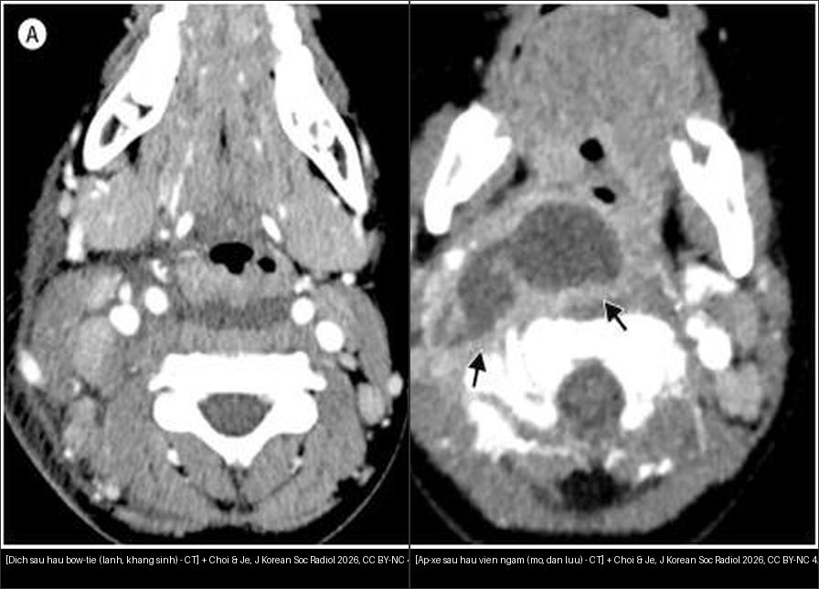
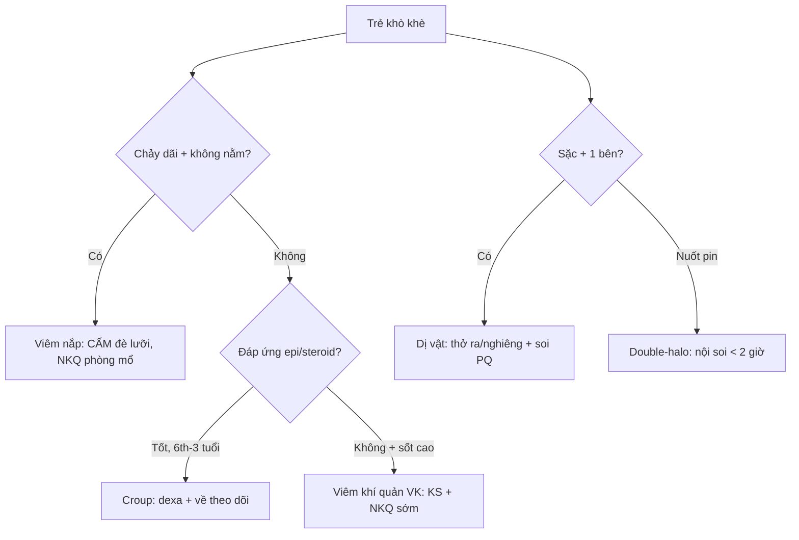
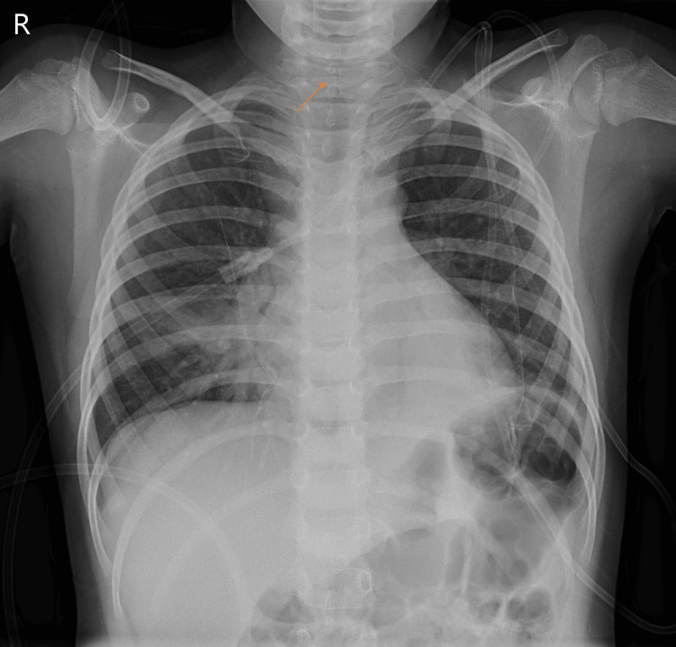
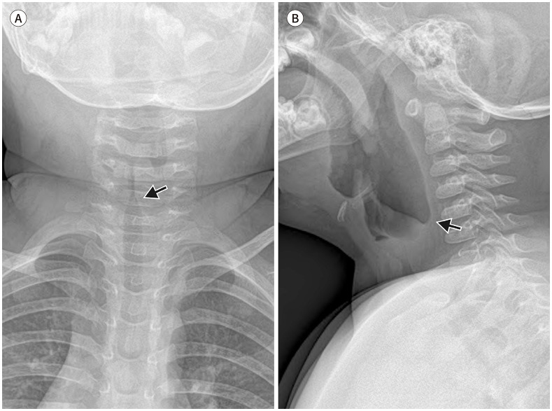
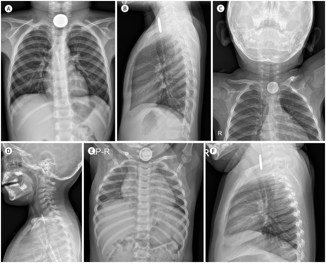

# 612 — Cấp cứu đường thở trên trẻ em: Croup vs viêm nắp thanh quản, áp-xe sau hầu & dị vật / Pediatric stridor

**Tags:** `pattern:duong-tho-tre-em` `vung:duong-tho-nhi` `protocol:X-quang-co-nghieng`
**Mức chắc chắn (certainty):** tổng hợp y văn (literature synthesis) — nhóm tự biên từ 2 nguồn mở (Cureus 2024 CC BY 4.0 + J Korean Soc Radiol 2026 CC BY-NC 4.0), chưa gắn ca nguyên văn đơn lẻ.

## 1. Tổng quan — hạ thanh môn là chỗ hẹp nhất + 3 câu hỏi mọi khò khè

- Hạ thanh môn (subglottis) là chỗ hẹp nhất đường thở trẻ em (người lớn là thanh môn) — TẠI SAO 1 mm phù đã nguy kịch: sức cản dòng khí tỉ lệ nghịch lũy thừa 4 bán kính (Poiseuille), phù nề vòng sụn nhẫn (không giãn được) bóp bán kính rất nhanh.
- 3 câu hỏi mọi trẻ khò khè (stridor): **(1) tuổi mấy? (2) sốt + nhiễm độc không? (3) đáp ứng epi/steroid không?** — 3 câu này chia 90% ca trước cả phim.
- Tuổi chốt theo Choi & Je 2026: croup **6 tháng–3 tuổi** (virus á cúm — parainfluenza), viêm khí quản vi khuẩn **3–8 tuổi** (tụ cầu vàng — S. aureus, hậu virus), viêm nắp thanh quản nay gặp **thanh thiếu niên/người lớn** (Hib đã giảm nhờ vaccine).
- Ngưỡng xử trí: dexamethasone **0,6 mg/kg** + epi khí dung đáp ứng tốt = croup; **không đáp ứng + sốt cao + nhiễm độc = viêm khí quản vi khuẩn** (đặt nội khí quản tới **80%** ca, tử vong ~**20%** — Moreira 2024).

## 2. Gamut khò khè + sốt theo tuổi (Gamut)

- **6 tháng–3 tuổi + ho ông ổng (barking) + hạ sốt + đáp ứng epi:** croup — dexa + epi + về (nặng mới nhập).
- **3–8 tuổi + sốt cao + nhiễm độc + KHÔNG đáp ứng epi/steroid:** viêm khí quản vi khuẩn — kháng sinh + nội khí quản sớm (màng giả bong gây tắc đột ngột!).
- **Sốt cao + chảy dãi + không nằm được + giọng khoai nóng:** viêm nắp thanh quản — CẤM đè lưỡi, nội khí quản phòng mổ (ngón cái — thumb sign chỉ chụp khi ổn định).
- **< 5 tuổi + sốt + cổ cứng/nghiêng + nuốt đau:** áp-xe sau hầu (hạch sau hầu teo sau 5 tuổi) — CT cản quang phân dịch vs mủ.
- **1–3 tuổi + sặc đậu phộng + khò khè 1 bên:** dị vật đường thở (van 1 chiều → bẫy khí) — phim thở ra/nằm nghiêng + soi phế quản.
- **Nuốt đồng xu/pin + nuốt đau + chảy dãi:** dị vật thực quản — pin nút là tối khẩn tính bằng giờ (hoại tử trong **< 2 giờ**!).

## 3. Bảng so sánh phân biệt (ma trận đối chiếu)

| Thực thể (entity) | Hình ảnh điển hình | Chốt vào (rule-in) | Chốt loại (rule-out) | Gợi ý xác nhận |
|---|---|---|---|---|
| Croup | **Hẹp hạ thanh môn đối xứng (steeple) trên AP + giãn hạ họng trên lateral** | **6th–3 tuổi + ho ông ổng + đáp ứng epi** | Nắp dày → viêm nắp; không đáp ứng → BT | X-quang cổ AP + nghiêng |
| Viêm khí quản vi khuẩn | Steeple + **thành khí quản không đều + màng giả + viêm phổi kèm** | **Sốt cao + nhiễm độc + KHÔNG đáp ứng steroid/epi** | Đáp ứng epi tốt → croup | Cấy dịch PQ + NKQ sớm |
| Viêm nắp thanh quản | **Nắp dày hình ngón cái (thumb) + nếp phễu dày, hạ thanh môn bình thường** | **Chảy dãi + không nằm + giọng khoai nóng** | Steeple đối xứng → croup | NKQ phòng mổ, cấm đè lưỡi |
| Dịch sau hầu (lành) | **Dẹt, thắt nơ (bow-tie) 2 đầu nhọn, KHÔNG viền ngấm** | **< 5 tuổi + dẹt + không viền** | Lồi + viền dày → áp-xe | Kháng sinh + theo dõi |
| Áp-xe sau hầu | **Ổ dịch lồi + viền ngấm dày + qua đường giữa + đè đường thở** | **Viền dày + sốt cao + cổ cứng** | Dẹt bow-tie → dịch | Dẫn lưu + cấy (nối bài 730) |
| Dị vật đường thở | **Bẫy khí 1 bên thì thở ra/nằm nghiêng** (đậu phộng thấu quang!) | **Sặc + khò khè 1 bên + bẫy khí** | 2 bên đều → hen/croup | Soi phế quản gắp |
| Xu vs pin nút | Xu: đặc đều; **pin: quầng đôi (double-halo) AP + gờ vát lateral** | **Double-halo/gờ vát = pin → tối khẩn** | Tròn đều + sau khí quản → xu thực quản | Nội soi gắp (pin < 2 giờ!) |

*Trái: dịch (effusion) thắt nơ 2 đầu nhọn, không viền. Phải: áp-xe viền ngấm dày + đè hẹp đường thở. Nguồn: Choi & Je, J Korean Soc Radiol 2026 Fig. 8, CC BY-NC 4.0. Ảnh ghép letterbox.*

**Quiz composite:** che 2 nhãn, hỏi bên nào mổ?

<b>Bấm để hiện đáp án</b>

- Trái = **dịch sau hầu (effusion)** — dẹt, bow-tie, không viền → kháng sinh + theo dõi, đừng mổ oan.
- Phải = **áp-xe sau hầu** — lồi + viền ngấm dày + đè đường thở → dẫn lưu + giữ đường thở.

### Steeple không đồng nghĩa croup — ca viêm khí quản vi khuẩn cũng steeple!

- Ca Moreira (bé trai 5 tuổi): AP hẹp hạ thanh môn steeple điển hình nhưng **nhiễm độc + không đáp ứng steroid/epi + toan hô hấp pH 7,19** → cấy ra liên cầu nhóm A, phải đặt NKQ + kháng sinh 10 ngày.
- Bài học: steeple chỉ nói "hẹp hạ thanh môn", **đáp ứng thuốc mới phân biệt croup vs vi khuẩn** — đừng thấy steeple là kết luận croup rồi cho về.

## 4. Protocol chụp cổ nhi

- **X-quang cổ AP + nghiêng (trẻ ổn định, ngồi thẳng, cổ duỗi, thì hít vào):** AP tìm steeple, nghiêng tìm thumb + đo mô mềm trước sống (**> 7 mm ở C1–C4 hoặc > 14 mm ở C5–C7 là dày** — loại trừ cổ gập/khóc).
- **Viêm nắp thanh quản nghi ngờ:** CẤM đè lưỡi/soi họng tại giường — NKQ tại phòng mổ có sẵn mở khí quản; phim chỉ khi trẻ ổn và không trì hoãn đường thở.
- **Sau hầu:** CT cản quang khi sốt cao + cổ cứng (phân dịch vs mủ) — mủ lan danger space xuống trung thất thì nối bài 730.
- **Dị vật:** cặp phim hít vào–thở ra (trẻ lớn) hoặc nằm nghiêng 2 bên (trẻ nhỏ: bên nghiêng = thì thở ra); pin nút thực quản = nội soi tối khẩn, không chờ.

## 5. Biến thể bình thường và cạm bẫy

- **Khóc/thở ra giả steeple** — hạ thanh môn hẹp sinh lý khi khóc + dây thanh khép: chụp lại thì hít vào yên tĩnh mới kết luận.
- **Cổ gập giả dày mô mềm sau hầu** — duỗi cổ + hít vào mới đo 7 mm/14 mm; khóc cũng đẩy họng phồng giả áp-xe.
- **Xu tưởng pin (và ngược lại):** pin có quầng đôi + gờ vát — đọc AP không đủ, bắt buộc lateral; pin = giờ, xu = ngày (xu trơn < 24 giờ có thể chờ qua tự nhiên nếu không triệu chứng — theo dõi, không áp dụng cho pin!).
- **Đậu phộng thấu quang** — X-quang thường quy hít vào có thể bình thường hoàn toàn: sặc + khò khè 1 bên là soi, đừng chờ phim "đẹp".
- **Thỏa mãn tìm kiếm:** viêm khí quản vi khuẩn thường kèm viêm phổi — thấy phổi mờ đừng dừng, vẫn phải đánh giá đường thở.

## 6. Tự lượng giá — Blind Quiz

**Ca 1 — Bé trai 5 tuổi, ho + khò khè + khó thở tăng dần trong 2 giờ, đáp ứng kém với steroid/epi khí dung. Nhìn AP cổ, mô tả trước.**

- Hỏi: hẹp ở đâu, hình gì? 3 phân biệt + dấu hiệu nào phân định croup vs vi khuẩn?

<b>Bấm để hiện đáp án (findings + chẩn đoán)</b>

- Dấu hiệu (findings): hẹp hạ thanh môn đối xứng hình tháp chuông (steeple, mũi tên) — nhưng trẻ **nhiễm độc + không đáp ứng epi + toan hô hấp**.
- Chẩn đoán (diagnosis): **viêm khí quản vi khuẩn (liên cầu nhóm A)** — vì steeple chỉ nói vị trí hẹp, còn đáp ứng thuốc mới là chốt (croup phải đáp ứng epi).
- Nguồn ảnh: Moreira et al., Cureus 2024 Fig. 1, CC BY 4.0.

**Ca 2 — Bé gái 2 tuổi, ho ông ổng + khò khè hít vào, không sốt cao. Cặp AP + nghiêng:**

<b>Bấm để hiện đáp án (findings + chẩn đoán)</b>

- Dấu hiệu (findings): (A) hẹp hạ thanh môn đối xứng steeple (mũi tên) + (B) ứ khí giãn hạ họng trên phim nghiêng.
- Chẩn đoán (diagnosis): **croup điển hình (viêm thanh khí phế quản virus)** — tuổi + ho ông ổng + cặp dấu AP/nghiêng đủ bộ; dexa + epi + theo dõi.
- Nguồn ảnh: Choi & Je, J Korean Soc Radiol 2026 Fig. 7, CC BY-NC 4.0.

**Ca 3 — 3 trẻ nuốt dị vật ở lỗ vào ngực. Cặp nào phải nội soi TỐI KHẨN?**

<b>Bấm để hiện đáp án (findings + chẩn đoán)</b>

- Dấu hiệu (findings): E quầng đôi (double-halo) trên AP + F gờ vát (step-off) trên lateral = **pin nút**; A–D đặc đều không quầng = xu thường (B/D sau khí quản = thực quản).
- Chẩn đoán (diagnosis): **E/F pin nút thực quản — nội soi tối khẩn (< 2 giờ đã bỏng hoại tử!)**; xu trơn không triệu chứng có thể theo dõi ngắn.
- Nguồn ảnh: Choi & Je, J Korean Soc Radiol 2026 Fig. 10, CC BY-NC 4.0.

## Bài liên quan chéo
- [600 – Tổng quan Nhi khoa](../600-tong-quan-nhi-khoa/lesson.md)
- [610 – Suy hô hấp sơ sinh](../610-suy-ho-hap-so-sinh-va-di-dang-phoi/lesson.md) (khò khè sơ sinh)
- [620 – Cấp cứu tiêu hóa nhi](../620-cap-cuu-tieu-hoa-so-sinh-nhu-nhi/lesson.md) (xu qua đường tiêu hóa)
- [730 – Cổ sâu: áp-xe sau hầu & danger space](../730-deep-neck-infections/lesson.md) (mủ lan trung thất)

## Ảnh
- `612_steeple_XR_PMC-Moreira-CCBY40.jpg` — CC BY 4.0, Moreira et al., Cureus 2024.
- `612_croup-steeple-hypopharynx_XR_PMC-Choi-CCBYNC40.jpg`, `612_dich-vs-apxe-sau-hau_CT_PMC-Choi-CCBYNC40.jpg`, `612_xu-vs-pin-nut_XR_PMC-Choi-CCBYNC40.jpg` — CC BY-NC 4.0, Choi & Je, J Korean Soc Radiol 2026 (dùng phi thương mại, ghi nguồn).
- Chi tiết giấy phép từng ảnh trong `images/CREDITS.md`.

> Không dùng để chẩn đoán độc lập khi chưa có người hướng dẫn.
