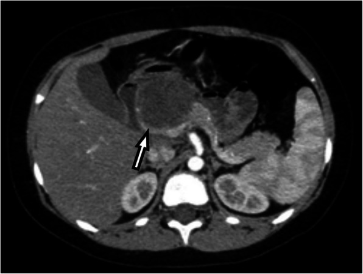
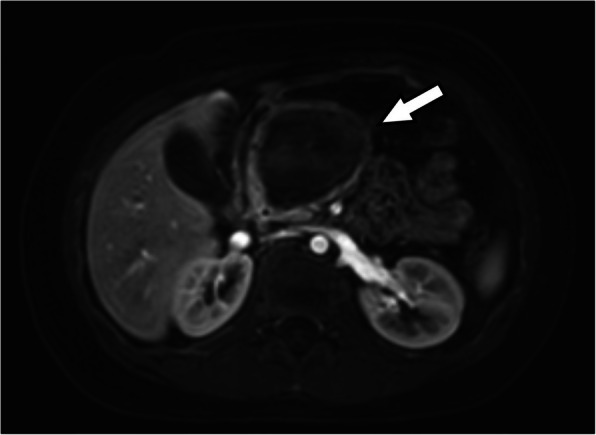
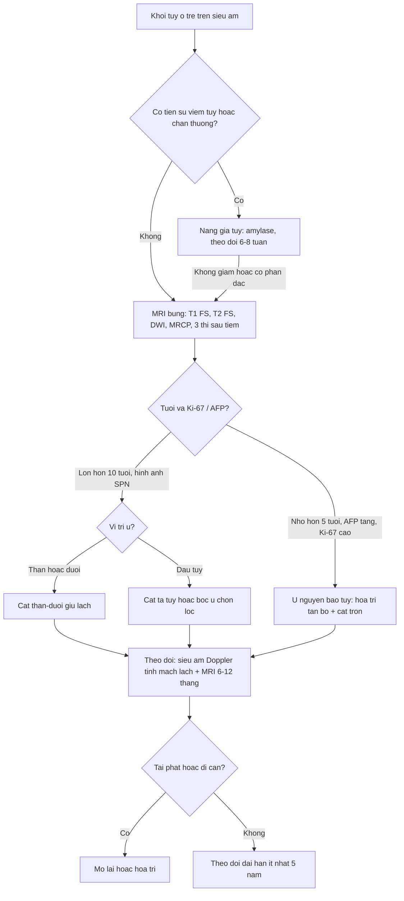
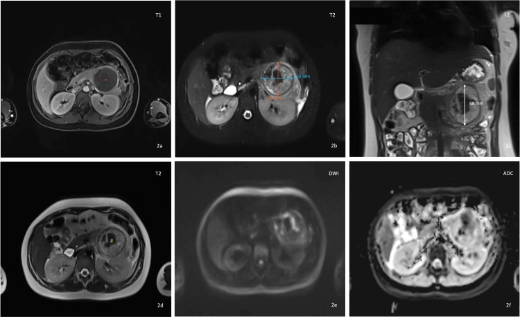
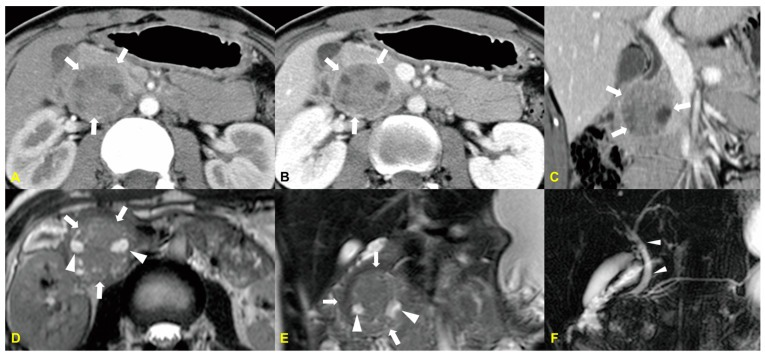

# 6120 — U tụy ở trẻ: u đặc–nhầy nhú (SPN), u nguyên bào tụy (pancreatoblastoma), IPMN nhánh và cạm bẫy "nang giả"

**Tags:** `pattern:khoi-tuy` `pattern:dac-nang-hon-hop` `pattern:xuat-huyet-trong-u` `pattern:voi-hoa` `pattern:di-can-phuc-mac` `vung:tuy` `vung:o-bung` `vung:tinh-mach-lach` `protocol:MRI-bung-co-tuong-phan` `protocol:CT-3-thi` `protocol:sieu-am-Doppler` `protocol:EUS-FNA` `score:Ki-67`
**Mức chắc chắn (certainty):** tổng hợp y văn (literature synthesis) — ghép **ca bé trai 9 tuổi u đặc–nhầy nhú (SPN) ở mỏm móc tụy** (J Egypt Natl Canc Inst 2025, PMC13313416), **ca bé gái 11 tuổi SPN đuôi tụy được cắt thân–đuôi giữ lách qua nội soi** (Cureus 2026, PMC12949481), **ca 18 tuổi u nguyên bào tụy trong bài tổng quan hình ảnh–mô bệnh** (Medicina 2024, PMC11596154), **đoàn hệ 32 trẻ SPN với chiến lược chọn lọc giữ nhu mô tụy** (PLoS One 2026, PMC13561321), **khảo sát toàn quốc Nhật 213 trẻ** (World J Gastrointest Oncol 2024, PMC11514659), **đoàn hệ SEER 195 trẻ** (BMC Gastroenterol 2024, PMC10941481), **48 trẻ mổ u tụy một trung tâm** (Front Pediatr 2025, PMC12198236) và **so sánh CEUS SPN vs u nguyên bào tụy** (Diagnostics 2026, PMC12896552).

> **Câu hỏi thực hành:** bé trai **9 tuổi**, **đau bụng âm ỉ + sờ thấy khối vùng thượng vị**; siêu âm có **khối 48 × 48 × 50 mm ở ranh giới đầu–thân tụy**, bờ không đều, **không thấy tăng sinh mạch trong khối**; CT có cản quang: khối **giảm tỷ trọng không đồng nhất, KHÔNG ngấm thuốc**; MRI: khối **hỗn hợp nang 55 × 51 × 48 mm**, có **vỏ bao**.
> Câu hỏi: **khối này là nang giả tụy sau một đợt viêm tụy không được chẩn đoán, hay u thật? nếu là u thì cắt giữ lách hay bỏ lách? vì sao phải theo dõi nhiều năm dù "u lành"?**
> Bài chốt **bốn việc**: **(1) u tụy ở trẻ hiếm nhưng gần như luôn phải mổ — "nang giả" không có tiền sử viêm tụy/chấn thương phải coi là u cho tới khi mô bệnh học chứng minh ngược lại; (2) SPN có chữ ký hình ảnh: khối lớn, vỏ bao xơ, đặc–nang, xuất huyết trong u, ngấm thuốc tiến triển; (3) ở thân/đuôi tụy, cắt thân–đuôi **giữ lách** là lựa chọn ưu tiên nhưng phải theo dõi tĩnh mạch lách; (4) u nguyên bào tụy (PB) là u ác thật ở trẻ nhỏ — khác hoàn toàn về tuổi, Ki-67 và tiên lượng.** Nối [6115 – Tăng áp cửa phía trái do tắc tĩnh mạch lách](../6115-tang-ap-cua-phia-trai-tac-tinh-mach-lach/lesson.md), [135 – Viêm tụy cấp theo Atlanta](../135-viem-tuy-Atlanta/lesson.md), [136 – U nang tụy](../136-u-nang-tuy/lesson.md).

## 1. Tổng quan bệnh học – cơ chế hình ảnh: tại sao u đặc lại "tan thành nang"

- **Dịch tễ – bức tranh tổng thể:** u tụy ở trẻ **rất hiếm**. U đặc–nhầy nhú (solid pseudopapillary neoplasm, SPN) có **tỉ lệ mắc 0,1–0,2/1 triệu trẻ/năm**, chiếm **0,9–2,7% u ngoại tiết tụy** và **~5% u nang tụy**, nhưng lại là **u tụy thường gặp nhất ở trẻ có tiềm năng ác tính** (PLoS One 2026, PMC13561321). Trong **213 trẻ mổ u tụy ở Nhật (2000–2021)**: **SPN 77,0% (164)**, **u nguyên bào tụy (pancreatoblastoma, PB) 7,5% (16)**, u nội tiết **6,6% (14)**, u không biểu mô **4,2% (9)** (PMC11514659). Trong **195 trẻ của SEER (1975–2018)**: u thần kinh nội tiết **33,8%**, **SPN 32,3%**, **PB 11,3%**, khác **22,6%**; tuổi trung vị **16**; **30,3% đã có di căn xa lúc chẩn đoán**; **69,7% được mổ**; sống 1/3/5 năm **90,3% / 79,2% / 77,7%** (BMC Gastroenterol 2024, PMC10941481).
- **TẠI SAO SPN vừa đặc vừa nang:** u khởi đầu là **khối đặc**; khi lớn lên, **mạch máu nuôi không theo kịp** → **thoái hóa nang, xuất huyết trong u, hoại tử**, hình thành **cấu trúc nhú giả (pseudopapillae)** trên các trụ xơ–mạch. Vì vậy tỉ lệ đặc/nang thay đổi theo kích thước: **u < 3 cm có thể đặc hoàn toàn và chưa có vỏ bao**, u lớn thì **nang hóa + xuất huyết** rõ; **vỏ bao xơ gần như luôn có khi u > 3 cm** (Diagnostics 2023, PMC10046973).
- **TẠI SAO tín hiệu MRI lại "kỳ quặc" — giải thích bằng vật lý:**
  - **T1 tăng tín hiệu trong u** = **máu xuất huyết (methemoglobin nội bào)** — đây là dấu hiệu gần như đặc trưng; xuất huyết trong u gặp **29% đến 88,9%** ca.
  - **T2 hỗn hợp, có vùng rất sáng** = **dịch và máu cũ**; có thể thấy **mức dịch–dịch (fluid–fluid level)**.
  - **Vỏ bao xơ T1 và T2 đều TỐI, ngấm thuốc muộn** = **collagen/fibrosis** (rất ít proton tự do → tối trên mọi chuỗi, đối quang đọng lại trong mô đệm xơ → sáng muộn). Trong khi đó **thành nang giả tụy** cũng tối nhưng **mỏng đều và không có phần đặc bên trong**.
  - **Ngấm thuốc TIẾN TRIỂN (progressive)**: phần đặc ngấm **ít ở thì động mạch**, **tăng dần ở thì cửa–muộn** vì mô đệm xơ giữ thuốc — ngược với **u thần kinh nội tiết (NET)** ngấm **rất mạnh và sớm** ở thì động mạch.
  - **DWI:** phần đặc **hạn chế khuếch tán nhẹ** (ADC không tối như ung thư biểu mô ống tụy); phần nang/hoại tử **không hạn chế** — nên **DWI âm KHÔNG loại trừ SPN** (ca 11 tuổi: b = 1500 s/mm² **không hạn chế thật** — PMC12949481).
- **Số liệu định lượng phải thuộc:**
  - **Vôi hóa: tới 30%**, hay gặp ở u lớn, đủ kiểu (ngoại vi, trung tâm, thô, lấm tấm) — **vôi hóa không loại trừ và không khẳng định ác tính**.
  - **Ác tính thật 10–15%**; **di căn xa tới 15%** (gan, phúc mạc, hạch) — có thể xuất hiện **nhiều năm sau mổ**; **tái phát 2–10%**; **khỏi bệnh tới ~90%** sau cắt trọn (PMC10046973; PMC13561321).
  - **Dấu hiệu gợi ác tính trên hình ảnh:** **giãn ống tụy chính**, **ôm/bóp mạch (vessel encasement)**, **di căn**, **mất liên tục vỏ bao khu trú**, **bờ đa cung (lobulated)**. **Kích thước, vị trí, độ dày vỏ, kiểu vôi hóa KHÔNG khác biệt** giữa lành và ác (PMC10046973).
  - **PB khác SPN về sinh học:** PB là **u ác thật của trẻ nhỏ** — trong so sánh CEUS 22 trẻ: tuổi trung bình **2,94 tuổi (PB) vs 13,51 tuổi (SPN)**, **Ki-67 30% vs 5%**, cường độ đỉnh **IMAX 179,84% vs 60,56%**, tốc độ thải **773,88 vs 275,38**, và **100% PB có dấu "mạch nuôi hỗn loạn" (disorganized nourishing vessels)** (Diagnostics 2026, PMC12896552). **AFP có thể tăng** — ca 14 tuổi **AFP 395 ng/mL**, ca 4 tuổi **AFP 1210 ng/mL** kèm **NSE 51,2 ng/mL** (Front Oncol 2025, PMC12672239).
  - **Tiên lượng thực tế:** trong **48 trẻ mổ u tụy**, **45 (93,75%) còn sống không bệnh** sau theo dõi trung vị **8,2 năm**; **2 ca PB tử vong** và **1 ca ung thư tụy tử vong** (Front Pediatr 2025, PMC12198236) — tức là **"u tụy ở trẻ" không đồng nghĩa lành tính**, và **PB là thủ phạm chính của tử vong**.

*Bé trai **9 tuổi**, khối **48 × 48 × 50 mm** ở ranh giới đầu–thân tụy, **bờ không đều, giảm tỷ trọng không đồng nhất, KHÔNG ngấm thuốc** (mũi tên). Điểm cần nhớ: **"không ngấm thuốc" không có nghĩa là nang giả** — SPN có mô đệm xơ và hoại tử nên phần lớn khối có thể giảm tỷ trọng; phải đọc thêm MRI T1/T2 để tìm **máu trong u và vỏ bao**. Nguồn: Journal of the Egyptian National Cancer Institute 2025 (PMC13313416), CC BY 4.0, nguyên bản.*

*Cùng bệnh nhi trên MRI: khối **hỗn hợp nang 55 × 51 × 48 mm** ở đầu–thân tụy, **bờ rõ, có vỏ bao** — kích thước trên MRI **lớn hơn** so với CT (55 vs 48 mm) vì MRI nhạy hơn với thành phần nang/dịch. Chẩn đoán sau mổ: **u đặc–nhầy nhú (SPN) của mỏm móc tụy**. Nguồn: Journal of the Egyptian National Cancer Institute 2025 (PMC13313416), CC BY 4.0, nguyên bản.*

## 2. Mẫu hình + chẩn đoán phân biệt theo tuổi và theo hình thái (gamut)

- **Gamut theo tuổi (trục mạnh nhất ở trẻ):**
  - **< 5 tuổi:** **u nguyên bào tụy (PB)** — u ác thật, thường **đặc–nang, hoại tử trung tâm**; **nang giả tụy** sau viêm tụy/chấn thương; **u quái**, **lymphangioma**, **nang bẩm sinh**; **u nguyên bào thần kinh di căn tụy** (hiếm).
  - **5–10 tuổi:** **PB** (giảm dần), **SPN** (bắt đầu tăng), **nang giả tụy**, **lymphoma** (thường đa ổ + hạch).
  - **> 10 tuổi – vị thành niên:** **SPN chiếm ưu thế tuyệt đối** (nữ ≫ nam), **IPMN nhánh** (rất hiếm), **u nội tiết (NET)**, **ung thư biểu mô ống tụy** (hầu như không gặp).
- **Gamut theo hình thái trên MRI/CT:**
  - **Đặc hoàn toàn:** SPN nhỏ (< 3 cm, chưa có vỏ), NET, lymphoma, ung thư biểu mô tuyến nang (acinar cell carcinoma), PB ít nang.
  - **Đặc–nang có vỏ:** **SPN** (điển hình), **PB** (hoại tử trung tâm), **u quái trưởng thành**.
  - **Nang "trơn" không có phần đặc:** **nang giả tụy**, nang bẩm sinh, lymphangioma — **nhưng nang giả có thể trông "đặc" (pitfall ở trẻ 3 tuổi)**.
  - **Nang có nốt/thành phần đặc bám thành:** **IPMN nhánh**, u nhầy nhú trong ống, **SPN thể chủ yếu nang**.
- **Gamut theo vị trí:** **đầu tụy** → PB, SPN, ung thư biểu mô (hay vàng da vì chèn ống mật chủ); **thân/đuôi** → SPN, nang giả, NET. Trong đoàn hệ 32 trẻ SPN: **đầu tụy 46,8% (15/32)**, **thân/đuôi 53,2% (17/32)** — **không có vị trí nào "an toàn"**.
- **Mẫu hình kinh điển cần nhớ:** **bé gái vị thành niên + khối tụy lớn, bờ rõ, đặc–nang, có máu trong u, không giãn ống tụy, không vàng da, xét nghiệm bình thường** → **SPN**. Nhưng **bé trai 9 tuổi** trong bài cũng là SPN — **không được dùng giới/tuổi để loại trừ**.

## 3. Bảng so sánh phân biệt (ma trận đối chiếu)

| Thực thể (entity) | Hình ảnh điển hình | Chốt vào (rule-in) | Chốt loại (rule-out) | Gợi ý xác nhận |
|---|---|---|---|---|
| **SPN (u đặc–nhầy nhú)** | Khối lớn, **bờ rõ, vỏ bao xơ T1/T2 tối**, **đặc–nang**, **T1 sáng do máu**, **ngấm thuốc tiến triển**, vôi hóa tới 30% | **Máu trong u (T1 sáng) + vỏ bao xơ + ngấm thuốc tiến triển ở bé gái > 10 tuổi** | Giãn ống tụy chính + bóp mạch + di căn → **nghi ác/không điển hình**, cân nhắc PB/ung thư | MRI bụng (T1 FS trước/sau, T2 FS, DWI, MRCP); mô bệnh + **β-catenin, CD56, synaptophysin dương; chromogranin âm** |
| **U nguyên bào tụy (PB)** | Khối **đặc–nang, hoại tử trung tâm**, bờ rõ, có thể **vôi hóa**; **trẻ < 5 tuổi** | **Tuổi nhỏ (TB 2,94) + Ki-67 cao (30%) + mạch nuôi hỗn loạn trên CEUS + AFP tăng** | Bé gái > 10 tuổi, Ki-67 thấp, không có mạch nuôi hỗn loạn → không phải PB | AFP, CEUS, mô bệnh; **hóa trị tân bổ + mổ** |
| **IPMN nhánh (nhánh ống tụy)** | **Nang thông với ống tụy chính**, nốt đặc bám thành, ống tụy **không giãn quá mức** | **Thấy rõ thông nang–ống tụy trên MRCP** | Không thông với ống tụy, có vỏ bao xơ dày → SPN | MRCP/EUS; **theo dõi định kỳ nếu không có dấu hiệu nguy cơ** |
| **Nang giả tụy** | Nang **thành mỏng đều**, **không có phần đặc**, không vỏ bao xơ dày; thường sau **viêm tụy/chấn thương** | **Tiền sử viêm tụy/chấn thương + amylase/lipase tăng + nang không có phần đặc** | **Không tiền sử + có phần đặc/vỏ bao → coi là u** | Amylase dịch nang (nếu chọc), theo dõi 6–8 tuần; **không hết thì mổ chẩn đoán** |
| **NET tụy** | Khối đặc **ngấm thuốc rất mạnh thì động mạch**, có thể vôi hóa, **không có vỏ bao xơ đặc trưng** | **Ngấm mạnh–sớm thì động mạch + hội chứng nội tiết (insulinoma)** | Ngấm thuốc tiến triển muộn, T1 sáng do máu → SPN | CT 3 thì/CEUS, xét nghiệm hormone, DOTATATE |
| **Lymphoma tụy** | Khối **đồng nhất, giảm ngấm nhẹ**, thường **nhiều ổ + hạch lớn + lách**, không vỏ bao | **Nhiều ổ + hạch + đáp ứng nhanh với hóa trị** | Một khối đơn độc có máu trong u + vỏ xơ → SPN | Sinh thiết, PET-CT, LDH |
| **SPN đã vỡ** | **Máu/dịch quanh tụy, thâm nhiễm mỡ, dịch phúc mạc**, khối **> 10 cm** xâm lấn mô quanh tụy | **Vỡ tự phát/sau chấn thương + khối > 10 cm + xâm lấn mô quanh** | Khối nhỏ, vỏ liên tục, không dịch phúc mạc → chưa vỡ | CT/MRI cấp; **mổ + đánh giá phúc mạc kỹ**, theo dõi dài |

- **Không tạo ảnh ghép:** 3 ảnh thuộc **3 bệnh nhân khác nhau và 2 loại u khác nhau** (SPN mỏm móc ở bé trai 9 tuổi; SPN đuôi tụy ở bé gái 11 tuổi; u nguyên bào tụy ở 18 tuổi) — ghép cạnh nhau dễ khiến người đọc tưởng cùng một ca.

## 4. Protocol chụp + chọn mổ + theo dõi

- **Siêu âm bụng (đầu tay, không bức xạ):** xác định **khối, vị trí, thành phần đặc/nang, có vỏ hay không**, khảo sát **ống tụy** và **tĩnh mạch lách/tĩnh mạch cửa** (vì u đuôi tụy có thể **chèn/huyết khối tĩnh mạch lách** → [6115](../6115-tang-ap-cua-phia-trai-tac-tinh-mach-lach/lesson.md)).
- **MRI bụng có cản quang là chuẩn để đặc trưng hóa khối đặc–nang ở trẻ** (không bức xạ, đa chuỗi):
  - **T1 in-phase/out-of-phase + T1 fat-sat TRƯỚC tiêm** → tìm **máu (T1 sáng)** và **mỡ** (mất tín hiệu khi fat-sat).
  - **T2 fat-sat** → **mức dịch–dịch**, phần nang, **vỏ bao tối**.
  - **DWI b = 800–1500 + ADC** → đặc trưng phần đặc; **âm tính không loại trừ**.
  - **MRCP 3D** → **nang có thông với ống tụy không** (chốt IPMN nhánh).
  - **Sau tiêm: thì động mạch / tĩnh mạch cửa / muộn 3–5 phút** → **kiểu ngấm thuốc tiến triển** của SPN vs **ngấm mạnh–sớm** của NET.
- **CT bụng 3 thì, lát ≤ 1 mm** khi MRI không khả thi/gây mê không thuận lợi, hoặc để **đánh giá vôi hóa, mạch máu, di căn phổi** (CT ngực liều thấp nếu nghi PB/di căn).
- **EUS ± FNA/FNB:** dành cho khối **không điển hình, không mổ được, hoặc khi chẩn đoán sẽ đổi cách mổ**. Không chọc thường quy khối điển hình còn mổ được — **chọc qua dạ dày có nguy cơ rò tụy và gieo mầm đường chọc** (quan điểm đang tranh luận; đoàn hệ 32 trẻ **không sinh thiết trước mổ** với tổn thương điển hình — PMC13561321).
- **Mô bệnh học là chốt cuối:** SPN **dương β-catenin (nhân), CD56, cyclin D1, synaptophysin; âm chromogranin**; **Ki-67 thấp (~5%)** giúp tách khỏi PB (**~30%**).
- **Chọn mổ — nguyên tắc "cắt trọn + giữ chức năng":**
  - **Thân/đuôi tụy:** **cắt thân–đuôi giữ lách (spleen-preserving distal pancreatectomy)** — hai kỹ thuật: **bảo tồn mạch lách (Kimura)** hoặc **cắt mạch lách, giữ tuần hoàn qua mạch máu ngắn (Warshaw)**. Trong đoàn hệ 32 trẻ: **59,4% (19/32) được mổ giữ nhu mô**; **12 ca cắt thân–đuôi, trong đó 9 ca giữ lách**.
  - **Đầu tụy:** **cắt tá tụy (pancreaticoduodenectomy)** hoặc **bóc u (enucleation)** chọn lọc — nhưng **bóc u ở đầu tụy có nguy cơ rò tụy và bờ sát (R1)**: trong đoàn hệ trên, **toàn bộ 5 biến chứng sớm đều ở u đầu tụy, 1 ca rò tụy độ C phải mổ lại**, **R0 chỉ 65,6%**, và **1 ca tái phát tại chỗ sau bóc u đầu tụy R1** phải cắt tá tụy.
  - **PB:** **u ác thật** → **hóa trị (thường tân bổ) + cắt trọn**, không "theo dõi".
  - **JP:** **cắt lách chỉ khi mạch lách không bảo tồn được hoặc u xâm lấn**; nếu cắt lách → **tiêm phòng phế cầu, não mô cầu, Hib trước mổ** và **nhắc lại mỗi 5 năm** (nguy cơ **OPSI**).
- **Thuật toán xử trí khối tụy ở trẻ:**

- **Theo dõi sau mổ (ghi vào giấy ra viện):** **siêu âm bụng + Doppler tĩnh mạch lách 6–12 tháng/lần trong 2 năm đầu** (vì cắt thân–đuôi giữ lách có thể gây **hẹp/huyết khối tĩnh mạch lách → tăng áp cửa phía trái**), **MRI bụng hằng năm trong 3–5 năm**, rồi **2–3 năm/lần tới ít nhất 10 năm** vì **di căn có thể xuất hiện nhiều năm sau**; theo dõi **đái tháo đường/thiếu men tụy ngoại tiết** (trong đoàn hệ: **không ca nào suy nội tiết rõ**, **11/26 ca thiếu men ngoại tiết thoáng qua và hồi phục hết**).

*Bé gái **11 tuổi**, khối **68 × 60 × 58 mm** ở đuôi tụy: **(2a)** T1 fat-sat sau tiêm — **ngấm thuốc ngoại vi nhẹ**; **(2b)** T2 fat-sat — **mất liên tục vỏ bao** phía trước–trong kèm thâm nhiễm mỡ quanh tụy (dấu viêm/hoại tử); **(2d)** T2 — tín hiệu **hỗn hợp**; **(2e–2f)** DWI b = 1500 + ADC — **không hạn chế khuếch tán thật**. Bài học: **DWI âm không loại trừ SPN**; và **vỏ bao mất liên tục + thâm nhiễm quanh tụy** là dấu hiệu cần đọc kỹ trước mổ. Nguồn: Cureus 2026 (PMC12949481), CC BY 4.0, nguyên bản.*

## 5. Biến thể bình thường và cạm bẫy

- **Cạm bẫy số 1 — SPN bị chẩn đoán là "nang giả tụy":** bé gái **11 tuổi** có khối tụy được chẩn đoán **nang giả tụy**, sau đó mô bệnh học là **SPN** (JPGN Reports 2026, PMC13150970). **Quy tắc an toàn:** nang tụy ở trẻ **KHÔNG có tiền sử viêm tụy hoặc chấn thương** → **coi là u cho tới khi chứng minh ngược lại**; nang **không nhỏ đi sau 6–8 tuần** → **mổ chẩn đoán**.
- **Cạm bẫy số 2 — chiều ngược lại: nang giả tụy trông "đặc":** bé gái **3 tuổi** có khối cạnh dạ dày **giảm âm, không đồng nhất, đứng yên 8 tháng**, **amylase/lipase bình thường**, không tiền sử bệnh tụy → mổ và **mô bệnh là nang giả tụy** (Case Rep Pediatr 2026, PMC13266080). Vì vậy **"nang giả" và "u" có thể tráo hình ảnh cho nhau ở cả hai chiều** — **mô bệnh học mới là chốt**.
- **SPN nhỏ (< 3 cm) đặc hoàn toàn, KHÔNG có vỏ bao** → rất dễ bị đọc thành **ung thư biểu mô ống tụy (PDAC)** hoặc **NET**; ở trẻ, **PDAC gần như không gặp** — **đừng đưa PDAC lên đầu danh sách chỉ vì khối đặc** (PMC10046973).
- **Vôi hóa trong u không phân biệt lành/ác:** tới **30%** SPN có vôi hóa; **không** dùng vôi hóa để loại trừ, cũng **không** dùng để khẳng định.
- **Vỡ u (ruptured SPN) — biến chứng âm thầm:** loạt **7 trẻ trong 20 năm**: **tất cả là nữ**, tuổi trung vị **12**, kích thước trung vị **7,4 cm**, **57,1% vỡ sau chấn thương**, **42,9% tự phát**; **71,4% được cắt thân–đuôi**; **71,4% (5/7) bị nghi tái phát** nhưng **chỉ 28,6% (2/7) xác nhận tái phát phúc mạc**, **cả 2 đều u > 10 cm có xâm lấn mô quanh tụy** (Front Pediatr 2025, PMC12823964). Bài học: **đừng gọi "tái phát" chỉ vì hình ảnh đám mờ sau mổ**, nhưng **u > 10 cm + xâm lấn mô quanh tụy phải theo dõi sát**.
- **Giữ lách không phải "miễn phí":** cắt thân–đuôi giữ lách vẫn có thể **hẹp/huyết khối tĩnh mạch lách** → **tăng áp cửa phía trái, giãn tĩnh mạch dạ dày, lách to tiến triển** — đúng bối cảnh bài [6115](../6115-tang-ap-cua-phia-trai-tac-tinh-mach-lach/lesson.md) (ca 12 tuổi phải **cắt lách sau 9 tháng** dù đã giữ lách khi mổ u). Vì vậy **theo dõi Doppler tĩnh mạch lách là bắt buộc**, không phải tùy chọn.
- **Cắt lách = nguy cơ OPSI suốt đời:** tiêm phòng **phế cầu, não mô cầu, Hib trước mổ**, nhắc lại **mỗi 5 năm**, và **dự phòng kháng sinh** khi sốt ở trẻ nhỏ.
- **Đừng bỏ sót PB vì "bé gái tuổi lớn là SPN":** PB gặp ở **trẻ nhỏ**, **Ki-67 cao**, **AFP có thể tăng**, **mạch nuôi hỗn loạn trên CEUS**, và **có thể di căn** — bỏ sót dẫn tới **mổ mà không hóa trị** (2/12 ca PB tử vong trong đoàn hệ 48 trẻ — PMC12198236).
- **Đừng chọc hút mọi khối:** FNA không làm thay đổi kế hoạch mổ ở tổn thương điển hình, nhưng có thể gây **rò tụy** và **gieo mầm đường chọc** — chỉ làm khi **kết quả sẽ đổi cách xử trí**.

**Ca 3 (quiz dưới) — lưu ý đọc ảnh:** u nguyên bào tụy trên CT/MRI thường **đặc–nang, bờ rõ, có hoại tử trung tâm và có thể vôi hóa**; điểm phân biệt với SPN **không nằm ở hình thái** mà ở **tuổi, AFP, Ki-67 và mạch nuôi**.

## 6. Tự lượng giá — Blind Quiz ngay trên trang tĩnh

**Ca 1 — Bé trai 9 tuổi, đau bụng âm ỉ + khối thượng vị. Nhìn CT rồi MRI, mô tả trước khi mở đáp án.**

- Gợi ý lâm sàng (clinical context): **9 tuổi, nam**, đau bụng âm ỉ, sờ thấy khối; không vàng da, **amylase/lipase bình thường**, không tiền sử viêm tụy/chấn thương.
- Câu hỏi: **(1)** Mô tả khối trên CT và MRI (kích thước, tỷ trọng/tín hiệu, ngấm thuốc, vỏ bao)? **(2)** Vì sao CT "không ngấm thuốc" mà vẫn là u thật? **(3)** Ba chẩn đoán phân biệt? **(4)** Nếu u ở mỏm móc/đầu tụy thì chọn mổ gì?

<b>Bấm để hiện đáp án (findings + chẩn đoán)</b>

- **Findings:** CT — khối **48 × 48 × 50 mm** ranh giới đầu–thân tụy, **bờ không đều, giảm tỷ trọng không đồng nhất, không ngấm thuốc rõ** (mũi tên). MRI — khối **hỗn hợp nang 55 × 51 × 48 mm**, **bờ rõ, có vỏ bao**; kích thước **lớn hơn trên MRI** vì thành phần nang/dịch.
- **Vì sao "không ngấm thuốc" vẫn là u:** phần lớn khối là **hoại tử/nang và mô đệm xơ** — mô đệm xơ ngấm **muộn**, nên thì động mạch/CT thường **gần như không thấy ngấm**; phải đọc **T1 trước tiêm (máu), T2 (mức dịch–dịch) và thì muộn**.
- **Chẩn đoán (diagnosis):** **u đặc–nhầy nhú (SPN) của mỏm móc tụy** — khối lớn, vỏ bao, đặc–nang ở trẻ; xác nhận bằng mô bệnh (**β-catenin nhân dương, chromogranin âm, Ki-67 thấp**).
- **Phân biệt:** **nang giả tụy** (không tiền sử, có vỏ/ phần đặc → không phải), **u nguyên bào tụy** (trẻ nhỏ, Ki-67 cao, AFP tăng), **NET tụy** (ngấm mạnh thì động mạch), **IPMN nhánh** (thông với ống tụy).
- **Chọn mổ:** **bóc u (enucleation) hoặc cắt tá tụy chọn lọc** ở đầu tụy — nhưng nhớ **nguy cơ rò tụy và R1 cao hơn ở đầu tụy** (5/5 biến chứng sớm của đoàn hệ 32 trẻ đều ở u đầu tụy).
- Nguồn: Journal of the Egyptian National Cancer Institute 2025 (PMC13313416), CC BY 4.0.

**Ca 2 — Bé gái 11 tuổi, đau bụng cấp + sốt, nôn; siêu âm không kết luận. MRI bụng:**

- Gợi ý lâm sàng: **11 tuổi, nữ**, đau bụng cấp + sốt + nôn + chán ăn; **marker u bình thường**; ban đầu được điều trị **kháng sinh vì nghi biến chứng viêm**.
- Câu hỏi: **(1)** Khối ở đâu, kích thước? **(2)** Chuỗi nào chứng minh **không hạn chế khuếch tán** và vì sao điều đó **không loại trừ** SPN? **(3)** Dấu hiệu nào trên T2 gợi **vỏ bao mất liên tục**? **(4)** Cách mổ đã chọn và kết quả?

<b>Bấm để hiện đáp án (findings + chẩn đoán)</b>

- **Findings:** khối **68 × 60 × 58 mm** ở **đuôi tụy**; **(2a)** T1 fat-sat sau tiêm: **ngấm thuốc ngoại vi nhẹ**; **(2b)** T2 fat-sat: **mất liên tục vỏ bao** phía trước–trong + **thâm nhiễm mỡ quanh tụy** và **dịch ít** lan vào khoang cạnh thận trước trái; **(2d)** T2: tín hiệu **hỗn hợp** (giảm/trung gian/tăng); **(2e–2f)** **DWI b = 1500 + ADC: KHÔNG hạn chế khuếch tán thật**.
- **Chẩn đoán:** **SPN đuôi tụy** (pT3N0M0), **có dấu viêm/hoại tử quanh u** giải thích bệnh cảnh "đau bụng cấp + sốt" và việc ban đầu bị điều trị như ổ nhiễm.
- **Vì sao DWI âm không loại trừ:** phần lớn khối là **nang/hoại tử/máu cũ** — những thành phần này **không hạn chế khuếch tán**; chỉ phần đặc tế bào mới hạn chế, và có thể chiếm rất ít thể tích.
- **Xử trí:** **cắt thân–đuôi giữ lách qua nội soi**; mô bệnh: **β-catenin, CD56, cyclin D1, synaptophysin dương; chromogranin âm**; không di căn hạch.
- Nguồn: Cureus 2026 (PMC12949481), CC BY 4.0.

**Ca 3 — Nữ 18 tuổi, khối đầu tụy. CT và MRI:**

- Gợi ý lâm sàng: **18 tuổi, nữ**, khối đầu tụy, **giãn nhẹ ống mật chủ ngoài gan**, không vàng da rõ.
- Câu hỏi: **(1)** Mô tả khối và thành phần bên trong? **(2)** Vì sao đây **không** phải SPN điển hình? **(3)** Cần xét nghiệm gì để phân biệt, và thái độ điều trị khác SPN ở điểm nào?

<b>Bấm để hiện đáp án (findings + chẩn đoán)</b>

- **Findings:** **(A–C)** CT thì động mạch/muộn + coronal: khối **bờ rõ ở đầu tụy**, có **thành phần nang và thành phần đặc ngấm thuốc**; **(D–E)** T2 axial/coronal: khối **tín hiệu hỗn hợp**, các ổ **tăng tín hiệu cao** bên trong = **thành phần nang**; **(F)** MRCP 3D: **giãn nhẹ ống mật chủ ngoài gan** do khối chèn, **không thấy thông nang–ống tụy rõ**.
- **Chẩn đoán:** **u nguyên bào tụy (pancreatoblastoma)** — u **ác thật** của trẻ nhỏ/vị thành niên, đặc–nang, hoại tử trung tâm.
- **Vì sao không phải SPN điển hình:** **tuổi nhỏ hơn**, **Ki-67 cao (~30% vs 5%)**, **AFP có thể tăng**, trên CEUS có **mạch nuôi hỗn loạn (100%)** và **ngấm mạnh–thoát nhanh**; hình thái đặc–nang **không đủ** để phân biệt.
- **Điều trị khác SPN:** **hóa trị (thường tân bổ) + cắt trọn** — không "cắt là xong"; tiên lượng xấu hơn nhiều (**2/12 ca PB tử vong** trong đoàn hệ 48 trẻ, so với SPN gần như không tử vong).
- **Lưu ý phản biện:** ca trong bài tổng quan là **18 tuổi** (PB người lớn/vị thành niên hiếm) — bài dùng ca này **chỉ để minh họa hình thái**, không đại diện cho PB ở trẻ nhỏ.
- Nguồn: Medicina (Kaunas) 2024 (PMC11596154), CC BY 4.0.

## Bài liên quan chéo
- [6115 – Tăng áp cửa phía trái do tắc tĩnh mạch lách](../6115-tang-ap-cua-phia-trai-tac-tinh-mach-lach/lesson.md) — **hệ quả trực tiếp của u thân/đuôi tụy và của cắt thân–đuôi giữ lách**.
- [135 – Viêm tụy cấp: phân độ Atlanta & biến chứng](../135-viem-tuy-Atlanta/lesson.md) — nguồn gốc của **nang giả tụy** (đối thủ chính của SPN).
- [136 – U nang tụy](../136-u-nang-tuy/lesson.md) — phân loại nang tụy và cách đọc thành phần đặc trong nang.
- [6114 – Di chứng muộn huyết khối tĩnh mạch cửa sau catheter rốn (EHPVO)](../6114-ehpvo-sau-catheter-ron/lesson.md) — bối cảnh tăng áp cửa khác cần loại trừ khi có lách to.
- [600 – Tổng quan Nhi khoa](../600-tong-quan-nhi-khoa/lesson.md)

> Không dùng để chẩn đoán độc lập khi chưa có người hướng dẫn.
