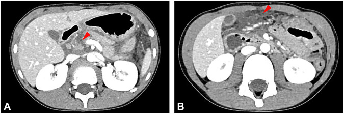
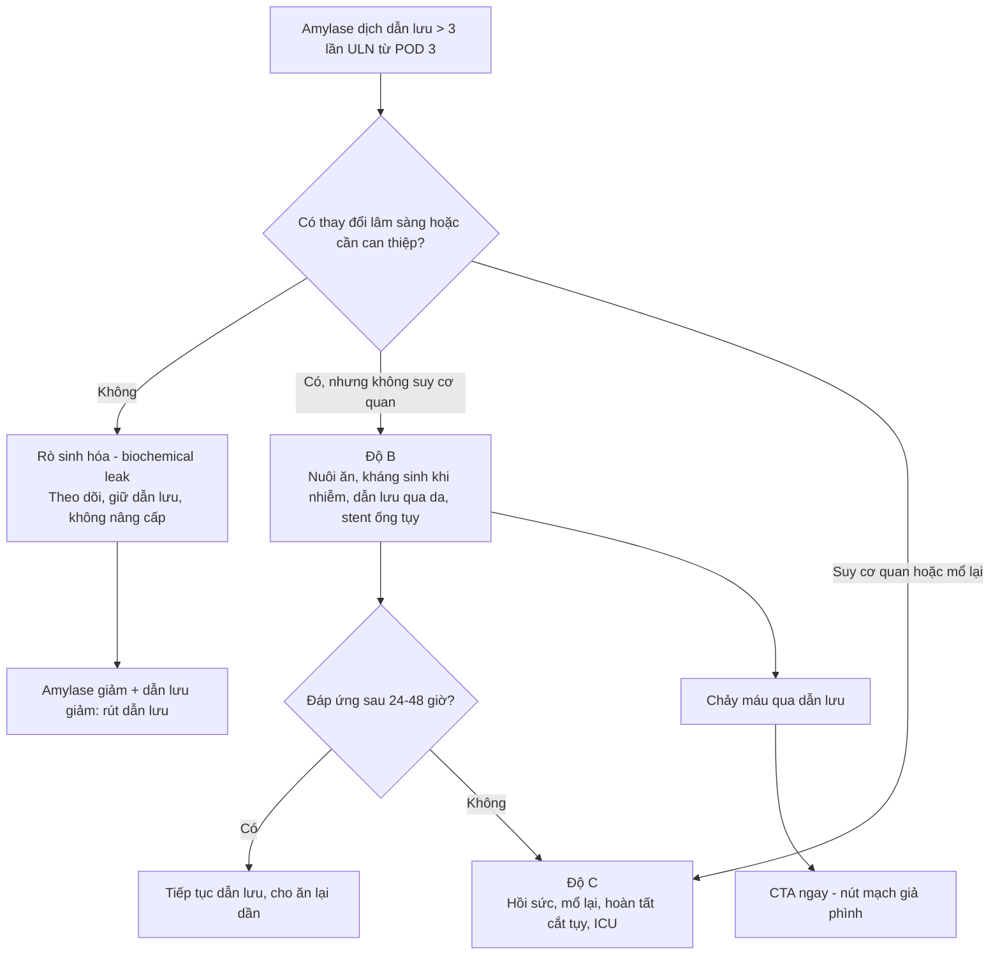
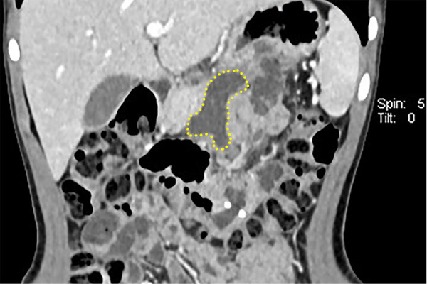
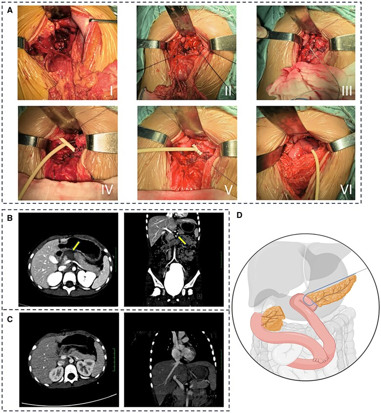

# 6121 — Rò tụy sau cắt thân–đuôi/bóc u tụy ở trẻ: phân độ ISGPS, ngưỡng amylase dịch dẫn lưu và khi nào mổ lại

**Tags:** `pattern:ro-tuy` `pattern:dich-quanh-tuy` `pattern:ap-xe-o-bung` `pattern:gia-phinh-dong-mach` `pattern:tu-mau-sau-mo` `vung:tuy` `vung:o-bung` `protocol:CT-bung-co-can-quang` `protocol:MRI-MRCP` `protocol:EUS-ERCP` `protocol:DSA` `score:ISGPS-2016` `score:FRS`
**Mức chắc chắn (certainty):** tổng hợp y văn (literature synthesis) — ghép **bài tổng quan toàn diện về rò tụy sau mổ** (eGastroenterology 2025, PMC12699584), **89 lần mổ tụy ở 74 trẻ cường insulin bẩm sinh/insulinoma** (Pediatr Surg Int 2025, PMC12443887), **32 trẻ u đặc–nhầy nhú có rò tụy độ C sau bóc u đầu tụy** (PLoS One 2026, PMC13561321), **so sánh bóc u nội soi vs mở ở trẻ** (Front Pediatr 2025, PMC12627055), **kỹ thuật U-suture không stent ở 5 trẻ** (Front Pediatr 2026, PMC13433606), **tổng quan robot cắt thân tụy trung tâm ở trẻ** (J Robot Surg 2026, PMC13102831), **ca bé gái 5 tuổi đứt cổ tụy do chấn thương kèm kỹ thuật "tube-in-tube"** (Gastroenterol Rep 2024, PMC11220174) và **bài tổng quan biến chứng sau cắt tá tụy** (PMC12917441).

> **Câu hỏi thực hành:** bé gái **5 tuổi** bị **chấn thương bụng kín** 12 giờ trước, đau bụng dữ dội, **amylase 443 U/L, lipase 440 U/L**. CT: **đứt ngang cổ tụy kèm máu tụ**. Mổ: khâu đầu tụy, cắt thân–đuôi hoại tử, **miệng nối tụy–hỗng tràng**, đặt **dẫn lưu cạnh miệng nối**. Ngày hậu phẫu 3: dịch dẫn lưu **đục, 180 mL/ngày**; ngày 7: **sốt 38,6 °C, đau thượng vị, bạch cầu tăng**.
> Câu hỏi: **dịch dẫn lưu bao nhiêu amylase thì gọi là rò tụy? "rò sinh hóa" khác "rò có ý nghĩa lâm sàng" ở đâu? khi nào chỉ theo dõi, khi nào chọc dẫn lưu, khi nào phải mổ lại — và vì sao trẻ em lại dễ rò hơn người lớn?**
> Bài chốt **bốn việc**: **(1) rò tụy sau mổ (postoperative pancreatic fistula, POPF) = amylase dịch dẫn lưu > 3 lần giới hạn trên amylase máu, từ ngày hậu phẫu 3 trở đi (ISGPS); (2) từ 2016, "rò sinh hóa" (biochemical leak) không còn là rò thật — chỉ độ B/C mới có ý nghĩa lâm sàng; (3) trẻ có ống tụy **thường < 2 mm** và nhu mô mềm, dễ vỡ → tỉ lệ rò sau cắt thân–đuôi/bóc u **11–22%**, nhưng **rò độ C hiếm**; (4) **CT có cản quang** là chuẩn tìm ổ dịch/giả phình, còn **dẫn lưu qua da + nuôi ăn** xử lý được phần lớn độ B — mổ lại chỉ khi nhiễm trùng không kiểm soát, chảy máu hoặc suy cơ quan.** Nối [6120 – U tụy ở trẻ](../6120-u-tuy-o-tre/lesson.md), [135 – Viêm tụy cấp theo Atlanta](../135-viem-tuy-Atlanta/lesson.md), [136 – U nang tụy](../136-u-nang-tuy/lesson.md), [6115 – Tăng áp cửa phía trái do tắc tĩnh mạch lách](../6115-tang-ap-cua-phia-trai-tac-tinh-mach-lach/lesson.md).

## 1. Tổng quan bệnh học – cơ chế hình ảnh: tại sao "rò" lại là bệnh của enzym

- **Định nghĩa chuẩn (ISGPS):** POPF là **rò ra ngoài qua dẫn lưu bụng**, với **amylase dịch dẫn lưu > 3 lần giới hạn trên của amylase huyết thanh**, đo **từ ngày hậu phẫu (POD) 3 trở đi**. Năm **2016**, ISGPS bổ sung khái niệm **ý nghĩa lâm sàng**: **"rò sinh hóa" (biochemical leak, BL)** — trước đây là **độ A** — **không có hậu quả lâm sàng**; **rò có ý nghĩa lâm sàng (clinically relevant, CR-POPF)** chia **độ B** (cần can thiệp tối thiểu: kéo dài dẫn lưu, can thiệp nội soi) và **độ C** (suy cơ quan, mổ lại, tử vong) (eGastroenterology 2025, PMC12699584).
- **TẠI SAO ngưỡng lại là "3 lần" và "ngày 3":** amylase trong dịch dẫn lưu phản ánh **enzym tụy rò ra khoang quanh tụy**, không phải amylase máu. Ngưỡng **3× ULN** được chọn để **tách rò thật khỏi nhiễm amylase nhẹ do thao tác mổ/phù nề miệng nối**; **POD 3** là thời điểm **miệng nối đã đủ "thử thách"** bởi dịch tụy tiết ra, và mô hoại tử đã bong — trước đó amylase cao chưa đủ kết luận.
- **TẠI SAO enzym tụy gây tổn thương nặng:** dịch tụy chứa **trypsin, chymotrypsin, elastase, lipase** ở dạng hoạt hóa; khi rò ra ngoài, enzym **tự tiêu hóa mỡ và mô liên kết quanh tụy**, gây **viêm, hoại tử, áp-xe**, và **ăn mòn thành mạch** → **giả phình động mạch** → chảy máu ồ ạt (eGastroenterology 2025, PMC12699584).
- **TẠI SAO trẻ em lại "dễ rò" hơn về mặt kỹ thuật:** theo bài tổng quan và loạt U-suture, **ống tụy chính ở trẻ thường < 2 mm**, **nhu mô tụy mềm, dễ rách**, **chức năng ngoại tiết mạnh** — bộ ba này làm **miệng nối tụy–ruột khó làm** và **diện cắt dễ rỉ dịch** (Front Pediatr 2026, PMC13433606). Tuy vậy, **tỉ lệ rò ở trẻ không cao hơn người lớn**: bài tổng quan dẫn đoàn hệ nhi của Fuchs cho **POPF 7% chung, 17% sau cắt thân–đuôi, 0% sau cắt tá tụy** — có thể vì trẻ **ít béo, ít đái tháo đường, ít xơ hóa tụy** (PMC12699584).
- **Số liệu định lượng phải thuộc:**
  - **Người lớn sau cắt tá tụy:** POPF **10–30%**, chậm làm rỗng dạ dày **15–45%**, chảy máu sau cắt tụy **3–10%**; biến chứng chung **30–60%**, tử vong **< 5%** ở trung tâm lớn (PMC12917441; PMC12699584).
  - **Trẻ sau mổ tụy:** loạt **89 lần mổ ở 74 trẻ** cường insulin bẩm sinh/insulinoma: **POPF 11%**, **CR-POPF 3,4%**, biến chứng nặng **CMC ≥ IIIb 8%**; biến chứng hay gặp nhất là **nhiễm trùng 29%**, rồi **chậm làm rỗng dạ dày 20%** (Pediatr Surg Int 2025, PMC12443887).
  - **Trẻ bóc u đặc–nhầy nhú:** **32 trẻ**, **5 ca biến chứng sớm — TẤT CẢ ở u ĐẦU tụy** (p = 0,015); **CR-POPF sau bóc u đầu tụy 2 ca**: **1 độ B** (hồi phục bảo tồn) và **1 độ C** (phải làm lại miệng nối tụy–ruột); **không tử vong**; nằm viện trung vị **10 ngày** (PLoS One 2026, PMC13561321).
  - **Bóc u nội soi vs mở:** rò tụy **22,2% vs 18,2%** (p = 1,000), **không có độ C** (Front Pediatr 2025, PMC12627055).
  - **Amylase dịch dẫn lưu ngày 1:** **> 5.000 U/L** làm tăng nguy cơ POPF **OR ~3**; **< 600 U/L** dự báo **không rò** đáng tin cậy; **lipase** có **tỉ lệ dương tính giả 12%** nên **không thay amylase** (PMC12699584).
  - **Điểm nguy cơ (FRS/a-FRS):** gồm **độ mềm nhu mô, đường kính ống tụy, lượng máu mất**; AUROC khi phát triển **0,94** nhưng khi **kiểm định ngoài chỉ 0,71** (FRS) và **0,72** (ua-FRS) — **dùng để tư vấn, không để quyết định một mình** (PMC12699584).
- **TẠI SAO rò tụy "ăn mòn" mạch máu:** dịch tụy hoạt tính gây **viêm quanh mạch**, phá hủy lớp áo giữa → **giả phình** ở **mỏm động mạch vị tá tràng (GDA)** hoặc **nhánh động mạch gan**; giả phình có thể **rỉ máu "sentinel bleed"** vào dẫn lưu **vài giờ–vài ngày trước khi vỡ**. Đây là lý do **mọi chảy máu nhỏ qua dẫn lưu sau mổ tụy đều phải chụp mạch**, không chờ (PMC12917441).

*Bé **5 tuổi**, chấn thương bụng kín (ca 5 trong loạt U-suture): **(A)** mất liên tục nhu mô **cổ tụy** (mũi tên đỏ), nhu mô không đồng nhất, **mờ các mặt phẳng mỡ quanh tụy**; **(B)** **dịch quanh tụy** (mũi tên đỏ) — nền của cả **rò tụy do chấn thương** và **rò sau mổ**. Điểm cần nhớ: **dịch quanh tụy một mình không phải rò** — phải có **amylase dịch dẫn lưu** hoặc **bằng chứng ống tụy bị gián đoạn**. Nguồn: Front Pediatr 2026 (PMC13433606), CC BY 4.0, nguyên bản.*

## 2. Mẫu hình + chẩn đoán phân biệt theo thời điểm và hình thái (gamut)

- **Gamut theo thời điểm:**
  - **POD 1–2:** amylase dẫn lưu cao nhưng **chưa gọi POPF** — có thể chỉ là **rò sinh hóa sớm/phản ứng phù nề**; theo dõi, **không can thiệp**.
  - **POD 3–7:** cửa sổ **chẩn đoán POPF**; sốt, đau, bạch cầu/CRP tăng, dịch dẫn lưu **đục hoặc đổi màu**.
  - **POD 7–30:** biến chứng muộn — **áp-xe, giả phình, chảy máu muộn, hẹp miệng nối**; đây là giai đoạn **CT có cản quang** có giá trị nhất.
  - **> 1 tháng:** **rò tụy mạn/nang giả tụy**, hẹp miệng nối, suy tụy ngoại tiết.
- **Gamut theo hình thái trên CT:**
  - **Dịch quanh miệng nối/diện cắt** đồng nhất, thành mỏng → **rò đơn thuần** (thường độ B).
  - **Ổ dịch có bóng khí/thành dày ngấm thuốc** → **áp-xe** (độ B/C, cần dẫn lưu).
  - **Máu tụ mới + hematocrit giảm** → **chảy máu sau mổ** (không phải rò, nhưng thường đi kèm).
  - **Nang giả phình trong/quanh ổ dịch** (ngấm thuốc đồng thì với động mạch) → **nguy cơ chảy máu ồ ạt**.
  - **Ống tụy gián đoạn/đứt rời (disconnected duct)** → **rò kéo dài, khó lành**, cần can thiệp nội soi/mổ.
- **Gamut theo loại miệng nối:** **tụy–hỗng tràng (PJ)** sau cắt đầu tụy/trung tâm · **diện cắt thân–đuôi** (đóng bằng stapler/khâu) · **mặt cắt sau bóc u (enucleation)** — rò từ **nhu mô**, không từ miệng nối · **vỡ ống tụy do chấn thương** (không phải rò sau mổ nhưng cùng sinh lý).
- **Mnemonic "DRAIN" của rò tụy:** **D**ebris/collection (ổ dịch) · **R**ising amylase (dịch dẫn lưu) · **A**bscess (sốt, bạch cầu) · **I**njury to duct (ống tụy gián đoạn) · **N**ecrosis/hemorrhage (giả phình, chảy máu).

## 3. Bảng so sánh phân biệt (ma trận đối chiếu)

| Thực thể (entity) | Hình ảnh điển hình | Chốt vào (rule-in) | Chốt loại (rule-out) | Gợi ý xác nhận |
|---|---|---|---|---|
| **Rò sinh hóa (BL, cựu độ A)** | Dịch quanh miệng nối **lượng ít**, không có ổ dịch, không khí, không sốt | **Amylase dẫn lưu > 3× ULN nhưng KHÔNG đổi xử trí, không sốt, không đau tăng** | **Sốt/đau tăng/ổ dịch trên CT** → không còn là BL | Theo dõi 24–48 giờ, **không nâng cấp điều trị** |
| **Rò độ B (CR-POPF)** | **Ổ dịch quanh miệng nối**, có thể **bóng khí**, thành ngấm thuốc; dẫn lưu **kéo dài > 3 tuần** | **Amylase > 3× ULN + sốt/đau + cần dẫn lưu qua da hoặc nội soi, nhưng KHÔNG suy cơ quan** | Suy cơ quan/mổ lại → **độ C**, không phải B | CT có cản quang; **dẫn lưu qua da**; đặt stent ống tụy qua ERCP/EUS |
| **Rò độ C (CR-POPF nặng)** | **Ổ dịch lớn/áp-xe lan**, **hoại tử**, **giả phình**, dịch ổ bụng, suy đa cơ quan | **Suy cơ quan hoặc mổ lại hoặc tử vong do rò** | Không suy cơ quan, đáp ứng dẫn lưu → độ B | CT + CTA; mổ lại/hoàn tất cắt tụy |
| **Viêm tụy cấp sau mổ (PPAP)** | Tụy **phù, phản ứng viêm quanh tụy**, **amylase máu tăng**; có thể tiến triển thành rò | **Amylase máu tăng + đau + hình ảnh viêm tụy trong 3 ngày đầu** | Amylase máu bình thường, chỉ amylase dịch cao → POPF | Amylase máu/CRP; CT muộn hơn |
| **Rò mật (bile leak)** | Ổ dịch **đường mật**, dịch **vàng–xanh**, **bilirubin dịch cao** | **Bilirubin dịch > 3× ULN + vị trí gần miệng nối mật–ruột** | Dịch **trong, amylase cao, bilirubin thấp** → rò tụy | Bilirubin dịch, MRCP/ERCP |
| **Rò dưỡng trấp (chylous)** | Dịch **trắng đục**, lượng lớn, sau mổ **quanh tụy/hạch** | **Triglycerid dịch > 200 mg/dL + dầu mỡ trong dịch** | Dịch trong, triglycerid thấp → không phải dưỡng trấp | Triglycerid dịch; nuôi ăn MCT |
| **Giả phình/chảy máu muộn** | **Nốt ngấm thuốc đồng thì động mạch** trong ổ dịch; **sentinel bleed** qua dẫn lưu | **Chảy máu qua dẫn lưu + giả phình trên CTA** | Máu tụ không ngấm thuốc, không có nguồn mạch → theo dõi | **CTA → DSA nút mạch**, không chờ |
| **Nang giả tụy (pseudocyst)** | Nang **thành mỏng**, **không có phần đặc**, xuất hiện **> 4 tuần** sau viêm/mổ | **Nang không có phần đặc + tiền sử viêm/chấn thương + amylase dịch nang cao** | Có phần đặc/vỏ bao → nghĩ u (bài 6120) | Siêu âm/CT; can thiệp khi **> 6 cm, có triệu chứng hoặc tăng kích thước** |

- **Không tạo ảnh ghép:** 3 ảnh thuộc **3 bệnh nhân khác nhau** (ca chấn thương cổ tụy; ca theo dõi sau mổ ngày 11; ca kỹ thuật tube-in-tube) — ghép cạnh nhau dễ khiến người đọc tưởng cùng một ca.

## 4. Protocol chụp + phân độ ISGPS + bậc thang xử trí

- **Khi nào chụp CT:** **không chụp thường quy chỉ vì amylase dẫn lưu cao**. Chụp khi **sốt, đau tăng, bạch cầu/CRP tăng, dịch dẫn lưu đổi màu/tăng lượng, vàng da, chảy máu, hoặc dẫn lưu không giảm sau 5–7 ngày**.
- **Protocol CT bụng:**
  - **Không cản quang** (tìm máu tụ, vôi hóa) → **thì động mạch (35–40 giây)** → **thì tĩnh mạch cửa (65–70 giây)**, lát **1–3 mm**, **tái tạo coronal/sagittal**.
  - Đọc theo 4 câu hỏi: **(1) ổ dịch ở đâu, kích thước? (2) có khí/thành ngấm thuốc (áp-xe)? (3) có giả phình/chảy máu? (4) ống tụy có liên tục không?**
  - **MRCP** khi nghi **gián đoạn ống tụy** hoặc **rò kéo dài** — thấy đoạn ống mất liên tục, dịch nang thông với ống tụy.
  - **EUS/ERCP** vừa chẩn đoán vừa điều trị: **đặt stent ống tụy**, **dẫn lưu ổ dịch qua dạ dày**, hoặc **rendezvous** khi ERCP thường thất bại.
- **Phân độ ISGPS 2016 và xử trí tương ứng:**

- **Bậc thang xử trí (từng bước, không nhảy cóc):**
  1. **Xác nhận** bằng amylase dịch dẫn lưu (không dựa amylase máu).
  2. **Rò sinh hóa:** **không làm gì thêm** — giữ dẫn lưu, theo dõi.
  3. **Độ B:** **nuôi ăn** (ưu tiên đường tiêu hóa qua sonde đặt **dưới chỗ rò**, hoặc TPN nếu không dung nạp); **kháng sinh chỉ khi có bằng chứng nhiễm**; **dẫn lưu qua da** (thành công **78%** ổ áp-xe sau cắt tá tụy — PMC12917441); **stent ống tụy qua ERCP/EUS**; **octreotide** chỉ chọn lọc.
  4. **Độ C:** **hồi sức, dinh dưỡng tĩnh mạch, dẫn lưu ổ nhiễm, mổ lại** (khâu lại miệng nối, làm lại miệng nối, hoặc **hoàn tất cắt tụy**), kiểm soát chảy máu bằng **nút mạch** trước khi mổ nếu có giả phình.
- **Octreotide/somatostatin — dùng đúng chỗ:** **somatostatin 6 mg/ngày** hoặc **octreotide ≥ 100 µg × 3 lần/ngày** có thể **tăng tỉ lệ đóng rò** nhưng **không có ý nghĩa thống kê** do khác biệt giữa các nghiên cứu; một số dữ liệu còn gợi ý **tăng CR-POPF và chậm lành vết thương** → **không dùng thường quy**, chỉ cân nhắc ở rò lượng lớn (PMC12699584).
- **Dự phòng trong mổ (trẻ em):** **nhận diện ống tụy** (thường < 2 mm), **miệng nối tụy–ruột kiểu niêm mạc–niêm mạc hoặc U-suture xuyên tụy**, **stent ống tụy ngoài hóa** khi làm được, **che phủ mỏm tụy** bằng mạc treo/mạc nối lớn; ở trẻ nhỏ, **kỹ thuật không stent** có thể an toàn: **5 trẻ, 1 rò sinh hóa, 0 CR-POPF** (95% CI 0–52,2%), dẫn lưu rút ngày **5–14** (Front Pediatr 2026, PMC13433606).
- **Dự phòng sau mổ:** **rút dẫn lưu sớm ở nguy cơ thấp** (khi amylase ngày 1 thấp và lâm sàng ổn) làm giảm nhiễm trùng mà **không tăng rò**; **không dùng kháng sinh dự phòng kéo dài**; **ERAS** ở trẻ lớn.
- **Theo dõi sau ra viện:** amylase/lipase máu, **siêu âm bụng 2–4 tuần**, đánh giá **suy tụy ngoại tiết** (phân mỡ, giảm cân) và **đái tháo đường** sau cắt nhiều nhu mô — nhất là sau **cắt thân–đuôi gần toàn bộ** ở trẻ cường insulin bẩm sinh.

## 5. Biến thể bình thường và cạm bẫy

- **Cạm bẫy 1 — amylase dẫn lưu cao nhưng KHÔNG phải rò:** nếu dẫn lưu **nằm xa miệng nối** hoặc **đã rút**, amylase có thể **thấp giả** dù có ổ dịch; ngược lại **dịch dẫn lưu nhiễm amylase từ máu** có thể **cao nhẹ**. Luôn đọc **cùng lâm sàng + CT** (PMC12699584).
- **Cạm bẫy 2 — gọi "độ A" rồi điều trị như độ B:** từ 2016, **độ A không còn tồn tại**; **rò sinh hóa không cần kháng sinh, không cần nhịn ăn kéo dài, không cần octreotide**. Điều trị quá mức gây **teo ruột, nhiễm trùng bệnh viện, tăng chi phí**.
- **Cạm bẫy 3 — bỏ sót "sentinel bleed":** **máu đỏ tươi qua dẫn lưu** dù chỉ **20–30 mL** là dấu hiệu **giả phình sắp vỡ**; phải **CTA ngay + DSA nút mạch**, không chờ nội soi hay siêu âm.
- **Cạm bẫy 4 — CT quá sớm:** trong **48 giờ đầu**, ổ dịch có thể chỉ là **dịch mổ còn lại**, không phân biệt được với rò; **CT có giá trị nhất từ POD 5–7** khi có triệu chứng.
- **Cạm bẫy 5 — nhầm nang giả tụy với rò đang hoạt động:** nang giả tụy **thành mỏng, không có phần đặc**, xuất hiện **sau 4 tuần**; rò hoạt động có **dịch dẫn lưu tăng amylase liên tục**. Nếu nang **có phần đặc/vỏ bao** phải nghĩ **u** (bài 6120), không chọc mù.
- **Cạm bẫy 6 — dùng lipase thay amylase:** **lipase dương tính giả 12%**, không giúp chẩn đoán thêm (PMC12699584).
- **Cạm bẫy 7 — trẻ nhỏ, ống tụy < 2 mm:** đặt stent có thể **gây tắc, di lệch, viêm tụy**; nếu không đặt được stent thì **không cố**, chọn **kỹ thuật miệng nối phù hợp** và **dẫn lưu ngoài** (Front Pediatr 2026, PMC13433606).
- **Biến thể bình thường:** **dịch quanh tụy lượng nhỏ, tự hết trong 2–4 tuần** sau mổ — **không phải rò** nếu amylase thấp và không có triệu chứng; **amylase máu tăng nhẹ đơn thuần** sau mổ tụy cũng không đồng nghĩa POPF.

## 6. Tự lượng giá — Blind Quiz

**Ca 1 — Bé gái 5 tuổi, chấn thương bụng kín, đau thượng vị dữ dội:**

- Gợi ý lâm sàng: **amylase 443 U/L, lipase 440 U/L**; CT sau chấn thương 12 giờ.
- Câu hỏi: mũi tên đỏ ở (A) và (B) chỉ gì? Tổn thương này thuộc độ mấy theo phân độ chấn thương tụy? Nguy cơ lâu dài nếu điều trị bảo tồn?

<b>Bấm để hiện đáp án (findings + chẩn đoán)</b>

- Dấu hiệu: **(A)** **mất liên tục nhu mô cổ tụy**, nhu mô không đồng nhất, **mờ mặt phẳng mỡ quanh tụy**; **(B)** **dịch quanh tụy**.
- Chẩn đoán: **đứt ngang cổ tụy (chấn thương tụy độ IV)** — tổn thương ống tụy chính; cần **mổ** (khâu đầu tụy + nối tụy–ruột hoặc cắt thân–đuôi).
- Cơ chế: ống tụy đứt → dịch tụy giàu enzym thoát ra khoang quanh tụy → **rò tụy/nang giả tụy**; bảo tồn ở độ III–V làm **nang giả tụy tăng OR 12,46 (4,60–33,77)**, còn **nguy cơ rò tụy không giảm** (Gastroenterol Rep 2024, PMC11220174 dẫn gộp liệu).
- Nguồn ảnh: Front Pediatr 2026 (PMC13433606), CC BY 4.0.

**Ca 2 — Bé trai 8 tuổi, ngày 11 sau cắt thân–đuôi tụy, sốt và đau tăng:**

- Gợi ý lâm sàng: dịch dẫn lưu **đục, 150 mL/ngày**, amylase dịch **> 3× ULN**, **sốt 38,5 °C**, không suy cơ quan.
- Câu hỏi: đường chấm vàng bao quanh gì? Đây là độ mấy? Bước tiếp theo là gì — mổ lại ngay hay dẫn lưu qua da?

<b>Bấm để hiện đáp án (findings + chẩn đoán)</b>

- Dấu hiệu: **ổ dịch khu trú quanh miệng nối** (đường chấm vàng), thành dày nhẹ, **không thấy giả phình**, không khí tự do.
- Chẩn đoán: **rò tụy độ B** — có triệu chứng nhiễm nhưng **chưa suy cơ quan**.
- Xử trí: **dẫn lưu qua da + nuôi ăn + kháng sinh theo nhiễm**; **chỉ mổ lại** nếu không kiểm soát được nhiễm, chảy máu hoặc suy cơ quan (độ C).
- Nguồn ảnh: Front Pediatr 2026 (PMC13433606), CC BY 4.0.

**Ca 3 — Bé gái 5 tuổi, đứt cổ tụy do chấn thương, được mổ nối tụy–hỗng tràng:**

- Gợi ý lâm sàng: sau mổ **cho ăn lại ngày 5**, rút dẫn lưu theo kế hoạch; theo dõi 7 tháng không rò, không hẹp.
- Câu hỏi: ống thông trong ảnh làm nhiệm vụ gì? Vì sao đặt **stent ống tụy lồng trong T-tube** thay vì stent thường? Điều gì quyết định rút stent?

<b>Bấm để hiện đáp án (findings + chẩn đoán)</b>

- Dấu hiệu: **(A)** các thì mổ: cắt ngang cổ tụy → đặt catheter ngoài vào ống tụy → lồng vào T-tube → khâu cố định T-tube vào nhu mô → nối tụy–hỗng tràng; **(B)** CT trước mổ: đứt cổ tụy + máu tụ; **(C)** CT sau mổ: không biến chứng; **(D)** sơ đồ.
- Chẩn đoán: **dự phòng rò tụy bằng dẫn lưu ống tụy có kiểm soát (tube-in-tube)** — giữ ống tụy mở, giảm áp lực dịch, tránh hẹp miệng nối.
- Vì sao: stent thường **khó cố định, dễ di lệch/gãy**; T-tube **neo vào nhu mô** và **dẫn dịch ra ngoài** ổn định hơn. Stent được rút sau **60 ngày**, theo dõi 7 tháng không rò/hẹp.
- Nguồn ảnh: Gastroenterology Report 2024 (PMC11220174), CC BY 4.0.

## Bài liên quan chéo
- [6120 – U tụy ở trẻ: SPN vs u nguyên bào tụy, cắt thân–đuôi giữ lách](../6120-u-tuy-o-tre/lesson.md)
- [135 – Viêm tụy cấp theo Atlanta](../135-viem-tuy-Atlanta/lesson.md) (nang giả tụy, hoại tử)
- [136 – U nang tụy](../136-u-nang-tuy/lesson.md) (phân biệt nang giả–u nang)
- [6115 – Tăng áp cửa phía trái do tắc tĩnh mạch lách](../6115-tang-ap-cua-phia-trai-tac-tinh-mach-lach/lesson.md) (biến chứng sau viêm/u tụy)
- [600 – Tổng quan Nhi khoa](../600-tong-quan-nhi-khoa/lesson.md)

## Ảnh
- 3 ảnh, **tất cả CC BY 4.0**, nguồn + giấy phép từng ảnh trong `images/CREDITS.md`.
- **Không tạo ảnh ghép** (3 bệnh nhân khác nhau).

> Không dùng để chẩn đoán độc lập khi chưa có người hướng dẫn.
