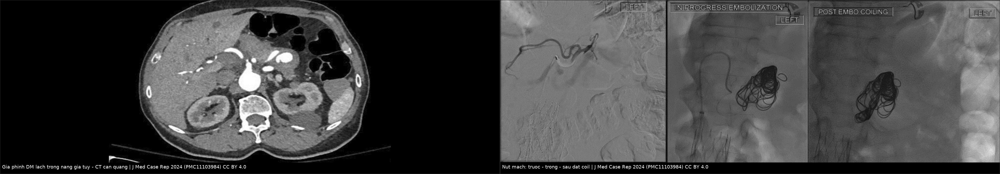
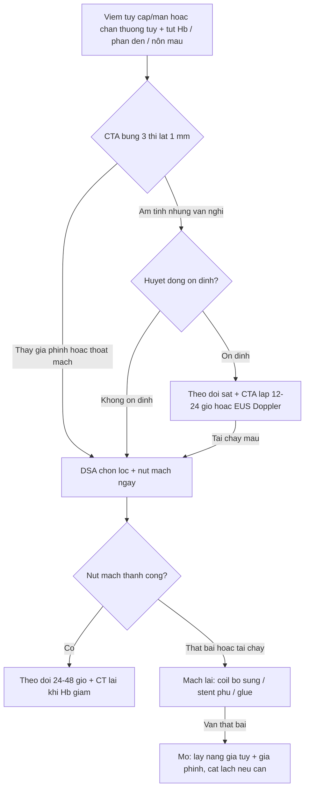
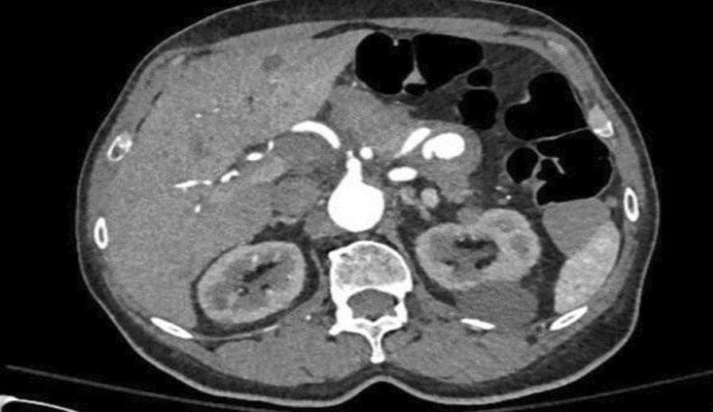
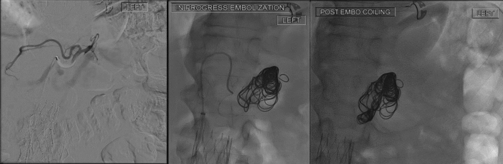

# 6122 — Giả phình động mạch tạng sau viêm tụy cấp/chấn thương tụy ở trẻ: "sentinel bleed" là tiếng chuông, CTA âm không loại trừ

**Tags:** `pattern:gia-phinh-dong-mach` `pattern:chay-mau-tieu-hoa` `pattern:nang-gia-tuy` `pattern:tu-mau-sau-phuc-mac` `vung:tuy` `vung:o-bung` `protocol:CTA-bung-3-thi` `protocol:DSA-nut-mach` `protocol:EUS` `protocol:CT-bung-co-can-quang` `score:ISGPS-2016` `score:CTSI`
**Mức chắc chắn (certainty):** tổng hợp y văn (literature synthesis) — ghép **bài tổng quan giả phình động mạch tạng** (Medicina 2025, PMC12299956), **89 bệnh nhân nút mạch giả phình tạng** (Quant Imaging Med Surg 2024, PMC11400682), **69 đợt chảy máu ở 56 ca viêm tụy cấp nặng có đối chiếu CECT–DSA** (Front Med 2026, PMC13265546), **10 trẻ ho ra máu qua ống tụy (hemosuccus pancreaticus) — tổng quan gộp** (Case Rep Gastrointest Med 2026, PMC13698648), **ca vị thành niên giả phình động mạch vị–tá tràng nút mạch cầm máu** (BMJ Case Rep 2026, PMC13662899) và **ca giả phình động mạch lách trong nang giả tụy có ảnh CT + DSA** (J Med Case Rep 2024, PMC11103984). Không có ca do nhóm tự chụp.

> **Câu hỏi thực hành:** bé trai **13 tuổi** viêm tụy cấp hoại tử sau chấn thương xe đạp, ngày 21 xuất hiện **đau thượng vị tăng đột ngột, đi cầu phân đen, Hb 118 → 79 g/L**. CT có cản quang: **ổ hoại tử có vách (WON) 8 cm** ở thân–đuôi tụy, bên trong có **một cấu trúc tròn 9 mm bắt thuốc ngang động mạch chủ**. Nội soi dạ dày: **không thấy máu đang chảy**, chỉ có máu cũ ở tá tràng D2.
> Câu hỏi: **cấu trúc tròn đó là giả phình hay chỉ là mạch máu trong ổ? Có phải nút mạch ngay không? Nếu CTA âm tính mà vẫn nghi thì làm gì? Khi nào cầm máu bằng can thiệp không đủ và phải mổ?**
> Bài chốt **bốn việc**: **(1) chảy máu "gửi tín hiệu trước" (sentinel bleed) rồi tái phát ồ ạt sau vài giờ–vài ngày là bệnh cảnh kinh điển của giả phình sắp vỡ — tử vong do giả phình tạng không được xử trí tới 90%; (2) giả phình quanh tụy được chẩn đoán bằng CTA 3 thì lát ≤ 1 mm, nhưng CTA và DSA chỉ khớp nhau ở mức "trung bình" (κ 0,29) — CTA âm KHÔNG loại trừ, 18/26 đợt CTA âm vẫn nút mạch thành công; (3) nút mạch qua ống thông là điều trị đầu tay, thành công lâm sàng 86,5%; (4) sau nút mạch vẫn tái chảy (11% ở nhóm CTA dương rõ) và ở trẻ giả phình trong nang giả tụy hay tái phát — khi đó phải mổ lấy nang + giả phình ± cắt lách.** Nối [6121 – Rò tụy sau mổ tụy](../6121-ro-tuy-sau-mo-tuy-o-tre/lesson.md), [135 – Viêm tụy cấp theo Atlanta](../135-viem-tuy-Atlanta/lesson.md), [627 – Giả phình mạch sau chấn thương gan/lách ở trẻ](../627-gia-phinh-mach-xuat-huyet-muon-gan-lach-nhi/lesson.md), [1683 – Hoại tử tụy nhiễm khuẩn & step-up](../1683-hoai-tu-tuy-nhiem-khuan-step-up/lesson.md).

## 1. Tổng quan bệnh học – cơ chế hình ảnh: vì sao "thành mạch bị tiêu" lại thành một túi bắt thuốc

- **Giả phình (pseudoaneurysm) ≠ phình thật (true aneurysm):** phình thật giãn cả **3 lớp** thành mạch; giả phình là **máu thoát ra qua chỗ rách lớp nội mạc + trung mạc**, được **mô xơ quanh mạch (adventitia hoặc mô quanh tụy) đóng vai trò thành túi**. Vì thành túi **không có cơ trơn** nên không co lại được → **không tự cầm máu**, chỉ giãn tiếp và vỡ.
- **TẠI SAO ở viêm tụy:** enzym tiêu protein được hoạt hóa tại chỗ (**trypsin, elastase, phospholipase A2**) **tiêu hủy trực tiếp thành mạch** quanh tụy; cộng thêm viêm và tăng áp trong nang giả/WON → **ăn mòn mạch**. Ở trẻ, **chấn thương tụy** và **hậu phẫu tụy** là hai cơ chế hay gặp không kém — cả hai đều tạo ra **dịch tụy hoạt tính nằm sát mạch** (đúng cơ chế của rò tụy, bài 6121).
- **TẠI SAO bắt thuốc:** lòng giả phình **thông với lòng động mạch**, nên **đậm độ trên CT ngang bằng động mạch chủ ở thì động mạch (khoảng 200–400 HU)** và **giữ nguyên ở thì muộn** khi mô xung quanh đã thải thuốc. Đây là **"chốt vật lý"**: *cùng đậm độ với ĐM, cùng thời điểm, cùng vị trí qua các thì* = lòng mạch, không phải máu tụ (máu tụ **không đổi đậm độ theo thì**, thường 50–80 HU và có viền).
- **Ngưỡng định lượng (bắt buộc nhớ):**
  - Giả phình tạng trong dân số chung: **0,1–0,2%**; **viêm tụy (chủ yếu mạn) là nguyên nhân hàng đầu**; **động mạch lách 60–65%**, **động mạch vị–tá tràng 20–25%**, sau đó là **tá–tụy**, **gan**, **vị trái** (PMC12299956).
  - Viêm tụy cấp nặng: **xuất huyết có ý nghĩa lâm sàng 1,2–14,5%**, **tử vong > 30% nếu không can thiệp kịp** (PMC13265546).
  - **Không được chẩn đoán và xử trí → tử vong tới 90%** (tổng quan PMC12299956).
  - **Nút mạch qua ống thông (TAE)**: thành công lâm sàng **86,5% (77/89)**, biến chứng nhẹ **12,4%**, tử vong trong 30 ngày **5,6%** (PMC11400682).
- **Trẻ em — con số ít ỏi nhưng đủ để không bỏ sót:** gộp **10 trẻ** ho ra máu qua ống tụy (hemosuccus pancreaticus) trong y văn: **8 trai/1 gái/1 không rõ**, **tuổi trung vị 11 (3–18)**, nguyên nhân chủ yếu là **giả phình quanh tụy vỡ sau viêm tụy cấp/mạn, sau mổ bụng hoặc chấn thương bụng kín**; **6/10 chẩn đoán bằng CTA**, phần còn lại **bị nội soi bỏ sót nhiều lần** (PMC13698648).

## 2. Mẫu hình + chẩn đoán phân biệt theo vị trí (gamut)

- **Theo mạch (vị trí quyết định kỹ thuật nút):**
  - **Động mạch lách (splenic artery)** — hay nhất trong viêm tụy mạn; giả phình nằm **trong nang giả tụy thân–đuôi**; vỡ vào **ống tụy → hemosuccus pancreaticus** (đau + vàng da nhẹ + xuất huyết tiêu hóa) hoặc vào **dạ dày/đại tràng**.
  - **Động mạch vị–tá tràng (gastroduodenal)** — hay sau **mổ cắt đầu tụy/rò tụy**, vỡ vào **tá tràng** → nôn máu, phân đen; trên CTA giả phình **nằm giữa đầu tụy và D1–D2**.
  - **Động mạch tá–tụy (pancreaticoduodenal)** — sau chấn thương/mổ; thường nhỏ (**2–4 mm**) → khó thấy nếu lát dày.
  - **Động mạch gan (hepatic)** — giả phình + **rò mật–máu (hemobilia)**: tam chứng **đau hạ sườn phải + vàng da + xuất huyết tiêu hóa**.
  - **Động mạch vị trái (left gastric)** — trong viêm tụy mạn/giả nang ở thân tụy.
- **Theo bối cảnh (bối cảnh quyết định thời điểm can thiệp):** **viêm tụy cấp hoại tử** (giả phình xuất hiện **1–4 tuần**, đỉnh **2–3 tuần**) · **viêm tụy mạn** (giả phình "im lặng" nhiều tháng) · **sau mổ tụy có rò tụy** (POPF là yếu tố nguy cơ trực tiếp — bài 6121) · **chấn thương tụy kín** · **sau dẫn lưu qua da/qua dạ dày ổ WON** (đặt stent nang–dạ dày làm tăng nguy cơ chảy máu sớm).
- **Gợi nhớ theo cơ chế "4 vị trí – 3 kiểu xuất huyết":** *lách → ống tụy/dạ dày; vị–tá tràng → tá tràng; gan → đường mật; tá–tụy → sau phúc mạc.*

## 3. Bảng so sánh phân biệt (ma trận đối chiếu)

| Thực thể (entity) | Hình ảnh điển hình (CTA 3 thì) | Chốt vào (rule-in) | Chốt loại (rule-out) | Gợi ý xác nhận |
|---|---|---|---|---|
| **Giả phình (pseudoaneurysm)** | Túi tròn/bầu dục trong hoặc sát ổ dịch, **bắt thuốc đồng thì ĐM (200–400 HU)**, giữ thuốc thì muộn, có **cổ (neck)** nối với mạch mẹ | **Đậm độ = ĐM ở thì động mạch + giữ nguyên ở thì muộn + thấy cổ** | Máu tụ tổ chức hóa (không đổi đậm độ theo thì) | DSA chọn lọc (chuẩn vàng); **không chờ** nếu có sentinel bleed |
| **Thoát mạch hoạt tính (active extravasation)** | **Vệt/nhóm thuốc không có hình túi**, **lan rộng và đổi hình giữa các thì** (blush bơi trong máu tụ) | **Đổi hình – lan rộng theo thì** + máu tụ lớn dần | Giả phình: **giữ nguyên hình, có cổ** | DSA + nút mạch ngay |
| **Máu tụ tổ chức hóa (organized hematoma)** | Khối **50–80 HU**, không đồng thì với ĐM, **có viền/vôi hóa**, không có cổ | **Không đổi đậm độ giữa thì ĐM và thì muộn** | Giả phình (bắt thuốc mạnh thì ĐM) | Theo dõi CTA; **đừng nút mạch** |
| **Nang giả tụy (pseudocyst) không biến chứng** | Túi dịch **0–20 HU**, vỏ mỏng đều, không bắt thuốc | **Đồng tỷ trọng dịch, vỏ ≤ 2 mm** | Giả phình: trong ổ **có cấu trúc bắt thuốc** | Siêu âm/EUS Doppler; CTA |
| **Phình thật (true aneurysm)** | Túi có **cả 3 lớp**, thường có **huyết khối thành (mural thrombus)**, vôi hóa thành | Vôi hóa thành + huyết khối viền + vị trí giải phẫu điển hình | Giả phình: **không có huyết khối thành, có cổ hẹp** | DSA/MRA |
| **Giãn tĩnh mạch quanh tụy (varices)** | Bó mạch **bắt thuốc thì tĩnh mạch (60–70 s)**, thải chậm, **không có cổ** | **Đậm độ đỉnh ở thì cửa/tĩnh mạch**, nối với TM lách/cửa | Giả phình (đỉnh thì động mạch) | CTA thì cửa; đo áp lực TM cửa nếu nghi tăng áp |

*Trái: **túi bắt thuốc đồng thì với động mạch chủ** nằm trong nang giả tụy — đây là "chốt vật lý" của giả phình. Phải: **coi (coil) cuộn trong túi**, hình mạch mất dần từ trái sang phải. Nguồn: J Med Case Rep 2024 (PMC11103984), CC BY 4.0, ảnh ghép letterbox.*

### Ba dấu hiệu "phải nhìn thấy" trên CTA — và chỗ hay bị bỏ qua
1. **Cổ (neck):** khe hẹp nối túi với lòng mạch — **không có cổ thì phải nghĩ lại** (máu tụ, biến thể giải phẫu).
2. **Vị trí tương quan với ổ dịch:** giả phình "ẩn" **bên trong** nang giả/WON là nơi dễ bỏ nhất — phải **cuộn cửa sổ MIP** qua toàn bộ ổ, không chỉ đọc lát ngang.
3. **Máu tụ mới/tăng kích thước giữa 2 lần chụp:** dấu hiệu **gián tiếp** của vỡ — quan trọng hơn cả việc "thấy túi" khi bệnh nhân đang tụt Hb.

## 4. Protocol chụp + hệ phân độ & thuật toán xử trí

**CTA bụng 3 thì (chuẩn chẩn đoán, bắt buộc ở trẻ nghi chảy máu quanh tụy):**
- **Lát ≤ 1 mm**, tái tạo **0,6–0,8 mm**, FOV che **từ vòm hoành đến mào chậu** (không chỉ "ổ bụng").
- **Thì động mạch 25–35 giây** (bắt thuốc tạng đặc, **có thể dùng test-bolus**), **thì cửa 60–70 giây**, **thì muộn 3–5 phút** (phân biệt **giả phình** giữ thuốc với **máu tụ** thải thuốc, và bắt được **thoát mạch chậm**).
- **MIP dày 5–10 mm theo trục mạch** + **MPR cong (curved planar)** dọc động mạch lách/vị–tá tràng.
- **Liều cản quang theo cân nặng** (trẻ: **1,5–2 mL/kg**, tối đa 100 mL); **ALARA** — nhưng **không hạ liều đến mức mất thì động mạch** (đây là lỗi hay gặp vì sợ bức xạ).
- **Không có "CTA âm là yên tâm":** trong loạt 69 đợt chảy máu có cả CTA và DSA, **độ đồng thuận chỉ ở mức trung bình (κ = 0,29)**; **độ nhạy CTA 58–69%**, **giá trị tiên đoán âm 30,8–42,4%**; **18/26 (69,2%) đợt có CTA âm (Grade 0) vẫn nút mạch được và ổn định** (PMC13265546).

**Mermaid — đường đi từ "sentinel bleed" tới can thiệp:**

**Hệ phân độ & ngưỡng dùng trong thực hành (không có RADS riêng cho giả phình):**
- **ISGPS 2016 (rò tụy sau mổ)** — vì **POPF là yếu tố nguy cơ trực tiếp** của giả phình sau mổ tụy (bài 6121): rò độ B/C = **amylase dịch dẫn lưu > 3× giới hạn trên** từ **ngày hậu phẫu 3**, kèm thay đổi xử trí.
- **CTSI (CT severity index) / Atlanta 2012** — mức hoại tử và ổ dịch dự báo nguy cơ mạch máu; hoại tử **> 30%** và ổ **> 10 cm** làm tăng nguy cơ can thiệp (bài 1683).
- **Phân tầng can thiệp (thực hành):**
  1. **Giả phình + đang chảy máu / mất huyết động** → **DSA + nút mạch khẩn** (không chờ "đủ 4 tuần").
  2. **Giả phình phát hiện tình cờ, < 10 mm, không triệu chứng** → **có thể theo dõi CTA 48–72 giờ/lần trong 1–2 tuần đầu** rồi giãn khoảng — nhưng **ngưỡng can thiệp hạ xuống ở trẻ và ở giả phình trong nang giả tụy**, vì các ca trẻ trong y văn đều tái chảy sau khi trì hoãn (PMC13698648).
  3. **Thất bại nút mạch/tái chảy** → **mổ** (lấy nang giả tụy + giả phinh, cắt lách bán phần theo ranh giới thiếu máu).

**Kỹ thuật nút mạch (chọn theo vị trí và tuần hoàn bàng hệ):**
- **Coil "sandwich"** (đặt coil **xa – qua cổ – gần**): chỉ định khi **có tuần hoàn bàng hệ** (lách, gan, vị–tá tràng) — **thành công > 90%** (PMC12299956).
- **Nút "proximal"** (chỉ phía gần): dùng cho **mạch tận** (động mạch thận).
- **Stent phủ (covered stent)**: giữ được mạch mẹ — hữu ích ở **động mạch gan** khi cần bảo tồn gan; **không dùng được ở mạch < 3 mm** (đa số mạch tá–tụy ở trẻ).
- **Glue/thrombin/EUS-guided**: **keo (glue)** ít dùng vì nguy cơ tắc mạch ngoài đích; **thrombin qua EUS** là lựa chọn khi túi nằm sát dạ dày/tá tràng; **không thay thế được DSA khi đang chảy máu ồ ạt**.
- **Ở trẻ:** **đường kính mạch nhỏ (2–4 mm)** → chọn **coil ≥ 20% lớn hơn đường kính mạch** để không trôi; **hạn chế số lần chụp**; **luôn hỏi ý kiến gây mê** vì trẻ mất máu nhanh và **thể tích tuần hoàn nhỏ**.

**Sau nút mạch — theo dõi theo mốc:**
- **6–12 giờ**: Hb, đau bụng, dấu hiệu thiếu máu tạng (đau tăng + LDH/AST tăng = tắc mạch ngoài đích).
- **24–48 giờ**: CTA lại **nếu Hb còn giảm** hoặc đau tăng — **không chụp lại thường quy** nếu ổn định (coil gây nhiễu, dễ đọc quá tay).
- **1 tuần – 1 tháng**: theo dõi **tái chảy** (phân đen tái phát, Hb tụt) — **tái chảy 11% ở nhóm CTA dương rõ** (4/36) và **toàn bộ trường hợp tái chảy/bỏ cuộc đều nằm trong nhóm này** (PMC13265546).

## 5. Biến thể bình thường và cạm bẫy

- **"Mạch trong ổ dịch" là bình thường, "túi có cổ" mới là giả phình.** Trong WON/nang giả tụy, các nhánh **tá–tụy nhỏ chạy xuyên qua ổ** bắt thuốc bình thường; phân biệt bằng **hình thái (ống, không phình) + không có cổ + đường kính đều**.
- **Cạm bẫy 1 — tin vào CTA âm:** κ chỉ **0,29**; **1/4–2/3** trường hợp CTA âm vẫn có tổn thương nút được. **Quy tắc:** *"Hb tụt + nội soi không thấy nguồn + CTA âm"* trong viêm tụy = **vẫn phải DSA**, không phải "theo dõi".
- **Cạm bẫy 2 — nội soi "sạch":** máu từ **ống tụy** chỉ chảy **từng đợt**; giữa các đợt **tá tràng có thể sạch hoàn toàn**. Ca vị thành niên: nội soi chỉ thấy **cục máu đông dính thành sau D1 không gỡ được**, chẩn đoán thật sự đến từ **chụp mạch mạc treo** (PMC13662899).
- **Cạm bẫy 3 — nhầm "thoát mạch" với "giả phình" và ngược lại:** quyết định kỹ thuật khác nhau (**nút mạch + kiểm tra toàn bộ mạch** vs **nút túi ± sandwich**). Dấu phân biệt là **tính ổn định hình thái giữa các thì**.
- **Cạm bẫy 4 — nhiễu do coil trên CT:** sau nút mạch, **coil gây vệt giả ảnh (streak artifact)**; **đừng đọc "còn bắt thuốc" trên CT** — dùng **DSA** hoặc **CTA xoắn ốc góc rộng (dual-energy)** nếu bắt buộc.
- **Cạm bẫy 5 — bỏ sót tổn thương thứ hai:** **20–30%** ca có **nhiều giả phình** hoặc **giả phình + thoát mạch**; phải **chụp toàn bộ thân tạng + mạc treo tràng trên** chứ không dừng ở nơi thấy tổn thương đầu tiên.
- **Biến thể bình thường dễ nhầm:** **tiểu động mạch uốn lượn trong ổ viêm** (tortuous vessel) giống "túi"; **tĩnh mạch lách giãn** bắt thuốc thì cửa; **giả phình "giả" sau sinh thiết/dẫn lưu** (đường kim) tự tắc sau 48–72 giờ.

## 6. Tự lượng giá — Blind Quiz

**Ca 1 — Bé trai 13 tuổi, viêm tụy hoại tử ngày 21, đau tăng + phân đen:**

- Gợi ý: viêm tụy cấp hoại tử, Hb tụt 3,9 g/dL trong 24 giờ, không sốt.
- Câu hỏi: cấu trúc bắt thuốc trong ổ là gì? Hai dấu hiệu nào chốt nó là lòng mạch? Bước tiếp theo trong 60 phút?

<b>Bấm để hiện đáp án (findings + chẩn đoán)</b>

- **Dấu hiệu:** trong nang giả tụy thân tụy có **túi tròn bắt thuốc đậm tương đương động mạch chủ**, bờ đều, **có cổ** nối với nhánh động mạch lách.
- **Chẩn đoán:** **giả phình động mạch lách trong nang giả tụy** — enzym tụy ăn mòn thành mạch, túi chỉ có mô xơ làm thành nên **không tự cầm**.
- **Chốt:** (1) **đậm độ = động mạch ở thì động mạch**, (2) **giữ thuốc ở thì muộn** (máu tụ thì thải thuốc).
- **Xử trí:** **DSA + nút mạch ngay** (không chờ), chuẩn bị máu; **không nội soi lại để "tìm nguồn"**.
- Nguồn ảnh: J Med Case Rep 2024, PMC11103984, CC BY 4.0.

**Ca 2 — Cùng bệnh nhân sau nút mạch:**

- Câu hỏi: ba khung hình chứng minh điều gì? Vì sao phải chụp lại **nhánh khác** sau khi túi đã tắc?

<b>Bấm để hiện đáp án</b>

- Khung 1: **túi giả phình còn bắt thuốc**; khung 2: **coil cuộn trong túi** (đang nút); khung 3: **mạch mẹ và túi đã tắc hoàn toàn, không còn bắt thuốc**.
- **Vì sao chụp lại nhánh khác:** **20–30%** ca có **nhiều giả phình/thoát mạch đồng thời**; nút xong tổn thương đầu tiên **không đồng nghĩa hết nguồn chảy**.
- Nguồn ảnh: J Med Case Rep 2024, PMC11103984, CC BY 4.0.

**Ca 3 — Vị thành niên sau mổ thần kinh, POD 14 nhập viện vì phân đen + ngất:**

- Gợi ý: POD 9 đã có **đau bụng + táo bón** (đợt "sentinel"), POD 14 **sốc giảm thể tích**; nội soi thấy **cục máu đông lớn dính thành sau D1**, không gỡ được, không thấy mạch đang chảy.
- Câu hỏi: tại sao nội soi "không thấy gì" mà vẫn là chảy máu ồ ạt? Cấu trúc nào nằm ngay sau D1? Can thiệp nào cầm máu mà không cần mổ?

<b>Bấm để hiện đáp án</b>

- **Giả phình động mạch vị–tá tràng (GDA)** vỡ vào tá tràng: máu chảy **từng đợt**, giữa các đợt **không thấy tia máu**; cục máu đông che miệng lỗ rò.
- **Vị trí:** GDA chạy **sau D1**, nên tổn thương "ẩn" ngay sau thành tá tràng.
- **Xử trí:** **chụp mạch mạc treo + nút mạch chọn lọc bằng coil → cầm máu triệt để**, bệnh nhân ổn định, không cần mổ (PMC13662899).
- **Bài học:** **"endoscopy âm + Hb tụt" = chỉ định chụp mạch**, không phải nội soi lần 2.

## Bài liên quan chéo
- [6121 – Rò tụy sau cắt thân–đuôi/bóc u tụy ở trẻ](../6121-ro-tuy-sau-mo-tuy-o-tre/lesson.md) (POPF là yếu tố nguy cơ trực tiếp; "sentinel bleed → CTA + nút mạch")
- [1683 – Hoại tử tụy nhiễm khuẩn & bóc hoại tử tối thiểu xâm lấn](../1683-hoai-tu-tuy-nhiem-khuan-step-up/lesson.md) (giả phình vỡ, nút mạch 85%)
- [135 – Viêm tụy cấp theo Atlanta](../135-viem-tuy-Atlanta/lesson.md) (phân độ, ổ dịch, thời điểm can thiệp)
- [627 – Giả phình mạch & xuất huyết muộn sau chấn thương gan/lách ở trẻ](../627-gia-phinh-mach-xuat-huyet-muon-gan-lach-nhi/lesson.md) (cùng vật lý "bắt thuốc theo bể máu", khác vị trí: nhu mô gan–lách sau chấn thương vs mạch quanh tụy sau viêm tụy/chấn thương tụy)
- [6120 – U tụy ở trẻ](../6120-u-tuy-o-tre/lesson.md) (bối cảnh hậu phẫu tụy)

## Ảnh
- Tên file: `6122_gia-phinh-dong-mach_CT_PMC11103984-Fig3.jpg`, `6122_gia-phinh-dong-mach_DSA_PMC11103984-Fig5.jpg`, `composite_phinh-gia-va-nut-mach.jpg`.
- Nguồn + giấy phép từng ảnh: `images/CREDITS.md`. Cả hai ảnh là **cùng một bệnh nhân** trong một case report → được phép ghép đối chiếu.

> Không dùng để chẩn đoán độc lập khi chưa có người hướng dẫn.
