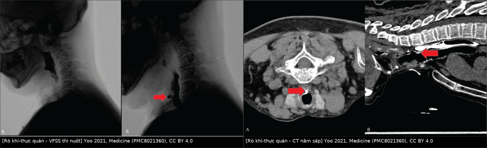
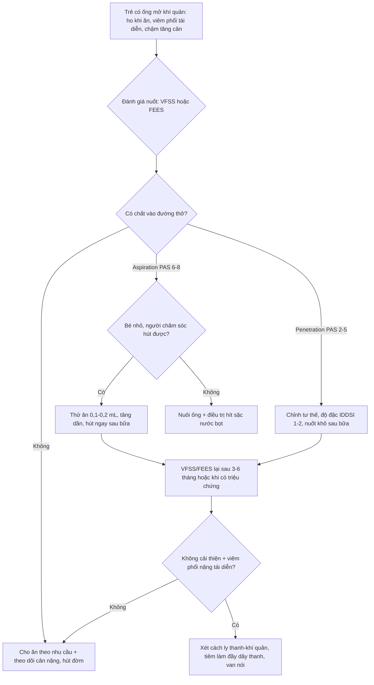
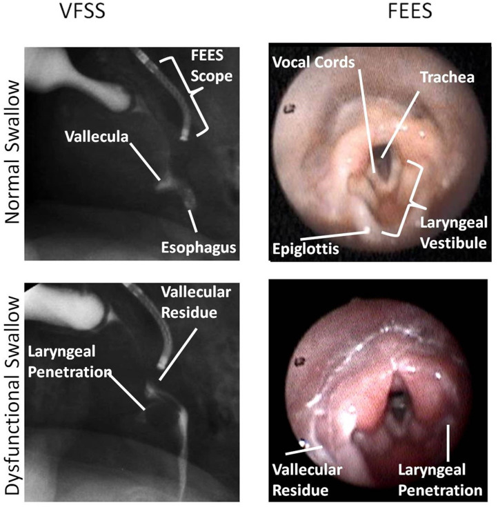

# 6123 — Rối loạn nuốt và hít sặc ở trẻ có ống mở khí quản / Dysphagia and aspiration in children with tracheostomy

**Tags:** `pattern:hit-sac` `pattern:roi-loan-nuot` `vung:duong-tho-nhi` `protocol:VFSS` `protocol:FEES` `score:PAS` `score:FOIS`
**Mức chắc chắn (certainty):** tổng hợp y văn (literature synthesis) — đoàn hệ 525 trẻ có VFSS trước và sau mở khí quản (*Laryngoscope Investig Otolaryngol* 2026, PMC13086536); 47 trẻ < 7 tuổi có hít sặc chất lỏng được cho ăn đường miệng có kiểm soát (*Front Pediatr* 2019, PMC6737036); 11 trẻ đo amylase trong khí quản (*JMA J* 2024, PMC11301107); so sánh đồng thời VFSS–FEES ở nhũ nhi (*Front Pediatr* 2020, PMC7522365); cùng ca nguyên văn rò khí–thực quản phát hiện bằng VFSS (*Medicine* 2021, PMC8021360). Không gắn một bệnh án đơn lẻ cho phần số liệu.

## 1. Tổng quan bệnh học – cơ chế hình ảnh: vì sao "có ống" là mất ba chốt sinh lý của nuốt

- **Ba chốt sinh lý bị ống mở khí quản lấy đi:** (1) **nâng thanh quản** — ống cố định khí quản vào da cổ nên thanh quản không trượt lên ra khỏi đường đi của thức ăn; (2) **áp lực dưới thanh môn** — bình thường khí bị giữ dưới dây thanh trong lúc nuốt tạo "búa hơi" tống thức ăn còn sót và tạo **phản xạ ho**; mở khí quản làm mất áp lực này, nên **ho yếu và hít sặc im lặng**; (3) **cảm giác niêm mạc** — dòng khí qua thanh quản mất, giảm phản xạ đóng thanh môn. Vì thế ống vừa **cứu đường thở** vừa **tạo ra rối loạn nuốt**: trong 525 trẻ, triệu chứng nuốt kém tăng từ **37% lên 91%** sau mở khí quản (p < 0,001), và **85%** trẻ trước đó không có triệu chứng lại có triệu chứng sau mổ.
- **Số liệu theo pha nuốt (VFSS sau mở khí quản, n = 225):** pha **miệng 88%** (197/225), **khởi phát nuốt 53%**, **pha hầu 67%**, **pha thực quản 2%** — tức tổn thương **dồn về pha miệng và khởi phát**, đúng với cơ chế "thức ăn rơi xuống trước khi phản xạ nuốt bật". Trong 25 trẻ có VFSS **trước và sau** mổ: khởi phát nuốt bất thường **40% → 80%** (p = 0,004), **penetration chất lỏng đặc 12% → 40%** (p = 0,008).
- **Vì sao chất lỏng LOÃNG nguy hiểm hơn chất đặc:** chất lỏng chảy nhanh, không được giữ trong miệng nên **không có thời gian bù trừ**; sau mổ, **penetration 28% và aspiration 28% với chất loãng** so với **16% và 17% với chất đặc** (p = 0,002). Ngược lại, chất đặc **dính vào xoang lê (vallecula), xoang lưỡi thanh môn** rồi tràn xuống sau nuốt — kiểu "hít sặc sau nuốt" (xem ảnh dưới).
- **Vì sao VFSS "nhìn thấy" còn nội soi "nhìn thấy một nửa":** baryt cản quang cho **tương phản dương tính** nên thấy **dòng chảy và vị trí baryt** ở mọi thì; nhưng VFSS có **bức xạ** và chỉ ghi **2 chiều**. FEES thấy **cấu trúc và ứ đọng** nhưng bị **"white-out"** — lúc hầu co để đẩy thức ăn thì màn hình trắng, đúng lúc cần thấy chất đi qua thanh môn; trong ảnh so sánh dưới đây, khung FEES phải lấy **2 frame sau** khung VFSS tương ứng.
- **Định lượng bằng thang điểm, không bằng cảm giác:** dùng **PAS 1–8** (1 = không vào đường thở; 2–5 = penetration; 6–8 = aspiration dưới dây thanh, **8 = hít sặc im lặng**), **FOIS 1–7** và **IDDSI** (chất lỏng **mức 0**, đặc **mức 1–4**) — định nghĩa đầy đủ ở [082](../082-bai-nao-an-toan-nuot/lesson.md). Điểm khác biệt ở trẻ **có ống**: tần suất **aspiration chất loãng 28%** so với **chất đặc 17%** trong cùng một nhóm, nên "chọn độ đặc" là câu trả lời chính của VFSS.
- **Hít sặc nước bọt là một thực thể riêng:** ở trẻ có ống, nước bọt chảy liên tục và **không có "bữa ăn" để dừng lại**. Amylase trong khí quản dao động **103–115.500 U/L** ở 11 trẻ; số đợt viêm phổi cần kháng sinh trung vị **0,5 lần/năm** (0–3), và **82% (9/11)** đã phải **cách ly thanh–khí quản** vì hít sặc tái diễn.

## 2. Mẫu hình + chẩn đoán phân biệt theo vị trí (Gamut)

- **Mẫu hình "trẻ có ống mở khí quản ho, sặc, viêm phổi tái diễn":** đây là chỗ giao nhau của **rối loạn nuốt do ống** (mất ba chốt ở mục 1), **bệnh nền thần kinh** (bại não, bệnh cơ), và **tổn thương giải phẫu do ống** (rò khí–thực quản, hẹp dưới thanh môn).
- **Gamut theo pha nuốt (đọc VFSS từ trên xuống):**
  - **Pha miệng:** yếu lưỡi/môi, thức ăn rơi sớm vào hầu (**premature spillage**) — hay gặp nhất sau mổ (88%).
  - **Khởi phát nuốt:** chậm/bất thường (53%) — chất lỏng đã xuống xoang lê trước khi nuốt bật.
  - **Pha hầu:** yếu co hầu, ứ đọng xoang lê/xoang lưỡi thanh môn, **penetration/aspiration** (67%).
  - **Pha thực quản:** hiếm (2%) nhưng là nơi **rò khí–thực quản** lộ ra — baryt từ **thực quản trên** chảy **qua thành sau khí quản**.
  - **Ngoài pha nuốt:** **hít sặc nước bọt** (liên tục), **trào ngược dạ dày–thực quản**, **ứ đọng trên thanh môn do ống quá lớn/bóng quá căng**.
- **Gamut theo tổn thương giải phẫu đặc thù của trẻ có ống:** rò khí–thực quản (ống tì thành sau), hẹp dưới thanh môn sau cai ống (bài 3047), liệt dây thanh sau mổ (bài 3068), u hạt quanh lỗ mở chắn đường thở (bài 6100), hẹp thực quản do bóng ống.
- **Ba câu hỏi phải trả lời trên mọi VFSS của trẻ có ống:** (1) chất **đi vào đường thở ở mức nào** (trên dây thanh / dưới dây thanh) và **có tống ra được không**; (2) **thời điểm** so với phản xạ nuốt (trước – trong – sau nuốt); (3) **độ đặc nào an toàn** — đây là câu trả lời lâm sàng, không phải "có/không hít sặc".

## 3. Bảng so sánh phân biệt (ma trận đối chiếu)

| Thực thể (entity) | Hình ảnh điển hình (VFSS/FEES/CT) | Chốt vào (rule-in) | Chốt loại (rule-out) | Gợi ý xác nhận |
|---|---|---|---|---|
| **Hít sặc do chậm khởi phát nuốt** | VFSS: baryt đã tới **xoang lê** khi thanh môn còn mở; chất lỏng xuống dây thanh **trước** khi nuốt bật | Baryt **dưới dây thanh** ở thì hầu, **trước** cơn nuốt; PAS 6–8 | Ứ đọng **trên** dây thanh rồi được tống ra (PAS 2–3) | VFSS thì nghiêng, chất loãng mức 0 |
| **Hít sặc sau nuốt do ứ đọng** | FEES/VFSS: **residue ở vallecula/xoang lưỡi thanh môn** tràn xuống khi bắt đầu nuốt kế tiếp | Ảnh **ứ đọng tồn tại sau nuốt** + tràn xuống thì sau | Ứ đọng nhỏ, tự tống hết sau 1–2 lần nuốt khô | FEES: cho nuốt khô (dry swallow) sau bữa để đếm lần tống |
| **Hít sặc im lặng** | Không ho, không tím; VFSS thấy baryt dưới dây thanh, **không có phản ứng tống** | **PAS 8** trên VFSS/FEES | Có ho/phản xạ tống rõ (PAS ≤ 7) | Không dựa vào lâm sàng — phải nội soi/chiếu |
| **Rò khí–thực quản (TEF) sau mở khí quản** | VFSS: baryt thoát từ **thực quản trên** qua **thành sau khí quản**; CT **nằm sấp** thấy thuốc vào khí quản | Dòng thuốc **thực quản → khí quản** ở **pha thực quản**, không phải hít sặc thật | Chỉ hít sặc từ **trên xuống** qua thanh môn | Nội soi + CT nằm sấp sau khi nuốt cản quang |
| **Hít sặc nước bọt** | Không thấy trên "bữa ăn" VFSS; amylase trong khí quản **tăng cao** | Amylase khí quản cao **+** không có nguyên nhân hít sặc khi ăn | Amylase thấp **và** VFSS bình thường | Đo amylase dịch hút khí quản, đối chiếu amylase máu |
| **Hẹp dưới thanh môn sau cai ống** | CT/nội soi: vòng xơ dưới dây thanh; VFSS có thể bình thường | Hẹp **cố định** khi soi, không đổi theo thì thở | Lòng khí quản mở hoàn toàn khi thở vào | Nội soi ống mềm + CT ≤ 1 mm (bài 3047) |
| **Trào ngược dạ dày–thực quản** | Baryt trào **ngược lên** thực quản rồi xuống đường thở | Trào ngược **thấy được** trong thì thực quản muộn | Không trào ngược khi nuốt chuẩn | VFSS kéo dài + pH trở kháng |
| **U hạt quanh lỗ mở (giả "nhiễm trùng")** | Nội soi: khối đỏ quanh lỗ mở; X-quang/CT: mô mềm trong lòng | Khối **trong lòng** chắn đầu ống, tăng dần | Niêm mạc nhẵn, không khối | Nội soi (bài 6100) |

## 4. Protocol chụp + hệ phân độ

- **VFSS (videofluoroscopic swallow study) — "tiêu chuẩn vàng" cho hít sặc:** trẻ ngồi thẳng, uống baryt **mức IDDSI 0 (loãng) → 1–4 (đặc)** theo thứ tự, ghi **30 khung/giây** ở thì nghiêng; mỗi độ đặc **≥ 3 lần nuốt**; đọc **PAS** và **FOIS** thống nhất. Trong đoàn hệ 525 trẻ, VFSS được làm ở **65 trẻ trước** và **225 trẻ sau** mở khí quản — tức VFSS **sau mổ là chuẩn**, không phải "làm một lần trước mổ".
- **FEES (fiberoptic endoscopic evaluation of swallowing):** ống soi qua mũi tới hầu; đánh giá **ứ đọng, penetration/aspiration, quản lý chất tiết**; **không có bức xạ**, làm được tại giường, lặp lại nhiều lần. Hạn chế: **không thấy pha miệng** và bị **white-out** đúng lúc hầu co — khi so sánh đồng thời ở nhũ nhi, khung FEES phải lấy **sau** khung VFSS 2 frame để thấy cùng một lần nuốt.
- **Chọn VFSS hay FEES:** nghi **rò khí–thực quản, hít sặc trước/sau nuốt cần định lượng độ đặc** → **VFSS**; trẻ nặng, cần đánh giá **ứ đọng chất tiết và phản xạ ho** tại giường → **FEES**; không có bằng chứng một phương pháp thay thế được phương pháp kia — nên **bổ sung nhau**.
- **Giao thức "thử ăn đường miệng có kiểm soát" (oral feeding trial)** — dùng số liệu 47 trẻ có **PAS 8 (hít sặc im lặng) trên VFSS**:
  - Chỉ làm khi **người chăm sóc hút đờm thành thạo** trong và ngay sau bữa ăn (máy hút xách tay).
  - Bắt đầu **0,1–0,2 mL** mỗi lần, tăng dần theo kết quả VFSS.
  - Sau 1 năm: **11 trẻ ăn hoàn toàn đường miệng, 16 trẻ ăn một phần** ở nhóm thử (n = 30) so với **1 và 5** ở nhóm chỉ nuôi ống (n = 17), p < 0,0001.
  - **Viêm phổi trong 1 năm KHÔNG tăng:** **30% vs 47,1%** (p = 0,242); số ngày nằm viện vì hô hấp **3,93 vs 5,0 ngày** (p = 0,304).
  - **PAS cải thiện ở nhóm thử:** 8 (IQR 8–8) → **6 (IQR 1–8)**, p = 0,003; nhóm không thử **không đổi** (p = 0,180). Thời gian vận chuyển hầu (PTT) lúc theo dõi **0,701 s vs 1,418 s** (p = 0,003 giữa hai nhóm).
- **Amylase trong khí quản (đánh giá hít sặc nước bọt):** lấy dịch qua lỗ mở khí quản, đo bằng kit thương mại; giá trị tham chiếu **chưa chuẩn hóa** — dùng **so sánh nội cá thể** (theo dõi một trẻ) hơn là ngưỡng tuyệt đối.

## 5. Biến thể bình thường và cạm bẫy

- **Biến thể bình thường:** **ứ đọng một ít ở xoang lê** sau nuốt rồi tự tống hết; **penetration mức 2–3** ở trẻ nhỏ khi uống loãng rất nhanh nhưng tự ho ra — không đồng nghĩa "cấm ăn đường miệng"; **bọt khí trong thực quản** khi trẻ khóc.
- **Cạm bẫy 1 — "không ho = không sặc":** PAS 8 (hít sặc im lặng) là kiểu **thường gặp nhất** ở nhóm có ống; trong 47 trẻ của nghiên cứu thử ăn, **toàn bộ** có PAS 8 lúc đầu. Chỉ số tin cậy là **VFSS/FEES**, không phải tiếng ho.
- **Cạm bẫy 2 — làm đặc mọi thứ:** chất đặc **giảm** aspiration (17% vs 28%) nhưng **không xóa** penetration (16% vs 28%); chất đặc còn **dính lại và hít sặc muộn**. Phải chọn độ đặc **theo từng trẻ trên VFSS**, không theo công thức.
- **Cạm bẫy 3 — hít sặc "từ trên xuống" che mất rò khí–thực quản:** ca 64 tuổi (minh họa nguyên lý, không phải trẻ em) bị **viêm phổi tái diễn 25 năm** sau cai ống; VFSS cho **PAS 7**, nhưng dòng baryt đi **từ thực quản trên qua thành sau khí quản**. CT **nằm ngửa âm**, chỉ **nằm sấp** mới thấy thuốc vào khí quản; lỗ rò **2,2 cm dưới sụn giáp, đường kính 6 mm**. Không nghĩ tới rò → tiếp tục nuôi ống vô ích.
- **Cạm bẫy 4 — amylase khí quản không đọc rời:** amylase **máu** có thể **93.600 U/L** trong khi amylase **khí quản chỉ 64 U/L** (một ca trong loạt 11 trẻ) → amylase cao trong máu **không** chứng minh hít sặc nước bọt; phải lấy **dịch khí quản** và so **nội cá thể**.
- **Cạm bẫy 5 — "có hít sặc thì cấm ăn đường miệng":** nhóm được thử ăn **không** tăng viêm phổi (30% vs 47,1%) và cải thiện nuốt; cấm ăn kéo dài làm mất **kỹ năng miệng** và chậm phát triển. Quyết định dựa trên **khả năng hút của người chăm sóc + độ đặc an toàn**, không chỉ PAS.
- **Cạm bẫy 6 — bỏ sót tầng tổn thương thứ hai:** trẻ vừa **hẹp dưới thanh môn** vừa **rối loạn nuốt**; sửa hẹp mà không đánh giá nuốt thì vẫn viêm phổi tái diễn (nối bài 3047, 6100).

## 6. Tự lượng giá — Blind Quiz

**Ca 1 — người lớn 29 tuổi (minh họa nguyên lý), mở khí quản 14 năm, ho khi ăn và viêm phổi tái diễn**

- Gợi ý lâm sàng: mở khí quản từ lâu, cai ống nhiều năm trước; ho khi ăn, cảm giác vướng cổ, nhiều đợt viêm phổi không rõ nguyên nhân.
- Câu hỏi: Ở khung B, chất cản quang đi **theo đường nào**? Vì sao CT nằm ngửa bình thường mà CT nằm sấp lại dương tính? Đây có phải hít sặc "thông thường" không?

<b>Bấm để hiện đáp án (findings + chẩn đoán)</b>

- Dấu hiệu (findings): VFSS — baryt thoát từ **thực quản trên** qua **thành sau khí quản** vào lòng khí quản (mũi tên đỏ), **ở pha thực quản**; CT nằm sấp — thuốc cản quang trong **lòng khí quản** ngay trên **cột sống cổ** (mũi tên đỏ), tức đường rò đi **ra trước** từ thực quản.
- Chẩn đoán (diagnosis): **rò khí–thực quản mắc phải sau mở khí quản** — lỗ rò **2,2 cm dưới sụn giáp, ~6 mm**, đóng bằng đường mổ bên; hết triệu chứng **10 tháng** sau mổ.
- Vì sao: thành sau khí quản và thành trước thực quản **áp sát**, bị đầu ống tì lâu → thiếu máu → rò. Ở tư thế **nằm ngửa**, thuốc chảy ra **sau** thực quản theo trọng lực nên không vào lỗ rò; **nằm sấp** mới đưa thuốc **ra trước**, đúng miệng rò.
- Vì sao không phải hít sặc thường: hít sặc thường đi **qua thanh môn từ trên xuống** và xảy ra **trong/sau nuốt**; ở đây chất đi **từ thực quản sang khí quản** — đường khác hoàn toàn, nên điều trị cũng khác (đóng rò, không chỉ làm đặc thức ăn).
- Nguồn ảnh: Yoo DH và cs., *Medicine (Baltimore)* 2021 (PMC8021360), CC BY 4.0 — Hình 1 (VFSS) + Hình 2 (CT nằm sấp), ghép bằng `tools/make_composite.py`.

**Ca 2 — nhũ nhi sinh non, nghi hít sặc, được đánh giá đồng thời VFSS và FEES**

- Gợi ý lâm sàng: trẻ bú chậm, ho và tụt bão hòa khi bú; chưa rõ sặc ở mức nào.
- Câu hỏi: Khác nhau cốt lõi giữa hai cột ảnh là gì? Dấu hiệu trong ảnh dưới bên trái gọi là gì? Vì sao không thể chỉ dùng FEES để loại trừ hít sặc?

<b>Bấm để hiện đáp án (findings + chẩn đoán)</b>

- Dấu hiệu (findings): cột **VFSS** — hình chiếu nghiêng thấy **vallecula**, **thực quản**, và dòng baryt; ảnh dưới có **ứ đọng vallecula** và **penetration thanh quản** (chất dừng **trên** dây thanh). Cột **FEES** — hình ảnh nội soi thấy **dây thanh, thanh môn, thanh quản**; ảnh dưới có **ứ đọng** và **penetration** tương ứng.
- Chẩn đoán (diagnosis): **rối loạn nuốt có penetration (không phải aspiration dưới dây thanh)** — mức độ **PAS 2–5**; xử trí: chỉnh tư thế, độ đặc, nuốt khô sau bữa.
- Vì sao FEES không loại trừ được: FEES **không thấy pha miệng** và bị **white-out** khi hầu co — chất có thể **đi qua trong khoảng trắng** đó; trong nghiên cứu này, khung FEES phải chọn **2 frame sau** khung VFSS mới thấy cùng một lần nuốt.
- Vì sao VFSS không thay FEES: VFSS có **bức xạ**, khó lặp lại nhiều lần/ngày, và không đánh giá tốt **ứ đọng chất tiết** giữa các bữa.
- Nguồn ảnh: Kamity R và cs., *Front Pediatr* 2020 (PMC7522365), CC BY 4.0 — Hình 5 (VFSS và FEES của cùng một lần nuốt). Ca gốc là **nhũ nhi sinh non**, không có ống mở khí quản — dùng làm hình minh họa phương pháp, không đại diện bệnh cảnh trẻ có ống.

**Ca 3 — trẻ 10 tuổi, bại não, có ống mở khí quản, viêm phổi 3 đợt/năm, ăn đường miệng rất ít**

- Gợi ý lâm sàng: không ho khi ăn; hút đờm rất nhiều giữa các bữa; VFSS bữa ăn "bình thường".
- Câu hỏi: Cơ chế hít sặc nào giải thích **viêm phổi mà VFSS bữa ăn âm**? Xét nghiệm nào hỗ trợ? Hướng xử trí?

<b>Bấm để hiện đáp án (findings + chẩn đoán)</b>

- Dấu hiệu (findings): VFSS với baryt **không** thấy aspiration; nhưng **amylase dịch hút khí quản** rất cao so với amylase máu, và lượng dịch hút tăng giữa các bữa.
- Chẩn đoán (diagnosis): **hít sặc nước bọt (salivary aspiration)** — nước bọt chảy liên tục, không gắn với "bữa ăn", nên VFSS bữa ăn âm.
- Vì sao: **mất áp lực dưới thanh môn + giảm cảm giác** làm trẻ không ho; nước bọt tích ở xoang lê rồi tràn xuống. Amylase khí quản là dấu hiệu **gián tiếp**, cần **so nội cá thể** (một ca trong loạt có amylase máu **93.600 U/L** nhưng khí quản **64 U/L**).
- Hướng xử trí: tăng hút, thuốc giảm tiết (glycopyrrolate/thảo luận), cân nhắc **cách ly thanh–khí quản** khi hít sặc nặng tái diễn (**82%** trẻ trong loạt 11 ca đã phải làm).
- Nguồn số liệu: Kubota H và cs., *JMA J* 2024 (PMC11301107), CC BY 4.0 — amylase khí quản **103–115.500 U/L**, viêm phổi **0,5 đợt/năm**.

## Bài liên quan chéo
- [6100 – Chăm sóc, biến chứng & cai ống mở khí quản ở trẻ](../6100-cham-soc-va-cai-ong-mo-khi-quan-tre/lesson.md)
- [6124 – Nhiễm trùng liên quan ống mở khí quản ở trẻ (TRAIN)](../6124-nhiem-trung-lien-quan-ong-mo-khi-quan-o-tre/lesson.md)
- [082 – Bại não & an toàn nuốt ở trẻ: phân tầng GMFCS, VFSS/FEES](../082-bai-nao-an-toan-nuot/lesson.md)
- [3047 – Hẹp khí quản sau đặt nội khí quản ở trẻ](../3047-hep-khi-quan-sau-dat-noi-khi-quan-o-tre/lesson.md)
- [3068 – Liệt dây thanh sau phẫu thuật đường thở ở trẻ](../3068-liet-day-thanh-sau-mo-duong-tho-o-tre/lesson.md)
- [6101 – Xẹp phổi một bên tái diễn ở trẻ BPD/TBM](../6101-xep-phoi-tai-dien-mot-ben-tre-bpd-tbm/lesson.md)

## Ảnh
- `images/composite_vfss-ro-khi-thuc-quan.jpg` — VFSS + CT nằm sấp, Yoo 2021 (PMC8021360), CC BY 4.0, ghép bằng `tools/make_composite.py` (letterbox, không crop).
- `images/6123_roi-loan-nuot_VFSS-FEES-FrontPediatr-PMC7522365-F5.jpg` — Kamity 2020 (PMC7522365), CC BY 4.0.
- Nguồn, giấy phép từng ảnh: `images/CREDITS.md`.

> Không dùng để chẩn đoán độc lập khi chưa có người hướng dẫn.
