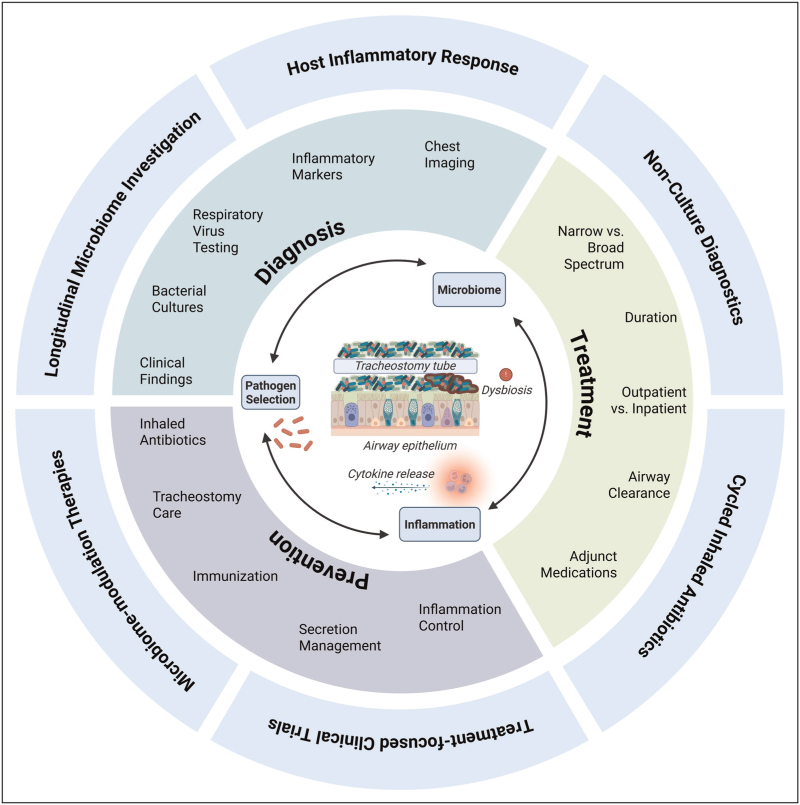
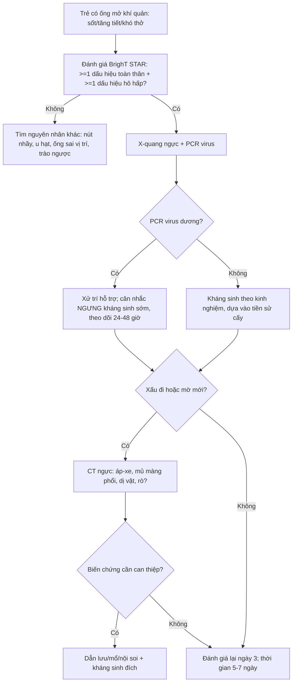
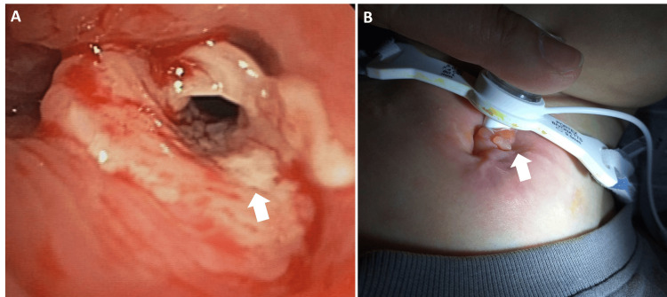
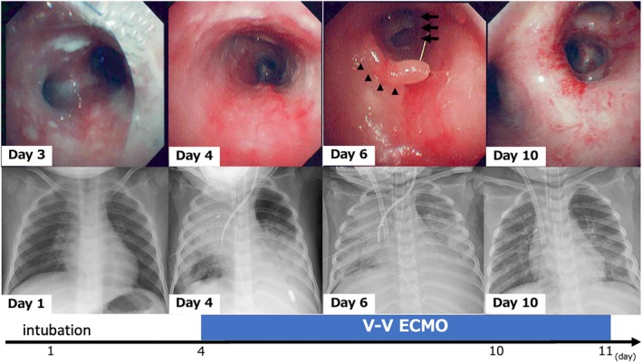
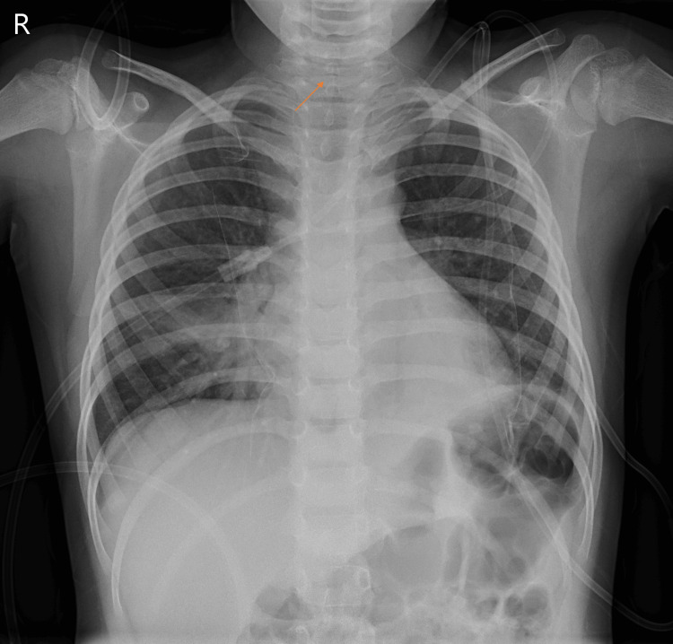
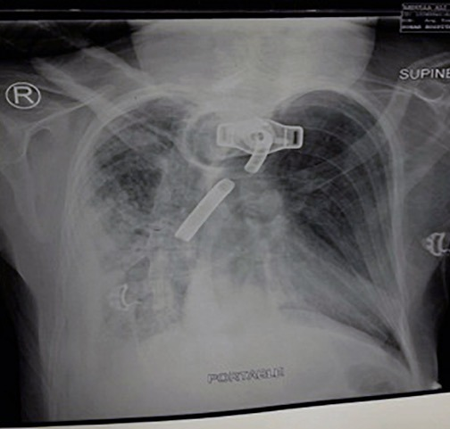

# 6124 — Nhiễm trùng liên quan ống mở khí quản ở trẻ / Pediatric tracheostomy-associated infection (TRAIN)

**Tags:** `pattern:dam-mo-phoi` `pattern:thanh-khi-quan` `vung:duong-tho-nhi` `protocol:X-quang-nguc` `protocol:CT-co-nguc` `protocol:cay-dich-khi-quan`
**Mức chắc chắn (certainty):** tổng hợp y văn (literature synthesis) — tổng quan cơ chế và thực hành (*Curr Opin Pediatr* 2026, PMC13152059); đoàn hệ 6 bệnh viện **542 đợt nhập viện/365 trẻ** về ngưng kháng sinh sớm khi PCR virus dương (*Pediatr Pulmonol* 2026, PMC13179731); ca nguyên văn viêm thanh khí quản do vi khuẩn có ảnh X-quang + nội soi theo ngày (*Pediatr Int* 2025, PMC12369452); ca nguyên văn **steeple sign** (*Cureus* 2024, PMC11293875); ca ống mở khí quản gãy–di trú gây viêm phổi (*Oman Med J* 2020, PMC7157438); hình u hạt lỗ mở (*Cureus* 2026, PMC12873625). Không gắn một bệnh án đơn lẻ cho phần số liệu.

## 1. Tổng quan bệnh học – cơ chế hình ảnh: vì sao "cấy dương tính" là trạng thái mặc định, không phải chẩn đoán

- **Ống mở khí quản là một bề mặt lạ nằm trong đường thở có niêm mạc ẩm:** trong vài giờ, protein của vật chủ bám thành lớp màng; vi khuẩn (kể cả Gram âm và *P. aeruginosa*) tạo **màng sinh học (biofilm)** nhiều loài, có ma trận polysaccharide bảo vệ khỏi kháng sinh và kháng thể. Biofilm **không** gây viêm cho tới khi bị phá vỡ (hút đờm, cọ rửa, nhiễm virus) và giải phóng vi khuẩn với **"nở hoa" (bloom)** của loài vốn đã cư trú. Vì thế **hít vào ống = hít vào một cộng đồng vi khuẩn**, không phải "đường thở vô khuẩn bị nhiễm".
- **Hệ quả định lượng — dịch hút khí quản (tracheal aspirate, TA) dương tính là chuyện thường:** **25–87%** mẫu TA mọc vi khuẩn; một trẻ có ống được cấy trung vị **4 lần/năm**. Là **xét nghiệm chẩn đoán**, TA chỉ đạt **độ nhạy 27% và độ đặc hiệu 85%** so với chẩn đoán lâm sàng "nhiễm đường hô hấp dưới"; và loài mọc được **không** dự báo bệnh: *S. pneumoniae*, *H. influenzae*, *M. catarrhalis* có liên quan với chẩn đoán, còn ***P. aeruginosa*, *S. aureus*, *S. maltophilia* thì KHÔNG** — trong một nghiên cứu đa trung tâm, *P. aeruginosa* trên TA không làm thay đổi xác suất được điều trị như TRAIN.
- **Vì sao X-quang không phân biệt được "nhiễm" với "xẹp":** hình mờ trên X-quang chỉ nói **phế nang bị lấp** (dịch, mủ, tế bào, hoặc không khí bị hút mất). Ở trẻ có ống, **nút nhầy** trong lòng phế quản gây xẹp thùy với **mờ đồng nhất + mất thể tích** (khe di lệch, trung thất kéo, cơ hoành lên) — mô hình **giống viêm phổi nhưng không có viêm phổi**. Vì vậy mọi đám mờ mới phải đọc theo **học thuyết mất thể tích** (bài 001) trước khi gọi "viêm phổi".
- **Vì sao dấu hiệu lâm sàng cũng không đặc hiệu:** ho và **màu đờm** là dấu hiệu **không đáng tin**; đồng thuận **BrighT STAR** yêu cầu **≥ 1 dấu hiệu toàn thân VÀ ≥ 1 dấu hiệu hô hấp** mới coi là nhiễm khuẩn đường hô hấp dưới. Ngay cả vậy, **16–56%** trẻ **không** được chẩn đoán TRAIN vẫn có **bạch cầu mức "trung bình" trở lên** trên nhuộm Gram đờm — tức viêm đường thở mạn đủ để làm nhiễu xét nghiệm.
- **Vì sao "không nhiễm" vẫn nguy hiểm:** TRAIN là nguyên nhân **nhập viện và tử vong hàng đầu** ở trẻ có ống — **tử vong nội viện 1–4%** mỗi đợt, chi phí **> 900 triệu USD/năm** ở Mỹ. Nhưng điều trị oan cũng có giá: kháng sinh kéo dài làm tăng **vi khuẩn đa kháng**, *C. difficile*, và **tăng thời gian nằm viện**.
- **Bằng chứng mới nhất đổi thực hành:** ở **542 đợt nhập viện** vì nghi nhiễm khuẩn có **PCR virus dương** (rhinovirus **52%**, SARS-CoV-2 **12%**, RSV **11%**), chỉ **28%** được ngưng kháng sinh sớm. Nhóm điều trị đủ liệu trình nằm viện **8,6 ngày** so với **7,0 ngày** khi ngưng sớm (**+23%**, KTC 5–45%), trong khi **chuyển ICU muộn 14,6%**, **tử vong 0,9%**, **tái nhập viện 30 ngày 8,3%** — **không khác** giữa hai nhóm.

## 2. Mẫu hình + chẩn đoán phân biệt theo vị trí (Gamut)

- **Mẫu hình "trẻ có ống mở khí quản sốt + tăng tiết + đám mờ mới trên X-quang":** đây là chỗ giao của 3 nhóm — **nhiễm** (virus, vi khuẩn, hỗn hợp), **cơ học** (nút nhầy/xẹp, u hạt, ống sai vị trí) và **biến chứng cấu trúc** (áp-xe, rò khí–thực quản, dị vật).
- **Gamut theo vị trí tổn thương (đọc từ ống ra ngoài):**
  - **Trong lòng ống:** nút nhầy/vảy tiết, mảnh ống gãy, dị vật (bài 6100).
  - **Lỗ mở – khí quản trên lỗ mở:** u hạt, sụp thành trước, hẹp (bài 6100, 3047).
  - **Khí quản – phế quản:** viêm thanh khí quản màng giả/do vi khuẩn, màng sợi – giả mạc, viêm khí quản do ống.
  - **Nhu mô phổi:** viêm phổi do vi khuẩn (TRAIN), viêm phổi do virus, viêm phổi hít sặc, xẹp phổi do nút nhầy, áp-xe.
  - **Màng phổi/trung thất:** tràn dịch – mủ màng phổi, tràn khí, tràn khí trung thất (biến chứng của thủ thuật/barotrauma).
  - **Đường nối bất thường:** rò khí–thực quản (bài 6123).
- **Gamut theo hình thái mờ trên X-quang/CT:** **mờ đồng nhất + mất thể tích** = xẹp; **mờ đông đặc có phế quản hơi** = lấp phế nang (viêm phổi, phù, xuất huyết); **mờ dạng lưới–nốt hai bên** = virus/viêm phổi kẽ; **mờ tròn có vỏ** = áp-xe; **mờ đáy phổi hai bên đối xứng** = xẹp do tư thế, hay gặp ở trẻ nằm lâu.
- **Ba câu hỏi phải trả lời trước khi gọi "TRAIN":** (1) **có mất thể tích không** (xẹp thay vì viêm); (2) **có dấu hiệu toàn thân + hô hấp theo BrighT STAR không**; (3) **có biến chứng cấu trúc cần can thiệp không** (áp-xe, mủ màng phổi, dị vật, rò) — câu (3) là lý do chính để chụp CT.

## 3. Bảng so sánh phân biệt (ma trận đối chiếu)

| Thực thể (entity) | Hình ảnh điển hình (X-quang/CT/nội soi) | Chốt vào (rule-in) | Chốt loại (rule-out) | Gợi ý xác nhận |
|---|---|---|---|---|
| **Viêm phổi do vi khuẩn (bTRAIN)** | Đông đặc **mới**, có **phế quản hơi**, không mất thể tích; có thể một thùy | **≥ 1 dấu hiệu toàn thân + ≥ 1 dấu hiệu hô hấp** (BrighT STAR) **+** đám mờ mới | Mờ **kèm mất thể tích** (xẹp) hoặc mờ cũ không đổi | Lâm sàng + X-quang; **không** dựa vào TA dương tính |
| **Viêm phổi do virus** | Mờ lưới–nốt hai bên, dày quanh phế quản, **không đông đặc thùy** | PCR virus dương **+** hình ảnh phù hợp | Đông đặc thùy đơn độc, đáp ứng kháng sinh nhanh | PCR đa tác nhân; **ngưng kháng sinh sớm** |
| **Xẹp phổi do nút nhầy** | Mờ **đồng nhất**, **mất thể tích**: khe di lệch, trung thất kéo, cơ hoành lên, **không phế quản hơi** khi tắc hoàn toàn | Mất thể tích + **tái thông sau hút/nội soi** | Mờ không đổi thể tích, có phế quản hơi | So phim cũ; nội soi/hút; X-quang lại sau hút |
| **Viêm phổi hít sặc** | Đông đặc **thùy dưới bên phải** hoặc hai bên vùng phụ thuộc, hay tái diễn **cùng vị trí** | Tiền sử sặc/khó nuốt + đông đặc vùng phụ thuộc | Hình ảnh thay đổi vị trí, không liên quan bữa ăn | VFSS/FEES (bài 6123); cân nhắc **che phủ kỵ khí** |
| **Viêm thanh khí quản do vi khuẩn (màng giả)** | X-quang: **steeple sign** (hẹp dưới thanh môn); nội soi: **mủ bám chu vi**, màng giả, loét niêm mạc | Nội soi thấy **mủ/màng** trong lòng khí quản | Chỉ hẹp dưới thanh môn đơn thuần, đáp ứng corticoid (croup) | Nội soi ống mềm + cấy; **steeple sign không đặc hiệu** |
| **U hạt quanh lỗ mở** | Nội soi: khối đỏ, dễ chảy máu **quanh/trên lỗ mở**; CT: mô mềm trong lòng | Khối **trong lòng** chắn đầu ống, tăng dần theo thời gian có ống | Niêm mạc nhẵn, không khối | Nội soi (bài 6100) |
| **Dị vật/mảnh ống gãy** | X-quang: **cấu trúc cản quang hình ống** trong khí quản/phế quản; phổi phía dưới mờ/xẹp | Vật cản quang **trong lòng** phế quản + mờ phổi cùng bên | Ống **đúng vị trí**, không mảnh rời | Soi ống mềm lấy dị vật |
| **Áp-xe phổi / mủ màng phổi** | CT: ổ **dịch hoá có vỏ ngấm thuốc**, mức khí–dịch; màng phổi **dày, vách** | Ổ dịch **có vỏ** + màng phổi dày/vách | Đông đặc đặc, không hoá dịch | CT có cản quang; siêu âm màng phổi |
| **Rò khí–thực quản** | VFSS: thuốc từ **thực quản** sang khí quản; CT **nằm sấp** thấy đường rò | Dòng thuốc **thực quản → khí quản** | Chỉ hít sặc qua thanh môn từ trên xuống | Nội soi + CT nằm sấp (bài 6123) |

## 4. Protocol chụp + hệ phân độ & quyết định điều trị

- **X-quang ngực thẳng tại giường:** chỉ định khi **có dấu hiệu hô hấp mới** hoặc nghi biến chứng — **không chụp thường quy** mỗi đợt sốt. Đọc theo trình tự: **thể tích phổi → vị trí đầu ống → mờ mới → màng phổi → khí ngoài phổi**.
- **CT ngực (liều thấp, ≤ 1 mm, có cản quang khi nghi áp-xe/mủ màng phổi)** khi: nghi **biến chứng** (áp-xe, mủ màng phổi, tràn khí trung thất), **xẹp không hồi phục sau hút**, hoặc nghi **dị vật/tổn thương lòng khí quản** (thêm CT cổ, dựng mặt phẳng coronal). **CT không dùng để chẩn đoán TRAIN** — không có ngưỡng HU/độ dày thành nào đủ đặc hiệu cho TRAIN.
- **Cấy dịch hút khí quản — quy tắc dùng (3 mục đích khác nhau):**
  - **Chẩn đoán TRAIN:** **không** lấy thường quy; nếu lấy, kết quả **không** đủ để mở kháng sinh (Se 27%/Sp 85%).
  - **Định hướng kháng sinh:** có thể dùng **khi đã quyết định điều trị**, để **thu hẹp** phổ — không dùng để **bắt đầu**.
  - **Giám sát lúc khoẻ:** **không** khuyến cáo (ATS 2025, BrighT STAR).
- **Thời gian kháng sinh:** **không có khuyến cáo dựa trên bằng chứng**; thực hành trung vị **7 ngày (IQR 3–11)** ở 548 trẻ; hai nghiên cứu hồi cứu cho thấy liệu trình **≤ 6 ngày** không làm tăng tiến triển thành viêm phổi, điều trị lại hay tử vong. **Ngưng sớm khi có PCR virus dương** làm giảm **1,6 ngày** nằm viện mà không tăng biến cố.
- **Che phủ kỵ khí:** khi **nghi hít sặc** (bằng chứng hít sặc, thần kinh nặng, trào ngược) — theo đồng thuận ATS 2025, không dùng thường quy cho mọi TRAIN.
- **Dự phòng bằng kháng sinh hít:** tobramycin hít **theo chu kỳ 28 ngày dùng / 28 ngày nghỉ**; 4 nghiên cứu nhỏ (n = 6–42, **trước–sau, không nhóm chứng**) cho thấy giảm số đợt TRAIN phải dùng kháng sinh toàn thân và giảm nhập viện tới **12 tháng** — bằng chứng yếu.
- **Làm sạch đường thở:** ở 770 trẻ có bệnh thần kinh nhập viện vì nhiễm hô hấp, **tăng cường làm sạch đường thở không** làm khác thời gian về mức hỗ trợ hô hấp ban đầu hay thời gian nằm viện; đồng thuận vẫn khuyến cáo **tăng tần suất so với nền** khi trẻ dưới mức hỗ trợ hô hấp cơ bản.

## 5. Biến thể bình thường và cạm bẫy

- **Biến thể bình thường:** **mờ đáy phổi hai bên ở trẻ nằm lâu** do xẹp phụ thuộc, hết khi thay đổi tư thế/vỗ rung; **dày niêm mạc khí quản nhẹ quanh đầu ống** trên CT; **bóng khí nhỏ quanh lỗ mở** ngay sau thay ống.
- **Cạm bẫy 1 — cấy dương tính = điều trị:** **25–87%** mẫu TA mọc vi khuẩn lúc trẻ **hoàn toàn khoẻ**; *P. aeruginosa* trên TA **không** dự báo TRAIN. Điều trị theo cấy đơn thuần là nguyên nhân chính của kháng sinh dư thừa.
- **Cạm bẫy 2 — đọc "mờ đáy phổi" thành viêm phổi:** xẹp do nút nhầy có **mất thể tích**; nếu không kiểm tra khe/trung thất/cơ hoành, trẻ sẽ nhận kháng sinh cho một tổn thương **chỉ cần hút**.
- **Cạm bẫy 3 — bỏ sót dị vật/mảnh ống gãy:** ca 29 tuổi (minh họa nguyên lý, không phải trẻ em) mang ống **14 năm không đổi**, vào viện với **SpO₂ 82%, RR 30, HR 160**; X-quang cho thấy **mảnh ống gãy nằm trong phế quản gốc phải**, kèm viêm phổi bên phải. Đây là "nhiễm trùng" do **nguyên nhân cơ học** — kháng sinh đơn thuần không giải quyết.
- **Cạm bẫy 4 — u hạt giả "viêm khí quản":** khối mô hạt quanh lỗ mở **không** phải nhiễm trùng và **không** đáp ứng kháng sinh; nó chắn đường thở và gây xẹp tái diễn.
- **Cạm bẫy 5 — PCR virus dương không loại trừ bội nhiễm:** nhưng dữ liệu 542 đợt cho thấy tỉ lệ **chuyển ICU muộn 14,6%** và **tử vong 0,9%** **không khác** khi ngưng kháng sinh sớm → **theo dõi sát 24–48 giờ** quan trọng hơn "điều trị cho chắc".
- **Cạm bẫy 6 — "không sốt thì không nhiễm":** trẻ có bệnh thần kinh nặng có thể **hạ thân nhiệt** hoặc **không tăng bạch cầu**; BrighT STAR tính cả **hạ nhiệt độ** và **bạch cầu giảm**.

## 6. Tự lượng giá — Blind Quiz

**Ca 1 — trẻ 2 tuổi, ho "ông ổng" 5 ngày sau cúm, diễn tiến nặng dần**

- Gợi ý lâm sàng: chẩn đoán ban đầu là **croup**, đã dùng adrenaline khí dung + corticoid; ngày 3 sốc nhiễm khuẩn, phải thở máy rồi ECMO.
- Câu hỏi: Hàng trên và hàng dưới là hai phương pháp gì? Dấu hiệu nào ở ngày 3–6 giải thích **thất bại với điều trị croup**? Vì sao phổi trên X-quang "không tương xứng" với mức nặng lâm sàng?

<b>Bấm để hiện đáp án (findings + chẩn đoán)</b>

- Dấu hiệu (findings): hàng trên là **nội soi ống mềm**: ngày 3 **mủ bám chu vi niêm mạc khí quản** lan ra phế quản ngoại vi; ngày 4 **niêm mạc đỏ, phù**; ngày 6 **mảng niêm mạc bong, lồi vào lòng** gây hẹp phế quản (mũi tên); ngày 10 hồi phục. Hàng dưới là **X-quang ngực** các ngày 1–4–6–10 kèm dòng thời gian **đặt ống → V-V ECMO**.
- Chẩn đoán (diagnosis): **viêm thanh khí quản do vi khuẩn (bacterial tracheitis) do MRSA** — biến chứng **sốc nhiễm khuẩn, ARDS**; V-V ECMO ngày 4–11, cai máy ngày 18, ra viện ngày 42.
- Vì sao "không đáp ứng croup" là chốt: croup đáp ứng **adrenaline khí dung + corticoid**; viêm thanh khí quản do vi khuẩn có **màng mủ/màng giả** trong lòng nên **không** cải thiện và cần **đặt ống + kháng sinh**. Tỉ lệ phải đặt ống **70–90%**.
- Vì sao X-quang "nhẹ" hơn lâm sàng: tổn thương nằm **trong lòng khí quản–phế quản lớn** (màng, mủ, bong niêm mạc) — X-quang chỉ thấy **hệ quả** (xẹp, mờ) và có thể **bình thường** dù đường thở gần tắc.
- Nguồn ảnh: Kano K và cs., *Pediatr Int* 2025 (PMC12369452), CC BY 4.0 — Hình 1.

**Ca 2 — trẻ 5 tuổi, ho, rít, khó thở tăng nhanh trong 2 giờ**

- Gợi ý lâm sàng: sốt và ho 1 tuần, đã dùng corticoid uống + adrenaline khí dung; nay thở rít, co kéo nặng, không đáp ứng; CRP **38,5 mg/L**, bạch cầu **22,93 × 10³/µL** (neutrophil **17,95**).
- Câu hỏi: Dấu hiệu mũi tên cam tên là gì? Nó **chốt** chẩn đoán gì, và **loại trừ** được gì? Bước tiếp theo?

<b>Bấm để hiện đáp án (findings + chẩn đoán)</b>

- Dấu hiệu (findings): **hẹp dưới thanh môn** hình **"tháp chuông" (steeple sign)** — mũi tên cam đánh dấu đoạn hẹp ngay dưới dây thanh; phổi không có đông đặc.
- Chẩn đoán (diagnosis): **viêm thanh khí quản do vi khuẩn** (ban đầu nghĩ croup) — cấy dịch phế quản ra ***Streptococcus pyogenes***; đặt ống ngày 1, cai ngày 5, ra viện ngày 8, không di chứng.
- Chốt vào/loại ra: steeple sign **chỉ nói "có hẹp dưới thanh môn"**, gặp ở **cả croup** — nó **không** chốt vi khuẩn và **không** loại trừ viêm nắp thanh môn (khi đó tìm **thumb sign**). Chốt thật là **không đáp ứng corticoid/adrenaline + mủ trong lòng khí quản**.
- Vì sao: niêm mạc dưới thanh môn là **chỗ hẹp nhất** của đường thở trẻ; phù 1 mm làm giảm tiết diện rất nhiều (định luật Poiseuille, xem bài 6100), nên triệu chứng nặng nhanh.
- Nguồn ảnh: Moreira M và cs., *Cureus* 2024 (PMC11293875), CC BY 4.0 — Hình 1.

**Ca 3 — trẻ có ống mở khí quản, sốt cao, bão hòa 82%, thở nhanh**

- Gợi ý lâm sàng: mở khí quản nhiều năm, **ống chưa từng được thay**; nay sốt cao, khó thở, giảm tri giác.
- Câu hỏi: Có **mấy bất thường** trên phim? Vì sao đây **không** phải "TRAIN đơn thuần"? Xử trí khác gì so với một đợt viêm phổi thường?

<b>Bấm để hiện đáp án (findings + chẩn đoán)</b>

- Dấu hiệu (findings): (1) **mảnh ống cản quang hình ống** nằm trong **phế quản gốc phải**; (2) **đám mờ đông đặc phổi phải** quanh mảnh ống; (3) ống mở khí quản còn tại lỗ mở nhưng **mất phần đầu** (flange gãy).
- Chẩn đoán (diagnosis): **mảnh ống mở khí quản gãy – di trú vào phế quản gốc phải, gây viêm phổi hít sặc/dị vật** — phải **lấy dị vật** bằng nội soi, không chỉ kháng sinh.
- Vì sao không phải TRAIN đơn thuần: đám mờ là **hệ quả của tắc nghẽn cơ học**; cấy đờm có thể dương tính nhưng nguồn gốc là **dị vật**. Ca gốc (người lớn 29 tuổi, ống kim loại dùng **14 năm**) minh họa nguyên lý: **không đổi ống định kỳ** → gãy do mỏi vật liệu.
- Xử trí: nội soi ống mềm gắp mảnh; kiểm tra toàn bộ ống và **thay ống theo lịch**; kháng sinh sau khi giải quyết tắc nghẽn.
- Nguồn ảnh: Kashoob M và cs., *Oman Med J* 2020 (PMC7157438), CC BY-NC 4.0 — Hình 1 (ca người lớn, dùng minh họa nguyên lý; không đại diện bệnh cảnh nhi).

## Bài liên quan chéo
- [6100 – Chăm sóc, biến chứng & cai ống mở khí quản ở trẻ](../6100-cham-soc-va-cai-ong-mo-khi-quan-tre/lesson.md)
- [6123 – Rối loạn nuốt và hít sặc ở trẻ có ống mở khí quản](../6123-roi-loan-nuot-va-hit-sac-tre-mo-khi-quan/lesson.md)
- [3047 – Hẹp khí quản sau đặt nội khí quản ở trẻ](../3047-hep-khi-quan-sau-dat-noi-khi-quan-o-tre/lesson.md)
- [3044 – Catheter tĩnh mạch trung tâm ở trẻ](../3044-catheter-tinh-mach-trung-tam-o-tre/lesson.md)
- [6101 – Xẹp phổi một bên tái diễn ở trẻ BPD/TBM](../6101-xep-phoi-tai-dien-mot-ben-tre-bpd-tbm/lesson.md)
- [011 – Tiểu thùy phổi](../011-tieu-thuy-phoi/lesson.md)

## Ảnh
- `images/6124_nhiem-trung-ong-mo-khi-quan_So-do_CurrOpinPediatr-PMC13152059-F1.jpg` — Morrison 2026 (PMC13152059), CC BY-NC-ND 4.0, **nguyên bản, không chỉnh sửa**.
- `images/6124_nhiem-trung-ong-mo-khi-quan_Xquang-Noisoi_PediatrInt-PMC12369452-F1.jpg` — Kano 2025 (PMC12369452), CC BY 4.0.
- `images/6124_nhiem-trung-ong-mo-khi-quan_X-quang_Cureus-PMC11293875-F1.jpg` — Moreira 2024 (PMC11293875), CC BY 4.0.
- `images/6124_nhiem-trung-ong-mo-khi-quan_X-quang_OmanMedJ-PMC7157438-F1.jpg` — Kashoob 2020 (PMC7157438), CC BY-NC 4.0.
- `images/6124_nhiem-trung-ong-mo-khi-quan_Noi-soi_Cureus-PMC12873625-F2.jpg` — *Cureus* 2026 (PMC12873625), CC BY 4.0.
- Nguồn, giấy phép từng ảnh: `images/CREDITS.md`.

> Không dùng để chẩn đoán độc lập khi chưa có người hướng dẫn.
