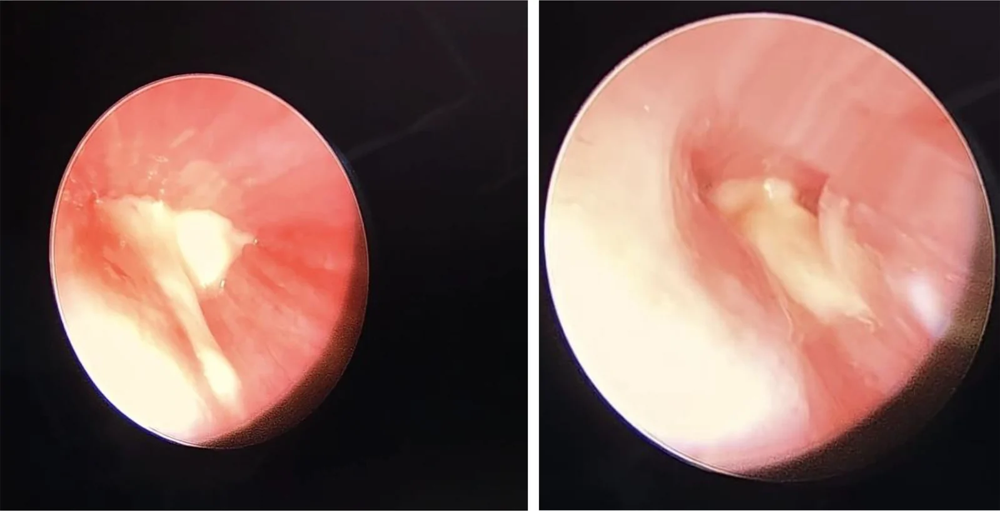
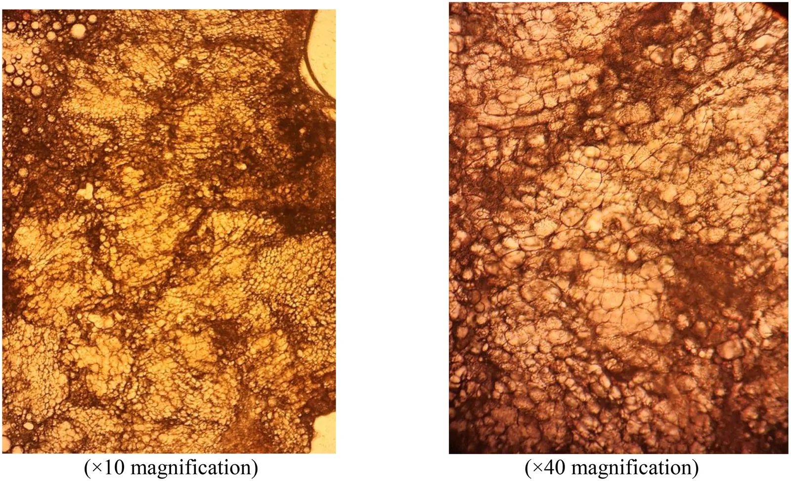
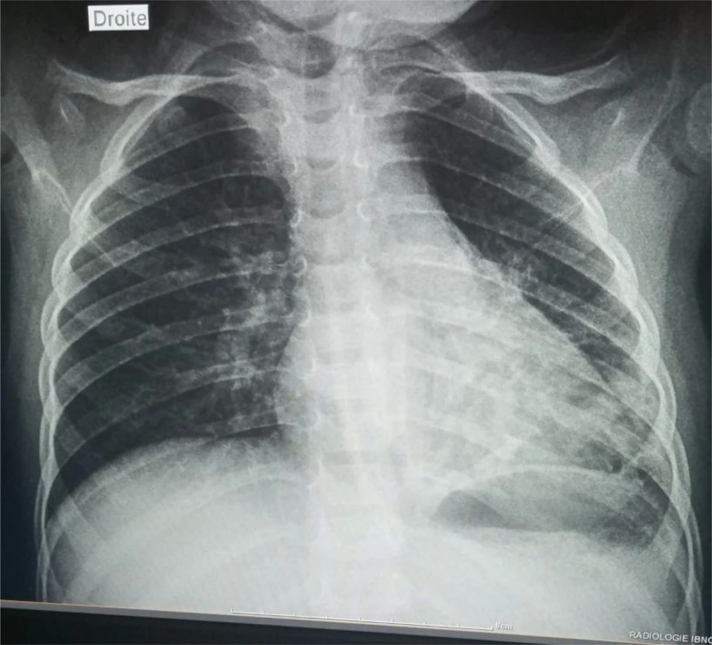
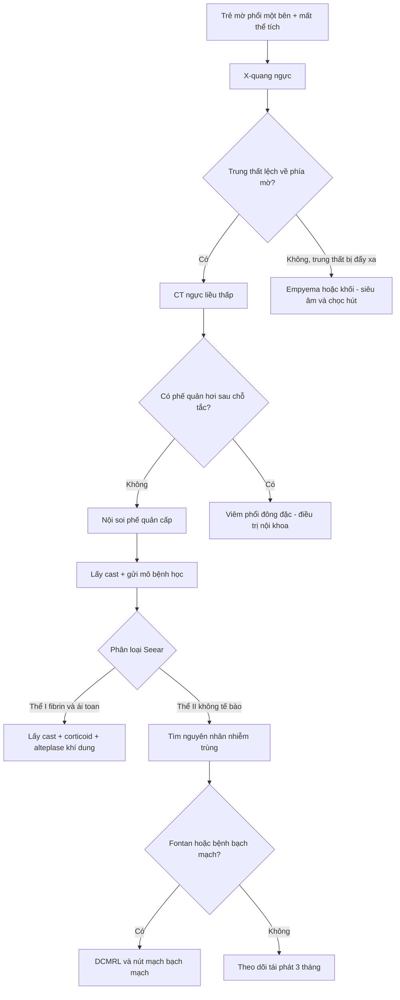
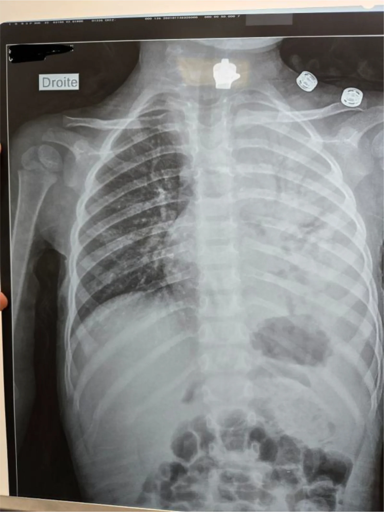
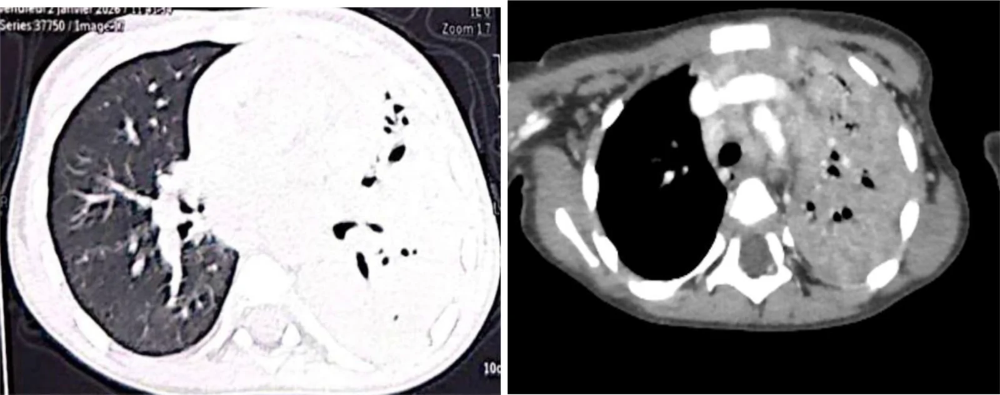
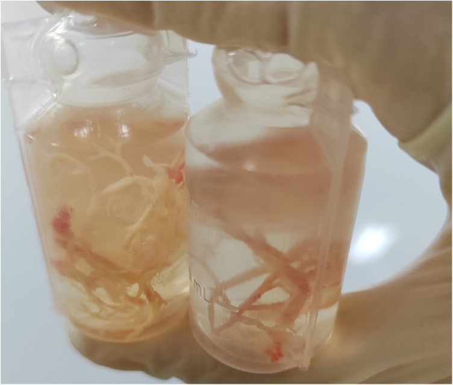
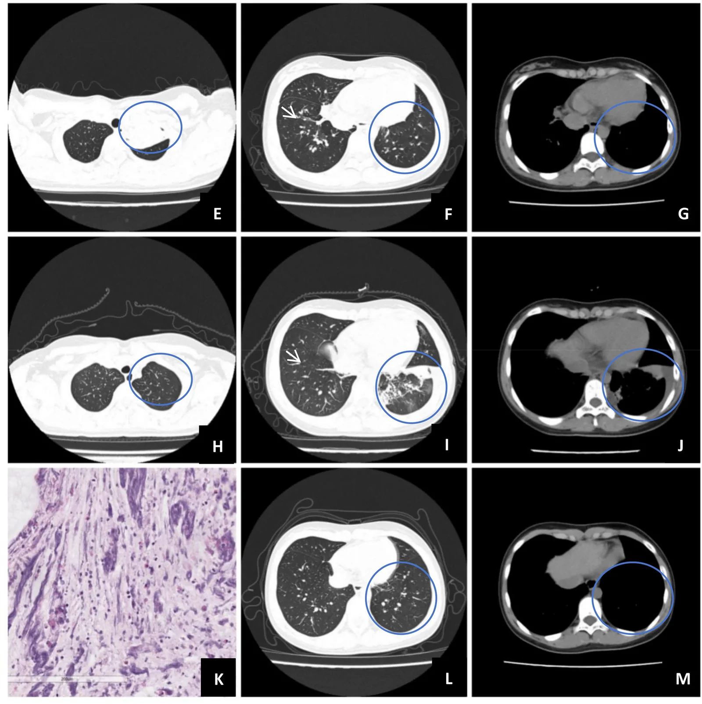

# 6126 — Viêm phế quản nhựa (plastic bronchitis) & bã nhầy phế quản ở trẻ / Plastic bronchitis & bronchial cast

**Tags:** `pattern:ba-nhay` `pattern:xep-phoi` `pattern:mat-the-tich` `pattern:trang-phoi` `vung:phe-quan` `vung:phoi-nhi` `anatomy:phex-quan` `protocol:X-quang-nguc` `protocol:CT-nguc` `protocol:noi-soi-phe-quan` `score:Seear` `incidentaloma:khong`
**Mức chắc chắn (certainty):** tổng hợp y văn (literature synthesis) — ghép **tổng quan tự sự 2026 về phân loại và sinh bệnh học** (Front Pediatr 2026, PMC13212312), **đoàn hệ 86 trẻ PB liên quan nhiễm trùng** (Front Pediatr 2026, PMC13021623), **đoàn hệ 352 trẻ tái phát** (Front Pediatr 2026, PMC13597871), **ca “trắng phổi” một bên** (BMC Pediatr 2026, PMC13524460) và **ca EV-D68** (Front Med 2026, PMC13719561). Không có ca do nhóm tự chụp.

> **Câu hỏi thực hành:** bé trai **2 tuổi 5 tháng**, sốt 5 ngày, ho, khó thở; X-quang **mờ toàn bộ nửa ngực trái (“trắng phổi”)** kèm **mất thể tích và trung thất lệch sang trái**; CT thấy **xẹp toàn bộ phổi trái, nhu mô đông đặc đều, KHÔNG có phế quản hơi** sau chỗ tắc. Câu hỏi: **viêm phổi hoại tử/tràn mủ màng phổi, dị vật, hay bã nhầy phế quản?** Và **khi nào phải nội soi phế quản cấp?**

## 1. Tổng quan bệnh học – cơ chế hình ảnh

- **Định nghĩa:** viêm phế quản nhựa (plastic bronchitis, PB) là tình trạng hình thành **bã nhầy (bronchial cast)** — khối **liên kết, dai, có hình phân nhánh** tái hiện **đúng kiến trúc cây phế quản** — gây tắc đường thở. Đây **không phải “nút nhầy thường” (ordinary mucus plug)**: cast giữ nguyên hình ống–phân nhánh khi lấy ra hoặc khi bệnh nhân ho ra, còn nút nhầy thường mềm, vụn, không giữ hình ([PMC13212312](https://pmc.ncbi.nlm.nih.gov/articles/PMC13212312/)).
- **Thành phần quyết định tên gọi và điều trị:** cast gồm **fibrin, mucin, tế bào viêm, tế bào biểu mô bong** với tỷ lệ khác nhau. Phân loại **Seear 1997** chia 2 thể: **thể I (viêm)** — **nhiều fibrin, ít mucin, có tinh thể Charcot–Leyden và thâm nhiễm bạch cầu ái toan dày đặc**; **thể II (không tế bào)** — **nhiều mucin, ít fibrin, ít tế bào**. Cast dạng **chylous (dưỡng trấp)** không lọt vào phân loại này; đây là lý do có khung phân loại mới **lymphatic PB (LPB) vs eosinophilic PB**.
- **TẠI SAO hình ảnh lại “giống ung thư/xẹp phổi”:**
  1. **Tắc hoàn toàn lòng phế quản** → khí phía sau bị hấp thu (nitơ và oxy) trong **vài giờ** → **xẹp phổi (atelectasis)** với **mất thể tích** rõ: khe di lệch, trung thất lệch cùng bên, cơ hoành nâng, các cung sườn sát nhau.
  2. **Không có phế quản hơi (air bronchogram) sau chỗ tắc** vì lòng phế quản **đã bị cast lấp đầy** — phế quản hơi chỉ xuất hiện khi phế quản còn khí và nhu mô quanh nó đặc. Đây là **chốt cơ chế**, không phải dấu hiệu “phổi đã hỏng”.
  3. Cast **ngậm nước, không cản quang** → trên CT có **đậm độ mô mềm–dịch**, không vôi hóa, không bắt thuốc; có thể thấy **dải phân nhánh trong lòng phế quản** hoặc chỉ thấy **đông đặc + xẹp**.
  4. Khi cast **van một chiều** thay vì tắc hoàn toàn → **ứ khí (air trapping)**, thậm chí **tràn khí**, làm hình ảnh “nặng” hơn thực tế.
- **Ngưỡng định lượng cần nhớ** (từ các nguồn đã đọc):
  - Tần suất chung **6,8/100.000** (một trung tâm Mỹ, 12 năm); theo nhóm: **bệnh tim bẩm sinh 113/100.000**, **viêm phổi/cúm 58/100.000**, **hen 29/100.000**; **tử vong 7% (1/14 ca)** trong loạt nhỏ này.
  - Sau **Fontan**: **0,1% (4/3.226)** trong một nghiên cứu đa trung tâm Nhật; một loạt Australia báo **1,8%**.
  - Trong **viêm phổi do Mycoplasma pneumoniae nặng (SMPP)**: **14,67%** trẻ có PB (nghiên cứu đa trung tâm Trung Quốc).
  - Trong **86 trẻ PB liên quan nhiễm trùng**: **94,2% do M. pneumoniae** (kèm **35,8% đồng nhiễm**); **7,4% có kết cục bất lợi** (xẹp dai dẳng, giãn phế quản, 1 ca phải mổ).
  - **Tái phát sau lấy cast: 85/352 = 24,1%**; yếu tố dự báo: **albumin thấp**, **sốt kéo dài ≥ 72 giờ sau lần rửa phế quản đầu**, **xẹp phổi**, **cast ở ≥ 2 thùy**; nomogram **AUC 0,853 / 0,833 / 0,811** (huấn luyện / nội kiểm / ngoại kiểm).
  - Trong loạt 81 ca MP: **tràn dịch màng phổi 25 (30,9%)**, **xẹp phổi 24 (29,6%)**, **viêm phổi hoại tử 14 (17,3%)**, **giãn phế quản 5 (6,2%)**, khí bóng kẽ phổi 3, **thuyên tắc phổi 2**.

## 2. Mẫu hình + chẩn đoán phân biệt theo vị trí & cơ chế (Gamut)

- **Theo cơ chế (quan trọng hơn vị trí):**
  1. **Nhiễm trùng** (thể I hoặc II): *M. pneumoniae* (hàng đầu ở trẻ lớn), **cúm A/B, EV-D68, ho gà, adenovirus, RSV**; sau viêm phổi hoại tử.
  2. **Bạch mạch (lymphatic PB, LPB)**: sau **Fontan/Glenn**, **loạn sản bạch mạch**, **bất sản ống ngực**, hội chứng Noonan; cast **dưỡng trấp**, tái phát nhiều đợt, thường **không có nhiễm trùng khởi phát**.
  3. **Tăng bạch cầu ái toan/dị ứng**: **hen, ABPA, viêm phế quản ái toan**; cast thể I, đáp ứng corticoid.
  4. **Khác**: bỏng hít, bệnh hồng cầu hình liềm (hội chứng ngực cấp), bụi silic (hiếm), sau phẫu thuật tim.
- **Theo vị trí/hình ảnh:** **một bên “trắng phổi”** (cast lấp toàn bộ cây phế quản một bên — ca PMC13524460), **một thùy/phân thùy xẹp tái diễn**, **ứ khí một bên** khi van một chiều, hoặc **hình “ngón tay trong găng” (finger-in-glove)** khi ứ nhầy phế quản.
- **Gợi nhớ CAST:** **C**ongenital heart (Fontan/Glenn) · **A**sthma/ABPA (ái toan) · **S**epsis/infection (*Mycoplasma*, cúm, EV-D68) · **T**horacic duct/lymphatic dysplasia (LPB).

## 3. Bảng so sánh phân biệt (ma trận đối chiếu): “trắng phổi/xẹp một bên ở trẻ”

| Thực thể (entity) | Hình ảnh điển hình (CXR/CT) | Chốt vào (rule-in) | Chốt loại (rule-out) | Gợi ý xác nhận |
|---|---|---|---|---|
| **Bã nhầy phế quản (PB cast)** | Mờ đồng nhất một bên/thùy + **mất thể tích**; CT: đông đặc đều, **KHÔNG phế quản hơi sau chỗ tắc**, dày thành phế quản quanh chỗ tắc | **Mất thể tích + không phế quản hơi + nội soi thấy cast hình phân nhánh**; **ho ra “khuôn” phế quản** | Đông đặc có phế quản hơi lan tỏa + sốt cao đơn thuần → viêm phổi; có mức dịch màng phổi → empyema | **Nội soi phế quản ống mềm** (tiêu chuẩn vàng, vừa chẩn đoán vừa điều trị) + gửi cast mô bệnh học |
| **Nút nhầy/ứ nhầy do ABPA–hen** | Ứ nhầy **hình ngón tay trong găng**, phế quản giãn trung tâm; thường hai bên, nhiều đợt | **Giãn phế quản trung tâm + tăng IgE/bạch cầu ái toan + tiền sử hen** | Cast dai giữ hình phân nhánh, một bên, không giãn phế quản → PB | CT lát mỏng, IgE, nội soi |
| **Dị vật đường thở** | Mờ một thùy/phổi + **ứ khí thì thở ra**; dị vật cản quang chỉ **~11%** | **Hội chứng xâm nhập rõ + ứ khí một bên + dị vật thấy trên CT** | Mờ đều không ứ khí, không tiền sử sặc → nghĩ PB/viêm phổi | Nội soi phế quản (vừa lấy dị vật) |
| **Empyema/mủ màng phổi** | Mờ chiếm nửa ngực, **hiệu ứng khối** (trung thất đẩy xa), **split pleura sign**, góc tù | **Dịch màng phổi vách + trung thất bị đẩy** | **Mất thể tích + trung thất lệch về phía mờ** → không phải empyema | Siêu âm màng phổi, CT có cản quang, chọc hút |
| **Viêm phổi hoại tử** | Đông đặc + **hang/bóng khí trong nhu mô**, có thể tràn dịch | **Bóng khí trong đông đặc + sốt cao, LDH tăng** | Không hang, xẹp đều → PB | CT cản quang, theo dõi |
| **Bất sản/dị dạng phổi bẩm sinh** | Mờ đều từ sơ sinh, **trung thất lệch cùng bên**, không thay đổi theo thời gian | **Bệnh sử từ sơ sinh + không có đường thở bất thường** | Mờ mới xuất hiện sau nhiễm trùng → mắc phải | CT/MRI, nội soi |

### Cast phế quản vs nút nhầy thường (đọc đúng bản chất)
- **Cast:** **dai, đàn hồi, giữ hình phân nhánh** khi lấy ra; mô học có **lớp fibrin/mucin đồng nhất**, thể I có bạch cầu ái toan và tinh thể Charcot–Leyden, thể II **không tế bào**.
- **Nút nhầy thường:** vụn, dễ vỡ, không tái hiện kiến trúc phế quản; thường gặp trong hen/CF/xẹp do thở máy.
- **Hệ quả điều trị:** cast cần **lấy bằng nội soi** (có khi nhiều lần), còn nút nhầy đáp ứng hút/rửa và vật lý trị liệu đường thở.

## 4. Protocol chụp + hệ phân độ/điểm chuẩn hóa

- **Bước 1 — X-quang ngực thẳng:** xác nhận **mờ + mất thể tích**; phân biệt **mờ có hiệu ứng khối (empyema/khối)** với **mờ có mất thể tích (xẹp/cast)**. X-quang **có thể bình thường trong vài giờ đầu**.
- **Bước 2 — CT ngực liều thấp (có cản quang khi nghi empyema/hoại tử):** trả lời **“tắc ở đâu, có phế quản hơi không, có hang/dịch màng phổi không”**; tìm **cast dạng dải trong lòng phế quản**, dày thành phế quản, ứ khí.
- **Bước 3 — nội soi phế quản ống mềm:** **tiêu chuẩn vàng**; lấy cast, rửa bằng nước muối sinh lý, gửi **mô bệnh học + cấy**; đánh giá đồng thời TBM/hẹp/dị vật.
- **Bước 4 — phân loại và tìm nguyên nhân:** mô học theo **Seear** (I/II); nếu **LPB** → **DCMRL (dynamic contrast-enhanced MR lymphangiography)** hoặc **CT lymphangiography**, siêu âm tim/tìm Fontan; nếu thể ái toan → IgE, test dị ứng, ABPA.
- **Điều trị (định hướng, theo nguồn đã đọc):**
  - **Lấy cast bằng nội soi** là trung tâm; có thể cần **nhiều lần** (nhóm kết cục xấu trung vị **3,5 lần** so với **2 lần** ở nhóm tốt).
  - **Thể fibrin/ái toan:** cân nhắc **alteplase khí dung** để làm tan cast và **heparin khí dung** để giảm tái tạo cast fibrin; corticoid toàn thân nếu thể ái toan.
  - **LPB/Fontan:** **nút mạch bạch mạch qua da** (percutaneous lymphatic embolization) sau khi xác định dòng bạch mạch bất thường; xem xét **fenestration** ở bệnh nhân Fontan.
  - **Nhiễm trùng:** kháng sinh theo *Mycoplasma*/vi khuẩn; không có kháng sinh dự phòng để “ngừa cast”.
- **Theo dõi tái phát:** lịch khám sớm trong **3 tháng đầu** (thời điểm tái phát cao); dùng nomogram 4 biến (**albumin, sốt ≥ 72 giờ sau rửa lần 1, xẹp phổi, cast ≥ 2 thùy**) để phân tầng.

**Bằng chứng nội soi – mô học – hồi phục (cùng một bệnh nhi “trắng phổi”):**

*Cast trắng, dai, lấp lòng phế quản trái — lấy bằng ống mềm. Nguồn: BMC Pediatr 2026 (PMC13524460), Fig. 3, CC BY-NC-ND 4.0, nguyên bản.*

*Mô học: chất mucin–sợi **không tế bào** = thể II theo Seear. Nguồn: BMC Pediatr 2026 (PMC13524460), Fig. 4, CC BY-NC-ND 4.0, nguyên bản.*

*Sau lấy cast: phổi trái **gần như tái thông khí hoàn toàn** — bằng chứng nhu mô không hoại tử. Nguồn: BMC Pediatr 2026 (PMC13524460), Fig. 5, CC BY-NC-ND 4.0, nguyên bản.*

## 5. Biến thể bình thường và cạm bẫy

- **Bẫy 1 — “trắng phổi” bị đọc là phổi đã hỏng, chỉ định cắt thùy:** nhu mô **hồi phục hoàn toàn sau khi lấy cast** (X-quang ngày sau nội soi đã gần bình thường trong ca PMC13524460). **Không mổ cắt phổi trước khi nội soi.**
- **Bẫy 2 — thiếu phế quản hơi bị hiểu là “phổi xẹp không hồi phục”:** thiếu phế quản hơi **chỉ nói lên lòng phế quản bị lấp**, không nói nhu mô hoại tử.
- **Bẫy 3 — bỏ mất cast bệnh nhân ho/khạc ra:** cast có thể bị vứt vào thùng rác; **phải giữ và gửi mô bệnh học** — đây là mẫu chẩn đoán rẻ nhất.
- **Bẫy 4 — nhầm với dị vật:** dị vật cản quang chỉ **~11%**; CT âm không loại trừ. **Tiền sử sặc + ứ khí một bên** mới là chốt, còn **mất thể tích đều** nghiêng về cast.
- **Bẫy 5 — coi PB là bệnh “lành tính một đợt”:** **24,1% tái phát**; nhóm tái phát có **cast ≥ 2 thùy, xẹp phổi, sốt kéo dài sau rửa đầu** — cần theo dõi chủ động.
- **Bẫy 6 — bỏ sót LPB ở bệnh nhân Fontan:** cast dưỡng trấp tái phát nhiều đợt, không đáp ứng kháng sinh; cần **hình ảnh bạch mạch** trước khi leo thang điều trị.
- **Biến thể bình thường dễ nhầm:** **ứ nhầy phế quản thoáng qua sau gây mê/thở máy** (nút nhầy mềm, mất sau hút) và **giả tổn thương do tư thế** trên X-quang — đừng gọi là cast khi không có mất thể tích.

## 6. Tự lượng giá — Blind Quiz ngay trên trang tĩnh

**Ca 1 — Bé 2 tuổi 5 tháng, sốt và khó thở, “trắng phổi” trái. Nhìn phim trước, mô tả trước.**

- Gợi ý lâm sàng: sốt 5 ngày, ho nhiều, khó thở; không có tiền sử tim bẩm sinh.
- Câu hỏi: (1) Vì sao nói đây là **mất thể tích** chứ không phải **hiệu ứng khối**? (2) Ba chẩn đoán phân biệt hàng đầu? (3) Bước tiếp theo?

<b>Bấm để hiện đáp án (findings + chẩn đoán)</b>

- Dấu hiệu: **mờ đồng nhất toàn bộ nửa ngực trái**, **trung thất lệch sang trái**, **cơ hoành trái khó thấy**, không có mức dịch màng phổi; bóng dạ dày dưới cơ hoành trái cho thấy đây là bên trái.
- Chẩn đoán: **xẹp phổi toàn bộ trái do bã nhầy phế quản (plastic bronchitis)** — cast lấp cây phế quản trái. Ba phân biệt: empyema (hiệu ứng khối), viêm phổi hoại tử, dị vật.
- Chốt: **trung thất lệch về phía mờ = mất thể tích**; CT sau đó cho thấy **không phế quản hơi** và nội soi lấy cast.
- Nguồn ảnh: BMC Pediatr 2026 (PMC13524460), Fig. 1 — **CC BY-NC-ND 4.0**, nguyên bản.

**Ca 2 — Cùng bệnh nhi: CT ngực trước nội soi.**

- Câu hỏi: Nhu mô trái **đông đặc đều và không có phế quản hơi** — dấu hiệu này nói gì về vị trí tắc và tiên lượng? Có nên cắt thùy ngay?

<b>Bấm để hiện đáp án (findings + chẩn đoán)</b>

- Dấu hiệu: phổi trái **xẹp hoàn toàn, mất thể tích lớn**, trung thất lệch trái; nhu mô **đông đặc đồng nhất, không thấy phế quản hơi** ngoài mức tắc; dày thành phế quản quanh rốn phổi, **không hang, không đường rò, không dị vật cản quang**.
- Chẩn đoán: **tắc hoàn toàn phế quản gốc trái do cast**; nhu mô chưa hoại tử.
- Chốt: **không phế quản hơi = lòng phế quản bị lấp**, không phải “phổi hỏng”; **không cắt thùy** trước khi nội soi.
- Nguồn ảnh: BMC Pediatr 2026 (PMC13524460), Fig. 2 — **CC BY-NC-ND 4.0**, nguyên bản.

**Ca 3 — Cast lấy ra và cast bệnh nhân ho khạc.**

- Câu hỏi: Vì sao hình dạng **phân nhánh, liên kết** lại là chốt phân biệt với nút nhầy thường? Mô học thể I và II khác nhau ở đâu, và khác nhau đó đổi điều trị thế nào?

<b>Bấm để hiện đáp án (findings + chẩn đoán)</b>

- Dấu hiệu: khối **dai, liền một mảnh, phân nhánh**, tái hiện kiến trúc phế quản — “khuôn” của cây phế quản.
- Chẩn đoán: **bã nhầy phế quản (bronchial cast)**. Thể I: **nhiều fibrin, ít mucin, tinh thể Charcot–Leyden, bạch cầu ái toan** → cân nhắc **corticoid + alteplase khí dung**. Thể II: **nhiều mucin, ít fibrin, ít tế bào** → điều trị theo nguyên nhân (nhiễm trùng, LPB).
- Chốt: **giữ hình phân nhánh + dai** là dấu hiệu đại thể; mô bệnh học quyết định thể.
- Nguồn ảnh: Front Pediatr 2026 (PMC13212312), Fig. 1 — **CC BY 4.0**, nguyên bản.

**Ca 4 — Trẻ sau nhiễm EV-D68: mờ thùy trên trái, giảm thể tích.**

- Gợi ý: sốt, khò khè, sau nhiễm virus đường hô hấp.
- Câu hỏi: Hình ảnh này gợi ý tắc ở đâu? Cần làm gì để xác nhận và lấy bã?

<b>Bấm để hiện đáp án (findings + chẩn đoán)</b>

- Dấu hiệu: **mờ vá đông đặc thùy trên trái kèm giảm thể tích** (vòng tròn đánh dấu), nốt nhỏ đáy phổi hai bên; sau điều trị và nội soi, **phổi tái thông khí** ở CT ngày 10.
- Chẩn đoán: **PB sau nhiễm EV-D68**; cast lấy qua nội soi phế quản.
- Chốt: **giảm thể tích khu trú + không phế quản hơi** trong bối cảnh nhiễm virus → nội soi sớm.
- Nguồn ảnh: Front Med 2026 (PMC13719561), Fig. 2 — **CC BY 4.0**, nguyên bản.

## Bài liên quan chéo

- [6101 – Xẹp phổi một bên tái diễn ở trẻ BPD/TBM](../6101-xep-phoi-tai-dien-mot-ben-tre-bpd-tbm/lesson.md)
- [602 – Tracheobronchomalacia ở trẻ BPD](../602-tracheobronchomalacia-o-tre-bpd/lesson.md)
- [606 – BPD ở trẻ sinh non](../606-bpd-tre-sinh-non/lesson.md)
- [616 – Biến chứng viêm phổi nhi: empyema & hoại tử](../616-bien-chung-viem-phoi-nhi-empyema-hoai-tu/lesson.md)
- [614 – Bệnh tiểu phế quản tắc nghẽn (BO/Swyer–James)](../614-benh-tieu-phe-quan-tac-nghen-BO-Swyer-James/lesson.md)
- [612 – Cấp cứu đường thở trên ở trẻ em](../612-cap-cuu-duong-tho-tren-tre-em/lesson.md)

## Ảnh

- File: `6126_plastic-bronchitis_X-quang_PMC13524460-F1.webp`, `…_CT_PMC13524460-F2.webp`, `…_noi-soi_PMC13524460-F3.webp`, `…_mo-hoc_PMC13524460-F4.webp`, `…_X-quang_PMC13524460-F5.webp` (BMC Pediatr 2026, **CC BY-NC-ND 4.0** — nguyên bản, không crop/ghép).
- `6126_plastic-bronchitis_cast_PMC13212312-F1.jpg` (Front Pediatr 2026, **CC BY 4.0**).
- `6126_plastic-bronchitis_CT_PMC13719561-F2.webp` (Front Med 2026, **CC BY 4.0**).
- Nguồn + giấy phép từng ảnh: `images/CREDITS.md`.

> Không dùng để chẩn đoán độc lập khi chưa có người hướng dẫn.
