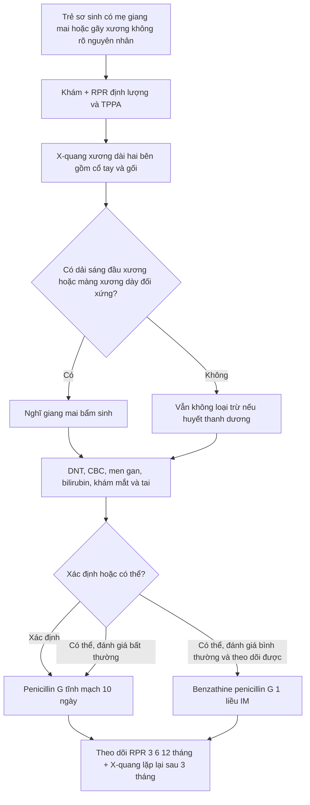
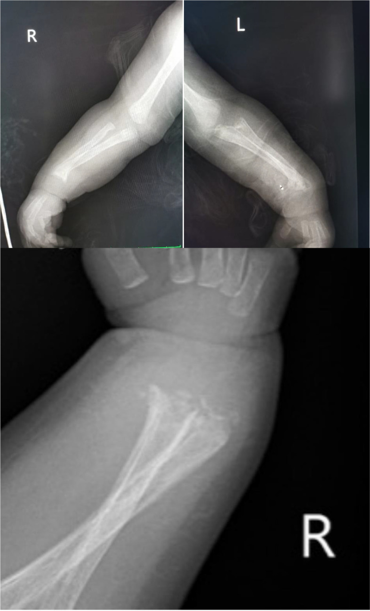
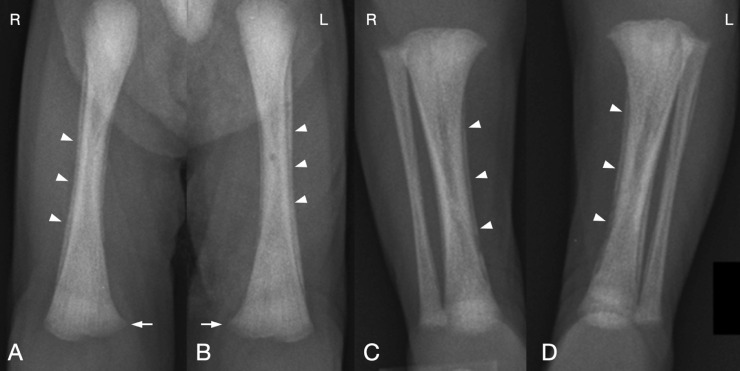
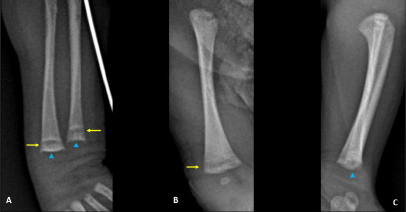

# 6127 — Giang mai bẩm sinh: viêm xương sụn, viêm màng xương & liệt giả Parrot / Congenital syphilis: osteochondritis, periostitis & pseudoparalysis

**Tags:** `pattern:day-sang-dau-xuong` `pattern:vien-mang-xuong` `pattern:gay-xuong` `pattern:huy-xuong` `vung:xuong-dai` `protocol:X-quang-xuong-dai` `score:Wimberger` `incidentaloma:khong`
**Mức chắc chắn (certainty):** tổng hợp y văn (literature synthesis) — ghép **tổng quan minh họa về giang mai bẩm sinh** (Children (Basel) 2023, PMC10453258), **ca trẻ 2 tháng gãy nhiều xương** (BMC Pediatr 2022, PMC9768959), **ca sơ sinh viêm màng xương đối xứng** (Radiol Case Rep 2021, PMC8495030) và **ca sinh non 33 tuần không triệu chứng** (Radiol Case Rep 2025, PMC11625107). Không có ca do nhóm tự chụp.

> **Câu hỏi thực hành:** bé trai **2 tháng tuổi** nhập viện vì **gãy thân xương quay và xương trụ hai bên**, kèm thở rít; bác sĩ chỉnh hình nghi **xơ xương bất toàn (osteogenesis imperfecta)**. Phim **không thấy xương mỏng, không giảm đậm độ toàn thân**, nhưng có **dải sáng ngang đầu xương và phản ứng màng xương đối xứng**. Câu hỏi: **gãy do bị bạo hành, do bệnh xương di truyền, hay do nhiễm trùng bẩm sinh?**

## 1. Tổng quan bệnh học – cơ chế hình ảnh

- **Bệnh học:** *Treponema pallidum* lây **qua nhau thai** ở bất kỳ tam cá nguyệt nào; nguy cơ lây **cao nhất khi mẹ ở giai đoạn sớm** — **40–70%** ở giang mai sớm, giảm còn **~10%** ở giai đoạn muộn. Tổn thương xương là **viêm xương sụn (osteochondritis) ở vùng sụn tiếp hợp**, **viêm màng xương (periostitis)** và **viêm tủy xương (osteitis)** do phản ứng viêm quanh mạch của xoắn khuẩn.
- **TẠI SAO lại là “dải sáng đầu xương” (metaphyseal radiolucent band):**
  1. Vùng sụn tiếp hợp **giàu mạch máu**, là nơi xoắn khuẩn dễ khu trú → **viêm và tiêu xương ở bè xương sơ khai ngay dưới sụn**.
  2. Trên X-quang, vùng tiêu xương tạo **dải sáng ngang** chạy song song sụn tiếp hợp, thường có **viền xơ hóa (sclerotic line) ở trên và dưới** — dấu hiệu của **metaphysitis**.
  3. Khi các dải sáng–đặc **xen kẽ nhau**, đầu xương trông như **thân cần tây (celery stalk)**; bờ đầu xương bị bào mòn tạo hình **răng cưa (serrated)**.
  4. **Màng xương dày lên** do viêm → **phản ứng màng xương đối xứng dọc thân xương**, có thể thấy **“vỏ hành”**; về sau màng xương dày có thể **dày dính vào vỏ xương**.
  5. **Wimberger sign:** **khuyết/tiêu xương bờ trong đầu xương chày gần** — dấu hiệu kinh điển của viêm xương do giang mai bẩm sinh.
  6. **Đau xương → trẻ không cử động chi = “liệt giả Parrot” (pseudoparalysis of Parrot)**, dễ nhầm với liệt đám rối cánh tay hoặc viêm khớp nhiễm khuẩn.
- **Ngưỡng định lượng:**
  - **Tổn thương xương gặp ở 60–80%** trẻ giang mai bẩm sinh và **có thể là biểu hiện DUY NHẤT** (BMC Pediatr 2022, PMC9768959).
  - Trong giang mai bẩm sinh sớm: **viêm xương sụn 24%**, **phản ứng màng xương 34%**, **viêm xương 0,7%** (Radiol Case Rep 2021, PMC8495030).
  - **Tới 70% trẻ sơ sinh nhiễm có thể KHÔNG có triệu chứng lúc sinh.** Thai chết lưu/hydrops có thể tới **40%** ở thai kỳ không điều trị.
  - Dịch tễ Hoa Kỳ 2021: **2.677 ca** giang mai bẩm sinh, **77,9/100.000 trẻ sinh sống**; **+30,5% so với 2020** và **+219,3% so với 2017** (Children (Basel) 2023, PMC10453258).
- **Vì sao tổn thương đối xứng:** xoắn khuẩn lan **qua đường máu** → tác động lên **các vùng sụn tiếp hợp đang phát triển mạnh nhất** ở cùng thời điểm (đầu dưới xương quay/trụ, đầu dưới xương đùi, đầu trên xương chày) → tổn thương **hai bên, đối xứng**. Đây là chốt phân biệt với **gãy do bạo hành** (thường không đối xứng, không có dải sáng đầu xương).

## 2. Mẫu hình + chẩn đoán phân biệt theo vị trí (Gamut)

- **Dải sáng ngang đầu xương (metaphyseal bands):** giang mai bẩm sinh · nhiễm trùng bẩm sinh khác (CMV, rubella) · bạch cầu cấp (dải sáng do thâm nhiễm/điều trị) · còi xương đang lành (bờ loe, tua) · scorbut · loạn sản xương · di căn u nguyên bào thần kinh (hiếm).
- **Phản ứng màng xương đối xứng (periostitis):** giang mai bẩm sinh · **viêm màng xương sinh lý ở trẻ sơ sinh** · tăng vitamin A · điều trị prostaglandin kéo dài · nhiễm trùng xương · bệnh hồng cầu hình liềm (hiếm).
- **Gãy nhiều xương ở nhũ nhi:** **bạo hành trẻ** (hàng đầu) · **xơ xương bất toàn** · **giang mai bẩm sinh** · còi xương · thiếu đồng · bệnh xương do thuốc.
- **“Liệt giả” một chi:** giang mai bẩm sinh (đau xương) · liệt đám rối cánh tay do sinh khó · viêm khớp/viêm tủy xương · gãy xương do bạo hành.
- **Gợi nhớ vị trí:** tổn thương hay gặp nhất ở **đầu dưới xương quay và xương trụ, đầu dưới xương đùi, đầu trên xương chày, đầu trên xương cánh tay** — nơi sụn tiếp hợp **tăng trưởng nhanh nhất**. Vì vậy phim **cổ tay và đầu gối** là hai vùng bắt buộc.

## 3. Bảng so sánh phân biệt (ma trận đối chiếu)

| Thực thể (entity) | Hình ảnh điển hình | Chốt vào (rule-in) | Chốt loại (rule-out) | Gợi ý xác nhận |
|---|---|---|---|---|
| **Giang mai bẩm sinh** | **Dải sáng ngang đầu xương đối xứng** + viền xơ hóa, **phản ứng màng xương dọc thân xương**, “celery stalk”, bờ răng cưa, **Wimberger sign**, gãy bệnh lý | **Đối xứng hai bên + dải sáng đầu xương + màng xương dày + huyết thanh giang mai dương** | Chỉ có gãy không kèm dải sáng/màng xương → nghĩ bạo hành/OI; xương mỏng toàn thân → OI | **RPR/TPPA**, huyết thanh mẹ, X-quang xương dài hai bên, DNT |
| **Xơ xương bất toàn (OI)** | **Giảm đậm độ xương toàn thân**, vỏ xương mỏng, **gãy nhiều lứa tuổi**, biến dạng cong, xương sọ có Wormian | **Xương mỏng + gãy nhiều thì + tiền sử gia đình + củng mạc xanh** | Đậm độ xương bình thường, không Wormian, có dải sáng đầu xương → không phải OI | Gene *COL1A1/COL1A2*, phim sọ, tiền sử gia đình |
| **Bạo hành trẻ** | Gãy **không đối xứng**, gãy góc (corner), gãy xương sườn nhiều lứa tuổi, gãy xương đòn, **không có dải sáng đầu xương** | **Cơ chế chấn thương không khớp + gãy nhiều lứa tuổi + tổn thương da/mô mềm** | Tổn thương đối xứng + dải sáng đầu xương + màng xương đều → nghĩ bệnh hệ thống | Skeletal survey, đánh giá bảo vệ trẻ, xét nghiệm giang mai |
| **Còi xương (rickets)** | **Đầu xương loe rộng, bờ tua (fraying), lõm (cupping)**, dải sáng rộng không đều, xương cong | **Bờ sụn tiếp hợp loe + cupping + hạ calci/phospho, ALP cao** | Bờ đầu xương sắc, có viền xơ hóa + màng xương → nghĩ giang mai | Calci, phospho, ALP, 25-OH vitamin D |
| **Scorbut** | **Dải trắng Frankel**, **Pelkan spur**, góc xương (corner sign), loãng xương, dễ chảy máu lợi | **Thiếu vitamin C + dấu Frankel + Pelkan spur** | Không có dải trắng điển hình; có màng xương dày → không scorbut | Vitamin C, hỏi chế độ ăn |
| **Nhiễm trùng bẩm sinh khác (CMV/rubella)** | Dải sáng đầu xương có thể gặp nhưng **không đặc hiệu**; kèm **vôi hóa nhu mô, giảm sản men răng, điếc, bệnh võng mạc** | **Bộ ba/tổn thương đa cơ quan + IgM/PCR dương** | Chỉ có tổn thương xương đơn thuần + huyết thanh giang mai dương → giang mai | CMV PCR, rubella IgM, siêu âm sọ, khám mắt |
| **Viêm màng xương sinh lý sơ sinh** | **Dày màng xương nhẹ, đối xứng, < 2 mm**, xuất hiện **vài tuần đầu**, tự thoái triển | **Trẻ khỏe mạnh, không dải sáng đầu xương, tự hết trong 1–2 tháng** | Màng xương dày kèm dải sáng đầu xương/gãy → không phải sinh lý | Theo dõi X-quang sau 4–6 tuần |

### Ba dấu hiệu X-quang cần đọc đúng thứ tự
1. **Dải sáng ngang đầu xương** — dấu hiệu **sớm nhất và nhạy nhất**; đối xứng.
2. **Phản ứng màng xương dọc thân xương** — thường rõ ở **đầu dưới xương đùi/chày**; “celery stalk” khi dải sáng–đặc xen kẽ.
3. **Wimberger sign** — khuyết bờ trong đầu xương chày gần; **đặc hiệu nhưng không nhạy** (không có vẫn không loại trừ).

## 4. Protocol chụp + hệ phân độ/điểm chuẩn hóa

- **Chỉ định:** mọi trẻ **có mẹ nhiễm giang mai chưa điều trị/điều trị không đủ**, trẻ có **huyết thanh dương**, hoặc **gãy xương không giải thích được ở nhũ nhi**; X-quang **được khuyến cáo trong bộ đánh giá chuẩn** của giang mai bẩm sinh.
- **Kỹ thuật:** **X-quang xương dài hai bên, tư thế thẳng** — tối thiểu **xương cánh tay, xương quay/trụ, xương đùi, xương chày/xương mác**; chụp thêm **khớp gối và cổ tay** (nơi tổn thương hay gặp nhất). Không cần gây mê; che chắn tuyến sinh dục.
- **Chụp gì thêm:** X-quang ngực nếu có triệu chứng hô hấp (“snuffles”, viêm phổi); siêu âm bụng nếu gan lách to; **siêu âm sọ/MRI** nếu có dấu thần kinh; **khám mắt và thính lực**.
- **Xét nghiệm bắt buộc:** **RPR (hoặc VDRL) định lượng + TPPA** cho trẻ và mẹ; **DNT** (tế bào, protein, VDRL), **CBC, men gan, bilirubin**; **X-quang xương dài** là một phần của “evaluation”.
- **Điều trị theo mức chắc chắn (CDC/AAP):**
  - **Giang mai bẩm sinh xác định/chắc chắn** (bất thường lâm sàng hoặc RPR ≥ 4 lần mẹ): **penicillin G tĩnh mạch 10 ngày**, bất kể kết quả đánh giá.
  - **Có thể (possible):** xét nghiệm bình thường + mẹ điều trị không đủ/không rõ → **IV penicillin G 10 ngày** (nếu đánh giá bất thường/không đầy đủ) **hoặc** **benzathine penicillin G 1 liều IM** (nếu đánh giá bình thường và chắc chắn theo dõi được).
  - **Ít khả năng (less likely):** **benzathine penicillin G 1 liều IM** hoặc **theo dõi hiệu giá** nếu mẹ đã điều trị đủ ≥ 30 ngày trước sinh.
  - Liều thực tế trong ca báo cáo: **aqueous penicillin G 200.000 UI/kg/ngày IV × 10 ngày**, thêm **benzathine penicillin G 50.000 UI/kg IM 1 liều** khi DNT bất thường.
- **Theo dõi:** khám lại + **RPR định lượng** theo lịch (thường 3, 6, 12, 18–24 tháng); **X-quang xương dài lặp lại sau ~3 tháng** để xác nhận lành xương và phân biệt với bệnh xương khác.

## 5. Biến thể bình thường và cạm bẫy

- **Bẫy 1 — X-quang bình thường lúc sinh không loại trừ:** tổn thương xương có thể **xuất hiện muộn trong vài tuần đầu**; trẻ **không triệu chứng** vẫn có thể đã có tổn thương xương (ca PMC11625107: sinh non 33 tuần, **không triệu chứng**, vẫn có metaphysitis).
- **Bẫy 2 — gọi là bạo hành khi thấy gãy nhiều xương:** **bạo hành là nguyên nhân hàng đầu**, nhưng **đối xứng + dải sáng đầu xương + màng xương dày** phải dẫn tới **xét nghiệm giang mai trước khi kết luận**. Kết luận sai gây **mất cơ hội điều trị** và **tổn hại gia đình**.
- **Bẫy 3 — nhầm với xơ xương bất toàn:** OI có **xương mỏng toàn thân, gãy nhiều lứa tuổi, biến dạng**; giang mai có **đậm độ xương bình thường + dải sáng đầu xương đối xứng**. Ca PMC9768959 ban đầu bị nghi OI.
- **Bẫy 4 — viêm màng xương sinh lý:** ở trẻ sơ sinh khỏe mạnh, màng xương có thể dày **nhẹ, đối xứng, dưới 2 mm** trong vài tuần đầu và **tự hết** — không có dải sáng đầu xương, không gãy.
- **Bẫy 5 — Wimberger âm tính:** dấu hiệu này **đặc hiệu nhưng không nhạy**; không có Wimberger **không loại trừ**.
- **Bẫy 6 — bỏ sót “snuffles” và liệt giả:** chảy mũi kéo dài, thở rít và **không cử động chi** ở nhũ nhi phải gợi ý giang mai bẩm sinh, không chỉ “viêm mũi” hay “liệt đám rối”.
- **Biến thể bình thường dễ nhầm:** **đường sáng của sụn tiếp hợp** và **bờ đầu xương gồ ghề sinh lý** ở trẻ non tháng — luôn so **hai bên** và đối chiếu tuổi xương.

## 6. Tự lượng giá — Blind Quiz ngay trên trang tĩnh

**Ca 1 — Bé trai 2 tháng, gãy xương quay/trụ hai bên, nghi xơ xương bất toàn.**

- Gợi ý: trẻ bú kém, da xanh, **gan lách to**; không có tiền sử chấn thương.
- Câu hỏi: (1) Mô tả tổn thương xương. (2) Vì sao **không nghĩ xơ xương bất toàn**? (3) Xét nghiệm nào chốt chẩn đoán?

<b>Bấm để hiện đáp án (findings + chẩn đoán)</b>

- Dấu hiệu: **gãy thân xương quay và xương trụ hai bên**, có **can xương** (gãy đang lành), kèm **phản ứng màng xương** dọc thân xương; không giảm đậm độ xương toàn thân.
- Chẩn đoán: **giang mai bẩm sinh** — tổn thương xương đối xứng là biểu hiện của viêm xương sụn/màng xương; huyết thanh **RPR và TPPA dương**, DNT có tăng nhẹ tế bào.
- Chốt: **đối xứng + can xương + màng xương dày** ở trẻ không chấn thương; OI bị loại vì **xương không mỏng, không biến dạng**.
- Phản biện nguồn: ca này gãy **thân xương** chứ không chỉ dải đầu xương — dạng **nặng hơn** điển hình; vẫn giữ nguyên mô tả gốc.
- Nguồn ảnh: BMC Pediatr 2022 (PMC9768959), Fig. 1 — **CC BY 4.0**, nguyên bản.

**Ca 2 — Sơ sinh đủ tháng, mẹ nhiễm giang mai phát hiện muộn.**

- Câu hỏi: Dấu hiệu nào là **“celery stalk”**? Có Wimberger sign không, và điều đó thay đổi kết luận thế nào?

<b>Bấm để hiện đáp án (findings + chẩn đoán)</b>

- Dấu hiệu: **phản ứng màng xương đối xứng** dọc thân cả hai xương đùi, xương chày, xương mác (mũi tên đầu); **dải sáng mờ ở đầu dưới xương đùi** (mũi tên trắng); các đường đậm độ mảnh từ thân tới đầu xương tạo hình **“celery stalk”**.
- Chẩn đoán: **giang mai bẩm sinh**; **Wimberger sign KHÔNG thấy** trong ca này nhưng chẩn đoán vẫn đứng vững nhờ huyết thanh + tổn thương đối xứng.
- Chốt: **tổn thương đối xứng + không gãy + không giảm đậm độ xương**; Wimberger chỉ là dấu hiệu bổ trợ.
- Nguồn ảnh: Radiol Case Rep 2021 (PMC8495030), Fig. 1 — **CC BY-NC-ND 4.0**, nguyên bản (4 panel).

**Ca 3 — Sơ sinh non tháng 33 tuần, mẹ giang mai thai kỳ không điều trị, trẻ KHÔNG triệu chứng.**

- Câu hỏi: Trẻ không triệu chứng thì có cần chụp X-quang không? Dấu hiệu nào trên phim xác nhận metaphysitis?

<b>Bấm để hiện đáp án (findings + chẩn đoán)</b>

- Dấu hiệu: **dải sáng ngang ở đầu dưới xương quay và xương trụ hai bên** (mũi tên vàng), có **đường xơ hóa trên/dưới**; bờ đầu xương **răng cưa (serrated)** (mũi tên xanh); tương tự ở đầu dưới xương đùi, xương chày, xương mác nhưng nhẹ hơn.
- Chẩn đoán: **metaphysitis do giang mai bẩm sinh** ở trẻ **không triệu chứng** — X-quang là công cụ phát hiện sớm.
- Chốt: **dải sáng + viền xơ hóa + bờ răng cưa đối xứng**; cần **X-quang xương dài ngay cả khi trẻ khỏe**.
- Nguồn ảnh: Radiol Case Rep 2025 (PMC11625107), Fig. 1 — **CC BY-NC-ND 4.0**, nguyên bản (3 panel).

## Bài liên quan chéo

- [6134 – Bệnh xương cứng di truyền (osteopetrosis)](../6134-benh-xuong-cung-di-truyen-osteopetrosis/lesson.md)
- [6102 – Nhiễm CMV bẩm sinh](../6102-nhiem-cmv-bao-thai/lesson.md)
- [6103 – Nhiễm toxoplasma và Zika bẩm sinh](../6103-nhiem-toxoplasma-va-zika-bao-thai/lesson.md)
- [610 – Suy hô hấp sơ sinh và dị dạng phổi](../610-suy-ho-hap-so-sinh-va-di-dang-phoi/lesson.md)
- [300 – Tổng quan hệ Cơ – Xương – Khớp](../300-tong-quan-he-co-xuong-khop/lesson.md)

## Ảnh

- `6127_giang-mai_X-quang_PMC9768959-F1.jpg` (BMC Pediatr 2022, **CC BY 4.0**).
- `6127_giang-mai_X-quang_PMC8495030-F1.jpg` (Radiol Case Rep 2021, **CC BY-NC-ND 4.0** — nguyên bản, không crop/ghép).
- `6127_giang-mai_X-quang_PMC11625107-F1.jpg` (Radiol Case Rep 2025, **CC BY-NC-ND 4.0** — nguyên bản).
- Nguồn + giấy phép từng ảnh: `images/CREDITS.md`.

> Không dùng để chẩn đoán độc lập khi chưa có người hướng dẫn.
