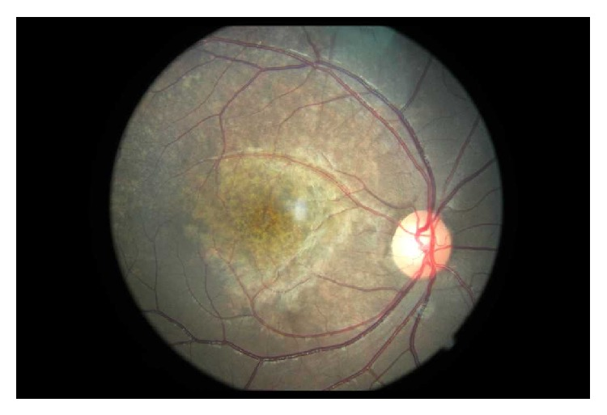
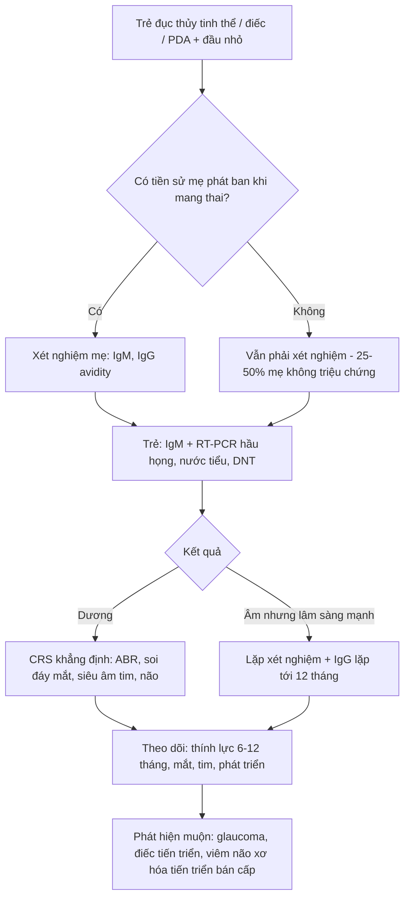
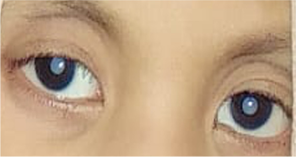
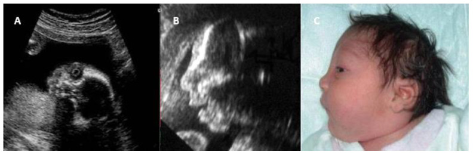
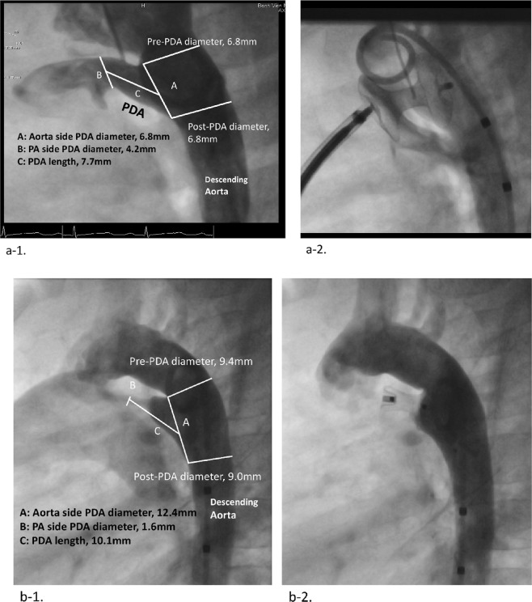

# 6128 — Rubella bẩm sinh (congenital rubella syndrome, CRS): tam chứng Gregg — đục thủy tinh thể + điếc tiếp nhận + hẹp động mạch phổi

**Tags:** `pattern:duc-thuy-tinh-the` `pattern:viem-vong-mac-sac-to` `pattern:hep-dong-mach-phoi` `pattern:ong-dong-mach-ton-tai` `pattern:dau-nho` `pattern:gan-lach-to` `vung:mat` `vung:tim` `vung:nao-thai` `protocol:sieu-am-thai` `protocol:MRI-thai` `protocol:PCR` `protocol:ABR` `incidentaloma:khong`

**Mức chắc chắn (certainty):** tổng hợp y văn (literature synthesis) — mô hình hóa toàn cầu (**PMC10689248**), giám sát Anh 2003–2016 (**PMC5954604**), loạt 115 ca Bangladesh có siêu âm tim (**PMC7692988**), loạt 108 trẻ Việt Nam (**PMC6863812**), sàng lọc 320 học sinh Cameroon có ảnh đáy mắt (**PMC4262751**), tổng quan cơ chế – chẩn đoán (**PMC12156454**), 1 ca nguyên văn Indonesia có ảnh đục thủy tinh thể (**PMC9745697**), 1 ca nhập khẩu Hoa Kỳ (**PMC5875265**) và 2 ca Canada (**PMC11323722**). Số liệu đối chiếu PMCID trong `sources.md`; chỗ suy luận được ghi rõ.

> **Câu chốt:** CRS là **bệnh của THỜI ĐIỂM nhiễm, không phải của nồng độ virus**. Ba con số quyết định cách đọc: **(1)** lây dọc tới **90% nếu nhiễm trong 12 tuần đầu**, **> 80% trong 3 tháng đầu**, rồi **giảm** giữa thai kỳ và **tăng lại gần 100% cuối thai kỳ** nhưng **gần như không gây dị tật** (PMC12156454; PMC5954604: **9/12 ca CRS nhiễm trước 16 tuần**, **8 trẻ khoẻ** sau phơi nhiễm **> 16 tuần**); **(2)** tổn thương **không đối xứng về tần suất**: **tim 98,2%** nhưng **điếc 75,6%**, **đục thủy tinh thể 53,0%**, **đầu nhỏ 68,6%** (PMC7692988) — nên **tim bình thường không loại trừ**; **(3)** **"muối tiêu" võng mạc** là dấu **rẻ nhất và bền nhất** nhưng **mẹ nhiễm không triệu chứng 25–50%** nên **không có tiền sử** vẫn phải nghĩ tới (PMC12156454; **65,2%** ca Bangladesh không nhớ nhiễm, PMC7692988).

## 1. Tổng quan bệnh học – cơ chế hình ảnh (TẠI SAO)

### 1.1 Virus và đường lây

- **Rubella virus** (họ *Togaviridae*, chi *Rubivirus*, RNA sợi đơn) — **chỉ người là ổ chứa**; lây qua **giọt bắn hô hấp**, thời kỳ lây mạnh nhất **7 ngày trước đến 7 ngày sau** phát ban, ủ bệnh **14–21 ngày** (PMC12156454).
- Nhiễm ở mẹ **25–50% không triệu chứng** → nhiễm huyết → **nhiễm nhau thai** → thai. Virus gây **chết tế bào theo chương trình ở tế bào đang phân chia chậm** + **ức chế phân bào** → cơ quan **thiếu tế bào** (giảm sản) chứ không phải "viêm–hoại tử ồ ạt" như toxo. Đây là lý do tổn thương CRS **nhỏ, đối xứng kiểu giảm sản**: mắt nhỏ, ống ốc giảm sản, nhánh động mạch phổi hẹp.
- **Vì sao có cả tổn thương MẠCH:** virus xâm nhập **nội mạc mạch máu nhỏ** → viêm nội mạc, phù nề, hẹp lòng → **thiếu máu cục bộ** ở võng mạc, ống ốc, cơ tim và **thành ống động mạch**. Trên hình ảnh, hệ quả là **hẹp nhánh ĐMP ngoại vi nhiều chỗ** và **PDA kiểu ống (tubular)** — không phải một chỗ hẹp khu trú.

### 1.2 TẠI SAO mỗi cơ quan lại có hình ảnh đó

- **Thủy tinh thể:** nang thủy tinh thể hình thành **tuần 4–7**; nhiễm đúng cửa sổ này → **hoại tử sợi thủy tinh thể** → **đục hai bên**, thường **đục nhân/trung tâm**, kèm **nhãn cầu nhỏ (microphthalmia)** vì mắt ngừng lớn theo. Trên **siêu âm thai**, thủy tinh thể bình thường là **vòng echo dày bao quanh lòng trống âm**; khi đục, **lòng thủy tinh thể trở nên echo dày/đặc** (Hình 3 trong bài). Đục thủy tinh thể **một bên** ít gợi ý CRS hơn nhiều.
- **Võng mạc "muối tiêu" (salt-and-pepper):** virus phá **biểu mô sắc tố võng mạc (RPE)** từng đám → **mảng giảm sắc tố xen mảng tăng sắc tố** ở **cực sau**, bờ không rõ. Vì tổn thương ở lớp RPE chứ không ở tế bào cảm quang, **thị lực thường KHÔNG giảm** — đây là điểm khác cốt lõi so với viêm võng mạc do toxo (sẹo hoại tử, mù). Trong loạt 320 học sinh Cameroon: **29 ca có bệnh võng mạc sắc tố**, **96,6% nằm trong nhóm khiếm thính**, **89,7% hai bên** (PMC4262751).
- **Tim:** vách buồng tim hoàn tất **tuần 4–8**; ống động mạch (ductus arteriosus) bị viêm → **không co lại sau sinh**. Trên **siêu âm tim/CTM**, PDA của CRS **ngắn, thành dày, kiểu ống** và **thường kèm hẹp nhánh ĐMP** — trong loạt so sánh: **PDA kiểu tubular 16% ở CRS vs 3% ở không CRS (p = 0,020)**, CRS có **cân nặng sinh thấp hơn**, **hẹp phổi/hẹp van động mạch chủ nhiều hơn**, **áp lực ĐMP và áp lực ĐMC tâm thu/tâm trương cao hơn (p < 0,001)** (PMC6863812).
- **Tai:** tổn thương **mạch vân (stria vascularis) và cơ quan Corti** do thiếu máu → **điếc tiếp nhận**, có thể **một bên hoặc hai bên** và **tiến triển thêm vài năm đầu** — lý do phải **đo thính lực lặp lại**, không chỉ đo một lần lúc sinh.
- **Não:** viêm màng não – mạch máu nhỏ gây **đầu nhỏ, chậm phát triển**, có thể **vôi hóa rải rác**; nhưng **vôi hóa KHÔNG phải dấu chủ của CRS** (xem mục 5) — khác hẳn CMV (quanh não thất) và toxo (rải rác cả hạch nền) ở bài 6102/6103.
- **Da – máu:** **tạo máu ngoài tủy ở trung bì** + giảm tiểu cầu → phát ban **"bánh muffin việt quất" (blueberry muffin)**, gan lách to, vàng da, **bệnh xương giảm đậm độ (radiolucent bone disease)**.

### 1.3 Ngưỡng định lượng cần nhớ

| Chỉ số | Số liệu | Nguồn |
|---|---|---|
| Lây dọc theo tuổi thai | **tới 90% trong 12 tuần đầu**; **> 80% trong 3 tháng đầu**; giảm giữa thai kỳ; **gần 100% cuối thai kỳ** (nhưng ít dị tật) | PMC12156454 |
| Cửa sổ gây CRS | **9/12 ca CRS nhiễm trước 16 tuần**; **8/8 trẻ khoẻ** khi phơi nhiễm **> 16 tuần** | PMC5954604 |
| Gánh nặng toàn cầu | **32.000 ca CRS sinh năm 2019** (KTC 13.000–60.000) vs **100.000 năm 2010**; **−73% từ 1996**; châu Phi **64/100.000** trẻ sinh sống, Đông Địa Trung Hải **27/100.000** | PMC10689248 |
| Tần suất ở nơi có giám sát tốt | Anh 2003–2016: **31 nhiễm rubella trong thai kỳ = 0,23/100.000 thai kỳ** → **5 CRS** | PMC5954604 |
| Tam chứng Gregg (115 ca) | **tim 98,2%** (PDA **76,5%**, hẹp van ĐM **38,2%**, hẹp nhánh ĐMP **14,7%**, VSD 2,6%, ASD 8,6%, hẹp eo 5,2%) · **điếc 75,6%** · **đầu nhỏ 68,6%** · **đục thủy tinh thể 53,0%** | PMC7692988 |
| Tuổi chẩn đoán | **trung vị 2 tuổi** (3 tháng–14 tuổi) — nghĩa là **bỏ sót ở giai đoạn sơ sinh là quy luật, không phải ngoại lệ** | PMC7692988 |
| Huyết thanh | IgG dương **91,3%**, IgM dương **8,6%** ở trẻ đã có chẩn đoán | PMC7692988 |
| "Rubella facies" | mặt tam giác **82,6%** · trán rộng **76,5%** · xoáy tóc bên phải **80%** · mũi cao **65,2%** | PMC7692988 |
| Bệnh võng mạc | **29 ca**, **96,6%** trong nhóm khiếm thính, **89,7% hai bên** (y văn: hai bên **80%**) | PMC4262751 |
| Ca nghi CRS được xác nhận | Ấn Độ, 8.953 ca nghi: **6,5% xác nhận bằng xét nghiệm**; tỉ lệ xác nhận **24,9% (2017) → 2,5% (2025)** | PMC13546868 |

## 2. Mẫu hình + chẩn đoán phân biệt theo vị trí (gamut)

- **Mẫu hình A — đục thủy tinh thể HAI BÊN + nhãn cầu nhỏ, trẻ nhỏ:** **CRS** (kèm "muối tiêu" võng mạc, tim bẩm sinh, điếc); phân biệt **galactosemia** (đục dạng "giọt dầu", bắt đầu quanh rìa, kèm vàng da – gan to – rối loạn đông máu), **hội chứng Lowe** (đục + giảm trương lực + toan ống thận + chậm phát triển), **PHPV/PFV** (dây xơ từ thể thủy tinh tới đĩa thị, **một bên**), **đục thủy tinh thể di truyền** (không có bất thường toàn thân).
- **Mẫu hình B — viêm võng mạc sắc tố "muối tiêu" ở cực sau:** **CRS**; phân biệt **giang mai bẩm sinh** (cũng "muối tiêu" + Hutchinson răng + viêm xương sụn), **loạn dưỡng sắc tố võng mạc sớm (RP)**, **sẹo viêm hắc–võng mạc do toxo** (sẹo teo có viền sắc tố, **giảm thị lực**), **ngộ độc/thiếu vitamin A**.
- **Mẫu hình C — PDA + hẹp NHÁNH động mạch phổi ở trẻ nhỏ:** **CRS**; phân biệt **hội chứng Williams** (hẹp trên van ĐMC + hẹp nhánh ĐMP + mặt "elfin" + tăng canxi máu), **Alagille** (hẹp nhánh ĐMP + cột sống "bướm" + thiểu sản đường mật), **hẹp nhánh ĐMP đơn thuần**, **Rubinstein–Taybi**.
- **Mẫu hình D — gan lách to + giảm tiểu cầu + phát ban "bánh muffin việt quất":** **CRS**; phân biệt **CMV**, **toxo**, **giang mai bẩm sinh**, **u nguyên bào thần kinh** (khối thượng thận), **bạch cầu cấp** (công thức máu ngoại vi).
- **Mẫu hình E — đầu nhỏ + vôi hóa nội sọ:** **CRS** (vôi hóa **thưa, không đặc hiệu**); **CMV** (vôi hóa **quanh não thất**, nang dưới nội tủy), **toxo** (vôi hóa **rải rác cả hạch nền**), **Zika** (vôi hóa **ranh giới vỏ–chất trắng**, vỏ mỏng), **Aicardi–Goutières** (vôi hóa hạch nền + lympho bào dịch não tủy).
- **Gợi nhớ:** **R**ubella = **R**etina muối tiêu + **R**iêng biệt "hẹp nhánh ĐMP" + **R**ăng? không; chốt bằng **R**ubella IgM/PCR. Đừng nhớ theo tam chứng đầy đủ — **chỉ 3/115 ca có đủ cả ba** dấu trong thực hành (suy ra từ tần suất từng dấu ở PMC7692988).

## 3. Bảng so sánh phân biệt (ma trận đối chiếu)

| Thực thể (entity) | Hình ảnh điển hình (US/MRI/CT) | Chốt vào (rule-in) | Chốt loại (rule-out) | Gợi ý xác nhận |
|---|---|---|---|---|
| **Rubella bẩm sinh** | **Đục thủy tinh thể hai bên + nhãn cầu nhỏ**; "muối tiêu" võng mạc; **PDA kiểu ống + hẹp nhánh ĐMP**; đầu nhỏ; gan lách to; xương giảm đậm độ | **Đục thủy tinh thể + điếc tiếp nhận + hẹp nhánh ĐMP/PDA** ở trẻ nhỏ, **mẹ nhiễm < 16 tuần** hoặc **không có tiền sử** | Tim bình thường, không đục thủy tinh thể **không loại trừ** (tim 98,2% nhưng đục thủy tinh thể chỉ 53,0%) | **Rubella IgM huyết thanh sơ sinh**, **RT-PCR dịch hầu họng/nước tiểu/dịch não tủy**, IgG lặp tới 12 tháng |
| **CMV bẩm sinh** | **Vôi hóa quanh não thất**, nang dưới nội tủy, polymicrogyria thùy thái dương; **bệnh võng mạc KHÔNG "muối tiêu"** | Vôi hóa quanh não thất + giảm thính lực **một bên** + PCR CMV dương | Đục thủy tinh thể + hẹp nhánh ĐMP → không phải CMV | PCR CMV nước tiểu/dịch hầu họng trong **3 tuần đầu** |
| **Toxoplasma bẩm sinh** | **Vôi hóa rải rác** vỏ + hạch nền, **dãn não thất tắc nghẽn**, **sẹo hắc–võng mạc hoại tử hai bên** | Vôi hóa rải rác + dãn não thất + **sẹo võng mạc giảm thị lực** | "Muối tiêu" **không mất thị lực** + hẹp nhánh ĐMP → nghiêng CRS | IgM/IgA sơ sinh, avidity mẹ, PCR dịch ối |
| **Giang mai bẩm sinh** | "Muối tiêu" võng mạc **rất giống CRS**; viêm xương sụn đầu xương, periostitis, gan lách to | **Muối tiêu + viêm xương sụn + VDRL/TPHA mẹ dương** | Không có tổn thương xương, không có hẹp nhánh ĐMP | **VDRL/RPR + TPHA** mẹ và con; X-quang chi dài |
| **Hội chứng Williams** | **Hẹp trên van ĐMC** + hẹp nhánh ĐMP; không đục thủy tinh thể | Hẹp trên van ĐMC + mặt đặc trưng + **tăng canxi máu** | **Không có đục thủy tinh thể/điếc** → ít nghĩ rubella | MLPA vùng 7q11.23; canxi máu |
| **Galactosemia** | Đục thủy tinh thể **dạng "giọt dầu"**, bắt đầu quanh rìa; **không** hẹp nhánh ĐMP | Đục thủy tinh thể + **vàng da kéo dài, gan to, rối loạn đông máu, nhiễm khuẩn huyết** | "Muối tiêu" võng mạc + điếc + tim bẩm sinh → không phải galactosemia | **Galactose-1-phosphate uridyltransferase (GALT)**, galactose máu |
| **PHPV / PFV** | Dây xơ từ **thể thủy tinh tới đĩa thị**, thường **một bên**, nhãn cầu nhỏ | **Một bên**, dây xơ nhìn thấy trên siêu âm/MRI | **Hai bên + "muối tiêu" + tim bẩm sinh** → CRS | Siêu âm/MRI hốc mắt; không có huyết thanh rubella |

*Đáy mắt: **loang lổ sắc tố kiểu "muối tiêu"** quanh hoàng điểm và cực sau, mạch máu và gai thị bình thường — tổn thương **lớp biểu mô sắc tố**, không phải sẹo hoại tử, nên **thị lực thường không giảm**. Đây là dấu **rẻ nhất, bền nhất** để truy ngược chẩn đoán ở trẻ khiếm thính. Nguồn: Int J Telemed Appl 2014 (PMC4262751), Fig. 1, **CC BY**.*

## 4. Protocol chụp + hệ phân tầng chẩn đoán

### 4.1 Trước sinh

- **Xét nghiệm mẹ là bước đầu, không phải siêu âm:** IgM/IgG rubella + **IgG avidity** khi nghi; **avidity cao** giúp loại nhiễm gần đây. Chẩn đoán **huyết thanh chuyển đổi** mới đủ cơ sở tư vấn.
- **Siêu âm thai:** lặp **2–4 tuần** nếu mẹ nhiễm/nghi nhiễm — tìm **đầu nhỏ**, **đục thủy tinh thể** (lòng thủy tinh thể echo dày), **nhãn cầu nhỏ**, **tim bẩm sinh/PDA**, **gan lách to, cổ trướng, FGR**. Hình 3 dưới là **ca phát hiện đục thủy tinh thể trên siêu âm thai** kèm đầu nhỏ — chứng minh **CRS có thể chẩn đoán trước sinh**.
- **MRI thai:** bổ sung khi siêu âm nghi ngờ hoặc cần đánh giá vỏ não/hố sau; **không thay** siêu âm tim thai.
- **RT-PCR dịch ối** có thể dương nhưng **không dự báo được mức độ nặng** — vì vậy **quyết định dựa trên hình ảnh + huyết thanh**, không dựa một xét nghiệm.
- **Giới hạn cần nói với gia đình:** **sau 16 tuần, dị tật cấu trúc gần như không xảy ra** (PMC5954604) — nhưng **điếc tiến triển vẫn có thể** xuất hiện muộn, nên **không hứa "an toàn tuyệt đối"**.

### 4.2 Sau sinh — bộ xét nghiệm và bộ hình ảnh tối thiểu

| Nhóm | Việc phải làm | Thời điểm |
|---|---|---|
| **Xác nhận nhiễm** | **Rubella IgM** huyết thanh; **RT-PCR** dịch hầu họng, nước tiểu, dịch não tủy, dịch kết mạc | **càng sớm càng tốt**, lặp nếu âm mà lâm sàng mạnh |
| **Theo dõi huyết thanh** | IgG lặp tới **12 tháng** — IgG **tồn tại/dương kéo dài** mới chứng minh nhiễm thai (IgG mẹ mất dần) | 3, 6, 9, 12 tháng |
| **Mắt** | **Soi đáy mắt** + khám thủy tinh thể/glaucoma **mọi trẻ nghi CRS** | sơ sinh, rồi 6–12 tháng/lần tới khi lớn |
| **Tai** | **ABR/ASSR** (không dùng otoacoustic emission đơn thuần để loại trừ) | **trước 3 tháng**, lặp mỗi 6–12 tháng tới 5 tuổi |
| **Tim** | Siêu âm tim tìm **PDA, hẹp nhánh ĐMP, hẹp van ĐM phổi/ĐMC**; **CTA/CTM** khi cần đo nhánh ĐMP | ngay khi chẩn đoán |
| **Não** | Siêu âm qua thóp/CT/MRI khi có đầu nhỏ, co giật, chậm phát triển | sơ sinh |
| **Toàn thân** | Công thức máu (giảm tiểu cầu), men gan, X-quang chi dài nếu nghi bệnh xương | sơ sinh |

### 4.3 Tiêu chuẩn ca bệnh (dùng để không bỏ sót)

- **Nhóm A (dấu chính):** đục thủy tinh thể **hoặc** glaucoma bẩm sinh · **bệnh tim bẩm sinh** · **điếc tiếp nhận** · **bệnh võng mạc sắc tố**.
- **Nhóm B (dấu phụ):** ban xuất huyết · gan lách to · vàng da · **đầu nhỏ** · **nhãn cầu nhỏ** · chậm phát triển · viêm màng não · **bệnh xương giảm đậm độ** · các bệnh muộn (đái tháo đường, **viêm não xơ hoá tiến triển bán cấp**).
- **Ca tương thích lâm sàng (clinically compatible)** = **≥ 2 dấu nhóm A** *hoặc* **1 dấu A + ≥ 1 dấu B**; **ca khẳng định** = tương thích + **IgM dương/RT-PCR dương/IgG tồn tại**.

## 5. Biến thể bình thường và cạm bẫy

- **Cạm bẫy 1 — "không có tiền sử mẹ nhiễm thì không phải rubella":** **65,2%** ca trong loạt 115 ca **không nhớ nhiễm** khi mang thai (PMC7692988), vì **25–50%** nhiễm rubella **không triệu chứng** (PMC12156454). Không có tiền sử **không loại trừ**.
- **Cạm bẫy 2 — chờ đủ tam chứng:** chỉ **53,0%** có đục thủy tinh thể, **75,6%** điếc, **98,2%** có bệnh tim. Chờ "đủ ba" = **chẩn đoán trung vị 2 tuổi** — đúng bằng tuổi đã qua cửa sổ can thiệp thủy tinh thể và ngôn ngữ.
- **Cạm bẫy 3 — đọc "muối tiêu" thành bệnh võng mạc khác:** "muối tiêu" **không đặc hiệu** — giang mai bẩm sinh, RP sớm, ngộ độc đều có. **Chốt loại** bằng huyết thanh, không bằng hình ảnh.
- **Cạm bẫy 4 — tìm vôi hóa não để chẩn đoán CRS:** vôi hóa ở CRS **thưa và không đặc hiệu**; bỏ công tìm vôi hóa trong khi **không soi đáy mắt và không đo thính lực** là sai thứ tự ưu tiên (ngược với CMV/toxo ở bài 6102/6103).
- **Cạm bẫy 5 — IgM âm giả:** IgM có thể **âm ở trẻ lớn** hoặc do **phản ứng chéo/yếu tố dạng thấp** gây **dương giả**. IgM âm **không loại trừ**; phải làm **RT-PCR** và **theo dõi IgG tới 12 tháng**.
- **Cạm bẫy 6 — loại trừ vì siêu âm tim bình thường:** PDA có thể **đóng dần** và hẹp nhánh ĐMP **khó thấy** ở trẻ sơ sinh do áp lực phổi còn cao. Không thấy tổn thương trên siêu âm sớm **không loại trừ**; lặp siêu âm sau 4–8 tuần.
- **Biến thể bình thường / dương tính giả hay gặp:** **(a)** võng mạc **dạng vân (tessellation)** ở trẻ da sẫm màu — đối xứng, đều, không có mảng giảm sắc tố; **(b)** **echo dày quanh não thất** ở trẻ sinh non — mất dần theo tuổi; **(c)** **PDA "im lặng" ở sơ sinh đủ tháng** trong 24–48 giờ đầu (bình thường sinh lý, không phải CRS).
- **Điểm an toàn thực hành:** **vaccine rubella (MMR) KHÔNG gây CRS** — nhiễm virus vaccine không gây dị tật; phát hiện kháng thể sau tiêm hoặc tiêm nhầm trong thai kỳ **không phải chỉ định chấm dứt thai kỳ**. Đây là câu hỏi hay gặp nhất ở phòng khám sản.

## 6. Tự lượng giá — Blind Quiz

**Ca 1 — Học sinh 9 tuổi ở vùng chưa có vaccine rubella, đi khám vì nghe kém, không phàn nàn thị lực.**

- Gợi ý: không có tiền sử bệnh mắt; mẹ không nhớ phát ban khi mang thai.
- Câu hỏi: Mô tả dấu hiệu ở cực sau? Vì sao **thị lực vẫn tốt**? Nêu 3 chẩn đoán phân biệt và xét nghiệm chốt.

<b>Bấm để hiện đáp án (findings + chẩn đoán)</b>

- Dấu hiệu: **loang lổ sắc tố "muối tiêu"** ở cực sau/hoàng điểm; gai thị và mạch máu bình thường; **không có sẹo hoại tử**.
- Chẩn đoán: **bệnh võng mạc sắc tố do rubella bẩm sinh**. Thị lực tốt vì tổn thương ở **lớp biểu mô sắc tố**, không phá tế bào cảm quang — khác sẹo do toxo.
- Số liệu: trong **320 học sinh** Cameroon, **29 ca** có bệnh võng mạc sắc tố, **96,6%** thuộc nhóm khiếm thính, **89,7% hai bên**; IgG rubella dương **48,7%** ở nhóm khiếm thính vs **7,4%** ở nhóm nghe bình thường (p < 0,0001).
- Phân biệt: giang mai bẩm sinh (VDRL/TPHA), RP sớm (ERG, tiền sử gia đình), sẹo toxo (giảm thị lực, sẹo teo rõ).
- Nguồn ảnh: Int J Telemed Appl 2014 (PMC4262751), Fig. 1, CC BY.

**Ca 2 — Bé gái 4 tuổi 3 tháng, mẹ đưa đi khám vì "mắt trắng ở cả hai bên từ nhỏ".**

- Gợi ý: trẻ chậm nói, nghe kém; mẹ không nhớ bệnh khi mang thai.
- Câu hỏi: Dấu hiệu chính? Vì sao đục thủy tinh thể **hai bên** ở trẻ nhỏ là chìa khóa? Cần khám gì tiếp?

<b>Bấm để hiện đáp án (findings + chẩn đoán)</b>

- Dấu hiệu: **đục thủy tinh thể hai bên**, đồng tử trắng (leukocoria), nhãn cầu nhỏ.
- Chẩn đoán: **rubella bẩm sinh** — xác nhận bằng RT-PCR/máu; ca gốc là ca CRS **4 tuổi 3 tháng** có **đục thủy tinh thể hai bên**.
- Vì sao hai bên quan trọng: đục **một bên** nghiêng về **PHPV/PFV hoặc chấn thương**; đục **hai bên** nghiêng về **nguyên nhân toàn thân** (rubella, galactosemia, di truyền).
- Việc phải làm: **ABR đo thính lực**, **siêu âm tim (PDA/hẹp nhánh ĐMP)**, khám phát triển; **mổ thủy tinh thể sớm** + phục hồi thị lực, không chờ xét nghiệm.
- Nguồn ảnh: BMC Pediatr 2022 (PMC9745697), Fig. 1, CC BY 4.0.

**Ca 3 — Thai 27,5 tuần, mẹ có huyết thanh chuyển đổi rubella ở 3 tháng đầu.**

- Câu hỏi: Hai bất thường trên siêu âm thai là gì? Chúng cho biết điều gì về **thời điểm nhiễm**?

<b>Bấm để hiện đáp án (findings + chẩn đoán)</b>

- Dấu hiệu: **(A)** mặt cắt vành hốc mắt — **thủy tinh thể echo dày (đục thủy tinh thể bẩm sinh)**; **(B)** mặt cắt dọc đầu — **đầu nhỏ**; **(C)** ảnh sau sinh xác nhận đầu nhỏ.
- Ý nghĩa: cả hai tổn thương hình thành **rất sớm (tuần 4–8)**, khớp với nhiễm **3 tháng đầu** — đúng cửa sổ nguy cơ cao nhất (**> 80% lây dọc**).
- Việc phải làm: tư vấn tiên lượng **mắt + tai + tim**, sinh tại cơ sở có hồi sức nhi và phẫu thuật mắt; không hứa "hết sau sinh".
- Nguồn ảnh: J Clin Med 2025 (PMC12156454), Fig. 1, CC BY 4.0.

**Ca 4 — Bé gái 24 tháng, CRS, được can thiệp PDA qua catheter.**

- Câu hỏi: Khác biệt hình thái ống động mạch giữa hai ca? Vì sao CRS lại có kiểu "ống"?

<b>Bấm để hiện đáp án (findings + chẩn đoán)</b>

- Dấu hiệu: **(a-1)** ống động mạch **thẳng, thành song song, không thắt eo** (đường kính phía ĐMC **6,8 mm**, phía ĐMP **4,2 mm**, dài **7,7 mm**) — **kiểu ống/tubular (type C)**; **(b-1)** ống **hình nón, hẹp dần về phía ĐMP** (**type A**). **(a-2)** đóng bằng **occluder thất (muscular VSD)**; **(b-2)** đóng bằng **Amplatzer Duct Occluder**.
- Vì sao: viêm nội mạc do rubella làm **thành ống dày, mất co thắt sau sinh** → ống **ngắn, rộng, thẳng**; trong loạt 50 CRS-PDA vs 290 không CRS: **tubular 16% vs 3% (p = 0,020)**, kèm **áp lực ĐMP cao hơn** và **hẹp nhánh ĐMP/hẹp van nhiều hơn** (p < 0,001).
- Ý nghĩa thực hành: ống **rộng – ngắn** khó đóng bằng coil/duct occluder chuẩn → phải **chọn dụng cụ lớn hơn (occluder thất)** và dự phòng **tăng áp phổi tồn lưu**.
- Nguồn ảnh: Sci Rep 2019 (PMC6863812), Fig. 4, CC BY 4.0.

## Bài liên quan chéo
- [6102 – Nhiễm CMV bào thai](../6102-nhiem-cmv-bao-thai/lesson.md) — vôi hóa quanh não thất, nang dưới nội tủy
- [6103 – Nhiễm Toxoplasma và Zika bào thai](../6103-nhiem-toxoplasma-va-zika-bao-thai/lesson.md) — vôi hóa rải rác vs ranh giới vỏ–chất trắng
- [6104 – Aniridia bẩm sinh và hội chứng WAGR](../6104-aniridia-bam-sinh-va-hoi-chung-wagr/lesson.md) — dị tật mắt hai bên ở trẻ
- [6116 – Hẹp eo động mạch chủ ở trẻ](../6116-hep-eo-dong-mach-chu-o-tre/lesson.md) — tiếp cận trẻ có bệnh tim bẩm sinh
- [850 – Loạn sản cơ xơ (FMD) toàn thân ở trẻ](../850-loan-san-co-xo-fibromuscular-dysplasia-toan-than-o-tre/lesson.md) — hẹp mạch nhiều ổ
- [600 – Tổng quan Nhi khoa](../600-tong-quan-nhi-khoa/lesson.md) — bản đồ hệ Nhi

> Không dùng để chẩn đoán độc lập khi chưa có người hướng dẫn.
