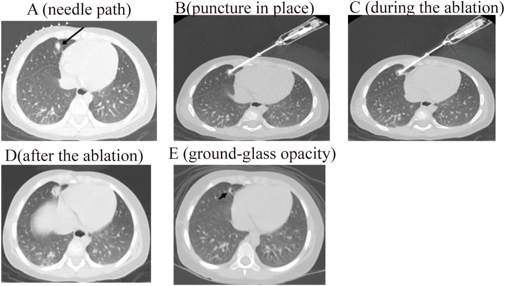
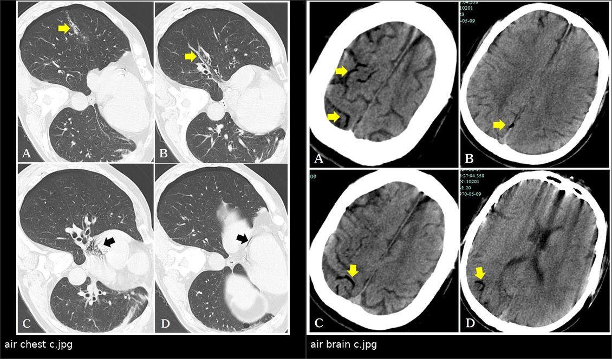
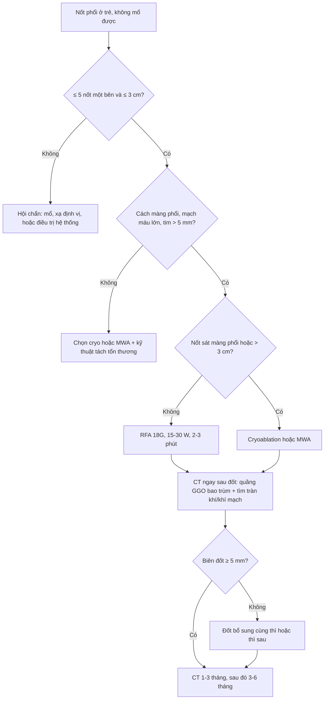

# 6129 — Đốt nhiệt qua da nốt phổi ở trẻ khi không mổ được / Percutaneous thermal ablation of pediatric lung nodules

**Tags:** `pattern:not` `pattern:di-can` `pattern:hoai-tu-dong-dich` `pattern:gia-phinh` `pattern:gco` `vung:phoi` `vung:mong-phoi` `score:RECIST` `score:CTCAE` `protocol:CT-huong-dan` `protocol:dot-nhiet` `protocol:metastasectomy` `incidentaloma:not-phoi`
**Mức chắc chắn (certainty):** tổng hợp y văn (literature synthesis) — số liệu chính lấy từ đoàn hệ nhi 91 trẻ hepatoblastoma (Li Y et al., Front Oncol 2025, PMC12665533), loạt cryoablation 28 bệnh nhân/84 u sarcoma (Aoki Y et al., BMC Cancer 2026, PMC13595653 — người lớn, dùng để tham chiếu kỹ thuật), tổng quan biến chứng đốt phổi (How GY & Pua U, Cancers 2026, PMC13702536) và các nghiên cứu về biên đốt (PMC13573749, PMC13002626); chưa có thử nghiệm ngẫu nhiên ở trẻ.

> **Câu chốt của bài:** đốt nhiệt qua da là **lựa chọn thay thế mổ** khi trẻ **đã mất dự trữ phổi**, nốt **hai bên**, hoặc u nguyên phát chưa kiểm soát — nhưng chỉ an toàn khi tôn trọng **3 ngưỡng chọn bệnh nhân**: **≤ 5 nốt một bên**, **đường kính ≤ 3 cm**, **cách màng phổi – mạch máu lớn – tim > 5 mm** (Li 2025). Kết quả gần như tương đương mổ (**kiểm soát bệnh 3 tháng 96,43% vs 96,67%**), viêm phổi sau thủ thuật **19,35% vs 96,67%**, không có tử vong — nhưng **biên đốt < 5 mm làm tăng tái phát tại chỗ gấp ~4 lần** (OR 4,15) và **tràn khí màng phổi gộp 37–44%** là biến chứng phải chuẩn bị sẵn.

## 1. Tổng quan bệnh học – cơ chế hình ảnh: vì sao đốt nhiệt thay được dao mổ

- **Sinh lý bệnh:** di căn phổi ở trẻ (osteosarcoma, hepatoblastoma, Wilms, Ewing, sarcoma mô mềm) là **bệnh gieo rắc theo tuần hoàn phổi**; mổ chỉ lấy được nốt nhìn/sờ thấy, nên tái phát là quy luật (bài 6702). Đốt nhiệt không lấy mô nhưng **phá hủy tại chỗ** mọi tế bào trong thể tích đốt, cho phép điều trị **nhiều nốt, hai bên, nhiều lần** mà vẫn giữ nhu mô — đây là lý do phương pháp này tồn tại song song với mổ.
- **Vật lý – TẠI SAO nốt biến thành "quầng mờ" ngay sau đốt:**
  - **RFA (radiofrequency ablation):** dòng xoay chiều **460 kHz** qua điện cực làm ion trong mô dao động ma sát → nhiệt **60–100 °C** → **hoại tử đông vón (coagulative necrosis)**. Vùng hoại tử chứa nước và protein biến tính có **đậm độ mô mềm (khoảng 30–60 HU)**, trong khi phổi xung quanh là khí **−800 đến −900 HU** → trên CT cửa sổ phổi, vùng đốt hiện thành **quầng mờ đông đặc (ground-glass opacity — GGO) hoặc đông đặc bao quanh nốt**.
  - **MWA (microwave ablation):** nhiệt sinh bằng dao động lưỡng cực của phân tử nước, **không phụ thuộc độ dẫn điện của mô** → ít bị **hiệu ứng tản nhiệt (heat-sink)** của mạch máu, vùng đốt dự đoán được hơn, phù hợp u lớn hơn.
  - **Cryoablation:** chu trình **đông–tan lặp lại** (Joule–Thomson) → phá màng tế bào và vi mạch; **giữ khung collagen** nên ít tổn thương màng phổi/thành ngực hơn, hữu ích cho nốt sát màng phổi.
  - **Dấu hiệu che phủ (coverage sign):** ngay sau đốt, **quầng GGO phải bao trùm toàn bộ nốt + biên an toàn**; thiếu quầng quanh một phần nốt = đốt chưa đủ (Li 2025 mô tả chính xác bước này trên CT sau đốt).
- **Ngưỡng định lượng cốt lõi (bắt buộc thuộc):**
  - **Chọn nốt (đoàn hệ nhi, Li 2025):** **≤ 5 nốt một bên phổi**, **đường kính lớn nhất ≤ 3 cm**, **không xâm lấn màng phổi**, **cách tim – mạch máu lớn – màng phổi > 5 mm**. Lý do đưa ra trong bài: đường kính **> 3 cm** dễ **hoại tử không hoàn toàn ở rìa**, còn nhiều mũi chọc/nốt làm tăng chảy máu và viêm phổi.
  - **Biên đốt (ablation margin):** **biên tối thiểu 3 chiều (3D MAM) ≥ 5 mm** liên quan giảm tái phát tại chỗ (**OR 0,06; KTC 95% 0,02–0,16**); **MAM < 5 mm gặp ở 67,7% (147/217)** ca RFA phổi (PMC13573749). Ở nhóm MWA, **biên an toàn ≤ 5 mm cho OR 4,152** cho tiến triển sớm ≤ 6 tháng (PMC13002626).
  - **Kích thước & vị trí:** u **> 30 mm** (OR 2,681) và **cách rốn phổi ≤ 10 mm** (OR 3,280) là yếu tố nguy cơ tiến triển sớm độc lập (PMC13002626).
  - **Kết quả tức thì – 3 tháng (nhi):** **26/28 (92,9%)** nốt biến mất hoàn toàn với quầng GGO, **1** thoái triển dạng hốc nhỏ, **1** nốt mới ở phổi trái; **kiểm soát bệnh (DCR) 96,43%** so với mổ **96,67%** (Li 2025).

## 2. Mẫu hình + chẩn đoán phân biệt theo vị trí (Gamut)

**Mẫu hình:** một hoặc vài **nốt đặc, tròn, ngoại vi** ở trẻ đã biết ung thư, **không mổ được** vì lý do nhu mô/vị trí/số nốt — câu hỏi không còn là "nốt là gì" mà là **"nốt này đốt được không, đốt bằng gì, và ai phải được mổ"**.

- **Theo số lượng – vị trí (quyết định kỹ thuật):**
  - **1–5 nốt, một bên, ≤ 3 cm, ngoại vi > 5 mm khỏi màng phổi:** **đốt nhiệt là lựa chọn hợp lý** (RFA cho nốt nhỏ ngoại vi; MWA cho nốt lớn/trung tâm; cryo cho nốt sát màng phổi – mạch máu).
  - **Nhiều nốt hai bên:** đốt **theo thì**, mỗi thì một bên phổi — không đốt hai bên cùng lúc vì nguy cơ tràn khí hai bên và suy hô hấp.
  - **Nốt trung tâm, sát rốn phổi ≤ 10 mm hoặc ôm mạch lớn:** **nguy cơ chảy máu/đốt không hết cao** → hội chẩn mổ hoặc xạ định vị, không "cố đốt".
  - **Nốt sát màng phổi < 5 mm:** nguy cơ **đau, bỏng thành ngực, tràn khí dai dẳng, rò phế quản–màng phổi** → **cryoablation** hoặc chèn màng phổi nhân tạo/khí dung môi để tách nốt.
- **Theo bản chất nốt (gamut chẩn đoán):**
  - **Di căn tái phát** (hàng đầu: osteosarcoma, hepatoblastoma, Wilms, Ewing): nốt **tròn, lớn dần**, có thể vôi hóa (osteoid).
  - **Nốt lành/u hạt:** vôi hóa trung tâm, **đứng yên ≥ 2 năm** — không đốt.
  - **Nhiễm nấm xâm lấn:** nốt có **quầng GGO**, sau đó **hang**, bạch cầu hạt giảm — điều trị thuốc, không đốt.
  - **Hạch nội phổi:** ≤ 10 mm, dọc khe/sát màng phổi, ổn định.
  - **Sẹo/stapler line sau mổ:** bầu dục, bám đường khâu, không lớn (bài 6702).
  - **U ác thứ hai do xạ:** trong trường xạ, xuất hiện nhiều năm sau — **không đốt như di căn** khi chưa mô bệnh.
- **Gợi nhớ "5 mm – 3 cm – 5 nốt":** **5 mm** khoảng cách an toàn tới màng phổi/mạch máu, **3 cm** đường kính tối đa, **5 nốt** một bên — ba con số quyết định "đốt được hay mổ".

## 3. Bảng so sánh phân biệt (ma trận đối chiếu)

| Thực thể (entity) | Hình ảnh điển hình | Chốt vào (rule-in) | Chốt loại (rule-out) | Gợi ý xác nhận |
|---|---|---|---|---|
| **Di căn phổi đốt được** | Nốt đặc, tròn, bờ rõ, **≤ 3 cm**, ngoại vi, **> 5 mm** khỏi màng phổi/mạch máu; 1–5 nốt một bên | **Tròn + lớn dần trên chuỗi CT + tiền sử sarcoma/HB** | **Sát màng phổi < 5 mm, ôm mạch/rốn phổi, > 5 nốt** → chọn mổ/xạ, không RFA | So CT cũ; hội chẩn đa chuyên khoa; mô bệnh khi mổ |
| **Di căn cần MWA/cryo hơn RFA** | Nốt **> 3 cm** hoặc **sát màng phổi** hoặc **gần mạch máu** | **Kích thước > 3 cm (MWA)** hoặc **sát màng phổi (cryo)** | Nốt nhỏ ngoại vi ≤ 3 cm → RFA đủ | Chọn đầu đốt theo vị trí; kiểm tra quầng GGO |
| **Đốt thiếu biên (incomplete ablation)** | Quầng GGO **không bao trùm** nốt; biên **< 5 mm**; nốt lớn dần ở rìa vùng đốt | **Biên < 5 mm (OR 4,15)** + **tăng kích thước ở rìa** | **Biên ≥ 5 mm + teo dần + không ngấm FDG** | CT 1–3 tháng; so cùng cửa sổ; PET nếu nghi |
| **Tràn khí màng phổi sau đốt** | Khí màng phổi **cùng bên**, có thể tăng khi bệnh nhân thở; **37–44%** các ca | **Khí màng phổi mới sau chọc + giảm đau ngực** | **Không có khí, chỉ đau thành ngực** → theo dõi | CT thì hết thủ thuật; X-quang; chọc hút/ống ngực nếu có triệu chứng hoặc khí tăng dần |
| **Khí mạch hệ thống (systemic air embolism)** | Khí trong **nhĩ phải, động mạch vành, tĩnh mạch não**; đột ngột đau đầu/ngất/thiếu máu thần kinh khu trú | **Khí trong mạch hệ thống ngay sau đốt + triệu chứng thần kinh/tim** | **Chỉ tràn khí màng phổi, không khí trong buồng tim/mạch** | CT sọ/ngực khẩn; MRI sọ; điều trị oxy cao áp |
| **Nhiễm trùng/áp-xe sau đốt** | Ổ đông đặc có **khí**, thành dày, sốt **≥ 38,5 °C** kéo dài; hiếm (< 3%) | **Sốt kéo dài + khí trong ổ đốt + tăng CRP** | **Sốt nhẹ 1–2 ngày, không khí** → hội chứng sau đốt | CT có cản quang; cấy; kháng sinh/dẫn lưu |

*Năm thì của một ca RFA nốt di căn hepatoblastoma: (A) đường chọc được vạch; (B) kim vào đúng nốt; (C) đang đốt; (D) sau đốt; (E) quầng GGO bao trùm nốt = dấu hiệu che phủ. Nguồn: Li Y et al., Front Oncol 2025 (PMC12665533), Fig. 2, CC BY 4.0.*

*Trái: sau đốt, **đường kim dày nối tràn khí màng phổi với mạch phổi**, khí đã vào **nhĩ phải và động mạch vành**. Phải: khí trong **tĩnh mạch não** trên CT sọ — biến chứng hiếm nhưng chết người, phải tìm chủ động trên CT ngay sau đốt. Nguồn: Tang W et al., Front Oncol 2024 (PMC11628378), Fig. 2–3, CC BY 4.0; ảnh ghép letterbox.*

## 4. Protocol chụp + hệ phân độ/điểm chuẩn hóa

- **Trước thủ thuật:**
  - **CT ngực lát mỏng 1–1,5 mm, không cản quang** là đủ để lập kế hoạch; đo **đường kính lớn nhất, khoảng cách tới màng phổi – mạch máu lớn – tim – rốn phổi** và ghi bằng mm.
  - **Đếm và đánh dấu từng nốt** trên 3 bình diện; nốt **< 5 mm** vẫn có thể là di căn — không bỏ qua vì "nhỏ".
  - Xét nghiệm đông máu, tiểu cầu; **ngừng kháng đông** theo phác đồ can thiệp; dự phòng kháng sinh **không thường quy** (chỉ khi có ổ nhiễm).
- **Trong thủ thuật (theo Li 2025 – đoàn hệ nhi):**
  - **Gây mê không đặt ống** (propofol/sufentanil); theo dõi ECG, SpO₂; **giữ bất động thì thở ra** để nốt không di chuyển.
  - **Kim RFA 18 G, đầu hoạt động 10 mm**; đốt **15–30 W trong 2–3 phút**, tùy kích thước nốt.
  - **CT ngay sau đốt:** xác nhận **quầng GGO bao trùm nốt** và tìm **tràn khí, chảy máu, khí trong buồng tim/mạch** — đây là bước không được bỏ.
- **Theo dõi sau đốt:**

| Thời điểm | Việc cần làm |
|---|---|
| **Ngay sau đốt** | CT ngực: quầng GGO, tràn khí, máu tụ; theo dõi 4–6 giờ |
| **1 tháng** | CT ngực: vùng đốt **teo dần**, bờ rõ; **không sinh thiết** vùng đốt còn viêm |
| **3 tháng** | CT ngực: đánh giá **hoại tử hoàn toàn** (Li: 92,9% nốt biến mất); RECIST 1.1 |
| **6 tháng, 1 năm, 2 năm, 3 năm, 5 năm** | Theo dõi **tái phát tại chỗ và nốt mới**; so cùng cửa sổ, cùng độ dày lát (lịch của loạt Li 2025) |

- **Tiêu chuẩn kết quả:** **RECIST 1.1** cho tổn thương đích ≥ 10 mm (tiến triển = tăng ≥ 20% **và** ≥ 5 mm); với vùng đốt, "thành công" là **teo dần + không ngấm FDG**, không phải "mất hoàn toàn trên CT".
- **Biến chứng – ngưỡng cần nhớ (tổng quan How & Pua 2026):** tràn khí **37–44%**, **tới 20% cần chọc hút/ống ngực**; chảy máu trong nhu mô **17,7%**, ho ra máu **16%**, tử vong do chảy máu **0,4%**; tràn dịch màng phổi **19%**; rò phế quản–màng phổi **0,3%**; giả phình động mạch phổi **0,2%**; tổn thương thần kinh **1–2%**; bệnh nhân có **bệnh phổi kẽ** trước đó: tràn khí **60% vs 38,9%**, tử vong do đợt cấp **7,1%**.
- **Sơ đồ quyết định:**

## 5. Biến thể bình thường và cạm bẫy

- **Quầng GGO sau đốt là bình thường, không phải "di căn lan":** vùng GGO/đông đặc quanh nốt trong **1–3 tháng đầu** là hoại tử + viêm; chỉ **lớn dần ở rìa** hoặc **ngấm FDG** mới đáng lo. Đừng sinh thiết sớm.
- **"Đốt xong là khỏi" — sai:** **14,3% (12/84)** u sarcoma có tiến triển tại chỗ sau cryo (Aoki 2026); hiệu quả nguyên phát **88,8% / 79,1% / 79,1%** ở 1/3/5 năm; **u ≤ 2 cm** cho kết quả tốt hơn (p = 0,024). Đốt lại cứu được (**hiệu quả hỗ trợ 95,6% / 82,8% / 77,9%**).
- **Khí mạch hệ thống — biến chứng chết người, dễ bỏ qua:** rò phế quản–mạch máu tạm thời khi kim xuyên tĩnh mạch phổi; khí đi ngược về **nhĩ phải → động mạch vành → não**. Ca báo cáo: sau MWA nốt 5,2 mm, CT thấy **khí ở nhĩ phải và động mạch vành**, sau đó **khí trong tĩnh mạch não**, nhồi máu tĩnh mạch đỉnh phải ngày 5, hồi phục hoàn toàn sau chống đông + oxy (Tang W et al., Front Oncol 2024, PMC11628378).
- **Đốt nốt sát màng phổi:** bỏng thành ngực **5–33%** độ I, **0,1–3,2%** độ II–III; **gãy sườn muộn 13,5%** khi vùng đốt sát thành ngực (How & Pua 2026) → cân nhắc **cryo** hoặc tách màng phổi.
- **Hiệu ứng tản nhiệt (heat-sink):** nốt cạnh mạch máu lớn bị dòng máu làm nguội → **đốt không đủ biên**; cần tăng công suất/thời gian hoặc chọn MWA.
- **Di chuyển do thở:** nốt đáy phổi di chuyển nhiều nhất; **ngừng thở thì thở ra** và kiểm tra kim trước khi đốt.
- **Bỏ sót nốt thứ hai ("satisfaction of search"):** đốt một nốt rồi dừng; phải **đếm lại toàn bộ phổi** vì chỉ định đốt dựa trên việc kiểm soát tất cả nốt.
- **Nhiễm trùng ổ đốt:** khí trong ổ đốt sớm có thể lành tính, nhưng **sốt ≥ 38,5 °C kéo dài, khí mới, thành dày** phải chụp CT cản quang và cân nhắc kháng sinh/dẫn lưu.

## 6. Tự lượng giá — Blind Quiz

**Ca 1 — Bé gái 4 tuổi, hepatoblastoma giai đoạn IV di căn phổi, đã mổ nốt phổi hai lần; nay còn 3 nốt thùy dưới phải, lớn nhất 2,1 cm, cách màng phổi 8 mm. Gia đình hỏi "còn mổ được không?".**

- Câu hỏi: Nốt có đủ điều kiện đốt không? Đốt bằng năng lượng gì? Trên CT sau đốt, dấu hiệu nào chứng tỏ đã che phủ tổn thương?

<b>Bấm để hiện đáp án</b>

- Điều kiện: **3 nốt một bên (≤ 5)**, **2,1 cm (≤ 3 cm)**, **cách màng phổi 8 mm (> 5 mm)** → **đốt được**; nếu còn nốt bên trái thì đốt **thì khác**.
- Chọn RFA (nốt nhỏ, ngoại vi); nếu sát màng phổi hơn hoặc > 3 cm → cryo/MWA.
- Dấu hiệu che phủ: **quầng GGO bao trùm toàn bộ nốt** (Hình E); thiếu quầng = đốt chưa đủ, cần đốt bổ sung.
- Nguồn ảnh: Li Y et al., Front Oncol 2025 (PMC12665533), Fig. 2, CC BY 4.0.

**Ca 2 — Bé trai 12 tuổi, di căn phổi sarcoma, đốt MWA nốt 5,2 mm thùy dưới phải. Ngay sau đốt bệnh nhân đau đầu, ngất, sau đó liệt nửa người thoáng qua.**

- Câu hỏi: Hai ảnh cho thấy gì? Cơ chế nào đưa khí từ phổi tới não? Xử trí cấp cứu gồm gì?

<b>Bấm để hiện đáp án</b>

- Trái: **khí trong nhĩ phải và động mạch vành** trên CT ngực sau đốt, kèm **tràn khí màng phổi** và đường kim dày. Phải: **khí trong tĩnh mạch não** trên CT sọ.
- Cơ chế: **rò phế quản–tĩnh mạch phổi tạm thời** khi kim xuyên mạch; khí đi ngược dòng về nhĩ phải rồi vào tuần hoàn hệ thống (nghịch lý) → **thuyên tắc khí não**.
- Xử trí: **ngừng thủ thuật, 100% oxy, tư thế đầu thấp/nghiêng trái**, hỗ trợ tim–hô hấp, **oxy cao áp** nếu có; CT/MRI sọ; ca này hồi phục hoàn toàn.
- Cạm bẫy: khí lượng nhỏ có thể **không triệu chứng** — phải chủ động tìm trên CT ngay sau đốt.
- Nguồn ảnh: Tang W et al., Front Oncol 2024 (PMC11628378), Fig. 2–3, CC BY 4.0; ảnh ghép letterbox.

**Ca 3 — Bé trai 9 tuổi, osteosarcoma, đã đốt RFA một nốt 2,5 cm. CT 3 tháng sau: nốt cũ teo, nhưng xuất hiện **vòng đậm ở rìa vùng đốt**, đường kính vòng 8 mm, không ngấm FDG.**

- Câu hỏi: Đây là tái phát, viêm sau đốt, hay đốt thiếu biên? Cần làm gì?

<b>Bấm để hiện đáp án</b>

- Vòng đậm **đồng tâm, không ngấm FDG, không lớn thêm** sau 3 tháng thường là **phản ứng viêm/xơ quanh vùng đốt**, không phải tái phát.
- Nếu **lớn dần, lệch tâm, ngấm FDG** → nghĩ **đốt thiếu biên/tái phát tại chỗ** (biên < 5 mm: OR 4,15) → **đốt lại** hoặc mổ.
- Cần: so CT 1 tháng – 3 tháng cùng cửa sổ; **không sinh thiết ngay** vùng đốt còn viêm; hội chẩn nếu nghi.
- Nguồn số liệu: How & Pua, Cancers 2026 (PMC13702536); PMC13573749 (biên < 5 mm).

## Bài liên quan chéo
- [6702 – Theo dõi sau mổ nốt phổi ở trẻ: nốt mới là tái phát hay sẹo?](../6702-theo-doi-sau-mo-not-phoi-o-tre/lesson.md)
- [6701 – Di căn phổi ở Wilms & sarcoma xương ở trẻ: nốt nào cắt](../6701-di-can-phoi-wilms-va-sarcoma-xuong-o-tre/lesson.md)
- [381 – Di căn phổi MPNST: cắt nốt hay SBRT](../381-di-can-phoi-mpnst-cat-not-hay-sbrt/lesson.md)
- [020 – Nốt phổi](../020-not-phoi/lesson.md)
- [651 – Đánh giá đáp ứng & theo dõi sau điều trị Wilms](../651-danh-gia-dap-ung-sau-dieu-tri-wilms/lesson.md)
- [016 – Nốt phổi ở bệnh nhân có tiền sử ung thư](../016-not-phoi-tien-su-ung-thu/lesson.md)

## Ảnh
- `6129_dot-nhiet-RFA_CT_PMC12665533.jpg` — 5 thì RFA dưới CT; `composite_6129_khi-mach-he-thong.jpg` — khí mạch hệ thống. Nguồn + giấy phép từng ảnh: `images/CREDITS.md`.

> Không dùng để chẩn đoán độc lập khi chưa có người hướng dẫn.
