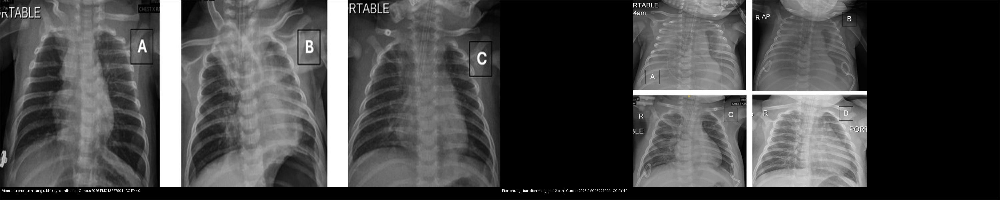
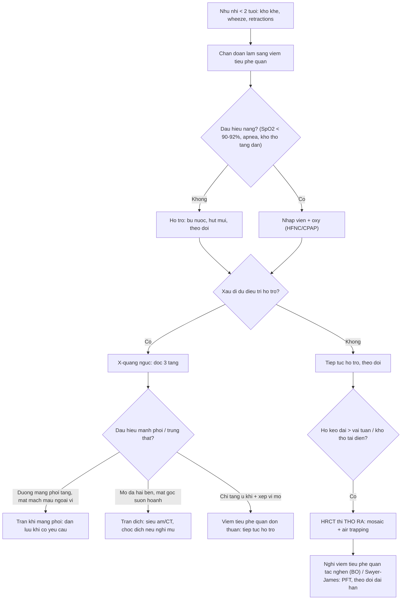
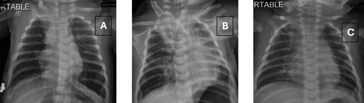
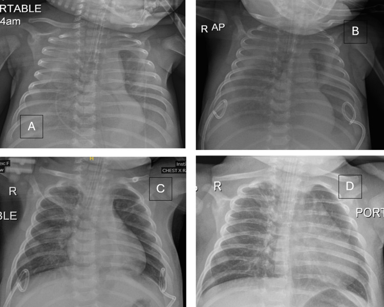
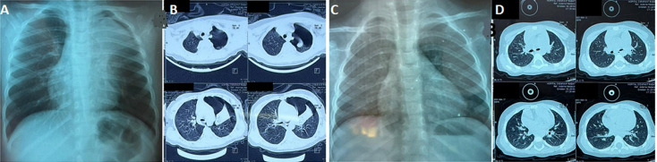
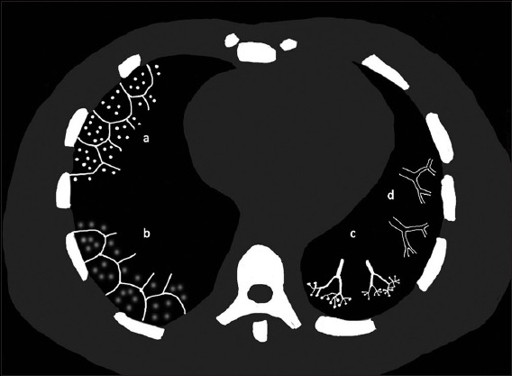
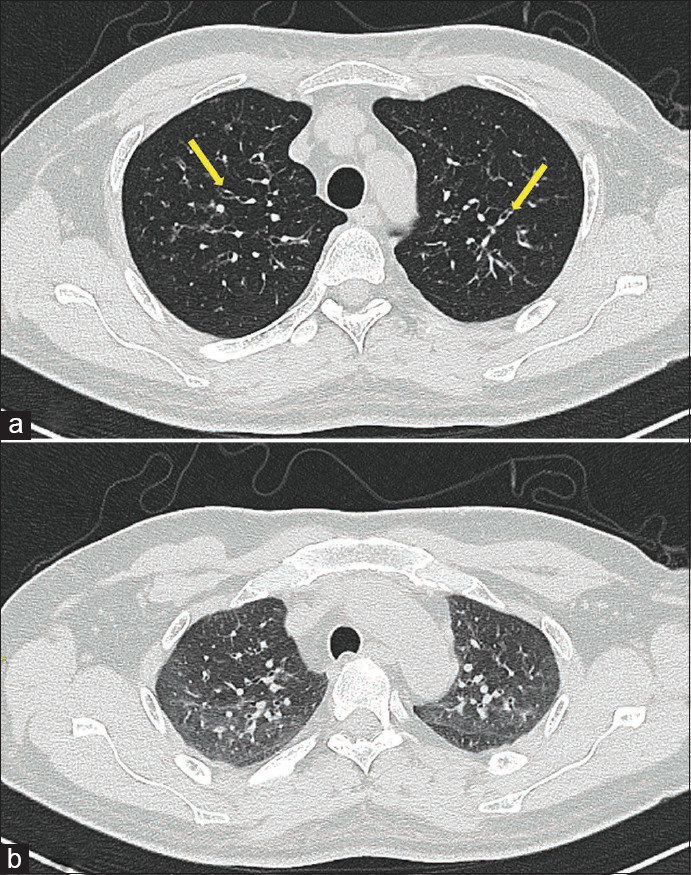

# 613 — Viêm tiểu phế quản ở nhũ nhi: tăng ứ khí, xẹp vi mô & phân biệt với viêm phổi

**Tags:** `pattern:viem-tieu-phe-quan` `vung:phe-quan` `vung:phoi-nhi` `protocol:X-quang-nguc-nhi` `protocol:HRCT`
**Mức chắc chắn (certainty):** tổng hợp y văn (literature synthesis) — nhóm tự biên từ 1 bài tổng quan CT viêm tiểu phế quản (Singapore Med J 2026, CC BY-NC-ND) + dữ liệu dịch tễ/biến chứng; **các ca trong quiz là ca nguyên văn (verbatim case)** chép đúng tuổi – bệnh cảnh – chú thích gốc (Cureus 2026, Pan Afr Med J 2025 — CC BY 4.0).

## 1. Tổng quan bệnh học – cơ chế hình ảnh

**Viêm tiểu phế quản cấp (acute bronchiolitis)** là viêm nhiễm cấp tính đường hô hấp dưới ở trẻ **< 2 tuổi**, đỉnh **2–6 tháng tuổi**; **tần suất 3–5%/năm ở trẻ < 1 tuổi**, **RSV chiếm 50–80%** ca (Pan Afr Med J 2025). Đây là **nguyên nhân nhập viện hàng đầu ở nhũ nhi**.

- **Bản chất mô học:** tiểu phế quản (bronchiole) là đường dẫn khí **< 2 mm, KHÔNG có sụn và KHÔNG có tuyến dưới niêm mạc** (Singapore Med J 2026). Vì không có sụn, thành tiểu phế quản dễ bị **phù nề + chất nhầy + co thắt** bít lòng.
- **TẠI SAO X-quang thấy "tăng ứ khí" (air trapping):** khi lòng tiểu phế quản bị hẹp không đều, nó thành **van một chiều** — khí vào lúc thở vào nhưng **khó thoát ra lúc thở ra**; khí ứ dần → **phổi giãn quá mức (hyperinflation)**: cơ hoành dẹt/đè xuống, khoang liên sườn rộng, xương sườn nằm ngang, tăng khoảng sáng sau xương ức.
- **TẠI SAO thấy "xẹp vi mô" (microatelectasis):** tiểu phế quản bị **bít hoàn toàn** → khí phía sau bị **hấp thu** → xẹp phân thùy nhỏ, **lan tỏa hoặc rải rác**, đôi khi tụ thành đám hình tiểu thùy. Trên phim thẳng dễ nhầm **đông đặc viêm phổi**.
- **TẠI SAO thấy "dày thành phế quản" (peribronchial cuffing — "dấu vòng"):** viêm quanh phế quản làm thành phế quản dày, thấy dạng **đường ray (tram-track)** hoặc **vòng** khi phế quản cắt ngang.
- **TẠI SAO trên CT là nốt "trung tâm tiểu thùy":** tiểu phế quản nằm ở **tâm tiểu thùy thứ cấp (secondary pulmonary lobule)** → tổn thương cho **nốt trung tâm tiểu thùy**; khi lòng tiểu phế quản bị nhầy/viêm lấp đầy tạo **dạng chồi cây (tree-in-bud)**. Vì tiểu phế quản thành mỏng < 2 mm nên **thường không thấy trực tiếp trên X-quang** — ta chỉ thấy **hệ quả** (ứ khí, xẹp vi mô).
- **Chặng mạn — viêm tiểu phế quản tắc nghẽn (bronchiolitis obliterans, BO):** sau viêm tiểu phế quản nặng (điển hình **adenovirus**, cũng gặp Mycoplasma, sởi), xơ hóa quanh tiểu phế quản gây hẹp cố định → **mosaic giảm tỷ trọng + air trapping khi thở ra** trên HRCT (Singapore Med J 2026).
- **Ngưỡng định lượng cần nhớ:**
  - Tiểu phế quản = đường dẫn khí **< 2 mm** (không sụn, không tuyến).
  - **SpO₂ < 90–92%** → cần **oxy**; theo dõi/apnea ở trẻ non tháng/nhũ nhi nhỏ.
  - **Tràn khí màng phổi** do viêm tiểu phế quản: **0,5–2%** nhũ nhi nhập viện (Pan Afr Med J 2025).
  - **Tử vong < 1%** ở nước phát triển (cao hơn ở trẻ non tháng/tim-phổi bẩm sinh).
  - **RSV ≈ 3,6 triệu ca nhập viện/năm** ở trẻ < 5 tuổi toàn cầu (Cureus 2026).

## 2. Mẫu hình + chẩn đoán phân biệt theo vị trí (gamut)

**Gamut theo chặng bệnh và vị trí trên tiểu thùy thứ cấp:**

- **Nhũ nhi < 2 tuổi, đợt cấp, toàn phổi:** **tăng ứ khí (giãn phổi quá mức) + xẹp vi mô lan tỏa + dày thành phế quản** — chân dung RSV điển hình.
- **Trung tâm tiểu thùy (cellular bronchiolitis):** nốt trung tâm tiểu thùy mờ / **tree-in-bud** / kính mờ trung tâm tiểu thùy — nhiễm trùng, hít sặc, viêm phổi quá mẫn (HP), viêm tiểu phế quản nang.
- **Tắc nghẽn khi thở ra (constrictive bronchiolitis / BO):** **mosaic giảm tỷ trọng + air trapping thì thở ra** ± giãn phế quản — hậu nhiễm trùng, viêm khớp dạng thấp, GVHD sau ghép, hội chứng Swyer–James.
- **Biến chứng màng phổi:** **tràn khí màng phổi** (rách phế nang do van một chiều) hoặc **tràn dịch màng phổi** (hiếm, thường transudate vô khuẩn).

**Gợi nhớ đọc X-quang viêm tiểu phế quản — 3 tầng:** **Khí (ứ khí) → Nhu mô (xẹp vi mô, KHÔNG đông đặc thùy) → Màng phổi (tràn khí/dịch)**.

## 3. Bảng so sánh phân biệt (ma trận đối chiếu)

| Thực thể (entity) | Hình ảnh điển hình | Chốt vào (rule-in) | Chốt loại (rule-out) | Gợi ý xác nhận |
|---|---|---|---|---|
| Viêm tiểu phế quản cấp (RSV) | **Tăng ứ khí lan tỏa** (cơ hoành dẹt, liên sườn rộng) + **xẹp vi mô** + dày thành phế quản; KHÔNG đông đặc thùy | **Nhũ nhi < 2 tuổi + wheeze/crackles + tăng ứ khí hai bên** | Đông đặc thùy khu trú + sốt cao → viêm phổi | **Chẩn đoán lâm sàng** (AAP); PCR hô hấp nếu không điển hình |
| Viêm phổi khu trú | **Đông đặc thùy/phân thùy đồng nhất**, có thể kèm tràn dịch | **Đông đặc thùy khu trú + sốt cao** | Ứ khí lan tỏa, không đông đặc → viêm tiểu phế quản | X-quang; siêu âm phổi tại giường |
| Xẹp phổi - viêm tiểu phế quản tắc nghẽn (BO) / Swyer–James | **Mosaic giảm tỷ trọng + air trapping thì THỞ RA** ± giãn phế quản; phổi một bên sáng hơn (Swyer–James) | **Air trapping thở ra + giãn phế quản + tiền sử viêm tiểu phế quản nặng (adenovirus)** | Ứ khí đơn thuần đợt cấp → không phải BO | **HRCT thì thở ra**; PFT (tắc nghẽn cố định) |
| Tràn khí màng phổi | **Đường trắng màng phổi tạng + mất mạch máu ngoại vi**, xẹp phổi phía dưới, trung thất có thể lệch | **Đường màng phổi tạng + tăng sáng ngoại vi mất mạch máu** | Ứ khí đối xứng hai bên không có đường màng phổi → viêm tiểu phế quản | X-quang ± CT khi nghi ngờ |
| Tràn dịch màng phổi do RSV | **Đục mờ hai đáy, dấu màng phổi tạng ngập nước (meniscus bel)**; có thể **hai bên, lượng nhiều** | **Đục mờ đáy + mất góc sườn hoành, dịch transudate vô khuẩn** | Tăng ứ khí đơn thuần → không có dịch | Siêu âm phổi/CT; chọc dịch khi nghi mủ |
| Nốt trung tâm tiểu thùy (HP) | **Nốt/kính mờ trung tâm tiểu thùy** lan tỏa, **không** dày thành phế quản nổi | **Nốt trung tâm tiểu thùy + tiền sử phơi nhiễm (chim, mốc)** | Tree-in-bud → nhiễm trùng/viêm tiểu phế quản cấp | HRCT thì hít vào + thở ra |

*Trái: viêm tiểu phế quản cấp — **tăng ứ khí hai bên + tăng đậm mạch phế quản**, không đông đặc. Phải: cùng bé gái, biến chứng **tràn dịch màng phổi lượng nhiều hai bên** (mờ đáy, mất góc sườn hoành). Nguồn: Abdulaal F et al., Cureus 2026 (PMC13227901), CC BY 4.0. Ảnh ghép letterbox, giữ tỉ lệ.*

## 4. Protocol chụp + hệ phân độ/điểm chuẩn hóa

- **X-quang ngực KHÔNG thường quy** (AAP 2014): viêm tiểu phế quản là **chẩn đoán lâm sàng**. Chỉ chụp khi: chẩn đoán không rõ, **diễn tiến xấu dù điều trị hỗ trợ**, nghi biến chứng, hoặc trẻ không điển hình.
- **Đọc X-quang theo 3 tầng (chống bỏ sót):**
  1. **Khí/thể tích:** phổi có giãn quá mức không? (cơ hoành dẹt/đè xuống, liên sườn rộng, khoang sáng sau xương ức).
  2. **Nhu mô:** xẹp vi mô lan tỏa/rải rác (phân biệt đông đặc thùy), dày thành phế quản, xẹp do đặt nội khí quản (không phải đông đặc).
  3. **Màng phổi/trung thất:** tràn khí màng phổi, tràn khí trung thất (đường sáng dọc trung thất/tim), tràn dịch màng phổi (mờ đáy hai bên).
- **HRCT (không thường quy):** chỉ khi nghi biến chứng, ho kéo dài/suy giãn phế quản, hoặc nghi **BO**. **Bắt buộc có thì THỞ RA** để phát hiện **air trapping** (mosaic giảm tỷ trọng giữ nguyên trên phim thở ra).
- **Điều trị hỗ trợ (không can thiệp hình ảnh):** **oxy khi SpO₂ < 90–92%**, bù nước, hút mũi, tư vấn. **KHÔNG dùng thường quy** kháng sinh, thuốc giãn phế quản, corticosteroid, lý liệu pháp ngực (AAP 2014).
- **Phòng ngừa:** kháng thể đơn dòng RSV (palivizumab/nirsevimab) cho nhũ nhi nguy cơ cao (non tháng, tim-phổi bẩm sinh, suy giảm miễn dịch).

## 5. Biến thể bình thường và cạm bẫy

- **Đừng chụp X-quang thường quy** — chẩn đoán viêm tiểu phế quản là lâm sàng; chụp "cho chắc" dễ dẫn tới **chẩn đoán nhầm viêm phổi và dùng kháng sinh oan** (AAP 2014).
- **Tăng ứ khí sinh lý ở trẻ nhỏ:** lồng ngực nhũ nhi vốn căng, phổi sáng hai bên — đừng gọi bệnh chỉ vì phổi sáng; tìm **tính đối xứng + xẹp vi mô/đông đặc khu trú**.
- **Xẹp vi mô lan tỏa vs đông đặc viêm phổi:** xẹp vi mô **không có đông đặc thùy**, không sốt cao đáp ứng kháng sinh; ngược lại **đông đặc thùy đồng nhất** → viêm phổi.
- **Xẹp phổi do đặt nội khí quản:** hình xẹp thùy (điển hình **thùy trên phải**) sau đặt ống — đừng gọi là đông đặc/viêm phổi (xem Ca 1 panel B).
- **Tràn dịch do RSV thường là transudate vô khuẩn** (Cureus: protein 0,37 g/dL, WBC 3,75 tế bào/µL) → **không mặc định kháng sinh** chỉ vì có dịch.
- **Air trapping trên CT** cũng gặp trong **HP/viêm phổi quá mẫn** (mosaic do air trapping) — phải đọc cùng bối cảnh và tiền sử phơi nhiễm, không quy hết cho viêm tiểu phế quản (Singapore Med J 2026).
- **Cạm bẫy mặt cắt:** dịch màng phổi đáy phổi trên phim thẳng dễ bị đọc thành **cơ hoành dâng cao**; xem **bờ tự do của dịch, dấu màng phổi tạng ngập nước**, hoặc siêu âm phổi/CT nằm nghiêng để phân định.

## 6. Tự lượng giá — Blind Quiz (ảnh trơn ngoài, đáp án ẩn trong khối chi tiết)

**Ca 1 — Bé gái 8 tuần tuổi, trước đó khỏe mạnh, nhập viện vì suy hô hấp. X-quang lúc nhập viện. Mô tả trước khi mở đáp án.**

- Gợi ý lâm sàng: khò khè, co lõm liên sườn, suy hô hấp tiến triển ở nhũ nhi nhỏ.
- Câu hỏi: Thể tích phổi ra sao? Có đông đặc thùy không? Chẩn đoán và nguyên nhân hàng đầu?

<b>Bấm để hiện đáp án (findings + chẩn đoán)</b>

- **Dấu hiệu:** (A) **phổi tăng ứ khí hai bên + tăng đậm mạch phế quản** — phù hợp **viêm tiểu phế quản cấp**; KHÔNG đông đặc thùy. (B) sau đặt nội khí quản: **xẹp thùy trên phải + mờ bên trái** (xẹp, không phải đông đặc). (C) trước rút ống: phổi sáng đều, không tổn thương.
- **Chẩn đoán:** **viêm tiểu phế quản cấp do RSV** (bệnh nhân 8 tuần tuổi). Trên X-quang: **tăng ứ khí + xẹp vi mô**, không đông đặc thùy.
- Nguồn ảnh: Abdulaal F et al., Cureus 2026 (PMC13227901), Figure 1, CC BY 4.0.

**Ca 2 — Cùng bé gái trên, diễn tiến nặng, cần đặt lại nội khí quản. X-quang mới. Chuyện gì xảy ra?**

- Câu hỏi: Tổn thương mới ngoài nhu mô phổi là gì? Xử trí? Dịch có phải mủ không?

<b>Bấm để hiện đáp án (findings + chẩn đoán)</b>

- **Dấu hiệu:** (A) **tràn dịch màng phổi lượng nhiều hai bên** — mờ đáy, mất góc sườn hoành, mờ đậm hơn bên phải; (B–D) sau đặt **catheter pigtail hai bên**, dịch rút dần, phổi nở lại.
- **Chẩn đoán – xử trí:** **tràn dịch màng phổi hai bên — biến chứng hiếm của viêm tiểu phế quản RSV nặng**; dẫn lưu bằng **pigtail** + điều trị hỗ trợ. Dịch là **transudate vô khuẩn** (protein 0,37 g/dL, WBC rất thấp) → **không phải mủ**, không mặc định kháng sinh.
- Nguồn ảnh: Abdulaal F et al., Cureus 2026 (PMC13227901), Figure 2, CC BY 4.0.

**Ca 3 — Bé gái 11 tháng tuổi, viêm tiểu phế quản RSV, đột ngột khó thở nặng hơn. X-quang (A) và CT (B); sau đó là phim giải quyết (C, D).**

- Câu hỏi: Dấu hiệu chốt trên X-quang/CT? Đây là biến chứng gì, gặp bao nhiêu %?

<b>Bấm để hiện đáp án (findings + chẩn đoán)</b>

- **Dấu hiệu:** (A, B) **tràn khí màng phổi trái** + **xẹp đỉnh phổi trái**; (C, D) sau điều trị — **tràn khí tiêu hết, phổi nở tốt trở lại**.
- **Chẩn đoán:** **tràn khí màng phổi tự phát biến chứng viêm tiểu phế quản RSV** — gặp **0,5–2%** ở nhũ nhi nhập viện. Cơ chế: van một chiều gây ứ khí quá mức → **vỡ phế nang**, khí vào khoang màng phổi. Ở ca này điều trị bảo tồn thành công.
- Nguồn ảnh: Eddukar H et al., Pan Afr Med J 2025 (PMC12741973), Figure 1, CC BY 4.0.

**Ca 4 — Sơ đồ tổn thương CT của viêm tiểu phế quản. Ghép mỗi hình (a–d) với tên dấu hiệu.**

- Câu hỏi: a, b, c, d tương ứng dấu hiệu nào? Dấu hiệu nào nằm ở trung tâm tiểu thùy?

<b>Bấm để hiện đáp án (findings + chẩn đoán)</b>

- **(a)** nốt trung tâm tiểu thùy (centrilobular micronodules) — nằm ở **tâm tiểu thùy thứ cấp**. **(b)** nốt kính mờ trung tâm tiểu thùy (centrilobular ground-glass nodules). **(c)** **dạng chồi cây (tree-in-bud)** — lòng tiểu phế quản bị nhầy/viêm lấp đầy. **(d)** **giãn tiểu phế quản sát màng phổi (bronchiolectasis)**.
- Chốt: tất cả đều **bám theo trung tâm tiểu thùy thứ cấp** — vì tổn thương ở tiểu phế quản (< 2 mm) nằm ở tâm tiểu thùy.
- Nguồn ảnh: Lee ECH et al., Singapore Med J 2026 (PMC13405576), Figure 1, CC BY-NC-ND 4.0 (dùng nguyên bản, không chỉnh sửa).

**Ca 5 — Bệnh nhân sau ghép tế bào gốc, ho và khó thở kéo dài. So sánh 2 phim CT (hít vào vs thở ra).**

- Câu hỏi: Phim thở ra (b) cho thấy gì so với phim hít vào (a)? Nghĩ chặng bệnh nào?

<b>Bấm để hiện đáp án (findings + chẩn đoán)</b>

- **Dấu hiệu:** (a) hít vào — **mosaic giảm tỷ trọng**; (b) **thở ra** — các ổ giảm tỷ trọng **giữ nguyên, không giảm thể tích = air trapping**; kèm **dày và giãn thành phế quản**.
- **Chẩn đoán:** **viêm tiểu phế quản tắc nghẽn (bronchiolitis obliterans)** — ở ca này sau ghép tế bào gốc (GVHD). Bài học: **air trapping chỉ lộ khi chụp thì THỞ RA**; ở trẻ, chặng này thường hậu nhiễm trùng (adenovirus).
- Nguồn ảnh: Lee ECH et al., Singapore Med J 2026 (PMC13405576), Figure 15, CC BY-NC-ND 4.0 (dùng nguyên bản, không chỉnh sửa).

## Bài liên quan chéo
- [600 – Tổng quan Hệ Nhi khoa](../600-tong-quan-nhi-khoa/lesson.md)
- [615 – Viêm phổi nhi: round pneumonia, virus vs vi khuẩn & hít sặc dầu hỏa](../615-viem-phoi-nhi-round-pneumonia/lesson.md)
- [610 – Suy hô hấp sơ sinh & dị dạng phổi](../610-suy-ho-hap-so-sinh-va-di-dang-phoi/lesson.md)
- [612 – Cấp cứu đường thở trên trẻ em](../612-cap-cuu-duong-tho-tren-tre-em/lesson.md)
- [051 – Tiểu phế quản & khảm](../051-tieu-phe-quan/lesson.md) (mẫu hình tiểu phế quản ở người lớn)
- [032 – Kính mờ & lát đá](../032-kinh-mo-lat-da/lesson.md) (mosaic/air trapping)

## Ảnh
- Tên file: `NNN_slug_Modality_SourceID.jpg`. Chi tiết nguồn + giấy phép từng ảnh: `images/CREDITS.md` và `sources.md`.
- Ảnh CXR/CT ca nguyên văn: **CC BY 4.0** (Cureus 2026 PMC13227901; Pan Afr Med J 2025 PMC12741973) — được phép tải/ghép, ghi nguồn.
- Ảnh CT minh họa mẫu hình: **CC BY-NC-ND 4.0** (Singapore Med J 2026 PMC13405576) — **giữ nguyên bản, KHÔNG crop/ghép**.
- Ảnh ghép đối chiếu (`composite_*.jpg` trong `images/`) chỉ dùng ảnh CC BY, tạo bằng `tools/make_composite.py` (letterbox, không crop/kéo giãn).

> Không dùng để chẩn đoán độc lập khi chưa có người hướng dẫn.
