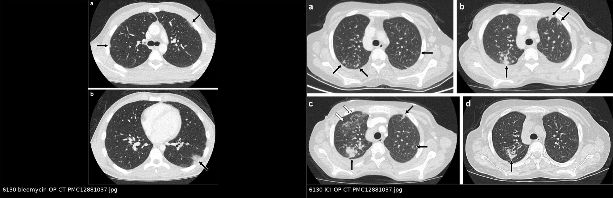
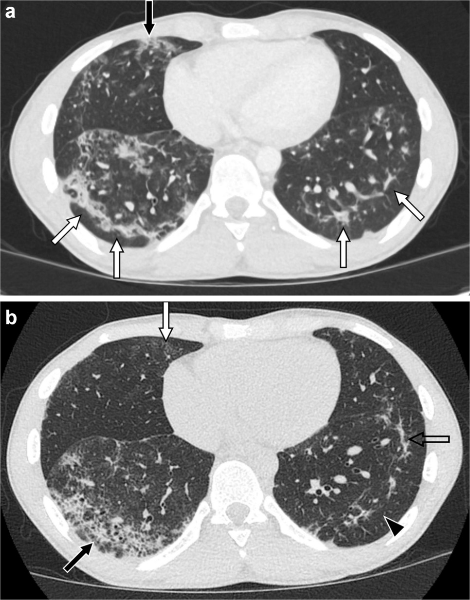
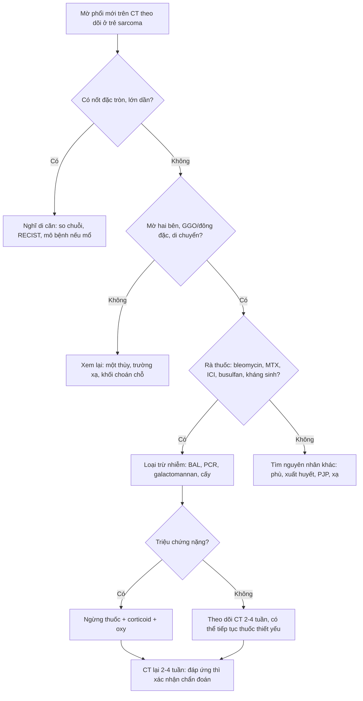
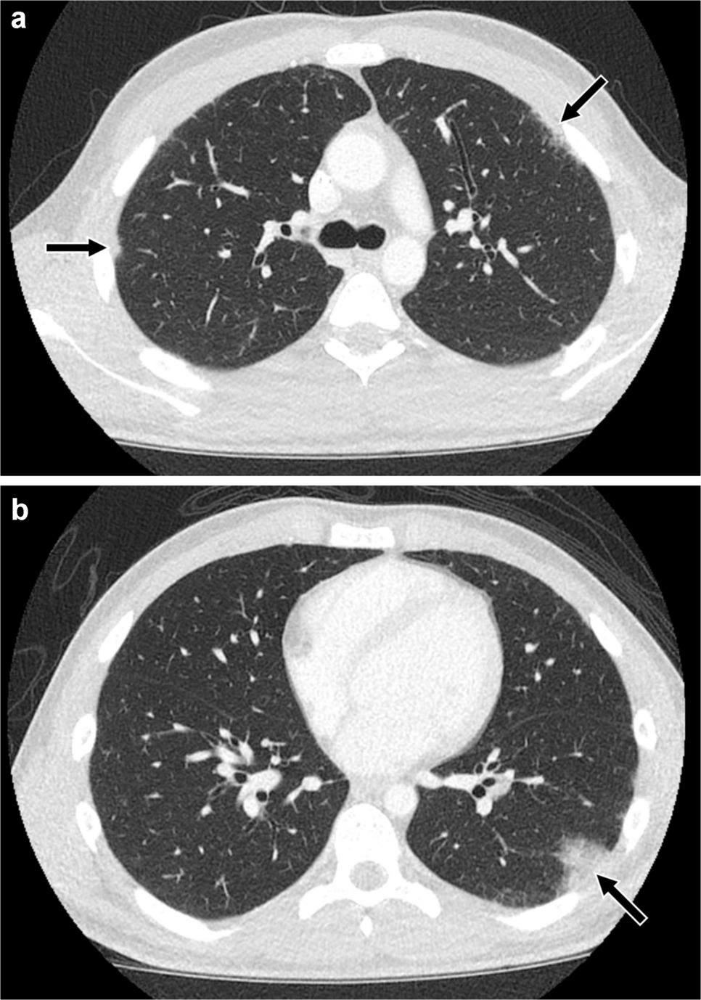
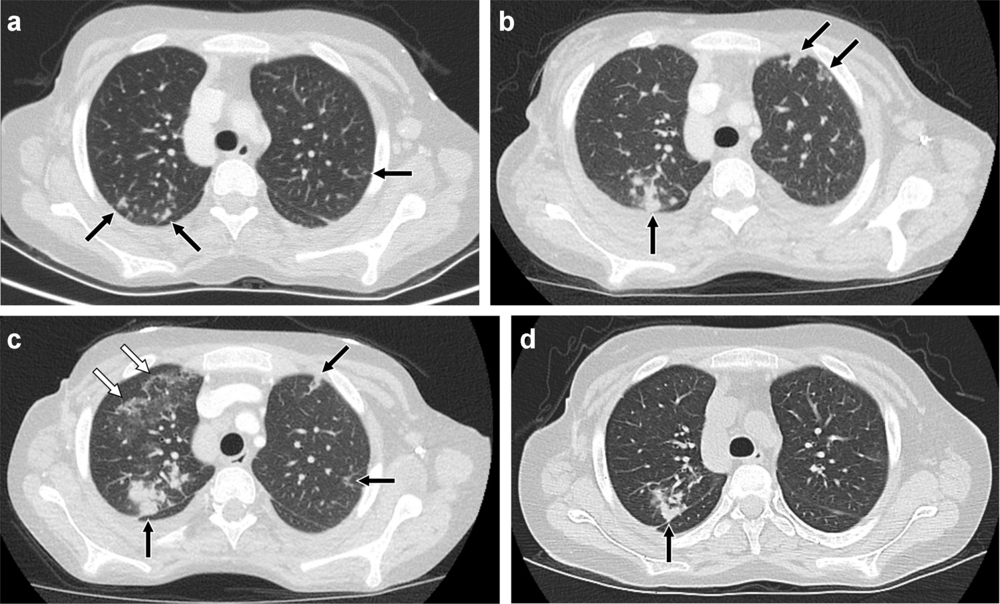
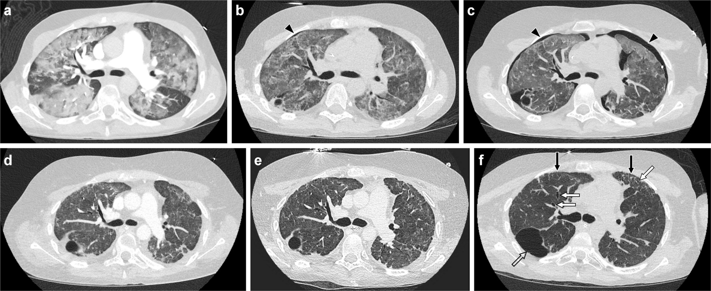
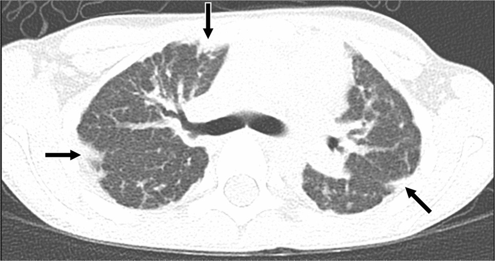

# 6130 — Viêm phổi do thuốc trên CT theo dõi ở trẻ sarcoma / Medication-induced lung disease in children with sarcoma

**Tags:** `pattern:mo-lan-toa` `pattern:gco` `pattern:to-chuc-hoa` `pattern:not` `pattern:di-can` `pattern:day-vach` `vung:phoi` `score:CTCAE` `protocol:CT-nguc` `protocol:CT-lieu-thap` `protocol:surveillance` `incidentaloma:not-phoi`
**Mức chắc chắn (certainty):** tổng hợp y văn (literature synthesis) — khung mẫu hình và cách tiếp cận lấy từ tổng quan nhi khoa (Schapiro AH, Ruff KL, Guillerman RP, Pediatr Radiol 2026, PMC12881037), số liệu định lượng từ đoàn hệ ALL nhi (Li Y et al., Ann Hematol 2026, PMC12988986), tổng quan độc tính bleomycin (Olah P et al., Front Immunol 2026, PMC13478953), đoàn hệ ung thư tinh hoàn ở trẻ/vị thành niên (Ajaj R et al., Int J Cancer 2025, PMC12407061), đoàn hệ hóa trị theo dõi bằng CT (Zhao J et al., Cancers 2026, PMC13565309) và meta phân tích di chứng hô hấp ở người sống sót ung thư nhi (Liu J et al., Transl Pediatr 2026, PMC13351682).

> **Phạm vi:** nguyên lý áp dụng cho mọi trẻ ung thư đang hóa trị/ICI; các ca minh họa gồm u tế bào mầm và AML vì đây là những ca có ảnh công bố trong tổng quan nhi khoa, còn sarcoma dùng **methotrexate liều cao** và một số phác đồ có **bleomycin**.
>
> **Câu chốt của bài:** trên CT theo dõi một trẻ sarcoma, **mờ hai bên dạng GGO/đông đặc, có thể di chuyển, không choán chỗ, không phải nốt đặc tròn** phải gợi **bệnh phổi do thuốc** trước khi gọi là "di căn mới" — vì **15,2%** bệnh nhân đang hóa trị có bất thường phổi mới trên CT (đoàn hệ người lớn), trong đó **GGO 44%** và **mờ vá 56%** (Zhao 2026). Chẩn đoán là **loại trừ**: ngừng thuốc nghi ngờ ở ca có triệu chứng, corticoid khi nặng; **không sinh thiết mù** vì mô học chỉ khớp hình ảnh khoảng **50%** (Schapiro 2026).

## 1. Tổng quan bệnh học – cơ chế hình ảnh: vì sao thuốc gây mờ phổi và vì sao CT không đặc hiệu

- **Bệnh học:** tổn thương phổi do thuốc là **phản ứng mô kẽ – phế nang** với 3 cơ chế chính: (1) **độc trực tiếp lên tế bào phế nang** (bleomycin, nitrosourea, busulfan); (2) **phản ứng miễn dịch/quá mẫn** (methotrexate, ICI, kháng sinh); (3) **tăng thấm mao mạch** (dinutuximab, phản ứng tăng viêm). Bleomycin gây độc vì phổi **thiếu enzym bleomycin hydrolase** — chính vì vậy phổi và da là hai cơ quan bị ảnh hưởng nhiều nhất (Olah 2026).
- **TẠI SAO CT hiện các mẫu hình này (vật lý + mô bệnh):**
  - **GGO (ground-glass opacity):** khí trong phế nang bị thay một phần bằng **dịch viêm/tế bào/bệnh nhân xơ** nhưng **còn đủ khí** → đậm độ **trung gian giữa khí (−900 HU) và mô mềm (+30 đến +60 HU)** nhưng **vẫn thấy mạch máu xuyên qua**.
  - **Đông đặc (consolidation):** phế nang **đầy hoàn toàn** dịch/tế bào → **+30 đến +60 HU**, **mạch máu bị che**, có thể có **phế quản hơi**.
  - **Day vách (septal thickening) + dấu atoll/đảo ngược:** viêm lan theo **bạch mạch quanh tiểu thùy thứ cấp** → vách dày; khi GGO trung tâm được viền đông đặc hình vòng = **reversed halo/atoll** — dấu hiệu của **viêm phổi tổ chức hóa (organizing pneumonia — OP)**.
  - **Mờ di chuyển (migratory):** tổn thương OP **tái hấp thu và xuất hiện ở vị trí khác** giữa hai lần chụp — đây là điểm khác biệt mạnh với di căn (nốt đứng yên hoặc lớn dần tại chỗ).
  - **Vì sao không đặc hiệu:** cùng một mẫu hình OP có thể do **nhiễm trùng, bệnh mô liên kết, xạ trị, hít sặc, EVALI**; hình ảnh chỉ khớp mô học khoảng **50%** (Schapiro 2026) → chẩn đoán phải dựa vào **quan hệ thời gian với thuốc + loại trừ nguyên nhân khác**.
- **Ngưỡng định lượng cốt lõi:**
  - **Bleomycin:** viêm phổi lâm sàng rõ **10–20%**, tử vong **1–3%**; **liều tích lũy 240–300 mg** là ngưỡng nguy cơ được nhắc nhiều nhất nhưng **không có ngưỡng tuyệt đối**; thải trừ **50–70% qua thận** → **suy thận làm tăng độc** (Olah 2026).
  - **Trẻ ALL:** viêm phổi kẽ **6,82% (33/484)**; nhóm **nguy cơ cao 16,67% vs 3,78%**; **75,75%** xảy ra trong **giai đoạn duy trì**, khởi phát **trung vị 122 ngày** sau khi bắt đầu duy trì; **khó thở 100%**, **sốt 87,88%**, **ho 75,75%**; **7/33 tử vong** do suy hô hấp (Li 2026).
  - **Trên CT theo dõi hóa trị:** bất thường phổi mới **15,2% (34/223)**; **mờ vá 56%**, **GGO 44%**; **cyclophosphamide > 1.800 mg/m² OR 2,38 (1,06–5,71)** (Zhao 2026).
  - **Di chứng dài hạn:** người sống sót ung thư nhi có **35%** biến chứng hô hấp bất kỳ, **DLCO giảm 39%**, **FVC giảm 19%**, **bệnh hô hấp có triệu chứng 14%** (Liu 2026) — nên "mờ thoáng qua" không được xem là vô hại.

## 2. Mẫu hình + chẩn đoán phân biệt theo vị trí (Gamut)

**Mẫu hình:** trẻ đang/đã hóa trị hoặc ICI, **mờ phổi mới hai bên**, thường **đáy phổi và ngoại vi**, **không có khối choán chỗ** — câu hỏi là **"thuốc hay di căn hay nhiễm?"**.

- **Theo mẫu hình CT (6 mẫu hình của Schapiro 2026):**
  - **OP (organizing pneumonia):** đông đặc **quanh phế quản – mạch máu và/hoặc ngoại vi**, **mờ quanh tiểu thùy**, **atoll/reversed halo**, nốt quanh phế quản bờ mờ; **có thể di chuyển** — thuốc hay gặp: **bleomycin, methotrexate, ICI**.
  - **NSIP:** **GGO + lưới + giãn phế quản co kéo**, **đáy phổi**, quanh phế quản – mạch máu/ngoại vi, **đối xứng**.
  - **DAD (diffuse alveolar damage):** **GGO lan rộng + đông đặc phụ thuộc + mất thể tích**; tuần 1 phù/hyaline, tuần 1–3 hỗn hợp, **sau tuần 3 xơ hóa** (lưới, giãn phế quản co kéo).
  - **HP/bronchiolocentric:** **nốt trung tâm tiểu thùy bờ mờ + GGO + bẫy khí tiểu thùy** — nghĩ thuốc, nhưng **nốt dạng cây–chồi (tree-in-bud) thì nghiêng về nhiễm/hít sặc**.
  - **Bệnh phổi tăng bạch cầu ái toan:** thể đơn thuần **mờ di chuyển, tự khỏi < 1 tháng**; thể cấp **GGO + dày vách + tràn dịch**; thể mạn **đông đặc ngoại vi** — thuốc: **TMP-SMX, minocycline, doxycycline**.
  - **Tăng thấm mao mạch (capillary leak):** **dày vách + GGO + tràn dịch màng phổi ± màng tim, cổ trướng** — giống phù phổi; thuốc: **dinutuximab** (kháng GD2 ở neuroblastoma).
- **Theo bối cảnh lâm sàng (thuốc nào – hình nào):**
  - **Sarcoma xương đang hóa trị:** **methotrexate liều cao** → OP/NSIP; **bleomycin** (một số phác đồ sarcoma mô mềm/germ cell) → OP/NSIP/DAD.
  - **ICI (pembrolizumab, cemiplimab…):** OP, NSIP, HP, DAD — **có thể xuất hiện muộn** và **bắt chước giả tiến triển**.
  - **Sau ghép tế bào gốc:** **busulfan, cyclophosphamide, carmustine** → DAD/NSIP; phân biệt với **PERDS, IPS, TRALI, GVHD** theo **mốc thời gian sau ghép**.
  - **Kháng sinh:** TMP-SMX, minocycline, doxycycline → bệnh phổi tăng bạch cầu ái toan.
  - **Dinutuximab:** capillary leak trong/ngay sau truyền.
- **Gợi nhớ "OP – NSIP – DAD – HP – EOS – LEAK":** sáu mẫu hình, **mỗi mẫu hình vẫn phải loại trừ nhiễm trùng** trước khi quy cho thuốc.

## 3. Bảng so sánh phân biệt (ma trận đối chiếu)

| Thực thể (entity) | Hình ảnh điển hình trên CT | Chốt vào (rule-in) | Chốt loại (rule-out) | Gợi ý xác nhận |
|---|---|---|---|---|
| **OP do thuốc (bleomycin/MTX/ICI)** | Đông đặc **ngoại vi/quanh phế quản**, **mờ quanh tiểu thùy**, **atoll**, nốt bờ mờ; **di chuyển** | **Mờ hai bên + quan hệ thời gian với thuốc + di chuyển/đáp ứng corticoid** | **Nốt đặc tròn, lớn dần, một vị trí cố định** → di căn | So chuỗi CT; ngừng thuốc; BAL loại trừ nhiễm |
| **NSIP do thuốc** | **GGO + lưới + giãn phế quản co kéo**, đáy phổi, đối xứng | **Đối xứng, đáy phổi, không choán chỗ, tiến triển chậm** | **Mờ một bên, có khối, đẩy khe** → u/di căn | HRCT thì hít vào; PFT (hạn chế, DLCO giảm) |
| **DAD do thuốc** | **GGO lan rộng + đông đặc phụ thuộc + mất thể tích**; sau 3 tuần xơ hóa | **Khởi phát cấp sau thuốc/ghép + suy hô hấp tiến triển** | **Chỉ một thùy, không suy hô hấp** → không phải DAD | CT lặp 1–2 tuần; loại trừ nhiễm/ phù |
| **HP/bronchiolocentric do thuốc** | **Nốt trung tâm tiểu thùy bờ mờ + GGO + bẫy khí tiểu thùy** | **Nốt trung tâm tiểu thùy lan tỏa + bối cảnh thuốc** | **Tree-in-bud, nốt phân bố theo thùy** → nhiễm/hít sặc | BAL (lympho CD8), loại trừ nhiễm |
| **Bệnh phổi tăng bạch cầu ái toan** | **Mờ di chuyển ngoại vi**, thể cấp có **GGO + dày vách + tràn dịch** | **Tăng bạch cầu ái toan máu/BAL + mờ di chuyển + tự khỏi/đáp ứng corticoid** | **Bạch cầu ái toan bình thường + nốt đặc** → không điển hình | Công thức máu, BAL; ngừng kháng sinh |
| **Di căn phổi mới** | **Nốt đặc, tròn, bờ rõ**, có thể vôi hóa; **lớn dần tại chỗ**; thường không GGO | **Tròn + lớn lên trên ≥ 2 CT cùng kỹ thuật** | **Mờ lan tỏa hai bên, di chuyển, không nốt** → không phải di căn | So CT cũ; RECIST 1.1; mô bệnh nếu mổ |
| **Nhiễm nấm xâm lấn** | **Nốt có quầng GGO**, sau đó **hang**; nhiều ổ | **Sốt + giảm bạch cầu hạt + quầng/hang** | **Mờ ngoại vi không quầng, không sốt** → không nấm | Galactomannan, cấy, CT 1–2 tuần |
| **Pneumocystis jirovecii** | **GGO hai bên đối xứng + dày vách**, có thể nang nhỏ; **ít tràn dịch** | **Sốt + khó thở + LDH tăng + GGO đối xứng** | **Đông đặc thùy/tràn dịch rõ** → nghĩ vi khuẩn | PCR/BAL; điều trị TMP-SMX |
| **Viêm phổi do xạ** | **Đông đặc/GGO thẳng bờ trường chiếu**, không vượt đường giữa tùy trường | **Vị trí khớp trường xạ + 1–6 tháng sau xạ** | **Ngoài trường xạ, hai bên đối xứng** → không do xạ | Đối chiếu bản đồ liều xạ |
| **Tăng thấm mao mạch (dinutuximab)** | **Dày vách + GGO + tràn dịch màng phổi/màng tim**, thay đổi nhanh | **Trong/ngay sau truyền thuốc + tràn dịch + đáp ứng nhanh** | **Không tràn dịch, mờ khu trú** → không phải leak | Siêu âm tim, cân nặng, albumin |

*Trái: bleomycin — đông đặc ngoại vi thùy giữa phải + mờ quanh tiểu thùy hai bên. Phải: cemiplimab (ICI) — mờ nốt/đông đặc ngoại vi thùy trên, **di chuyển theo thời gian**. Nguồn: Schapiro AH et al., Pediatr Radiol 2026 (PMC12881037), Fig. 1 + Fig. 7, CC BY 4.0; ảnh ghép letterbox, không crop.*

*Dấu hiệu **mờ quanh tiểu thùy (perilobular opacities)**: các đường cong/vòng đa giác **dày hơn và kém sắc nét hơn vách liên tiểu thùy**, gặp trong OP do bleomycin. Nguồn: Schapiro AH et al., Pediatr Radiol 2026 (PMC12881037), Fig. 6, CC BY 4.0.*

## 4. Protocol chụp + hệ phân độ/điểm chuẩn hóa

- **CT ngực (ALARA, trẻ em):**
  - **Không cản quang** là đủ cho mờ nhu mô; cản quang khi cần phân biệt **di căn mạch máu, huyết khối, hoại tử** hoặc đánh giá trung thất.
  - **Lát mỏng 1–1,5 mm**, tái tạo **cửa sổ phổi + trung thất**, **MPR**; thì **hít vào tối đa** nếu hợp tác; giảm kVp/mAs theo cân nặng.
  - **Luôn so với CT nền trước điều trị** trên cùng cửa sổ, cùng độ dày lát — đây là cách duy nhất tách "mờ mới" với "mờ đã có".
  - Ghi rõ: **mẫu hình chính (OP/NSIP/DAD/HP/eosinophilic/leak)**, **phân bố** (ngoại vi/đáy/quanh phế quản), **có di chuyển không**, **có xơ hóa không** (lưới, giãn phế quản co kéo) — vì mức độ và mẫu hình tương quan với độ nặng.
- **Phân độ CTCAE v5.0 — viêm phổi (pneumonitis):**

| Độ | Định nghĩa thực hành |
|---|---|
| **1** | Không triệu chứng; chỉ thấy trên hình ảnh |
| **2** | Có triệu chứng; cần can thiệp y khoa; hạn chế hoạt động dụng cụ hằng ngày |
| **3** | Nặng; hạn chế tự chăm sóc; cần oxy |
| **4** | Đe dọa tính mạng; cần hỗ trợ thông khí |
| **5** | Tử vong |

- **Quy trình chẩn đoán (theo Schapiro 2026):**
  1. **Rà danh sách thuốc** (kể cả thuốc mua tự do, thực phẩm bổ sung) + tra **pneumotox.com**.
  2. **Xác lập quan hệ thời gian** thuốc → tổn thương (có thể cấp, bán cấp, hoặc **nhiều năm** sau carmustine/bleomycin).
  3. **Loại trừ nhiễm** (PJP, CMV, nấm, lao), **phù**, **xuất huyết**, **tái phát u**, **giả tiến triển do ICI**, **viêm phổi do xạ**.
  4. **BAL** để loại trừ nhiễm và tìm **tăng lympho CD8/tăng bạch cầu ái toan**; **PFT** (hạn chế, DLCO giảm).
  5. **Sinh thiết** chỉ khi vẫn còn chẩn đoán phân biệt làm **thay đổi điều trị** — mô học không xác nhận được nguyên nhân.
- **Xử trí:** ca **có triệu chứng** → **ngừng thuốc nghi ngờ** là chính; **corticoid** khi nặng; **nintedanib** đã được báo cáo ở ca kháng trị (Schapiro 2026). Ca **không triệu chứng** mà thuốc thiết yếu → có thể **tiếp tục theo dõi sát**.
- **Sơ đồ tiếp cận:**

## 5. Biến thể bình thường và cạm bẫy

- **Gọi mờ do thuốc là "di căn mới" — sai lầm tốn kém nhất:** hậu quả là **đổi phác đồ, mổ phổi hoặc xạ oan** ở một trẻ đang đáp ứng tốt; dấu hiệu phân biệt là **mờ lan tỏa/GGO/di chuyển/atoll** thay vì **nốt đặc tròn lớn dần**.
- **Ngược lại, gọi di căn là "do thuốc"** → **trì hoãn điều trị ung thư**; nếu tổn thương **đặc, tròn, lớn dần**, phải sinh thiết/cắt bỏ, không chờ "thuốc tự khỏi".
- **Bleomycin có thể khởi phát muộn và bùng phát khi dùng oxy:** xơ hóa tiến triển **nhiều năm** sau carmustine; **oxy bổ sung có thể làm bùng phát viêm phổi bleomycin** — hỏi tiền sử bleomycin trước khi cho oxy liều cao (Schapiro 2026; Olah 2026).
- **"Mờ thoáng qua = lành":** bệnh phổi do thuốc có thể để lại **xơ hóa, giãn phế quản co kéo**; người sống sót ung thư nhi có **DLCO giảm 39%** — cần theo dõi chức năng phổi, không chỉ hình ảnh (Liu 2026).
- **Tree-in-bud không phải do thuốc:** nốt dạng cây–chồi, nốt phân bố theo thùy, đông đặc phụ thuộc → **nhiễm trùng/hít sặc** (Schapiro 2026).
- **Viêm phổi do xạ có bờ thẳng:** tổn thương **không vượt quá đường giữa** nếu trường chiếu một bên, xuất hiện **1–6 tháng** sau xạ; hỏi bản đồ xạ trước khi quy cho thuốc.
- **ICI và giả tiến triển:** tổn thương **to lên rồi nhỏ đi** hoặc **xuất hiện tổn thương mới** trong khi lâm sàng tốt lên — không vội kết luận thất bại; nhưng **pneumonitis do ICI** có thể nặng, cần loại trừ trước khi tiếp tục thuốc.
- **Corticoid che bệnh:** đang dùng corticoid vì lý do khác có thể **làm mờ hình ảnh nhiễm trùng**, khiến "đáp ứng corticoid" bị hiểu nhầm là bằng chứng bệnh do thuốc.
- **Tràn dịch màng phổi hai bên + dày vách:** nghĩ **capillary leak (dinutuximab)** hoặc **phù**, không phải OP — hỏi thời điểm truyền thuốc.

## 6. Tự lượng giá — Blind Quiz

**Ca 1 — Nam 17 tuổi, u tế bào mầm hỗn hợp tinh hoàn, đang hóa trị có bleomycin. Khó thở khi gắng sức, DLCO giảm dần, không sốt. CT ngực có cản quang.**

- Câu hỏi: Mô tả phân bố tổn thương? Nghĩ đến 3 chẩn đoán nào? Dấu hiệu nào nghiêng về bệnh do thuốc hơn là di căn?

<b>Bấm để hiện đáp án</b>

- Hình: **đông đặc ngoại vi hai bên**, nhiều ổ, **mờ quanh tiểu thùy** — mẫu hình **viêm phổi tổ chức hóa (OP)**.
- Chẩn đoán phân biệt: **bệnh phổi do bleomycin**, **viêm phổi do bệnh mô liên kết/viêm mạch**, **nhiễm trùng**; ít nghĩ di căn vì **không có nốt đặc tròn**.
- Chốt: **phân bố ngoại vi + mờ quanh tiểu thùy + quan hệ thời gian với bleomycin + không sốt + DLCO giảm**; triệu chứng và hình ảnh **hết sau khi kết thúc hóa trị** (ca gốc).
- Nguồn ảnh: Schapiro AH et al., Pediatr Radiol 2026 (PMC12881037), Fig. 1, CC BY 4.0.

**Ca 2 — Nữ 17 tuổi, ung thư biểu mô vảy trên bệnh ly gai, đang cemiplimab. Mờ phổi không triệu chứng, thay đổi qua 3 lần CT trong 4 tháng; BAL không có nhiễm, không có u.**

- Câu hỏi: Đặc điểm nào trên chuỗi ảnh giúp phân biệt với di căn? Vì sao không sinh thiết ngay? Xử trí?

<b>Bấm để hiện đáp án</b>

- Chuỗi ảnh cho thấy **mờ nốt/đông đặc ngoại vi thùy trên xuất hiện, mất đi và tái xuất hiện ở vị trí khác** = **di chuyển (waxing and waning)** — không phải hành vi của di căn.
- BAL **tăng đại thực bào, không nhiễm, không u, không viêm mạch**; sinh thiết có thể không xác nhận nguyên nhân và **không đổi điều trị**.
- Xử trí: **nghi pneumonitis do ICI**; ca này **không triệu chứng** nên theo dõi; khi có triệu chứng → **ngừng ICI + corticoid**; CT sau corticoid cho thấy **cải thiện** (ca gốc).
- Nguồn ảnh: Schapiro AH et al., Pediatr Radiol 2026 (PMC12881037), Fig. 7, CC BY 4.0.

**Ca 3 — Nam 19 tuổi, AML, ghép tế bào gốc 18 tháng trước, vừa kết thúc cefepime thì suy hô hấp cấp. CT ngực: GGO lan rộng + đông đặc phụ thuộc + mất thể tích.**

- Câu hỏi: Mẫu hình gì? Thời điểm nào trong tuần đầu và sau 3 tuần? Điều gì còn lại trên CT sau 1 năm?

<b>Bấm để hiện đáp án</b>

- Mẫu hình **DAD (diffuse alveolar damage)**: **GGO lan rộng + đông đặc phụ thuộc + mất thể tích phổi**.
- Tuần 1: **phù + màng hyaline** → GGO; tuần 1–3: **hỗn hợp**; **sau tuần 3**: **tăng sinh nguyên bào sợi/xơ** → lưới, giãn phế quản co kéo.
- Sau 1 năm: còn **lưới + giãn phế quản/co kéo** (xơ hóa di chứng), có thể có **mảng xẹp** và **hang/phỏng khí**; ca gốc có tràn khí thoáng qua và phỏng khí thùy dưới phải.
- Cạm bẫy: DAD do thuốc **không phân biệt được với nhiễm trùng/nhiễm khuẩn huyết** trên hình ảnh — phải dựa vào bối cảnh và loại trừ.
- Nguồn ảnh: Schapiro AH et al., Pediatr Radiol 2026 (PMC12881037), Fig. 8, CC BY 4.0.

**Ca 4 — Bé trai 8 tuổi, AML, chuẩn bị ghép bằng busulfan. CT không cản quang: đông đặc dưới màng phổi hai bên, nhiều ổ.**

- Câu hỏi: Mẫu hình gợi ý gì? Vì sao không thể chẩn đoán xác định chỉ bằng CT? Cần làm gì trước khi đổi phác đồ?

<b>Bấm để hiện đáp án</b>

- Hình: **đông đặc dưới màng phổi nhiều ổ hai bên** — mẫu hình OP/NSIP; sinh thiết ở ca gốc cho **xơ hóa màng phổi – vách – phế nang + viêm phổi do lipid nội sinh (endogenous lipoid pneumonia) + tiểu phế quản bị bít**.
- CT **không đặc hiệu**: cùng hình ảnh có thể do nhiễm, phù, xuất huyết, tái phát bệnh; **chẩn đoán là loại trừ**.
- Trước khi đổi phác đồ: **loại trừ nhiễm (BAL/cấy/PCR)**, rà thuốc, đánh giá **quan hệ thời gian**; hội chẩn bác sĩ huyết học – X quang – hô hấp.
- Nguồn ảnh: Schapiro AH et al., Pediatr Radiol 2026 (PMC12881037), Fig. 2, CC BY 4.0.

## Bài liên quan chéo
- [6702 – Theo dõi sau mổ nốt phổi ở trẻ: nốt mới là tái phát hay sẹo?](../6702-theo-doi-sau-mo-not-phoi-o-tre/lesson.md)
- [6701 – Di căn phổi ở Wilms & sarcoma xương ở trẻ](../6701-di-can-phoi-wilms-va-sarcoma-xuong-o-tre/lesson.md)
- [6703 – Bệnh cơ tim do anthracycline ở người sống sót ung thư nhi](../6703-benh-co-tim-do-anthracycline-o-nguoi-song-sot-ung-thu-nhi/lesson.md)
- [6129 – Đốt nhiệt qua da nốt phổi ở trẻ khi không mổ được](../6129-dot-nhiet-phoi-o-tre-khi-khong-mo-duoc/lesson.md)
- [016 – Nốt phổi ở bệnh nhân có tiền sử ung thư](../016-not-phoi-tien-su-ung-thu/lesson.md)
- [025 – Hang & nấm phổi: dấu liềm khí](../025-ton-thuong-phoi-tao-hang/lesson.md)

## Ảnh
- `6130_bleomycin-OP_CT_PMC12881037.jpg`, `6130_bleomycin-perilobular_CT_PMC12881037.jpg`, `6130_ICI-OP_CT_PMC12881037.jpg`, `6130_DAD-tien-trien_CT_PMC12881037.jpg`, `composite_6130_bleomycin-vs-ICI.jpg` — nguồn + giấy phép từng ảnh: `images/CREDITS.md`.

> Không dùng để chẩn đoán độc lập khi chưa có người hướng dẫn.
