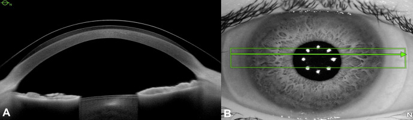
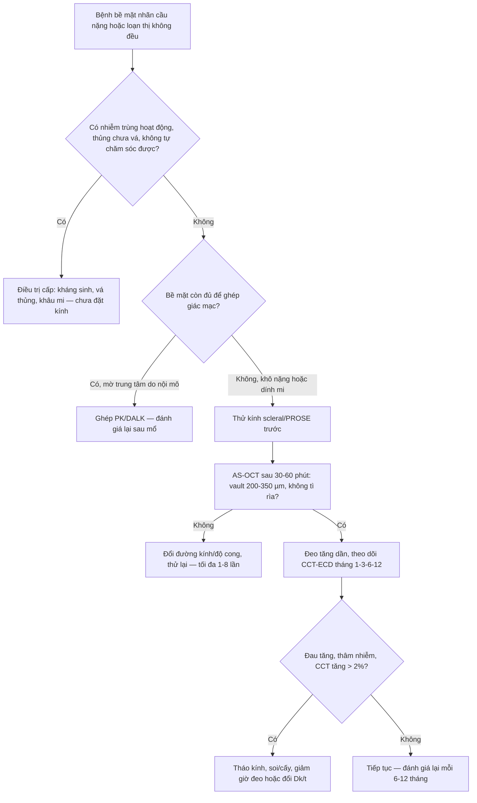
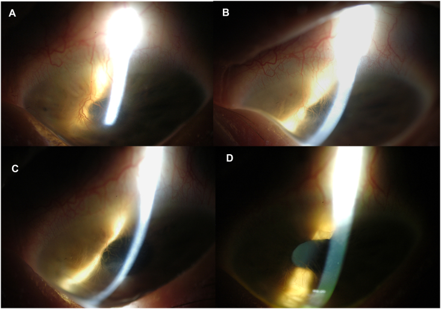
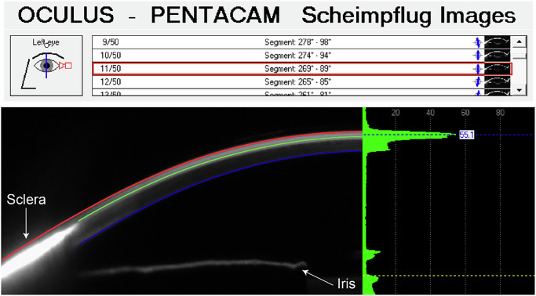

# 6131 — Kính scleral (scleral lens) trong bệnh bề mặt nhãn cầu nặng: chọn thông số, đo vault bằng AS-OCT, biến chứng và khi nào không nên đeo

**Tags:** `pattern:khuyet-bieu-mo-giac-mac` `pattern:mo-giac-mac` `pattern:tan-mach-giac-mac` `pattern:loet-giac-mac` `vung:mat` `vung:giac-mac` `vung:cung-mac` `anatomy:bieu-mo-giac-mac` `score:OSDI` `protocol:AS-OCT` `protocol:Scheimpflug` `protocol:topography`
**Mức chắc chắn (certainty):** tổng hợp y văn (literature synthesis) — ghép **meta-analysis 22 nghiên cứu / 830 mắt** về biến đổi giác mạc và nhãn áp khi đeo kính scleral (Ophthalmic Physiol Opt 2026, PMC13395828), **nghiên cứu 12 mắt sau ghép giác mạc** (Ophthalmic Physiol Opt 2026, PMC13396062), **thử nghiệm tiền cứu 21 mắt bệnh bề mặt nhãn cầu khó trị** (Sci Rep 2021, PMC7840975), **hồi cứu 49 mắt / 34 bệnh nhân** (Turk J Ophthalmol 2025, PMC12372548), **2 ca SJS/TEN (4 mắt) đeo PROSE** (Am J Ophthalmol Case Rep 2022, PMC9027328) và **thí điểm động học dịch ở kính có lỗ thông** (Ophthalmic Physiol Opt 2026, PMC13395885). Không có ca do nhóm tự chụp.

> **Câu hỏi thực hành:** nữ **19 tuổi**, hội chứng Stevens–Johnson (SJS) sau sulfamethoxazole/trimethoprim **1 năm**, đã dùng nước mắt nhân tạo, kháng sinh, kính mềm băng và màng ối, vẫn **đau, nhìn dao động, loét giác mạc tái phát ở mắt trái**. Câu hỏi: **có nên đặt kính scleral không, đo gì để biết kính "vừa", và cái gì quyết định thành công hay thủng giác mạc?**
> Bài chốt **ba quyết định**: **(1) kính scleral là thiết bị duy nhất vừa che chở vừa không đè lên vùng rìa (limbus) — chỉ định khi bề mặt nhãn cầu không còn cách nào khác; (2) "vừa" không phải cảm giác mà là số đo vault 200–350 µm trên AS-OCT; (3) biến chứng chính là phù giác mạc do thiếu oxy và viêm giác mạc nhiễm khuẩn — kiểm soát bằng Dk/t, thời gian đeo và vệ sinh, không bằng "đeo ít đi một chút".** Nối [6106 – Bệnh giác mạc do aniridia](../6106-benh-giac-mac-do-aniridia-dieu-tri-va-phuc-hoi-be-mat/lesson.md), [6104 – Aniridia bẩm sinh và hội chứng WAGR](../6104-aniridia-bam-sinh-va-hoi-chung-wagr/lesson.md), [452 – Hoại tử võng mạc cấp ARN/CMV](../452-hoai-tu-vong-mac-ARN-CMV/lesson.md).

## 1. Tổng quan bệnh học – cơ chế hình ảnh: vì sao "một lớp nước" lại cứu được giác mạc

- **Nguyên lý cơ học:** kính scleral là kính cứng thấu khí (rigid gas-permeable) **đường kính lớn 15–18 mm**, **tựa hoàn toàn trên cùng mạc (sclera)** và **vượt qua (vault) giác mạc**, tạo một **bể dịch (fluid reservoir)** giữa mặt sau kính và biểu mô giác mạc. Khác kính tiếp xúc thường, **không có điểm tì trên giác mạc và không tì lên vùng rìa** — đây là lý do nó dùng được khi vùng rìa đã mất tế bào gốc.
- **TẠI SAO bể dịch chữa được bề mặt nhãn cầu:** bể dịch liên tục **cấp nước cho biểu mô**, **rửa trôi cytokine viêm và protease** trong nước mắt, **che chắn khỏi mi mắt và lông xiêu**, và **tạo mặt quang học mới** che các bất thường bề mặt. Ba tác dụng này giải thích vì sao cùng một kính vừa **giảm đau**, vừa **liền biểu mô**, vừa **tăng thị lực** — không phải ba cơ chế riêng.
- **TẠI SAO vẫn có thể gây hại:** oxy tới giác mạc chỉ còn đường **khuếch tán qua vật liệu kính và bể dịch**. Độ thấu khí được biểu diễn bằng **Dk/t** (Dk = hệ số khuếch tán × độ hòa tan oxy; t = bề dày). Trong 22 nghiên cứu của meta-analysis, **Dk/t dao động 85 đến > 160 (ISO/Fatt)** và bề dày trung tâm thực tế dùng trong nghiên cứu sau ghép là **≈ 250 µm với Dk 100** (PMC13395828, PMC13396062). Thiếu oxy → **phù giác mạc** (tăng bề dày) → giảm thị lực, tăng nguy cơ nhiễm khuẩn.
- **Con số "an toàn" của đeo kính hiện đại:** gộp **190 mắt** trong 7 nghiên cứu, bề dày giác mạc trung tâm (CCT) **tăng 7,93 µm (95% CI 4,92–10,95)** khi đang đeo; sau tháo kính **chênh 1,49 µm (95% CI −1,59 đến 4,56; p = 0,34)** — tức **hồi phục hoàn toàn**. Phù nhu mô gộp **0,88% (95% CI 0,67–1,10)** (PMC13395828). Đây là ngưỡng để phân biệt "đeo kính bình thường" với "quá tải oxy".
- **Ngược lại, giác mạc đã mỏng/yếu thì con số đổi hẳn:** 12 mắt sau ghép (PK/DALK) đeo kính **8 giờ**, CCT **485,3 ± 47,1 → 520,4 ± 51,3 µm**, tức **phù 7,2 ± 3,1%**; **PK 11,38% so với DALK 5,23% (p = 0,003)**, và mức phù **tương quan với tuổi mảnh ghép (r = 0,80)** chứ không với mật độ tế bào nội mô trước đeo (PMC13396062). Bài học: **nội mô là "trần" của đeo kính scleral** — mắt ghép cũ, mắt sau herpes nội mô, mắt có ECD thấp phải đo bề dày trước và sau mỗi lần tăng giờ đeo.
- **Nhãn áp có tăng không?** Lo ngại kinh điển là kính đè lên cùng mạc làm cản lưu thông dịch. Gộp **830 mắt**, nhãn áp sau tháo kính **chênh 0,38 mmHg (95% CI −0,30 đến 1,05; p = 0,27)**; ở giác mạc lành đo trong ngày **0,91 mmHg (95% CI −0,29 đến 2,11; p = 0,14)** — **không có ý nghĩa** (PMC13395828). Cẩn trọng: đo nhãn áp **khi đang đeo kính là sai** (kính cản đầu đo), phải tháo kính rồi đo.
- **Vì sao phải đo bằng hình ảnh chứ không nhìn bằng mắt:** bể dịch chỉ dày **200–400 µm** — mắt người không phân biệt được 100 µm. Trong **49 mắt** hồi cứu, vault đo bằng **AS-OCT là 0,21 ± 0,02 mm (150–260 µm)** ở 23 mắt / 17 bệnh nhân; tác giả khuyến cáo **300–350 µm cho nón giác mạc trung bình và mắt sau mổ**, và **200–250 µm là mức trung bình** dùng trong thực hành; trên đèn khe, ước lượng "lớp huỳnh quang dày bằng nửa bề dày giác mạc" (PMC12372548). Đây là **ngưỡng định lượng** thay cho cảm giác "kính vừa".
- **Hiệu quả lâm sàng có số:** thử nghiệm tiền cứu **21 mắt** bệnh bề mặt nhãn cầu khó trị (47,6% khuyết biểu mô dai dẳng, 28,6% GVHD, 19,0% SJS) đeo **12 tuần**: thị lực có kính **0,77 → 0,27 logMAR (p < 0,001)**, tỷ lệ bắt màu fluorescein **độ nặng ở giác mạc 61,9% → 14,3%** và **kết mạc 52,4% → 9,5%**, OSDI **67,89 → 34,69**, NEI-VFQ-25 **51,40 → 64,48**, **không có biến chứng** (PMC7840975). Hồi cứu 49 mắt: thị lực **0,67 → 0,13 logMAR**, đeo **9,3 ± 4,5 giờ/ngày**, thử **3,7 ± 1,9 lần** mới vừa (PMC12372548).
- **Ca SJS/TEN cho thấy điều kính mềm không làm được:** 4 mắt của 2 bệnh nhân đeo PROSE (thiết kế **kênh mặt sau — back-surface channeled haptics**), tân mạch giác mạc **thoái triển về độ 0** và mờ giác mạc **từ độ 1 về 0** sau **8 tháng**, thị lực **20/20 và 20/15**, **không cần steroid tại chỗ** (PMC9027328). Tân mạch thoái triển được vì bể dịch cắt **kích thích thiếu oxy – viêm – cọ xát** — ba yếu tố nuôi dưỡng tân mạch.

## 2. Mẫu hình + chẩn đoán phân biệt theo vị trí và mục tiêu đeo kính (Gamut)

- **Gamut theo mục tiêu (quyết định trước khi nghĩ tới thông số):**
  - **Mục tiêu quang học:** bất thường bề mặt gây loạn thị không đều — **nón giác mạc (keratoconus)**, **sau ghép xuyên (PK)**, **sau LASIK/ectasia**, **sẹo giác mạc**, **loạn thị sau chấn thương**.
  - **Mục tiêu bảo vệ – nuôi dưỡng:** **khuyết biểu mô dai dẳng (PED)**, **bệnh mắt hột/Stevens–Johnson**, **GVHD**, **bỏng hóa chất**, **bệnh khô nặng**, **giác mạc thần kinh (neurotrophic)**.
  - **Mục tiêu "cứu giác mạc" thay mổ:** **dọa thủng (descemetocele)**, **sau vá thủng**, **mắt chỉ còn một mắt** — kính giữ vai trò **cầu nối** trước ghép hoặc thay ghép khi ghép quá nguy hiểm.
- **Gamut theo vị trí tổn thương:**
  - **Trung tâm giác mạc (2–4 mm trung tâm):** loét, sẹo, mờ, tân mạch — can thiệp chính là **bể dịch trung tâm**; đây là nơi vault phải đo chính xác nhất.
  - **Vùng rìa (limbus, 1–2 mm ngoài):** **tế bào gốc** — kính scleral **không tì** nên dùng được khi kính thường chống chỉ định; nhưng nếu **vòng tựa (landing zone)** đè lên rìa thì chính kính gây **LSCD**.
  - **Cùng mạc (sclera):** nơi **tựa** của kính — cùng mạc dày, ít mạch; bệnh cùng mạc (viêm củng mạc, sau mổ) làm tựa không đều, dễ xoay lệch.
  - **Kết mạc và mi mắt:** lông xiêu, sẹo mi, hở mi — vừa là **nguyên nhân** bệnh bề mặt, vừa là **yếu tố cản** đeo kính.
- **Bảng "ai cần kính scleral" theo mẫu hình bề mặt:**

| Mẫu hình bề mặt | Đặc điểm định lượng | Kính scleral giải quyết gì | Điều không giải quyết được |
|---|---|---|---|
| Loạn thị không đều (nón giác mạc) | Kmax thường **> 50 D**, loạn thị giác mạc **> 3 D** | Tạo mặt cầu mới, thị lực **0,67 → 0,13 logMAR** | Không ngăn tiến triển nón — vẫn cần CXL |
| Khuyết biểu mô dai dẳng | Bắt màu fluorescein **> 2 tuần**, không liền dù băng kín | Che chở + cấp ẩm, giảm bắt màu **61,9% → 14,3%** | Không xử lý nguyên nhân (mi, thần kinh, độc chất) |
| SJS/TEN mạn | Tân mạch, mờ, dính mi – kết mạc, khô nặng | Thoái triển tân mạch, làm trong giác mạc trong **8 tháng** | Không phá dính mi – kết mạc, không tái tạo tế bào gốc |
| Sau ghép giác mạc | CCT **485 µm**, mảnh ghép **7 tuổi** | Che chở mảnh ghép, cải thiện thị lực | Không cứu được nội mô yếu — phù **11,4%** sau 8 giờ |
| Dọa thủng / sau vá thủng | Mỏng **< 100 µm**, descemetocele | "Cầu nối" giữ nhãn cầu | Không thay thế mô — thủng vẫn phải vá |

## 3. Bảng so sánh phân biệt (ma trận đối chiếu)

| Thực thể / lựa chọn | Hình ảnh – lâm sàng điển hình | Chốt vào (rule-in) | Chốt loại (rule-out) | Gợi ý xác nhận |
|---|---|---|---|---|
| **Kính scleral (đúng chỉ định, vừa)** | AS-OCT: **vault 200–350 µm**, không tì giác mạc/rìa; đèn khe: lớp huỳnh quang đều, không có điểm tì | **Bệnh bề mặt nhãn cầu nặng + AS-OCT vault trong khoảng + hết đau, biểu mô liền trong 2–4 tuần** | Vault **> 400 µm** (bể quá dày, thiếu oxy) hoặc **< 100 µm** (tì) → **không phải kính vừa** | AS-OCT lát cắt qua đỉnh nón + đèn khe sau 30 phút |
| **Kính mềm băng (bandage soft lens)** | Che chở tạm, không tạo mặt quang học mới; thấm dịch | **Loét nhỏ, cần che tạm vài ngày, bề mặt còn tương đối đều** | **Loạn thị không đều lớn, khô nặng, SJS** — không đủ che chở | Thử 1–2 tuần; nếu vẫn đau/bắt màu → chuyển scleral |
| **Kính cứng RGP thường** | Tựa trên giác mạc, tì lên đỉnh nón, dễ xước | **Loạn thị không đều nhẹ – trung bình, giác mạc còn lành** | **Bề mặt nhãn cầu bệnh, khuyết biểu mô, sau ghép** — chống chỉ định | Thử RGP trước; đau/xước → scleral |
| **PROSE (kính scleral thiết kế y tế, có kênh mặt sau)** | Như scleral nhưng **có kênh (channel)** trao đổi dịch, đúc theo từng mắt | **SJS/TEN, GVHD, LSCD, dọa thủng, mắt dị dạng** — cần trao đổi dịch chủ động | Bể dịch **ứ đọng, đục (midday fogging)** nặng mà kính thường không xử lý được | Chụp AS-OCT bể dịch, đánh giá lưu thông qua kênh |
| **Ghép giác mạc (PK/DALK)** | Mảnh ghép, đường khâu, loạn thị sau ghép | **Mờ trung tâm do nội mô/sẹo không hồi phục, bề mặt còn nuôi được** | **Bề mặt nhãn cầu khô nặng, dính mi, không có tuyến lệ** → ghép sẽ thất bại | Đánh giá bề mặt trước; nếu không đủ → scleral/PROSE trước |
| **Màng ối / vá thủng / khâu mi** | Màng ối phủ, chỉ khâu mi, đốt điểm lệ | **Loét hoạt động, thủng, hở mi nặng cấp** | **Bệnh mạn ổn định, cần thị lực chức năng** — can thiệp cấp không đủ | Xử lý cấp rồi chuyển kính scleral duy trì |
| **Biến chứng: viêm giác mạc nhiễm khuẩn do kính** | Thâm nhiễm khu trú, bắt màu, tiền phòng có thể có mủ; thường **dưới kính, vùng ứ dịch** | **Đau tăng đột ngột + thâm nhiễm mới + đeo kính quá giờ/vệ sinh kém** | Thâm nhiễm **do phản ứng dung dịch/thẩm thấu**, không có thâm nhiễm thực | Soi đèn khe + nhuộm Gram/cấy; **tháo kính ngay** |
| **Biến chứng: phù giác mạc do thiếu oxy** | CCT tăng, có thể **+7,9 µm** (lành) đến **+7,2%** (sau ghép); giác mạc mờ nhẹ cuối ngày | **Đeo > 12–14 giờ/ngày + Dk/t thấp + CCT tăng so với ban đầu** | Phù **do nội mô mất bù** (không hồi phục sau tháo kính 2–4 giờ) | Đo bề dày giác mạc trước và sau đeo; AS-OCT |

*Mắt nón giác mạc **30 phút sau khi đặt kính**. **(A)** AS-OCT: kính (đường cong phía trên) **vượt qua đỉnh nón**, bể dịch đen ở giữa, **không có điểm tì** trên giác mạc; đây là mặt cắt để **đo vault** — trong loạt này vault trung bình **0,21 ± 0,02 mm (150–260 µm)**. **(B)** Ảnh hồng ngoại cùng mắt: vòng tựa nằm trên cùng mạc, qua đồng tử thấy các điểm phản quang của kính. Nguồn: Turk J Ophthalmol 2025 (PMC12372548), **CC BY-NC-ND 4.0**, nguyên bản.*

## 4. Protocol chọn – đo – theo dõi (kèm sơ đồ quyết định)

- **Bước 0 — loại trừ chống chỉ định tuyệt đối trước khi nói tới thông số:** **nhiễm trùng hoạt động** (viêm giác mạc, viêm kết mạc mủ), **dọa thủng chưa được vá**, **dính mi – kết mạc nặng không đặt được kính**, **bệnh nhân không thể tự lấy kính/vệ sinh** (tay yếu, sa sút trí tuệ, trẻ nhỏ không có người chăm). Đeo kính qua nhiễm trùng = **ổ kín cho vi khuẩn**.
- **Bước 1 — đo nền (baseline) trước khi thử kính:**
  - **Bản đồ giác mạc (topography/tomography)** để chọn đường kính và độ cong đỉnh nón; **AS-OCT** đo **bề dày giác mạc tại đỉnh nón** và **độ cong cùng mạc**;
  - **Đếm tế bào nội mô (specular microscopy)** — đặc biệt sau ghép: ECD thấp là **yếu tố nguy cơ phù** (bài gốc nêu **6%** nguy cơ phù mảnh ghép khi ECD thấp trước đeo, PMC12372548);
  - **Nhuộm fluorescein + đánh giá bề mặt**, OSDI, thị lực không kính/có kính.
- **Bước 2 — chọn thông số (theo số, không theo cảm giác):**
  - **Đường kính 15–18 mm**, đường kính lớn hơn cho **SJS, bệnh bề mặt nặng** (tăng vùng tựa trên cùng mạc, tránh rìa);
  - **Vault mục tiêu 200–350 µm**, cao hơn (**300–350 µm**) cho **nón trung bình và mắt sau mổ**; **200–250 µm** là mức trung bình thực hành (PMC12372548);
  - **Dk/t 85 đến > 160**, bề dày trung tâm **≈ 250 µm** với **Dk 100** là cấu hình đã được đo phù ở mắt sau ghép (PMC13395828, PMC13396062);
  - **Kênh mặt sau (back-surface channel)** hoặc **lỗ thông (fenestration)** khi cần **trao đổi dịch** — thí điểm cho thấy có **nhóm "lưu lượng cao" (3/9 mắt) và "lưu lượng thấp" (6/9)**, tức trao đổi dịch **không đồng nhất giữa các mắt** dù cùng thiết kế (PMC13395885).
- **Bước 3 — đo sau khi đặt 30–60 phút (kính đã "ổn định"):** AS-OCT qua **đỉnh nón** đo **vault trung tâm**, kiểm tra **vòng tựa không chạm rìa**, đèn khe xem **bể dịch có bọt, mảnh vụn, tì cục bộ**. Chỉ khi vault đạt mới cho đeo dài.
- **Bước 4 — lịch theo dõi (đề xuất từ dữ liệu các nghiên cứu):**
  - **Ngày 1 và tuần 1:** đau, bắt màu, vault (kính có thể "lún" sau vài giờ đeo → vault giảm);
  - **Tháng 1, 3, 6, 12:** thị lực, OSDI, **CCT** so với nền, **ECD** nếu sau ghép;
  - **Mỗi 6–12 tháng:** soi đèn khe tìm **tân mạch rìa, phản ứng kết mạc, thâm nhiễm**; thay kính khi **vault giảm > 50 µm** hoặc kính xước/biến dạng.
  - **Ngưỡng "quá tải" cần giảm giờ đeo:** CCT tăng **> 2%** so với nền, hoặc phù **không hết sau 2–4 giờ tháo kính** — ở mắt sau ghép, phù **7,2%** sau 8 giờ là **có thật** và **PK nặng hơn DALK (11,4% so với 5,2%)** (PMC13396062).
- **Bước 5 — giáo dục bệnh nhân (phần quyết định thành công):** **không ngủ với kính**, **không đeo > 12–14 giờ/ngày** khi mới bắt đầu, **vệ sinh tay – dung dịch – hộp đựng** theo đúng quy trình, **tháo ngay khi đau tăng/đỏ/mờ đột ngột** và tới khám trong **24 giờ**.
- **Sơ đồ quyết định:**

## 5. Biến thể bình thường và cạm bẫy

- **"Bể dịch có bọt khí nhỏ"** ở bờ kính là **bình thường**; bọt lớn **giữa trục** thì không — bọt trung tâm làm giảm thị lực và là dấu hiệu **kính không vừa**.
- **Vault "đẹp" trên một lát cắt chưa chắc đúng:** AS-OCT chỉ đo **một mặt cắt**; nón giác mạc **lệch tâm** khiến vault ở trục **thấp hơn** vault trên đỉnh nón. Phải đo **qua đỉnh nón** (dùng bản đồ giác mạc để chọn mặt cắt), không đo mặc định qua trục đồng tử.
- **Scheimpflug/Pentacam "thấy" kính nhưng không thấy bể dịch:** hình Scheimpflug chỉ hiện kính khi **tăng tương phản** và bể dịch chỉ hiện rõ khi **có fluorescein**; đừng kết luận "không có bể dịch" từ ảnh xám (PMC13395885).
- **Nhầm phù giác mạc với thâm nhiễm:** phù do thiếu oxy **lan tỏa, mờ nhẹ, hết sau tháo kính**; thâm nhiễm **khu trú, đau, có thể có mủ tiền phòng** — hai thái độ xử trí khác nhau hoàn toàn.
- **Cạm bẫy "kính mềm băng là đủ":** kính mềm không tạo mặt quang học mới và **không bảo vệ được vùng rìa**; ở SJS, kính mềm từng được dùng **trước** PROSE nhưng bệnh vẫn tiến triển (PMC9027328).
- **Cạm bẫy "vault càng cao càng an toàn":** vault **> 400 µm** làm bể dịch quá dày → **giảm Dk/t hiệu dụng**, tăng phù và **midday fogging**; trong meta-analysis vault nền trải **74 đến > 400 µm** — "cao" không đồng nghĩa "tốt" (PMC13395828).
- **Cạm bẫy vệ sinh:** tổng quan dẫn **viêm giác mạc nhiễm khuẩn ~6%** trong nhóm đeo kính scleral, nguy cơ tăng khi **đeo quá giờ, vệ sinh kém, thiếu oxy kéo dài** (PMC12372548) — đây là biến chứng **phòng được**, không phải "tai nạn".
- **Biến thể bình thường cần biết:** **vòng ấn kết mạc (blanching)** thoáng qua khi mới đặt; **chảy nước mắt nhiều** 1–2 tuần đầu; **nhìn mờ thoáng qua** khi vừa đặt do bể dịch chưa ổn định — không phải thất bại.

## 6. Tự lượng giá — Blind Quiz ngay trên trang tĩnh

**Ca 1 — Nón giác mạc, đo "kính vừa" thế nào?**

- **Bối cảnh:** nam/nữ trẻ, nón giác mạc tiến triển, không dung nạp kính cứng thường; vừa đặt kính scleral 30 phút.
- **Câu hỏi:** (1) Mô tả lớp đen giữa kính và giác mạc trên AS-OCT. (2) Đo được bao nhiêu là "vừa"? (3) Nếu lớp này chỉ còn **< 100 µm** thì hậu quả là gì?

<b>Bấm để hiện đáp án (findings + chẩn đoán)</b>

- **Dấu hiệu:** **(A)** AS-OCT — đường cong trên là **mặt sau kính**, đường dưới là **biểu mô giác mạc**; khoảng đen giữa là **bể dịch**, dày nhất trên **đỉnh nón**, **không có điểm tì**. **(B)** ảnh hồng ngoại — vòng tựa trên cùng mạc, các điểm phản quang là chốt của kính.
- **Chẩn đoán:** kính **vừa** — vault trung bình trong loạt này **0,21 ± 0,02 mm (150–260 µm)**; khuyến cáo **300–350 µm** cho nón trung bình/sau mổ và **200–250 µm** là mức trung bình thực hành.
- **Nếu vault < 100 µm:** kính **tì lên đỉnh nón** → xước biểu mô, đau, **phù do thiếu oxy cục bộ**, và ở mắt đã mỏng thì nguy cơ **thủng**. Xử trí: đổi kính **đường kính/độ cong lớn hơn**, không "nới rộng" bằng cách đeo ít giờ hơn.
- **Nguồn ảnh:** Turk J Ophthalmol 2025 (PMC12372548), CC BY-NC-ND 4.0, nguyên bản.

**Ca 2 — SJS: tân mạch có thoái triển được không?**

- **Bối cảnh:** nữ **19 tuổi**, SJS sau sulfamethoxazole/trimethoprim **1 năm**, đau và nhìn dao động, **loét giác mạc tái phát**, đã dùng kính mềm băng và màng ối.
- **Câu hỏi:** (1) Ảnh A–D chụp gì và theo thứ tự thời gian nào? (2) Kỳ vọng điều gì xảy ra với tân mạch và mờ giác mạc? (3) Vì sao thiết kế **kênh mặt sau** lại quan trọng ở bệnh nhân này?

<b>Bấm để hiện đáp án (findings + chẩn đoán)</b>

- **Dấu hiệu:** ảnh đèn khe **chiếu sáng gián tiếp** mắt trái: **(A)** nền — tân mạch giác mạc và mờ; **(B)** 1 tháng; **(C)** 4 tháng; **(D)** 8 tháng — tân mạch **thoái triển dần**, mờ giảm, **chi tiết mống mắt rõ trở lại**.
- **Chẩn đoán:** **thoái triển tân mạch và làm trong giác mạc** khi đeo **PROSE có kênh mặt sau** liên tục — mờ **độ 1 → 0**, tân mạch **về độ 0** sau **8 tháng**, thị lực **20/20 và 20/15**, **không steroid tại chỗ**.
- **Vì sao kênh mặt sau:** kênh tạo **lưu thông dịch** dưới kính, **giảm áp lực hút (suction)** và **ứ đọng cytokine** — bể dịch tù đọng là môi trường cho viêm và nhiễm khuẩn. Thí điểm cho thấy lưu lượng dịch **khác nhau giữa các mắt** dù cùng thiết kế (3/9 "lưu lượng cao", 6/9 "thấp") — nên **không thể coi mọi kính scleral là như nhau** (PMC13395885).
- **Nguồn ảnh:** Am J Ophthalmol Case Rep 2022 (PMC9027328), CC BY 4.0, nguyên bản.

**Ca 3 — Đo bể dịch bằng Scheimpflug: thấy gì và bỏ sót gì?**

- **Bối cảnh:** mắt đeo kính scleral có **lỗ thông (fenestration)**, nhỏ fluorescein natri vào kết mạc để theo dõi **động học dịch** trong 90 phút.
- **Câu hỏi:** (1) Cấu trúc nào được chỉ bằng mũi tên? (2) Vì sao phải dùng fluorescein mới thấy bể dịch? (3) Đồ thị bên phải dùng để làm gì?

<b>Bấm để hiện đáp án (findings + chẩn đoán)</b>

- **Dấu hiệu:** ảnh Scheimpflug (Pentacam HR) mặt cắt kinh tuyến **269°–89°**: mũi tên chỉ **cùng mạc (sclera)** và **mống mắt (iris)**; lớp sáng mảnh phía trên là **kính**; **fluorescein** làm bể dịch phát sáng và hiện **đường cong bờ** của bể.
- **Vì sao cần fluorescein:** bể dịch là **dung dịch trong suốt**, gần như **không tương phản** với giác mạc trên ảnh xám; chỉ khi có chất màu mới đo được **bề dày và động học** của bể.
- **Đồ thị bên phải:** **mật độ tín hiệu (densitometry, thang 0–100)** dọc mặt cắt — dùng để **định lượng nồng độ fluorescein** trong bể và theo dõi **dòng chảy** (lưu lượng cao/thấp) qua thời gian, thay vì chỉ "nhìn thấy đẹp".
- **Nguồn ảnh:** Ophthalmic Physiol Opt 2026 (PMC13395885), CC BY 4.0, nguyên bản.

## Bài liên quan chéo
- [6106 – Bệnh giác mạc do aniridia (AAK): phân độ Lagali, khi nào mổ](../6106-benh-giac-mac-do-aniridia-dieu-tri-va-phuc-hoi-be-mat/lesson.md)
- [6104 – Aniridia bẩm sinh và hội chứng WAGR](../6104-aniridia-bam-sinh-va-hoi-chung-wagr/lesson.md)
- [452 – Hoại tử võng mạc cấp (ARN/CMV)](../452-hoai-tu-vong-mac-ARN-CMV/lesson.md)

## Ảnh
- `6131_kinh-scleral_AS-OCT_PMC12372548-F2.jpg` — AS-OCT + ảnh hồng ngoại kính scleral trên mắt nón giác mạc (CC BY-NC-ND 4.0).
- `6131_kinh-scleral_slitlamp_PMC9027328-F3.jpg` — đèn khe gián tiếp, SJS: tân mạch và mờ thoái triển 1 → 8 tháng (CC BY 4.0).
- `6131_kinh-scleral_Scheimpflug_PMC13395885-F1.jpg` — Scheimpflug Pentacam + densitometry bể dịch có fluorescein (CC BY 4.0).
- Không tạo composite: có ảnh **CC BY-NC-ND** (chỉ dùng nguyên bản, không ghép/crop).

> Không dùng để chẩn đoán độc lập khi chưa có người hướng dẫn.
