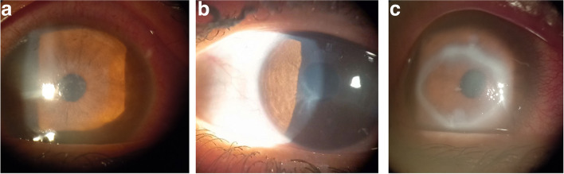
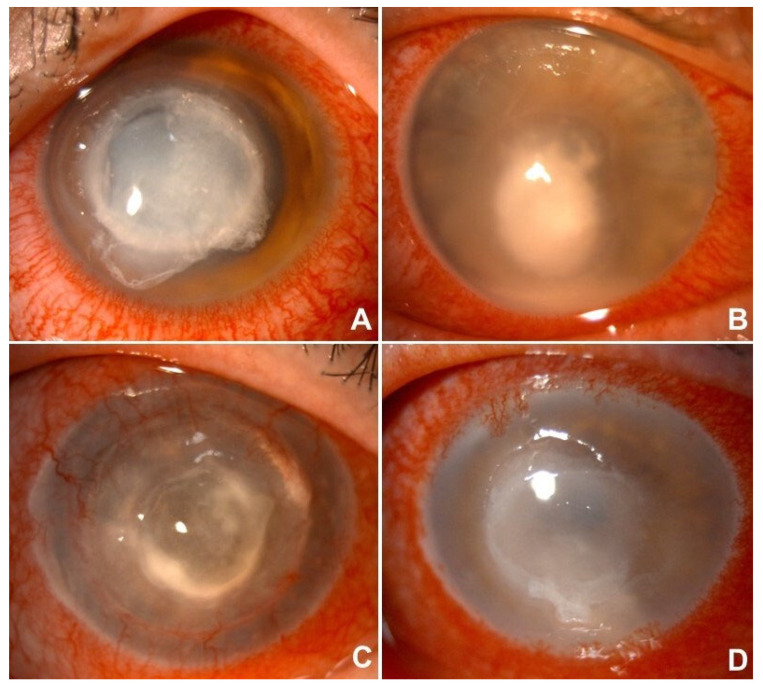
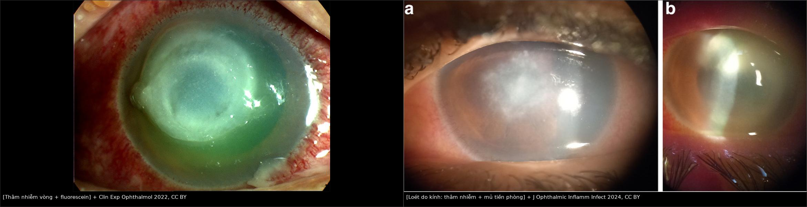
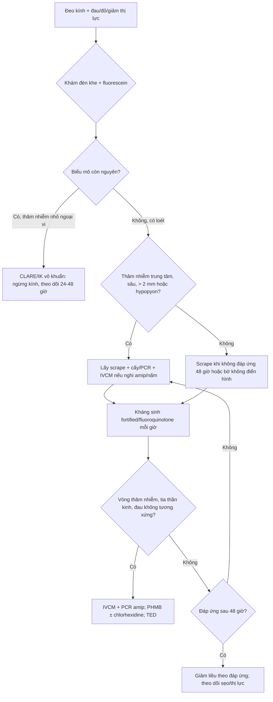
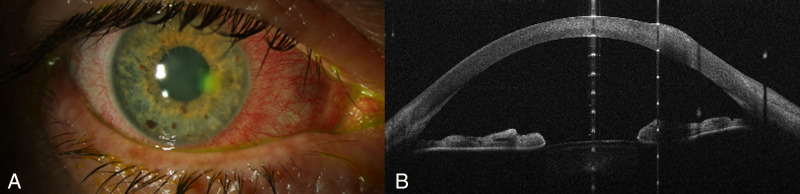
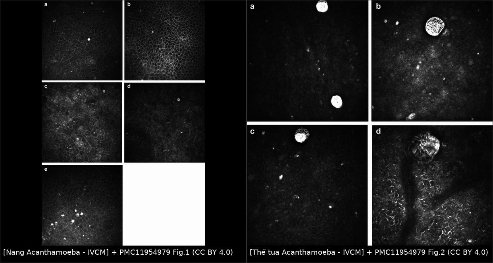
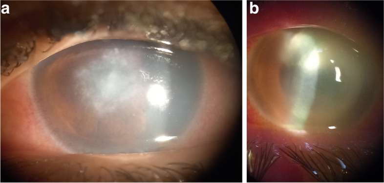

# 6132 — Viêm giác mạc nhiễm khuẩn liên quan kính tiếp xúc: phân biệt thâm nhiễm vô khuẩn với nhiễm khuẩn thật & bẫy *Acanthamoeba* / Contact lens-related microbial keratitis

**Tags:** `pattern:tham-nhien-giac-mac` `pattern:loet-giac-mac` `pattern:khuyet-bieu-mo` `pattern:vet-thuong-bieu-mo` `vung:giac-mac` `vung:mat` `protocol:den-khe` `protocol:sinh-thiet-giac-mac` `protocol:nuoi-cay` `protocol:IVCM` `protocol:AS-OCT`
**Mức chắc chắn (certainty):** tổng hợp y văn (literature synthesis) — **bổ sung 2026-11-13:** đoàn hệ Pseudomonas **66 mắt** ở Anh (Front Med 2026, PMC13395769), nghiên cứu yếu tố nguy cơ vệ sinh kính **Ai Cập 2024** (PMC11336145) và tổng quan viêm giác mạc nhiễm trùng (Clin Exp Ophthalmol 2022, PMC9542356) — đoàn hệ **41 bệnh nhân/42 mắt nhập viện** vì viêm giác mạc nặng liên quan kính tiếp xúc (Sund MH et al., *Acta Ophthalmol* 2025, PMC11986396), **138 ca** viêm giác mạc do vi khuẩn liên quan kính tại Nottingham 7 năm (Suresh L et al., *Eye* 2024, PMC11621543), **221 mắt** viêm giác mạc nhiễm trùng tại trung tâm tham chiếu (Moramarco A et al., *Microorganisms* 2025, PMC12565946), nghiên cứu **AS-OCT phân biệt *Pseudomonas*** (Khalil H et al., *Transl Vis Sci Technol* 2023, PMC10691401) và **27 ca IVCM** *Acanthamoeba* (Przybek-Skrzypecka J et al., *Sci Rep* 2025, PMC11954979). Các ca trong mục (6) là ca của bài gốc, ghi rõ nguồn từng ca; **không có ca nguyên văn của nhóm**.

> **Điểm chốt:** kính tiếp xúc không chỉ là "yếu tố nguy cơ" — nó quyết định **chùm tác nhân** (Pseudomonas, Acanthamoeba, nấm sợi) và **tốc độ** (vi khuẩn 24–48 giờ). Câu hỏi đầu tiên trên đèn khe không phải "loét to hay nhỏ" mà là **"biểu mô còn nguyên hay đã mất, và thâm nhiễm sâu tới đâu"** — vì thâm nhiễm vô khuẩn (CLARE/IK) và nhiễm khuẩn thật trông giống nhau nhưng xử trí ngược nhau.

## 1. Tổng quan bệnh học – cơ chế hình ảnh

- **Vì sao đeo kính làm giác mạc dễ nhiễm:** kính làm giảm **trao đổi nước mắt và oxy** dưới kính, tăng **vi chấn thương biểu mô** khi tháo/lắp và khi kính khô, đồng thời tạo **màng sinh học (biofilm)** trên kính và hộp đựng — nơi *Pseudomonas aeruginosa* và amip bám vào. Vi khuẩn tiết **exotoxin A, protease, elastase** phá mô đệm; amip xâm nhập **dây thần kinh giác mạc** và nang hóa trong mô đệm. Vì vậy cùng một "vết xước nhỏ", **Pseudomonas** có thể thành loét thủng trong **24–48 giờ**, còn *Acanthamoeba* diễn tiến **nhiều tuần** với đau không tương xứng.
- **Vì sao hình ảnh trông như vậy (vật lý + mô bệnh):**
  - **Thâm nhiễm trắng trên đèn khe** = tế bào viêm (chủ yếu bạch cầu đa nhân) + phù mô đệm. Mật độ tế bào càng cao và càng sát bề mặt → tán xạ ánh sáng càng mạnh → **càng đục trắng**; mất biểu mô → **fluorescein bắt màu xanh lá**.
  - **Vòng thâm nhiễm (ring infiltrate)** = lắng đọng phức hợp kháng nguyên–kháng thể và tế bào viêm ở **mô đệm trước**, không phải "màng" — vì thế nó **không bóc được** và **không đặc hiệu** cho amip (còn gặp trong nấm, HSV, *Pythium*, dị vật).
  - **Viêm dây thần kinh dạng tia (radial keratoneuritis)** = amip di chuyển dọc **dây thần kinh giác mạc** gây thâm nhiễm quanh sợi trục — dấu hiệu **gợi ý mạnh** nhưng không có ở mọi ca.
  - **AS-OCT** đo trực tiếp **độ dày thâm nhiễm** và **mô đệm còn lại**; *Pseudomonas* gây **tăng thể tích mô 30%** so với **15%** ở Gram dương (p = 0,041) và thâm nhiễm dày hơn (p = 0,009) — vì Gram âm bùng nổ phản ứng viêm và phù mô mạnh hơn.
  - **IVCM (confocal đồng tiêu)** phát hiện **nang amip hai vách ~10 µm** dạng **điểm sáng (bright spot)**, **thể tua (trophozoite)** và **dấu signet-ring**; đây là bằng chứng **tế bào sống** tại chỗ, bổ sung cho cấy.
- **Ngưỡng định lượng phải nhớ:**
  - **Tần suất viêm giác mạc NẶNG phải nhập viện:** **2,52/10.000 người dùng kính** đeo qua đêm (extended wear) mỗi năm, so với **0,52/10.000** ở người dùng kính **dùng một lần/ngày** (Sund 2025, PMC11986396).
  - **Nhóm vi khuẩn:** 138 ca Nottingham — trong **64 ca cấy dương**, **Pseudomonas 49,3%**, *Staphylococcus* **21,9%**, đa vi khuẩn **4,3%**; **97,0%** khỏi chỉ bằng kháng sinh tại chỗ (Suresh 2024, PMC11621543).
  - **Tỷ lệ tác nhân ở trung tâm tham chiếu (221 mắt):** vi khuẩn **64%**, virus **20%**, nấm **13%**, amip **3,2%**; **42,5%** có đeo kính; cấy dương **75,7%** (Moramarco 2025, PMC12565946).
  - **IVCM so với cấy trong *Acanthamoeba*:** IVCM phát hiện **85% (23/27)** so với cấy **74% (20/27)**; **điểm sáng 87%**, **nang hai vách 56%**, **signet-ring 22%**, **thể tua 30%** (Przybek-Skrzypecka 2025, PMC11954979).
  - **Cấy âm 34–62%** trong viêm giác mạc vi khuẩn — **cấy âm không loại trừ nhiễm khuẩn** (Khalil 2023, PMC10691401).

## 2. Mẫu hình + chẩn đoán phân biệt theo vị trí (Gamut)

Hỏi theo thứ tự: **có đeo kính không? → biểu mô còn nguyên hay mất? → thâm nhiễm nông hay sâu, trung tâm hay ngoại vi? → có vòng thâm nhiễm/tia thần kinh/hypopyon? → tốc độ onset bao lâu?**

- **Thâm nhiễm mủ đặc, khởi phát < 48 giờ, đeo kính qua đêm:** ***Pseudomonas*** (hàng đầu), *Serratia*, *Klebsiella*; kèm **hypopyon** và **mủ bám mặt sau kính**.
- **Thâm nhiễm nhỏ, ngoại vi, biểu mô còn nguyên, đau nhẹ:** **CLARE/IK vô khuẩn** (contact lens acute red eye / infiltrative keratitis) — phản ứng viêm với nội độc tố vi khuẩn trên kính, **không phải nhiễm mô**.
- **Vòng thâm nhiễm + đau nhiều hơn mức thấy + tia thần kinh + tiền sử bơi/nước máy/rửa kính bằng nước:** ***Acanthamoeba***.

*Ba dấu hiệu hay gặp của *Acanthamoeba* trên đèn khe: **(a)** thâm nhiễm dưới biểu mô dạng chấm, **(b)** **viêm thần kinh tỏa tia**, **(c)** **thâm nhiễm vòng**. Không dấu nào đặc hiệu một mình — chốt bằng IVCM/PCR/cấy. Nguồn: J Ophthalmic Inflamm Infect 2024 (PMC11336145), CC BY 4.0.*
- **Bờ tua (feathery), vệ tinh (satellite), tiền sử chấn thương thực vật:** **nấm sợi** (*Fusarium* sau kính, *Aspergillus* sau chấn thương); diễn tiến **chậm, nhiều tuần**.
- **Nhánh gai (dendrite)/loét địa đồ + tiền sử HSV:** **HSV giác mạc** — không phải "loét do kính", nhưng thường bị chẩn đoán nhầm và **nặng lên nếu dùng corticoid**.
- **Vị trí quyết định mức khẩn:** **trung tâm/trục thị giác** → nguy cơ sẹo thị lực, can thiệp sớm; **ngoại vi** → thường vô khuẩn nhưng vẫn phải loại trừ nấm/amip nếu bờ không đều.
- **Gợi nhớ "PAF-H":** **P**seudomonas, **A**canthamoeba, **F**ungal, **H**SV — bốn nhóm phải nghĩ trước khi kê "kháng sinh chung".
- **Nhóm do kính có tiên lượng tốt hơn nhóm không do kính (định lượng):** trong **66 mắt** Pseudomonas (Anh 2016–2020), **53,1%** do kính; nhóm do kính **trẻ hơn, thị lực vào viện tốt hơn, loét nhỏ và không ở trung tâm, ít mủ tiền phòng**, **lành 17 ngày so với 32 ngày** (p = 0,029) và **nguy cơ thị lực xấu thấp hơn** (aOR 0,13; KTC 95% 0,01–0,84); **97,0%** chủng còn nhạy kháng sinh (Front Med 2026, PMC13395769).
- **Yếu tố nguy cơ vệ sinh — con số để tư vấn:** **tắm/bơi khi đeo kính** (p = 0,012) và **rửa kính bằng nước máy** (p = 0,030) tăng loét **nhiễm trùng**; **đeo > 12 giờ/ngày** tăng loét **không nhiễm trùng ~ 4 lần** (p = 0,030); **đeo qua đêm** tăng **2,6 lần** (p = 0,030) (J Ophthalmic Inflamm Infect 2024, PMC11336145).

## 3. Bảng so sánh phân biệt (ma trận đối chiếu)

| Thực thể (entity) | Hình ảnh điển hình (đèn khe / AS-OCT / IVCM) | Chốt vào (rule-in) | Chốt loại (rule-out) | Gợi ý xác nhận |
|---|---|---|---|---|
| **Pseudomonas** | Thâm nhiễm mủ **đặc, trắng vàng**, bờ không đều, **hypopyon**, phù mô mạnh; AS-OCT: **thâm nhiễm dày, mô tăng 30%** | **Đeo kính qua đêm + khởi phát < 48 giờ + thâm nhiễm mủ đặc** | Bờ tua/vệ tinh + diễn tiến chậm → nghĩ nấm; vòng + đau không tương xứng → amip | Cấy/scrape; AS-OCT (mô hình Se **85,7%**/Sp **91,7%**) |
| **Gram dương (Staph)** | Thâm nhiễm **khu trú, bờ tròn**, mô tăng **15%**, thường ngoại vi | **Thâm nhiễm nhỏ, bờ đều, tiến triển chậm** | Thâm nhiễm lan + mủ đặc + hypopyon → Gram âm | Cấy; đáp ứng kháng sinh 48 giờ |
| **Acanthamoeba** | **Vòng thâm nhiễm**, **tia thần kinh**, đau nhiều; IVCM: **điểm sáng/nang hai vách** | **Đau không tương xứng + vòng/tia + tiền sử nước** | Chỉ thâm nhiễm mủ đặc không vòng → ít nghĩ amip | IVCM (85% vs cấy 74%), PCR, cấy amip |
| **Nấm sợi** | **Bờ tua, vệ tinh**, đôi khi vòng; AS-OCT: thâm nhiễm sâu, bờ không đều | **Chấn thương thực vật/kính + bờ tua + vệ tinh** | Bờ đều, đáp ứng nhanh kháng sinh → ít nghĩ nấm | Nhuộm/cấy nấm, IVCM sợi nấm |
| **HSV** | **Nhánh gai**, loét địa đồ, giảm cảm giác giác mạc | **Nhánh gai điển hình + tiền sử tái phát** | Nhánh giả do thuốc/dị vật → xem bờ và cảm giác | PCR HSV, đáp ứng acyclovir |
| **CLARE/IK vô khuẩn** | Thâm nhiễm **nhỏ, ngoại vi, biểu mô nguyên**, không hypopyon | **Kính + thâm nhiễm ngoại vi + biểu mô nguyên + đau nhẹ** | Biểu mô mất, thâm nhiễm trung tâm, hypopyon → **không phải vô khuẩn** | Theo dõi 24–48 giờ sau ngừng kính |
| ***Pythium* / vòng thâm nhiễm khác** | Vòng thâm nhiễm **lan nhanh, đau dữ dội**, tiền sử nước/nông nghiệp | **Vòng + tiến triển nhanh + cấy nấm âm** | Không có vòng/tia → ít nghĩ | Nuôi cấy chuyên biệt, PCR; **không chờ kết quả** |

*Bốn thể trên đèn khe: (A) *Pseudomonas* — thâm nhiễm mủ đặc, phù mô; (B) nấm — thâm nhiễm trắng xám bờ không đều; (C) HSV — tổn thương dạng nhánh/địa đồ; (D) *Acanthamoeba* — vòng thâm nhiễm và phù lan. Nguồn: Moramarco A et al., *Microorganisms* 2025;13:2308, PMC12565946 Fig. 1, CC BY 4.0. Ảnh nguyên bản của tác giả, không chỉnh sửa.*

*Trái: **thâm nhiễm vòng** dưới nhuộm fluorescein — mẫu hình gặp ở Pseudomonas, Acanthamoeba, nấm và cả phản ứng miễn dịch, **không dùng một mình để chẩn đoán**. Phải: loét do kính áp tròng — **(a)** thâm nhiễm trung tâm, **(b)** **mủ tiền phòng** lắng ngang. Nguồn: Clin Exp Ophthalmol 2022 (PMC9542356) và J Ophthalmic Inflamm Infect 2024 (PMC11336145), CC BY 4.0; ảnh ghép letterbox, không crop.*

## 4. Protocol chụp/khám + phân độ và ngưỡng xử trí

- **Đèn khe là "modality" đầu tiên, không phải chụp cắt lớp:** đánh giá **kích thước thâm nhiễm (mm), vị trí so với trục thị giác, độ sâu (biểu mô/mô đệm trước/sâu), biểu mô còn hay mất, hypopyon (mm), phản ứng tiền phòng, nhãn áp, cảm giác giác mạc**, và **lật mi trên tìm dị vật**.
- **AS-OCT (chụp cắt lớp quang học tiền phòng):** đo **độ dày thâm nhiễm, độ dày giác mạc, mô đệm còn lại** và theo dõi đáp ứng — hữu ích khi **giác mạc đục không nhìn rõ độ sâu**, khi cân nhắc **ghép giác mạc xuyên (TPK) hay ghép mảnh (DALK)**. Mô hình AS-OCT phân biệt *Pseudomonas* đạt **Se 85,7%/Sp 91,7%** với **thâm nhiễm dày + mô tăng 30%** (Khalil 2023).
- **IVCM:** chỉ định khi **nghi *Acanthamoeba*** (vòng/tia/đau không tương xứng/không đáp ứng kháng sinh), hoặc **nghi nấm**; tìm **nang hai vách, điểm sáng, thể tua, signet-ring**. Không thay thế cấy nhưng cho kết quả **tại chỗ, trong vài phút**.
- **Lấy bệnh phẩm (scrape) khi:** loét **trung tâm/đe dọa thị lực**, thâm nhiễm **sâu hoặc > 2 mm**, **hypopyon**, **bờ không điển hình**, **không đáp ứng sau 48 giờ**, **chấn thương**, **suy giảm miễn dịch**, hoặc **nghi nấm/amip**. Cấy + nhuộm Gram/Giemsa + nấm + amip; PCR khi có.
- **Nguyên tắc điều trị ban đầu (không chờ cấy):**
  - **Ngừng kính ngay**, bỏ kính và hộp đựng đang dùng.
  - **Vi khuẩn:** **fluoroquinolone tại chỗ** (moxifloxacin 0,5% hoặc ciprofloxacin 0,3%) **mỗi 1 giờ khi thức** ở thể nặng; **cefazolin 5% + tobramycin 1,3%** (fortified) khi **loét trung tâm, sâu, hypopyon** hoặc nghi Gram âm nặng.
  - **Acanthamoeba:** **PHMB 0,08% ± chlorhexidine 0,02%**, **cạo biểu mô điều trị (TED)** hỗ trợ thấm thuốc; **tránh corticoid trước khi có chẩn đoán** vì làm nặng và che dấu.
  - **Nấm:** **natamycin 5%** tại chỗ (Fusarium), voriconazole khi thấm sâu; **không dùng corticoid đơn thuần**.
  - **HSV:** **acyclovir tại chỗ ± toàn thân**; corticoid chỉ khi có chỉ định chuyên khoa và đã kiểm soát nhiễm.
- **Nhập viện/theo dõi sát khi:** loét **trung tâm hoặc đe dọa trục thị giác**, thâm nhiễm **sâu/giác mạc mỏng**, **hypopyon**, **nguy cơ thủng**, **không tuân thủ nhỏ thuốc**, hoặc **không cải thiện sau 48 giờ**. Hẹn khám lại **24–48 giờ** trong thể nặng.
- **Ý nghĩa của chậm trễ (định lượng):** bệnh nhân được chuyển đến **> 15 ngày** có **40%** cần mổ cấp cứu so với **8%** khi đến sớm; thời gian điều trị trung bình **123 ngày vs 53 ngày**; mỗi ngày chậm tăng **2%** nguy cơ phải mổ (Moramarco 2025, PMC12565946). Ở thể amip, thời gian điều trị trung bình **235 ngày** và **43%** cần can thiệp phẫu thuật.

- **Khi phải can thiệp (số liệu để giải thích cho bệnh nhân):** **keo cyanoacrylate** dán che ổ thủng/descemetocele đạt **29–86%** thành công tùy nguyên nhân và thường phải làm lại trong **1 tháng**; **ghép giác mạc xuyên (TPK)** có nguy cơ **tái nhiễm 5–14%**, cao hơn khi tổn thương **chạm rìa, có mủ tiền phòng hoặc đã thủng** (Clin Exp Ophthalmol 2022, PMC9542356). Corticoid bổ trợ **vẫn còn tranh cãi** → không dùng khi còn khuyết biểu mô/mủ tiền phòng.

## 5. Biến thể bình thường và cạm bẫy

- **CLARE/IK vô khuẩn không phải "nhiễm khuẩn nhẹ":** thâm nhiễm **nhỏ, ngoại vi, biểu mô nguyên**, không hypopyon; **ngừng kính + theo dõi** là đủ, kháng sinh thường không cần. Điều trị như loét thật sẽ **che dấu** và làm mất dấu theo dõi.
- **Vòng thâm nhiễm không đồng nghĩa amip:** gặp trong nấm, HSV, *Pythium*, dị vật, thậm chí sau *Pseudomonas*; **đừng chốt amip chỉ vì có vòng** — và **đừng bỏ amip chỉ vì cấy âm**.
- **Đau không tương xứng là dấu hiệu, không phải tiêu chuẩn:** có ca amip **không đau** (đã báo cáo), nên **không loại trừ** khi thiếu đau.
- **Corticoid trước chẩn đoán:** làm nặng nấm/amip/HSV và có thể gây **thủng giác mạc**; chỉ dùng khi đã kiểm soát nhiễm và có theo dõi chuyên khoa.
- **Băng kính (bandage contact lens) sau chấn thương biểu mô** là **yếu tố nguy cơ** viêm giác mạc — không được coi là "vô hại" (PMC6440609).
- **Cấy âm 34–62%:** một scrape sạch không loại trừ nhiễm khuẩn; nếu bệnh cảnh nặng, **điều trị theo hình ảnh + lâm sàng** và lặp scrape.
- **Bỏ sót dị vật dưới mi trên:** luôn **lật mi** trước khi kết luận "loét do kính"; dị vật để lại sẽ làm thâm nhiễm tái diễn dù kháng sinh đúng.
- **AS-OCT/IVCM phụ thuộc người vận hành:** kết quả âm không loại trừ; **so sánh với đèn khe và cấy**.

## 6. Tự lượng giá — Blind Quiz

**Ca 1 — Nam 24 tuổi, đeo kính áp tròng mềm qua đêm 3 đêm, đau và giảm thị lực 36 giờ.**

- Hỏi: mô tả thâm nhiễm (vị trí, mật độ, bờ)? Có hypopyon không? Ba chẩn đoán phân biệt và dấu nào chốt?
- Gợi ý: nhìn **panel A** — thâm nhiễm mủ đặc, phù mô lan, bờ không đều.

<b>Bấm để hiện đáp án (findings + chẩn đoán)</b>

- **Findings:** thâm nhiễm **mủ đặc, trắng-vàng, trung tâm**, phù mô đệm lan, bờ không đều; biểu mô mất trên vùng thâm nhiễm. Panel A của hình là *Pseudomonas*.
- **Chẩn đoán:** **viêm giác mạc do *Pseudomonas aeruginosa*** — đeo kính qua đêm + khởi phát < 48 giờ + thâm nhiễm mủ đặc là bộ ba kinh điển.
- **Ba phân biệt:** nấm sợi (bờ tua/vệ tinh, chậm), *Acanthamoeba* (vòng/tia, đau nhiều), Gram dương (nhỏ hơn, bờ đều).
- **Chốt:** **scrape + cấy** trước khi đổi kháng sinh; khởi đầu **fluoroquinolone mỗi giờ**, thêm **fortified cefazolin + tobramycin** nếu trung tâm/sâu/hypopyon.
- Nguồn ảnh: Moramarco A et al., *Microorganisms* 2025;13:2308, PMC12565946 Fig. 1A, CC BY 4.0.

**Ca 2 — Nữ 29 tuổi, đeo kính mềm, đau tăng dần 10 ngày, "đau hơn nhiều so với vết loét nhìn thấy".**

- Hỏi: dấu hiệu nào trên **panel D** gợi ý amip? Cần làm gì ngay để xác nhận mà không chờ cấy?

<b>Bấm để hiện đáp án (findings + chẩn đoán)</b>

- **Findings:** **vòng thâm nhiễm (ring infiltrate)** ở mô đệm trước, phù lan; có thể kèm **tia thần kinh** và **đau không tương xứng**.
- **Chẩn đoán:** ***Acanthamoeba* keratitis** — panel D.
- **Xác nhận tại chỗ:** **IVCM** tìm **nang hai vách/điểm sáng/thể tua**; đồng thời **PCR + cấy amip**. IVCM phát hiện **85%** so với cấy **74%** trong loạt 27 ca.
- **Điều trị:** **PHMB 0,08% ± chlorhexidine 0,02%**, **TED**, **không corticoid** trước chẩn đoán; thời gian điều trị có thể **235 ngày**.
- Nguồn ảnh: Moramarco A et al., *Microorganisms* 2025;13:2308, PMC12565946 Fig. 1D, CC BY 4.0.

**Ca 3 — Nam 31 tuổi, đeo kính dùng một lần/ngày, đau 24 giờ, thâm nhiễm nhỏ ở rìa.**

- Hỏi: AS-OCT đo được gì mà đèn khe không đo được? Khi nào **không** cần scrape?

<b>Bấm để hiện đáp án (findings + chẩn đoán)</b>

- **Findings:** đèn khe (A) thâm nhiễm nhỏ, rìa; AS-OCT (B) cho thấy **độ dày thâm nhiễm, độ dày giác mạc và mô đệm còn lại**, cùng **mô tăng/giảm** — định lượng khách quan hơn ước lượng bằng mắt.
- **Chẩn đoán:** viêm giác mạc sớm liên quan kính; **không thể phân biệt chắc vi khuẩn** chỉ bằng ảnh — cần bối cảnh (kính qua đêm, tốc độ, mủ).
- **Khi không cần scrape ngay:** thâm nhiễm **nhỏ, ngoại vi, biểu mô nguyên**, không hypopyon, bệnh nhân tuân thủ → **ngừng kính + theo dõi 24–48 giờ**; scrape nếu **xấu đi, trung tâm, sâu, hoặc không đáp ứng**.
- Nguồn ảnh: Khalil H et al., *Transl Vis Sci Technol* 2023;12:34, PMC10691401 Fig. 7, CC BY 4.0.

**Ca 4 — Bệnh nhân nghi amip, IVCM dương tính:**

- Hỏi: hai hình thái này khác nhau thế nào, và vì sao IVCM có thể dương tính khi cấy âm?

<b>Bấm để hiện đáp án (findings + chẩn đoán)</b>

- **Findings:** trái = **nang hai vách** (điểm sáng tròn, viền đôi, ~10 µm); phải = **thể tua** (hình thái lớn hơn, bờ không đều, có tua giả).
- **Vì sao IVCM dương khi cấy âm:** IVCM nhìn **trực tiếp tế bào amip trong mô sống**, không phụ thuộc môi trường nuôi cấy; cấy amip **khó và chậm**, độ nhạy thấp hơn.
- **Chốt:** IVCM **bổ sung**, không thay thế PCR/cấy; dương tính giúp **khởi trị sớm** bằng biguanide.
- Nguồn ảnh: Przybek-Skrzypecka J et al., *Sci Rep* 2025, PMC11954979 Fig. 1 và Fig. 2, CC BY 4.0; ảnh ghép letterbox bằng `tools/make_composite.py`, không crop/kéo giãn.

**Ca 4 — Nữ 22 tuổi, đeo kính mềm quên tháo khi ngủ 2 đêm; đau dữ dội, nhìn mờ 2 ngày.**

- Hỏi: hai dấu hiệu ở (a) và (b)? Ba việc phải làm trong 1 giờ đầu? Vì sao chưa được dùng corticoid?

<b>Bấm để hiện đáp án (findings + chẩn đoán)</b>

- **(a)** thâm nhiễm trung tâm trắng đục + khuyết biểu mô; **(b)** **mủ tiền phòng** mức lắng ngang.
- Chẩn đoán: **loét giác mạc nhiễm trùng do kính áp tròng**, hàng đầu ***Pseudomonas*** (khởi phát < 48 giờ, đeo qua đêm).
- Trong 1 giờ: **bỏ kính**, **cạo giác mạc nhuộm Gram + cấy** (kèm cấy kính/hộp/dung dịch), **fortified tobramycin 1,4% + cefazolin 5% mỗi giờ**; hẹn khám lại **24 giờ**.
- **Chưa corticoid** vì còn khuyết biểu mô + mủ tiền phòng: giảm viêm giả tạo nhưng **tăng nguy cơ thủng** và che dấu đáp ứng.
- Nguồn: J Ophthalmic Inflamm Infect 2024 (PMC11336145) Fig. 3, CC BY 4.0.

## Bài liên quan chéo
- [474 – Kháng nấm nội nhãn: chọn thuốc theo loài & kháng sinh đồ](../474-khang-nam-noi-nhan-chon-thuoc-theo-loai/lesson.md) (nấm giác mạc/nội nhãn)
- [6131 – Kính scleral trong bệnh bề mặt nhãn cầu nặng](../6131-kinh-scleral-benh-be-mat-nhan-cau/lesson.md)
- [6106 – Bệnh giác mạc do aniridia: điều trị và phục hồi bề mặt](../6106-benh-giac-mac-do-aniridia-dieu-tri-va-phuc-hoi-be-mat/lesson.md)
- [400 – Tổng quan Mắt & thị giác](../400-tong-quan-mat-thi-giac/lesson.md)

> Không dùng để chẩn đoán độc lập khi chưa có người hướng dẫn.
