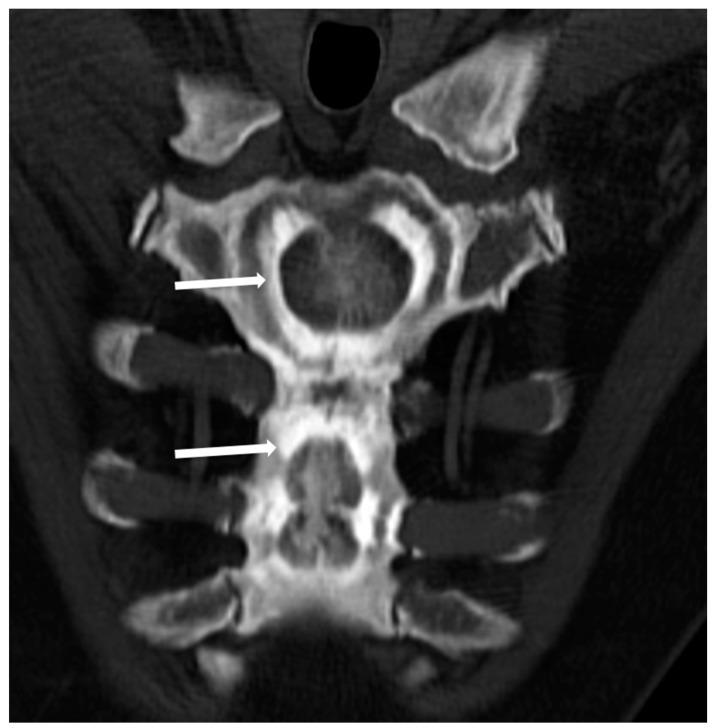
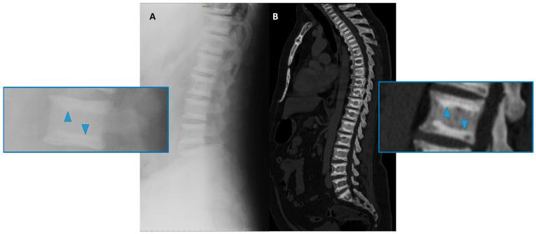
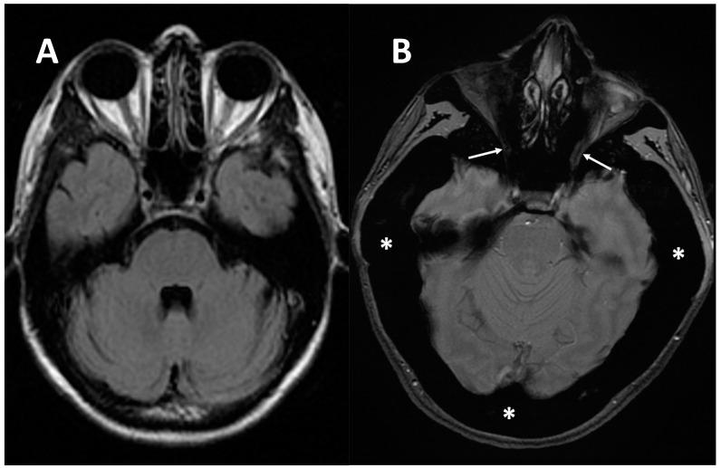
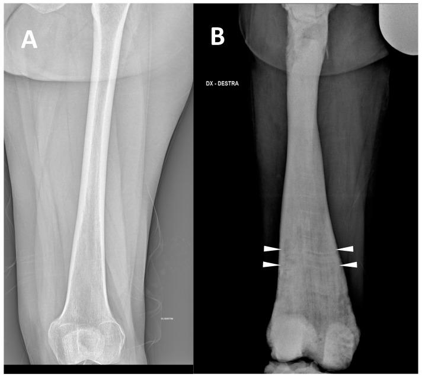
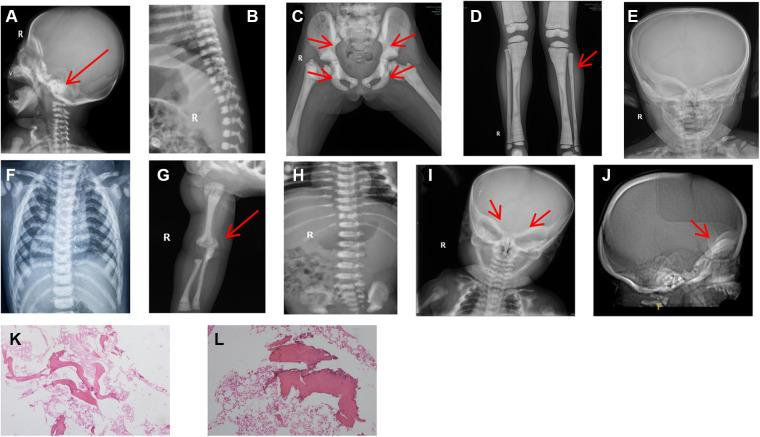
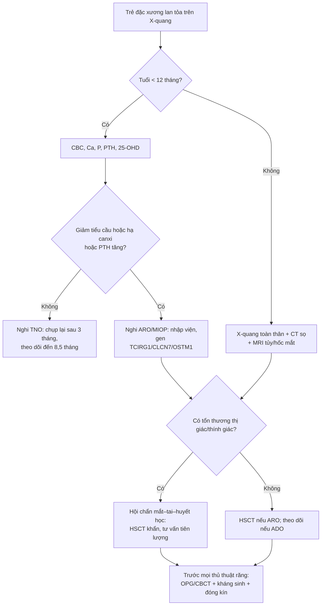
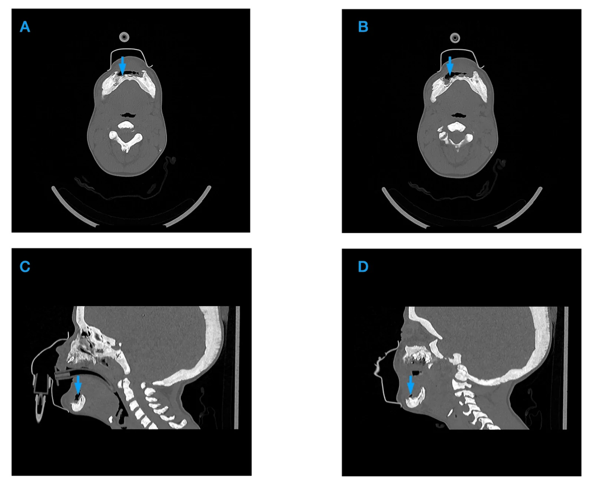
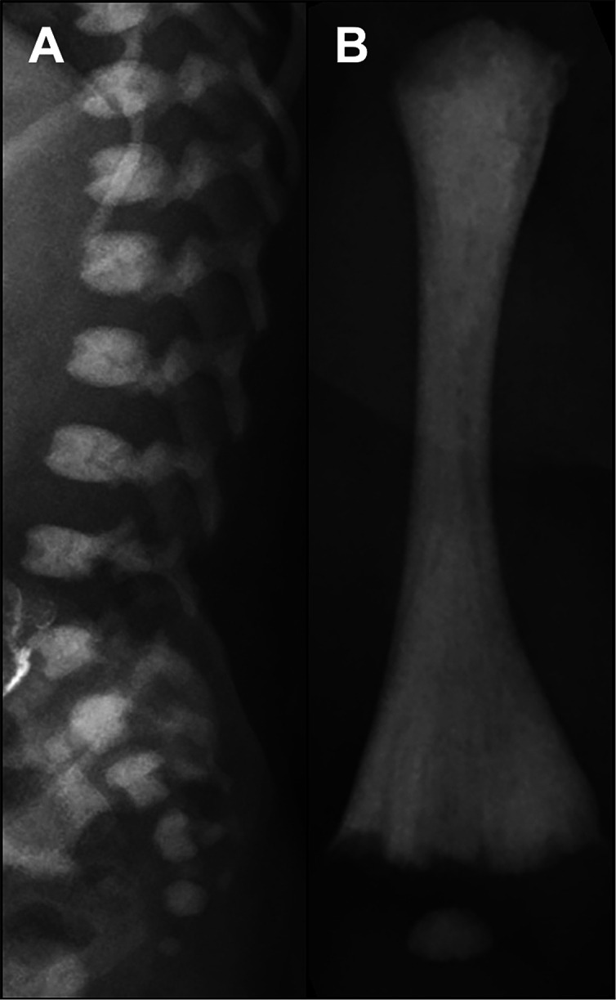

# 6134 — Bệnh xương cứng di truyền (osteopetrosis) ở trẻ: xương đặc lan tỏa, mất tủy xương, chèn ép thần kinh & hoại tử hàm / Osteopetrosis in children

**Tags:** `pattern:dac-xuong` `pattern:bone-in-bone` `pattern:sandwich-vertebrae` `pattern:mat-tuy-xuong` `pattern:hoai-tu-xuong-ham` `vung:co-xuong` `vung:so-mat` `vung:xuong-ham` `score:ADO-type` `protocol:X-quang-xuong-dai` `protocol:CT-xuong` `protocol:MRI-tuy-xuong` `incidentaloma:dac-xuong`
**Mức chắc chắn (certainty):** tổng hợp y văn (literature synthesis) — ghép tổng quan cơ chế/dịch tễ (Penna S, Villa A, Capo V. Dis Model Mech 2021;14:dmm048940, PMC8188884), phổ hình ảnh theo kiểu di truyền (Spinnato P et al., Genes 2022;13:1965, PMC9689876), ca hoại tử hàm ở trẻ (Matysek J et al., Cureus 2026;18(9):e116923, PMC13696059), loạt 33 trẻ của Trung Quốc (Chen Y et al., Front Pediatr 2023;11:1096770, PMC10043213), so sánh xơ xương sơ sinh thoáng qua với thể ác tính (Ackah SA et al., Bone Rep 2025;27:101885, PMC12639257), loạt nội tiết 17 trẻ (Gök E et al., Front Endocrinol 2026;17:1854949, PMC13518210) và tổng quan sọ–mặt–răng (Ma Y et al., Int J Mol Sci 2023;24:10412, PMC10299715).

> **Điểm chốt của bài:** osteopetrosis **không phải "xương chắc"** mà là **xương đặc nhưng giòn, không có tủy, và các lỗ thần kinh bị bít**. Trên phim, chốt là **mất phân biệt vỏ–tủy lan tỏa + bone-in-bone/sandwich vertebrae**; trên lâm sàng, chốt là **thiếu máu – giảm tiểu cầu + chèn ép thị giác/thính giác + hoại tử hàm**. Ở **sơ sinh**, trước khi gọi bệnh nặng, phải loại **xơ xương sơ sinh thoáng qua (TNO)** — thể này **tự hết, trung bình 8,5 tháng**, và **không có giảm tiểu cầu/hạ canxi**. Ở trẻ **không dùng bisphosphonate** mà có **hoại tử hàm**, nghĩ osteopetrosis/LRRK1 trước khi dán nhãn MRONJ.

## 1. Tổng quan — vì sao xương đặc mà lại giòn, và vì sao hình ảnh trông như vậy

- **Cơ chế (pathophysiology):** nguyên bào hủy xương (osteoclast) **không hoạt động hoặc không biệt hóa** → sụn–xương sơ cấp (primary spongiosa) **không được tái tạo**, canxi hóa tiếp tục trên "giàn giáo" cũ → **khối xương khoáng hóa tăng nhưng cấu trúc là xương woven, không có collagen sắp xếp theo lực** → **cứng nhưng giòn (brittle)**. Khoang tủy bị lấp dần, **không còn chỗ cho tạo máu**.
- **Vì sao CT đậm:** tỷ lệ mô khoáng hóa trên thể tích tăng; **xương xốp bình thường 150–400 HU**, trong osteopetrosis vùng tủy có thể **> 500–1.000 HU**, **mất phân biệt vỏ–tủy**; không có hiện tượng hủy xương nên **không thấy viền tiêu/osteolysis** trừ khi có biến chứng nhiễm trùng.
- **Vì sao MRI tối ở MỌI chuỗi xung:** tủy mỡ (T1 sáng) và nước tủy (T2 sáng) bị thay bằng **xương khoáng hóa** — mô này có **mật độ proton thấp và T2 rất ngắn** → **T1 thấp, T2/STIR thấp, không ngấm thuốc, không hạn chế khuếch tán**. Đây là điểm phân biệt với **thâm nhiễm/u tủy** (T1 thấp nhưng T2 sáng, ngấm thuốc, DWI sáng/ADC tối).
- **Vì sao thiếu máu + lách to:** khoang tủy bị bít → **suy tủy (anemia, thrombocytopenia, nhiễm trùng, chảy máu)**; tạo máu ngoài tủy bù trừ → **gan lách to**. Ca dưới đây: **Hb 8,4 g/dL, tiểu cầu 61 × 10⁹/L, lách 189 × 95 mm** (PMC13696059).
- **Vì sao mù/điếc:** xương sọ dày + **hẹp lỗ thị giác, lỗ ốc tai, lỗ bầu dục** → **teo dây thần kinh thị giác, điếc tiếp nhận, liệt mặt**; hẹp lỗ chẩm → **chèn ép hành não/não úng thủy**. Tổn thương thần kinh **thường không hồi phục dù ghép tủy thành công** (xem dưới).
- **Dịch tễ và di truyền (số phải nhớ):**
  - **Thể lặn nhiễm sắc thể thường (ARO — malignant infantile): 1/250.000 trẻ sinh sống**, **tử vong trong thập niên đầu nếu không điều trị** (PMC8188884). **Thể trội (ADO): 1/20.000** — thường nhẹ hơn, phát hiện ở người lớn (PMC9689876).
  - **TCIRG1 > 50% ARO**, **CLCN7 17%**, **OSTM1 5%**; các gen hiếm: **SNX10, PLEKHM1, CA2, SLC4A2, TNFSF11 (RANKL), TNFRSF11A (RANK), LRRK1** (PMC8188884).
  - **13/13 thể osteopetrosis đều có kiểu hình sọ–mặt–răng** (PMC10299715): **sọ dày, nền sọ đặc, hàm nhỏ, chen chúc răng, men răng khiếm khuyết, chậm mọc răng**; kiểu "mặt người ngoài hành tinh" (space alien face) ở thể nặng.
- **Biến chứng nội tiết — osteopetrorickets (rất hay bị bỏ):** xương không huy động được canxi → **hạ canxi** → cường cận giáp thứ phát → **mất phosphate qua thận** → **còi xương nghịch lý trên nền xương đặc**. Loạt 17 trẻ: **76,4% (13/17) có osteopetrorickets**, trong đó **hạ canxi 11/13**, **hạ phosphate 8/13**, **thiếu vitamin D 4/13**; **sau ghép tủy, tăng canxi máu dội ngược 4/13 (30,8%)** (PMC13518210).
- **Điều trị chốt:** **ghép tế bào gốc tạo máu (HSCT)** đưa osteoclast của người cho vào — **sống còn 62–88%** với người cho HLA phù hợp, **62% sau 10 năm**; nhưng **> 50% bệnh nhân vẫn mất thị lực tiến triển sớm sau ghép** vì tổn thương thần kinh đã cố định (PMC8188884). **CLCN7/OSTM1 có thoái hóa thần kinh nguyên phát → HSCT không hiệu quả/ chống chỉ định** (PMC8188884).

## 2. Mẫu hình + chẩn đoán phân biệt theo vị trí (gamut)

- **Mẫu hình A — đặc xương lan tỏa + "bone-in-bone" (xương trong xương):** osteopetrosis thể ADO II là điển hình; trên CT thấy **một vỏ xương thứ hai bên trong thân xương/cánh chậu**. Gamut khác: **hồng cầu hình liềm, thalassemia, tăng vitamin D, còi xương, to đầu chi (acromegaly), bệnh Gaucher** — vì vậy **bone-in-bone không đặc hiệu**, phải đọc cùng **mất phân biệt vỏ–tủy + tuổi + tủy**.
- **Mẫu hình B — "sandwich vertebrae"/"rugger jersey spine" (đốt sống bánh sandwich):** dải đặc ở **hai mặt trên–dưới thân sống**, giữa sáng hơn. Osteopetrosis ADO II (do CLCN7) vs **bệnh xương do thận (renal osteodystrophy)** — thể thận thường có **tăng PTH, suy thận, đặc xương dạng viền mờ**, không có bít lỗ thần kinh.
- **Mẫu hình C — sơ sinh đặc xương lan tỏa:** **TNO (transient neonatal osteosclerosis)** vs **thể ác tính (MIOP/ARO)** vs **nhiễm trào ngược mẹ–thai (CMV, giang mai)**, **Down**, **loạn sản xương**, **tăng vitamin D mẹ**. TNO: **tuổi chẩn đoán trung vị 6 ngày**, **tự tan trung bình 8,5 tháng (1–31 tháng)**, **công thức máu và canxi bình thường**; IOP: **73 ngày**, **giảm tiểu cầu 4/6, hạ canxi 3/6, PTH tăng 5/6**, **giãn đầu xương 6/6**, **còi xương 3/6** (PMC12639257).
- **Mẫu hình D — sọ–mặt:** nền sọ đặc/dày, xương trán dày, **hàm dưới nhỏ, góc hàm tù**, răng chen chúc, **chậm mọc răng**. Gamut: **loạn sản sợi (fibrous dysplasia)**, **bệnh Paget** (người lớn), **loạn sản sọ–đầu xương (craniometaphyseal dysplasia)**, **Camurati–Engelmann** (thân xương dài), **loạn sản xương đòn sọ (cleidocranial dysplasia)**.
- **Mẫu hình E — đặc xương + hoại tử xương hàm:** osteopetrosis (kể cả **LRRK1/OSMD**), **MRONJ** (có bisphosphonate/denosumab), **osteoradionecrosis** (có xạ), **viêm xương tủy Garré**, **LCH**, **di căn/đa u tủy**. Chốt phân biệt nằm ở **tiền sử thuốc/xạ** + **mảnh xương chết** + **phản ứng màng xương** (xem bài 6108).
- **Mẫu hình F — đặc xương một chi:** **melorheostosis** (dạng "nến chảy"), **osteoma**, **di căn xơ (tuyến tiền liệt/vú)**, **nhồi máu xương**, **viêm xương tủy mạn**.
- **Gamut theo tuổi:** **sơ sinh** → TNO, ARO, nhiễm trùng TORCH; **trẻ nhỏ** → ARO, osteopetrorickets; **trẻ lớn/người lớn** → ADO II, LRRK1, bệnh thận, myelofibrosis.

*Bệnh nhân nam 48 tuổi, osteopetrosis thể ADO II: CT tái tạo coronal–oblique xương ức — **một lớp xương đặc thứ hai nằm trong thân xương** (mũi tên), giữa hai lớp vỏ là "xương trong xương". Đây là dấu **chốt vào** của thể ADO II nhưng **không đặc hiệu** (gặp cả trong thiếu máu hồng cầu hình liềm, thalassemia, Gaucher). Nguồn: Spinnato P, Pedrini E, Petrera MR, Zarantonello P, Trisolino G, Sangiorgi L, Carpenzano M, Crombé A, Tetta C. Genes 2022;13:1965 (PMC9689876, Fig. 3), CC BY 4.0.*

*Bệnh nhân nam 50 tuổi, ADO II: **(A)** X-quang cột sống thắt lưng nghiêng và **(B)** CT sagittal — dải đặc xương ở **mặt trên và mặt dưới mỗi thân sống** (arrowhead), giữa sáng hơn = **"sandwich vertebrae"/"rugger jersey"**. Cùng hình ảnh này gặp trong **bệnh xương do thận**; phân biệt bằng xét nghiệm thận/PTH và mất phân biệt vỏ–tủy lan tỏa. Nguồn: Spinnato P et al., Genes 2022;13:1965 (PMC9689876, Fig. 4), CC BY 4.0.*

*Bệnh nhân nữ 38 tuổi, ARO: **(A)** MRI trục T2* bình thường và **(B)** ở bệnh nhân osteopetrosis — xương dày lan tỏa làm **hẹp cả hai lỗ thị giác** (mũi tên), dây thần kinh thị giác bị chèn ép. Đây là cơ chế **mù tiến triển** dù ghép tủy thành công; cần MRI sọ–hốc mắt sớm và theo dõi thị lực. Nguồn: Spinnato P et al., Genes 2022;13:1965 (PMC9689876, Fig. 6), CC BY 4.0.*

## 3. Bảng so sánh phân biệt (ma trận đối chiếu)

| Thực thể (entity) | Hình ảnh điển hình (X-quang/CT/MRI) | Chốt vào (rule-in) | Chốt loại (rule-out) | Gợi ý xác nhận |
|---|---|---|---|---|
| **Osteopetrosis (ARO/ADO)** | Đặc xương **lan tỏa, đối xứng**, **mất phân biệt vỏ–tủy**; bone-in-bone, sandwich vertebrae, Erlenmeyer flask; MRI tủy **T1/T2 thấp toàn bộ**, không ngấm | **Đặc xương lan tỏa + mất tủy + giảm tiểu cầu/thiếu máu + hẹp lỗ thần kinh**; tiền sử gia đình | Đặc xương **khu trú**, có **viền tiêu xương**, mô mềm bắt thuốc → u/di căn | X-quang toàn thân + CT sọ/xương dài; gen (TCIRG1, CLCN7…); CBC, Ca, PTH |
| **TNO (xơ xương sơ sinh thoáng qua)** | Đặc xương lan tỏa ở sơ sinh, **dải đặc đầu xương**, **không giãn đầu xương**, không còi xương | **Sơ sinh ≤ 16 ngày, CBC/canxi gần bình thường, tự tan** | **Giảm tiểu cầu + hạ canxi + giãn đầu xương + PTH tăng** → IOP | Chụp lại **3 tháng**; theo dõi đến **8,5 tháng** |
| **Bệnh xương do thận** | Rugger-jersey spine, đặc xương **dạng viền**, **tăng PTH**, có thể gãy xương, canxi hóa mạch | **Suy thận mạn + PTH rất cao + phosphate cao** | Không suy thận, không rối loạn canxi–phosphate | Creatinin, PTH, phosphate; X-quang bàn tay |
| **Pyknodysostosis** | Đặc xương + **lùn, đầu to, xương đòn giảm sản, đầu ngón tay ngắn**, khớp rộng | **Lùn + xương đòn giảm sản + đầu ngón tay ngắn** | Chiều cao bình thường, xương đòn bình thường | Gen CTSC; X-quang toàn thân |
| **Loạn sản sợi (fibrous dysplasia)** | **Kính mờ (ground-glass)**, dày xương, **bờ chuyển tiếp rộng**, không đối xứng | **Kính mờ + dày xương + không đau nhiều năm** | Đặc xương đối xứng, mất tủy lan tỏa → osteopetrosis | CT xương; theo dõi |
| **MRONJ** | **Mảnh xương chết đậm + viền tiêu + đặc xương quanh**, **KHÔNG phản ứng màng xương** | **Tiền sử bisphosphonate/denosumab + mảnh chết** | Không tiền sử thuốc + đặc xương toàn thân → osteopetrosis/LRRK1 | CBCT/CT hàm; phân độ AAOMS |
| **Viêm xương tủy (Garré)** | **Phản ứng màng xương**, dày xương, phù mô mềm, có thể mức khí | **Sốt, sưng đau cấp + màng xương + phù cơ cắn** | Không màng xương, đặc xương đối xứng → osteopetrosis | CT + CRP/BC; cấy mủ/xương |
| **Di căn xơ / myelofibrosis** | Đặc xương **không đều**, có ổ tiêu, **mô mềm bắt thuốc**; myelofibrosis: lách rất to, tủy T1 tối nhưng **T2 sáng** | **Tiền sử ung thư/tăng sinh tủy + tổn thương không đối xứng + mô mềm** | Đặc xương đối xứng, tủy T2 tối, không khối → osteopetrosis | MRI toàn thân, sinh thiết tủy, PET/CT |

### Ba dấu hiệu phải đọc thành tiếng
- **Mất phân biệt vỏ–tủy lan tỏa:** không thấy ranh giới vỏ đặc/tủy xốp ở **mọi xương** — đây là dấu nhạy nhất trên X-quang.
- **Bone-in-bone / sandwich vertebrae:** dấu **chốt vào** của ADO II, nhưng phải loại các nguyên nhân khác (mục 2).
- **Tủy T2 tối + không ngấm + không hạn chế khuếch tán:** phân biệt với **u/thâm nhiễm tủy** — nếu T2 sáng/ngấm/DWI sáng, đừng gọi osteopetrosis.

*So sánh **(A)** đùi người trẻ khỏe và **(B)** bệnh nhân nam 35 tuổi ARO: **giãn rộng đầu xương dưới đùi** kiểu "bình Erlenmeyer" (Erlenmeyer flask), vỏ dày, mất phân biệt vỏ–tủy. Dấu này cũng gặp trong **Gaucher, thalassemia, ngộ độc chì, Pyle disease** — không đặc hiệu. Nguồn: Spinnato P et al., Genes 2022;13:1965 (PMC9689876, Fig. 2), CC BY 4.0.*

*Bốn bệnh nhi osteopetrosis: **(A)** nền sọ đặc (mũi tên); **(B)** "sandwich vertebrae" điển hình; **(C)** cánh chậu "bone-in-bone" (mũi tên) và đặc xương lan tỏa; các panel còn lại cho thấy **dày vỏ + mất tủy ở xương dài**. Đây là bộ dấu hay gặp ở trẻ Việt Nam khi chụp vì lùn/thiếu máu. Nguồn: Chen Y, Zhou L, Guan X, Wen X, Yu J, Dou Y. Front Pediatr 2023;11:1096770 (PMC10043213, Fig. 2), CC BY 4.0.*

## 4. Protocol chụp + phân loại + ngưỡng điều trị

### 4.1 Protocol hình ảnh (theo bậc)
- **Bước 1 — X-quang toàn thân (skeletal survey) liều thấp:** sọ nghiêng, cột sống cổ–ngực–thắt lưng nghiêng, khung chậu AP, **hai xương đùi và cẳng chân**, bàn tay. Tìm **đặc xương lan tỏa, bone-in-bone, Erlenmeyer, gãy bệnh lý**.
- **Bước 2 — CT xương sọ/xương dài lát mỏng ≤ 1 mm** khi cần: đánh giá **nền sọ, lỗ thị giác, lỗ ốc tai**, mức **bít khoang tủy**; CT **liều thấp** ở trẻ (ALARA).
- **Bước 3 — MRI sọ–hốc mắt + cột sống (T1, T2, STIR):** **lượng tủy còn lại**, **chèn ép dây thần kinh thị giác**, hẹp ống sống, thoát vị hành não. Tủy bệnh **T1/T2 thấp, không ngấm**.
- **Bước 4 — nha khoa:** **OPG/CBCT trước mọi thủ thuật răng**; **tránh nhổ răng khi chưa kiểm soát** vì nguy cơ **hoại tử xương hàm**; nếu buộc phải làm, **kháng sinh dự phòng + đóng kín niêm mạc**.
- **KHÔNG dùng DXA để chẩn đoán/loại trừ:** mật độ xương đo bằng DXA **bị thổi phồng giả tạo** do xương đặc; **T-score không có giá trị** trong osteopetrosis.

### 4.2 Xét nghiệm tối thiểu
- **CBC + reticulocyte:** thiếu máu, giảm tiểu cầu, tạo máu ngoài tủy.
- **Ca, phosphate, ALP, PTH, 25-OH vitamin D:** phát hiện **osteopetrorickets** (hạ canxi + PTH tăng + phosphate thấp) và theo dõi sau ghép.
- **Gen:** **TCIRG1, CLCN7, OSTM1, SNX10, PLEKHM1, CA2, TNFSF11, TNFRSF11A, LRRK1**; tư vấn di truyền cho gia đình.

### 4.3 Phân loại thực hành

| Thể | Đặc điểm chính | Hình ảnh chốt | Điều trị |
|---|---|---|---|
| **ARO (malignant infantile)** | Khởi phát **< 12 tháng**, thiếu máu/giảm tiểu cầu, mù–điếc, tử vong sớm nếu không ghép | Đặc xương lan tỏa + **mất tủy** + hẹp lỗ thần kinh | **HSCT** sớm; hỗ trợ máu, canxi |
| **IAO (intermediate)** | Nhẹ hơn ARO, sống tới tuổi trưởng thành | Đặc xương + gãy xương tái phát | Theo dõi, chỉnh canxi |
| **ADO I** | Thường **không triệu chứng**, không tăng nguy cơ gãy | **Đặc xương vòm sọ**, dày nền sọ | Theo dõi |
| **ADO II (Albers–Schönberg)** | Đau xương, gãy xương, thiếu máu, liệt thần kinh muộn | **Bone-in-bone, sandwich vertebrae, rugger jersey** | Theo dõi; chỉnh phẫu thuật khi gãy |
| **ADO III** | Đặc xương + **liệt dây thần kinh sọ**, thiếu máu | Đặc xương + hẹp lỗ | Hỗ trợ; ca nặng cân nhắc ghép |
| **OL-EDA-ID (IKBKG)** | Nam, **loạn sản ngoại bì + suy giảm miễn dịch + lympho phù** | Đặc xương nhẹ | Điều trị miễn dịch |
| **LRRK1/OSMD** | Đặc xương + **hoại tử hàm tiến triển** ở trẻ | Xương hàm đặc + tiêu xương tiến triển | Phẫu thuật hàm, ghép tủy theo ca |

### 4.4 Sơ đồ quyết định

*Bệnh nhân nữ 14 tuổi, osteopetrosis do CLCN7: **(A–B)** CT trục và **(C–D)** CT sagittal xương hàm — **đặc xương lan tỏa hàm trước + khuyết xương + khí trong mô mềm** (mũi tên), phù hợp **viêm xương tủy–hoại tử hàm** trên nền xương cứng. Điều trị: **lấy xương hoại tử + che phủ mô mềm bằng vạt cằm (submental flap)**; bệnh nhân cần truyền máu/tiểu cầu trước mổ (Hb 8,4 → 11,7 g/dL; PLT 61 → 83 × 10⁹/L). Nguồn: Matysek J, Lech D, Maksymowicz R, Straczek C, Dowgierd K. Cureus 2026;18(9):e116923 (PMC13696059, Fig. 1), CC BY 4.0.*

## 5. Biến thể bình thường & cạm bẫy

- **Cạm bẫy 1 — gọi TNO là osteopetrosis ác tính.** TNO **tự tan**, trung bình **8,5 tháng**; trẻ **6 ngày tuổi**, **CBC/canxi bình thường**, **không giãn đầu xương**. Gọi sai → **ghép tủy oan**. Ngược lại, ARO có **giảm tiểu cầu/hạ canxi/PTH tăng/giãn đầu xương** — đừng chờ.
- **Cạm bẫy 2 — dùng DXA/T-score.** Xương đặc làm **BMD giả tăng**; T-score bình thường **không loại trừ** và T-score thấp **không chẩn đoán** osteopetrosis.
- **Cạm bẫy 3 — bone-in-bone là "chắc chắn osteopetrosis".** Còn gặp trong **hồng cầu hình liềm, thalassemia, tăng vitamin D, còi xương, acromegaly, Gaucher** (PMC9689876); phải có **mất phân biệt vỏ–tủy lan tỏa** và bối cảnh.
- **Cạm bẫy 4 — MRI tủy tối = "thâm nhiễm/u".** Trong osteopetrosis tủy **T2 tối, không ngấm, DWI không hạn chế**; u/thâm nhiễm **T2 sáng, ngấm, DWI sáng/ADC tối**.
- **Cạm bẫy 5 — hẹp lỗ thị giác bị đọc thành "u dây thần kinh thị giác".** Đây là **chèn ép xương**, không phải khối trong ống; đừng sinh thiết, hãy đo thị lực + MRI + hội chẩn.
- **Cạm bẫy 6 — mầm răng/nang mầm răng thành "ổ tiêu xương".** Nang mầm răng có **bờ vỏ mảnh, quanh thân răng chưa mọc**, không phá vỏ; đừng mổ.
- **Cạm bẫy 7 — bỏ sót hoại tử hàm vì "chỉ đau răng".** Trẻ osteopetrosis **đau hàm kéo dài + sưng + chảy mủ** phải chụp **CT/CBCT** tìm **khí trong mô mềm, mảnh chết, khuyết xương**; nhổ răng mù làm bệnh lan rộng.
- **Cạm bẫy 8 — tăng canxi máu sau ghép.** Khi osteoclast người cho hoạt động, **xương đặc bị phá giải phóng canxi** → **tăng canxi 30,8%** trong loạt trên; theo dõi canxi **15 ngày–8 tháng** sau ghép (PMC13518210).
- **Cạm bẫy 9 — gãy xương "chalk stick" bị bỏ qua.** Xương giòn gãy **ngang, ít di lệch**, dễ lành kém; đau sau chấn thương nhẹ phải chụp lại, không gọi là "bong gân".

## 6. Tự lượng giá — Blind Quiz

**Ca 1 — đau lưng mạn, phim cột sống bất thường**

- Bệnh nhân nam 50 tuổi, đau lưng nhiều năm, không suy thận, không dùng corticoid. Phim nghiêng cột sống thắt lưng và CT sagittal như hình.
- Câu hỏi: Dấu hiệu chính? Ba chẩn đoán phân biệt? Dấu nào giúp chốt thể bệnh?

<b>Bấm để hiện đáp án (findings + chẩn đoán)</b>

- Dấu hiệu: **dải đặc xương ở mặt trên và mặt dưới các thân sống**, giữa sáng hơn = **sandwich vertebrae/rugger jersey**; kèm **mất phân biệt vỏ–tủy** ở các thân sống.
- Chẩn đoán: **osteopetrosis thể ADO II (CLCN7)** — xương đặc do osteoclast không hoạt động, canxi hóa giữ lại ở hai mặt thân sống nơi lực nén lớn.
- Phân biệt: **bệnh xương do thận** (PTH cao, suy thận), **di căn xơ tuyến tiền liệt** (ổ không đều, mô mềm), **Paget** (xương dày, bè xương thô, thường khu trú).
- Chốt: **đặc xương đối xứng + bone-in-bone + canxi/phosphate/PTH bình thường + tiền sử gia đình**; gen CLCN7.
- Nguồn ảnh: Spinnato P et al., Genes 2022;13:1965 (PMC9689876, Fig. 4), CC BY 4.0.

**Ca 2 — trẻ 14 tuổi đau hàm, thiếu máu, lách to**

- Bệnh nhân nữ 14 tuổi, osteopetrosis CLCN7, nhập viện vì **đau và sưng hàm dưới**, chảy mủ; Hb **8,4 g/dL**, tiểu cầu **61 × 10⁹/L**, lách **189 × 95 mm**.
- Câu hỏi: Findings trên CT? Vì sao trẻ osteopetrosis dễ hoại tử hàm? Xử trí cấp?

<b>Bấm để hiện đáp án (findings + chẩn đoán)</b>

- Dấu hiệu: **đặc xương lan tỏa xương hàm trước**, **khuyết xương**, **khí trong mô mềm** cạnh xương (mũi tên) → **viêm xương tủy có khí/hoại tử**.
- Vì sao: xương đặc **giảm tưới máu**, khoang tủy bị bít → **khó lành, dễ nhiễm trùng sau nhổ răng/nhiễm răng**; thiếu máu–giảm tiểu cầu làm lành kém.
- Xử trí: **kháng sinh + lấy xương hoại tử + che phủ mô mềm có mạch (vạt cằm)**, truyền máu/tiểu cầu trước mổ; **không cắt đoạn hàm rộng nếu có thể**.
- Nguồn ảnh: Matysek J et al., Cureus 2026;18(9):e116923 (PMC13696059, Fig. 1), CC BY 4.0.

**Ca 3 — sơ sinh đặc xương: bệnh thật hay thoáng qua?**

- Bé gái **33 ngày tuổi**, đặc xương lan tỏa, tiểu cầu **25.000/μL**, canxi thấp; X-quang cột sống và xương dài như hình.
- Câu hỏi: Chẩn đoán? Dấu nào phân biệt với TNO? Bước tiếp theo?

<b>Bấm để hiện đáp án (findings + chẩn đoán)</b>

- Dấu hiệu: **đặc xương toàn bộ thân sống**, **dải đặc đầu xương**, **mất khoang tủy**, giãn đầu xương; kèm **giảm tiểu cầu nặng + hạ canxi**.
- Chẩn đoán: **ARO/MIOP do TCIRG1** — không phải TNO vì **giảm tiểu cầu + hạ canxi + giãn đầu xương**; TNO thường **6 ngày tuổi**, CBC/canxi bình thường, **tự tan 8,5 tháng**.
- Bước tiếp theo: **nhập viện, xét nghiệm Ca/P/PTH/25-OHD, gen TCIRG1–CLCN7**, đánh giá thị giác/thính giác, **hội chẩn HSCT sớm**; theo dõi **tăng canxi sau ghép**.
- Nguồn ảnh: Ackah SA et al., Bone Rep 2025;27:101885 (PMC12639257, Fig. 3), CC BY-NC 4.0.

## Bài liên quan chéo
- [6108 – Hoại tử xương hàm do thuốc (MRONJ) ở trẻ: phân độ AAOMS & ngưỡng ngưng thuốc](../6108-hoai-tu-xuong-ham-MRONJ-o-tre/lesson.md) — phân biệt osteopetrosis/LRRK1 với MRONJ.
- [6107 – Thay khớp háng ở người sống sót ung thư nhi](../6107-thay-khop-hang-nguoi-song-sot-ung-thu-nhi/lesson.md) — xương đặc/giòn ảnh hưởng chọn implant và nguy cơ gãy quanh chuôi.
- [6105 – Hoại tử xương ở trẻ điều trị ALL](../6105-hoai-tu-xuong-o-tre-dieu-tri-ALL/lesson.md) — chẩn đoán phân biệt đau xương/khập khiễng ở trẻ.
- [300 – Tổng quan Hệ Cơ – Xương – Khớp](../300-tong-quan-he-co-xuong-khop/lesson.md) — bản đồ đọc xương trẻ và học thuyết vùng chuyển tiếp.
- [301 – Protocol MSK](../301-protocol-msk/lesson.md) — chọn modality và liều theo ALARA.

## Ảnh
- Tên file: `6134_osteopetrosis_<Modality>_<SourceID>-FigN.jpg`; nguồn + giấy phép từng ảnh trong `images/CREDITS.md`.
- Ảnh **CC BY 4.0** dùng/ghép được khi ghi nguồn; ảnh **CC BY-NC 4.0** dùng học phi thương mại, **giữ nguyên bản, không crop/ghép**.
- Không tải ảnh từ Radiopaedia hàng loạt; ca lẻ chỉ dẫn link trong `sources.md`.

> Không dùng để chẩn đoán độc lập khi chưa có người hướng dẫn. Số liệu lấy từ toàn văn các bài ghi trong `sources.md`; số nào chưa kiểm chứng ghi "chưa rõ".
