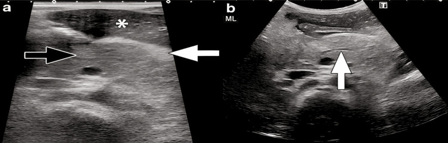
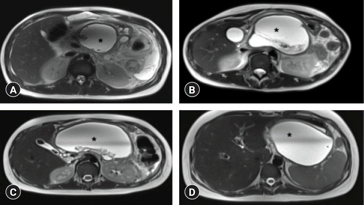
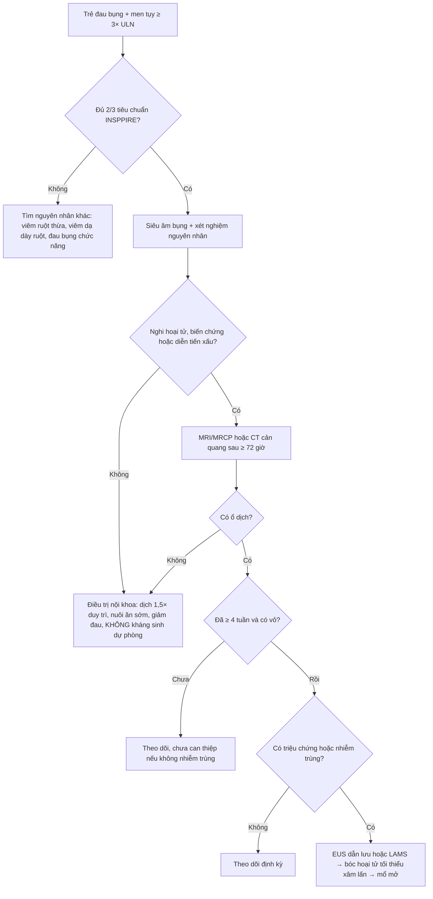
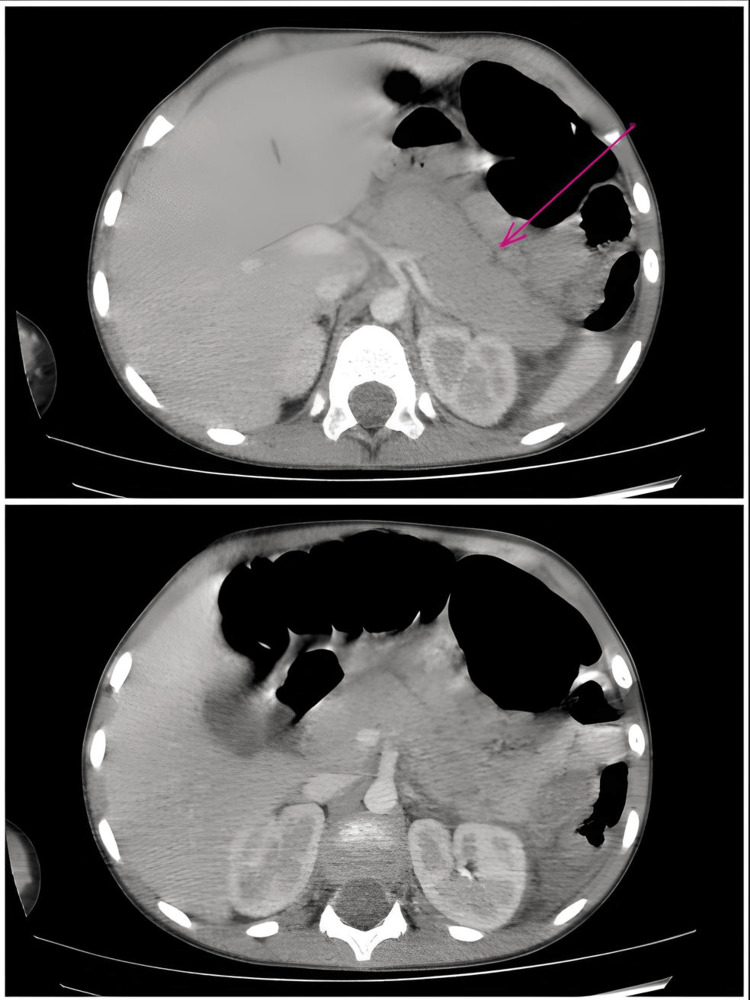

# 6135 — Viêm tụy cấp ở trẻ: tiêu chuẩn INSPPIRE, phân độ NASPGHAN và ổ dịch quanh tụy theo thời gian

**Tags:** `pattern:viem-tuy` `pattern:tu-dich-quanh-tuy` `pattern:hoai-tu-tuy` `vung:tuy` `vung:o-bung` `protocol:SA-bung` `protocol:CT-bung-co-can-quang` `protocol:MRI-MRCP` `score:INSPPIRE-2018` `score:NASPGHAN-2017` `score:CTSI` `incidentaloma:khong`
**Mức chắc chắn (certainty):** tổng hợp y văn (literature synthesis) — ghép **định nghĩa INSPPIRE** và **phân độ NASPGHAN 2017** (qua bài 2026, PMC13510817), **nghiên cứu hình ảnh 74 trẻ** (Turk Arch Pediatr 2023, PMC9885787), **phân tích gộp 44 nghiên cứu về dự báo độ nặng** (Front Pediatr 2022, PMC9561825), **phân tích gộp tiến triển AP → ARP → CP** (Clin Exp Pediatr 2026, PMC12877302), **dịch tễ Đài Loan 2.127 ca** (JPGN 2019, PMC6314501), **loạt 57 trẻ Ba Lan** (Children 2025, PMC12732265), **loạt 15 ca có ảnh US/CT** (Cureus 2025, PMC12433681), **11 trẻ đặt stent LAMS cho WON** (Clin Endosc 2025, PMC12314618), **loạt 75 trẻ Thái Lan** (2022, PMC9722370) và **khảo sát tuân thủ hướng dẫn ở 60 trẻ Iran** (BMC Pediatr 2022, PMC9336120).

> **Câu hỏi thực hành:** bé trai **3 tuổi**, đau bụng thượng vị 2 ngày, nôn, sốt nhẹ; **lipase 640 U/L** (giới hạn trên 75 U/L), amylase 210 U/L. Siêu âm bụng: **tụy to, giảm hồi âm, mỡ quanh tụy tăng hồi âm dày lên**, ống tụy chính giãn nhẹ. Bác sĩ ngoại trú hỏi: **có cần chụp CT ngay không, khi nào chụp, và nếu sau 3 tuần vẫn còn ổ dịch thì gọi là gì?**
> Bài chốt **bốn việc**: **(1) chẩn đoán viêm tụy cấp ở trẻ là chẩn đoán lâm sàng – xét nghiệm – hình ảnh, cần 2/3 tiêu chuẩn INSPPIRE, không cần CT;** **(2) CT có cản quang không dùng để chẩn đoán và không chụp trong 72 giờ đầu — chỉ chụp khi nghi hoại tử/biến chứng, và tên ổ dịch do THỜI GIAN quyết định (trước 4 tuần: APFC/ANC; sau 4 tuần: pseudocyst/WON);** **(3) phân độ NASPGHAN 2017 dựa trên suy cơ quan 48 giờ, và trẻ có tới ~30% diễn tiến trung bình/nặng, 18% tái phát, 10% tiến triển mạn;** **(4) điều trị là bồi phủ dịch + nuôi ăn sớm + giảm đau; KHÔNG kháng sinh dự phòng, không đặt sonde dạ dày thường quy, can thiệp ổ dịch chỉ sau khi ổ đã "chín" (≥ 4 tuần) và ưu tiên bước lên thang (dẫn lưu qua da/nội soi → mổ).** Nối [135 – Viêm tụy cấp người lớn theo Atlanta](../135-viem-tuy-Atlanta/lesson.md), [6120 – U tụy ở trẻ](../6120-u-tuy-o-tre/lesson.md), [6121 – Rò tụy sau mổ tụy](../6121-ro-tuy-sau-mo-tuy-o-tre/lesson.md), [6122 – Giả phình động mạch tạng sau viêm tụy](../6122-gia-phinh-dong-mach-tang-sau-viem-tuy-o-tre/lesson.md), [1680 – Viêm tụy do tăng triglyceride ở người lớn](../1680-viem-tuy-tang-triglyceride-nguoi-lon/lesson.md), [684 – Tăng triglyceride do asparaginase ở trẻ](../684-tang-triglyceride-asparaginase-all-nhi/lesson.md).

## 1. Tổng quan bệnh học – cơ chế hình ảnh: tại sao "tụy to + phù" lại là bệnh của men tiêu hóa

- **Định nghĩa (INSPPIRE 2018):** trẻ được chẩn đoán **viêm tụy cấp (acute pancreatitis, AP)** khi có **≥ 2 trong 3** yếu tố: **(1)** đau bụng kiểu viêm tụy (thượng vị, lan sau lưng, giảm khi cúi người); **(2)** **amylase và/hoặc lipase ≥ 3 lần giới hạn trên** của phòng xét nghiệm; **(3)** hình ảnh (siêu âm/CT/MRI) phù hợp viêm tụy. **Viêm tụy cấp tái phát (acute recurrent pancreatitis, ARP)** = **≥ 2 đợt AP riêng biệt**, giữa các đợt **hết đau và men tụy trở về bình thường**; **viêm tụy mạn (chronic pancreatitis, CP)** = thay đổi cấu trúc không hồi phục (giãn ống, sỏi ống, teo nhu mô) (PMC13510817).
- **TẠI SAO ngưỡng là "3 lần ULN", không phải "tăng nhẹ":** men tụy tăng nhẹ gặp trong rất nhiều bệnh bụng cấp ở trẻ (viêm dạ dày–ruột, viêm ruột thừa, đau bụng chức năng, suy thận); đặt ngưỡng **3× ULN** để **tăng độ đặc hiệu** cho hoại tử tế bào nang tụy. Hệ quả thực hành: **một lipase 1,5× ULN không đủ chẩn đoán** — phải tìm yếu tố thứ hai (đau điển hình hoặc hình ảnh). Ở trẻ, **amylase có thể đã bình thường khi đến muộn** (amylase thanh thải nhanh hơn lipase), nên **lipase là men nên dùng** và **không loại trừ AP chỉ vì amylase bình thường** (PMC13510817).
- **TẠI SAO tụy to và giảm hồi âm trên siêu âm:** tổn thương khởi đầu là **phù kẽ (interstitial edema)** — tế bào nang mất cực đỉnh, dịch và protein thoát vào khoảng kẽ. Nước làm **giảm số mặt phân cách phản xạ âm** → nhu mô **giảm hồi âm, to ra, bờ mất đều**; dịch thấm vào **mỡ quanh tụy** làm mỡ **tăng hồi âm và dày** (dấu hiệu phù quanh tụy). Đó là lý do cặp dấu hiệu **"tụy to + mỡ quanh tụy tăng hồi âm"** có giá trị hơn việc đo kích thước tụy đơn thuần (PMC12433681).
- **TẠI SAO CT phải chờ ≥ 72 giờ:** hoại tử tụy là tổn thương **thiếu máu cục bộ → ranh giới hoại tử chỉ rõ sau vài ngày**. Trong 72 giờ đầu, **cả nhu mô phù và nhu mô hoại tử đều ngấm thuốc không đồng nhất**, nên CT sớm **vừa bỏ sót hoại tử vừa dễ gọi nhầm hoại tử**. Vì vậy **CT có cản quang (hoặc MRI) nên làm sau ≥ 72 giờ ở ca nặng/nghi hoại tử** (PMC9885787); **CT không phải phương tiện chẩn đoán AP**, và **không chụp CT thường quy** trong thể phù đơn thuần.
- **TẠI SAO tên ổ dịch do THỜI GIAN quyết định:** trước **4 tuần**, ổ dịch chưa có vỏ xơ thật: không hoại tử → **APFC (acute peripancreatic fluid collection)**; có hoại tử → **ANC (acute necrotic collection)**. Sau **4 tuần**, tổ chức hạt tạo **vỏ xơ** → không hoại tử thành **pseudocyst (nang giả tụy)**, có hoại tử thành **WON (walled-off necrosis)**. Vì vậy **cùng một ổ dịch đổi tên khi qua mốc 4 tuần** — đây là cạm bẫy ngôn ngữ hay gặp giữa bác sĩ lâm sàng và bác sĩ hình ảnh (PMC9885787).
- **TẠI SAO hình ảnh lại "quan trọng hơn" ở trẻ:** trong loạt **74 trẻ** (tuổi trung bình **9 ± 4,9**), siêu âm chỉ dương tính **40,5% (30/74)** trong khi MRI dương tính **60% (39/65)**; **41% (16/39) trẻ có MRI dương tính mà siêu âm hoàn toàn bình thường**. Siêu âm vẫn là **bước đầu tiên** (không bức xạ, rẻ, tìm sỏi/nang ống mật), nhưng **siêu âm bình thường KHÔNG loại trừ AP**. MRI/MRCP được ưu tiên làm bước hai vì **mô tả ống mật–tụy và ổ hoại tử tốt hơn** (PMC9885787).
- **TẠI SAO trẻ khác người lớn:** nguyên nhân hàng đầu ở trẻ là **bất thường đường mật – tụy (biliary tract anomalies), sỏi mật, nang xơ (cystic fibrosis), chấn thương, thuốc, gen** chứ không phải rượu; hậu quả là **tái phát và tiến triển mạn cao hơn**. Phân tích gộp **68 nghiên cứu**: sau đợt AP đầu, **ARP 18% (95% CI 16–22%)**, **CP 10% (6–16%)**; trong nhóm ARP, **35% (24–49%)** tiến triển CP. Tỉ lệ ARP theo nguyên nhân: **tăng triglyceride 33%, vô căn 28%, mật 19%, chấn thương 16%, thuốc 14%, virus 3%**; theo độ nặng: **nặng 39%, trung bình 24%** (PMC12877302). Đây là lý do phải **tìm nguyên nhân ngay từ đợt đầu**, không dừng ở "viêm tụy cấp – điều trị nội khoa".
- **Dịch tễ và tử vong (số phải nhớ):**
  - Tỉ lệ mắc **~1/10.000 trẻ/năm**, dao động vùng **2–13/100.000/năm** (PMC13510817). Đài Loan **2000–2013: 2.127 ca, 2,83/100.000**, tăng từ **2,33 → 3,07/100.000**; hai đỉnh tuổi **4–5 tuổi** và **12–13 tuổi** (PMC6314501).
  - Nguyên nhân (Đài Loan): **bệnh mật/giải phẫu 29,57%**, **chuyển hóa 21,77%**, **chấn thương 5,64%** (PMC6314501). Loạt Ba Lan **57 trẻ**: **mật 24,6%**, **gen 17,5%** (SPINK1 8,7%, PRSS1 7%, CPA1 1,8%), **bất thường giải phẫu 14%**, **vô căn 35,1%**; biến chứng **15,8%** (dịch quanh tụy **10,5%**, hoại tử tụy **7%**) (PMC12732265).
  - Tử vong **1,6–3,6%** trong các loạt dân số (PMC10931901), nhưng **28%** ở loạt hồi sức ngoại khoa có bệnh nền (bệnh nền **34,4% vs 5,6%**, p = 0,01) (PMC9722370) — **tiên lượng phụ thuộc bệnh nền và biến chứng, không phụ thuộc một mình men tụy**.
  - Dự báo độ nặng bằng thang điểm: gộp **44 nghiên cứu**, **modified Glasgow ≥ 3** có **độ đặc hiệu 91,5%**, còn **PAPS (Pediatric Acute Pancreatitis Severity) ≥ 3** có **độ nhạy 63,1%** — **chưa có thang điểm nào đủ tốt để một mình quyết định**; **chấn thương (RR 1,70; 1,09–2,67)** và **thuốc (RR 1,33; 0,98–1,87)** làm tăng nguy cơ trung bình/nặng, **nguyên nhân giải phẫu lại giảm (RR 0,61; 0,38–0,96)** (PMC9561825).

## 2. Mẫu hình + chẩn đoán phân biệt theo hình thái và theo tuổi (gamut)

- **Mẫu hình A — tụy to, phù, KHÔNG hoại tử (interstitial edematous pancreatitis):** chiếm đa số. Gamut nguyên nhân theo tuổi:
  - **< 2 tuổi:** chấn thương (kể cả không rõ tiền sử), bất thường bẩm sinh ống mật–tụy, bệnh chuyển hóa, nhiễm trùng nặng, hội chứng urê huyết tán huyết (HUS).
  - **2–10 tuổi:** **chấn thương**, **bất thường đường mật**, **thuốc** (acid valproic, asparaginase, corticoid), nhiễm (Coxsackie, Mycoplasma, SARS-CoV-2), **nang xơ**, bệnh hệ thống (SLE, HSP).
  - **> 10 tuổi:** **sỏi mật**, **tăng triglyceride máu**, **nguyên nhân gen** (PRSS1, SPINK1, CFTR, CTRC, CPA1), rượu (hiếm nhưng không bằng không).
- **Mẫu hình B — ổ dịch/hoại tử quanh tụy:** gamut theo **thời gian** (bắt buộc thuộc): **< 4 tuần** → APFC (không hoại tử) hoặc ANC (có hoại tử); **≥ 4 tuần** → pseudocyst hoặc WON. Phân biệt với **nang ống mật chủ (choledochal cyst)**, **nang tiêu hóa lặp lại (duplication cyst)**, **lymphangioma**, **u tụy (u đặc–nhầy nhú, u nguyên bào tụy)**, **máu tụ tổ chức hóa sau chấn thương** — trong đó **nang ống mật chủ là "kẻ bắt chước" nguy hiểm nhất** vì vừa gây viêm tụy vừa cần mổ.
- **Mẫu hình C — ống tụy giãn ± sỏi/giãn đường mật:** nghĩ **bất thường đường mật – tụy** (nang ống mật chủ, pancreas divisum, ansa pancreatica, sỏi ống mật chủ) → **MRCP** là bước tiếp theo, không phải CT.
- **Mnemonic "I GET SMASHED" bản nhi:** **I**diopathic, **G**allstone (và bất thường đường mật), **E**thanol (rất hiếm), **T**rauma, **S**teroid, **M**umps/Infection, **A**utoimmune, **S**corpion (nọc độc), **H**yperlipidemia/Hypercalcemia, **E**RCP/Drugs.

*Bé trai **3 tuổi**, siêu âm **2 ngày sau khởi phát**: **(a)** tụy **to nhẹ, giảm hồi âm** (mũi tên đen) và **mỡ quanh tụy tăng hồi âm, dày** (mũi tên trắng) — dấu hiệu phù quanh tụy; ngôi sao đánh dấu vùng nhu mô–dịch quanh tụy. **(b)** **giãn ống tụy chính** ở thân tụy (mũi tên trắng) — gợi ý phải tìm nguyên nhân tắc (sỏi/nang ống mật) bằng MRCP. Nguồn: Cureus 2025 (PMC12433681), CC BY 4.0, nguyên bản.*

## 3. Bảng so sánh phân biệt (ma trận đối chiếu)

| Thực thể (entity) | Hình ảnh điển hình (US/CT/MRI theo thời điểm) | Chốt vào (rule-in) | Chốt loại (rule-out) | Gợi ý xác nhận |
|---|---|---|---|---|
| **Viêm tụy cấp thể phù (interstitial edematous AP)** | US: tụy to, **giảm hồi âm**, mỡ quanh tụy tăng hồi âm; CT: ngấm thuốc **đồng nhất hoặc hơi không đồng nhất**, **không vùng không ngấm**, phù mỡ quanh tụy | **Đau điển hình + men ≥ 3× ULN ± tụy to/phù quanh tụy** | **Có vùng nhu mô không ngấm thuốc sau 72 giờ → không còn là thể phù đơn thuần** | Lâm sàng + lipase; US đầu tay; **không cần CT** |
| **Hoại tử cấp (ANC, < 4 tuần)** | CT ≥ 72 giờ: **vùng nhu mô không ngấm thuốc**, có thể có khí; MRI: nhu mô **T1 tối, T2 hỗn hợp**, không ngấm | **Vùng không ngấm thuốc trong nhu mô tụy** hoặc **hoại tử mỡ quanh tụy** | **Ngấm thuốc đều = thể phù**; **ổ dịch đồng nhất không vỏ** = APFC | CT cản quang ≥ 72 giờ hoặc MRI; theo dõi nhiễm trùng |
| **Nang giả tụy (pseudocyst, ≥ 4 tuần)** | Ổ dịch **đồng nhất**, thành mỏng đều, **không có mảnh hoại tử**, thường ở khoang quanh tụy | **≥ 4 tuần + vỏ xơ + dịch đồng nhất, không cặn** | **Có cặn/mảnh đặc trong ổ → WON**, không phải pseudocyst | MRI/MRCP; US theo dõi |
| **Hoại tử có vỏ (WON, ≥ 4 tuần)** | Ổ **vỏ xơ không đều**, **dịch + mảnh hoại tử T2 tối**, có thể nhiễm khuẩn (khí) | **Vỏ + cặn hoại tử trong ổ** | **Ổ đồng nhất, không cặn = pseudocyst**; **khí lan vào nhu mô = hoại tử nhiễm khuẩn** | MRI; EUS khi cần dẫn lưu |
| **Nang ống mật chủ (choledochal cyst)** | US: **nang/dãn ống mật chủ**, có thể kèm sỏi bùn; MRCP: dãn hình thoi ống mật chủ, nối bất thường ống mật–tụy | **Dãn ống mật chủ + nối bất thường** | **Không thấy dãn đường mật, men mật bình thường → ít nghĩ** | **MRCP**; cắt nang + nối mật–ruột |
| **U tụy trẻ (u đặc–nhầy nhú, u nguyên bào tụy)** | Khối **đặc–nang hỗn hợp**, vôi hóa, xuất huyết trong u; **không tự thoái triển** | **Khối có thành phần đặc + vôi hóa/xuất huyết** | **Ổ dịch thay đổi theo thời gian, có vỏ mỏng = tổn thương viêm** | MRI/EUS; xem [6120](../6120-u-tuy-o-tre/lesson.md) |

*Bốn trẻ khác nhau (A–D): ổ **WON** lớn, **đã có vỏ xơ**, tín hiệu **T2 rất cao** (dịch) với **mảnh hoại tử T2 tối bên trong** (ngôi sao). Điểm cần nhớ: **vỏ + cặn đặc** là thứ phân biệt WON với pseudocyst, và là lý do **không rút/dẫn lưu "non" trước 4 tuần** — ổ chưa có vỏ sẽ rò vào khoang tự do. Nguồn: Clin Endosc 2025 (PMC12314618), CC BY-NC 4.0, nguyên bản.*

## 4. Protocol chụp + hệ phân độ/điểm chuẩn hóa

- **Bước 1 — Siêu âm bụng (đầu tay, cho mọi ca nghi AP):** đánh giá **kích thước, hồi âm nhu mô, mỡ quanh tụy, ống tụy chính, đường mật, sỏi, nang ống mật**. Ưu điểm: không bức xạ, làm được tại giường, lặp lại. Hạn chế: **dương tính chỉ 40,5%** trong loạt 74 trẻ; **béo phì, nhiều hơi ruột** làm khó (PMC9885787).
- **Bước 2 — MRI/MRCP (khi cần nguyên nhân hoặc biến chứng):** mô tả **ống mật–tụy, nối bất thường, sỏi ống mật, ổ hoại tử, mảnh cặn**. Trong loạt trên, MRI phát hiện thêm **41% ca** mà siêu âm bỏ sót (PMC9885787). **Không cần gadolinium nếu chỉ tìm sỏi/ổ dịch**; dùng chuỗi **T2, T2 fat-sat, DWI, MRCP 3D**.
- **Bước 3 — CT bụng có cản quang (chỉ khi có lý do):** **nghi hoại tử, nghi biến chứng, diễn tiến xấu, không đáp ứng điều trị**, và **≥ 72 giờ sau khởi phát**. Không dùng CT để "xác nhận chẩn đoán" ở thể nhẹ. Với trẻ, **hạn chế liều bức xạ**: chọn MRI nếu trẻ hợp tác/đủ điều kiện.
- **Phân độ lâm sàng NASPGHAN 2017 (dùng để quyết định mức chăm sóc):**
  - **Nhẹ (mild):** **không** biến chứng tại chỗ/toàn thân, **không** suy cơ quan.
  - **Trung bình (moderate):** có biến chứng tại chỗ và/hoặc toàn thân **và/hoặc suy cơ quan < 48 giờ**.
  - **Nặng (severe):** **suy cơ quan > 48 giờ** (đánh giá theo tiêu chuẩn nhi khoa) (PMC13510817).
  - Tới **~30%** trẻ có diễn tiến trung bình/nặng (PMC9561825).
- **Phân độ hình ảnh CTSI (Balthazar + hoại tử), 0–10 điểm:** Balthazar **A–E = 0–4**; hoại tử **0% = 0**, **≤ 30% = 2**, **30–50% = 4**, **> 50% = 6**; tổng **0–3 nhẹ, 4–6 trung bình, 7–10 nặng**. Lưu ý: CTSI **được xây dựng trên người lớn**, ở trẻ dùng để **mô tả và theo dõi**, không thay phân độ lâm sàng NASPGHAN.
- **Điều trị — các ngưỡng cần thuộc:**
  - **Dịch:** bồi phủ tinh thể **1,5 lần nhu cầu duy trì trong 24–48 giờ đầu**, sau đó điều chỉnh theo nước tiểu/điện giải; khảo sát 60 trẻ cho thấy **chỉ một nửa** được truyền đủ **1,5× duy trì** trong 24 giờ đầu (PMC9336120).
  - **Nuôi ăn:** **nuôi ăn đường tiêu hóa sớm** (trong **48–72 giờ** khi trẻ chịu được), **không cần nhịn ăn kéo dài**, **không đặt sonde dạ dày thường quy**, không cần dinh dưỡng tĩnh mạch nếu ăn được (PMC13510817).
  - **Kháng sinh:** **KHÔNG dự phòng** trong AP nhẹ; chỉ dùng khi **nhiễm trùng được chứng minh** (hoại tử nhiễm khuẩn, áp-xe, nhiễm trùng đường mật, nhiễm trùng huyết). Thực tế **48% trẻ được dùng kháng sinh** trong khi chỉ **34%** có chỉ định (PMC9336120).
  - **ERCP:** chỉ khi **viêm đường mật** hoặc **tắc mật kéo dài** do sỏi; không ERCP "thăm dò" chỉ vì men tụy cao.
  - **Cắt túi mật:** với viêm tụy do sỏi, **cắt túi mật trong đợt nhập viện hoặc trong 2–4 tuần** để giảm tái phát (thực hành chuẩn; ca sỏi–hoại tử ở trẻ 4,5 tuổi phải nằm **26 ngày** và có biến chứng nhiễm khuẩn) (PMC11531643).
  - **Ổ dịch:** **theo dõi nếu không triệu chứng**; can thiệp khi **nhiễm trùng, chèn ép, đau kéo dài, tăng kích thước**, và **chỉ sau khi ổ đã có vỏ (≥ 4 tuần)**. Thang bậc: **dẫn lưu qua da/nội soi (EUS) → bóc hoại tử tối thiểu xâm lấn → mổ mở**.
  - **Stent LAMS ở trẻ:** loạt **11 trẻ 5–18 tuổi** (trung bình **15,5 ± 3,1**) WON được đặt **stent kim loại áp sát lòng (LAMS)** qua EUS: **thành công kỹ thuật 100%**, **thành công lâm sàng 90,9%** trong 12 tuần, **tắc stent 2 ca (18,2%)** xử lý bằng rửa nước muối, **1 ca phải mổ bóc hoại tử (VARD)**, nằm viện trung bình **5,4 ± 3,3 ngày**, **không có biến chứng nặng** (PMC12314618). Cỡ mẫu nhỏ — dùng để **tư vấn**, không phải chuẩn bắt buộc.

## 5. Biến thể bình thường và cạm bẫy

- **Biến thể bình thường dễ gọi nhầm:**
  - **Tụy "sáng" do mỡ (pancreatic lipomatosis)** ở trẻ béo: tụy **tăng hồi âm**, không to, không phù quanh tụy, men tụy bình thường — **không phải viêm tụy**.
  - **Tụy hình móc câu (uncinate process)** và **mỏm móc lớn** có thể trông như "khối" ở đầu tụy; đối chiếu mạch máu và thì ngấm thuốc.
  - **Pancreas divisum** và **ansa pancreatica** là biến thể ống, **không tự gây AP** nhưng làm **tăng nguy cơ** khi có yếu tố khác — thấy trên MRCP, đừng quy kết một mình.
- **Cạm bẫy (pitfall):**
  - **Siêu âm bình thường không loại trừ AP**: **41%** ca có MRI dương tính mà siêu âm âm (PMC9885787). Đừng đóng hồ sơ chỉ vì siêu âm sạch.
  - **CT quá sớm (< 72 giờ)** dễ **bỏ sót hoại tử** hoặc **gọi nhầm phù nề thành hoại tử** — hậu quả là can thiệp/kháng sinh không cần thiết.
  - **Gọi tên ổ dịch sai mốc 4 tuần**: "pseudocyst" cho ổ mới 10 ngày, hoặc "WON" cho ổ dịch đồng nhất — sai tên dẫn tới **can thiệp quá sớm** hoặc **bỏ sót hoại tử nhiễm khuẩn**.
  - **Tăng men tụy không đồng nghĩa AP**: suy thận, nhiễm toan ceton, viêm ruột thừa, viêm túi mật, tắc ruột đều có thể tăng lipase — **bắt buộc đủ 2/3 tiêu chuẩn**.
  - **Bỏ sót nang ống mật chủ** khi chỉ nhìn tụy: ống tụy giãn + men mật tăng + nang vùng đầu tụy = **MRCP ngay**, vì nang ống mật chủ không điều trị sẽ **viêm tụy tái phát và nguy cơ ung thư đường mật**.
  - **Satisfaction of search:** đã thấy ổ dịch quanh tụy rồi dừng, bỏ sót **huyết khối tĩnh mạch lách/cửa** hoặc **giả phình động mạch** (xem [6122](../6122-gia-phinh-dong-mach-tang-sau-viem-tuy-o-tre/lesson.md)).

## 6. Tự lượng giá — Blind Quiz

**Ca 1 — Bé trai 3 tuổi, đau bụng thượng vị 2 ngày, nôn; lipase 640 U/L. Nhìn hình, mô tả trước khi mở đáp án.**

- Gợi ý lâm sàng: trẻ nhỏ, đau bụng cấp, men tụy tăng > 3× ULN.
- Câu hỏi: Dấu hiệu chính trên siêu âm? Có cần CT ngay không? Bước tiếp theo để tìm nguyên nhân là gì?

<b>Bấm để hiện đáp án (findings + chẩn đoán)</b>

- **Dấu hiệu:** tụy **to nhẹ, giảm hồi âm**; **mỡ quanh tụy tăng hồi âm, dày** (phù quanh tụy); **ống tụy chính giãn** ở thân tụy.
- **Chẩn đoán:** **viêm tụy cấp thể phù** — đủ tiêu chuẩn INSPPIRE (đau điển hình + lipase > 3× ULN + hình ảnh).
- **Vì sao:** phù kẽ làm giảm mặt phân cách phản xạ âm → tụy giảm hồi âm; dịch thấm mỡ quanh tụy → mỡ tăng hồi âm. **CT không cần ngay** (chưa có dấu hiệu nặng, chưa đủ 72 giờ).
- **Bước tiếp:** **MRCP** để tìm **sỏi ống mật chủ/nang ống mật chủ/bất thường nối mật–tụy** vì có **giãn ống tụy**; theo dõi lâm sàng, dịch, cho ăn sớm.
- Nguồn ảnh: Cureus 2025 (PMC12433681), CC BY 4.0.

**Ca 2 — Bé trai 5 tuổi, viêm tụy cấp, CT bụng có cản quang (Balthazar E). Chẩn đoán hình ảnh và quyết định?**

<b>Bấm để hiện đáp án</b>

- **Dấu hiệu:** tụy **to, bờ không đều**, **dịch quanh tụy nhiều**, **phù mỡ quanh tụy** lan quanh dạ dày–tá tràng; hình trên và dưới là hai lát cắt cho thấy **ổ dịch quanh tụy** (mũi tên) và **thay đổi viêm lan tỏa**. Balthazar **E** = **≥ 2 ổ dịch quanh tụy** hoặc khí sau phúc mạc.
- **Chẩn đoán:** **viêm tụy cấp thể phù có biến chứng tại chỗ (APFC)** — chưa thấy vùng nhu mô không ngấm thuốc rõ.
- **Vì sao chụp CT:** chỉ có chỉ định khi **nghi hoại tử/biến chứng** hoặc **diễn tiến xấu**, và **sau ≥ 72 giờ** — CT sớm dễ đọc sai ranh giới hoại tử.
- **Xử trí:** dịch 1,5× duy trì, **ăn sớm**, giảm đau; **không kháng sinh dự phòng**; theo dõi ổ dịch, **chỉ can thiệp khi nhiễm trùng/chèn ép và ổ đã có vỏ ≥ 4 tuần**.
- Nguồn ảnh: Cureus 2025 (PMC12433681), CC BY 4.0.

**Ca 3 — Bốn trẻ viêm tụy hoại tử, MRI T2 sau 4 tuần. Mô tả ổ dịch và chọn bước điều trị.**

<b>Bấm để hiện đáp án</b>

- **Dấu hiệu:** các ổ **T2 rất cao**, **có vỏ xơ**, bên trong có **mảnh hoại tử T2 tối** (ngôi sao) — không phải ổ dịch đồng nhất.
- **Chẩn đoán:** **WON (walled-off necrosis)** — ổ hoại tử đã có vỏ, **≥ 4 tuần** sau khởi phát.
- **Phân biệt:** **pseudocyst** (dịch đồng nhất, không cặn), **áp-xe** (khí, ngấm viền), **nang ống mật chủ** (dính đường mật), **u tụy** (thành phần đặc, vôi hóa).
- **Điều trị:** nếu **nhiễm trùng/chèn ép/triệu chứng** → **dẫn lưu qua nội soi EUS**, có thể đặt **LAMS**; nếu thất bại → **bóc hoại tử tối thiểu xâm lấn**, cuối cùng mới mổ mở. Loạt trẻ đặt LAMS: **thành công lâm sàng 90,9%**, **tắc stent 18,2%**, **1 ca cần VARD** (PMC12314618).
- Nguồn ảnh: Clin Endosc 2025 (PMC12314618), CC BY-NC 4.0.
- **Phản biện:** 4 ảnh thuộc **4 bệnh nhân khác nhau**, không phải tiến triển của một ca; cỡ mẫu LAMS **n = 11** nên chỉ là bằng chứng sơ bộ.

## Bài liên quan chéo
- [135 – Viêm tụy cấp người lớn: Atlanta 2012, Balthazar/CTSI](../135-viem-tuy-Atlanta/lesson.md)
- [6120 – U tụy ở trẻ: u đặc–nhầy nhú, u nguyên bào tụy, nang giả tụy](../6120-u-tuy-o-tre/lesson.md)
- [6121 – Rò tụy sau mổ tụy ở trẻ: ISGPS 2016](../6121-ro-tuy-sau-mo-tuy-o-tre/lesson.md)
- [6122 – Giả phình động mạch tạng sau viêm tụy/chấn thương tụy](../6122-gia-phinh-dong-mach-tang-sau-viem-tuy-o-tre/lesson.md)
- [1680 – Viêm tụy do tăng triglyceride ở người lớn](../1680-viem-tuy-tang-triglyceride-nguoi-lon/lesson.md)
- [684 – Tăng triglyceride do asparaginase ở trẻ](../684-tang-triglyceride-asparaginase-all-nhi/lesson.md)
- [600 – Tổng quan Nhi khoa](../600-tong-quan-nhi-khoa/lesson.md)

## Ảnh
- **3 ảnh**, tải từ PMC Open Access, ghi nguồn + giấy phép từng file trong `images/CREDITS.md`.
- Không crop/ghép/đổi màu; giữ nguyên nhãn và mũi tên của tác giả.

> Không dùng để chẩn đoán độc lập khi chưa có người hướng dẫn.
