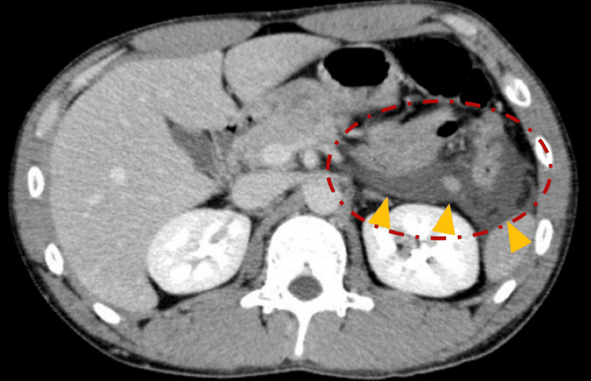
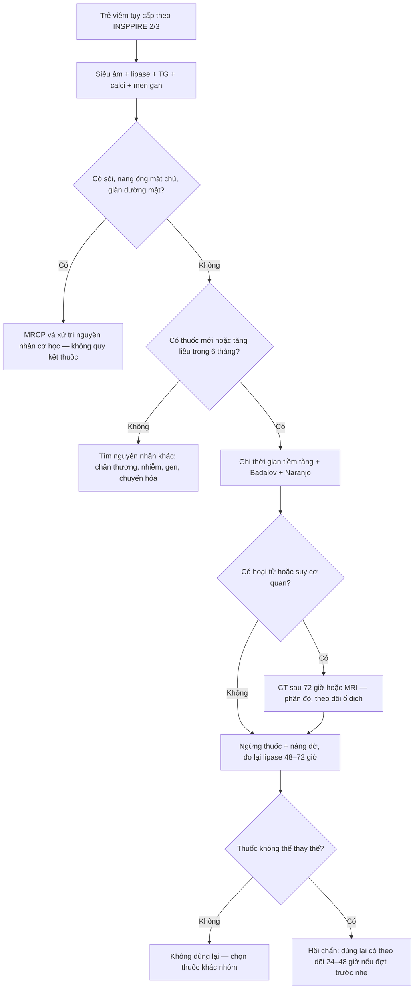
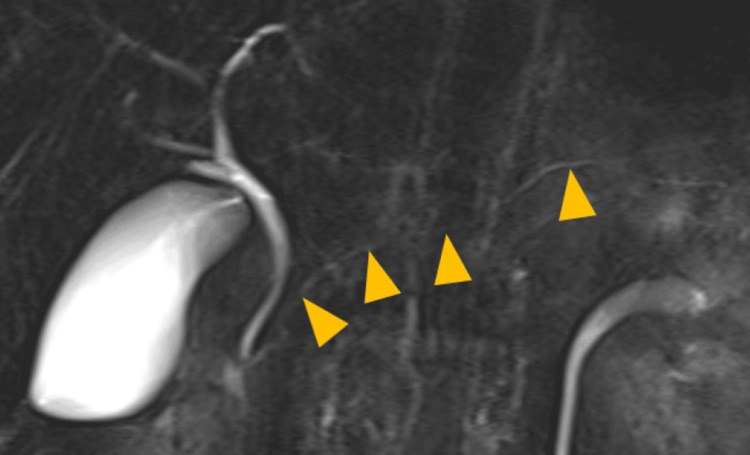

# 6136 — Viêm tụy cấp do thuốc ở trẻ: thời gian tiềm tàng, bảng Badalov và quyết định ngừng/thử lại

**Tags:** `pattern:viem-tuy` `pattern:hoai-tu-tuy` `pattern:tu-dich-quanh-tuy` `vung:tuy` `vung:o-bung` `protocol:SA-bung` `protocol:CT-bung-co-can-quang` `protocol:MRI-MRCP` `score:INSPPIRE-2018` `score:Badalov-2008` `score:Naranjo` `incidentaloma:khong`
**Mức chắc chắn (certainty):** tổng hợp y văn (literature synthesis) — ghép **ca nguyên văn có ảnh** (thư 14 tuổi dùng valproate, Ann Indian Acad Neurol 2026, **PMC13349259**; ca 20 tuổi dùng mesalazine, Cureus 2025, **PMC12356708**), **đoàn hệ 133 trẻ** (Children 2026, **PMC13024780**), **352 trẻ ALL dùng asparaginase** (Front Pharmacol 2026, **PMC13226028**), **tổng quan DIP** (World J Gastroenterol 2020, **PMC7304112**), **tổng quan hệ thống 713 ca** (PLoS One 2020, **PMC7164626**) và **ca paroxetine có tái dùng thuốc dương tính** (Front Med 2026, **PMC12813211**).

> **Câu hỏi thực hành:** bé gái **14 tuổi**, động kinh, dùng **valproate 1.600 mg/ngày (40 mg/kg/ngày) đã 8 tháng**; đau thượng vị lan sau lưng 1 ngày, nôn, amylase **703 U/L**, lipase **1.492 U/L**, tiểu cầu **69.000/µL**. Siêu âm: tụy không đồng nhất, dịch quanh tụy, dịch ổ bụng. Bác sĩ hỏi: **có phải do thuốc không, nồng độ valproate bình thường thì loại trừ được không, và sau này có được dùng lại valproate?**
> Bài chốt **bốn việc**: **(1) thuốc là nguyên nhân đứng thứ ba của viêm tụy cấp, chiếm 0,3–1,4% người lớn nhưng tới 15% trẻ trong một đoàn hệ gần đây — chẩn đoán là LOẠI TRỪ, không có hình ảnh đặc hiệu;** **(2) thời gian tiềm tàng là chốt lập luận: < 24 giờ (phản ứng quá mẫn) khác vài tuần–vài tháng (độc chất/chuyển hóa), và nồng độ thuốc trong "khoảng trị liệu" KHÔNG loại trừ được;** **(3) phân loại Badalov I–IV + thang Naranjo quyết định mức chắc chắn, không phải một lần tăng men tụy;** **(4) nguyên tắc xử trí: ngừng thuốc nghi ngờ + điều trị nâng đỡ; thử lại thuốc chỉ khi thuốc không thể thay thế, sau khi hội chẩn, và phải có kế hoạch theo dõi men tụy — valproate và mesalazine hầu như KHÔNG dùng lại.**

## 1. Tổng quan bệnh học – cơ chế hình ảnh: tại sao "tụy phù" không nói được thuốc nào

- **Tần suất (số phải nhớ):** thuốc gây **0,3–1,4%** tổng số ca viêm tụy cấp ở người lớn (PMC7304112), nhưng trong **133 trẻ** viêm tụy cấp tại một trung tâm, **nguyên nhân do thuốc chiếm 15,0%** — chỉ sau nguyên nhân tắc nghẽn **30,8%** và vô căn **29,3%**, trên chấn thương **9,8%** (PMC13024780). Ở Ấn Độ, loạt của Poddar ghi nhận **5,6%** do thuốc — chênh lệch lớn giữa các vùng vì **cách ghi nhận thuốc** khác nhau (PMC13024780). Tỉ lệ **tái phát trong nhóm do thuốc là 20%** (cao nhất trong các nguyên nhân của đoàn hệ đó), so với **12,9%** vô căn và **7,4%** tắc nghẽn (PMC13024780).
- **Bốn cơ chế — mỗi cơ chế cho một "kiểu thời gian" khác nhau (TẠI SAO):**
  1. **Độc chất trực tiếp lên tế bào nang (toxic/metabolic):** valproate ức chế β-oxy hóa và làm cạn carnitine → tích tụ axit béo chuỗi trung bình, chết tế bào nang; asparaginase ức chế tổng hợp protein → rối loạn chuyển hóa, **tăng triglyceride** thứ phát (đã có bài 684/628). Kiểu này thường **tiềm tàng vài tuần – vài tháng**, và **không phụ thuộc nồng độ thuốc**.
  2. **Quá mẫn/miễn dịch (hypersensitivity):** mesalazine, sulfasalazine, azathioprine/6-mercaptopurine — phản ứng idiosyncratic, có thể **< 24–72 giờ** hoặc sau nhiều tuần; tái dùng thuốc gây tái phát nhanh (dấu hiệu mạnh nhất của quan hệ nhân quả).
  3. **Thiếu máu cục bộ/vi huyết khối:** asparaginase (giảm antitrombin III), thuốc co mạch, huyết khối tĩnh mạch tạng — hình ảnh **hoại tử không ngấm thuốc** rõ hơn thể phù.
  4. **Gián tiếp qua chuyển hóa:** corticoid/GLP-1 → tăng triglyceride; thiazide/furosemide → tăng calci máu; propofol → tăng triglyceride. Kiểu này **không do thuốc "ăn" vào tụy** mà do **môi trường sinh hóa**.
- **TẠI SAO hình ảnh không đặc hiệu (vật lý + mô bệnh):** tổn thương khởi đầu là **phù kẽ và thâm nhiễm viêm** — nước làm giảm số mặt phân cách phản xạ âm nên **siêu âm thấy tụy giảm hồi âm, to, bờ mờ**; mỡ quanh tụy **tăng hồi âm và dày**. Trên CT, vùng **hoại tử mất ngấm thuốc** vì vi mạch bị huyết khối/tắc — nhưng **72 giờ đầu ranh giới hoại tử chưa rõ**, nên CT sớm **vừa bỏ sót vừa overcall**. Đây là cùng một chuỗi hình ảnh với **mọi nguyên nhân** (mật, rượu, tăng triglyceride, chấn thương): **không có "dấu hiệu của thuốc"**. Giá trị của hình ảnh là **(a)** loại trừ nguyên nhân khác (sỏi, nang ống mật chủ, bất thường đường mật–tụy), **(b)** xác định **hoại tử/ổ dịch** để phân độ và theo dõi.
- **Ngưỡng chẩn đoán (INSPPIRE 2018, dùng cho trẻ):** **≥ 2/3** tiêu chuẩn — đau bụng kiểu tụy, **lipase/amylase ≥ 3× giới hạn trên**, hình ảnh phù hợp. **Men tụy tăng < 3× ULN không đủ chẩn đoán**, và **amylase có thể đã bình thường khi đến muộn** → dùng **lipase**.
- **Số liệu theo từng thuốc hay gặp ở trẻ:**
  - **Valproate:** viêm tụy ở trẻ **~1/40.000** trẻ dùng thuốc, **nguy cơ cao nhất trong 12 tháng đầu**; phần lớn là **thể phù**, nhưng ca 14 tuổi dưới đây là **hoại tử, CTSI 10/10** (PMC13349259).
  - **Asparaginase/pegaspargase:** **AAP 10,23% (36/352 trẻ ALL)**, yếu tố nguy cơ độc lập: **tiền sử AAP OR 13,20**, **AST OR 1,01 mỗi 1 U/L**, **bilirubin toàn phần OR 1,04 mỗi 1 µmol/L**, **calci máu OR 0,01 mỗi 1 mmol/L**, **glucose OR 1,74 mỗi 1 mmol/L**, **albumin OR 0,87 mỗi 1 g/L**; mô hình **AUC 0,926** (PMC13226028). Trong 4.925 trẻ COG dùng **pegaspargase 2.500 IU/m²**, **béo phì + diện tích da lớn** làm tăng độc tính chung nhưng **không** làm tăng riêng viêm tụy (PMC13382259).
  - **Azathioprine/6-mercaptopurine: ~5%**; **didanosine: ~23%** (người lớn, PMC7304112).
  - **Mesalazine/sulfasalazine:** ca 20 tuổi dùng **6 tháng** rồi viêm tụy, ngừng thuốc và **không tái phát nhiều năm** (PMC12356708).
  - **GLP-1 receptor agonist:** exenatide từng được báo **tăng tới 6 lần** trong giám sát hậu mãi, cơ chế **phì đại tế bào nang + tăng tính thấm mạch**; bằng chứng ở **trẻ dùng semaglutide cho béo phì** còn mỏng — không quy kết nếu không loại trừ nguyên nhân khác (PMC7304112).
- **TẠI SAO phải phân loại chứ không chỉ "nghi ngờ":** 713 ca trong y văn liên quan **213 thuốc khác nhau**, nhưng chỉ **45 thuốc (21%)** đạt mức bằng chứng cao nhất; **47% ca có ít nhất một bệnh nền gây viêm tụy**, và **81% ca không được đánh giá nhân quả** (PMC7164626). Nghĩa là: **phần lớn "viêm tụy do thuốc" trong y văn là suy luận yếu** — bảng Badalov và thang Naranjo tồn tại để buộc ta ghi rõ mức chắc chắn.

## 2. Mẫu hình + chẩn đoán phân biệt theo hình thái và theo nhóm thuốc (gamut)

- **Mẫu hình A — viêm tụy thể phù (interstitial edematous):** tụy to, giảm hồi âm, mỡ quanh tụy tăng hồi âm, **không có vùng mất ngấm thuốc**. Chiếm đa số ca do thuốc; **tự khỏi sau ngừng thuốc 3–7 ngày** là dấu hiệu gợi ý mạnh (ca mesalazine: enzym về bình thường sau vài ngày, PMC12356708).
- **Mẫu hình B — hoại tử (necrotising):** **> 30% nhu mô mất ngấm thuốc** hoặc **> 3 cm**; dịch quanh tụy, dịch ổ bụng, tràn dịch màng phổi; **CTSI cao**. Valproate hiếm nhưng có thể nặng (ca dưới: **CTSI 10/10**, tràn dịch màng phổi hai bên, thở NIV 12 giờ) — **không được chủ quan vì "thuốc thì thường nhẹ"**.
- **Mẫu hình C — tái phát (ARP) có/không giãn ống:** nếu **tái phát ≥ 2 đợt** phải tìm **nguyên nhân nền** (nang ống mật chủ, pancreas divisum, đột biến PRSS1/SPINK1/CFTR, tăng triglyceride) trước khi quy kết thuốc — vì **thuốc là nguyên nhân "có thể sửa"**, còn bỏ sót nang ống mật chủ là **bỏ sót ung thư đường mật về sau** (bài 6137).
- **Gamut theo nhóm thuốc (dùng như checklist khi tra bệnh án):**

| Nhóm thuốc | Thuốc điển hình | Kiểu thời gian | Hình ảnh hay gặp |
|---|---|---|---|
| Chống động kinh | **valproate**, carbamazepine | **vài tuần – vài tháng**, cao nhất 12 tháng đầu | phù; hiếm hoại tử |
| Hóa trị | **L-asparaginase/pegaspargase** | **1–4 tuần** sau đợt truyền | phù ± hoại tử, ± tăng TG |
| Ức chế miễn dịch | **azathioprine, 6-MP** | 2–8 tuần | phù |
| IBD | **mesalazine, sulfasalazine** | **< 72 giờ đến vài tháng** | phù, đôi khi hoại tử đuôi |
| Kháng virus | didanosine, lamivudine | vài tuần | phù |
| Đái tháo đường/béo phì | **GLP-1 RA**, DPP-4i | vài tuần | phù |
| Khác | corticoid, propofol, thiazide, tetracycline, metronidazole | ngày–tuần | phù; corticoid/propofol qua tăng TG |

- **Gamut "không phải thuốc" bắt buộc loại trừ (theo thứ tự ưu tiên ở trẻ):** **bệnh mật/nang ống mật chủ** (siêu âm + MRCP), **chấn thương** (kể cả không rõ tiền sử), **nhiễm** (Coxsackie, Mycoplasma, SARS-CoV-2), **tăng triglyceride** (asparaginase, corticoid, béo phì), **tăng calci**, **bệnh hệ thống** (SLE, HSP), **nguyên nhân gen**, **pancreas divisum**.

## 3. Bảng so sánh phân biệt (ma trận đối chiếu)

| Thực thể (entity) | Hình ảnh điển hình (US/CT/MRI) | Chốt vào (rule-in) | Chốt loại (rule-out) | Gợi ý xác nhận |
|---|---|---|---|---|
| **Viêm tụy do valproate** | Tụy to, phù; thể nặng: **vùng mất ngấm thuốc thân–đuôi**, dịch quanh tụy, tràn dịch màng phổi | **Thuốc đang dùng + tiềm tàng vài tuần–vài tháng + Naranjo ≥ 5**; **nồng độ thuốc bình thường vẫn xảy ra** (ca: **67 µg/mL**, khoảng trị liệu 50–125) | Nồng độ **trong ngưỡng** KHÔNG loại trừ; không loại trừ nếu có sỏi/nang ống mật chủ | Ngừng valproate, theo dõi lipase 48–72 giờ; **không dùng lại** nếu từng hoại tử |
| **Asparaginase (AAP)** | Phù tụy ± hoại tử; có thể kèm **tăng TG, huyết khối xoang/tĩnh mạch** | **Trong 1–4 tuần sau truyền** + **tiền sử AAP OR 13,20** + AST/bilirubin/glucose tăng | Không thể loại trừ chỉ vì "đợt trước không sao" | Theo dõi men tụy có triệu chứng; hội chẩn ung thư trước khi bỏ đợt |
| **Mesalazine/sulfasalazine** | Phù tụy, có thể **hoại tử đuôi**; **MRCP không sỏi, không APBJ** | **Khởi phát sau khi bắt đầu/ tăng liều**, **tái phát nhanh khi dùng lại** | MRCP bình thường **không** loại trừ nguyên nhân thuốc — chỉ loại trừ nguyên nhân cơ học | Ngừng thuốc; chuyển aminosalicylate khác **chỉ khi** đã cân nhắc |
| **Azathioprine/6-MP** | Phù tụy không đặc hiệu | **2–8 tuần sau khởi trị**, **~5%** người dùng | Men tụy tăng nhẹ đơn độc không đủ | Ngừng; thử lại có kiểm soát nếu bệnh cần |
| **GLP-1 RA** | Phù tụy | **Khởi phát sau tăng liều**, không có nguyên nhân khác, **giảm khi ngừng** | Béo phì/ĐTĐ type 2 là **yếu tố gây nhiễu mạnh** | Ngừng 1–2 tuần, đánh giá lại |
| **Nang ống mật chủ (bắt chước)** | **Nang/fusiform đường mật**, ống mật chủ giãn, **APBJ**, có thể sỏi trong nang | **Nang > 1 cm + giãn đường mật ngoài gan**, MRCP thấy nang | "Viêm tụy tái phát do thuốc" mà **ống mật giãn** → phải MRCP | MRCP; **không gọi là do thuốc** (bài 6137) |
| **Viêm tụy do tăng triglyceride** | Phù tụy; **TG ≥ 1.000 mg/dL (11,3 mmol/L)** hoặc **5,65–11,3 + huyết thanh đục** | **TG đo được tại thời điểm viêm tụy**, đáp ứng ngưỡng | TG bình thường loại trừ | Xét nghiệm TG, loại trừ thuốc làm tăng TG (bài 628/1680) |
| **Chấn thương tụy** | **Vỡ/đụng dập**, dịch quanh tụy, có thể **tụ máu**, tổn thương ống tụy | **Tiền sử chấn thương/tai nạn + tổn thương khu trú** | Không có tiền sử **không** loại trừ (chấn thương kín bị bỏ sót) | CT bụng có cản quang; MRCP nếu nghi rò ống |

*CT có cản quang (ngày 4): vùng không ngấm thuốc chiếm phần lớn thân–đuôi tụy (mũi tên đen), dịch quanh tụy và tràn dịch màng phổi hai bên — hoại tử tụy, CTSI 10/10. Nguồn: Ann Indian Acad Neurol 2026 (PMC13349259), CC BY-NC-ND 4.0, nguyên bản.*

*CT có cản quang: viêm quanh tụy (vòng đứt nét đỏ) lan vào khoang cạnh thận trước trái (tam giác vàng). Nguồn: Cureus 2025 (PMC12356708), CC BY 4.0.*

## 4. Protocol chụp + thang điểm nhân quả (Badalov, Naranjo)

- **Bước 1 — siêu âm bụng (đầu tay, ALARA):** trẻ **nhịn ăn 3–4 giờ**; đo tụy, tìm **sỏi/nang ống mật chủ/giãn ống mật**, dịch quanh tụy. Siêu âm **bình thường không loại trừ** viêm tụy (bài 6135: US dương 40,5%, **41% ca MRI dương có US âm**).
- **Bước 2 — xét nghiệm loại trừ:** lipase/amylase (**≥ 3× ULN**), **triglyceride**, **calci**, chức năng gan, **siêu âm/MRCP đường mật**; ở trẻ có tái phát: **gen PRSS1/SPINK1/CFTR**, **mồ hôi (CF)**.
- **Bước 3 — CT bụng có cản quang:** **chỉ khi nghi hoại tử/biến chứng, và sau ≥ 72 giờ**; không dùng để chẩn đoán. Với trẻ, ưu tiên **MRI/MRCP** nếu cần đánh giá ống tụy–mật và ổ dịch (không bức xạ).
- **Bước 4 — đánh giá nhân quả (bắt buộc ghi vào hồ sơ):**
  - **Badalov 2008:** **Ia** = có **≥ 1 ca tái dùng thuốc dương tính + đã loại trừ nguyên nhân khác**; **Ib** = tái dùng dương tính nhưng chưa loại trừ đủ; **II** = **≥ 4 ca, có thời gian tiềm tàng nhất quán ở ≥ 75%** (không cần tái dùng); **III** = **≥ 2 ca**, không tiềm tàng nhất quán, không tái dùng; **IV** = **1 ca**.
  - **Naranjo:** **≥ 9 = chắc chắn**, **5–8 = có thể (probable)**, **1–4 = nghi ngờ**, **≤ 0 = loại trừ**. Ca valproate dưới đây đạt **7 = probable** (PMC13349259).
- **Bước 5 — quyết định ngừng/thay:** ngừng thuốc nghi ngờ là **điều trị**; nếu thuốc không thể thay thế (asparaginase trong ALL), **hội chẩn** và cân nhắc **dùng lại có theo dõi** — chỉ khi đợt trước **nhẹ, không hoại tử**, và có **kế hoạch đo lipase + lâm sàng mỗi 24–48 giờ**.

## 5. Biến thể bình thường và cạm bẫy

- **Nồng độ thuốc "trị liệu" không loại trừ:** ca valproate có **67 µg/mL** (50–125) mà vẫn **hoại tử tụy** — vì cơ chế **độc chất nội tại**, không phải quá liều (PMC13349259). Tương tự, **tăng men tụy nhẹ** đơn độc không phải viêm tụy.
- **Tiềm tàng dài bị bỏ qua:** mesalazine **6 tháng**, valproate **8 tháng** — nếu chỉ tìm "thuốc trong 1 tuần" sẽ bỏ sót. Hỏi **mọi thuốc mới/tăng liều trong 6 tháng**, kể cả **thuốc không kê đơn, thảo dược, thực phẩm bổ sung**.
- **Đa thuốc (polypharmacy):** trẻ động kinh thường dùng **3 thuốc** (valproate + levetiracetam + clobazam trong ca trên). **Không quy kết thuốc đầu tiên nghĩ đến** — ưu tiên thuốc **có thời gian khớp nhất** và **có bằng chứng Badalov cao nhất**, và **không ngừng đồng thời nhiều thuốc** nếu có thể.
- **Cạm bẫy "thuốc được thêm vào để chữa biến chứng":** kháng sinh/PPI/analgesic được dùng **sau** khi viêm tụy khởi phát dễ bị đổ lỗi ngược thời gian — dựng **bảng thời gian thuốc theo ngày** trước khi kết luận.
- **GLP-1 ở trẻ béo phì:** béo phì + tăng TG + ĐTĐ type 2 là **ba yếu tố gây nhiễu**; không quy kết nếu chưa loại trừ và chưa thấy **giảm sau ngừng**.
- **Bỏ sót nguyên nhân cơ học vì "đã có thuốc":** viêm tụy tái phát ở trẻ dùng thuốc vẫn phải **MRCP**; nang ống mật chủ/APBJ là nguyên nhân **gây ung thư đường mật muộn** (bài 6137). Thỏa mãn tìm kiếm (satisfaction of search) ở đây gây hại thật.
- **Ảnh giả và giới hạn siêu âm:** khí ruột che tụy, trẻ béo, hợp tác kém → **không kết luận "tụy bình thường"** khi chưa thấy rõ; dùng MRI khi lâm sàng vẫn nghi.

## 6. Tự lượng giá — Blind Quiz

**Ca 1 — Bé gái 14 tuổi, động kinh, đau thượng vị lan sau lưng 1 ngày.**

- Gợi ý: dùng **valproate 1.600 mg/ngày (40 mg/kg/ngày) 8 tháng**, amylase 703 U/L, lipase 1.492 U/L, tiểu cầu 69.000/µL; nồng độ valproate 67 µg/mL.
- Hỏi: (1) mô tả dấu hiệu chính trên CT; (2) 3 chẩn đoán phân biệt; (3) dấu hiệu nào chốt nguyên nhân do thuốc, và nồng độ thuốc bình thường có loại trừ được không?

<b>Bấm để hiện đáp án (findings + chẩn đoán)</b>

- **Dấu hiệu:** tụy to, **vùng không ngấm thuốc chiếm > 50% thân–đuôi** (mũi tên đen), dịch quanh tụy lan khoang quanh tụy, **tràn dịch màng phổi hai bên** → **hoại tử tụy**, **CTSI 10/10**.
- **Chẩn đoán:** **viêm tụy hoại tử do valproate**, Naranjo **7 = probable**.
- **Vì sao:** cơ chế độc chất (cạn carnitine, ức chế β-oxy hóa) **không phụ thuộc nồng độ** → nồng độ 67 µg/mL trong khoảng trị liệu **không loại trừ**.
- **Xử trí trong ca:** ngừng valproate, thay levetiracetam + phenytoin, dịch **1,5× duy trì**, nuôi ăn sớm, **levocarnitine 500 mg × 2/ngày**, NIV 12 giờ.
- Nguồn ảnh: Ann Indian Acad Neurol 2026 (PMC13349259), CC BY-NC-ND 4.0.

**Ca 2 — Nam 20 tuổi, viêm loét đại tràng, đau bụng trái sau ăn; dùng mesalazine 6 tháng.**

- Hỏi: (1) dấu hiệu quanh tụy; (2) vì sao phải làm MRCP (ảnh dưới) trước khi quy kết thuốc?

<b>Bấm để hiện đáp án (findings + chẩn đoán)</b>

- **Dấu hiệu:** viêm quanh tụy lan **khoang cạnh thận trước trái** (tam giác vàng), **vùng giảm ngấm thuốc ở đuôi tụy** nghi thiếu máu/viêm.
- **MRCP:** **không sỏi ống mật chủ, không bất thường đường mật–tụy (APBJ)**; ống tụy chính bình thường (tam giác vàng) → **loại trừ nguyên nhân cơ học**, củng cố nguyên nhân thuốc.
- **Chẩn đoán:** viêm tụy do **mesalazine**; ngừng thuốc, hồi phục, **không tái phát nhiều năm**.
- Nguồn ảnh: Cureus 2025 (PMC12356708), CC BY 4.0.

**Ca 3 — Nữ 28 tuổi, trầm cảm, tự dùng paroxetine 20 mg/ngày; đau thượng vị trong 24 giờ, tự dùng lại và tái phát trong 24 giờ.**

- Hỏi: kiểu thời gian này thuộc Badalov lớp nào, và nó nói gì về cơ chế?

<b>Bấm để hiện đáp án</b>

- **Tái dùng thuốc dương tính** (positive rechallenge) hai lần, triệu chứng tái phát trong **24 giờ**, enzym và CRP về bình thường trong **72 giờ** sau ngừng → **Badalov Ia** (nếu đã loại trừ nguyên nhân khác) — mức bằng chứng **mạnh nhất cho cá thể này**.
- **Cơ chế:** gợi ý **quá mẫn/idiosyncratic** hơn là độc chất tích lũy; tỉ lệ quần thể **< 0,01%** nên nghiên cứu dịch tễ không thấy tín hiệu.
- **Bài học:** **thời gian < 24 giờ + tái dùng dương tính** là chốt nhân quả; không cần chờ "đủ liều/đủ lâu".
- Nguồn: Front Med 2026 (PMC12813211), CC BY 4.0 (không dùng ảnh).

## Bài liên quan chéo
- [6135 – Viêm tụy cấp ở trẻ: INSPPIRE, NASPGHAN, ổ dịch theo mốc 4 tuần](../6135-viem-tuy-cap-o-tre/lesson.md)
- [6137 – Nang ống mật chủ ở trẻ: bắt chước viêm tụy tái phát](../6137-nang-ong-mat-chu-o-tre/lesson.md)
- [684 – Tăng triglyceride do asparaginase ở trẻ](../684-tang-triglyceride-asparaginase-all-nhi/lesson.md)
- [628 – Viêm tụy do tăng triglyceride ở trẻ](../628-viem-tuy-tang-triglyceride-o-tre/lesson.md)
- [135 – Viêm tụy cấp người lớn theo Atlanta](../135-viem-tuy-Atlanta/lesson.md)
- [136 – U nang tụy](../136-u-nang-tuy/lesson.md)
- [1662 – Độc tính asparaginase trong ENKTL](../1662-doc-tinh-asparaginase-trong-enktl/lesson.md)

> Không dùng để chẩn đoán độc lập khi chưa có người hướng dẫn.
